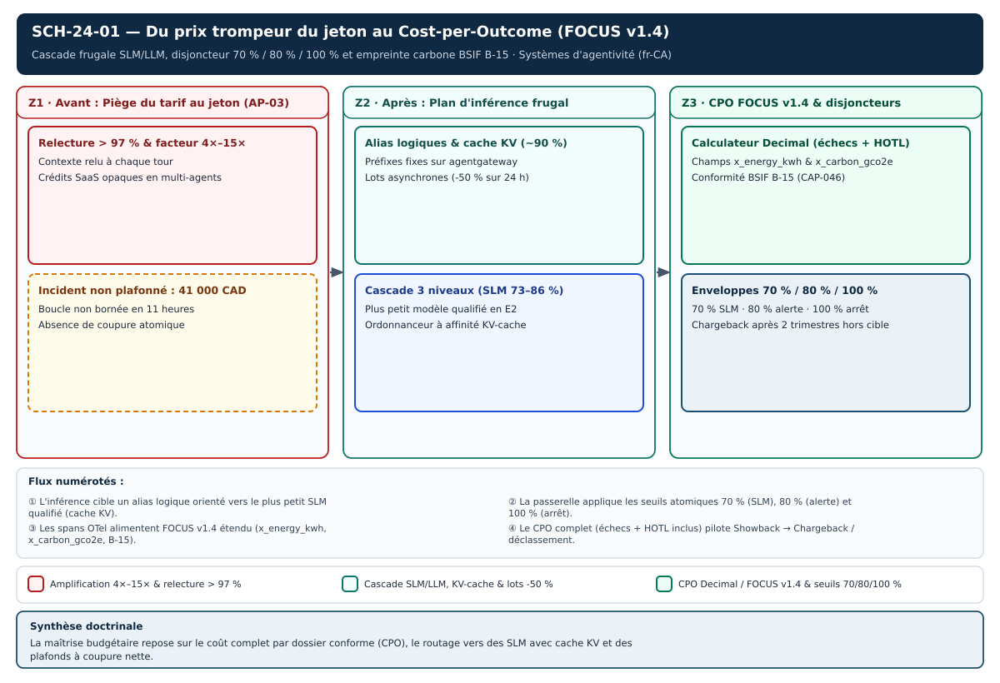
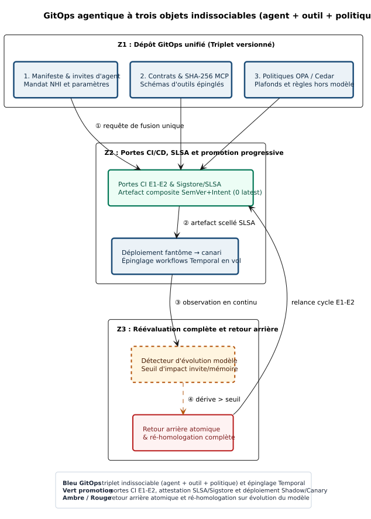
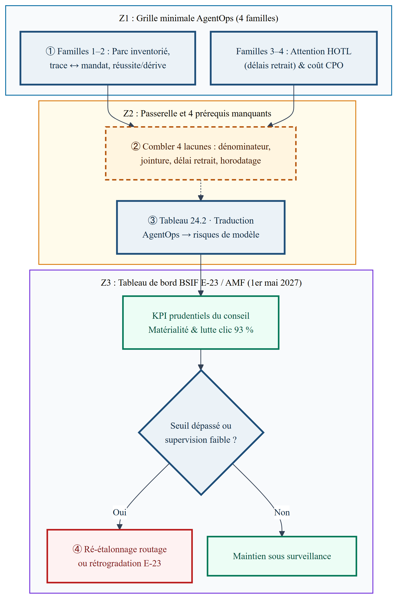

# Chapitre 24 — SRE agentique, FinOps FOCUS v1.4 au Cost-per-Outcome, routage frugal et comptabilité carbone

*Question directrice : Comment substituer au tarif trompeur du million de jetons un pilotage économique exact par résultat métier conforme, armé de disjoncteurs budgétaires atomiques, d'un routage frugal à affinité de cache et d'une comptabilité carbone opposable jusqu'aux indicateurs prudentiels du conseil ?*

Un système agentique peut afficher des sondes de disponibilité irréprochables et réussir ses bancs fonctionnels tout en détruisant sa rentabilité économique en quelques heures d'exploitation. Dans une boucle multi-tours non bornée, l'accumulation répétitive du contexte système, des schémas d'outils `MCP` et des échanges intermédiaires entraîne une explosion volumétrique : sur un banc externe d'extraction documentaire du repérage antérieur (hors socle `L+`), plus de `97 %` des jetons facturés proviennent de la relecture du préambule et de l'historique. Des mesures internes d'éditeur du même repérage chiffrent la consommation à `~4×` pour un agent unique et `~15×` en multi-agents face à une conversation simple. Illustrée par le scénario synthétique de boucle nocturne ayant consommé `41 000 $ CA` en `11` heures faute de plafond atomique (fil rouge hors preuve empirique), cette vulnérabilité exige d'ériger le contrôle budgétaire en invariant d'architecture de premier ordre.

Ce chapitre clôt le domaine D08 au gel documentaire du `2 décembre 2026`. Il s'appuie sur les compteurs de jetons et centres de coûts issus de la télémétrie `OpenTelemetry GenAI` (← Chapitre 22) ainsi que sur la qualification des petits modèles spécialisés issue des bancs `EvalOps` (← Chapitre 23). Sur cette base, il établit le calcul en arithmétique décimale exacte du **Coût par résultat conforme** (`CPO`) sur `FinOps FOCUS v1.4` [1], les enveloppes budgétaires à coupure nette, le plan d'inférence frugal à alias logiques, la comptabilité énergétique portée 3 pour la ligne directrice `BSIF B-15` [4], le `GitOps` à trois objets et la traduction des indicateurs `AgentOps` vers les programmes de risque de modèle `BSIF E-23` et `AMF`. Conformément à l'anti-objectif `AO-01`, les sources bloquées en accès (`gartner.com` et `iso.org`, `HTTP 403`) restent consignées en `statut F` hors évidence primaire, et toute analyse prudentielle s'inscrit sous statut pédagogique `non-avis` (`AO-05`).

## 24.1 Résumé exécutif : gouverner par le coût complet, la frugalité et l'opposabilité

Quatre mécanismes soudent la gouvernance économique et l'ingénierie de fiabilité (`SRE` agentique) (`EXIG-FIN-01` à `EXIG-FIN-10`, `EXIG-ARC-08`, `EXIG-ARC-09`, `PRI-014`, `CAP-029`, `CAP-034`, `CAP-045`, `CAP-046`, `DEC-006`, `DEC-011`, `ADR-014`, `ADR-015`, `ADR-023`, `PRR O-09`, `PRR O-12`, `PRR O-13`). Premièrement, l'antipatron consistant à comparer des modèles selon le prix facial affiché au million de jetons (`AP-03`) est banni au profit du **coût complet par résultat conforme** (`CPO` en dollars canadiens, calculé exclusivement en arithmétique `Decimal` exacte sans flottant `IEEE-754`). Cette formule du cadre (`EXIG-FIN-01`, `EXIG-FIN-02`) agrège réessais, échecs, évaluation, confinement et charge de supervision humaine `HOTL` sur des factures normalisées `FOCUS v1.4` [1] et des grilles tarifaires révisées trimestriellement.

Deuxièmement, tout appel d'inférence transite par une passerelle d'alias logiques appliquant un routage frugal à trois paliers qualifié en `E2`. D'après Belcak et collaborateurs [5], des petits modèles spécialisés (`SLM`) peuvent absorber `40 %` à `70 %` des requêtes dans leurs trois études de cas, avec une économie estimée de `10×` à `30×` (`7B` contre `70–175B`). Les taux de `73 %` à `86 %` restent des cibles illustratives du cas synthétique Boréal, hors preuve empirique. La passerelle assure aussi l'ordonnancement par affinité de cache clé-valeur (`KV-cache`, jusqu'à `~90 %` d'abattement de lecture selon les grilles du repérage antérieur), les lots asynchrones (`-50 %` sur `24` heures selon ce repérage) et les disjoncteurs du cadre (`70 %` repli `SLM` sous `ADR-023`, `80 %` alerte et `100 %` arrêt propre sous `EXIG-FIN-04`/`05` hors compensations `Saga`).

Troisièmement, l'imputation financière unifie les attributs `OpenTelemetry` (`gen_ai.usage.*` [2, 3], `ca.entreprise.cost_center`) et le schéma normalisé `FOCUS v1.4` [1] étendu via son mécanisme `x_` aux champs `x_energy_kwh` et `x_carbon_gco2e` (`CAP-046`). Elle pilote la transition du `Showback` (`POR-004`) vers le `Chargeback` (`POR-009`), la revue de valeur après deux mois hors cible (`EXIG-FIN-10`) et le déclassement après deux trimestres déficitaires (`POR-016`), tout en préparant la divulgation climatique de portée 3 prévue pour l'exercice `2028` (`fin 2028`) sous `BSIF B-15` [4]. Quatrièmement, l'exploitation du parc repose sur un dépôt `GitOps` à trois objets indissociables et sur une grille minimale `AgentOps` à quatre familles traduite vers les attentes prudentielles du `1er mai 2027` (`BSIF E-23` et `AMF`).

## 24.2 Ingénierie FinOps FOCUS, plan d'inférence frugal et SRE agentique

### 24.2.1 Pilotage au Cost-per-Outcome (FOCUS v1.4), routage frugal et comptabilité carbone

Le prix public du million de jetons constitue un indicateur trompeur pour piloter une architecture agentique (`AP-03`). Dans une boucle multi-tours `ReAct` de `T` étapes sans compaction ni cache, chaque itération ré-expédie le préambule initial `P` augmenté des sorties et retours d'outils précédents. Avec un ajout moyen \(\Delta\) par tour, la consommation cumulée croît de manière quadratique en \(T \times P + \Delta \times T(T - 1) / 2\), si bien que plus de `97 %` des jetons d'une extraction séquentielle relèvent de la relecture du contexte sur le banc de dépôts réglementaires du repérage antérieur (hors socle `L+`). À cette dérive en \(O(T^2)\) s'ajoutent, d'après les repères fournisseurs hors socle `L+`, une asymétrie entrée/sortie jusqu'à `5×`, un écart atteignant `35 %` entre segmenteurs d'un même fournisseur et une consommation de `~4×` pour un agent unique et `~15×` en multi-agents face au clavardage.

De plus, un modèle à bas coût unitaire qui échoue fréquemment ou multiplie les réparations de schémas double ou triple le coût réel d'une transaction aboutie. Les crédits propriétaires des suites `SaaS` (tels les crédits facturés à l'action ou par palier de capacité) masquent eux aussi le prix véritable par dossier tant qu'ils ne sont pas convertis en dollars canadiens et plafonnés (`EXIG-FIN-03`, avec seuil d'alerte avant des paliers de désactivation tel le seuil à `125 %` de capacité prépayée relevé sur une offre `SaaS` au repérage antérieur). L'architecture substitue donc à ces métriques partielles le **Coût par résultat conforme** (`CPO`, `PRI-014`, `CAP-045`, `DEC-011`, `EXIG-FIN-01`, `EXIG-FIN-02`) :

\[\text{CPO} = \frac{C_{\text{inférence}} + C_{\text{reprises/échecs}} + C_{\text{évaluation}} + C_{\text{sécurité/audit}} + C_{\text{supervision HOTL}}}{N_{\text{résultats conformes non rouverts}}}\]

Le numérateur agrège le coût total de possession (`TCO`) à cinq postes sur la période : inférence nominale, jetons perdus en réessais, campagnes `E1–E3`, confinement microVM et ancrage `SCITT` incluant les plans de sortie `BSIF B-10` [6], et temps humain de revue `HOTL`. Le dénominateur ne retient que les dossiers ayant satisfait les règles métier et politiques sans réouverture ni litige (`compliant_outcomes ≥ 1`). Un agent bon marché qui réussit `95 %` de ses appels unitaires mais échoue sur une séquence multi-étapes voit son coût par dossier multiplié par les reprises manuelles et les compensations `Saga` ; le `CPO` rend immédiatement visible cette dérive cachée.

Le retour sur investissement ajusté du risque (méthode `EF-13`) rapporte ensuite les gains métier nets à ce `TCO` majoré du coût espéré des incidents résiduels. Tout calcul financier et d'imputation est exécuté exclusivement en arithmétique `Decimal` exacte, rejetant par `TypeError` tout flottant binaire `IEEE-754`, comme le vérifie en `G0` la fonction `compute_cpo_and_focus` dans `authz_pqc_audit/audit_scitt_focus.py` sur les champs `EffectiveCost` et `BilledCost` des enregistrements `FOCUS` [1]. Les grilles tarifaires des fournisseurs et les taux de change vers le dollar canadien sont versionnés et révisés au minimum chaque trimestre afin de préserver la comparabilité historique des séries.

Pour empêcher toute dérive nocturne ou attaque par épuisement de portefeuille (*Denial of Wallet*), la passerelle de modèles détient seule, côté serveur, l'état atomique des enveloppes budgétaires indexées par identifiant de tâche (`EXIG-FIN-04`) et des plafonds mensuels par agent (`EXIG-FIN-05`). À la différence des simples compteurs de débit approximatifs, chaque appel réserve atomiquement son coût maximal avant exécution puis ajuste la décrémentation au coût réel, sans jamais réinitialiser l'enveloppe lors d'une délégation à un sous-agent. Trois seuils gradués propres au cadre gouvernent cette barrière (`EXIG-FIN-04`, `EXIG-FIN-05`, `ADR-023`) :

1. **À `70 %` de l'enveloppe** : la passerelle bascule automatiquement le routage vers le palier `SLM` de repli qualifié pour achever la tâche à moindre coût.
2. **À `80 %` d'un plafond de tâche ou mensuel** : une alerte est émise vers le responsable technique et le parrain métier.
3. **À `100 %`** : la passerelle stoppe proprement toute progression vers l'avant par un refus typé « budget épuisé », tout en préservant l'achèvement des compensations `Saga` en cours sur leur canal isolé doté d'une réserve dédiée (← Chapitre 15).

Sur les `20 %` de charge cognitive restants après déport déterministe (`80/20`, ← Chapitre 04), le plan d'inférence derrière alias logiques (`CAP-029`, `DEC-006`, `EXIG-ARC-08`, `EXIG-ARC-09`, `EXIG-FIN-06` à `EXIG-FIN-08`) empile quatre leviers de sobriété vérifiés :

- **Routage frugal à trois paliers qualifié en `E2`** : chaque étape est adressée via un alias logique (jamais un identifiant de modèle codé en dur) vers le plus petit modèle homologué atteignant les seuils de constance `pass^k` (`EXIG-FIN-06`). Comme l'argumentent Belcak et collaborateurs (`arXiv:2506.02153`, juin 2025), des petits modèles spécialisés (`SLM`) suffisent pour la majorité des sous-tâches agentiques répétitives et bornées [5]. Leurs trois études de cas estiment `40 %` à `70 %` de requêtes transférables (`40 %` sur *Open Operator*, `60 %` sur *MetaGPT*, `70 %` sur *Cradle*), avec une économie de calcul, de latence et d'énergie de `10×` à `30×` pour `7` milliards de paramètres face à `70–175` milliards [5]. Les taux de `73 %` à `86 %` du cas synthétique Boréal (Figure 76) restent des cibles illustratives hors preuve empirique, réservant les modèles frontières aux arbitrages complexes. Sur déclenchement des signaux d'échelle (`SIG-015`, `SIG-016`), la distillation `Multi-LoRA` sous porte `pass^5` (← Chapitre 23) renforce cette part locale (`CAP-034`).
- **Ordonnancement par affinité `KV-cache` et préfixe fixe** : les invites sont assemblées du plus stable au plus variable (outils `MCP` triés, instructions système, documents récurrents, requête) pour maximiser le réemploi clé-valeur (jusqu'à `~90 %` d'abattement selon les grilles fournisseurs du repérage antérieur, soit `1/10` à `1/40` du tarif d'entrée, mesuré par `gen_ai.usage.cache_read.input_tokens` [2, 3]). L'ordonnanceur dirige les requêtes partageant un préfixe vers la réplique chaude correspondante (`TTFT` réduit), et toute baisse de plus de `20` points en cache sur `7` jours ouvre une analyse (`EXIG-FIN-07`).
- **Cache sémantique vectoriel borné** : pour les requêtes consultatives homogènes, une recherche par similarité cosinus sous contrôle d'accès `ACL` et durée de vie courte évite l'appel au modèle lors de répétitions exactes ou quasi exactes (sans taux d'économie préjugé sans mesure locale).
- **Traitement par lots asynchrones et arbitrage capacité** : les charges différables jusqu'à `24` heures basculent vers les lots asynchrones (`-50 %` selon les grilles fournisseurs du repérage antérieur, `EXIG-FIN-08`). Pour les charges `24/7`, un socle en unités de débit provisionnées (`PTU`) garantit la latence nominale tout en débordant (*spillover*) vers le paiement à l'usage (`PAYG`) lors des pointes.

Le suivi comptable et environnemental repose sur l'appariement de la télémétrie `OpenTelemetry GenAI` et de la spécification **FinOps Open Cost and Usage Specification (FOCUS) v1.4** (publiée le `4 juin 2026` par la *FinOps Foundation* [1], épinglée sous veille `FOCUS v1.5`). L'adaptateur d'imputation joint les compteurs normalisés de jetons (entrée, sortie, lecture en cache et écriture — nommée `cache_creation` en `v1.41.0` [2], puis `cache_write` dans `semantic-conventions-genai` [3]) et `ca.entreprise.cost_center` (`EXIG-FIN-09`) au format `FOCUS v1.4` [1]. Celui-ci normalise dix colonnes retenues par le cadre (`BillingAccountId`, `PricingCurrency`, `ChargePeriodStart`, `ChargePeriodEnd`, `ServiceName`, `ResourceId`, `EffectiveCost`, `BilledCost`, `ConsumedQuantity`, `ConsumedUnit`), avec `ServiceProviderName` et `HostProviderName` en remplacement de `ProviderName` retirée dès la `v1.3` [1], tandis que `focus_carbon_record.schema.json` (`G0`) conserve le champ hérité `ProviderName`.

Deux exigences transversales viennent sceller ce modèle de données. D'abord, face à l'accroissement potentiel de la demande électrique des centres de données (fourchette haute de `700` à `1 700 TWh` projetée pour `2035` par l'Agence internationale de l'énergie, reprise sous contrainte `SIG-016` hors socle `L+`), la ligne directrice **BSIF B-15** (*Climate Risk Management*, `7 mars 2025` [4], `ANC-106`) impose la divulgation des émissions absolues brutes de portée 3 dès l'exercice financier `2028` (`fin 2028`). Pour satisfaire cette échéance, chaque enregistrement `FOCUS v1.4` exploite le mécanisme d'extension `x_` prévu par la spécification [1] pour inclure obligatoirement les champs `x_energy_kwh` et `x_carbon_gco2e` par entité juridique (`CAP-046`, validés par le schéma strict `focus_carbon_record.schema.json` en `G0`) [1, 4]. Le calcul associe la consommation électrique estimée par modèle et région d'hébergement au facteur d'intensité carbone du réseau concerné — distinguant l'hydroélectricité à très faible intensité (telle celle du Québec) des réseaux thermiques plus carbonés — tout en exigeant des fournisseurs des mesures par requête, les facteurs d'émissions de portée 3 par inférence demeurant partiellement opaques au gel (`SIG-016`).

Ensuite, la gouvernance applique une trajectoire de responsabilisation en deux temps : refacturation transparente informative (*Showback*, `POR-004`) durant la phase d'observation initiale, puis imputation comptable réelle (*Chargeback*, `POR-009`) une fois les règles d'allocation `FOCUS` stabilisées et acceptées par les unités d'affaires. Ce passage au `Chargeback` s'accompagne d'une revue de valeur dès qu'un agent excède son `CPO` cible pendant deux mois civils consécutifs (`EXIG-FIN-10`) et d'un déclassement ou d'une reconception après deux trimestres déficitaires (`POR-016`) sans redressement prouvé par le routage `SLM` ou l'optimisation de cache. Ce suivi économique s'articule directement avec les inventaires de tiers, plans de continuité et clauses de sortie réversibles de la ligne directrice `BSIF B-10` [6], ainsi qu'avec les obligations en vigueur depuis le `22 septembre 2023` (`Loi 25 art. 12.1`) et les jalons futurs de sécurité et de cryptographie (`15 mars 2027`, `15 mars 2029` et `2030–2035`).

*Figure 76 — SCH-24-01 : Comparatif opposant l'inflation volumétrique du tarif facial au jeton (Z1, scénario illustratif Boréal à `41 000 $ CA`) à l'architecture frugale par alias logiques, cache KV et cascade SLM 40–70 % (cible Boréal 73–86 %, Z2), pilotée en Decimal exact sur FOCUS v1.4 carbone avec disjoncteurs 70 % / 80 % / 100 % hors Saga et déclassement après deux trimestres déficitaires (Z3).*

| Levier FinOps / Carbone | Mécanisme et contrat technique | Gain ou seuil vérifié | Règle d'arbitrage et exigence |
|---|---|---|---|
| **Calculateur `CPO` `Decimal`** (`FOCUS v1.4`) | Somme exacte des `5` postes sur `compliant_outcomes ≥ 1` (`G0`) [1] | Rejet `float` `IEEE-754` ; `10` col. `FOCUS` (+ `ProviderName` `G0`) + `x_energy_kwh` / `x_carbon_gco2e` [1, 4] | `EXIG-FIN-01..03`, `CAP-045/046`, `BSIF B-15` fin `2028` [4] |
| **Enveloppes atomiques passerelle** | Réservation avant appel ; compteur central par `task_id` et mois | Repli `SLM` `70 %` (`ADR-023`), alerte `80 %`, arrêt propre `100 %` | `EXIG-FIN-04/05` ; réserve `Saga` isolée préservée |
| **Cascade `SLM` + cache `KV` + lots** | Alias logiques (`CAP-029`), préfixe stable (`OTel` [2, 3]), lots `24` h, `PTU` + `PAYG` | `SLM` `40–70 %` (`10×–30×` `7B` vs `70–175B` [5] ; cible Boréal `73–86 %`), cache `~90 %` et lots `-50 %` (repérage hors `L+`) | `EXIG-FIN-06..08` ; alerte cache `> 20` pts / `7` j |
| **Imputation et revue de valeur** | Jointure `OTel` (`cost_center`) ↔ `FOCUS` → `Showback` → `Chargeback` [1, 2] | Conversion crédits `SaaS` ; revue à `2` mois, déclassement à `2` trimestres | `EXIG-FIN-09/10`, `POR-004/009/016`, `BSIF B-10` [6] |

*Tableau 24.1 — Architecture FinOps FOCUS v1.4 au Cost-per-Outcome, disjoncteurs et comptabilité carbone CAP-046.*

### 24.2.2 SRE agentique : GitOps à trois objets et grille AgentOps vers BSIF E-23 / AMF

La fiabilité d'exploitation (`SRE` agentique) complète le pilotage économique en rattachant la performance technique aux budgets d'erreur et au cycle de vie déclaratif du parc. Aux métriques d'infrastructure — latence au premier jeton (`TTFT`), temps par jeton de sortie (`TPOT`), taux d'erreurs `429`/`5xx` et durée globale — s'ajoutent les `SLI` comportementaux mesurant la conformité `JSON Schema` au premier essai, la validité des appels d'outils et l'absence de violation de garde-fou.

Sur un objectif de niveau de service (`SLO`) mensuel fixé à `99,9 %` — soit un budget d'erreur résiduel de `0,1 %` — les équipes configurent des alertes multi-fenêtres sur vitesse de consommation (*burn rate*) selon le modèle du *Google SRE Workbook* (repris au Tome 6 § 11.3.2, hors socle `L+`) afin d'éviter la fatigue d'alerte. Une accélération critique de `14,4×` observée simultanément sur une fenêtre courte de `5` minutes et une fenêtre longue de `1` heure (épuisant `2 %` du budget mensuel) déclenche une pagination immédiate ; un rythme de `6×` sur `30` minutes et `6` heures (`5 %` du budget) alerte également l'équipe de garde, tandis qu'une dérive modérée de `1×` sur `6` heures et `3` jours (`10 %`) génère un billet d'analyse asynchrone.

Lorsqu'un incident survient, le diagnostic sépare strictement deux patrons de référence du Tome 6 (§ 11.3.4, hors socle `L+`) : le rejeu déterministe à coût nul sur historique d'orchestration (`Temporal Replayer`, validant l'absence de non-déterminisme de code sans rappeler les modèles) et la bifurcation cognitive (`LangGraph Time Travel`), laquelle ré-exécute les nœuds en aval et DOIT impérativement rester confinée dans le banc hermétique `MockMcpServer` (← Chapitre 23). Sans cette frontière stricte, une séance de débogage interactive pourrait déclencher une seconde vague d'appels `P2`/`P3` vers les systèmes d'enregistrement réels ou fausser les journaux d'audit probatoire.

Pour que toute anomalie permette un retour en arrière rapide et opposable, l'exploitation interdit le déploiement indépendant d'invites, d'outils ou de politiques. Chaque agent en production est gouverné par un modèle **GitOps à trois objets indissociables** (patron synthétisé des Tomes 3 et 6, hors socle `L+` hors `BSIF B-10` [6]) versionnés atomiquement dans un même dépôt déclaratif sous étiquette immuable `SemVer+Intent` (zéro `latest`) :

1. le manifeste d'agent, son mandat `NHI` et ses invites ou signatures compilées ;
2. les contrats et empreintes `SHA-256` canonisées des schémas d'outils `MCP` ;
3. les règles de contrôle et plafonds hors modèle (`OPA`/`Rego` ou `Cedar`).

Toute modification soumise par requête de fusion traverse obligatoirement les portes CI `E1–E2` (← Chapitre 23), reçoit une attestation cryptographique de chaîne logicielle (`SLSA`/`Sigstore`), puis progresse d'un déploiement fantôme vers un déploiement canari en épinglant la version antérieure pour les tâches durables `Temporal` déjà en cours d'exécution (← Chapitre 15). Surtout, le processus définit un seuil de bascule critique : dès qu'une adaptation du contexte, des compétences déclaratives ou des poids/mémoires modifie la distribution décisionnelle au-delà des tolérances fixées, le changement cesse d'être un simple correctif d'exploitation et déclenche un retour arrière atomique doublé d'une ré-homologation complète. En cas de dérive sur une dépendance critique de fournisseur externe, le manuel d'exploitation active la procédure de réversibilité et de bascule documentée sous `BSIF B-10` [6], sans improvisation manuelle sur les environnements de production.

*Figure 77 — SCH-24-02 : Chaîne GitOps agentique réunissant le triplet indissociable agent + outil + politique (Z1), les portes CI E1–E2 et la promotion fantôme → canari avec épinglage Temporal (Z2), et le retour arrière atomique sur seuil de réévaluation (Z3).*

Reste à relier les capteurs techniques quotidiens d'exploitation aux exigences de gouvernance des dirigeants et des organismes de réglementation canadiens et québécois (`BSIF E-23` prenant effet le `1er mai 2027` et repère attendu côté `AMF` sous réserve documentaire `statut F`, → Chapitre 25). Pour combler le fossé entre métriques de bas niveau et gestion du risque de modèle, l'architecture instaure une **grille minimale AgentOps à quatre familles d'indicateurs** (construction d'auteur du Tome 1 § 40.2). Celle-ci inclut explicitement deux grandeurs d'attention humaine `HOTL` — le temps effectif d'examen avant approbation et le taux d'approbation sans modification — pour détecter l'acquiescement mécanique (taux de `~93 %` rapporté par un éditeur sur son agent de programmation hors socle `L+`, → Chapitre 33).

Par transparence méthodologique, le cadre identifie toutefois **quatre prérequis instrumentaux souvent absents** des outils génériques du marché et devant impérativement être construits dans le noyau possédé de l'entreprise avant le passage aux indicateurs du conseil :

1. **Dénominateur exact du parc** : les conventions `OpenTelemetry GenAI` actuelles [2, 3] instrumentent des opérations unitaires (avec un nom lisible `gen_ai.agent.name` sans énumération globale de parc) ; seul le registre central d'agents (`CAP-047`) fournit le dénominateur des agents actifs identifiables.
2. **Clé de jointure trace ↔ mandat** : absente nativement d'`OTel` [2, 3], elle est fournie exclusivement par les quatre attributs obligatoires `ca.entreprise.*` (`lacune 21`, ← Chapitre 22).
3. **Délai mesuré de propagation de révocation** : aucune spécification protocolaire `A2A` ou `MCP` ne borne seule le délai de retrait ; l'automate `SSF`/`CAEP` branché au `PEP` (← Chapitre 17, ← Chapitre 21) instrumente la durée entre l'ordre de retrait et le dernier refus effectif.
4. **Horodatage d'évaluation exportable** : les plateformes d'évaluation tierces ne partageant pas d'identifiant unifié avec `OTel`, l'événement de convention `OpenTelemetry GenAI` `gen_ai.evaluation.result` (statut `Development`, `EXIG-EVA-04`) horodate l'âge de la dernière qualification `E2`/`E3` de chaque version déployée.

Une fois ces quatre manques instrumentés en propre, les capteurs `AgentOps` alimentent le tableau de bord de la direction et du comité des risques selon trois mouvements coordonnés vers le `1er mai 2027`. L'organisation commence par inventorier l'ensemble du parc et de ses dépendances (`BSIF B-10` [6], `E-23`), cote ensuite la matérialité de chaque flux et l'encadre par des bornes et budgets stricts, puis surveille en continu les écarts de performance, d'attention humaine et de coût complet pour déclencher un ré-étalonnage ou une rétrogradation d'autonomie. Chaque écart durable entre l'intention déclarée, la supervision humaine effective et la rentabilité mesurée devient ainsi un événement gouvernable, assorti d'un propriétaire nommé et d'un délai de remédiation vérifiable.

*Figure 78 — SCH-24-03 : Arbre de traduction reliant la grille minimale AgentOps à quatre familles (Z1) aux quatre lacunes d'instrumentation comblées par le noyau possédé (Z2, Tableau 24.2) pour alimenter les KPI prudentiels BSIF E-23 et AMF (Z3).*

| Famille `AgentOps` | Grandeurs techniques mesurées | Manque comblé par le noyau possédé | KPI prudentiel `BSIF E-23` / `AMF` (`1er mai 2027`) |
|---|---|---|---|
| **1. Disponibilité et inventaire du parc** | Agents identifiables, versions `SemVer+Intent` et triplet `GitOps` | Dénominateur fourni par le registre central (`OTel` unitaire sans inventaire de parc [2, 3]) | Couverture d'inventaire à l'échelle de l'entreprise et cote de risque inhérent |
| **2. Traçabilité et constance** | Couverture `trace ↔ mandat`, `TCR`, `TER`, `pass^k`, dérives `3+1` | Jointure à `4` clés `ca.entreprise.*` (`lacune 21`, ← Chapitre 22) | Surveillance continue des décisions autonomes, de la dérive et des dépendances |
| **3. Attention humaine et retrait (`HOTL`)** | Latence d'approbation `CIBA`, taux d'approbation sans modification, délai d'arrêt | Mesure bout-en-bout du retrait `SSF`/`CAEP` et de l'horodatage `E2`/`E3` | Effectivité de la supervision humaine (`anti-clic réflexe`) et temps d'endiguement |
| **4. Économie unitaire et carbone** | `CPO` `Decimal` (`FOCUS v1.4`), cache `KV`, `x_energy_kwh`, `x_carbon_gco2e` [1, 4] | Rapprochement `gen_ai.usage.*` + `cost_center` ↔ factures `FOCUS` [1, 2, 3] | Revue de valeur (`EXIG-FIN-10`), plans de sortie `B-10` [6] et portée 3 `B-15` [4] |

*Tableau 24.2 — Correspondance entre la grille minimale AgentOps à quatre familles et les indicateurs prudentiels BSIF E-23 / AMF.*

## 24.3 Synthèse architecturale, livrables et portes de contrôle

En clôturant le domaine D08, ce chapitre transforme les garanties architecturales des chapitres précédents en pilotage mesurable et soutenable. Il reçoit la sobriété topologique `OO1–OO4` et la maîtrise du multi-agent (← Chapitre 13), la partition `80/20` (← Chapitre 04), le routage et les passerelles centralisées (← Chapitre 09), ainsi que le compilateur de contexte à préfixe `KV-cache` fixe (← Chapitre 10). Il s'articule également avec la réserve de compensation `Saga` et les cinq plafonds `EXIG-ORC-26` (← Chapitre 15), la défense par maillage `PEP`/`PDP` et les coupe-circuits `< 10 s` (`POR-003`, ← Chapitre 20, ← Chapitre 21), les spans `OpenTelemetry` normalisés (← Chapitre 22) et les modèles `SLM` distillés et qualifiés en `E2` (← Chapitre 23). En aval, il prépare les dossiers de conformité prudentielle canadiens et européens de la **Partie IX (`D09`)**, l'échéance `BSIF B-15` fin `2028` et les exercices de réversibilité (→ Partie IX, Chapitre 25, → Chapitre 26, → Chapitre 27), alimente la fabrique `GitOps` (→ Chapitre 30) et fonde l'imputabilité budgétaire et les revues de valeur du modèle opérationnel en étoile à trois lignes (→ Chapitre 32).

| Livrable d'ingénierie | Exigences et capacités couvertes | Critère de vérification exécutable (`G0`–`G1`) |
|---|---|---|
| Calculateur `CPO` `Decimal` & schéma `FOCUS v1.4` carbone | `EXIG-FIN-01..03`, `EXIG-FIN-09/10`, `PRI-014`, `CAP-045/046`, `DEC-011`, `ADR-023` | `compute_cpo_and_focus` (`audit_scitt_focus.py`, `G0`) + `focus_carbon_record.schema.json` (`x_energy_kwh`, `x_carbon_gco2e`) [1, 4] |
| Passerelle à alias logiques, cache `KV` et disjoncteurs | `EXIG-FIN-04..08`, `EXIG-ARC-08/09`, `CAP-029`, `CAP-034`, `DEC-006`, `ADR-014/015` | Cascade `3` paliers qualifiée `E2` (`SLM` `40–70 %` [5] ; cible Boréal `73–86 %`), préfixe stable (`OTel` cache [2, 3]), enveloppes `70 %` / `80 %` / `100 %` hors `Saga` |
| Dépôt `GitOps` à `3` objets et matrice `AgentOps → E-23/AMF` | `EXIG-EVA-06`, `POR-004`, `POR-009`, `POR-016`, `BSIF E-23`, `B-10`, `B-15` | Triplet versionné `SemVer+Intent`, épinglage `Temporal`, traduction des `4` familles `AgentOps` et revue après `2` périodes [4, 6] |

*Tableau 24.3 — Livrables d'ingénierie, exigences normatives et preuves exécutables du Chapitre 24.*

> **Trois invariants exécutables — Chapitre 24**
>
> 1. **Pilotage exact au `CPO` sur `FOCUS v1.4` carbone et zéro flottant binaire (`EXIG-FIN-01..03`, `CAP-045/046`)** : Toute décision tarifaire ou de modèle repose sur le coût complet par résultat conforme en dollars canadiens calculé en `Decimal` exact (échecs, évaluation et `HOTL` inclus sur factures `FOCUS v1.4` [1]), joint aux traces `OTel` [2, 3] (clé `ca.entreprise.cost_center`) et aux colonnes `x_` [1] (`x_energy_kwh`, `x_carbon_gco2e` en `G0`) pour `BSIF B-15` fin `2028` [4].
> 2. **Enveloppes atomiques passerelle et plan d'inférence frugal (`EXIG-FIN-04..08`, `CAP-029`)** : La passerelle d'alias logiques impose le plus petit modèle qualifié en `E2` (`40 %` à `70 %` de requêtes transférables et gain `10×` à `30×` pour `7B` vs `70–175B` [5]) et préserve les préfixes `KV-cache` [2, 3]. Elle exploite les lots asynchrones (`-50 %` selon repérage fournisseur) et exécute les seuils du cadre `70 %` (repli `SLM`), `80 %` (alerte) et `100 %` (arrêt propre hors compensations `Saga`).
> 3. **Triplet `GitOps` indissociable, grille `AgentOps` et déclassement économique (`EXIG-FIN-10`, `POR-016`)** : Manifeste d'agent, schémas `MCP` et politiques `OPA`/`Cedar` voyagent et reculent ensemble sous `SemVer+Intent` ; les `4` familles `AgentOps` (incluant l'attention humaine `HOTL`) alimentent le suivi `BSIF E-23` / `AMF` (avec réversibilité `BSIF B-10` [6]), tandis que deux mois hors `CPO` ouvrent une revue de valeur et deux trimestres déficitaires déclenchent le déclassement.
