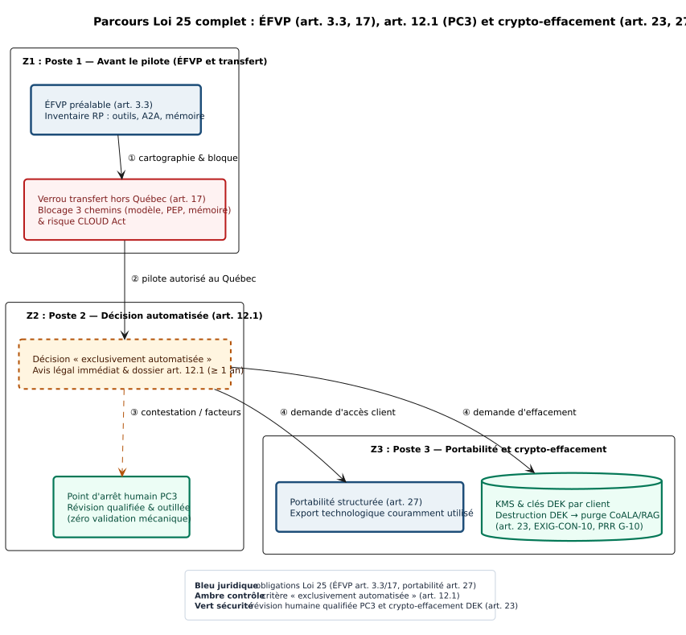
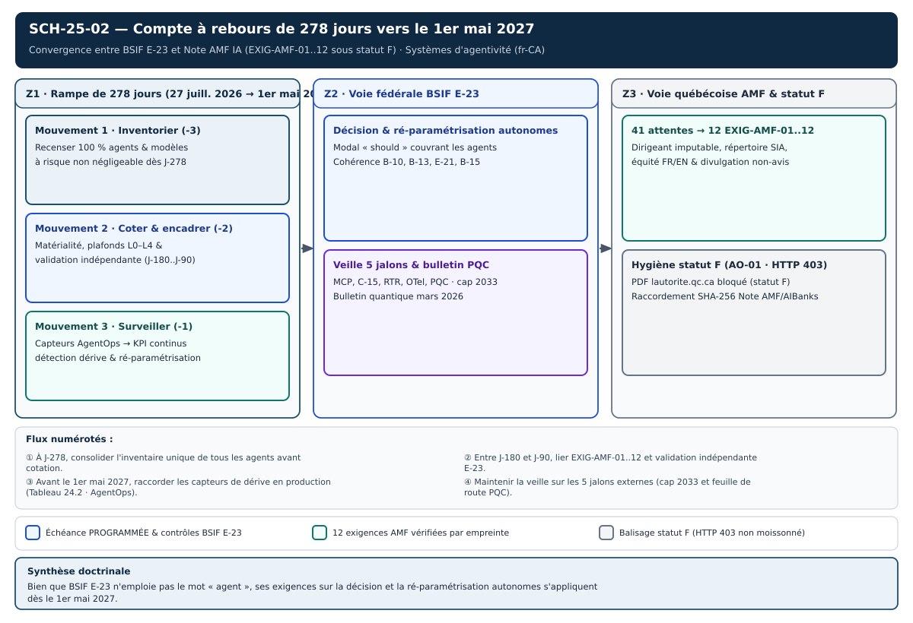
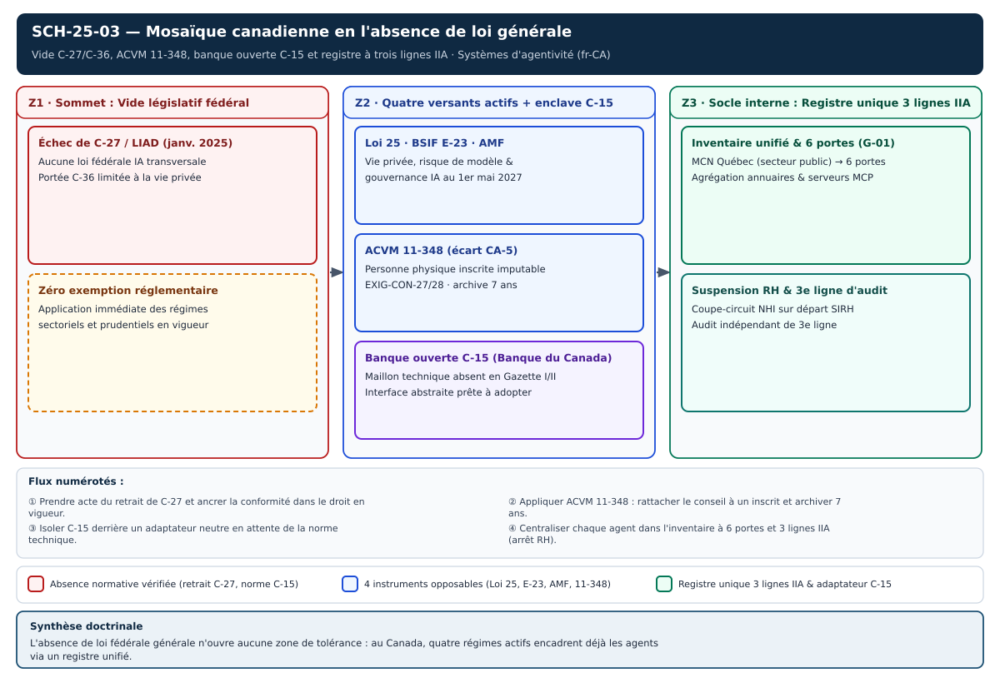

# Chapitre 25 — Droit québécois et cadre prudentiel financier canadien

*Question directrice : Comment traduire les obligations en vigueur de la Loi 25, les attentes prudentielles convergentes du BSIF et de l'AMF pour le 1er mai 2027 et le droit canadien des valeurs mobilières en garanties architecturales vérifiables malgré l'absence de loi fédérale générale sur l'intelligence artificielle ?*

L'observabilité probatoire, les bancs d'évaluation hermétiques et le pilotage FinOps de la Partie VIII (← Chapitres 22 à 24) ne forment pas un exercice d'instrumentation autonome. Ces mécanismes constituent la matière première exigée par les régimes juridiques et prudentiels qui encadrent les Systèmes d'agentivité au Québec et au Canada. Contrairement à une idée répandue, l'échec du projet de loi fédéral C-27 ne crée aucune zone de tolérance pour les déploiements d'agents autonomes en entreprise. Quatre instruments positifs ou prudentiels — la Loi 25 au Québec [1], la Ligne directrice E-23 du BSIF [3], l'encadrement de l'AMF (corroboré sous réserve `statut F` [7]) et le droit des valeurs mobilières (Avis 11-348 et Norme canadienne 31-103 [8]) — encadrent déjà ou saisiront au 1er mai 2027 les systèmes agentiques par les données traitées, les décisions rendues et les risques de modélisation.

Ce chapitre ouvre le domaine D09 en établissant le socle juridique québécois et prudentiel canadien arrêté au gel documentaire du 2 décembre 2026. Sous la clause impérative `non-avis` (`AO-05`), l'exposé décrit des exigences d'architecture et des repères normatifs à titre strictement technique et pédagogique. Il n'emporte aucune valeur d'avis juridique ni de certification réglementaire, toute qualification d'espèce relevant d'un conseiller juridique habilité. Conformément à la discipline probatoire `AO-01`, les sources primaires accessibles au statut L+ [1, 2, 3, 4, 5, 6, 7, 8, 9] fondent chaque énoncé. Les portails bloqués par code HTTP 403 (`lautorite.qc.ca`, `legisquebec.gouv.qc.ca`, `ciro.ca` et `securities-administrators.ca`) restent strictement consignés en statut F et exclus de l'évidence directe.

## 25.1 Résumé exécutif : Loi 25, échéance du 1er mai 2027 et mosaïque canadienne

Quatre constats directeurs structurent la conformité canadienne et québécoise des Systèmes d'agentivité. Premièrement, au Québec, l'article 12.1 introduit par la Loi 25 (`LQ 2021, c. 25`) au régime du secteur privé s'applique déjà pleinement depuis le 22 septembre 2023 [1]. Lorsqu'un agent produit une **décision fondée exclusivement sur un traitement automatisé** impliquant des renseignements personnels (RP), l'organisation informe la personne concernée au moment même de lui notifier cette décision (`EXIG-CON-07`, `PRR G-06`) [1]. Sur demande de cette personne, l'entreprise divulgue les RP exploités, les motifs et paramètres déterminants sous-tendant le résultat, ainsi que le droit de rectification. La personne dispose en outre du droit de soumettre ses arguments à un employé disposant du pouvoir de modifier cette décision (`EXIG-CON-08`) [1].

À ces obligations s'ajoutent l'ÉFVP préalable obligatoire (articles 3.3 et 17), l'effacement ou l'anonymisation vérifiable en mémoire et dans les index vectoriels (article 23, `EXIG-CON-10`, `PRR G-10`) et le droit à la portabilité structurée en vigueur depuis le 22 septembre 2024 (article 27) [1]. Les manquements exposent l'entreprise à des sanctions administratives pécuniaires atteignant `10 M\$ CA` ou `2 %` du chiffre d'affaires mondial et à des amendes pénales atteignant `25 M\$ CA` ou `4 %` (`C37`, `CAP-003`) [1, 2].

Deuxièmement, le 1er mai 2027 forme une échéance prudentielle convergente pour le secteur financier canadien. Publiée le 11 septembre 2025, la version révisée de la Ligne directrice E-23 publiée par le Bureau du surintendant des institutions financières (BSIF) s'applique dès le 1er mai 2027 aux institutions financières fédérales [3]. Sans jamais nommer « agent » ni « agentique », sa définition fonctionnelle de « modèle » englobe les méthodes d'IA et vise la prise de décision autonome et le reparamétrage autonome [3], convergence renforcée par le bulletin agentique du BSIF [4]. Le même jour, au Québec, l'encadrement IA de l'Autorité des marchés financiers (AMF) prend effet selon le repère corroboré sous réserve documentaire via `AIBanks.ca` (`statut F` sur `lautorite.qc.ca`) [7], que le profil interne `CRE-IA-2026-01-QC` traduit en douze exigences `EXIG-AMF-01` à `EXIG-AMF-12`. Pour ordonner les attentes d'inventaire, de cotation et de suivi [3, 4], le cadre structure une feuille de route interne de `278` jours (du 27 juillet 2026 au 1er mai 2027).

Troisièmement, la prorogation parlementaire du 6 janvier 2025 a éteint le projet de loi C-27 (qui englobait la *Loi sur l'intelligence artificielle et les données*, LIAD) [2], et le projet de loi C-36 (15 juin 2026) réforme la vie privée sans créer de loi fédérale autonome sur l'IA. Ce vide législatif spécifique déplace la charge vers les régimes généraux et sectoriels. Il est complété en valeurs mobilières par la Norme canadienne 31-103 et les travaux de l'OCRI [8], par le repère de l'Avis 11-348 (`statut F` sur `securities-administrators.ca`) et les exigences `EXIG-CON-27` et `EXIG-CON-28`, puis en banque ouverte par la *Loi sur les services bancaires axés sur les consommateurs* (issue du projet C-15, `L.C. 2026, ch. 3`) sous l'autorité de la Banque du Canada [9].

Quatrièmement, le respect simultané de ces régimes repose sur un registre unifié des agents articulé au modèle à trois lignes de défense de l'IIA (`PRR G-01`). Ce registre automatise la suspension des mandats non humains lors d'un départ des ressources humaines et trace les six portes du cycle de vie. Il maintient également une séparation nette entre les obligations légales visant les entreprises privées et les guides administratifs du secteur public québécois (MCN) ou fédéral.

## 25.2 Droit québécois et cadre prudentiel canadien

### 25.2.1 Droit québécois : Loi 25, ÉFVP et encadrement de l'AMF

La Loi 25 (`LQ 2021, c. 25`), sanctionnée le 22 septembre 2021, refond en profondeur l'encadrement applicable aux renseignements personnels détenus par les entreprises privées au Québec (`RLRQ, c. P-39.1`). Le portail consolidé `legisquebec.gouv.qc.ca` demeurant exclu en statut F, l'analyse probante s'appuie en statut L+ sur la loi modificative sanctionnée [1] et sur le rapport quinquennal 2026 de la CAI [2]. Les dispositions centrales se sont déployées en trois vagues : d'abord le 22 septembre 2022 s'agissant de la désignation du responsable de la protection des renseignements personnels (RPRP, article 3.1) et de la gestion des incidents (articles 3.5 à 3.8) [1]. Sont ensuite entrés en vigueur le 22 septembre 2023 l'évaluation des facteurs relatifs à la vie privée (ÉFVP, articles 3.3 et 17), les règles sur les décisions automatisées (article 12.1) et l'obligation de destruction ou d'anonymisation (article 23), suivis le 22 septembre 2024 par le droit à la portabilité des données informatisées recueillies auprès de la personne (article 27) [1, 2].

Un principe d'imputabilité commande toute l'architecture : l'organisation demeure légalement responsable des renseignements personnels qu'elle détient même lorsqu'elle en confie le traitement ou la conservation à un fournisseur de modèle, à une plateforme d'orchestration ou à un serveur MCP tiers [1]. La loi ne reconnaît aucune responsabilité partagée permettant de reporter la faute sur l'éditeur. Elle impose au contraire un mandat ou contrat de service écrit (article 18.3) encadrant la confidentialité, la limitation stricte à la finalité du mandat, l'absence de conservation après échéance et l'avis sans délai de toute violation [1] (→ Chapitre 27).

Sur le plan de la conception préalable, les articles 3.3 et 17 imposent l'achèvement d'une ÉFVP avant toute initiative visant à acquérir, bâtir ou remanier un système informatique traitant des RP, ainsi qu'avant toute communication de RP à l'extérieur du Québec [1]. L'exigence `EXIG-CON-04` (`PRR G-05`) proscrit le lancement de tout pilote agentique avant l'approbation de cette ÉFVP, avec consultation obligatoire du RPRP dès l'amorce du projet. Parce qu'un agent fragmente la circulation de la donnée bien au-delà d'une base relationnelle classique, l'ÉFVP recense les RP outil par outil, délégation par délégation et compartiment mémoire par compartiment mémoire. Dans son rapport quinquennal publié en mai 2026, la Commission d'accès à l'information du Québec (CAI) recommande explicitement (Recommandation 45) d'accompagner toute ÉFVP visant une décision automatisée concernant une personne d'une analyse d'impact algorithmique couvrant les biais et les risques sur les droits [2]. Le cadre intègre cette recommandation dès l'EXIG-CON-04 et l'évaluation d'impact unifiée (→ Chapitre 26).

La portée territoriale de l'article 17 crée un verrou architectural majeur. Toute communication vers l'extérieur du Québec — y compris vers une autre province canadienne comme l'Ontario — déclenche l'obligation d'ÉFVP préalable évaluant la sensibilité des données, la finalité, les mesures contractuelles et le régime juridique de l'État de destination, afin de confirmer une protection adéquate avant la signature d'une entente écrite [1]. Or un agent appelle des modèles d'inférence, consulte des index vectoriels et émet des traces télémétriques. En vertu d'EXIG-CON-05 (`PRR G-05`) et d'EXIG-APP-11, la passerelle de modèles, la passerelle d'agents (`PEP`, → Chapitre 09) et le plan mémoire bloquent techniquement par routage déclaré toute sortie hors Québec dépourvue d'ÉFVP approuvée.

Dans l'analyse de risque interne (`Tome 2 § 12.2`, hors corpus `L+`), cette contrainte vise directement l'exposition extraterritoriale au *Clarifying Lawful Overseas Use of Data Act* (`CLOUD Act`, `18 U.S.C. § 2713`). Cette loi fédérale américaine oblige tout prestataire soumis au droit des États-Unis à livrer sur injonction les données placées sous sa garde ou son contrôle, peu importe leur lieu physique d'hébergement. Le simple hébergement dans une région infonuagique canadienne ne neutralise donc pas ce risque juridictionnel. Celui-ci doit être pondéré dans l'ÉFVP et atténué par une détention souveraine des clés (`HYOK`) ou une enclave matérielle attestée (→ Chapitre 26).

La réutilisation des interactions pose un second garde-fou impératif (`EXIG-CON-06`). Aux termes des articles 12 et 14 de la Loi 25, les RP ne servent qu'aux fins pour lesquelles ils ont été recueillis, sauf consentement manifeste, libre, éclairé et spécifique à chaque fin distincte (ou exception légale précise) [1]. La prospection commerciale ou philanthropique n'est jamais une fin compatible. En ingénierie agentique, l'inférence requise pour répondre à l'usager relève de la fin principale de prestation de service. En revanche, l'utilisation des journaux de conversation, mémoires ou traces pour réentraîner ou ajuster finement un modèle constitue une fin secondaire exigeant un consentement distinct et une étiquette de finalité vérifiée aux points d'extraction. De plus, l'article 8.1 impose d'aviser préalablement la personne de toute technologie d'identification, de localisation ou de profilage, tandis que l'article 9.1 impose les paramètres de confidentialité les plus élevés par défaut sur tout service technologique offert au public [1].

Le cœur de la friction entre autonomie agentique et droit positif québécois réside toutefois dans l'article 12.1 [1]. En vigueur depuis le 22 septembre 2023, ce texte vise toute entreprise qui utilise des RP pour produire une décision entièrement issue d'un traitement automatisé, sans mentionner ni les modèles de langage ni les agents : le déclencheur porte uniquement sur la place de l'humain dans le processus. L'article 12.1 se décline en trois volets distincts. Premièrement, l'entreprise doit aviser l'individu concerné au moment même de la notification de la décision (`EXIG-CON-07`) [1].

Deuxièmement, l'organisation doit lui communiquer sur demande trois éléments précis : les RP utilisés, « des raisons, ainsi que des principaux facteurs et paramètres, ayant mené à la décision » [1], ainsi que son droit de faire rectifier ces renseignements. Troisièmement, un alinéa distinct lui ouvre le droit de faire valoir ses observations devant un employé qualifié de l'organisation, capable de réviser cette décision [1]. Par ailleurs, les RP ayant servi à décider doivent être conservés au moins un an après la décision en vertu de l'article 11 (`EXIG-CON-09`), tandis que le délai de réponse aux demandes d'accès ou de rectification est borné à 30 jours par l'article 32 [1].

| Disposition (`LQ 2021, c. 25`) | Régime et délai légal | Traduction architecturale (`EXIG-*` / `PRR`) |
|---|---|---|
| Art. 3.3 et art. 17 (`ÉFVP`) | Préalable à tout projet ou transfert hors Québec (y compris interprovincial) [1] | Blocage technique sur trois chemins (modèles, passerelle, mémoire) avant pilote (`EXIG-CON-04`, `EXIG-CON-05`, `G-05`) |
| Art. 12 et art. 14 (`Finalités`) | Consentement distinct par finalité ; prospection exclue [1] | Étiquetage de finalité et blocage d'extraction vers l'entraînement sans base légale (`EXIG-CON-06`) |
| Art. 12.1 et art. 11 (`Décision`) | Information d'office ; facteurs, RP et rectification sur demande ; révision humaine ; conservation `≥ 1` an [1] | Règle déterministe versionnée pour facteurs, dossier chiffré `DEK` (`EXIG-OBS-11`), arrêt `PC3` (`EXIG-CON-07`, `EXIG-CON-08`, `EXIG-CON-09`, `G-06`) |
| Art. 23 et art. 28 (`Effacement`) | Destruction ou anonymisation réglementaire une fois les fins accomplies [1] | Rétention bornée par magasin, crypto-effacement par destruction de clé `DEK` dans `CoALA` et index `RAG` (`EXIG-CON-10`, `G-10`) |
| Art. 27 et art. 32 (`Portabilité`) | Export structuré et couramment utilisé depuis le 22 sept. 2024 ; réponse `≤ 30` jours [1] | Export déterministe des données fournies hors inférences dérivées (`EXIG-CON-09`, `ANC-115`) |
| Art. 90.12 et art. 91 (`Sanctions`) | Sanctions administratives `≤ 10 M\$ CA` (`2 %`) ; amendes pénales `≤ 25 M\$ CA` (`4 %`), doublées si récidive [1] | Non-dérogeabilité absolue des points légaux (`EXIG-GOV-17`, `C37`, `CAP-003`) |

*Tableau 25.1 — Cartographie exécutive des obligations de la Loi 25 (`LQ 2021, c. 25`) et de leurs contrôles techniques exécutables.*

Tout l'enjeu opérationnel se cristallise sur l'adverbe « exclusivement ». En contexte agentique, un bouton d'approbation validé machinalement par un opérateur surchargé ne soustrait pas l'entreprise à l'article 12.1 (`EXIG-AUT-22`, `EXIG-AUT-23`, `EXIG-CON-08`, ↔ Chapitre 05). L'exigence `EXIG-CON-08` interdit de qualifier une intervention humaine de réelle si quatre conditions cumulatives font défaut : l'autorité effective de modifier ou d'annuler la décision, la compétence requise pour l'examiner, l'accès à l'ensemble des données pertinentes plutôt qu'à la seule synthèse de l'agent, et le temps nécessaire à l'examen. Tant que ces quatre conditions ne sont pas démontrées et mesurées en continu par le taux d'approbation sans modification (`EXIG-AUT-21`), toute décision touchant une personne est réputée exclusivement automatisée.

Sur le plan technique, l'exigence `EXIG-CON-07` impose par ailleurs que les « principaux facteurs et paramètres » communiqués sur demande proviennent d'une règle ou d'un modèle de pointage déterministe versionné consigné au dossier de décision (`EXIG-OBS-11`, → Chapitre 22). Ils ne doivent jamais provenir du texte probabiliste généré après coup par le modèle de langage, ce qui évite toute rationalisation trompeuse tout en préservant le secret commercial sur les algorithmes. Les articles 12.1, 23 et 27 s'articulent également aux droits à la rectification (article 28) et au crypto-effacement vérifiable (`EXIG-CON-10`, `PRR G-10`). Un plongement vectoriel calculé à partir d'un RP demeure réidentifiable par inversion et reste traité comme un RP à part entière. Sa suppression au terme de la finalité repose donc sur une rétention bornée par compartiment `CoALA` (↔ Chapitre 11) et sur la destruction irréversible de la clé de chiffrement par dossier client (`DEK`) sous gestionnaire `KMS`, rendant inexploitables mémoires et caches dérivés sans altérer le journal d'audit.

En parallèle de la Loi 25, les institutions financières à charte québécoise relèvent de l'Autorité des marchés financiers (AMF). Selon le rapport quinquennal de la CAI [2] et les repères chronologiques du registre (`ANC-120`, `ANC-119`), ce périmètre couvre les sociétés d'assurances (`RLRQ, c. A-32.1`), les coopératives de services financiers (`c. C-67.3`), les sociétés de fiducie (`c. S-29.02`) et les institutions de dépôts (`c. I-13.2.2`), réformées par `LQ 2018, c. 23` (13 juin 2018) et distinctes du secteur de la santé (`LQ 2023, c. 5`, 4 avril 2023). Le portail `lautorite.qc.ca` ayant retourné un blocage HTTP 403 lors de la collecte `AO-01`, la Ligne directrice IA de l'AMF demeure en **statut F** et exclue de la preuve primaire directe. L'agrégateur indépendant `AIBanks.ca` (édition T4 au 1er novembre 2026 [7]) corrobore toutefois sous réserve explicite sa publication de mars–avril 2026 et sa prise d'effet attendue le 1er mai 2027, en convergence avec BSIF E-23.

Sur le plan d'ingénierie interne (`Tome 2 § 12.10` et jalons `ANC-112`/`ANC-113`, sous réserve du `statut F` sur le texte officiel), le profil `CRE-IA-2026-01-QC` traduit 41 attentes attribuées à cinq familles (`AMF-G`, `AMF-R`, `AMF-C`, `AMF-V`, `AMF-P`) en douze exigences prescriptives `EXIG-AMF-01` à `EXIG-AMF-12` (→ Chapitre 34). En gouvernance (`EXIG-AMF-01` à `04`), ce profil prescrit un dirigeant imputable, un bilan semestriel au conseil, un plan de compétences sur six populations et l'adaptation du code d'éthique. En gestion des risques (`EXIG-AMF-05` à `08`), il prescrit un répertoire centralisé, une cote en un seul passage non récursif évitant toute circularité avec le plafond d'autonomie, et un registre d'exposition résiduelle. En validation (`EXIG-AMF-09` à `12`), il fixe un jalon au 30 septembre 2027 sur neuf familles de déclencheurs, encadre l'écriture en mémoire persistante, impose l'équité bilingue FR/EN (→ Chapitre 23) et exige la mention `non-avis`.

*Figure 1 — SCH-25-01 : Corridor réglementaire de la Loi 25 illustrant les trois postes séquentiels (ÉFVP et blocage hors Québec sur trois chemins, déclenchement de l'article 12.1 et révision au point d'arrêt PC3, puis portabilité structurée et crypto-effacement DEK dans CoALA et RAG).*

### 25.2.2 Cadre prudentiel canadien : BSIF E-23, ACVM et LSAC

Au palier fédéral, l'architecture prudentielle des institutions financières fédérales (IFF) repose sur l'articulation de lignes directrices du BSIF, dominées par l'entrée en vigueur d'E-23 (*Gestion du risque de modélisation*, édition 2027) le **1er mai 2027** [3, 7]. Publiée le 11 septembre 2025, E-23 adopte une approche fondée sur les principes : la version française officielle en `L+` ne comporte aucune mention de « agent », « agentique » ou « orchestration » [3], et l'inspection interne de la version anglaise (`Tome 1 § 25.4`) y relève le modal conditionnel (« should ») sans impératif « must ». Par rigueur rédactionnelle, il convient donc d'écrire « attendu par E-23 » plutôt que « exigé par E-23 ».

Néanmoins, E-23 retient une définition fonctionnelle large du « modèle » englobant les méthodes d'IA et d'apprentissage automatique, avec huit occurrences du radical « autonom* » visant la prise de décision autonome et le reparamétrage autonome [3]. L'inférence analytique d'une couverture implicite des systèmes agentiques (`Tome 1 § 25.3`) est directement renforcée par le bulletin technologique du BSIF du 13 juillet 2026, qui renvoie expressément à E-23 pour l'IA générative et agentique et préconise des garde-fous techniques hors modèle (*AI harnessing*) et une gouvernance de bout en bout [4].

Les attentes structurantes d'E-23 portent sur cinq piliers (`EXIG-CON-11`, `EXIG-CON-12`, `PRR G-04`) : cycle de vie en cinq composantes non strictement séquentielles, inventaire d'entreprise des modèles à risque inhérent non négligeable (y compris de tiers), cotation proportionnée, documentation rigoureuse et surveillance continue de la dérive [3]. S'y ajoutent quatre repères connexes. La Ligne directrice **B-10** (`30 avril 2023`) encadre les tiers par l'inventaire des sous-traitants, la continuité et les plans de sortie [5], tandis que la Ligne directrice **B-13** (en vigueur depuis le 1er janvier 2024 selon `Tome 2 § 12.5`) est reliée par le bulletin de juillet 2026 à l'attribution d'identités non humaines distinctes à moindre privilège [4, 5].

La Ligne directrice **E-21** sur la résilience opérationnelle et l'avis du BSIF sur le signalement des incidents technologiques complètent ce socle [4, 5] (le délai de 24 heures relevant de l'index interne `Tome 2 § 12.5`), avec la Ligne directrice **B-15** sur les émissions brutes de portée 3 dès l'exercice financier 2028 (`ANC-106`, → Chapitre 24). À long terme, la *Loi sur les banques* (`L.C. 1991, ch. 46`) prescrit la conservation au Canada des livres et registres (articles 238, 239 et suivants) et fixe au **30 juin 2033** la temporisation statutaire (article 21) [6]. En matière post-quantique, la sensibilisation du BSIF (mars 2026, `ADR-024`, ↔ Chapitre 18) reste sans échéance contraignante propre, et les mandats gouvernementaux (`EO 14412`, `OMB M-26-15`, `AMOPS`, `ITSM.40.001`) ne lient pas les institutions privées (→ Chapitre 36).

*Figure 2 — SCH-25-02 : Frise opérationnelle de 278 jours (27 juillet 2026 → 1er mai 2027) montrant la convergence des chantiers BSIF E-23 et AMF (EXIG-AMF-01..12), avec balisage explicite en statut F du portail lautorite.qc.ca.*

Pour converger vers l'échéance du 1er mai 2027 fixée par BSIF E-23 [3] et attendue pour l'AMF [7], le cadre découpe la préparation en une feuille de route interne de **278 jours** (du 27 juillet 2026 au 1er mai 2027, soit neuf mois et quatre jours, `Tome 1 § 25.1`). Durant les jours `0` à `90` (*Inventorier*), l'institution recense ses agents, modèles et API tierces avec un parrain imputable [3, 4]. Durant les jours `90` à `180` (*Coter et encadrer*), la deuxième ligne attribue la cote de risque inhérent intégrant l'autonomie [3], associe les contrôles `EXIG-AMF` le cas échéant et bloque en intégration continue toute promotion sans validation indépendante [3]. À l'approche du 1er mai 2027 puis jusqu'au jalon interne du `30 septembre 2027` (`ANC-113` pour `EXIG-AMF-09` et `EXIG-AMF-10`), les équipes raccordent les métriques `AgentOps` aux seuils de dérive tout en surveillant cinq jalons techniques et réglementaires externes (`MCP 2026-07-28`, `C-15`, rail `RTR`, `OTel GenAI` et transition post-quantique `2030–2035`).

En parallèle du volet prudentiel, deux régimes encadrent les marchés de capitaux et l'ouverture bancaire. Sur les marchés de capitaux, l'Avis 11-348 du personnel des ACVM (5 décembre 2024, consultation close le 31 mars 2025, jalon `ANC-121`) rappelle que les lois existantes sur les valeurs mobilières, la Norme canadienne `31-103` et les règles de l'OCRI s'appliquent aux systèmes d'IA. Les portails `securities-administrators.ca` et `ciro.ca` demeurant en statut F (`HTTP 403`), la preuve `L+` directe sur `31-103` et la participation de l'OCRI repose sur l'avis modificatif de la CVMO/OSC publié sur `osc.ca` [8].

Dans la lecture interne de l'Avis 11-348 (`Tome 1 § 28.2`, signalant un écart de traduction avec la version française), la version anglaise vise des systèmes présentant des degrés variables d'autonomie et d'adaptativité après déploiement. En traduction architecturale (`Tome 2 § 12.10`), `EXIG-CON-27` interdit qu'un agent remplace un représentant inscrit : toute recommandation reste liée cryptographiquement à une personne physique inscrite et archivée au moins `7` ans, tandis que `EXIG-CON-28` prohibe l'*AI washing* non étayé par les bancs d'évaluation. Sur la Norme canadienne `31-103`, l'avis officiel `L+` [8] arrête au `1er octobre 2028` l'interdiction des rétrofacturations de commissions (*chargebacks*, art. 11.11, hors titres acquis avant cette date), complétant les jalons du registre (`ANC-101`, `ANC-102`, `ANC-107`) : coût total des fonds dès le `1er janvier 2026` et divulgation aux distributeurs principaux au `1er janvier 2027` (fin transitoire le `1er janvier 2029`).

Dans le domaine bancaire ouvert, la « Loi sur les services bancaires axés sur les consommateurs » [9] (issue du projet C-15, `L.C. 2026, ch. 3`, article 224, sanctionnée le `26 mars 2026`, la majorité des dispositions entrant en vigueur par décret selon son article 181) confie à la Banque du Canada l'accréditation, la supervision et la tenue d'un registre public. Le projet de règlement d'application a été proposé le `27 juin 2026` dans la *Gazette du Canada*, Partie I, sans règle finale ni date d'ouverture du partage des données à la date de gel [7], les paramètres techniques prépubliés (`26 août 2026`, disponibilité minimale de `99,5 %` et registre des consentements conservé cinq ans) étant consignés au jalon `ANC-104` (`Tome 4 § 3.3`).

La vérification sur le texte officiel de la loi établit qu'aucun standard technique ni organisme de normalisation technique n'est encore nommé dans la loi (l'article 125 renvoyant cette désignation à un arrêté ministériel publié dans la *Gazette du Canada*) [9], ce que confirme l'absence de date de mise en œuvre [7]. Les mentions d'un format candidat relèvent du commentaire de marché, imposant d'encapsuler l'accès bancaire ouvert derrière une façade d'abstraction découplée (→ Chapitre 29).

Enfin, la clarification du paysage législatif lève toute ambiguïté sur les projets fédéraux et les guides publics. Le projet de loi fédéral `C-27` est mort au feuilleton en `2025` selon le relevé de la CAI [2] (prorogation du `6 janvier 2025` et volet `LIAD` consignés au `Tome 2 § 12.5`, hors `L+`). Le projet C-36 (15 juin 2026, deuxième lecture au gel selon `Tome 2 § 12.5`, hors `L+`) porte une réforme de la vie privée incluant un volet de transparence algorithmique (articles 62 et 63 ; sanctions administratives projetées jusqu'à `10 M\$ CA` ou `3 %` visant l'article 62(1) et non l'article 63) sans loi transversale sur l'IA. Les organisations ne doivent ni planifier leur conformité sur un projet de loi non adopté, ni confondre les textes publics avec le droit du secteur privé.

Au Québec, le registre algorithmique du MCN cité par la CAI [2], l'Arrêté `2025-02` (3 décembre 2025, `ANC-117`) et le *Guide sur l'utilisation responsable de l'intelligence artificielle agentique* (septembre 2026, `ANC-118`) lient uniquement les organismes publics. De même, l'EIA et le guide du Secrétariat du Conseil du Trésor fédéral (`Tome 2 § 12.5`) offrent des gabarits utiles au secteur privé sans l'obliger.

| Instrument juridique ou prudentiel | Juridiction et statut au 2 déc. 2026 | Date opposable / horizon | Effet déterminant sur les Systèmes d'agentivité |
|---|---|---|---|
| Loi 25 (`LQ 2021, c. 25`, art. 12.1, 17, 23, 27) | Québec — **En vigueur** [1] | 22 sept. 2023 (art. 12.1, 17, 23) ; 22 sept. 2024 (art. 27) | ÉFVP préalable, blocage hors Québec, explication/révision `PC3`, crypto-effacement `DEK` [1, 2] |
| BSIF E-23 (`2027`) + B-10 / B-13 / B-15 | Canada fédéral — **Programmé** [3, 5] | 1er mai 2027 (`E-23`) ; fin 2028 (`B-15` ch. 24) ; 30 juin 2033 (`LC 1991, c. 46` [6]) | Inventaire d'entreprise, validation indépendante, surveillance dérive et tiers [3, 4, 5, 6] |
| Ligne directrice IA de l'AMF (`CRE-IA-2026-01-QC`) | Québec financier — **Statut F** (corroboré [7] ; profil interne) | 1er mai 2027 [7] ; jalon interne `30 sept. 2027` (`ANC-113`) | Dirigeant imputable, répertoire SIA, passage unique non récursif, équité FR/EN |
| Avis ACVM `11-348` (`ANC-121`, `statut F`) & `NC 31-103` | Canada valeurs mobilières — **En vigueur** [8] | 5 déc. 2024 (`11-348`) ; 1er janv. 2026 / 2027 (`ANC-101`, `102`) ; 1er oct. 2028 [8] | Personne physique inscrite imputable (`EXIG-CON-27`), archive `7` ans, interdiction *AI washing* |
| LSAC (`L.C. 2026, ch. 3`, projet C-15) | Canada fédéral — **Sanctionné** (règlement proposé) [7, 9] | Sanction 26 mars 2026 [9] ; règlement proposé 27 juin 2026 [7] ; standard à désigner [9] | Accréditation Banque du Canada et façade d'abstraction évolutive [9] |
| Projets C-27 (LIAD) et C-36 ; guides MCN / SCT | Canada / Québec — **Éteint (C-27) [2] / Projet (C-36) / Public** | 6 janv. 2025 (`C-27`) ; 3 déc. 2025 & sept. 2026 (`MCN`) | Zéro exemption fédérale ; modèle de gouvernance interne pour le secteur privé [2] |

*Tableau 25.2 — Synthèse de la mosaïque réglementaire québécoise et canadienne et de son opposabilité.*

Pour empêcher la fragmentation des contrôles entre consoles propriétaires (`Entra Agent ID`, `Agent 365`, `Workday`, annuaires `MCP`), l'ensemble de ces instruments converge vers un **inventaire de gouvernance unique** (`PRR G-01`, `EXIG-GOV-01`) opéré selon le modèle des trois lignes de défense de l'Institute of Internal Auditors (IIA). La première ligne (propriétaire d'affaires et responsable technique) soumet chaque instance d'agent aux six portes du cycle de vie — qualification, pilote, production, exploitation, changement et retrait — avec suspension instantanée des identités non humaines (`NHI`) et des jetons dès qu'un départ des ressources humaines laisse un agent sans parrain nommé. La deuxième ligne (risques, conformité, RPRP et sécurité) fixe la classe de risque, valide les ÉFVP et vérifie le respect des plafonds d'autonomie. La troisième ligne (audit interne indépendant) rapproche périodiquement l'inventaire déclaré des journaux réseau et de passerelle afin de détecter tout agent fantôme non déclaré et de contrôler que les validations humaines ne dégénèrent pas en approbations réflexes.

*Figure 3 — SCH-25-03 : Architecture de conformité canadienne face au vide législatif C-27/C-36, combinant les quatre filets actifs (Loi 25, BSIF E-23, AMF et ACVM 11-348), l'adaptateur abstrait C-15 et le registre unifié à six portes et trois lignes de l'IIA.*

## 25.3 Synthèse architecturale, livrables et portes de contrôle

Sur le plan des frontières d'architecture du Compendium, le présent chapitre fixe les prescriptions légales et prudentielles québécoises et canadiennes sans réécrire les mécanismes techniques détaillés ailleurs. Il délègue les *frames* déterministes au Chapitre 04, l'ergonomie du point d'arrêt `PC3` au Chapitre 05, le blocage réseau des routes hors Québec par la passerelle `PEP` au Chapitre 09 et la purge interne des quatre tiroirs `CoALA` au Chapitre 11. Il confie de même le double couloir probatoire au Chapitre 22, les tests métamorphiques bilingues FR/EN au Chapitre 23 et la spécialisation des 24 propositions `PEX` sectorielles au Chapitre 28. En retour, il fonde les obligations d'entente écrite des articles 17 et 18.3 reprises dans les clauses contractuelles du Chapitre 27 et complète l'articulation transjuridictionnelle européenne et internationale du Chapitre 26.

La mise en conformité s'opérationnalise au moyen de quatre livrables auditables reliés aux portes bloquantes `G0` à `G1` :

| Livrable réglementaire et technique | Exigences et portes associées | Critère d'acceptation exécutable |
|---|---|---|
| Dossier d'ÉFVP préalable & tests de blocage hors Québec | `EXIG-CON-04`, `EXIG-CON-05`, `EXIG-APP-11`, `PRR G-05`, `SIG-107` | Zéro pilote sans ÉFVP approuvée ; tests CI bloquant `100,0 %` des routes hors Québec non autorisées sur modèles, passerelle et mémoire [1] |
| Démonstrateur Loi 25 art. 12.1, 23 et 27 | `EXIG-AUT-22`, `EXIG-AUT-23`, `EXIG-CON-07..10`, `PRR G-06`, `G-10`, `SIG-106` | Avis d'information généré, facteurs déterministes journalisés `≥ 1` an, export art. 27 sous `30` j, destruction clé `DEK` prouvée dans `CoALA`/`RAG` [1] |
| Registre unifié à 3 lignes IIA & matrice `278` j (`1er mai 2027`) | `EXIG-CON-11`, `EXIG-CON-12`, `EXIG-AMF-01..12`, `PRR G-01`, `G-04`, `SIG-101..109` | `100,0 %` des agents inventoriés avec parrain, suspension RH automatique, cote non récursive et preuve `EXIG-AMF-11` bilingue (`E-23` [3, 4], jalon AMF [7]) |
| Dossier valeurs mobilières, banque ouverte et journal `statut F` | `EXIG-CON-27`, `EXIG-CON-28`, `ADR-024`, `AO-01`, `C37`, `CAP-003` | Lien cryptographique au représentant inscrit (`7` ans, `EXIG-CON-27`) et `NC 31-103` [8], façade abstraite `C-15` [7, 9], et séparation `L+` / `statut F` [7] |

*Tableau 25.3 — Livrables de conformité, exigences liées et critères d'acceptation du Chapitre 25.*

Dans une organisation financière diversifiée telle que Groupe Boréal, la coexistence de la Loi 25, de BSIF E-23, de l'encadrement AMF et de l'Avis ACVM 11-348 impose de retenir la règle commune la plus exigeante sur les paramètres partagés tout en respectant les déclencheurs propres à chaque régime. C'est précisément cette discipline qui permet de passer du droit national et provincial aux exigences extraterritoriales européennes et aux référentiels internationaux dans le chapitre suivant (→ Chapitre 26).

> **Trois invariants exécutables — Chapitre 25**
>
> 1. **Verrouillage Loi 25 de bout en bout (`EXIG-CON-04..10`, `PRR G-05`, `G-06`, `G-10`)** : Aucun agent traitant des renseignements personnels ne démarre sans ÉFVP préalable ni blocage technique des sorties hors Québec sur les trois plans ; toute décision exclusivement automatisée produit des facteurs déterministes auditables, une révision humaine qualifiée hors approbation nominale et un crypto-effacement vérifiable par destruction de clé `DEK` jusque dans `CoALA` et les index `RAG` [1].
> 2. **Convergence prudentielle du 1er mai 2027 (`BSIF E-23`, `EXIG-AMF-01..12`, `PRR G-04`)** : Sans employer le mot « agent », `BSIF E-23` saisit les systèmes autonomes par sa définition large de modèle et attend dès le 1er mai 2027 un inventaire exhaustif, une cote de risque et une surveillance continue [3, 4]. Cette échéance converge avec le repère AMF du 1er mai 2027 corroboré sous réserve `statut F` [7], traduit dans le profil interne `CRE-IA-2026-01-QC`.
> 3. **Zéro vide juridique malgré l'échec de `C-27` (`ACVM 11-348`, `C-15`, `PRR G-01`)** : L'absence de loi fédérale générale sur l'IA n'emporte aucune exemption ; la Norme canadienne `31-103` encadre les conflits d'intérêts [8] tandis que `EXIG-CON-27` lie toute recommandation à un représentant inscrit archivé `7` ans. Le flux bancaire ouvert `C-15` s'encapsule derrière une abstraction évolutive faute de standard désigné [7, 9], et le registre à trois lignes de l'IIA révoque tout mandat orphelin lors d'un départ RH.
