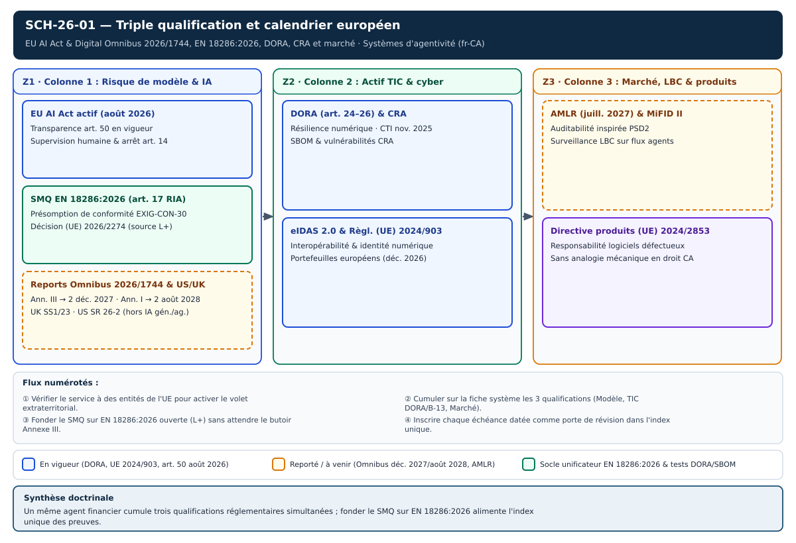
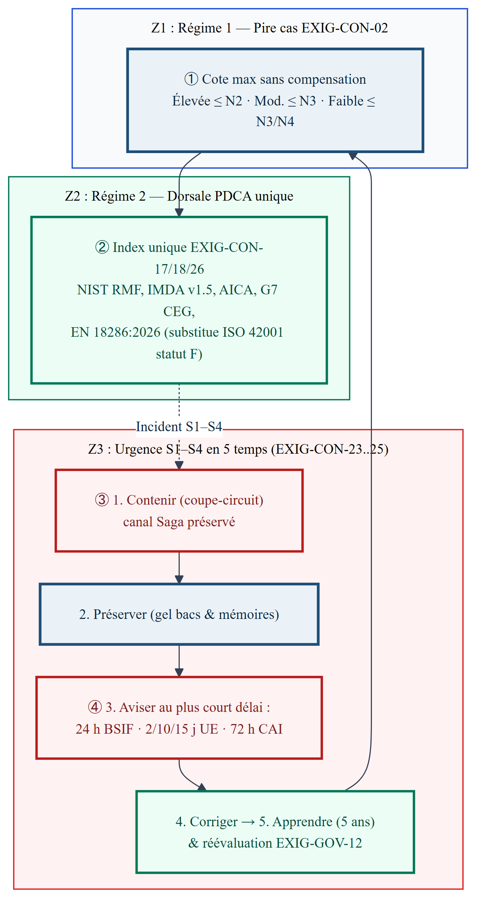
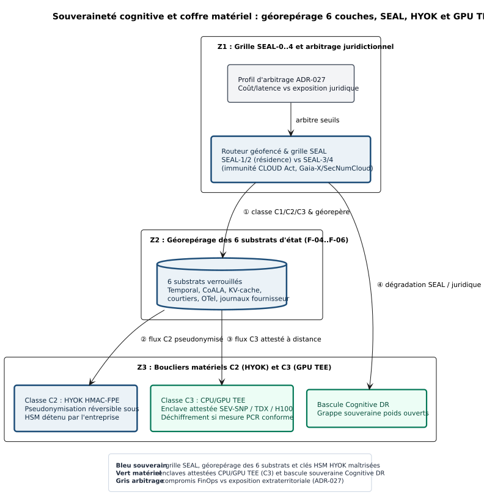

# Chapitre 26 — Réglementation européenne et référentiels internationaux

*Question directrice : Comment unifier sous un index probatoire unique et une souveraineté matérielle vérifiable les obligations extraterritoriales de l'Union européenne (EU AI Act, Digital Omnibus, EN 18286:2026, DORA et CRA) et les référentiels internationaux (NIST AI RMF, IMDA v1.5, AICA et G7) sans jamais opérer d'analogie mécanique avec le droit canadien ?*

Si le droit québécois et les attentes prudentielles canadiennes posent le premier cercle de contraintes autour des Systèmes d'agentivité (← Chapitre 25), aucune organisation financière, industrielle ou numérique opérant à l'international ne peut cantonner son architecture de conformité aux frontières domestiques. Dès lors que les sorties d'un agent développé ou hébergé à Montréal sont utilisées dans l'Union européenne, ou qu'un système s'exécute sur une infrastructure infonuagique soumise à une loi extraterritoriale tierce, plusieurs régimes juridiques et techniques se déclenchent simultanément [1, 7]. L'enjeu n'est plus de satisfaire un texte isolé, mais d'absorber la convergence de règlements européens contraignants et de cadres volontaires internationaux au sein d'un seul dispositif de gouvernance et de preuve.

Ce chapitre couvre la deuxième section du domaine D09 à l'état du gel documentaire du 2 décembre 2026. Sous la clause impérative `non-avis` (`AO-05`), l'analyse revêt une portée strictement technique et pédagogique sans constituer un conseil juridique ni une attestation réglementaire. Une règle méthodologique stricte interdit d'opérer une transposition mécanique entre le droit de l'Union européenne et le droit canadien ou québécois (↔ Chapitre 25). En vertu du protocole `AO-01`, les preuves primaires reposent exclusivement sur les sources ouvertes au statut L+ [1, 2, 3, 4, 5, 6, 7]. Les portails payants ou protégés (`iso.org` pour `ISO/IEC 42001:2023` en `HTTP 403`, `standards.cencenelec.eu` en `HTTP 500` et le miroir HTML `eur-lex.europa.eu` sous défi `AWS WAF`) demeurent consignés en statut F et substitués par les textes officiels EUR-Lex Cellar et la norme harmonisée ouverte `EN 18286:2026` [4, 5].

## 26.1 Résumé exécutif : portée extraterritoriale, classification unique et coffre souverain

Quatre piliers organisent l'architecture réglementaire européenne et internationale des Systèmes d'agentivité. Premièrement, le Règlement `(UE) 2024/1689` (*EU AI Act* ou RIA) saisit tout fournisseur ou déployeur établi dans un pays tiers dès que les sorties produites par le système sont utilisées dans l'Union européenne (`article 2(1)`) [1]. Les interdictions de l'article 5 s'appliquent depuis le 2 février 2025, et les règles visant les modèles à usage général (`GPAI`) depuis le 2 août 2025 (avec échéance au 2 août 2027 pour les modèles préexistants) [1].

De plus, les exigences de transparence de l'article 50 s'appliquent depuis le **2 août 2026**, avec transition au 2 décembre 2026 pour le marquage des systèmes préexistants (`article 50 § 2`) et de nouvelles interdictions ciblées (`article 5`, points `b bis` et `b ter`) [1, 2]. Le Règlement `(UE) 2026/1744` du 8 juillet 2026 (*Digital Omnibus*, publié le 24 juillet 2026, en vigueur le 27 juillet 2026) reporte l'Annexe III (crédit, assurance vie et santé) au **2 décembre 2027** (`PRR G-08`) et l'Annexe I au **2 août 2028** [2]. Ces échéances cadencent `EXIG-CON-13` à `EXIG-CON-16`, `PRR G-03` et `PRR G-07` (`article 50`) [2].

Deuxièmement, un agent financier international subit une **triple qualification simultanée** [1, 3]. Côté modèle décisionnel, il croise le RIA [1] avec `US SR 26-2` d'avril 2026 (excluant l'IA générative et agentique) et `UK SS1/23` (repérage `Tome 1`, hors `L+` fermé de ce chapitre). Côté TIC critiques, il relève de `DORA` (depuis le 17 janvier 2025) [3] et du `CRA` (`(UE) 2024/2847`, cité en [2], applicable le 11 décembre 2027, `ANC-008`).

Côté marché et produits, il cumule `MiFID II`, le futur corpus `AMLR` de juillet 2027 (sous réserve documentaire au `Tome 1`) et la Directive `(UE) 2024/2853` (après le 9 décembre 2026, `ANC-002`, repérage `Tome 1`/`3`), dont les risques systémiques transfrontaliers sont éclairés par Bostan [7]. Pour le système de management de la qualité (`SMQ`, article 17), `EN 18286:2026` — publiée par Décision `(UE) 2026/2274` du 12 octobre 2026 — confère présomption de conformité sous l'article 40 (`EXIG-CON-30`) et remplace `ISO/IEC 42001:2023` (statut F) [4, 5].

Troisièmement, face aux référentiels volontaires du repérage `Tome 2`/`3`/`4` (`NIST AI RMF 1.0`, `NIST AI 600-1`, `ISO/IEC 42005:2025`, `IMDA Agentic AI v1.5` de juin 2026, `AICA`/`IAIS`, hors `L+` ici) et à la feuille de route PQC du `G7 CEG` du 14 janvier 2026 [6], le Compendium impose trois contrôles internes. La classification par critère maximal unique désigne `EXIG-CON-02` comme source exclusive des plafonds (`Élevée ≤ N2`, `Modérée ≤ N3`, `Faible ≤ N3` ou `N4` sur comité). L'index unique (`EXIG-CON-18`) et l'évaluation d'impact unifiée (`EXIG-CON-26`) accompagnent une riposte `S1`–`S4` en cinq temps cumulant les délais légaux (`24 h` BSIF et `72 h` cible CAI/RGPD via `← Chapitre 25` et `Tome 2`, et `2`/`10`/`15` jours RIA art. 73) (`EXIG-CON-23`..`25`) [1].

Quatrièmement, l'hébergement géographique ne neutralise pas les lois extraterritoriales tel le `CLOUD Act` (repérage `Tome 3`). L'architecture cible (`ADR-027`, grille `SEAL-0..4` du repérage `Tome 3`, `F-04`..`F-06`) étend par choix interne le géorepérage à six couches d'état, combinant `HMAC-FPE` sous `HSM` souverain (`HYOK`) en `C2` et enclaves `CPU`/`GPU TEE` (`AMD SEV-SNP`, `Intel TDX`, `NVIDIA H100`) en `C3`.

## 26.2 Droit européen et référentiels internationaux

### 26.2.1 Droit de l'Union européenne : EU AI Act, DORA, CRA et EN 18286:2026

L'application extraterritoriale du Règlement `(UE) 2024/1689` (*EU AI Act* ou RIA) constitue souvent un angle mort nord-américain. Selon l'article 2(1), il s'applique aux fournisseurs et déployeurs de l'Union, mais aussi à ceux établis dans un pays tiers dès que les sorties du système sont utilisées dans l'Union [1]. L'article 3(1) vise tout système automatisé conçu pour divers degrés d'autonomie, pouvant s'adapter après déploiement et déduisant des entrées comment générer des sorties influençant des environnements physiques ou virtuels [1]. Chaque agent y entre directement. Aussi, `EXIG-CON-13` impose d'inscrire à la fiche si ses sorties atteignent l'Union ; dans un domaine de l'Annexe III, l'agent passe d'office en classe **Élevée** (`EXIG-CON-01`), par choix interne écartant l'article 6(3) [1].

Le calendrier modifié par le Règlement `(UE) 2026/1744` du 8 juillet 2026 (*Digital Omnibus*, publié le 24 juillet 2026 et en vigueur depuis le 27 juillet 2026) réorganise les échéances sans créer de moratoire [2]. Les pratiques interdites de l'article 5 sont exécutoires depuis le 2 février 2025, complétées au `2 décembre 2026` par des interdictions additionnelles (points `b bis` et `b ter` sur les hypertrucages sexuels non consentis et le matériel d'abus), justifiant le blocage absolu d'`EXIG-CON-14` quelle que soit la juridiction d'exploitation [2]. Les obligations visant les modèles d'IA à usage général (`GPAI`) s'appliquent depuis le 2 août 2025, avec date limite au `2 août 2027` pour les modèles antérieurs selon l'article 111 § 3 [1].

Depuis le **2 août 2026**, l'article 50 impose la divulgation claire de toute interaction avec une IA (art. 50 § 1) et la signalisation des systèmes de reconnaissance des émotions ou de catégorisation biométrique (art. 50 § 3) [1]. Le marquage lisible par machine des contenus synthétiques (art. 50 § 2) bénéficie jusqu'au `2 décembre 2026` d'une transition pour les systèmes préexistants (`ANC-001`) [1, 2]. `EXIG-CON-19` étend cette transparence à toute interaction écrite ou vocale, et `EXIG-CON-20` impose l'identification de tout contenu externe malgré relecture humaine (articulées avec `EXIG-CON-21` et `EXIG-CON-22`, ← Chapitre 25) [1].

Pour les systèmes à haut risque, le *Digital Omnibus* ajuste l'article 113 et l'article 111 : l'entrée en application des obligations du chapitre III pour les cas d'usage de l'Annexe III est reportée au plus tard au **2 décembre 2027** (`ANC-007`), tandis que les systèmes intégrés à des produits réglementés de l'Annexe I s'appliquent à compter du **2 août 2028** (`ANC-010`) [2]. Chaque État membre doit en outre disposer d'un bac à sable réglementaire opérationnel au 2 août 2027, et la Commission européenne remet ses orientations de surveillance post-commercialisation au `2 septembre 2027` (`art. 72 § 3`) [2].

Les systèmes à haut risque préexistants destinés aux autorités publiques disposent jusqu'au `2 août 2030` (`art. 111 § 2`) et ceux de l'Annexe X jusqu'à fin 2030 (`art. 111 § 1`), avec des réexamens quadriennaux prévus à partir du `2 août 2028` (Annexe III et art. 50) et du `2 août 2029` (évaluation générale), s'échelonnant de `2028` à `2033` (`art. 112 §§ 2–3`) [1, 2]. Dans le secteur financier, l'Annexe III encadre précisément son champ d'application : son point 5(b) vise l'évaluation de la solvabilité et la notation de crédit des particuliers tout en excluant la détection de la fraude financière, tandis que le point 5(c) vise la tarification en assurance-vie et maladie en excluant l'assurance de dommages [1].

L'architecture multi-agents pose un risque juridique critique en vertu de l'article 25 du RIA [1]. Un déployeur qui appose sa marque sur un système à haut risque, qui en modifie substantiellement le comportement ou qui réaffecte un agent ou un modèle `GPAI` à une finalité de l'Annexe III est **requalifié fournisseur** (`article 25(1)`). Il assume alors l'intégralité des devoirs du fournisseur : documentation technique (article 11), obligations générales (article 16), système de gestion de la qualité (article 17), évaluation de conformité (article 43), marquage CE (articles 47 à 49), surveillance après commercialisation (article 72) et signalement des incidents graves (article 73) [1]. En conséquence, `EXIG-CON-15` impose une revue de requalification avant homologation pour toute orchestration réaffectant un composant existant, ainsi que l'accord écrit de l'article 25(4) avec tout tiers fournisseur de composants intégrés (→ Chapitre 27) [1, 2].

Lorsque l'entreprise conserve son rôle de déployeur, `EXIG-CON-16` applique l'article 26 du RIA [1, 2]. Elle confie la supervision humaine à des personnes compétentes, conscientes du biais d'automatisation et dotées d'un dispositif d'interruption vers un état sûr (`article 14`), veille à la pertinence des entrées, conserve les journaux au moins six mois (`article 26(6)`, étendus à `24` mois par `EXIG-OBS-13`) et informe les travailleurs. Elle réalise également l'analyse d'impact sur les droits fondamentaux (`AIDF`, `article 27`, reliée à l'AIPD `art. 35` du RGPD sous `(UE) 2026/1744`) complétée par le droit à explication de l'article 86 pour les systèmes de l'Annexe III (hors point 2), notamment en crédit et en assurance [1, 2].

| Cadre européen | Acte juridique (`L+` ou repérage) | Échéances clés (`2025–2028`) | Exigences et impact sur les agents |
|---|---|---|---|
| **EU AI Act (`RIA`)** | Règlement `(UE) 2024/1689` [1] & `(UE) 2026/1744` [2] | `2 fév. 2025` (art. 5) ; `2 août 2026` (art. 50) ; `2 déc. 2027` (Ann. III) ; `2 août 2028` (Ann. I) [1, 2] | Portée par sorties (`art. 2`), requalification `art. 25` (`EXIG-CON-15`), arrêt `art. 14`, journaux `≥ 6` mois (`EXIG-CON-13..16`) [1, 2] |
| **Norme `EN 18286:2026`** | Décision `(UE) 2026/2274` [4] & DG CNECT [5] | `12 oct. 2026` (pub.) ; `21 oct. 2026` (portée) ; cible `J2a` `1er nov. 2027` | Première norme harmonisée publiée au JOUE ; présomption de conformité `QMS art. 17` (`EXIG-CON-30`, statut L+) [4, 5] |
| **DORA** | Règlement `(UE) 2022/2554` [3] | `17 janv. 2025` (applicable) ; `17 janv. 2028` (réexamen art. 58) [3] ; `nov. 2025` (`19` CTI, repérage `Tome 1`) | Registre des tiers TIC, tests de résilience et `TLPT` (`art. 24–26`), gestion concentration et sortie [3] |
| **CRA & Responsabilité** | `(UE) 2024/2847` (cité [2], `ANC-008`) & Dir. `(UE) 2024/2853` (`ANC-002`, repérage `Tome 1`/`3`) | `9 déc. 2026` (Dir. `2024/2853`) ; `11 déc. 2027` (CRA art. 71 § 2) ; réexamens `2030` | Nomenclature `SBOM`, vulnérabilités (`CRA`), responsabilité sans faute des logiciels commerciaux |
| **Interopérabilité & Identité** | `(UE) 2024/903`, `eIDAS 2.0`, `PSD2`, `NIS 2` (repérage `Tome 1` & `ANC-006`) | `12 janv. 2025` (`2024/903`) ; `24 déc. 2026` (`eIDAS`) ; `17 oct. 2027` (`NIS 2`) | Évaluation interopérabilité publique, portefeuilles d'identité (`eIDAS`), traçabilité interfaces ouvertes |

*Tableau 26.1 — Corpus réglementaire européen applicable aux Systèmes d'agentivité et échéancier vérifié.*

La maîtrise de la conformité qualité sous l'article 17 du RIA a connu un tournant décisif en octobre 2026. Par la Décision d'exécution `(UE) 2026/2274` du **12 octobre 2026**, la Commission européenne a publié la référence officielle de la norme harmonisée `EN 18286:2026` au Journal officiel de l'Union, déclenchant la présomption de conformité prévue à l'article 40 pour les systèmes de gestion de la qualité à haut risque [4]. Un communiqué officiel de la DG CNECT du **21 octobre 2026** précise comment cette norme s'intègre aux systèmes qualité sectoriels existants pour soutenir l'article 17 [5].

Dans la version 1.2 du référentiel (`EXIG-CON-30`), toute organisation fournisseur ou requalifiée au titre de l'article 25 aligne son dossier qualité sur `EN 18286:2026` avant l'échéance de l'Annexe III (cible interne `J2a` au `1er novembre 2027`). Selon `Tome 2 § 12.10`, ce dossier trace les versions de modèles et d'invites, les étages `E1`–`E3`, la surveillance post-commercialisation et les incidents [4, 5]. Le repérage `Tome 1` et les ancres complètent ce socle par la nomenclature `SBOM` du *Cyber Resilience Act* (`(UE) 2024/2847`, cité en [2], `11 décembre 2027`, `ANC-008`). Ils ajoutent l'*Interoperable Europe Act* (`(UE) 2024/903`, depuis le `12 janvier 2025`), `eIDAS 2.0` (`(UE) 2024/1183`, mise à disposition au `24 décembre 2026`, ← Chapitre 17) et l'auditabilité `PSD2` (← Chapitre 22).

À l'échelle financière internationale, un même agent déclenche simultanément une **triple qualification réglementaire** [1, 3]. Sur le premier axe (*Risque de modèle*), le repérage comparatif `Tome 1 § 30.2` (hors corpus `L+` de ce chapitre) relève une nette divergence transatlantique : `PRA SS1/23` au Royaume-Uni (mai 2024, cinq principes) et `BSIF E-23` au Canada (← Chapitre 25) couvrent l'IA. À l'opposé, la guidance américaine `US SR 26-2` / `OCC 2026-13` du 17 avril 2026 exclut l'IA générative et agentique du risque de modèle tout en maintenant le droit du crédit équitable.

Sur le deuxième axe (*Actif TIC critique*), **DORA** (`(UE) 2022/2554`, depuis le **17 janvier 2025**) qualifie tout fournisseur externe de modèle, passerelle ou outil de prestataire tiers TIC au registre opposable, avec plans de sortie et tests `TLPT` (`articles 24 à 26`) [3]. Selon le repérage `Tome 1 § 30.2.2` (hors `L+` ici), la désignation en novembre 2025 de dix-neuf prestataires critiques propage cette dépendance aux agents hébergés chez eux — propagation systémique transfrontalière éclairée par Bostan [7].

Sur le troisième axe (*Conduite de marché, LBC et produits*), selon les repères `Tome 1` et `Tome 3 § 36` (hors `L+` de ce chapitre), `MiFID II` s'applique sans atténuation aux recommandations assistées, et `AMLR` (cité sous réserve documentaire au `Tome 1`) s'appliquera en juillet 2027 sous `AMLA`. Parallèlement, selon `ANC-002` et `Tome 3`, la Directive `(UE) 2024/2853` (`9 décembre 2026`) soumet les logiciels commerciaux à une responsabilité sans faute où l'absence de preuves documentées fait présumer la défectuosité.

*Figure 82 — SCH-26-01 : Matrice de triple qualification d'un agent financier (Modèle et SMQ ouvert EN 18286:2026 en Z1, Actif TIC critique DORA/CRA/eIDAS en Z2, Marché et responsabilité en Z3) croisée avec le Digital Omnibus (UE) 2026/1744.*

### 26.2.2 Référentiels internationaux : NIST, ISO/IEC 42001, IMDA, G7 et souveraineté cognitive

Au-delà des textes juridiquement contraignants, l'architecture d'entreprise fédère plusieurs cadres normatifs internationaux fournissant la mécanique de gestion du risque tout au long du cycle de vie. Issus du repérage normatif antérieur du `Tome 2 § 12.5` (hors textes intégraux `L+` dans ce chapitre), le cadre américain **NIST AI RMF 1.0** (`NIST AI 100-1`, janvier 2023) structure `72` sous-catégories en quatre fonctions (*Gouverner*, *Cartographier*, *Mesurer*, *Gérer*), avec réexamen prévu au plus tard en 2028. Avec son profil génératif (`NIST AI 600-1`, juillet 2024), il oriente la prévention de la confabulation, la gestion des tiers (`GOVERN 6.1–6.2`), la supervision humaine (`MAP 3.5`), la surveillance continue (`MEASURE 2.4, 2.7, 3.1`) et le déclassement (`MANAGE 2.4`, `GOVERN 1.7`). Ils se complètent en veille par les travaux du *Center for AI Standards and Innovation* (`CAISI`, février 2026) et les projets d'extension *COSIS* sur les contrôles `SP 800-53`.

À l'international, la famille **ISO/IEC JTC 1/SC 42** associe au repérage `Tome 2 § 12.5` / `Tome 3 § 35` la norme de système de management `ISO/IEC 42001:2023` (`38` mesures en annexe A) à `ISO/IEC 42005:2025` (méthodologie d'évaluation d'impact), `ISO/IEC 22989:2022` (terminologie), `ISO/IEC 23894:2023` (risques) et aux projets `FDIS 24970` / `DIS 42102–42105`. Cependant, sous la discipline stricte `AO-01`, les normes payantes d'`iso.org` (dont `ISO/IEC 42001:2023` retournant `HTTP 403`) demeurent en **statut F** sans texte intégral ouvert en `L+`. Le Compendium limite donc leur emploi au cadrage de gouvernance et bascule l'ancrage probatoire ouvert de statut L+ vers la norme harmonisée `EN 18286:2026` [4, 5].

Trois repères sectoriels et internationaux complètent cette dorsale. Premièrement, selon le repérage `Tome 3 § 35.3` (hors base `L+` de ce chapitre), le *Model AI Governance Framework for Agentic AI v1.5* de l'autorité singapourienne **IMDA** (juin 2026) lie le niveau de risque à la portée des actions, à la réversibilité et à l'autonomie, tout en rappelant que le raisonnement textuel affiché ne prouve pas les causes réelles et en alertant contre l'approbation réflexe. Deuxièmement, selon le repérage `Tome 4`, les principes de l'Association internationale des contrôleurs d'assurance (`AICA`/`IAIS`) alignent l'IA assurantielle sur la proportionnalité prudentielle. Troisièmement, la feuille de route publiée le **14 janvier 2026** par le **G7 Cyber Expert Group** (`G7 CEG`) coordonne la transition financière post-quantique sur l'horizon `2030–2035`, avec priorité entre `2030` et `2032` pour les actifs critiques [6] (↔ Chapitre 18).

Pour éviter que cette multiplication de référentiels n'engendre des dossiers d'audit redondants, le Compendium impose quatre mécanismes internes unifiés. En premier lieu, la fonction risques et conformité attribue avant toute inscription au registre une **classe de risque** (`Faible`, `Modérée`, `Élevée`) selon la règle du **critère maximal unique sans moyenne compensatoire** (`EXIG-CON-01`, `EXIG-CON-02`, `PRR G-03`) : un agent en lecture seule accédant à des données de santé ou soulevant un risque `Annexe III` demeure en classe Élevée. L'exigence **`EXIG-CON-02`** fait autorité comme **source unique des plafonds d'autonomie** : la classe Élevée est plafonnée à `N2`, la classe Modérée à `N3`, et la classe Faible à `N3` (avec `N4` réservé à la classe Faible sur décision de comité, tandis que `NX` est proscrit). Tout déclencheur de dérive (`EXIG-GOV-12`) impose une réévaluation immédiate (`EXIG-CON-03`).

| Classe de risque (`EXIG-CON-01..02`) | Déclencheurs (un seul suffit) | Plafond d'autonomie | Contrôles et revue obligatoires |
|---|---|---|---|
| **Élevée** | Effet important sur personne (crédit, assurance vie/santé Ann. III [1, 2]), décision Loi 25 art. 12.1, action irréversible `P3` au-dessus du seuil, RP sensibles | **`≤ N2`** (strict) | Évaluation d'impact unifiée (`EXIG-CON-26`), équipe rouge pré-production, homologation comité, double approbation `CIBA` hors bande sur `P3` ; revue **semestrielle** |
| **Modérée** | RP non sensibles ou données confidentielles, actions `P2` réversibles/compensables, interactions partenaires ou public | **`≤ N3`** (seuils bornés) | ÉFVP si RP, volet impact algorithmique (`EXIG-CON-26`), revue sécurité, équipe rouge annuelle, évaluation continue ; revue **annuelle** |
| **Faible** | Jeux publics ou données internes non sensibles ; absence de RP et de tiers ; lecture ou écriture interne réversible bornée | **`≤ N3`** (`N4` sur comité) | Autoévaluation documentée, évaluation continue, inscription au registre unifié ; revue **annuelle** |

*Tableau 26.2 — Classification normative des risques, critère maximal unique et plafonds d'autonomie (`EXIG-CON-02`).*

En deuxième lieu, le comité fait approuver annuellement par la direction une déclaration écrite de tolérance au risque (`EXIG-CON-17`) fixant les seuils quantitatifs de suspension (incidents, dérive d'évaluation, approbation sans modification et dépassement de coût). En parallèle, une **évaluation d'impact unifiée** (`EXIG-CON-26`) fusionne en un seul dossier à volets séparables l'ÉFVP (Loi 25, ← Chapitre 25), l'AIDF (RIA article 27, s'appuyant le cas échéant sur l'AIPD du RGPD article 35 [1, 2]), l'impact algorithmique et la méthode `ISO/IEC 42005` (`Tome 2 § 12.9`). En troisième lieu, chaque artefact produit est référencé une seule fois dans un **index unique des preuves** (`EXIG-CON-18`) reliant chaque contrôle technique aux exigences `EXIG-*`, aux quatre fonctions du `NIST AI RMF` (`Tome 2 § 12.5`), aux clauses `EN 18286:2026`, à la Loi 25, à `BSIF E-23` (← Chapitre 25) et à `DORA` [1, 3, 4].

En quatrième lieu, les incidents agentiques `S1`–`S4` suivent une **riposte en cinq temps** (`EXIG-CON-23`..`25`) :

1. **Contenir** : déclencher le coupe-circuit (`EXIG-IAM-20`, → Chapitre 21) sans approbation préalable, en gardant ouverts le canal de compensation et les bacs intacts.
2. **Préserver** : geler traces, mémoires, contextes, tâches `A2A`, invites et modèles (`art. 73(6)` RIA [1]).
3. **Évaluer et aviser** : appliquer le cumul strict du délai le plus exigeant (`24 h` BSIF, `2`/`10`/`15 j` RIA art. 73 [1], `72 h` CAI/RGPD art. 33–34, Loi 25, LPRPDE via `← Chapitre 25` et `Tome 2 § 12.8`, veille `C-8`), avec registre conservé `5` ans.
4. **Corriger et compenser** : exécuter les sagas et la réparation métier.
5. **Apprendre** : capitaliser sans blâme sur les bancs `E1`–`E3`.

*Figure 83 — SCH-26-02 : Couplage du régime nominal (plafonds EXIG-CON-02, dorsale PDCA unifiée sous EN 18286:2026 et index EXIG-CON-18) avec la boucle d'urgence en cinq temps pour incidents S1–S4 et les horloges légales cumulatives (24 h BSIF, 2/10/15 j RIA, 72 h CAI/RGPD).*

Toutefois, la gouvernance documentaire et l'index de preuves restent insuffisants si les données régulées quittent la juridiction de contrôle par un angle mort d'infrastructure. Selon le repérage juridique du `Tome 3 § 37.1` (hors corpus `L+` fermé de ce chapitre) relatif au `U.S. CLOUD Act` (`18 U.S.C. § 2713`), une région infonuagique localisée physiquement au Canada ou en Europe règle la **résidence** mais ne résout pas le **contrôle juridictionnel** tant que l'exploitant soumis à un droit étranger conserve la capacité technique de déchiffrer la mémoire vive. Inversement, selon le même repérage `Tome 3`, l'article 32 du *Data Act* européen (`Règlement (UE) 2023/2854`, applicable depuis septembre 2025) oblige les fournisseurs à prévenir tout transfert conflictuel non fondé sur un accord international.

Pour évaluer objectivement cette exposition, les repères du `Tome 3 § 37.1–37.2` documentent la grille européenne **SEAL-0 à SEAL-4** (*Cloud Sovereignty Framework*) et les labels européens **Gaia-X** (niveau 3 exigeant l'absence de contrôle capitalistique et de sous-traitance hors EEE, encore attestés par déclaration en attente d'accréditation). S'y ajoutent la qualification nationale française **SecNumCloud 3.2** (arrêté du 12 août 2026 rapporté par commentaires secondaires, face au blocage du schéma européen `EUCS`) et la proposition non adoptée de règlement *Cloud and AI Development Act* (`COM(2026) 502` du 3 juin 2026, incluant les plateformes d'orchestration agentique dans ses considérants).

Dans l'architecture hybride cible du cadre (`ADR-027`, statut « acceptée sous réserve », `PRR F-04` à `F-06`, `Tome 3 § 46.9–46.13`), la souveraineté cognitive couvre simultanément **six couches d'état** d'une boucle agentique posées par choix de conception interne. Elle protège le journal du moteur durable (`Temporal` / `Restate`) chiffré côté client par *Payload Codec* `AES-256-GCM`, les mémoires `CoALA` / `Graphiti` vectorisées par modèles internes à poids ouverts, et le cache clé-valeur (`KV-cache` `GPU`/`NVMe`) cloisonné par `(tenant_id, jurisdiction_zone)` puis effacé en fin de session. Elle englobe également les files `Kafka`/`Solace` et tampons `A2A`, la télémétrie `OpenTelemetry` expurgée à la source, et les journaux fournisseur verrouillés sous contrat *Zero-Data-Retention* (`ZDR`).

Sur ces six substrats, deux boucliers matériels et cryptographiques gradués protègent les charges sensibles. En **classe `C2`**, la passerelle déploie une pseudonymisation réversible déterministe à préservation de format (`HMAC-FPE` / `FF1`) dont la clé maîtresse reste exclusivement confinée dans un module `HSM` souverain détenu par l'entreprise (**`HYOK`**, *Hold Your Own Key*). En **classe `C3`**, le traitement s'exécute sur une grappe interne à poids ouverts ou dans des enclaves matérielles **`CPU`/`GPU TEE`** (`AMD SEV-SNP`, `Intel TDX`, `NVIDIA Hopper H100` / `Blackwell B200`) dotées d'un canal `PCIe` chiffré (`SPDM`/`CMA`) et d'une libération de clé `HSM` subordonnée à l'attestation cryptographique distante des registres `PCR` (*Platform Configuration Registers*). Comme le rappelle `ADR-027`, le calcul confidentiel élève fortement le coût d'une interception technique sans conférer d'invulnérabilité absolue ni valoir réponse juridique, et s'accompagne d'une bascule de continuité cognitive vers une grappe souveraine visant les cibles de conception internes `RTO < 15 min` et `RPO = 0` à valider par exercice.

Sous `ADR-027` (repérage `Tome 3 § 46.2–46.3, § 46.10` et `Tome 5 § 9.2`, hors socle `L+`), la bascule **FinOps et latence** entre `C2 (HYOK)` et `C3 (TEE)` répond à deux critères complémentaires. Premièrement, `C2` vise les données pseudonymisables (Loi 25, contrats) pouvant recourir à des modèles frontières sous contrat `ZDR` à moindre coût matériel, car `HYOK` seul fournit une révocation cryptographique plutôt qu'une isolation durant l'inférence en clair ; il transfère toutefois au client la disponibilité et la latence de clé sous une cible réseau conseillée **`RTT ≤ 35 ms`** (repérage `AWS XKS`). Si le gestionnaire `HSM` devient injoignable ou dépasse cette borne `> 35 ms`, le déchiffrement échoue en mode fermé (*fail-closed*) et suspend l'accès aux données protégées avant bascule vers `C3`. Deuxièmement, l'architecture bascule vers `C3` (`CAP-033`, sur signal `SIG-016`) dès que les données ne sont pas pseudonymisables, relèvent d'un régime prudentiel critique (`BSIF E-23` élevé) ou dépassent durablement `RTT ≤ 35 ms`, arbitrant le surcoût GPU dédié et la limite physique `DDR5` (`TEE.fail`, `< 1 000 $ US` selon ses auteurs, ← Chapitre 21) contre l'exposition extraterritoriale.

En régime `C3`, la vérification distante des registres `PCR` (*Platform Configuration Registers*, `Tome 3 § 46.10`) confronte les empreintes signées par la racine silicium (microcode, noyau, moteur `vLLM`/`SGLang`, poids du modèle) au manifeste approuvé avant toute libération de clé `HSM`. Conformément à la trousse `G0` (`Tome 8`), cette vérification distante s'éprouve sur la cible matérielle homologuée sans simulation `GPU TEE` locale en tests automatisés.

*Figure 84 — SCH-26-03 : Architecture de souveraineté cognitive articulant la grille SEAL-0..4, le géorepérage des six substrats d'état et les boucliers matériels C2 (HYOK HMAC-FPE, RTT ≤ 35 ms) et C3 (enclaves CPU/GPU TEE avec attestation distante et limite TEE.fail).*

## 26.3 Synthèse architecturale, livrables et portes de contrôle

Sur le plan des interfaces du Compendium, ce chapitre reçoit les mécanismes de confinement et coupe-circuit du Chapitre 21 (`EXIG-IAM-20`) et les canaux de journalisation du Chapitre 22, tout en interagissant avec le Chapitre 05 (ergonomie `HOTL` matérialisant l'article 14 du RIA) et le Chapitre 08 (connecteurs `EDC`/`ODRL` des espaces de données européens). Il s'appuie également sur le Chapitre 09 (clauses de portabilité), le Chapitre 17 (`eIDAS 2.0` comme précédent `KYA`), le Chapitre 23 (boucle `PDCA` en `CI/CD`), le Chapitre 24 (arbitrage FinOps des enclaves `TEE`) et le Chapitre 25 (protection `HYOK`/`TEE` face au `CLOUD Act` et rupture de circularité `EXIG-AMF-07`).

En aval, il fonde les accords écrits et la réversibilité contractuelle du Chapitre 27 (`article 25(4)` du RIA et `Data Act`), contraint la qualification Annexe III des blueprints sectoriels du Chapitre 28, cadence les jalons `DAPP` du Chapitre 31 (`SIG-001`, `SIG-002`, `SIG-008`) et alimente les 305 exigences du Chapitre 34. En synchronisation `G0`, la trousse du Tome 8 valide mécaniquement le confinement par politiques, la conservation horodatée et les portes réglementaires (`sandbox_confinement.rego`, `audit_scitt_focus.py`, `prr_validators.py` dont `G-03`, `G-07` et `F-04`), tout en documentant explicitement l'absence de simulation matérielle `GPU TEE` réelle dans les tests automatisés locaux.

| Livrable réglementaire et architectural | Exigences et portes associées | Critère d'acceptation exécutable |
|---|---|---|
| Matrice multirégimes & index unique des preuves | `EXIG-CON-13..18`, `EXIG-CON-26`, `EXIG-CON-30`, `PRR G-07`, `G-08` | `100,0 %` des preuves liées sans duplication à `EN 18286:2026` (`statut L+`), `RIA` [1], `DORA` [3], `NIST` (`Tome 2`) et `Loi 25` (`← ch25`) ; exclusion `ISO 42001` (`statut F`) tracée [4, 5] |
| Règles `OPA`/`Cedar` de plafonnement par pire cas | `EXIG-CON-01..03`, `EXIG-GOV-12`, `PRR G-03` | Rejet bloquant en `CI/CD` de tout agent excédant `≤ N2` (`Élevée`), `≤ N3` (`Modérée`), `N4` sans comité (`Faible`) ou `NX` (choix `Tome 2` prolongeant `art. 14` [1]) |
| Playbook `SOAR` de riposte `S1`–`S4` en `5` temps | `EXIG-CON-23..25`, `EXIG-IAM-20`, `SIG-001`, `SIG-002` | Exercice à sec confirmant contention sans approbation préalable, gel des bacs à sable/contextes, canal de compensation ouvert et alertes `24 h` (`← ch25`) / `2/10/15 j` [1] / `72 h` (`Tome 2`) |
| Audit souveraineté `SEAL` sur `6` substrats (`ADR-027`) | `ADR-027`, `F-04..F-06`, `SIG-008`, `G7 CEG` [6] | Géorepérage cible vérifié des `6` couches d'état (`Tome 3`), clés `HSM HYOK` (`HMAC-FPE` `C2`), attestation `TEE` (`C3`) et contrat `ZDR` vérifié |

*Tableau 26.3 — Livrables d'architecture, exigences liées et critères d'acceptation du Chapitre 26.*

La cartographie européenne et internationale établit ainsi l'ensemble des règles de fond applicables aux agents opérant au-delà des frontières canadiennes. Pour que ces obligations — depuis l'accord écrit de l'article 25(4) du RIA jusqu'à la résidence sous `HYOK` et le droit de sortie sans frais du *Data Act* — deviennent opposables aux éditeurs de modèles, aux fournisseurs infonuagiques et aux partenaires commerciaux, elles doivent être converties en clauses contractuelles impératives et en bancs d'essai éliminatoires dès l'appel d'offres (→ Chapitre 27).

> **Trois invariants exécutables — Chapitre 26**
>
> 1. **Qualification cumulative et preuve ouverte `EN 18286:2026` (`EXIG-CON-13..18`, `EXIG-CON-30`, `PRR G-03`, `G-07`, `G-08`)** : Tout agent dont les sorties servent dans l'Union porte ses trois qualifications (Modèle, TIC `DORA`/`CRA` [2, 3], Marché selon `Tome 1`). Son système qualité s'ancre sur `EN 18286:2026` (L+) sans transposition mécanique canadienne ni dépendance à `ISO/IEC 42001` (statut F) [1, 2, 3, 4, 5].
> 2. **Plafonds par pire cas et riposte `S1`–`S4` sans destruction forensique (`EXIG-CON-02`, `EXIG-CON-23..25`, `PRR G-03`)** : Aucune moyenne ne tempère la classe de risque (`Élevée ≤ N2`, `Modérée ≤ N3`, `Faible ≤ N3` ou `N4` sur comité). Tout incident `S1`–`S4` déclenche contention autonome, gel des bacs, canal de compensation maintenu et cumul des délais (`24 h` BSIF `← ch25`, `2/10/15 j` RIA art. 73 [1], `72 h` CAI/RGPD `Tome 2`).
> 3. **Souveraineté matérielle sur six substrats d'état (`ADR-027`, `SEAL-0..4`, `F-04..F-06`)** : La résidence ne neutralisant pas le `CLOUD Act` (repérage `Tome 3`), l'architecture cible impose par choix interne `HMAC-FPE` sous `HSM HYOK` en `C2` et enclave `CPU`/`GPU TEE` attestée en `C3`, avec chiffrement des six couches d'état, contrat `ZDR` et bascule cible `RTO < 15 min` / `RPO = 0`.
