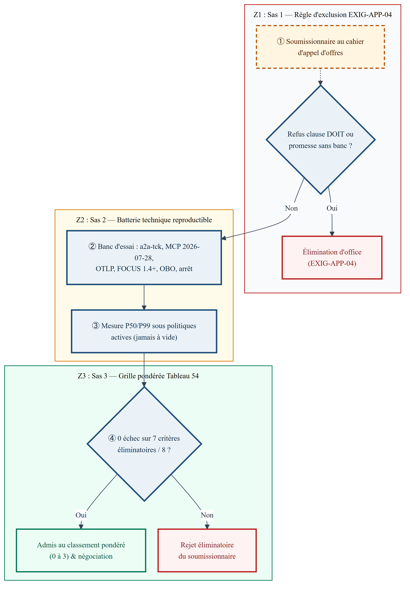
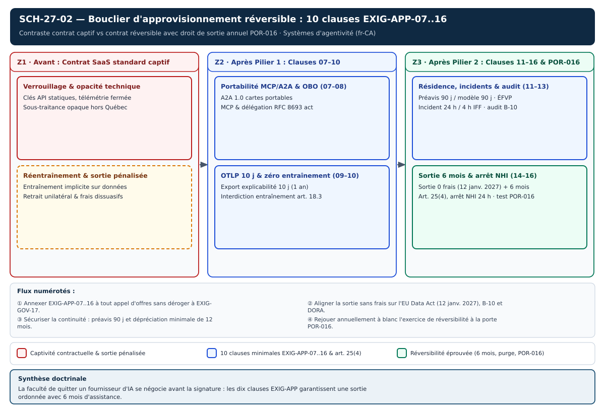
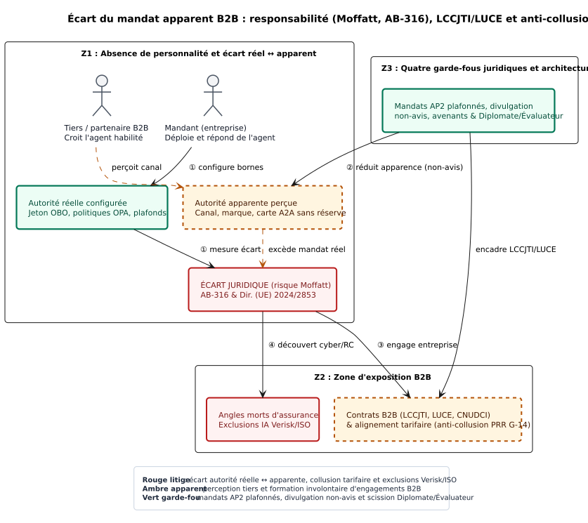

# Chapitre 27 — Approvisionnement réversible et clauses contractuelles

*Question directrice : Comment transformer la neutralité protocolaire et les obligations multi-juridictions en critères éliminatoires d'appel d'offres, en dix clauses contractuelles non dérogeables et en garde-fous juridiques sur le mandat B2B afin d'empêcher l'enfermement fournisseur ?*

Les normes juridiques québécoises, canadiennes et européennes (← Chapitres 25 et 26) demeureraient inopérantes si les contrats conclus avec les fournisseurs de modèles, de plateformes d'agents, de passerelles ou de serveurs d'outils réintroduisaient par stipulation privée l'opacité technique, le réentraînement non consenti ou la captivité infonuagique. Or, selon le repérage du cadre (*Tome 2*, 27 octobre 2026, hors socle `L+`), le transfert de `MCP` et d'`A2A` vers l'*Agentic AI Foundation* (`AAIF`) n'a pas supprimé le verrouillage. Il l'a déplacé vers les extensions propriétaires, la couverture partielle des primitives, les plafonds d'orchestration, la rétention d'identité en console fermée et la facturation en crédits propriétaires.

Ce chapitre clôt le domaine D09 au gel du 2 décembre 2026. Sous la clause impérative `non-avis` (`AO-05`), l'analyse formule des repères d'ingénierie contractuelle sans constituer un avis juridique : toute rédaction finale relève de conseillers juridiques habilités avant signature. Conformément à `AO-01`, les appuis légaux et techniques directs s'ancrent sur les sources `L+` [1, 2, 3, 4, 5, 6] et les registres du Compendium, tandis que la notation et les clauses relèvent du cadre interne (`CRE-IA-2026-01`). Les ressources bloquées ou payantes (`iso.org` pour `ISO/IEC 42001`, `legisquebec.gouv.qc.ca`), tout comme les formulaires assurantiels *ISO/Verisk* et décisions non ouvertes du repérage doctrinal, demeurent en statut F et hors preuve directe.

## 27.1 Résumé exécutif : banc d'essai éliminatoire, dix clauses et mandat apparent

Trois verrous garantissent l'indépendance technologique (`CAP-051`, `INI-014`, `POR-004`, `POR-016`) face aux éditeurs et infonuagiques. Premièrement, aucune sélection ne peut reposer sur des allégations commerciales non mesurées (`EXIG-APP-04`), en appui à la diligence préalable envers les tiers [2]. Chaque candidat traverse un banc d'essai reproductible dans l'environnement cible et doit se qualifier sur le **Tableau 54**, qui comporte **sept critères éliminatoires sur huit** et rejette tout refus d'une clause `DOIT` (`EXIG-APP-01` à `EXIG-APP-06`, `EXIG-APP-17`, avec décommissionnement `PRR O-15` en `A.8.6`). Les lacunes de la suite `a2a-tck` (`1.0.0.alpha3`, où `CARD-SIGN-001` à `CARD-SIGN-004` restent `NOT_AUTOMATABLE` sans vecteurs `a2a-jcs-v01` [3]) sont consignées explicitement plutôt que masquées.

Deuxièmement, tout contrat incorpore **dix clauses minimales** du cadre (`EXIG-APP-07` à `EXIG-APP-16`), appuyées sur les régimes applicables [1, 2, 4], vérifiées chaque année à la porte `POR-016` par un test réel de bascule et protégées contre toute dérogation à `EXIG-GOV-17`. Les cinq premières imposent portabilité `A2A 1.0`, conformité `MCP` avec délégation `RFC 8693` (`act`), export `OTLP` et explicatif (`10` j cibles, conservation `≥ 1` an art. 11 [1]), interdiction d'entraînement (étendue de l'art. 18.3 [1]) et résidence avec préavis cible de `90` j (entente art. 17 [1], livres bancaires [5], risque `CLOUD Act`). Les cinq suivantes exigent préavis d'incident (`24` h cibles, `4` h IFF selon attentes BSIF [2] et art. 3.5/18.3 [1]), audit `BSIF B-10` [2], préavis modèle cible de `90` j, réversibilité sans pénalité avec `6` mois d'assistance cible (*Data Act* `12 janvier 2027`), accord écrit art. 25(4) RIA [4] et révocation `NHI` sous `24` h cibles.

Troisièmement, la responsabilité juridique des engagements pris par un agent devant des tiers ne s'efface jamais derrière une prétendue autonomie algorithmique. Selon le repérage doctrinal (*Tome 3*, hors `L+`), aucun agent n'a de personnalité juridique (Code civil californien `AB-316`, art. `1714.46` ; Directive `(UE) 2024/2853` ; *Moffatt c. Air Canada*, connu d'après commentaires en statut F). Par modélisation architecturale, l'entreprise répond de tout écart entre l'**autorité réelle** configurée et l'**autorité apparente** perçue. Elle referme cet écart par des avenants `B2B` (`LCCJTI`, `LUCE`, `CNUDCI-2024`), des mandats `AP2` plafonnés, des verrous anti-collusion (`PRR G-14`) et une revue annuelle des exclusions IA en assurance.

## 27.2 Évaluation éliminatoire, clauses de réversibilité et responsabilité B2B

### 27.2.1 Banc d'essai technique et grille d'évaluation des fournisseurs

L'acquisition d'une plateforme d'agents, d'un service d'inférence, d'une passerelle ou d'un serveur `MCP` s'ouvre obligatoirement par une analyse de réversibilité validée par l'architecture d'entreprise (`EXIG-APP-01`), recensant composants propriétaires, formats de restitution, délais et coûts de sortie, en appui aux plans de sortie [2]. Parallèlement, `EXIG-APP-02` proscrit toute dépendance à une extension propriétaire absente du catalogue : une extension admise porte un `URI` versionné, dispose d'un repli documenté et ne peut être déclarée obligatoire (`required`) sans dérogation. Ces deux gardes répondent aux cinq foyers du repérage (*Tome 2*, Tableau 53). Ils couvrent extensions obligatoires (`A2A`/`MCP`), prise en charge partielle (outils seuls sans ressources ni état), limites de sous-agents, captation d'identité en console unique et facturation par crédits avec coupure au-delà du quota.

Pour neutraliser ces asymétries avant signature, `EXIG-APP-04` interdit formellement de retenir comme critère d'évaluation ou d'exigence une latence, un débit ou une allégation de compatibilité publiés par un fournisseur. Chaque candidat exécute dans le banc d'essai de l'entreprise quatre vérifications empiriques reproductibles (`EXIG-APP-03` à `EXIG-APP-06`) :

1. **Conformité protocolaire mesurée (`EXIG-APP-03`)** : exécution des scénarios `MCP 2026-07-28` et, pour toute solution déléguant ou recevant des tâches, passage de la suite officielle `a2a-tck` sans aucun échec de niveau `MUST` sur chaque liaison déclarée [3]. Tant que `a2a-tck` demeure en préversion (`1.0.0.alpha3`), seuls les tests demeurés stables sur deux versions sont bloquants. Les lacunes connues de l'outillage — notamment le statut `NOT_AUTOMATABLE` des vérifications de signature `CARD-SIGN-001` à `CARD-SIGN-004` (canonisation `JCS`, exclusion `signatures`, en-tête `JWS` et rejet des clés révoquées) et l'absence de `conformance-vectors/a2a-jcs-v01` [3] — sont consignées au procès-verbal et compensées par des tests internes substitutifs (`a2a_card.py`), avec inventaire des primitives non prises en charge.
2. **Latences sous politiques actives (`EXIG-APP-04`)** : mesure des temps d'exécution aux 50e et 99e centiles (`P50` et `P99`) avec les politiques `OPA` (ou `Cedar` en choix d'architecture), le caviardage, le traçage et la journalisation activés en pleine charge, jamais sur une instance dépouillée. Les données brutes, le matériel et le profil de trafic sont archivés au dossier.
3. **Exportation ouverte `OTLP` et `FOCUS 1.4+` (`EXIG-APP-05`)** : vérification de l'émission de traces via `OTLP` avec version déclarée et figée des conventions `OpenTelemetry GenAI` (`OTEL_SEMCONV_STABILITY_OPT_IN`) et propagation du contexte `W3C Trace Context` à chaque saut maîtrisé, y compris vers les serveurs `MCP` hébergés par le fournisseur. Les relevés de facturation doivent respecter le standard `FOCUS 1.4` ou ultérieur en traduisant sans ambiguïté les unités propres en jetons consommés.
4. **Identité fédérée et arrêt indépendant (`EXIG-APP-06`)** : attribution d'une identité non humaine distincte à chaque agent, fédérable auprès du fournisseur d'identité de l'entreprise sans aucun secret statique partagé. Parce que les tests substitutifs à `CARD-SIGN-004` [3] ne vérifient que la signature des cartes au catalogue (`EXIG-A2A-03`), le fournisseur démontre séparément par essai chronométré la révocation des jetons et sessions depuis les outils de l'entreprise (via `SSF`/`CAEP`) sous la borne `EXIG-IAM-20` (cible proposée de `≤ 15` minutes incluant la durée résiduelle des jetons bornée par `EXIG-IAM-15`, distincte de la révocation `NHI` sous `24` heures en `EXIG-APP-16`).

L'ensemble de ces essais alimente la grille pondérée du **Tableau 54** (`EXIG-APP-17`, *Tome 2*), dont chaque critère reçoit une note entière de `0` (absent ou non démontré) à `3` (démontré par essai reproductible de l'entreprise), une preuve requérant un essai interne étant plafonnée à `1` si l'entreprise ne l'a pas exécutée. Sur les huit critères de la grille, **sept sont éliminatoires** : une note inférieure à `3` sur un critère éliminatoire soumis à essai interne (`Interopérabilité`, `Identité`, `Observabilité`) ou inférieure à `2` sur les quatre autres critères éliminatoires (une note provisoire de `2` étant tolérée pour `Réversibilité` et `Coûts` avant confirmation lors du premier pilote) entraîne l'exclusion automatique (`EXIG-APP-17`). Tout refus d'une clause `DOIT` emporte le même rejet, quel que soit le score global. Bien que testé par essai reproductible (`EXIG-APP-04`), le critère `Performance mesurée` (`5 %`) n'est pas éliminatoire et départage seul les offres admissibles ; le comité ne peut rééquilibrer les pondérations que dans une marge de `± 5` points tout en maintenant un poids minimal de `5 %` par critère éliminatoire.

| Critère du `Tableau 54` | Poids indicatif | Preuve reproductible exigée (`EXIG-APP-03..06, 17`) | Statut |
|---|---|---|---|
| **Interopérabilité protocolaire** | `20 %` | Rapport `a2a-tck` (`0` échec `MUST` [3]), essais `MCP 2026-07-28`, écarts déclarés | **Éliminatoire** (`< 3`) |
| **Identité et délégation** | `15 %` | Fédération `NHI` sans clé fixe, jetons `RFC 8693`, révocation chronométrée (`EXIG-IAM-20`) | **Éliminatoire** (`< 3`) |
| **Sécurité & chaîne d'approvisionnement** | `15 %` | Bacs à sable, inventaire versionné, rapports d'équipe rouge, droit d'audit [2] | **Éliminatoire** (`< 2`) |
| **Observabilité et audit** | `15 %` | Trace `OTLP` complète sur tous les sauts, propagation `W3C Trace Context`, journal exportable | **Éliminatoire** (`< 3`) |
| **Données, résidence et conformité** | `15 %` | Acceptation clauses `3` à `6` (`Loi 25` art. 17/18.3/12.1 [1]), carte des flux `ÉFVP` | **Éliminatoire** (`< 2`) |
| **Réversibilité et sortie** | `10 %` | Essai de restitution sur agent pilote (`EXIG-APP-14`) et stratégie de sortie [2] | **Éliminatoire** (`< 2` ; note `2` provisoire confirmée au 1er pilote) |
| **Coûts et `FinOps`** | `5 %` | Export `FOCUS 1.4+` sur pilote (sauf composant libre gratuit) | **Éliminatoire** (`< 2` ; note `2` provisoire confirmée au 1er pilote) |
| **Performance mesurée** | `5 %` | Latences `P50` et `P99` sous politiques actives (`EXIG-APP-04`) | Non éliminatoire |

*Tableau 27.1 — Grille pondérée d'évaluation des fournisseurs (`Tableau 54`, `EXIG-APP-17`) : sept verrous éliminatoires sur huit.*

*Figure 1 — SCH-27-01 : Arbre de qualification éliminatoire des fournisseurs en trois sas, excluant d'office les promesses déclaratives (EXIG-APP-04) et les refus de clauses DOIT avant l'exécution du banc d'essai (MCP, a2a-tck, P50/P99 sous politiques, OTLP, FOCUS 1.4+) et le classement pondéré du Tableau 54.*

### 27.2.2 Clauses contractuelles EXIG-APP-07 à EXIG-APP-16 et réversibilité infonuagique

Une fois le candidat qualifié en banc d'essai, le contrat d'acquisition ou de renouvellement incorpore obligatoirement **dix clauses normatives non dérogeables** du cadre (`EXIG-APP-07` à `EXIG-APP-16`), appuyées sur les assises légales et prudentielles applicables [1, 2, 4] et complétées par l'interdiction absolue de toute stipulation contraire à `EXIG-GOV-17`. Une dérogation exceptionnelle à un délai interne ou à un critère technique (écart contractuel approuvé par le comité pour la durée du contrat) reste strictement interdite sur les engagements reprenant des obligations légales impératives (articles 17 et 18.3 de la Loi 25 [1], ou points `EXIG-GOV-17` prohibant par exemple les actions `P3` sans approbation). Ces dix clauses forment le bouclier opérationnel de l'organisation :

- **Clauses 1 et 2 — Portabilité protocolaire et délégation d'identité (`EXIG-APP-07`, `EXIG-APP-08`)** : Le fournisseur prend en charge `A2A 1.0` nativement (cartes conformes à `a2a.proto` publiées sous `/.well-known/agent-card.json` sans extension propriétaire obligatoire, vérifiées par la suite `a2a-tck` [3]) et maintient toute version dépréciée au moins `12` mois (cible du cadre si la spécification ne fixe pas un autre délai) avec préavis écrit. La Clause 2 impose `MCP 2026-07-28` (`resource` `RFC 8707`, jeton par serveur, zéro relais de jeton) ainsi que l'échange de jetons `RFC 8693` portant `act` afin d'exécuter l'intersection des droits `sub` ∩ `act`.
- **Clauses 3 et 4 — Télémétrie, explicabilité et zéro entraînement (`EXIG-APP-09`, `EXIG-APP-10`)** : La Clause 3 assure l'accès continu aux traces et restitue sous `10` jours (cible du cadre) les facteurs déterminants requis pour l'article 12.1 de la Loi 25 et l'article 32 (`30` jours), conservés au moins `1` an (article 11) [1]. La Clause 4 matérialise l'article 18.3 [1] — contrat écrit, usage limité au mandat, zéro conservation post-contrat hors gel légal — et étend explicitement cette limitation pour interdire d'exploiter invites, contextes, sorties, traces, mémoires ou vecteurs numériques aux fins d'entraîner, d'affiner ou de tester tout modèle appartenant au prestataire ou à un tiers, avec rétention nulle (ou bornée et déclarée) pour détection d'abus.
- **Clauses 5 et 6 — Résidence, `CLOUD Act` et notification d'incident (`EXIG-APP-11`, `EXIG-APP-12`)** : La Clause 5 déclare chaque lieu de traitement (inférence, outils, mémoires, journaux, sous-traitants), impose un préavis cible de `90` jours avant tout changement et formalise l'entente écrite de l'article 17 après ÉFVP pour tout transfert hors Québec [1]. Elle respecte le maintien au Canada des livres bancaires (article 239 de la *Loi sur les banques* [5]) tout en documentant le risque `CLOUD Act` et les mesures `HYOK`. La Clause 6 impose l'avis sans délai au RPRP (article 18.3 [1]) et au plus tard dans la cible cadre de **`24` heures** (`4` heures visées pour les IFF selon attentes du BSIF [2]), avec gel des preuves (`EXIG-CON-23`) [1, 2].
- **Clauses 7 et 8 — Audit `BSIF B-10`, préavis de retrait et réversibilité sans frais (`EXIG-APP-13`, `EXIG-APP-14`)** : La Clause 7 garantit le droit d'audit `BSIF B-10` [2], l'accès aux rapports d'équipe rouge fondés au minimum sur l'*OWASP Top 10 for Agentic Applications* (édition 2026) et l'inventaire actualisé des modèles et serveurs `MCP`. Elle impose aussi un préavis cible minimal de **`90` jours** préalable à toute suppression ou mise à jour de modèle (même masquée sous un alias) et l'accès à la version incriminée durant toute enquête. La Clause 8 garantit la restitution en formats ouverts de tout l'état possédé (mémoires `CoALA`, graphes, cartes, politiques, traces, index vectoriels, jeux d'évaluation), une **assistance cible de `6` mois** et la destruction écrite attestée [1, 2].
- **Clauses 9 et 10 — Accord `article 25(4)` du RIA et révocation directe des `NHI` (`EXIG-APP-15`, `EXIG-APP-16`)** : Lorsque l'entreprise agit comme fournisseur ou est requalifiée en vertu de l'article 25(1) de l'*EU AI Act* (← Chapitre 26), la Clause 9 établit l'accord écrit exigé par l'article 25(4) avec chaque fournisseur de composants ou modèles intégrés (ou documentation `article 53` pour les modèles `GPAI`) [4]. La Clause 10 impose l'invalidation immédiate des jetons et webhooks à la suspension (`CAEP` inclus), puis la révocation attestée par écrit de toutes les identités `NHI` sous la cible de **`24` heures** suivant la transition.

Sur le plan stratégique, ces dix clauses luttent contre la concentration sur les trois grands fournisseurs infonuagiques mondiaux (`hyperscalers`). En droit européen, l'ancre `ANC-003` fixe au **`12 janvier 2027`** l'interdiction des frais de changement de fournisseur (*Data Act*, `(UE) 2023/2854`, art. 29 § 1), tandis que `DORA` (← Chapitre 26) et `BSIF B-10` [2] exigent des plans de sortie éprouvés. Au Canada, la *Loi sur les services bancaires axés sur les consommateurs* encadre parallèlement l'ouverture bancaire et la sécurité des accès [6]. La porte annuelle **`POR-016`** impose donc un test réel de bascule bimodèle et de portabilité sur un agent pilote : il valide la migration des définitions, mémoires `CoALA` et modèles vers une cible souveraine sans perte d'état ni pénalité, avec une fenêtre cible de dépréciation de `12` mois sur les API critiques.

| Clause (`EXIG-APP`) | Ancrage juridique / prudentiel | Délai ou seuil normatif exécutable |
|---|---|---|
| `EXIG-APP-07` (`Clause 1`) | Portabilité `A2A 1.0` / `a2a-tck` [3] | `0` extension propriétaire obligatoire ; maintien version dépréciée `≥ 12` mois (cible cadre) |
| `EXIG-APP-08` (`Clause 2`) | `MCP 2026-07-28` & `RFC 8693` (`act`) | Jeton par serveur (`RFC 8707`) ; `0` relais de jeton ; intersection `sub` ∩ `act` |
| `EXIG-APP-09` (`Clause 3`) | Loi 25 art. 11, 12.1, 32 [1] | Restitution explicative `≤ 10` j (cible) ; conservation `≥ 1` an [1] ; réponse accès `≤ 30` j [1] |
| `EXIG-APP-10` (`Clause 4`) | Loi 25 art. 18.3 [1] | Limitation au mandat [1] étendue en interdiction d'entraînement ; rétention nulle ou bornée |
| `EXIG-APP-11` (`Clause 5`) | Loi 25 art. 17 [1] ; art. 239 [5] ; `CLOUD Act` | Préavis lieu `90` j (cible) ; entente écrite art. 17 [1] ; livres au Canada [5] ; `HYOK` |
| `EXIG-APP-12` (`Clause 6`) | Loi 25 art. 3.5, 18.3 [1] ; `BSIF B-10` [2] | Avis violation sans délai [1] ; cibles incident `≤ 24` h (`≤ 4` h IFF [2]) |
| `EXIG-APP-13` (`Clause 7`) | `BSIF B-10` [2] ; `BSIF E-23` | Droit d'audit tiers [2], équipe rouge `OWASP`, préavis retrait modèle `≥ 90` j (cible) |
| `EXIG-APP-14` (`Clause 8`) | `Data Act` (`12 janv. 2027`, `ANC-003`), `B-10` [2] | Sortie sans frais, restitution complète état/mémoire, assistance `6` mois (cible), destruction attestée [1] |
| `EXIG-APP-15` (`Clause 9`) | `EU AI Act` art. 25(4), 53 [4] | Accord écrit fournisseur tiers (Ann. III `2 déc. 2027` ; Ann. I `2 août 2028`, ← Ch. 26) |
| `EXIG-APP-16` (`Clause 10`) | `EXIG-IAM-20`, `OWASP NHI1` (2025) | Coupure immédiate via `CAEP` ; révocation attestée `NHI` `≤ 24` h post-transition (cible) |

*Tableau 27.2 — Synthèse exécutable des dix clauses contractuelles minimales (`EXIG-APP-07` à `EXIG-APP-16`).*

*Figure 2 — SCH-27-02 : Comparatif Avant / Après opposant un contrat infonuagique captif au bouclier des dix clauses non dérogeables EXIG-APP-07..16 (deux piliers juridiques et techniques) et à l'exercice annuel de sortie POR-016.*

### 27.2.3 Mandat apparent, contrats B2B autonomes et prévention des risques juridiques

Au-delà de la relation entre l'entreprise et son fournisseur d'IA, l'autonomie croissante des agents interagissant directement avec des clients ou des contreparties commerciales expose l'organisation à un risque de responsabilité civile et contractuelle majeur. Aucun système d'IA ou agent logiciel ne possède la personnalité juridique : il ne peut être ni partie à un contrat ni titulaire d'une faute autonome susceptible d'exonérer son exploitant, comme le relève le repérage doctrinal du traité (*Tome 3*, § 36.1, hors socle `L+` fermé de ce chapitre). Selon ce même repérage, l'article `1714.46` du Code civil de Californie (issu d'`AB-316`, en vigueur le 1er janvier 2026 d'après suivi législatif, texte reproduit hors portail officiel inaccessible) prive tout défendeur ayant développé, modifié ou utilisé une IA du moyen de défense tiré d'une causation autonome de la machine.

Au Canada, la décision *Moffatt c. Air Canada* (`2024 BCCRT 149`, connue au repérage d'après analyses doctrinales, décision primaire en statut F) illustre cette imputation : un transporteur répond des représentations erronées formulées par son robot conversationnel, le tribunal écartant la thèse d'une entité distincte. En Europe, selon le repérage du *Tome 3* (§ 36.4) et le jalon `ANC-002`, la Directive `(UE) 2024/2853` sur la responsabilité des produits défectueux (transposable au `9 décembre 2026`, la proposition `AILD` ayant été retirée en 2025 selon la note `CSA` en statut F) qualifie le logiciel et les systèmes d'IA commerciaux de produits. Elle allège la preuve pour les personnes physiques lésées lorsque le fabricant manque à divulguer ses journaux ou néglige les mises à jour de sécurité, tout en laissant les pertes commerciales `B2B` aux contrats.

En droit du mandat, le péril modélisé par déduction architecturale (*Tome 3*, § 36.2) réside dans l'écart entre l'**autorité réelle** de l'agent — ce que l'organisation configure techniquement via ses portées `OAuth`, ses politiques `OPA`/`Cedar` et ses mandats signés — et son **autorité apparente**, soit ce qu'un client ou partenaire externe croit raisonnablement être autorisé au vu du canal officiel, de la marque affichée ou d'une `AgentCard` dépourvue de limites explicites. Lorsqu'un agent dispose techniquement d'une capacité de communication ou d'engagement plus large que ses permissions internes sans afficher ses bornes, ses promesses ou erreurs peuvent lier juridiquement le mandant.

Dans les échanges `B2B` automatisés entre agents de deux entreprises distinctes, la validité de principe des contrats formés par agents électroniques est déjà établie dans plusieurs régimes relevés au *Tome 3* (§ 36.3 et § 38.10). Au Québec, la `LCCJTI` (`L.Q. 2001, c. 32`, `RLRQ, c. C-1.1` en statut F) fonde la neutralité technologique, l'intégrité et la signature sans mentionner « agent » ni « automatisé » ; la loi modèle `LUCE` vise la *common law* canadienne (non applicable au Québec), tandis qu'`E-SIGN`, `UETA` (art. 14 en statut F) et la loi type `CNUDCI-2024` (texte modèle non contraignant du 11 juillet 2024 décrit d'après présentation) admettent la formation électronique automatisée. Toutefois, ces textes ont été conçus pour des règles déterministes et peinent à trancher l'erreur unilatérale ou la « bataille d'algorithmes » entre agents probabilistes. De surcroît, les protocoles techniques tels qu'`AP2` génèrent des preuves de mandat mais excluent explicitement le règlement des litiges et la répartition des pertes (← Chapitre 08).

Quatre garde-fous juridiques et architecturaux s'imposent dès lors pour maîtriser l'exposition `B2B` :

1. **Avenants bilatéraux `B2B` et mandats `AP2` plafonnés** : Toute interaction contractuelle entre agents d'organisations distinctes est encadrée par un contrat-cadre bilatéral adossé au droit applicable (`LCCJTI`/`LUCE`) précisant quels messages engagent les parties, le format des preuves opposables, les mécanismes de correction d'erreur et les plafonds financiers cryptographiques portés par les mandats `AP2`, complétés côté architecture par la scission *Diplomate / Évaluateur* et le rapprochement tripartite sous `Cedar` (← Chapitre 13).
2. **Réduction visible de l'autorité apparente** : Les interfaces conversationnelles et cartes d'agents publient explicitement les limites de compétence, les seuils exigeant une approbation humaine hors bande (`CIBA`) et la mention `non-avis` (`EXIG-AMF-12`, `EXIG-CON-19`), supprimant toute apparence d'engagement illimité.
3. **Prévention de la collusion algorithmique (`PRR G-14`)** : Lorsque des agents négocient des prix ou soumettent des offres sur des places de marché numériques, des verrous déterministes hors modèle (`PRR G-14`) interdisent tout partage de signaux tarifaires ou alignement parallèle susceptible de déclencher les sanctions du droit de la concurrence (*Loi sur la concurrence* canadienne, *Sherman Act* américain ou article 101 `TFUE` sur les pratiques concertées, repérage *Tome 3* § 38.10).
4. **Audit annuel des assurances face aux exclusions IA** : L'émergence sur le marché américain d'avenants d'exclusion visant l'IA générative dans les polices commerciales standard met fin à la couverture « silencieuse ». Ces formulaires `ISO` / `Verisk` (`CG 40 47`, `CG 40 48`, `CG 35 08`, connus par presse spécialisée au repérage *Tome 3* § 36.5 et en statut F sous `AO-01`, outre certaines exclusions d'administrateurs) exigent une revue annuelle. L'entreprise vérifie avec ses courtiers l'étendue de ses polices cyber, responsabilité professionnelle et administrateurs, et exige du fournisseur une solvabilité proportionnée aux plafonds d'indemnité.

*Figure 3 — SCH-27-03 : Représentation de l'écart juridique entre autorité réelle configurée et autorité apparente perçue par les tiers (risque Moffatt c. Air Canada et AB-316), et des quatre garde-fous B2B (avenants LCCJTI/LUCE, mandats AP2 plafonnés, anti-collusion PRR G-14 et audit des exclusions d'assurance).*

## 27.3 Synthèse architecturale, livrables et portes de contrôle

Sur le plan des interfaces transversales, ce chapitre traduit en obligations contractuelles la portabilité du Chapitre 09 (`PRIN-09`, `EXIG-ARC-21`), la séparation `B2B` du Chapitre 13 et les paiements `AP2` du Chapitre 08. Il intègre les prescriptions québécoises d'entente écrite et de finalité du Chapitre 25 (Loi 25, art. 17 et 18.3 [1]) et les obligations européennes du Chapitre 26 (`EU AI Act` art. 25(4) [4] et `EU Data Act` art. 29, `ANC-003`). En aval, ces critères et clauses contraignent la portabilité des blueprints du Chapitre 29 vers des cibles souveraines et la porte `PRR O-15` au Chapitre 34.

En synchronisation `G0`, le contrôle d'appel d'offres s'appuie sur les `5` fichiers de vecteurs `a2a_tck` et cas négatifs locaux dérivés de `1.0.0.alpha3` (`114` exigences `MUST`, `a2a_jcs_v01` absent [3]) exécutés dans `test_third_party_vectors.py` (`Tome 8/trousse/`), démontrant l'applicabilité mécanique des contrôles `JCS`/`AgentCard` en complément des bancs fournisseurs.

| Livrable contractuel et d'approvisionnement | Exigences et portes associées | Critère d'acceptation exécutable |
|---|---|---|
| Protocole de banc d'essai & grille `Tableau 54` | `EXIG-APP-01..06`, `EXIG-APP-17`, `PRR O-15` | `0` sélection sur simple allégation ; rapport `a2a-tck` [3] (`0` échec `MUST`), `MCP 2026-07-28`, `P50`/`P99` sous politiques actives, `OTLP` et `FOCUS 1.4+` |
| Annexe contractuelle type (`10` clauses minimales) | `EXIG-APP-07..16`, `EXIG-GOV-17` | `10/10` clauses intégrées sans contradiction avec `EXIG-GOV-17` : préavis cibles `90` j, incident `24` h (`4` h IFF [2]), accord art. 25(4) [4], `NHI` `24` h [1, 2] |
| Plan de réversibilité & test annuel `POR-016` | `CAP-051`, `INI-014`, `POR-004`, `POR-016` | Test annuel réel de bascule et d'extraction `CoALA`/`RAG`, assistance cible `6` mois, frais `0` (`Data Act` `12 janv. 2027`, `ANC-003`) et destruction attestée [1, 2] |
| Avenant juridique `B2B` & audit assurances | `LCCJTI`/`LUCE`/`CNUDCI`, `PRR G-14` | Avenant `B2B` signé, mandats `AP2` plafonnés, verrous anti-collusion `PRR G-14` validés, revue annuelle des exclusions IA en assurance |

*Tableau 27.3 — Livrables d'approvisionnement réversible, exigences et critères d'acceptation du Chapitre 27.*

Avec la grille éliminatoire du `Tableau 54`, le bouclier des dix clauses non dérogeables et l'encadrement juridique du mandat `B2B`, la Partie IX achève de convertir les contraintes légales, prudentielles et souveraines en verrous techniques et contractuels exécutables. L'ensemble des huit domaines d'architecture technique (`D01` à `D08`) et du socle juridique (`D09`) converge désormais vers la Partie X, qui décline ces invariants au sein des cinq profils financiers réglementés, des trois blueprints sectoriels et de l'usine logicielle `GitOps` (→ Chapitre 28).

> **Trois invariants exécutables — Chapitre 27**
>
> 1. **Zéro sélection déclarative et sept critères éliminatoires (`EXIG-APP-01..06`, `EXIG-APP-17`, `PRR O-15`)** : Toute promesse commerciale non démontrée en banc d'essai est rejetée ; le candidat doit franchir sans échec les sept verrous éliminatoires du `Tableau 54` (`MCP 2026-07-28`, `a2a-tck` [3], `P50`/`P99` sous politiques actives, `OTLP`, `FOCUS 1.4+`, fédération `NHI` et arrêt indépendant) et accepter toutes les clauses `DOIT`.
> 2. **Dix clauses non dérogeables et sortie éprouvée (`EXIG-APP-07..16`, `POR-016`)** : Aucun contrat ne contredit `EXIG-GOV-17` et chaque accord impose `RFC 8693` (`act`), l'interdiction d'entraînement (dérivée de la Loi 25 art. 18.3 [1]) et le préavis cible de `90` jours (localisation art. 17 [1], livres bancaires au Canada [5], retrait de modèle). Il garantit également les cibles de notification d'incident sous `24` h (`4` h IFF [2]), l'accord `EU AI Act` art. 25(4) [4], l'ouverture sécurisée canadienne [6], la révocation `NHI` sous `24` h et la réversibilité sans pénalité (`6` mois d'assistance cible, vérifiée chaque année à `POR-016`) [1, 2, 4].
> 3. **Maîtrise de l'écart réel ↔ apparent en `B2B` (`Moffatt`, `AB-316`, `PRR G-14`)** : Dépourvu de personnalité juridique (repérage *Tome 3*), l'agent risque d'engager l'entreprise dès que son autorité apparente dépasse son autorité configurée ; tout déploiement externe exige avenants `LCCJTI`/`LUCE`, mandats `AP2` plafonnés, garde-fous anti-collusion tarifaire (`PRR G-14`) et audit annuel des exclusions IA dans les polices d'assurance.
