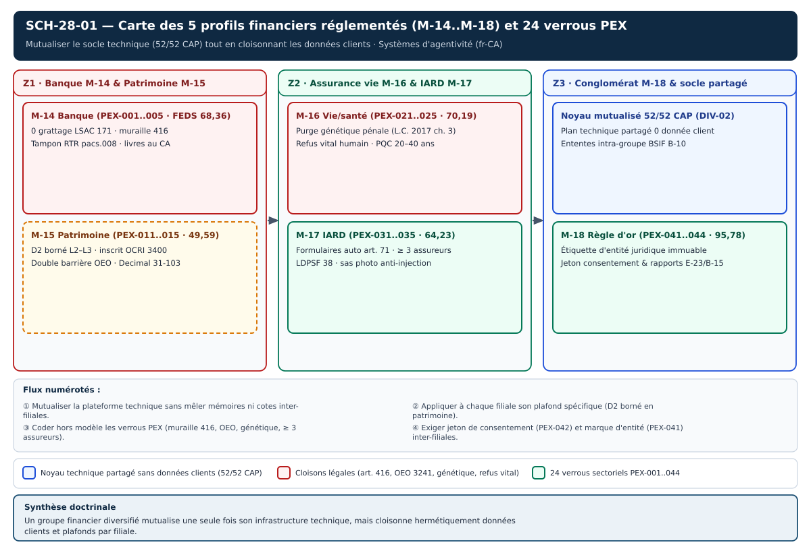
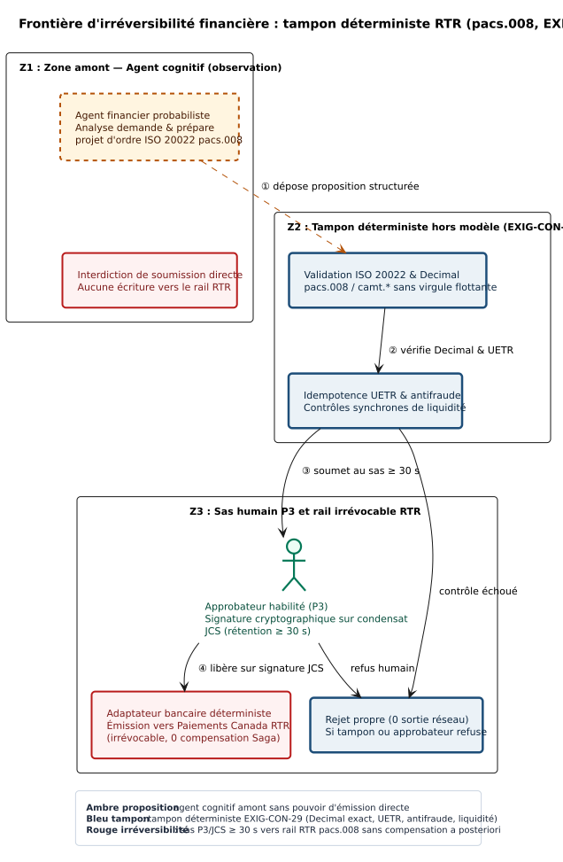
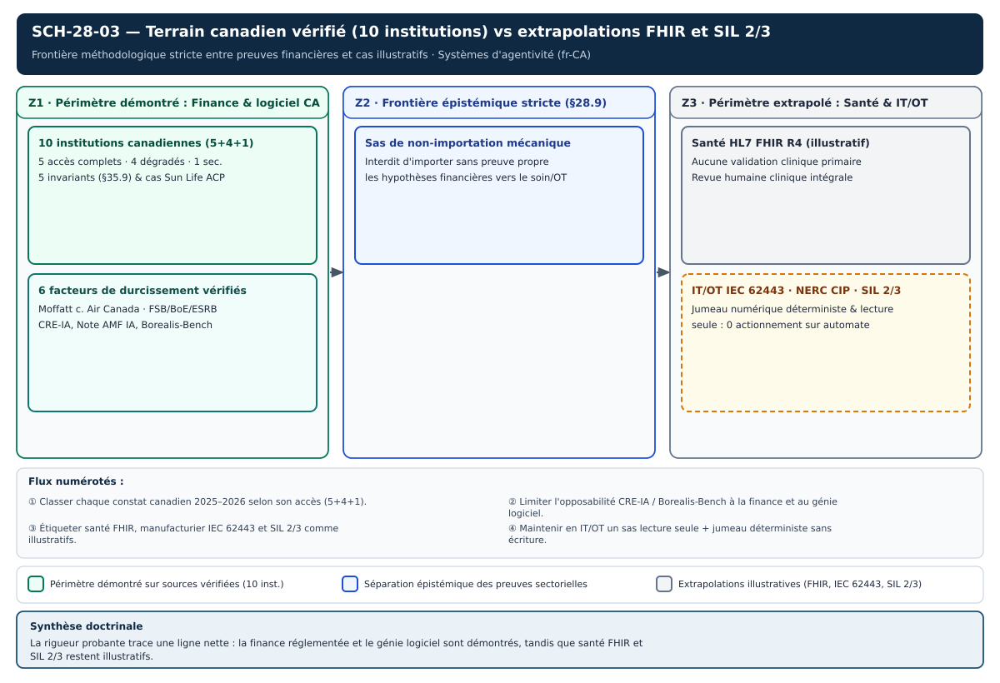

# Chapitre 28 — Cinq profils financiers réglementés et 24 propositions PEX

*Question directrice :* Comment décliner un noyau d'architecture invariant sur cinq sous-secteurs financiers réglementés sans re-dériver le socle ni franchir les plafonds d'irréversibilité, et où tracer la frontière entre les preuves financières vérifiées et les extrapolations sectorielles ?

La dixième partie (`D10`) éprouve l'assemblage des huit domaines techniques et du socle juridique (`D09`) face aux contraintes opérationnelles des secteurs hautement réglementés. Après l'énoncé des obligations québécoises, canadiennes et internationales (Chapitres 25 à 27), le présent chapitre soumet l'architecture de référence à l'épreuve du droit positif financier. Il montre qu'une banque, un courtier en valeurs mobilières, un assureur de personnes, un assureur de dommages et un conglomérat financier diversifié partagent la même infrastructure de contrôle tout en obéissant à des plafonds légaux incompatibles avec un modèle uniforme. Conformément à la clause de non-avis juridique, les analyses réglementaires qui suivent traduisent des textes primaires vérifiés en exigences d'ingénierie logicielle sans constituer une opinion juridique.

Le parcours se structure en trois temps. La première section décline les cinq profils financiers réglementés (`M-14` à `M-18`) ainsi que les vingt-quatre propositions d'exigence sectorielles (`PEX-001` à `PEX-044`) qui clôturent la divergence `DIV-02`. La deuxième section examine les six facteurs de durcissement propres à la finance, spécifie le tampon déterministe hors modèle exigé sur le rail de paiement en temps réel (`EXIG-CON-29`) et dresse le bilan empirique de dix institutions financières canadiennes observées en `2025–2026`. La troisième section fixe enfin une frontière probante stricte séparant le périmètre financier et logiciel démontré des transpositions illustratives en santé et en milieu industriel `IT/OT`.

## 28.1 Cinq profils financiers réglementés et 24 propositions PEX (DIV-02)

### 28.1.1 Déclinaison comparative sans re-dérivation et clôture de DIV-02

L'erreur la plus coûteuse en architecture financière consiste à concevoir une pile technique distincte pour chaque ligne d'affaires ou, à l'inverse, à imposer les règles de la banque de détail à la gestion de patrimoine et à l'assurance. L'analyse transversale des cinq sous-secteurs — secteur bancaire (`M-14`), patrimoine (`M-15`), assurance de personnes (`M-16`), dommages IARD (`M-17`) et conglomérat financier (`M-18`) — démontre la portabilité sans re-dérivation du socle cible de `52` capacités (`CAP-001` à `CAP-052`, dont `42` capacités invariantes du noyau possédé et `10` capacités conditionnelles). Chaque filiale réutilise les mêmes fondations de passerelle, d'identité non humaine et de journalisation, mais branche son vocabulaire sémantique propre (Chapitre 10) : `MISMO` pour le crédit hypothécaire, `ACORD` en assurance de dommages, `HL7 FHIR` en assurance de personnes et `CDM` (*Common Domain Model*) en gestion de patrimoine.

Lors de l'unification documentaire des référentiels antérieurs, l'écart `DIV-02` signalait vingt-quatre propositions sectorielles (`PEX-001` à `PEX-044`) dépourvues de raccordement direct avec `CRE-IA-2026-01`. La clôture sur pièce contre la version `1.2` (`305` exigences, reprise au Chapitre 36) résorbe cet écart selon la matrice synchronisée : `5` couvertures directes (après ajout d'`EXIG-CON-27` à `29` et d'`EXIG-SEC-27` à `28`), `12` extensions et `7` comblements (remplaçant le bilan `13` / `11` hérité de `v1.1`). Ces sept comblements visent la `LSAC` (`art. 171` [7]), l'article `416` de la *Loi sur les banques* [4], les règles de l'`OCRI`, la `NC 31-103` [6], la génétique, la `LDPSF` et le climat.

Sept questions structurantes gouvernent l'arbitrage entre productivité assistée et autonomie transactionnelle à travers ces sous-secteurs : le périmètre des données sensibles, la réversibilité de l'acte, la personne habilitée à engager l'institution, le délai maximal de traitement, la durée de conservation probatoire, la responsabilité du mandataire et l'étanchéité juridique entre entités d'un même groupe. En parallèle, l'évaluation artificielle `FEDS` (*Framework for Evaluation in Design Science*) issue du corpus interne (`Tome 4` et `Tome 5`, banc `Borealis-Bench` absent du disque) — bornée au périmètre logiciel sous plafond `C07 = 65,0 %` — attribue à chaque profil un indice synthétique de charge de contrôle de `49,59 / 100` à `95,78 / 100`. Ces cotes mesurent l'intensité relative des verrous requis et confirment la contrainte maximale des conglomérats.

### 28.1.2 Banque (M-14, PEX-001–005) et gestion de patrimoine (M-15, PEX-011–015)

Le profil **Banque et coopératives de dépôt (`M-14`)** présente une charge `FEDS` calibrée à `68,36 / 100` (`PEX-001` à `PEX-005` : `1` directe, `2` extensions et `2` comblements en `v1.2`). Promulguée le `26 mars 2026` sous la cote `L.C. 2026, ch. 3` (`art. 224`), la *Loi sur les services bancaires axés sur les consommateurs* prohibe en son article `171` le grattage d'écran par identifiant client dès son entrée en vigueur par décret [7]. La proposition `PEX-001` (comblement) bloque tout agent simulant une session usager et impose l'accréditation au registre de la Banque du Canada (`art. 44` [7]) sous `POR-008`, tandis que le projet de règlement de juin `2026` (`Tome 4`, hors `L+`) vise une disponibilité ouverte de `99,5 %`.

Trois autres verrous encadrent la banque de détail et de gros. D'abord, `PEX-002` (extension d'`EXIG-CON-06`) lie cryptographiquement chaque consentement exprès à un produit précis (`art. 627.08` [4]), garantit `7` ans de conservation des dossiers de plainte (`art. 627.44` [4]) et vise `5` ans pour le registre des consentements ouverts selon le projet de règlement (`Tome 4`, hors `L+`). Ensuite, `PEX-003` (comblement) code hors modèle la muraille bancassurance issue de l'article `416` de la *Loi sur les banques* [4] et de `DORS/92-330` (`Tome 4`, hors `L+`) : aucun agent ne peut promouvoir une assurance non autorisée ni transférer de données vers une filiale d'assurance, hors les huit produits permis par règlement.

Enfin, `PEX-005` (extension) maintient les livres comptables au Canada selon les articles `238` et `239` de la *Loi sur les banques* [4], active les alertes électroniques de solde sous `100 $ CA` (`art. 627.13` [4]) et proscrit le terme « ombudsman » interne (`art. 627.43(2)` [4]). Elle applique aussi le délai de `56` jours aux plaintes (`DORS/2021-181`, `Tome 4`, hors `L+`), tandis que `PEX-004` (directe, `EXIG-CON-29`) verrouille le rail `pacs.008` (§ `28.2.2`).

Le profil **Gestion de patrimoine et valeurs mobilières (`M-15`)** affiche une charge `FEDS` calibrée à `49,59 / 100` mais impose le plafond d'autonomie le plus bas sur le conseil (`D2`), verrouillé en exploitation bornée (`L1`–`L2`, sans autonomie fédérée inter-organisations). En vertu de l'article `415` de la *Loi sur les banques*, le commerce des valeurs mobilières demeure proscrit aux banques hors exceptions et relève des inscrits [4]. Sur les cinq propositions `PEX-011` à `PEX-015` (`2` directes, `1` extension, `2` comblements), `PEX-011` (`EXIG-CON-27`) rattache la convenance client à une personne physique inscrite, selon les règles `3400` et `1103(2)` de l'`OCRI` et l'Avis `11-348` (`Tome 4`, hors `L+`, `ciro.ca` et `securities-administrators.ca` étant en statut `F`). L'agent prépare la synthèse explicable mais ne valide jamais seul la recommandation.

Pour les comptes sans conseils (*Order-Execution-Only*, `OEO`), `PEX-012` (comblement) érige une double barrière conforme aux règles `3240` et `3241` de l'`OCRI` (`Tome 4`, hors `L+`) : elle bloque tout conseil personnalisé et rejette tout ordre issu directement d'un agent client externe. `PEX-013` (`EXIG-CON-28`) soumet toute communication sur les capacités de l'IA à un superviseur désigné, bloque l'*AI washing* et impose `7` ans d'archivage (règles `3600` et `3803`, `Tome 4`, hors `L+`). De leur côté, `PEX-014` (extension) applique les amendements à la Norme canadienne `31-103` du `8 octobre 2026` interdisant les rétrofacturations (*chargebacks*) à compter du `1er octobre 2028` (`2028-10-01`) [6]. `PEX-015` (comblement) confie à un module `Decimal` exact le calcul quotidien des frais prescrit dès le `1er janvier 2026` (`Tome 4`, ancre `ANC-101`, hors texte `L+`).

| Profil financier | Charge FEDS (artificielle) | Propositions PEX et bilan DIV-02 (`v1.2`) | Ancrages juridiques et normes clés | Plafonds et verrous déterministes non négociables |
|---|---|---|---|---|
| `M-14` Banque et coopératives | `68,36 / 100` | `PEX-001` à `PEX-005` (`1` dir., `2` ext., `2` combl.) | `LSAC` art. `44`, `171` [7], *Loi sur les banques* art. `239`, `416`, `627.*` [4], `DORS/92-330` (repérage), `EXIG-CON-29`, `SIG-103`, `SIG-104`, `DISC-01`, `DISC-05` | Zéro grattage d'écran, muraille bancassurance hors modèle, cible ouverte `99,5 %` (`POR-008`), tampon `RTR` `pacs.008`, livres au Canada, conservation `5` / `7` ans (`56` j) |
| `M-15` Gestion de patrimoine | `49,59 / 100` | `PEX-011` à `PEX-015` (`2` dir., `1` ext., `2` combl.) | `NC 31-103` [6], `OCRI 3400` / `3240` / `3241` / `3600` / `3803` (`statut F`, repérage), `EXIG-CON-27`, `EXIG-CON-28`, `SIG-105` | Conseil `D2` plafonné, convenance liée à un inscrit, double barrière `OEO`, fin des rétrofacturations le `1er octobre 2028` [6], calculs de frais en `Decimal`, archive `7` ans |

*Tableau 28.1 — Synthèse normative et architecturale des profils `M-14` (Banque) et `M-15` (Gestion de patrimoine).*

### 28.1.3 Assurance de personnes (M-16, PEX-021–025) et assurance de dommages (M-17, PEX-031–035)

Le profil **Assurance de personnes (`M-16`)** couvrant l'assurance vie, l'invalidité, la maladie et les rentes obtient une charge `FEDS` calibrée à `70,19 / 100`. Ses cinq propositions (`PEX-021` à `PEX-025` : `2` couvertures directes, `2` extensions et `1` comblement en `v1.2`) concentrent les sanctions pénales et les durées de rétention longues du secteur financier. `PEX-021` (comblement) exécute hors modèle l'interdiction pénale de la *Loi sur la non-discrimination génétique* (`L.C. 2017, ch. 3`, repérage `Tome 4`, hors base fermée `L+`) : un filtre déterministe inspecte tout flux documentaire avant l'ingestion en mémoire `CoALA` ou l'appel d'inférence afin de caviarder tout résultat d'analyse ADN, ARN ou chromosomique. Parallèlement, `PEX-022` (extension) vérifie l'existence d'un consentement exprès distinct et borné dans le temps avant toute requête vers le réseau sociosanitaire au titre du cadre législatif québécois régissant les renseignements sociosanitaires (`L.Q. 2023, c. 5`, repérage `Tome 4`, hors base `L+`).

Sur le plan décisionnel, `PEX-023` (couverture directe liée à `EXIG-AMF-12` et à l'article `12.1` de la *Loi 25* [1]) interdit tout refus d'assurabilité ou toute cessation automatisée de prestation vitale sans examen effectif par un tarificateur ou gestionnaire humain qualifié. Cette contrainte converge avec le classement à haut risque des systèmes de tarification en assurance vie et maladie prévu à l'Annexe III, point `5(c)`, du règlement européen sur l'IA (`SRC-060`). En distribution, `PEX-024` (extension liée à `EXIG-AMF-06`) étend l'obligation d'inventaire, d'homologation et de collecte probatoire aux agents exploités par les sociétés mandataires (*Managing General Agents*, `MGA`). Enfin, `PEX-025` (couverture directe via `EXIG-SEC-27` et `EXIG-SEC-28`) répond à la longévité des polices vie et rentes en imposant, selon la cible de conservation longue du traité (`20` à `40` ans documentés au `Tome 5`), une conservation bi-temporelle chiffrée par algorithmes post-quantiques afin qu'un dossier médical souscrit aujourd'hui ne puisse pas être déchiffré rétroactivement durant la vie du contrat.

Le profil **Assurance de dommages IARD (`M-17`)** présente une charge `FEDS` calibrée à `64,23 / 100` pour `PEX-031` à `PEX-035` (`3` extensions et `2` comblements en `v1.2`). Il se caractérise par un régime bimodal en indemnisation : `PEX-031` (extension) impose un profil pré-homologué d'élasticité capacitaire (visant les lignes directrices prudentielles `BSIF B-9` et `E-21`, repérage `Tome 4`, hors base `L+`) pour absorber les pics climatiques lors de l'ouverture des dossiers (*First Notice of Loss*, `FNOL`), tout en bloquant tout refus automatisé d'indemnisation hors de l'autorité d'un expert en sinistres certifié (`EXIG-AMF-12`, `Loi 25` art. `12.1` [1]). En émission de polices, `PEX-032` (extension) interdit à un modèle de langage de rédiger des clauses automobiles libres et confine l'agent à l'assemblage déterministe des formulaires approuvés en vertu de l'article `71` de la *Loi sur les assureurs* (`L.Q. 2018, c. 23`, repérage `Tome 4`, hors base `L+`).

Dans les réseaux de courtage indépendants, `PEX-033` (comblement lié à `EXIG-AMF-11`) rend vérifiable dans un journal probatoire l'obligation prévue à l'article `38` de la *Loi sur la distribution de produits et services financiers* (`LDPSF`, repérage `Tome 4`, hors base `L+`) de recueillir des soumissions auprès d'au moins `3` assureurs n'appartenant pas au même groupe financier. En parallèle, `PEX-034` (extension) attribue des identités non humaines révocables par cabinet partenaire (`BSIF B-10` [3]) et place un sas de décontamination multimodale devant les photographies de sinistres pour neutraliser les injections dissimulées dans les métadonnées ou pixels. Finalement, `PEX-035` (comblement) soumet à validation indépendante de deuxième ligne les modèles externes de catastrophe (`BSIF B-9`, repérage `Tome 4`) et impose le suivi des émissions associées à l'assurance en vue des divulgations climatiques (`BSIF B-15`, archivé au corpus sous `SRC-110` pour l'exercice `2028`), sous surveillance continue des signaux `SIG-109` et `SIG-110`.

### 28.1.4 Groupe financier diversifié (M-18, PEX-041–044) : mutualiser le socle, cloisonner les données

Le cinquième profil, **Groupe financier diversifié (`M-18`)**, atteint la charge `FEDS` la plus élevée à `95,78 / 100` en mobilisant l'intégralité des `52/52` capacités de l'architecture cible. Ses quatre propositions (`PEX-041` à `PEX-044`, toutes `4` des extensions en `v1.2`) appliquent le principe directeur `PRI-010` et la capacité `CAP-021` pour réfuter la tentation d'un socle unique fusionnant les contextes clients entre banque, patrimoine et assurances. La règle d'or conglomérale impose de mutualiser une seule fois l'infrastructure technique — passerelles, moteur d'exécution durable, service d'identité non humaine et observabilité — tout en maintenant des cloisons juridiques et sémantiques hermétiques par personne morale.

Techniquement, `PEX-041` (`EXIG-CON-06`) attache à chaque jeton de session, vecteur d'index et écriture mémoire une étiquette immuable d'entité juridique qui applique hors modèle la muraille banque-assurance. Dès qu'une requête franchit la frontière de deux filiales pour transporter des renseignements personnels, `PEX-042` exige un jeton cryptographique lié à un consentement manifeste, libre, éclairé, spécifique et présenté distinctement, conforme aux exigences de la *Loi 25* (`art. 9` modifiant `art. 53.1` [1]). En outre, la Partie XI de la *Loi sur les banques* (articles `485.1` à `506`) impose des conditions de concurrence normale pour toute prestation de services intra-groupe, limite sauf autre pourcentage réglementaire l'exposition envers un apparenté non institutionnel à `5 %` du capital réglementaire (`art. 495.2(1)`) et prohibe tout transfert de clientèle non autorisé [4].

Sur le plan contractuel, `PEX-043` encadre la plateforme partagée par des ententes intra-groupe conformes à la ligne directrice `B-10` du BSIF [3], qui inclut expressément les entités affiliées et sociétés mères dans le périmètre des accords avec des tiers et exige un plan de sortie proportionnel aux risques et testable pour chaque filiale. Enfin, `PEX-044` (`EXIG-CON-25`) désagrège par personne morale les livres comptables (`art. 239` [4]), les inventaires de modèles (`BSIF E-23` [2] et repère `AMF` sous réserve via la source secondaire `AIBanks.ca`, portail en statut `F` [5]) ainsi que les déclarations d'émissions financées et assurées (`BSIF B-15`, `SRC-110`), tout en préparant la révision statutaire fédérale du `30 juin 2033` (`2033-06-30`, `art. 21`) prévue par la *Loi sur les banques* [4]. Externaliser ces frontières statutaires dans des politiques déclaratives prêtes à évoluer permet au groupe d'absorber sans refonte logicielle l'issue de la révision législative décennale.

| Profil financier | Charge FEDS (artificielle) | Propositions PEX et bilan DIV-02 (`v1.2`) | Ancrages juridiques et normes clés | Plafonds et verrous déterministes non négociables |
|---|---|---|---|---|
| `M-16` Assurance de personnes | `70,19 / 100` | `PEX-021` à `PEX-025` (`2` dir., `2` ext., `1` combl.) | `L.C. 2017, ch. 3` et `L.Q. 2023, c. 5` (repérage), `Loi 25` art. `12.1` [1], `EXIG-AMF-06`, `EXIG-AMF-12` | Purge génétique pénale pré-mémoire, consentement santé distinct, révision humaine sur refus vital, suivi `MGA`, chiffrement `PQC` `20`–`40` ans |
| `M-17` Assurance de dommages | `64,23 / 100` | `PEX-031` à `PEX-035` (`0` dir., `3` ext., `2` combl.) | *Loi sur les assureurs* art. `71` et `LDPSF` art. `38` (repérage), `BSIF B-9` / `E-21` / `B-10` [3] / `B-15`, `EXIG-AMF-11`, `SIG-109`–`110` | Élasticité catastrophique pré-homologuée, refus par expert certifié, formulaires auto déterministes, comparaison `≥ 3` assureurs hors groupe, sas photo |
| `M-18` Groupe diversifié | `95,78 / 100` (`52/52 CAP`) | `PEX-041` à `PEX-044` (`0` dir., `4` ext., `0` combl.) | `PRI-010`, `CAP-021`, `EXIG-CON-06`, `EXIG-CON-25`, `BSIF B-10` [3], *Loi sur les banques* (`art. 495.2`, `2033-06-30`) [4] | Mutualisation du plan technique sans données clients, étiquette d'entité immuable, jeton de consentement inter-filiales, ententes `B-10`, rapports désagrégés |

*Tableau 28.2 — Synthèse normative et architecturale des profils `M-16` (Assurance de personnes), `M-17` (Assurance de dommages) et `M-18` (Groupe financier diversifié).*

La *Figure 88* synthétise cette architecture conglomérale à cinq ailes spécialisées reposant sur un socle technique commun, illustrant comment les `24` verrous `PEX` s'exécutent dans le code déterministe sans fragmenter l'infrastructure.

*Figure 88 — SCH-28-01 : Répartition des cinq profils financiers (`M-14` à `M-18`), de leurs charges `FEDS` calibrées et de leurs cloisons juridiques non délégables (`PEX-001` à `PEX-044`) autour d'un noyau technique mutualisé (`52/52 CAP`, clôture `DIV-02`).*

> **Trois invariants exécutables — Chapitre 28**
> 1. **Cloisonnement juridique et mutualisation sans données (`PRI-010`, `PEX-041` à `PEX-044`)** — Mutualiser les passerelles, l'identité non humaine et la télémétrie sous ententes intra-groupe `BSIF B-10`, tout en propageant une étiquette immuable d'entité juridique et un jeton de consentement exprès distinct avant tout transfert entre filiales.
> 2. **Tampon déterministe avant toute écriture irrévocable (`EXIG-CON-29`, `PEX-004`)** — Interdire la soumission directe vers le rail `Paiements Canada RTR` (`pacs.008`) et la compensation Saga a posteriori ; imposer validation de schéma `ISO 20022`, arithmétique `Decimal`, clé `UETR`, contrôles synchrones antifraude et signature `P3` sur condensat `JCS` avec rétention minimale de `30` secondes.
> 3. **Attribution obligatoire et frontière probante stricte** — Attribuer chaque métrique sectorielle à sa source primaire datée, maintenir les portails inaccessibles en statut bloqué sans contournement, et séparer explicitement le périmètre financier et logiciel vérifié des extrapolations illustratives `HL7 FHIR R4` et `IT/OT SIL 2/3`.

## 28.2 Durcissement financier, rail RTR ISO 20022 et terrain canadien 2025–2026

### 28.2.1 Six facteurs de durcissement financier et double qualification

Si le socle technique d'orchestration reste partagé avec d'autres secteurs, la finance réglementée impose un durcissement architectural spécifique expliqué par six facteurs structurels convergents. Le premier facteur tient à **l'irréversibilité et à la finalité du règlement** : un virement instantané confirmé, un ordre exécuté en bourse ou une prestation versée produisent un état économique définitif qui impose de dissocier la préparation probabiliste par l'agent de la libération déterministe ou humaine. Le deuxième facteur relève du **risque systémique et de la corrélation**, documenté au `Tome 1` (`§ 31.1`, hors base fermée `L+`). Des travaux du `FSB`, de la Banque d'Angleterre (`BoE`) et de l'`ESRB` avertissent que des agents partageant les mêmes modèles de fondation risquent d'amplifier des mouvements procycliques et de concentrer la dépendance critique.

Le troisième facteur concerne la **responsabilité juridique et de conduite**. L'affaire *Moffatt v. Air Canada* (tranchée le `14 février 2024` par le *Civil Resolution Tribunal* de la Colombie-Britannique pour `650,88 $ CA`, repérage `Tome 1 § 31.1.3` sous régime `[C]` hors `L+`) illustre qu'un agent conversationnel dépourvu de personnalité juridique engage l'entreprise lorsqu'il informe erronément un usager ; en finance, la même imputabilité frappe la convenance et les communications commerciales, soumises à la règle `non-avis` (`AO-05`). Le quatrième facteur forme le patron-signature du domaine : la **double qualification** simultanée d'un même agent comme *modèle* (`BSIF E-23` [2]) et comme *actif tiers technologique* (`BSIF B-10` [3]). Aucun outil commercial ne dispense l'institution de tenir ces deux registres coordonnés.

Le cinquième facteur réside dans l'exposition accrue à la **fraude et au blanchiment d'argent (`LBC-AML`)**, où des agents mal cloisonnés deviennent des vecteurs d'évasion de seuils ou d'ingénierie sociale automatisée. Enfin, le sixième facteur porte sur la **standardisation ouverte des contrôles sectoriels** illustrée par *FINOS AI Governance Framework v2.0* (`Tome 1 § 31.3.3`, hors `L+`), qui confronte les contrôles de modèle à une taxonomie vérifiable. L'étude empirique de Milsom (`arXiv:2512.02230`) conclut de son côté que les agents LLM en gestion de patrimoine sont limités moins par le raisonnement arithmétique que par la fiabilité de bout en bout des flux et la dérive d'autonomie, justifiant des schémas contraints [8].

### 28.2.2 Tampon déterministe hors modèle sur le rail RTR ISO 20022 (EXIG-CON-29)

L'articulation entre l'irréversibilité financière et l'exécution durable trouve sa concrétisation la plus rigoureuse dans l'exigence `EXIG-CON-29`, ajoutée à la version `1.2` de `CRE-IA-2026-01` lors de l'actualisation de novembre `2026`. Le **Rail en temps réel (`RTR`) de Paiements Canada** — dont la cible de mise en production du `9 novembre 2026` et la spécification `ISO 20022` (`pacs.008` pour les virements de crédit, `camt.*` pour les avis de trésorerie) proviennent du repérage interne (`Tome 2` et `Tome 4`, hors `L+`) — vise un règlement irrévocable en quelques secondes. Cette propriété annule l'hypothèse fondamentale du patron Saga examiné au Chapitre 15 : une fois le message `pacs.008` acquitté sur le rail, aucune transaction compensatoire automatique ne peut annuler le transfert de fonds ; seul un processus contentieux de recouvrement interbancaire demeure envisageable, sans garantie d'issue.

En conséquence, `EXIG-CON-29` (`PEX-004`) interdit formellement à tout agent probabiliste de détenir un droit de soumission directe vers l'adaptateur `RTR`. Comme le détaille la *Figure 89*, l'agent demeure cantonné dans la zone amont d'observation et de synthèse, où il rédige une proposition structurée d'ordre `pacs.008`. Cette proposition doit traverser un **tampon déterministe hors modèle** codé intégralement en logiciel traditionnel et exécutant quatre contrôles synchrones bloquants avant toute libération :

1. **Validation syntaxique, sémantique et décimale exacte** : contrôle contre le schéma `ISO 20022` (`EXIG-CON-29`) et conversion monétaire en arithmétique décimale exacte (`Decimal`, sans flottant binaire `IEEE-754`) dans la trousse du Tome 8 (`policy_saga/decimal_money.py`).
2. **Idempotence racine et suivi `UETR`** : génération et vérification d'une clé d'idempotence liée à l'identifiant unique de transaction de bout en bout (*Unique End-to-End Transaction Reference*, `UETR`) afin d'empêcher tout double paiement lors de reprises réseau.
3. **Contrôles synchrones antifraude et liquidité** : évaluation déterministe des plafonds de contrepartie, des listes de sanctions, des soldes disponibles et des vélocités horaires.
4. **Sas d'approbation `P3` lié au condensat `JCS`** : conformément à `EXIG-INT-22`, tout paiement ou virement déclenché par agent relève du palier `P3` (zéro paiement automatisé en l'absence de l'utilisateur) et exige une approbation humaine hors bande propre à la transaction. Sur le rail `RTR` (`EXIG-CON-29`), dès franchissement du seuil de matérialité ou de risque fixé par l'institution (paramètre interne sans montant universel au cadre), l'approbateur signe hors bande le condensat canonique `RFC 8785` (`JCS`) exact du bénéficiaire, du compte et du montant, avec second approbateur en classe Élevée (`EXIG-AUT-15`). La trousse exécutable (`authz_pqc_audit/ciba_approval.py`) contrôle le jeton `CIBA`, l'empreinte `JCS`, l'unicité `jti` et l'expiration (`≤ 15` minutes selon `EXIG-AUT-12`).

Sur le plan temporel, le tampon dissocie deux fenêtres complémentaires entre `EXIG-INT-22` et `EXIG-CON-29`. Les trois premiers contrôles déterministes (`ISO 20022`/`Decimal`, clé `UETR`, antifraude et liquidité) s'exécutent dans un budget synchrone court de passerelle (de l'ordre de quelques millisecondes d'après les mesures `PEP` du `Tome 5`, hors latence humaine) avant toute ouverture réseau. En complément du mandat `P3` prescrit pour tout paiement par `EXIG-INT-22`, `EXIG-CON-29` ajoute sur le rail `RTR` (`pacs.008`) — au-delà du seuil de risque institutionnel — une **fenêtre de rétention minimale de `30` secondes** qui retarde l'envoi afin de permettre l'arrêt avant irrévocabilité, sans se confondre avec la validité maximale de `15` minutes du jeton `CIBA` (`EXIG-AUT-12`). Si l'un des quatre contrôles échoue, si l'approbateur refuse ou si le jeton expire (`exp ≤ now_ts`), l'adaptateur bancaire émet un rejet propre à zéro sortie réseau vers `pacs.008` et impose une nouvelle demande liée au condensat exact.

*Figure 89 — SCH-28-02 : Séparation entre la zone probabiliste amont (`Z1`), le tampon déterministe `EXIG-CON-29` en arithmétique `Decimal` et `UETR` (`Z2`) et le sas humain `P3` sur condensat `JCS` avec rétention `≥ 30` s avant l'émission irrévocable `pacs.008` (`Z3`).*

### 28.2.3 Bilan empirique des dix institutions canadiennes (2025–2026)

L'analyse des cadres juridiques ne suffit pas sans confrontation au terrain réel. Le recensement empirique des annonces et rapports publics publiés en `2025–2026` par dix grandes institutions financières canadiennes — `TD` (avec `Layer 6`), `Scotiabank`, `RBC`, `Manuvie`, `Desjardins`, `CIBC`, `Intact`, `BMO`, `Sun Life` et `Banque Nationale` — impose une hygiène documentaire stricte. Toutes les métriques chiffrées publiées par ces institutions sont **auto-déclarées** dans des communiqués de presse, présentations aux investisseurs ou rapports annuels et n'ont fait l'objet d'aucune vérification technique indépendante sur leurs environnements internes. Elles doivent donc toujours être citées avec leur émetteur, leur date et leur support, sans jamais être additionnées lorsque leurs unités diffèrent.

L'observation met en lumière une forte asymétrie documentaire répartie au recensement du `Tome 1` (Chapitre 35, hors base `L+`) selon trois classes d'accès (`5 + 4 + 1`). Cinq institutions disposaient de sources primaires directement accessibles (`TD`, `RBC`, `Desjardins`, `CIBC`, `Intact`), contre quatre en accès dégradé (`Scotiabank`, `Manuvie`, `BMO`, `Sun Life`) et une sans source primaire publique au gel du `Tome 1` (`Banque Nationale`, notée toutefois `69 / 100` dans l'index secondaire tiers `AIBanks.ca` du `1er novembre 2026` [5]).

Par ailleurs, la collecte maintient en statut bloqué les portails `lautorite.qc.ca`, `ciro.ca` et `securities-administrators.ca` (`HTTP 403` sans contournement). Les textes applicables sont dès lors corroborés par leurs publications ouvertes (`NC 31-103` via la CVMO [6], lois fédérales [4, 7], *Loi 25* [1], BSIF [2, 3] et la source secondaire `AIBanks.ca` sous réserve [5]).

| Institution canadienne | Classe d'accès (`5+4+1`, `Tome 1`) | Faits publics datés et attribués (`2025–2026`, repérage `Tome 1 § 35`) | Portée réelle et réserves probatoires obligatoires |
|---|---|---|---|
| `TD` (`Layer 6`) | Directe (`1`) | Communiqué du `21 mai 2026` : pré-adjudication hypothécaire et mémos pour souscripteurs (`~15 h` à `< 3 min`, résultat préliminaire) ; prix `DataIQ 2025` ; `5` critères de gouvernance | L'outil prépare et documente la décision pour le souscripteur humain sans architecture d'exécution publiée |
| `Scotiabank` | Dégradée (`2`) | Source de `juillet 2025` (retirée ensuite, corroborée par `MIT Sloan Management Review`) : plateforme de `2018` traitant `~90 %` de `~1 500` courriels/j (`60 000`–`70 000` demandes/mois) ; revue d'impact éthique préalable | Courriels et demandes ne s'additionnent pas ; aucune description d'architecture de mandat |
| `RBC` | Directe (`1`) | Communiqué du `18 février 2026` : groupe IA rattaché au chef de la direction ; `~27 000` et `8 000` utilisateurs déclarés sur `2` plateformes internes ; cible `700 M$`–`1 G$` d'ici `2027` ; `4` axes | Les deux populations (`27 000` et `8 000`) ne s'additionnent pas faute de périmètre disjoint documenté |
| `Manuvie` | Dégradée (`2`) | Communiqué conjoint du `10 mars 2026` (sur miroirs) : environnement d'exécution nommé « en bêta » ; cible `> 1 G$` d'ici `2027` (`~300 M$` fin `2025`) ; `1er` rang vie `Evident AI Index` (`juin 2026`) | Seule institution nommant une brique d'exécution, explicitement déclarée en bêta |
| `Desjardins` | Directe (`1`) | Rapport annuel `2025` audité : orientation stratégique `2026–2029` incluant IA générative et suite bureautique assistée | État d'intention stratégique formalisé (`Tome 1 § 35.5`) ; aucune métrique agentique de production déclarée |
| `CIBC` | Directe (`1`) | Communiqué du `27 mai 2025` : plateforme générative interne (`> 200 000 h` sur pilote `10` mois, formation requise) ; code volontaire fédéral (`mars 2025`) | **Fait négatif vérifié** : le communiqué décrit une assistance générative et exclut tout terme agentique |
| `Intact` | Directe (`1`) | Rapport annuel `2025` (`26 mars 2026`) : `> 600` experts, `~600` modèles, `> 200 M$` bénéfices annuels, `> 90 %` lignes personnelles tarifées par ML (`60 %` commerciales) | Industrialisation ML majeure sans emploi du vocabulaire agentique dans la lettre du dirigeant |
| `BMO` | Dégradée (`2`) | Communiqué du `17 juin 2025` (`lancement mai 2025`) : assistant d'accès aux politiques internes ; ateliers `Vector Institute` ; rubrique risque IA (`3 décembre 2025`) | Le chiffre `8 000` (employés selon concours distinct) ne figure pas au communiqué et reste à ré-instruire |
| `Sun Life` | Dégradée (`2`) | Communiqué du consortium du `7 juillet 2026` : programme phare de plan de contrôle agentique traitant `> 2` billions de jetons/mois entre membres | **Homonymie levée** : ce programme n'a aucun lien avec l'ancien protocole `ACP` ; aucune imputation individuelle possible |
| `Banque Nationale` | Aucune source primaire (`3`) | Aucune source primaire retenue au gel du `Tome 1` (notée `69 / 100` dans l'index secondaire tiers `AIBanks.ca` du `1er novembre 2026` [5]) | **Absence documentée** au `Tome 1`, non preuve d'inactivité ; la discrétion publique ne mesure pas l'état interne |

*Tableau 28.3 — Bilan documentaire des dix institutions financières canadiennes observées en `2025–2026` (classes d'accès `5+4+1`, repérage `Tome 1 § 35`).*

De ce croisement découlent deux enseignements majeurs pour l'ingénierie canadienne. Premièrement, « le mot ne mesure pas la chose » : la `CIBC` déploie une plateforme d'assistance générative à grande échelle sans utiliser le mot « agentique », tandis qu'`Intact` exploite près de `600` modèles prédictifs en tarification sans recourir à ce lexique, à l'opposé d'annonces qualifiant d'« agentique » de simples copilotes documentaires. Deuxièmement, les cinq institutions publiant un dispositif identifiable de gouvernance (`TD`, `Scotiabank`, `RBC`, `Manuvie` et `CIBC`) se rejoignent sur cinq invariants de façade (`Tome 1 § 35.9`) : elles gouvernent le *modèle*, les *principes éthiques* (oscillant entre explicabilité et transparence) ou le *rang hiérarchique* d'un responsable nommé, mais aucune source primaire publique examinée ne documente encore ni la *chaîne de mandat cryptographique* entre l'humain et l'agent, ni le *positionnement d'orchestration* (`OO1`–`OO4`). Ce double angle mort justifie précisément les verrous de la Partie X et la préparation de l'échéance du `1er mai 2027` pour la ligne directrice `E-23` du BSIF [2] et l'encadrement attendu de l'AMF (corroboré sous réserve via la source secondaire `AIBanks.ca`, portail AMF en statut `F` [5]).

## 28.3 Frontière probante face aux extrapolations et schémas de vulgarisation

Une discipline d'ingénierie rigoureuse interdit de projeter mécaniquement des garanties démontrées dans un secteur vers un autre domaine régi par des lois physiques ou cliniques distinctes. Dès l'ouverture du cadre technique d'intégration et dans l'ensemble du présent traité, une frontière méthodologique stricte sépare deux périmètres :

- **Le périmètre démontré sur pièces** couvre exclusivement les services financiers réglementés (`BCA`, référentiel `CRE-IA-2026-01 v1.2` et profil québécois `AMF IA`) ainsi que l'infrastructure logicielle déterministe vérifiée mécaniquement en barrière `G0` par la trousse exécutable du Tome 8 (`policy_saga`, `policies_opa`, `authz_pqc_audit`, `evalops_prr` : `83/83` tests `pytest` et `45/45` tests `OPA` à `100,0 %`), complétée par les campagnes synthétiques `FEDS` documentées aux `Tome 4` et `Tome 5` (`Borealis-Bench`, absent du disque au `Tome 8`).
- **Le périmètre extrapolé à titre purement illustratif** englobe les scénarios de santé utilisant `HL7 FHIR R4`, l'automatisation manufacturière `IT/OT` inspirée de l'usine `BEL` de Trois-Rivières sous `IEC 62443`, ainsi que les environnements énergétiques et miniers soumis à `NERC CIP` ou aux systèmes instrumentés de sécurité `IEC 61511 SIL 2/3`.

Dans ces domaines non financiers, aucune validation clinique primaire ni aucune certification de sûreté fonctionnelle n'est revendiquée. Par mesure de précaution absolue, toute projection en milieu clinique impose la revue humaine intégrale par un professionnel de la santé habilité, tandis que tout raccordement `IT/OT` vers des automates programmables (`OPC UA`, `MQTT Sparkplug`) demeure confiné à un sas unidirectionnel en **lecture seule** adossé à un jumeau numérique déterministe : l'actionnement autonome direct sur équipement physique ou dispositif médical reste formellement proscrit. La *Figure 90* matérialise cette ligne de démarcation épistémique entre le terrain financier canadien vérifié et les extrapolations illustratives.

*Figure 90 — SCH-28-03 : Démarcation probatoire entre le bilan vérifié des dix institutions canadiennes (`5+4+1`, `6` facteurs de durcissement, `Z1`), le sas de non-importation mécanique (`Z2`) et les extrapolations illustratives en santé `HL7 FHIR R4` et `IT/OT SIL 2/3` en lecture seule (`Z3`).*

Les trois classes d'accès documentaire et les cinq dispositifs de gouvernance réels éclairent ainsi le fossé qui subsiste en `2026` entre la diffusion rapide d'assistants internes et l'homologation d'une boucle décisionnelle autonome. Sur le plan réglementaire, la date du `1er mai 2027` marque un point de convergence critique pour les institutions fédérales sous `BSIF E-23` [2] et pour le secteur financier québécois attendu sous la ligne directrice de l'AMF (source secondaire `AIBanks.ca`, portail AMF en statut `F` [5]), tandis que la date du `1er octobre 2028` verrouille la conformité rémunératoire en gestion de patrimoine [6]. L'alignement des `24 PEX` sur le socle `CRE-IA-2026-01 v1.2` évite aux équipes de réinventer des contrôles spécifiques à chaque sous-secteur lorsque ces échéances deviennent opposables.

Les cinq profils financiers (`M-14` à `M-18`), leurs vingt-quatre propositions `PEX` et le tampon irréversible `RTR` convertissent en exigences sectorielles le socle juridique de la Partie IX (← Chapitres 25 à 27). Le Chapitre 29 assemble ces briques en trois blueprints instanciables (`C01–C40`), précise la fédération multi-SaaS et la continuité cognitive, puis sépare le fil rouge du Groupe Boréal des preuves de la trousse (→ Chapitre 29).
