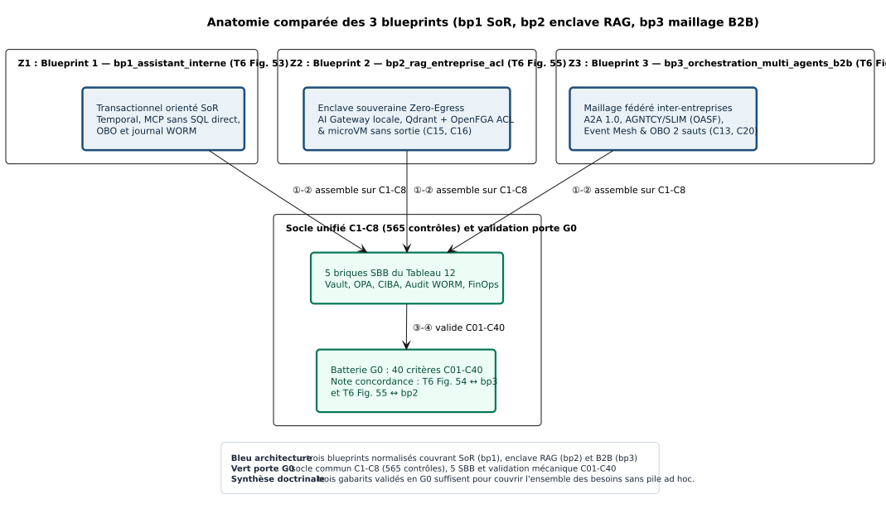
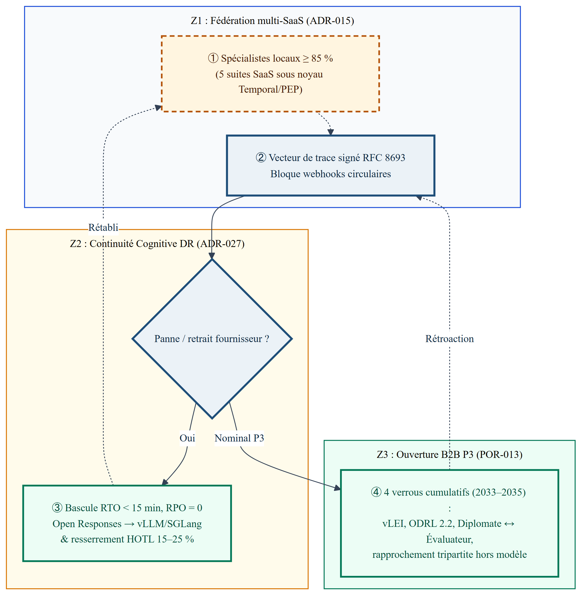
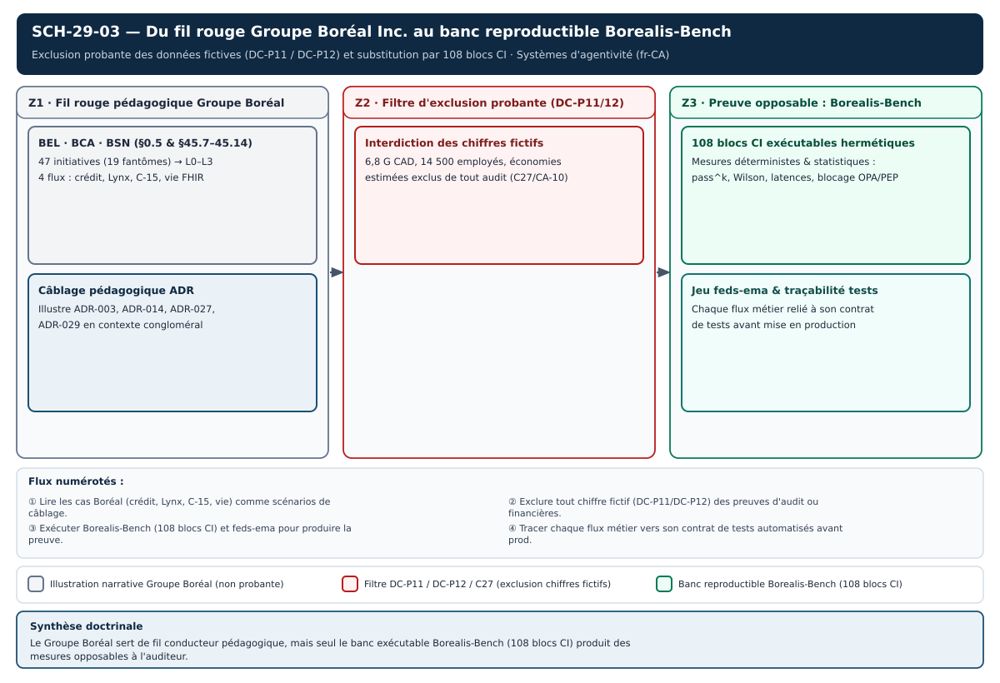

# Chapitre 29 — Trois blueprints de référence et cas Groupe Boréal (BEL)

*Question directrice :* Comment assembler le noyau de contrôle possédé en trois blueprints normalisés validables mécaniquement sur `C01–C40` et cinq briques `SBB`, assurer la fédération multi-SaaS et la reprise après sinistre cognitif, et dissocier le fil rouge pédagogique du Groupe Boréal des mesures reproductibles de `Borealis-Bench` ?

Les exigences sectorielles du Chapitre 28 demeureraient abstraites si chaque équipe devait réinventer de zéro l'assemblage des passerelles, des moteurs d'état durable, des enclaves vectorielles et des journaux d'audit. Le présent chapitre concrétise l'architecture de référence en trois **blueprints sectoriels instanciables** couvrant la quasi-totalité des besoins d'entreprise : l'assistant transactionnel interne sur systèmes d'enregistrement (`bp1_assistant_interne`), l'enclave souveraine à haute confidentialité avec recherche augmentée filtrée par habilitations (`bp2_rag_entreprise_acl`) et le maillage multi-agents fédéré inter-départemental et inter-entreprises (`bp3_orchestration_multi_agents_b2b`).

La démarche s'articule en trois volets. D'abord, la première section unifie ces trois blueprints sur le modèle en huit couches `C1–C8` (dont l'illustration par un portefeuille complet à `565` exigences en couche `C8`) et présente l'instanciation et la validation mécanique à la porte `G0` des `5` briques `SBB` du `Tableau 12` et des `40` critères `C01–C40`. Ensuite, la deuxième section résout deux défis d'exploitation transversaux — la fédération de cinq suites `SaaS` concurrentes par gravité des données (`ADR-015`) et la reprise après sinistre cognitif sous une cible de `15` minutes (`ADR-027`) — avant de poser les quatre verrous cumulatifs conditionnant l'ouverture des réseaux `B2B` au Palier 3 (`POR-013`). Enfin, la troisième section met en œuvre le cas fil rouge du **Groupe Boréal Inc.** (`BEL`, `BCA`, `BSN`) tout en appliquant la règle d'exclusion probante `DC-P11`/`DC-P12` qui substitue aux chiffres fictifs les campagnes reproductibles de `Borealis-Bench` (`108` blocs CI consignés au Corpus) et les preuves exécutables du Tome 8.

## 29.1 Trois blueprints multisectoriels (C01–C40, 5 SBB) et couche C1–C8

### 29.1.1 Socle C1–C8 à 565 contrôles, six principes et correspondance G0 (5 SBB, C01–C40)

Un blueprint d'entreprise ne se résume pas à un diagramme de conteneurs. Il relie six principes directeurs d'architecture à une pile outillée déployable sur huit strates (`C1` à `C8` : exposition, intégration applicative, messagerie, données, exécution agentique, gouvernance des modèles, observabilité et socle souverain). Cet assemblage s'ancre dans sept repères réglementaires canadiens et québécois (`BSIF E-23` [5], `BSIF B-13`, profil `AMF IA`, `Loi 25` art. `12.1` [6], `ACVM 11-348`, cadre bancaire ouvert et rails de paiement canadiens). Les six principes directeurs (`Tableau 45.1` du Tome 1) imposent d'abord l'autonomie encadrée par processus déterministe (`OO3` ou `OO4`), le transit par passerelle de politiques et la republication des contrats existants plutôt que leur réécriture. Ils exigent ensuite la résidence canadienne (illustrée en couche `C8` par un cadre d'éditeur à `565` exigences), la traçabilité hors agents et la gouvernance continue des modèles.

Conformément à la neutralité fournisseur (`Tome 1 § 45.3`), la référence datée sur `C1–C8` illustre des briques techniques sans recommandation commerciale : `IBM API Connect` (`v10.0.8` en disponibilité générale), `IBM ContextForge` (annoncé sans disponibilité générale établie), `IBM App Connect Enterprise` (`v13.0`) et `IBM MQ 9.4 LTS` (`TLS 1.3` post-quantique `ML-KEM` auto-déclaré par l'éditeur, non vérifié). Elle inclut aussi `IBM Data Fabric`, `IBM watsonx Orchestrate` / `IBM Granite 4.0`, `IBM watsonx.governance` (disponibilité générale), `IBM Instana` (observabilité d'agents en préversion publique) et `IBM Sovereign Core` (disponibilité générale du `5 mai 2026`). L'éditeur concerné ne revendique aucune conformité native à `E-23` ou `B-13`, ce cadre de `565` exigences n'équivalant pas à `B-13`, et le seul lien documenté porte sur son rôle d'opérateur des rails de paiement canadiens. Tout autre portefeuille satisfaisant aux mêmes contrats d'interface demeure interchangeable sous réserve de statuts datés et de couverture des contrôles.

Pour rendre ces trois architectures vérifiables mécaniquement avant toute mise en production sur système central, la trousse exécutable du Tome 8 matérialise les **cinq blocs de construction de solution (`5 SBB`)** laissés sans exemple au `Tableau 12` du cadre normatif. Trois relèvent du `Plan A` (`secrets_vault` via `authz_pqc_audit/obo_dpop.py` sans secret statique ; `guardrails_engine` via `policy_saga/opa_runner.py` avec `policies_opa/rule_of_two.rego` ; `signed_human_approval_service` via `authz_pqc_audit/ciba_approval.py`) et deux du `Plan B` (`immutable_audit_ledger` via `authz_pqc_audit/audit_scitt_focus.py` ; `finops_budget_quota_controller` via `policy_saga/decimal_money.py` et `audit_scitt_focus.py`).

En complément, dans `evalops_prr/prr_validators.py`, `validate_blueprints_and_c40` vérifie via `REQUIRED_BLUEPRINT_IDS` et `REQUIRED_5_SBB_SLOTS` que chaque blueprint renseigne ces cinq `SBB` et couvre `C01–C40`. D'autres validateurs vérifient les schémas JSON `Draft 2020-12` (`prr_24_evidence.schema.json`, `adr_2027_b001.schema.json` et `sandbox_manifest.schema.json` dans `policy_saga/sandbox_manifest.py`). Au gel du `2 décembre 2026`, le rapport scellé `G0` atteste `83/83` tests `pytest` réussis, `50/50` vecteurs tiers validés et `45/45` tests `OPA` couvrant à `100,0 %` les trois politiques `Rego` en mode fermé (`default allow := false` [7]).

Le contrôle de cohérence interne (`Tome 1 § 45.15`) exige en outre de vérifier la continuité du cycle de vie complet — naissance, vie et mort d'un agent d'entreprise — à travers l'ensemble de ces couches. À la naissance, l'inscription au catalogue et l'attribution de privilèges bornés doivent produire des jetons vérifiables à l'admission au maillage, plutôt que de laisser trois actes disjoints sans ancrage commun. Durant la vie opérationnelle, la délégation `RFC 8693`, l'autorisation par arête, le traçage `OpenTelemetry`, l'évaluation continue, la rotation des clés et la migration post-quantique s'exécutent de manière coordonnée. À la révocation ou au retrait, la perte d'habilitation doit se propager sans délai dans le maillage afin que l'archive probatoire conserve une séquence d'actions imputable à un mandant réel.

| Emplacement SBB (`Tableau 12`) | Plan d'appartenance | Module exécutable (`trousse/`) | Propriété mécanique vérifiée à la porte `G0` |
|---|---|---|---|
| `secrets_vault` | `Plan A` | `authz_pqc_audit/obo_dpop.py` | Aucun secret statique ; échange `RFC 8693` lié `DPoP` avec rejet du relais passif de jeton |
| `guardrails_engine` | `Plan A` | `policy_saga/opa_runner.py` + `policies_opa/rule_of_two.rego` | Évaluation déterministe hors modèle en mode fermé (`default allow := false`) [7] |
| `signed_human_approval_service` | `Plan A` | `authz_pqc_audit/ciba_approval.py` | Approbation hors bande `CIBA`/`FIDO2` liée au condensat canonique `JCS` exact |
| `immutable_audit_ledger` | `Plan B` | `authz_pqc_audit/audit_scitt_focus.py` | Journal chaîné scellé `SCITT` et signature post-quantique `SLH-DSA` |
| `finops_budget_quota_controller` | `Plan B` | `policy_saga/decimal_money.py` + `audit_scitt_focus.py` | Comptabilisation décimale exacte et imputation `FOCUS` au résultat conforme |

*Tableau 29.1 — Instanciation exécutable des cinq briques `SBB` du `Tableau 12` validées mécaniquement à la porte `G0`.*

### 29.1.2 Blueprint 1 : traitement transactionnel réglementé orienté SoR (bp1_assistant_interne)

Le **Blueprint 1 (`bp1_assistant_interne`)** répond aux processus internes réglementés orientés *Systems of Record* (`SoR`) tels que la pré-adjudication de crédit commercial, l'instruction de sinistres ou la vérification de conformité, relevant de la *Loi 25* (article `12.1` [6]) et de la ligne directrice `BSIF E-23` [5]. Ce patron correspond directement à la section `14.1` et à la `Fig. 53` du Tome 6. Son architecture dissocie la planification probabiliste de l'engagement comptable sur quatre plans découplés :

- **Plan 1 (`SoE`)** : le portail conseiller expose l'avancement du dossier, le différentiel exact de mutation sur le système central, les facteurs explicatifs et les pièces justificatives nécessaires à une révision humaine effective.
- **Plan 2 (`SoA`)** : le moteur durable `Temporal` orchestre `80 %` du flux en code déterministe (seuils, minuteries, compensations) et isole les `20 %` cognitifs dans des activités bornées soumises au `JSON Schema` strict.
- **Plan 3 (Données et Outils)** : la passerelle `MCP` unifiée (telle qu'`agentgateway`) applique les politiques `OPA` [7], l'idempotence et l'échange de jetons `OAuth 2.0 On-Behalf-Of` (`OBO`, `RFC 8693`) devant une couche anti-corruption `CQRS` alimentée par capture de données modifiées (`CDC`).
- **Plan 4 (Confiance et Audit)** : les identités `SPIFFE/SPIRE` s'associent à la télémétrie `OpenTelemetry GenAI` sans charge brute et à un stockage immuable `WORM` (*Write-Once-Read-Many*) en mode conformité.

En exploitation, aucune écriture `SQL` directe n'atteint le progiciel central (`SoR`). Chaque invocation de l'agent respecte la spécification `MCP` révisée au `28 juillet 2026` — validation des schémas d'entrée et de sortie et caractère non fiable des annotations d'outils [4], associés aux en-têtes `Mcp-Method` et `Mcp-Name` et au mode *Stateless Streamable HTTP* imposés en porte `G0` (← Chapitre 07, `DISC-05`) — tout en garantissant l'atténuation monotone des portées lors du passage de la lecture à la mutation. Lorsque le dossier franchit un seuil nécessitant validation humaine ou attend une pièce justificative pendant plusieurs jours, `Temporal` suspend l'instance sans consommer de processus grâce à une attente durable et protège les dossiers en vol contre toute mise à jour de code grâce au mécanisme *Worker Versioning* (`Pinned`). En cas d'échec postérieur à l'action pivot, les compensations enregistrées s'exécutent en ordre inverse via le canal isolé, tandis que les cibles d'architecture du cadre (`Tome 6 § 14.1.3`) prévoient une réplication synchrone sur trois zones de disponibilité (`RPO = 0`), complétée par un basculement multi-régions pour les flux à haute criticité.

Sur le plan budgétaire et organisationnel, ce premier gabarit privilégie une dépense d'exploitation prévisible (`OPEX`) fondée sur une capacité réservée avec débordement contrôlé et réduction des jetons grâce à la partition `80/20`. Les équipes alignées sur le flux métier livrent la logique et les façades `MCP` en consommant la plateforme interne comme un service sans devoir administrer elles-mêmes les clusters d'orchestration durable ou de stockage immuable.

### 29.1.3 Blueprint 2 : enclave souveraine Zero-Egress et RAG ACL (bp2_rag_entreprise_acl)

Le **Blueprint 2 (`bp2_rag_entreprise_acl`)** répond aux exigences de confidentialité maximale — secrets industriels, dossiers cliniques, défense ou renseignements personnels sensibles soumis au régime `Silo` de la *Loi 25* [6] — où aucun jeton de requête ni fragment documentaire ne doit quitter le périmètre interne vers une `API` infonuagique publique (*Zero Egress*). **Règle de concordance impérative entre tomes :** dans le Tome 6 (`§ 14.3` et `Fig. 55`), l'architecture d'enclave souveraine portait l'intitulé « Blueprint 3 », alors que la trousse exécutable du Tome 8 la nomme `bp2_rag_entreprise_acl`. La concordance exacte établit donc la correspondance bijective `T6 Fig. 55 ↔ bp2` (`bp2_rag_entreprise_acl`), documentée également au Chapitre 36 pour éliminer toute confusion lors des revues d'architecture.

Pour neutraliser l'exécution de code généré arbitraire (`OWASP ASI05` [8]), les fuites inter-locataires par similarité vectorielle (`ASI06` [8]) et le risque d'hébergement mutualisé, l'enclave assemble d'abord deux verrous. Une `AI Gateway` locale route les requêtes par affinité de cache de préfixes (`Endpoint Picker` sur pile `llm-d` / `vLLM` avec désagrégation *Prefill/Decode*, ou conteneurs hors ligne `NVIDIA NIM`) à l'intérieur d'enclaves confidentielles (`CPU AMD SEV-SNP` ou `Intel TDX` et `GPU TEE` sous attestation distante avant déchiffrement des poids). Ensuite, le pipeline `RAG` résout les droits relationnels avec `OpenFGA` (`ListObjects`, critère `C15`) avant d'interroger `Qdrant` partitionné par locataire (`is_tenant` ou `Silo`, critère `C16`) et `PostgreSQL RLS` en refus par défaut.

En troisième verrou, toute exécution de code analytique s'effectue dans des `microVM` éphémères (`Firecracker` ou `Kata Containers` orchestrées par `agent-sandbox` avec bassins pré-chauffés) sous politique réseau *Zero Egress*. Selon les seuils `Firecracker` rapportés au cadre (`Tome 6 § 14.3.4`, hors corpus `L+` fermé de ce chapitre), ces `microVM` visent un démarrage en au plus `125 ms`, un surcoût mémoire inférieur à `5 MiB` et plus de `95 %` de la performance native du processeur.

Sur le plan des objectifs de continuité et de coûts, ce gabarit substitue des investissements matériels (`CAPEX` GPU et mémoire vive des bassins pré-chauffés) à la facturation variable aux jetons infonuagiques. Pour éviter de doubler une grappe GPU onéreuse en actif-actif pur, les couches de données (`PostgreSQL`, `Qdrant`, `OpenFGA`, `SPIRE`) opèrent en veille chaude active-passive tandis que la capacité GPU de relève demeure prête pour les flux prioritaires.

### 29.1.4 Blueprint 3 : maillage inter-départemental et B2B (bp3_orchestration_multi_agents_b2b)

Le **Blueprint 3 (`bp3_orchestration_multi_agents_b2b`)** gouverne les chaînes de valeur transversales et les échanges inter-entreprises — approvisionnement *Source-to-Pay*, litiges fournisseurs, logistique douanière ou collaboration entre divisions autonomes — où aucune entité ne contrôle les systèmes internes de ses partenaires. **Par symétrie avec le profil précédent, la concordance exacte impose la permutation `T6 Fig. 54 ↔ bp3` :** le maillage inter-départemental et `B2B` décrit à la section `14.2` et à la `Fig. 54` du Tome 6 correspond à l'identifiant exécutable `bp3_orchestration_multi_agents_b2b` du Tome 8. Respectant l'invariant d'opacité inter-domaines, aucun serveur `MCP` ni aucune base mémoire interne n'est exposé à l'extérieur.

Ce blueprint déploie une architecture hybride à deux strates. Sur la **strate macro-réglementaire fédérée**, un gestionnaire de processus durable orchestre les jalons contractuels et les accords de niveau de service au moyen du protocole `Agent2Agent` (`A2A v1.0.1`, critère `C13`) [2], de l'annuaire et transport `AGNTCY` (`OASF`, `ADS`, `SLIM` sur chiffrement de groupe `MLS` permettant de traverser les pare-feu par connexions sortantes uniquement, critère `C14`) et d'une délégation `OAuth 2.0 OBO` à deux sauts (critère `C27`). Les fiches de capacités répliquées dans l'annuaire interne s'appuient sur un stockage adressable par contenu et sur une provenance signée avant toute consommation en production.

Sur la **strate intra-domaine chorégraphiée**, un maillage événementiel (`Event Mesh` sur `Solace DMR` ou `Kafka Cluster Linking`) diffuse des messages normalisés `CloudEvents` sous contrats `AsyncAPI 3.0` (critère `C20`) avec plafond de sauts (`ce_ttl`), files de reprise et files de rebut (`DLQ`) contre les boucles réactives. En réplication inter-sites, l'architecte arbitre entre la synchronisation stricte (`RPO = 0`, bridée par le temps d'aller-retour réseau) et la réplication asynchrone ou l'enchaînement de partitions préservant exactement les décalages (*offsets*) afin d'accélérer la reprise. À la frontière entrante, toute `AgentCard` et tout artefact reçu d'un tiers sont traités comme des données non fiables, validés contre la fuite par requête serveur (`SSRF`) [2], filtrés contre les injections indirectes [8] et coupés par `CancelTask` [2] dès dépassement de délai ou d'enveloppe `FinOps`. Toutefois, la suite de conformité `a2a-tck` (version `1.0.0.alpha3`) signale explicitement que les exigences de signature `CARD-SIGN-001` à `CARD-SIGN-004` restent non automatisables et sans vecteurs `a2a-jcs-v01` publiés [3], imposant un contrôle cryptographique complémentaire au sein de la passerelle de l'entreprise.

En synthèse comparative, aucun grand groupe ne doit enfermer l'ensemble de son portefeuille dans un unique gabarit. L'architecte d'entreprise oriente les écritures réglementées vers `bp1_assistant_interne`, les corpus confidentiels soumis à la souveraineté stricte vers `bp2_rag_entreprise_acl` et les chaînes multi-organisations vers `bp3_orchestration_multi_agents_b2b`, tout en maintenant un socle de contrôle commun (`SPIFFE`, `OpenTelemetry`, `OPA` [7]) permettant de déclencher un workflow durable depuis une tâche `A2A` ou de confiner une sous-tâche sensible dans l'enclave locale.

| Blueprint (`Tome 8`) | Concordance `Tome 6` | Cas d'usage cible et critères clés | Pile technique et protocolaire principale | Garants de sécurité et de résilience |
|---|---|---|---|---|
| `bp1_assistant_interne` | `§ 14.1` · `T6 Fig. 53` | Traitement transactionnel réglementé `SoR` (`L2`–`L3`, `C01`–`C40`, `DIV-02`) | `Temporal HA` (`80/20`), passerelle `MCP` [4], `OAuth OBO`, `CQRS`/`CDC`, `WORM` | Zéro `SQL` direct, *Worker Versioning Pinned*, réplication `3-AZ` (`RPO = 0`), approbation `CIBA`/`JCS` |
| `bp2_rag_entreprise_acl` | `§ 14.3` · **`T6 Fig. 55`** | Enclave souveraine haute confidentialité (`C15`, `C16`, `C01`–`C40`, `ADR-031`) | `AI Gateway` locale, `llm-d`/`vLLM`/`NIM CoCo`, `OpenFGA ACL`, `Qdrant`, `PostgreSQL RLS`, `microVM` | *Zero Egress*, attestation `TEE`, filtrage `ACL` pré-prompt, cibles `Firecracker` `≤ 125 ms` (`≤ 5 MiB`) |
| `bp3_orchestration_multi_agents_b2b` | `§ 14.2` · **`T6 Fig. 54`** | Maillage inter-départemental et `B2B` (`C13`, `C14`, `C20`, `C27`, `ADR-018`, `C01`–`C40`) | `Process Manager`, `A2A v1.0.1` [2], `AGNTCY` (`OASF`/`SLIM`/`MLS`), `Event Mesh` (`CloudEvents`) | Opacité `MCP`, anti-`SSRF` [2], `CancelTask` [2], plafond `ce_ttl`, `OBO` `2` sauts, contrôle tiers `a2a-tck` [3] |

*Tableau 29.2 — Matrice comparative des trois blueprints de référence (`bp1` à `bp3`), concordance `T6 ↔ T8` et propriétés vérifiées.*

La *Figure 91* met en regard ces trois topologies normalisées, leur ancrage sur le socle commun `C1–C8` (illustré par le cadre à `565` exigences) et les `5 SBB`, ainsi que le contrôle mécanique final des `40` critères `C01–C40` à la porte `G0`.

*Figure 91 — SCH-29-01 : Comparaison des blueprints `bp1_assistant_interne` (`Z1`, `T6 Fig. 53`), `bp2_rag_entreprise_acl` (`Z2`, `T6 Fig. 55`) et `bp3_orchestration_multi_agents_b2b` (`Z3`, `T6 Fig. 54`) assemblés sur les couches `C1–C8` (socle d'illustration à `565` contrôles), les `5 SBB` du `Tableau 12` et la validation mécanique `C01–C40` en `G0`.*

> **Trois invariants exécutables — Chapitre 29**
> 1. **Validation mécanique des blueprints et permutation explicite (`C01–C40`, `5 SBB`)** — Aucun gabarit `bp1`, `bp2` ou `bp3` n'est recevable sans renseigner les `5` emplacements `SBB` du `Tableau 12` et couvrir `C01` à `C40` dans `evalops_prr/prr_validators.py`, en respectant le mappage `T6 Fig. 54 ↔ bp3` et `T6 Fig. 55 ↔ bp2`.
> 2. **Gravité locale, continuité bimodèle et sas B2B Palier 3 (`ADR-015`, `ADR-027`, `POR-013`)** — Exécuter `≥ 85 %` des invocations `SaaS` près de leur source de vérité avec vecteur signé anti-boucle, maintenir une bascule `Cognitive DR` vers `vLLM`/`SGLang` visant `RTO < 15` minutes (`RPO = 0`, seuils `HOTL` resserrés de `15` à `25 %`) et verrouiller le `B2B` de Palier 3 par `vLEI`, `ODRL 2.2`, scission Diplomate/Évaluateur et rapprochement tripartite.
> 3. **Exclusion probante du Groupe Boréal (`DC-P11`, `DC-P12`, `C27`, `CA-10`)** — Maintenir le cas `Groupe Boréal Inc.` (`BEL`/`BCA`/`BSN`) au rang strict de fil rouge pédagogique et exclure toutes ses métriques fictives (telles que `6,8 G$ CAD`) de toute valeur probante au profit des `108` blocs CI de `Borealis-Bench` consignés au Corpus (`90` exécutés en CI dont `9` modules Python à assertions comportementales) et de la trousse exécutable du Tome 8.

## 29.2 Fédération multi-SaaS, reprise Cognitive DR et réseau B2B Palier 3

### 29.2.1 Fédération des cinq suites SaaS par gravité des données (ADR-015)

Une grande entreprise n'élit jamais un orchestrateur unique ; elle hérite simultanément de cinq écosystèmes applicatifs majeurs : `Salesforce Agentforce` (CRM), `ServiceNow` (ITSM/FSM), `SAP Joule` sur `S/4HANA` (ERP et grand livre), `Microsoft Copilot Studio` (bureautique collaboratrice) et `Workday` (capital humain). Laisser chacun de ces « jardins clos » interroger librement les API voisines crée une double pathologie : un maillage quadratique ingouvernable et une fuite des invariants métier, fiscaux ou de confidentialité (par exemple l'exportation de dossiers salariaux `Workday` sous la *Loi 25* [6]).

La décision d'architecture `ADR-015` résout cette pluralité par la **fédération gouvernée par gravité des données**, illustrée dans la zone `Z1` de la *Figure 92*. Pour toute tâche sollicitant plusieurs domaines, l'orchestrateur calcule l'affinité gravitationnelle selon la part d'écritures, d'invariants critiques et d'obligations de résidence portés par chaque progiciel. Trois règles déterministes en découlent :

- **Localité intra-domaine (`≥ 85 %` d'appels locaux)** : lorsqu'une tâche porte quasi exclusivement sur un seul système d'enregistrement, le spécialiste natif de cette suite orchestre l'exécution localement près de ses données, préservant les permissions fines et réduisant la consommation de crédits unitaires `SaaS`.
- **Enrichissement ponctuel en lecture** : un agent d'une suite ne lit un statut dans un silo voisin qu'à travers la passerelle neutre `agentgateway` et un serveur `MCP` en lecture seule, sans transfert d'orchestration.
- **Élévation au plan de contrôle neutre** : dès qu'un flux modifie au moins deux silos, requiert une saga compensatoire ou engage une exigence prudentielle (`BSIF E-23` [5]), aucun studio `SaaS` n'est autorisé à commander l'ensemble. La coordination remonte vers le noyau possédé (`Temporal` et `agentgateway`).

Dans ce plan neutre, la chaîne d'identité propage le contexte utilisateur depuis `Microsoft Entra ID` vers `Salesforce` et `SAP Cloud Identity Services` (`SAP CIS`) au moyen de l'échange `OAuth 2.0 OBO` (`RFC 8693`), évitant tout compte technique partagé sur-privilégié. De plus, chaque relais inter-plateformes embarque un vecteur de trace cryptographiquement signé qui détecte et coupe instantanément toute réentrance circulaire de webhooks entre suites concurrentes.

*Figure 92 — SCH-29-02 : Boucle de stabilité d'un parc fédéré articulant l'ancrage local par gravité des données (`Z1`, `ADR-015`), la bascule souveraine `Cognitive DR` visant un `RTO < 15` minutes (`Z2`, `ADR-027`) et les quatre verrous du sas `B2B` au Palier 3 (`Z3`, `POR-013`).*

### 29.2.2 Reprise après sinistre cognitif (Cognitive DR, ADR-027)

Rétablir la connectivité réseau après la panne prolongée, la saturation tarifaire ou le retrait brutal d'un fournisseur de modèle frontière ne suffit pas à rétablir le comportement sûr d'un agent. Basculer à chaud sans préparation vers un modèle à poids ouverts d'une autre famille modifie la verbosité, brise la structure `JSON` des appels `MCP` et accroît les faux positifs d'escalade. La décision `ADR-027` (`Cognitive DR`, liée aux contrôles de reprise `F-07` et `R-11` du cadre, `Tome 3 § 46.11–46.13`) érige donc la continuité cognitive en discipline d'exploitation testée par exercice de bascule trimestriel (ou au moins annuel), autour d'une cible de conception sans source externe d'un temps de reprise `RTO < 15` minutes et d'une perte transactionnelle nulle (`RPO = 0`).

Quatre mécanismes matériels et logiciels du profil `ADR-027` garantissent cette bascule (`Z2` de la *Figure 92*) :

1. **Abstraction `Open Responses` et purge des états opaques** : aucun code métier n'importe le kit propriétaire d'un fournisseur infonuagique. Les appels passent par l'enveloppe ouverte `Open Responses`. Lorsqu'une interruption survient, l'adaptateur écarte les blocs de délibération chiffrés du fournisseur défaillant et reconstruit le fil d'exécution du modèle de relève en s'appuyant uniquement sur le journal canonique des événements et des réponses d'outils validées.
2. **Double profil précompilé et validé en CI/CD** : chaque agent critique est homologué sous un profil nominal et un profil jumeau compilé pour la grappe souveraine à poids ouverts (`vLLM` ou `SGLang`, décodage contraint `MCP`). Sous `ADR-027` (`Tome 3 § 46.11`), l'homologation CI/CD exige `pass^5_DR ≥ 0,94 · pass^5_nominal`. Dans la zone intermédiaire `[0,90 ; 0,94 · pass^5_nominal[`, le modèle est recalé à l'homologation nominale mais autorisé en bascule d'urgence (`cognitive_dr_switch.py`) sous plafonds `HOTL` resserrés (`−15 %` à `−25 %`, multiplicateur `0,80`), alors que sous le plancher `0,90`, le contrôleur dévie vers la file humaine (`SAFE_HOLD_L2_HUMAN_QUEUE`).
3. **Embeddings internes ouverts et noyau GPU pré-chauffé** : les pipelines d'indexation vectorielle utilisent dès l'origine un modèle de plongements multilingue à poids ouverts hébergé en interne (complété par recherche lexicale `BM25`) afin que `100 %` des index restent interrogeables sans réindexation lors d'un sinistre. La capacité GPU souveraine mutualise un noyau actif pour les petits modèles spécialisés (`SLM`) et précharge les poids de secours sur disques `NVMe` locaux sous `180` secondes.
4. **Ajustement prudentiel des seuils `HOTL`** : tant que la fabrique opère sur la grappe de secours, le moteur de politiques abaisse de `15` à `25 %` les plafonds financiers d'engagement autonome, orientant les cas frontières vers la supervision humaine sans interrompre les flux durables (`RPO = 0`).

La formule opérationnelle du temps de reprise cognitif (`Tome 3 § 46.11`, cible `RTO ≤ 15` min) s'articule en trois jalons séquentiels. Premièrement, la détection (`cognitive_dr_switch.py` : taux d'erreur `≥ 0,08`, `p95_ttft_ms ≥ 12 000` ou `≥ 25` erreurs `429`/`5xx` consécutives) met en quiescence les activités `Temporal` en vol (`RPO = 0`) et purge les blocs opaques via `Open Responses` (`T + 30 s` en gabarit `Fig. 58`). Deuxièmement, la bascule passerelle s'exécute en parallèle du préchargement `NVMe` (`≤ 180` secondes, `T + 3 min` en gabarit). Troisièmement, la validation *Canary* vérifie les schémas `MCP` et distingue la zone `[0,90 ; 0,94 · pass^5_nominal[` (reprise dégradée sous `HOTL` resserré à `0,80`) du plancher `< 0,90` (file humaine), en `T + 12 min` en gabarit.

Ce budget cible de `15` minutes, éprouvé lors d'exercices périodiques de débranchement du fournisseur principal (`ADR-027`), vise à instrumenter la résilience opérationnelle et la maîtrise des dépendances externes attendues par `BSIF E-23` [5] (en articulation avec la gestion du risque lié aux tiers de `BSIF B-10`), sans que ni le délai de `15` minutes ni la périodicité d'exercice ne figurent textuellement dans `E-23` [5].

### 29.2.3 Ouverture conditionnelle aux réseaux B2B fédérés au Palier 3 (POR-013)

L'automatisation inter-organisations entièrement fédérée demeure strictement proscrite en conseil, vente et convenance (`D2`, incluant la gestion de patrimoine) ainsi qu'en conformité, lutte contre le blanchiment et gestion des risques (`D6`). Pour les autres domaines, son ouverture est différée au **Palier 3 (`horizon 2033–2035`)** sous la porte `POR-013` et subordonnée au franchissement vérifié des signaux d'observatoire `SIG-007` et `SIG-110` (`Z3` de la *Figure 92*). Conformément à l'arbitrage `DEC-012` et aux initiatives `INI-046`, `INI-047` et `INI-048`, tout échange `B2B` autonome requiert quatre verrous cumulatifs :

1. **Identité légale vérifiable `GLEIF vLEI` et rôle `OOR` (`CAP-041`)** : chaque partie prouve son existence morale et le mandat de son représentant officiel par la chaîne cryptographique ouverte `vLEI` (`ISO 17442-3`, écosystème `KERI`/`ACDC`) [1], la sous-page institutionnelle de gouvernance renvoyant une erreur `HTTP 404` demeurant consignée en `statut F` (`AO-01`, hors preuve) compensé par les spécifications techniques ouvertes [1].
2. **Connecteurs `Dataspace` et contrats d'usage `ODRL 2.2` (`CAP-027`)** : aucune donnée sensible ne circule hors d'un connecteur exécutant de manière déterministe les politiques d'usage, de durée et de finalité exprimées en `ODRL 2.2`.
3. **Scission stricte Diplomate externe ↔ Évaluateur interne (`CAP-014`)** : l'agent `Diplomate` exposé sur la frontière `B2B` ne détient ni secrets internes ni accès aux journaux de réserve ; il négocie dans une zone isolée et soumet les propositions à un agent `Évaluateur` interne anti-collusion opérant sous tolérance bornée par le code déterministe.
4. **Rapprochement tripartite hors modèle (`EXIG-INT-22`, `ADR-026`, `CAP-014` et `CAP-026`)** : aucun règlement inter-entreprises (notamment sur rails `AP2` ou `x402`) n'est libéré sans rapprochement déterministe à trois voies (bon de commande, avis de réception ou preuve de livraison et facture) validé en dehors du modèle linguistique.

## 29.3 Fil rouge Groupe Boréal (BEL/BCA/BSN), exclusion DC-P11/DC-P12 et Borealis-Bench

Pour illustrer l'assemblage de bout en bout sans recourir à des jouets académiques, le corpus mobilise un scénario transversal fictif : **Groupe Boréal Inc.**, conglomérat hypothétique structuré en trois divisions — **Boréal Équipements & Logistique (`BEL`)** en fabrication et distribution, **Boréal Capital & Assurances (`BCA`)** en financement et assurance sous supervision `BSIF E-23` [5] et *Loi 25* [6], et **Boréal Services Numériques (`BSN`)** en télématique industrielle. Ce fil rouge met en scène la rationalisation de `47` initiatives disparates — dont `19` agents fantômes révélés par deux incidents initiaux de boucle infinie et de compte de service partagé — au moyen d'une Fabrique Agentique déployant graduellement les niveaux d'autonomie `L0–L3` et quatre décisions structurantes (`ADR-003`, `ADR-014`, `ADR-027`, `ADR-029`). Par hygiène sectorielle, seules la filiale financière `BCA` et la couche logicielle déterministe relèvent du périmètre démontré, tandis que `BEL` et `BSN` constituent des extrapolations illustratives.

Sur le plan pédagogique, les quatre flux `Boréalis` matérialisent les patrons fondamentaux du traité :
- Le **Flux 1 (décision de crédit assistée chez `BCA`)** démontre que le processus déterministe commande (`OO3`–`OO4`) et insère un point d'arrêt humain technique, sans jamais prétendre que ce point d'arrêt équivaut à lui seul à la révision humaine qualifiée de l'article `12.1` de la *Loi 25* [6].
- Le **Flux 2 (paiement normalisé vers le rail de grande valeur `Lynx`)** applique la règle « l'agent observe, le rail exécute » à la frontière d'irréversibilité.
- Le **Flux 3 (accès au cadre bancaire ouvert canadien)** illustre la conception d'une frontière d'abstraction évolutive face à une norme technique encore en attente de désignation ministérielle.
- Le **Flux 4 (souscription vie et règlement de sinistres sous `HL7 FHIR`)** illustre la réutilisation d'une même chaîne à quatre étapes entre deux sous-secteurs tout en maintenant la séparation juridique et la revue humaine obligatoire.

En contrepartie, les règles d'hygiène probante `DC-P11`, `DC-P12`, `C27` et `CA-10` prononcent une **exclusion probante absolue** contre l'ensemble des chiffres narratifs fictifs du scénario `Groupe Boréal Inc.`. Ni le chiffre d'affaires hypothétique (`6,8 G$ CAD`), ni l'effectif fictif (`14 500` employés), ni les montants d'incidents, ni les temps de bascule illustratifs (tels que l'exercice simulé en `11` minutes et `14` secondes) ne possèdent de valeur empirique devant un auditeur ou un régulateur. Seuls font foi les résultats reproductibles d'évaluation artificielle `FEDS` : les `108/108` blocs syntaxiquement valides de **`Borealis-Bench`** consignés au Corpus (`Tome 3`, hors dépôt local : `90` blocs exécutés en CI dont `9` modules Python à assertions comportementales et l'Extrait `47.7`, et `18` schémas conceptuels). Ces résultats s'appuient localement sur les `83/83` tests `pytest`, `50/50` vecteurs tiers et `45/45` tests `OPA` (`100,0 %` sur `default allow := false` [7]) de la trousse du Tome 8 (rapport `G0`).

De plus, la portabilité contractuelle des actifs ouverts (`agents`, compétences, invites et mémoires exportables) se conjugue aux clauses de sortie réglementaires (`BSIF B-10` et règlement européen sur les données `Data Act`) pour éviter toute captivité lors du déploiement de ces blueprints dans un environnement multi-nuages réel. Chaque flux métier doit ainsi être relié à son contrat de tests automatisés avant toute promotion en production.

| Élément | Rôle pédagogique (`Groupe Boréal`) | Régime d'exclusion (`DC-P11` / `DC-P12`) | Substitut probant opposable (`Borealis-Bench` / `G0`) |
|---|---|---|---|
| Profil et taille du conglomérat | Mise en contexte des trois divisions `BEL` (`IT/OT`), `BCA` (finance) et `BSN` (`B2B`) | Chiffres fictifs (`6,8 G$ CAD`, `14 500` employés, `41 000 $ CAD` d'incident) **strictement exclus** | Périmètre démontré borné à la finance réglementée (`BCA`) et au contrôle logiciel |
| Scénario de rationalisation (`47` initiatives, `19` fantômes) | Illustration du passage de l'anarchie `L0` vers `L0–L3` sous `ADR-003/014/027/029` | Aucune économie ou réduction de délai narrative retenue comme fait | `108` blocs CI consignés au Corpus dans `Borealis-Bench` (`90` exécutés en CI dont `9` modules Python à assertions comportementales, `18` schémas conceptuels) |
| Quatre flux `Boréalis` (crédit, `Lynx`, bancaire ouvert, vie/sinistres) | Câblage concret des blueprints `bp1`–`bp3` sur `C1–C8` | Exercice fictif de bascule (`11` min `14` s) non opposable | Campagnes `FEDS` (`Borealis-Bench`) et porte `G0` Tome 8 (`83/83` `pytest`, `50/50` vecteurs tiers, `45/45` tests `OPA` à `100,0 %`, `default allow := false` [7]) |

*Tableau 29.3 — Frontière d'hygiène probante (`DC-P11` / `DC-P12`) séparant le fil rouge pédagogique `Groupe Boréal Inc.` des preuves exécutables de `Borealis-Bench`.*

La *Figure 93* illustre ce filtrage probant obligatoire qui convertit une narration pédagogique multi-divisions en un contrat de preuves CI reproductibles avant toute décision d'homologation.

*Figure 93 — SCH-29-03 : Séparation entre le rôle pédagogique du fil rouge `Groupe Boréal Inc.` (`Z1`), le filtre rouge d'exclusion des métriques fictives `DC-P11`/`DC-P12`/`C27` (`Z2`) et les `108` blocs CI exécutables de `Borealis-Bench` (`Z3`).*

Les trois blueprints normalisés, leur résilience fédérée et les contrats reproductibles de `Borealis-Bench` fournissent l'architecture de référence. Le Chapitre 30 décrit maintenant l'usine logicielle qui les produit, les certifie et les maintient en production à l'échelle — une *Internal Agentic Platform* (`IAP`) sous `GitOps` cognitif — tout en érigeant en barrages bloquants les anti-patrons qui font échouer les déploiements.
