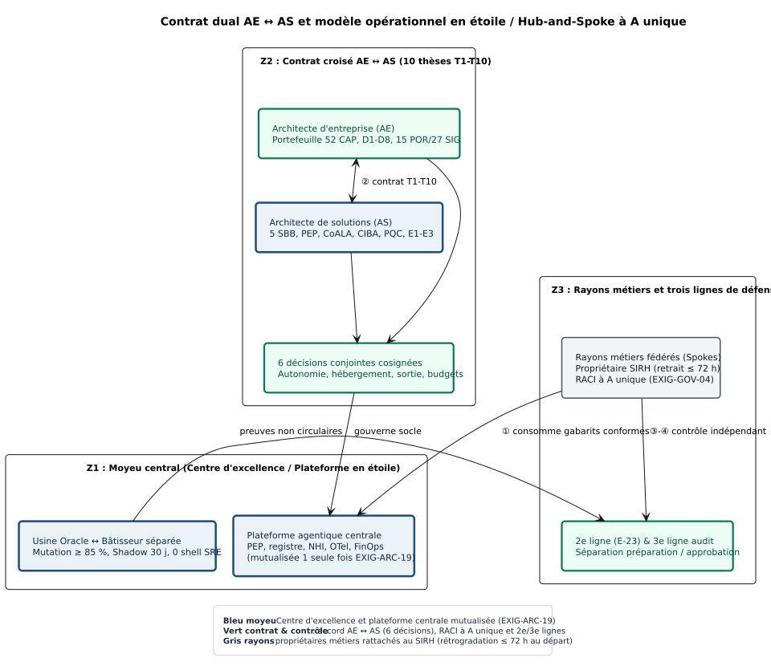
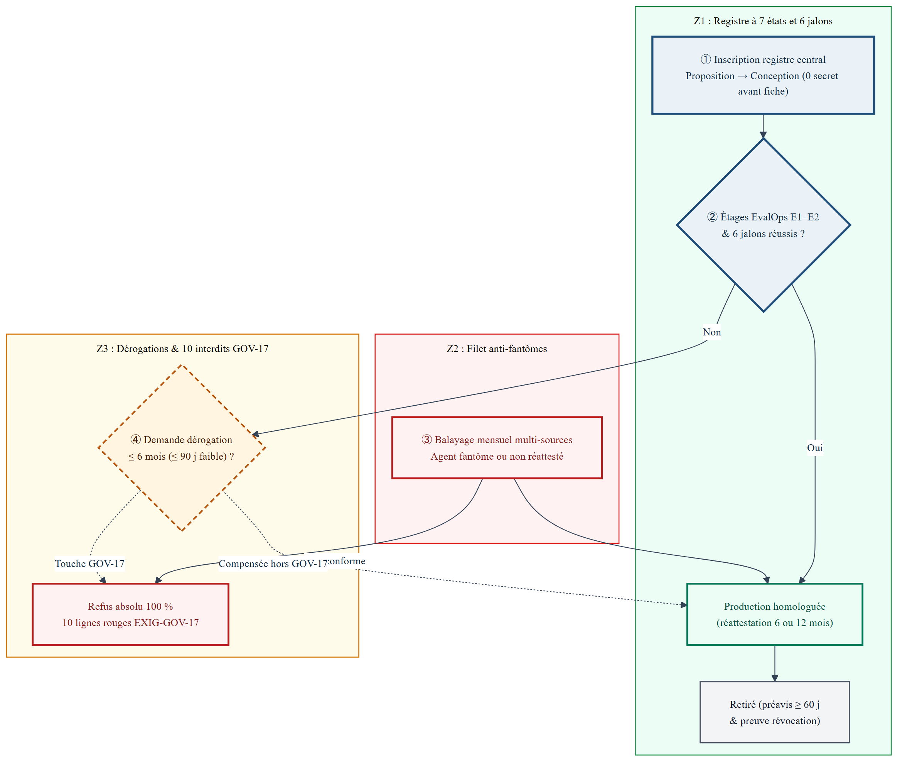
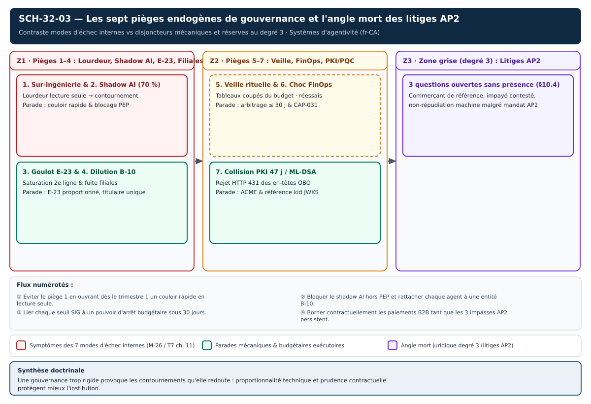

# Chapitre 32 — Gouvernance duale AE ↔ AS, modèle en étoile à trois lignes, cycle de vie et sept pièges endogènes

*Question directrice :* Comment articuler la gouvernance de portefeuille de l'Architecte d'entreprise (`AE`) aux invariants d'ingénierie de l'Architecte de solutions (`AS`) dans un modèle en étoile à responsable unique, tout en neutralisant les sept pièges internes et les zones d'ombre juridiques du commerce agentique ?

Un programme de **Systèmes d'agentivité** succombe rarement à une carence de politiques écrites ; il s'érode presque toujours sous l'effet d'un désalignement interne entre l'ambition des comités centraux et la réalité opérationnelle des équipes de livraison. Lorsqu'un assistant consultatif subit le même parcours d'homologation qu'un automate financier, les praticiens contournent le cadre officiel par des outils personnels non déclarés, saturent la deuxième ligne de défense à l'approche des échéances réglementaires et diluent l'imputabilité entre filiales. Le présent chapitre formalise l'architecture organisationnelle, le cycle de vie et les coupe-circuits qui préviennent cette dérive interne.

Conformément à la clause de non-avis (`AO-05`), l'analyse des textes prudentiels et législatifs qui suit constitue un cadre technique pédagogique arrêté au gel du `2 décembre 2026` et non un avis juridique. En respect de la règle probatoire `AO-01`, les sources primaires accessibles en texte intégral sous empreinte `SHA-256` fondent l'exposé. Les portails verrouillés — `iso.org` (`HTTP 403` sur `ISO/IEC 42001`), `lautorite.qc.ca` (`HTTP 403` Cloudflare, date attendue de la ligne directrice AMF corroborée sous réserve via la source secondaire `AIBanks.ca` [6]) et `genai.owasp.org` (compensé par le document `CC BY-SA 4.0` archivé dans `GenAI-Security-Corpus` [7]) — sont consignés en Statut F sans contournement. Le chapitre établit d'abord le contrat dual `AE ↔ AS`, le modèle en étoile `Hub-and-Spoke` et l'usine logicielle à séparation matérielle, définit ensuite le registre à sept états, les dérogations bornées, les sept pièges endogènes et l'angle mort juridique des litiges `AP2`, puis synthétise les exigences exécutables.

## 32.1 Gouvernance duale `AE ↔ AS`, modèle en étoile et usine logicielle

### 32.1.1 Dix thèses `T1–T10`, six décisions conjointes et modèle `Hub-and-Spoke`

L'expérience montre qu'une gouvernance confiée exclusivement à l'informatique échoue faute de légitimité d'affaires et de maîtrise budgétaire, tandis qu'une décentralisation intégrale dans les unités d'affaires multiplie les passerelles redondantes, fragmente les ontologies et viole les attentes prudentielles d'inventaire unifié [1, 2]. Le traité scelle donc un **contrat opérationnel croisé `AE ↔ AS`** adossé aux dix thèses structurantes de la collection (`T1` à `T10`) et à six décisions conjointes cosignées.

Les dix thèses condensent l'ossature doctrinale de l'ouvrage :

- **Fondations et interopérabilité (`T1`–`T4`)** : `T1` impose la sobriété empirique face à la loi de Lusser et à la falaise de capacité. `T2` unifie les `52` capacités et `305` exigences `CRE-IA-2026-01 v1.2` (prolongées par `CRE-IA-2027 v2.0`) sans accès `SQL` direct (`ADR-001`), `T3` verrouille les protocoles épinglés (`MCP`, `A2A`, `CloudEvents`) derrière `PEP`, et `T4` ancre la sémantique, `CoALA` et `EBCDIC`/`COMP-3`.
- **Exécution, sécurité et conformité (`T5`–`T10`)** : `T5` encadre l'enveloppe `OO3`/`OO4` et les sagas à canal de compensation dédié, tandis que `T6` croise domaines, classes et autonomie sous liaison `JCS`/`CIBA`. Ensuite, `T7` fonde la confiance zéro (`SPIFFE`, `RFC 8693`, `DPoP`, `CaMeL`) ainsi que la préparation `TLS` `47 jours` et `PQC`, alors que `T8` dissocie le double couloir probatoire, `EvalOps E1–E3` et le coût par résultat conforme (`CPO`). Enfin, `T9` projette la preuve unique multi-juridictions (`Loi 25` [5], `BSIF E-23` [1], `EU AI Act` [4]) sur `24` propositions sectorielles, et `T10` intègre les trois lignes de défense, l'usine logicielle séparée, les clauses tiers et l'homologation unifiée.

À travers ce socle, l'`AE` gouverne le portefeuille de cinquante-deux capacités architecturales (`CAP-001` à `CAP-052`), orchestre les trois lignes de maîtrise, fixe les plafonds par domaine et classe, pilote la grille d'acquisition réversible et cadence les `15` portes `POR` sur `27` signaux `SIG`. Parallèlement, l'`AS` conçoit et homologue les blocs substituables (`SBB`), la passerelle `PEP`, le contexte compilé, `CoALA`, les sagas durables, les échanges de jetons, `CaMeL`, la crypto-agilité `PQC`, le double couloir `OTel`/`JCS` et les bancs `E1–E3`. Les six décisions conjointes (`1` sobriété et topologie ; `2` noyau possédé contre verrouillage `SaaS` ; `3` sémantique et patrimoine ; `4` autonomie et effets irréversibles ; `5` fabrique de confiance `NHI`/`PQC` ; `6` exploitation, `CPO` et portes `POR`) empêchent toute dérive entre stratégie et implémentation.

Sur le plan organisationnel, ces responsabilités s'incarnent dans un **modèle opérationnel en étoile (*Hub-and-Spoke*) à trois lignes de défense** (`CAP-050`, `EXIG-ARC-19`, `EXIG-GOV-05`, `EXIG-GOV-06`, `ADR-025`). Le moyeu central — le Centre d'excellence agentique et la plateforme centrale — fournit et opère une seule fois les trois plans transversaux. Il livre ainsi les passerelles de modèles et d'agents, le bus événementiel, le registre et le catalogue d'entreprise, les gabarits conformes par construction (identité propre, traçage sans contenu brut, plafonds budgétaires et appel obligatoire par passerelle), l'outillage `EvalOps`, les tableaux de bord `CPO` et le coupe-circuit global. Un domaine métier NE DOIT PAS exploiter de passerelle, de registre ou de catalogue parallèle sans dérogation écrite (`EXIG-GOV-05`). Les rayons métiers fédérés conservent la propriété des serveurs `MCP` de domaine, de la logique métier et de leurs budgets `CPO`, tout en s'appuyant sur un tandem `RH–IT` pour reconvertir les coordonnateurs vers la supervision humaine.

### 32.1.2 Douze rôles, matrice `RACI` à `A` unique et séparation Oracle / Bâtisseur

La gouvernance humaine s'articule autour de **douze rôles** formellement définis (`EXIG-GOV-01` à `EXIG-GOV-06`, `PRIN-10`). Les quatre premiers portent la construction, l'exploitation et l'évaluation : le propriétaire métier nominatif (parrain), le responsable technique, l'équipe d'évaluation indépendante et l'équipe plateforme. Les quatre suivants assurent le cadrage transversal et la conformité : l'équipe `FinOps`, l'architecture d'entreprise (`AE`), la sécurité de l'information et la fonction risques et conformité (`2e` ligne). Enfin, le dispositif inclut le responsable de la protection des renseignements personnels (`RPRP`, articles `3.1` à `3.3` de la loi sur le secteur privé modifiée par la *Loi 25* [5]) et le comité d'architecture et des risques agentiques (`EXIG-GOV-02`). S'y ajoutent les approbateurs humains (compétence, formation et autorité calquées sur l'article `26`, paragraphe `2`, de l'`EU AI Act` [4] pour le haut risque) et l'équipe de garde joignable durant les heures d'exploitation.

L'exigence `EXIG-GOV-RACI` impose deux verrous d'imputabilité non négociables. Premièrement, selon `EXIG-GOV-01` et `ADR-025`, chaque agent interne, intégré à un logiciel-service ou exploité par un partenaire, ainsi que chaque serveur `MCP`, DOIT être rattaché à une **personne physique nommée** comme parrain métier dans le système d'information des ressources humaines (`SIRH`), avec suppléant désigné et rétrogradation automatique d'autonomie sous `72 heures` si le poste devient vacant sans relève. Deuxièmement, l'exigence `EXIG-GOV-03` interdit à une même personne de préparer et d'approuver une décision du cycle de vie, tandis qu'`EXIG-GOV-04` impose un **unique rôle imputable (`A`)** par activité de la matrice `RACI` (*Tableau 32.1*). Toute responsabilité partagée entre deux « `A` » ou déléguée à une « équipe » dissout l'obligation de rendre compte au moment d'un incident.

| Instance ou ligne | Périmètre de décision exclusif (`RACI` à `A` unique) | Verrou de séparation et contrôle système |
|---|---|---|
| **1re ligne — Parrain métier (`SIRH`) & Responsable technique** | `A` sur l'inscription initiale, les `ÉFVP`, les plafonds `FinOps`, la revue de valeur et le retrait planifié (`EXIG-GOV-01`, `EXIG-GOV-14`) | Rétrogradation d'autonomie sous `72 heures` sur vacance `SIRH` ; interdiction d'auto-homologuer ses seuils (`EXIG-GOV-03`) |
| **1re ligne — Équipe plateforme (`CoE` / Moyeu)** | `A` sur les passerelles, le registre central, le catalogue, les gabarits conformes (`EXIG-GOV-06`) et le balayage anti-fantômes | Blocage réseau des identités hors registre (`EXIG-GOV-08`, `EXIG-GOV-10`) et usine `Oracle`/`Bâtisseur` séparée |
| **2e ligne — Risques/Conformité, Sécurité, `RPRP` & Comité** | `A` sur le classement de risque (`E-23`), le palier d'outils, l'homologation, la réattestation (`6/12 mois`), les dérogations et l'arrêt anticipé | Validation `E-23` proportionnée à la cote de risque [1] (grille interne `R1–R4`) ; récusation de tout membre instructeur (`EXIG-GOV-02`) ; veto suspensif |
| **3e ligne — Audit interne indépendant** | Assurance indépendante au conseil sur l'étanchéité des `3` lignes, les dérogations, les exercices de sortie (`B-10` [3]) et les signaux `SIG` | Accès autonome en lecture seule aux voûtes probatoires et bancs scellés ; recommandation de retrait |

*Tableau 32.1 — Répartition `RACI` à responsable unique (`A`) dans le modèle en étoile à trois lignes de défense.*

À l'intérieur de la première ligne, l'usine logicielle interne applique la même séparation des pouvoirs (`EXIG-GOV-USINE`, `ADR-029` à `ADR-031`, en cohérence avec la séparation développement/production attendue par la réglementation prudentielle). L'agent qui produit un artefact ne définit jamais son propre oracle d'acceptation et ne déploie jamais seul en production. Sur les chantiers de code et de modernisation patrimoniale, les dépôts et droits séparent matériellement l'**agent Oracle** (qui génère les invariants et jeux d'essai à partir de graphes syntaxiques et sémantiques `AST` et `SCIP`) de l'**agent Bâtisseur** (qui produit le code), sous porte d'analyse statique et de revue humaine. Afin d'éviter les régressions silencieuses, la spécification cible de conception pose un **score de mutation supérieur ou égal à `85 %`** et, pour toute réécriture patrimoniale critique, une exécution en miroir (*Shadow Mirroring*) de **`30 jours`** à zéro écart décimal (cibles d'ingénierie synthétiques sans appui empirique statistique).

Trois garde-fous techniques complètent cette usine. En ingénierie des données (*DataOps*), les pipelines appliquent les contrats `ODCS v3` selon le patron *Write-Audit-Publish* (`WAP`), plaçant immédiatement en quarantaine tout lot analytique déviant avant qu'un index ou un agent ne puisse le consulter. En exploitation `SRE`, le diagnostic s'effectue exclusivement en lecture seule sur des journaux assainis au moyen de procédures pré-signées et bornées, tandis que tout interpréteur de commandes libre (*shell*) demeure strictement banni des environnements de production (`ADR-030`) pour parer les injections indirectes. Enfin, toute distillation conditionnelle `LLM → SLM` traverse un sas de purge irréversible des renseignements personnels validé par jetons témoins (*canaris*) et parité multi-essais `pass^5 ≥ 99 %` (cible de conception synthétique sans appui empirique). La *Figure 100* rassemble ce contrat dual `AE ↔ AS`, le moyeu en étoile et l'étanchéité de l'usine `Oracle / Bâtisseur`.

*Figure 100 — SCH-32-01 : Moyeu central mutualisé (`EXIG-ARC-19`) et usine séparée `Oracle ↔ Bâtisseur` (`Z1`), contrat croisé `AE ↔ AS` autour des `10` thèses `T1–T10` et `6` décisions conjointes (`Z2`), et rayons métiers avec parrain `SIRH` et `3` lignes de défense (`Z3`).*

## 32.2 Cycle de vie à sept états, dérogations bornées, sept pièges endogènes et litiges `AP2`

### 32.2.1 Registre à sept états, six jalons, dérogations et cohorte transitoire

« On ne gouverne pas ce que l'on ignore » : ce constat fonde l'exigence `EXIG-GOV-CYCLE` et le registre d'entreprise unifié (`CAP-047`, `EXIG-GOV-07` à `EXIG-GOV-14`, `EXIG-CON-12`). Répondant directement à l'attente d'inventaire complet de la ligne directrice `E-23` du BSIF applicable le `1er mai 2027` [1] et aux exigences de surveillance des tiers `B-10` [3], ce registre recense **100 % des agents** (internes, intégrés à des logiciels-services ou opérés par des partenaires) ainsi que **100 % des serveurs `MCP`**, sans jamais s'en remettre aux registres partiels d'un éditeur unique.

Chaque fiche inscrite au registre traverse **sept états officiels** (`proposé`, `en conception`, `en construction`, `pilote`, `production`, `suspendu` et `retiré`) et franchit dans l'ordre **six jalons** consignés avec leur décideur `A` et leurs pièces probantes (`EXIG-GOV-11`). Ces six étapes couvrent la proposition initiale (classement de risque approuvé), la conception (revue d'architecture et lancement de l'`ÉFVP`), la construction et l'évaluation (atteinte des seuils validée par une équipe distincte et exercice d'équipe rouge), le pilote borné (démarré au niveau inférieur pour tout agent visant `N3` ou `N4`), la production sous surveillance continue et enfin le retrait. L'exigence `EXIG-GOV-08` établit un verrou bloquant absolu : aucune identité d'agent ou de serveur `MCP` ne reçoit de justificatif valide en production tant que sa fiche n'est pas approuvée complète à l'état `pilote` ou `production`, tout pilote sur données réelles ou justificatifs de production étant traité comme une mise en production. Les passerelles rejettent techniquement tout appel d'une identité hors de ces deux états, à l'exception exclusive des opérations de compensation acheminées sur le canal dédié.

Durant la phase `production`, deux mécanismes empêchent le vieillissement silencieux des actifs. D'une part, `EXIG-GOV-12` énumère onze déclencheurs (couvrant quinze cas précis) qui imposent une réévaluation complète de la classe de risque et du niveau d'autonomie avant mise en service : changement de modèle servi (y compris derrière un alias), modification de l'invite système, ajout ou élévation de palier d'outil, évolution de mémoire, de corpus ou de juge, changement de fournisseur ou de lieu de traitement, ou encore incident grave. Toute promotion ou bascule reste bloquée tant que les étages `EvalOps E1` et `E2` échouent (`EXIG-EVA-01`, `PRR-75`). D'autre part, `EXIG-GOV-10` astreint l'équipe plateforme à exécuter au minimum chaque **mois** un rapprochement multi-sources (journaux des passerelles, identités du fournisseur d'identité, consoles `SaaS` et facturation des modèles) afin de placer immédiatement en quarantaine (`suspendu`) tout agent fantôme découvert hors registre et d'en révoquer les consentements `OAuth` ou d'en activer l'arrêt propre (`EXIG-ARC-02`).

Parallèlement, `EXIG-GOV-ATTEST` encadre la permanence humaine et la fin de vie (`EXIG-GOV-09`, `EXIG-GOV-13`, `EXIG-GOV-14`). Pour prévenir la dérive silencieuse, le parrain métier DOIT réattester périodiquement la fiche dans le registre selon la classe de risque : tous les **12 mois** en régime général, et selon une cadence semestrielle (**6 mois**) pour tout agent de classe élevée. Le système émet un avertissement automatique `30 jours` avant l'échéance et suspend administrativement tout agent orphelin lors de la revue trimestrielle (ou si un rôle `A` reste vacant plus de `30 jours`). Lors du déclassement définitif (`retiré`), l'organisation respecte un **préavis minimal de 60 jours** auprès des consommateurs connus (sauf retrait anticipé d'urgence pour motif de sécurité décidé par le comité), révoque l'ensemble des jetons et identités, retire les entrées du catalogue, archive ou purge les mémoires selon la politique applicable et inscrit la **preuve de révocation** validée par la sécurité au registre.

Un cadre dépourvu de soupape pousse au contournement ; un cadre sans plafond se vide de sa substance. L'exigence `EXIG-GOV-DEROG` (`EXIG-GOV-15` à `EXIG-GOV-17`) résout cette tension par un **régime strict de dérogations écrites**. Toute demande précise l'exigence visée, sa justification, le risque résiduel, les mesures compensatoires obligatoires (abaissement d'autonomie, approbation humaine ajoutée, plafond financier réduit) et le plan daté de retour à la conformité. Instruite par l'`AE` avec avis de la sécurité, de la conformité et du `RPRP`, la dérogation est tranchée par le comité pour une durée maximale de **`6 mois`**, renouvelable **une seule fois** (`≤ 90 jours` par délégation de l'`AE` pour la classe faible, sans cumul avec l'instruction), avec alerte à `30 jours` et suspension automatique à l'échéance.

Trois verrous complètent ce régime d'exception. Premièrement, `EXIG-GOV-17` érige une liste fermée de **dix interdictions absolues non dérogeables** :
- **Interdits d'autonomie et d'identité** : aucun niveau `NX` ; aucune action `P3` sans approbation humaine hors bande ; aucune usurpation d'identité en lieu et place de la délégation ; aucun relais de jeton reçu (*token passthrough*) ; aucun agent sans fiche complète ni parrain (hors fiche minimale d'un existant inventorié).
- **Interdits de plafond, de sécurité et de conformité** : aucun dépassement du plafond de classe ; aucune autonomie au-delà de `N2` sous la règle d'or ; aucune violation simultanée de la Règle de deux sans retrait d'exfiltration ; aucune exploitation sans journal d'audit ; aucun manquement légal ou réglementaire.

Deuxièmement, les agents déjà actifs à l'adoption du cadre ou découverts ensuite relèvent d'un régime transitoire de cohorte (`existant inventorié`, `EXIG-GOV-16`) imposant une fiche minimale et un parrain sous `5 jours ouvrables` sous peine de désactivation, limitant tout contournement transitoire de passerelle à la seule lecture seule (`P0/P1`) jusqu'au jalon fixé.

Troisièmement, le catalogue des protocoles (`EXIG-GOV-18`, `EXIG-GOV-19`, `EXIG-GOV-20`) exige six critères d'admission pour le statut `Adopter` (`EXIG-GOV-19`) : spécification publique versionnée, gouvernance neutre multipartite, statut final stable, deux mises en œuvre indépendantes (ou suite de tests épinglée), modèle de sécurité documenté et licence ouverte sans redevance. Il impose également une révision trimestrielle — ou extraordinaire sous `15 jours ouvrables` — et une veille désignée sur les organismes clés, incluant la gouvernance systémique des chaînes d'approvisionnement en IA générative [8]. Parallèlement, l'approvisionnement auprès d'éditeurs externes verrouille la grille éliminatoire et les dix clauses obligatoires `EXIG-APP-07` à `EXIG-APP-16` (interopérabilité `MCP`/`A2A`, non-entraînement sur données et traces, localisation et `ÉFVP` préalable hors Québec selon l'article `17` de la loi sur le secteur privé modifiée par la *Loi 25* [5], audit `BSIF B-10` [3], sortie assistée sans pénalité avec destruction attestée selon `EXIG-APP-14` et arrêt d'urgence direct). La *Figure 101* illustre ce passeport d'existence à sept états et le filtrage des dérogations.

*Figure 101 — SCH-32-02 : Progression contrôlée sur le registre à sept états et six jalons bloquée par `EvalOps E1–E2` (`Z1`), filet mensuel multi-sources plaçant les agents fantômes en quarantaine (`Z2`), et sas des dérogations limitées à `6 mois` face aux `10` lignes rouges d'`EXIG-GOV-17` (`Z3`).*

### 32.2.2 Sept pièges endogènes de gouvernance et angle mort des litiges `AP2`

Même dotée d'une matrice `RACI` claire et d'un registre exhaustif, une gouvernance peut s'enliser sous l'effet de **sept modes d'échec endogènes** identifiés au Plan Directeur (`M-26`) et au Tome 7 (`Tableau 11.2`). L'exigence `EXIG-GOV-PIEGES` associe chacun de ces sept symptômes internes à un disjoncteur technique ou budgétaire exécutoire (*Tableau 32.2*).

Le premier piège est la **sur-ingénierie initiale** : soumettre un assistant consultatif en lecture seule au même circuit lourd de comités qu'un agent effectuant des virements contredit directement les principes `2.2` et `2.3` de proportionnalité de la ligne directrice `E-23` du BSIF [1] et paralyse l'innovation bénigne.

Cette rigidité déclenche aussitôt le deuxième piège : la **prolifération d'agents fantômes (*shadow AI*)**. Les enquêtes canadiennes attestent ce décalage : dans l'analyse de `314` répondants du *Pouls des leaders d'entreprise* de décembre `2025` (Banque du Canada, juin `2026`), `70 %` déclarent utiliser personnellement l'IA chaque semaine au travail contre seulement `8 %` d'usage significatif en exploitation. Parallèlement, des entretiens auprès de `17` développeurs expérimentés (Dhanorkar *et al.*, juin `2026`) montrent une incertitude sur le devenir de données liées aux clients transmises à des plateformes tierces, à l'encontre des saines pratiques recommandées au bulletin technologique du BSIF de juillet `2026` [2]. La parade combine un **couloir rapide en lecture seule (`R1` / `L0–L1`)** livré dès le premier trimestre via les gabarits pré-homologués du moyeu (`Golden Paths`) et le blocage technique de tout flux sortant hors passerelle `PEP`.

Le troisième piège est l'**engorgement de la deuxième ligne de défense** avant le `1er mai 2027` (`BSIF E-23` [1] et échéance AMF attendue, source secondaire `AIBanks.ca`, portail en statut `F` [6]). En triant les dossiers par droits de mutation et en s'appuyant sur des jeux indépendants issus de la séparation `Oracle / Bâtisseur`, la deuxième ligne réserve sa bande passante aux classes modérées et élevées. Le quatrième piège réside dans la **dilution intra-groupe** entre filiales bancaires, assurantielles et de gestion de patrimoine : même lorsque l'outillage de plateforme est mutualisé selon la ligne directrice `B-10` [3], chaque entité juridique doit conserver son propriétaire métier nominatif, son inventaire `E-23` désagrégé et son consentement explicite inter-filiales.

Le cinquième piège est la **veille décorative et le biais des coûts irrécupérables**, où des indicateurs d'adoption flatteurs et une confiance excessive envers les bancs des vendeurs [2] masquent l'accumulation de dette cognitive. Le disjoncteur impose de lier les `27` signaux `SIG` à une révision budgétaire contraignante exécutée sous **`30 jours`** et auditée annuellement par la troisième ligne. Les sixième et septième pièges complètent la typologie. Le **choc tarifaire `FinOps`** traduit l'explosion de la facture sous l'effet des boucles de réessais malgré la baisse du prix unitaire du jeton, ce que parent le pilotage `CPO` et la bascule bimodèle annuelle (`CAP-031`, `POR-016`). Enfin, la **collision cryptographique** survient lorsque le raccourcissement `TLS` à `100` puis `47 jours` heurte l'allongement des signatures `ML-DSA` en erreur `HTTP 431`, appelant l'automatisation `ACME` et la référence par `kid` `JWKS` exigées à la porte `POR-007`.

| Piège endogène (`M-26` / `T7 ch. 11`) | Symptôme observable en exploitation | Conséquence juridique ou systémique | Disjoncteur exécutoire |
|---|---|---|---|
| **1. Sur-ingénierie initiale** | Assistant en lecture seule bloqué en comités lourds | Paralysie des projets bénins contraire à `E-23` [1] | Couloir rapide `R1` (`L0–L1`) par gabarits pré-homologués (`EXIG-GOV-06`) |
| **2. Agents fantômes (*shadow AI*)** | `70 %` d'usage personnel hebdomadaire (vs `8 %` en exploitation) ; données clients exposées | Contournement `ÉFVP` (`Loi 25` [5]) et écart aux pratiques du bulletin `BSIF` [2] | Offre fluide via couloir rapide + blocage hors `PEP` + scan mensuel (`EXIG-GOV-10`) |
| **3. Saturation de la 2e ligne** | Files d'attente avant le `1er mai 2027` (`BSIF` [1] ; `AMF` sous réserve, source secondaire `AIBanks.ca` [6]) | Relâchement critique et risque d'approbation réflexe | Tri proportionnel par cote `E-23` [1] (grille interne `R1–R4`) + jeux indépendants `Oracle / Bâtisseur` |
| **4. Dilution intra-groupe** | Agents mutualisés entre filiales sans répondant légal clair | Perte d'imputabilité et non-conformité `B-10` [3] | Titulaire `SIRH` unique par entité juridique + entente `B-10` et arrêt unilatéral |
| **5. Veille décorative** | Tableaux au vert coupés des budgets et coupe-circuits [2] | Biais des coûts irrécupérables et cécité de dérive | Arbitrage budgétaire contraignant `≤ 30 jours` sur signal `SIG` audité par `3e` ligne |
| **6. Choc tarifaire `FinOps`** | Facture explosive par boucles de réessais et reprises humaines | Effondrement du rendement net et captivité fournisseur | Plafonds `CPO`, revue de valeur à `2` mois (`EXIG-FIN-10`) et repli `CAP-031` |
| **7. Collision `PKI 47 j` / `ML-DSA`** | Passerelles rigides saturées (`HTTP 431`) et rotation manuelle | Pannes de connectivité et rupture crypto-agile | Automatisation `ACME` + référence `kid` `JWKS` bloquante en `POR-007` |

*Tableau 32.2 — Typologie des sept pièges endogènes de gouvernance et disjoncteurs organisationnels ou techniques associés.*

Au-delà de ces défaillances internes, la gouvernance des flux transactionnels automatisés se heurte à une frontière juridique majeure documentée au Tome 1 (`§ 10.4`) concernant l'**imputabilité et le règlement des litiges en commerce agentique sans présence humaine (`AP2`)**. Sur le plan technique, les protocoles de paiement agentique signés et horodatés établissent une chaîne probante solide (*intention → panier → paiement*) qui rattache une opération à un mandat antérieur du client. Toutefois, un mandat signé prouve qu'un consentement cryptographique a été émis ; il ne prouve ni que ce consentement était éclairé, ni que le raisonnement de l'agent solliciteur était exempt de manipulation (`OWASP ASI01`–`ASI10` [7]).

Plus fondamentalement, les sources primaires ne documentent aucun régime de litige propre aux transactions agentiques sans acheteur humain à l'écran — une **absence de documentation qualifiée au degré `3`** qui demeure ouverte au gel du `2 décembre 2026`. Certes, la conformité technique `AP2` produit une piste d'audit rigoureuse, tandis que le Règlement `(UE) 2024/1689` (`EU AI Act`) encadre la transparence et la gouvernance humaine des systèmes à haut risque [4]. Aucun des deux textes n'institue cependant de mécanisme propre de contestation commerciale automatisée. Trois impasses juridiques restent donc ouvertes : la désignation univoque du **commerçant de référence** lorsque plusieurs agents négocient, le traitement d'un **impayé contesté** en l'absence d'acheteur présent lors de l'acte, et l'**admissibilité probatoire devant les tribunaux de la non-répudiation machine** fondée sur une délégation multi-sauts. Tant que ces trois questions restent au degré `3` d'absence, l'institution doit maintenir des plafonds contractuels stricts, conserver le rattachement au commerçant de référence établi et borner les paiements autonomes `B2B` à des corridors pré-contractualisés. La *Figure 102* met en regard les sept pièges internes et cette réserve juridique de degré `3`.

*Figure 102 — SCH-32-03 : Contraste entre les sept pathologies endogènes (`Z1` pièges `1` à `4`, `Z2` pièges `5` à `7`) neutralisées par des disjoncteurs mécaniques ou budgétaires, et la zone grise juridique de degré `3` entourant les litiges `AP2` sans présence humaine (`Z3`).*

> **Trois invariants exécutables — Chapitre 32**
> 1. **Un seul `A` nominatif couplé au `SIRH` et zéro auto-homologation** — Chaque activité `RACI` porte un unique rôle imputable `A` (`EXIG-GOV-04`) distinct de la construction (`EXIG-GOV-03`) et rattaché à un parrain physique `SIRH` avec rétrogradation sous `72 heures` en cas de vacance ; l'usine isole matériellement `Oracle` et `Bâtisseur` sans aucun interpréteur `shell` en production `SRE`.
> 2. **Zéro justificatif sans fiche complète, scan mensuel et `10` lignes rouges `GOV-17`** — Le registre à sept états bloque tout jeton hors `pilote`/`production` (`EXIG-GOV-08`), place en quarantaine mensuelle les agents fantômes (`EXIG-GOV-10`), réatteste tous les `6`/`12` mois (`EXIG-GOV-13`) et interdit toute dérogation au-delà de `6 mois` ou sur les `10` interdits d'`EXIG-GOV-17`.
> 3. **Proportionnalité contre les sept pièges et prudence contractuelle `AP2`** — Un couloir rapide en lecture seule (`R1` / `L0–L1`) assèche le *shadow AI* et désengorge la `2e` ligne pour `BSIF E-23`, chaque franchissement de signal `SIG` impose un arbitrage sous `30 jours`, et les paiements `AP2` restent bornés contractuellement tant que les trois impasses juridiques demeurent au degré `3`.

## 32.3 Synthèse opératoire, exigences `EXIG-GOV` et frontières d'architecture

L'opérationnalisation du modèle dual `AE ↔ AS` s'appuie sur six exigences directrices (`EXIG-GOV-RACI`, `EXIG-GOV-CYCLE`, `EXIG-GOV-ATTEST`, `EXIG-GOV-DEROG`, `EXIG-GOV-PIEGES` et `EXIG-GOV-USINE`) résumées au *Tableau 32.3*, en cohérence avec la suite `EXIG-GOV-01` à `EXIG-GOV-20` et la gouvernance des tiers `EXIG-APP-07` à `EXIG-APP-17`. Pour éviter tout engorgement de la deuxième ligne tout en maintenant la traçabilité réglementaire, le tri proportionné mentionné aux *Tableaux 32.1* et *32.2* repose sur une grille interne à quatre échelons (`R1` à `R4`), distincte des cotes propres à `BSIF E-23` [1] :

- **`R1 — Minimal`** (`L0–L1`, lecture interne uniquement, aucune mutation de système d'enregistrement et zéro renseignement personnel) : approbation par le propriétaire d'agent appuyée sur les contrôles automatisés de première ligne, avec revue annuelle et révocation automatique après inactivité.
- **`R2 — Modéré`** (`L1–L2`, synthèse opérationnelle sur corpus internes bornés) : validation du propriétaire complétée par une revue ciblée de deuxième ligne (`EvalOps`, listes de contrôle d'accès et télémétrie `OTel`), suivie d'un réexamen semestriel des dérives et des coûts.
- **`R3 — Élevé`** (`L2–L3`, écritures compensables et traitement de renseignements personnels sensibles) : contrôle indépendant de deuxième ligne, décision collégiale d'homologation, évaluation préalable des facteurs relatifs à la vie privée, campagne offensive et coupe-circuit vérifié, puis suivi trimestriel, recertification annuelle et audit interne de troisième ligne.
- **`R4 — Critique`** (`L3–L4`, acte irréversible ou décision à portée juridique ou financière) : aval du comité exécutif des risques et du `RPRP`, évaluation de vie privée et fiche d'incidence, validation indépendante, bascule manuelle prouvée vers `L0`, surveillance continue, revue trimestrielle et plan de retrait éprouvé.

| Exigence directrice | Prescription normative de gouvernance | Artefact de preuve vérifiable |
|---|---|---|
| `EXIG-GOV-RACI` | Parrain métier `SIRH` (`≤ 72 h`), `1` seul `A` par activité (`EXIG-GOV-04`) et séparation construction/validation (`EXIG-GOV-03`) | Fiches complètes au registre nommant `R`, `A`, suppléants et approbateurs ; matrice `RACI` auditée ; déclencheur `SIRH` testé |
| `EXIG-GOV-CYCLE` | Registre à `7` états (`CAP-047`, `EXIG-GOV-07`, `08`, `EXIG-CON-12`), `6` jalons (`11`), réévaluation (`12`), blocage `E1–E2` (`EXIG-EVA-01`, `PRR-75`) et scan mensuel (`10`) | Journal mensuel (passerelles/IdP/`SaaS`/facturation) et quarantaine sous `5 jours` ouvrables |
| `EXIG-GOV-ATTEST` | Réattestation `12 mois` (`6 mois` classe élevée, `EXIG-GOV-13`) et retrait avec préavis `≥ 60 jours` (`EXIG-GOV-14`) | Certificats de réattestation signés, alertes `J-30`, suspensions trimestrielles des orphelins et preuve de révocation |
| `EXIG-GOV-DEROG` | Dérogations écrites compensées `≤ 6 mois` (`≤ 90 j` classe faible `AE`), zéro exception `EXIG-GOV-17` et revue catalogue (`EXIG-GOV-18`, `EXIG-GOV-19`, `EXIG-GOV-20`) | Registre des dérogations expirant à date, règle bloquante CI/CD sur les `10` interdits `GOV-17` et procès-verbaux trimestriels |
| `EXIG-GOV-PIEGES` | Couloir rapide `R1` (`L0–L1`), tri `E-23` [1], arbitrage `SIG ≤ 30 jours`, clause `B-10` [3] et bornage `AP2` au degré `3` | Gabarits `Golden Paths` actifs, délais `2e` ligne, audits annuels `3e` ligne (`CAP-050`) et avenants `B2B` |
| `EXIG-GOV-USINE` | Scission dépôts `Oracle` / `Bâtisseur`, `WAP` `ODCS v3`, zéro `shell` `SRE` et cibles synthétiques mutation `≥ 85 %` / `30 j` | Contrôles d'accès dépôts `GitOps`, journaux `Shadow Mirroring` sans écart décimal et catalogue de remédiation signé |

*Tableau 32.3 — Matrice des six exigences de gouvernance `EXIG-GOV-*` et des artefacts de conformité associés.*

En matière de frontières de non-redite (`→` / `←`), le présent chapitre gouverne l'organisation humaine, le contrat `AE ↔ AS`, les `12` rôles, le registre à `7` états, le régime des dérogations et les `7` pièges endogènes. Il s'abstient de réexposer la mécanique interne du harnais `80/20` (Chapitre 04), le détail des `42` capacités du noyau (Chapitre 06), le calcul `FinOps FOCUS v1.4` (Chapitre 24) ou le répertoire complet des `305` exigences `CRE-IA` (Chapitre 34).

En retour (`←`), ce chapitre reçoit du Chapitre 06 la mutualisation en étoile (`EXIG-ARC-19`), du Chapitre 09 le confinement des suites commerciales, et du Chapitre 13 les quatorze modes d'échec `MAST` justifiant l'imputabilité des rôles. Il intègre du Chapitre 23 le blocage technique `EvalOps E1–E2`, du Chapitre 24 la revue de valeur après deux mois hors cible `CPO`, et des Chapitres 25 et 26 les obligations `BSIF E-23`, `B-10`, `Loi 25` et `EU AI Act`. Enfin, il reçoit du Chapitre 30 les `Golden Paths` de l'usine `GitOps`, du Chapitre 31 la cadence des `27` signaux `SIG`, du Chapitre 33 les parades ergonomiques à l'approbation réflexe et du Chapitre 34 la projection exacte des `10` interdictions `EXIG-GOV-17`.

Cinq livrables concrets concrétisent ce dispositif avant mise en production :
- **Contrat et registre** : le contrat croisé `AE ↔ AS` documentant les `10` thèses et `6` décisions, ainsi que le registre à sept états muni de son script mensuel anti-fantômes.
- **Contrôle et litiges** : la procédure de couloir rapide `R1` (`L0–L1`) couplée au blocage des dix interdits `EXIG-GOV-17`, la matrice active des sept pièges auditée annuellement par la troisième ligne, et le dossier juridique bornant les flux `AP2` au degré `3`.

Or, même une gouvernance parfaitement proportionnée cède de l'intérieur si les opérateurs humains valident machinalement les synthèses des agents et perdent le savoir-faire de reprise manuelle : tel est l'objet du Chapitre 33 (→ Chapitre 33).
