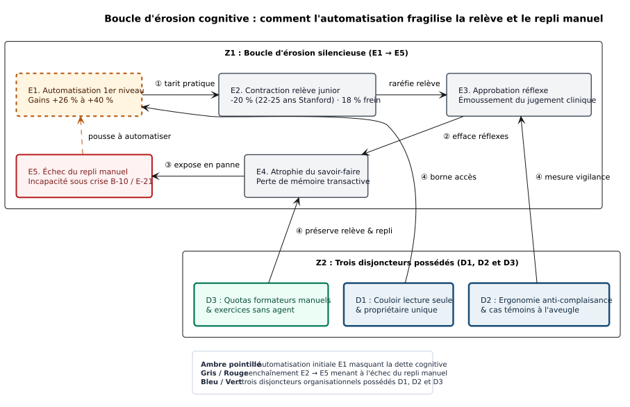
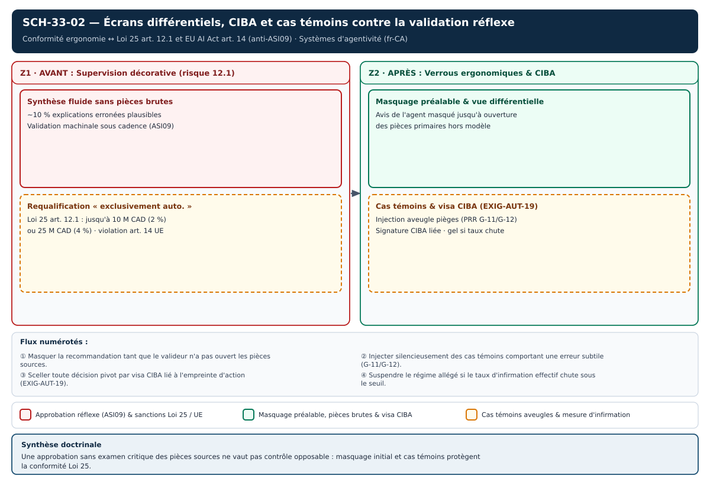
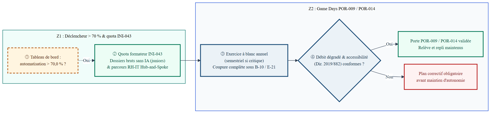

# Chapitre 33 — Préservation du capital humain, parade à l'approbation réflexe et maintien du repli manuel

*Question directrice :* Comment empêcher que l'automatisation des tâches de premier niveau n'atrophie la relève junior, ne transforme la supervision humaine en approbation réflexe exposée aux sanctions légales et ne prive l'organisation de sa capacité réelle de repli manuel ?

L'automatisation cognitive à grande échelle expose l'entreprise à un risque silencieux que les tableaux de bord techniques ne détectent pas : l'érosion simultanée de la relève professionnelle et de la vigilance humaine dans la boucle de décision. Lorsque des agents absorbent le traitement ordinaire des dossiers, ils dégagent des gains immédiats de productivité, mais ils suppriment le terrain d'apprentissage concret qui formait jusqu'ici les analystes et réduisent parfois les valideurs chevronnés à entériner machinalement des synthèses persuasives. À terme, l'organisation risque tout à la fois de perdre sa capacité effective de reprise manuelle lors d'une panne majeure et de voir une supervision purement décorative requalifiée en décision exclusivement automatisée.

Sous l'empire de la clause de non-avis juridique (`AO-05`), l'analyse des régimes légaux et prudentiels présentée ici constitue une référence technique pédagogique arrêtée au gel du `2 décembre 2026`. Conformément à l'hygiène probatoire `AO-01`, les faits statistiques et expérimentaux proviennent exclusivement de textes intégraux ouverts vérifiés (`L+`), tandis que les portails protégés — `pmc.ncbi.nlm.nih.gov` (défi `CAPTCHA`), `legisquebec.gouv.qc.ca` (`HTTP 403`) et `hbs.edu` (`HTTP 403`) — sont consignés en Statut F sans contournement (`pmc.ncbi.nlm.nih.gov` étant compensé pour le biais d'automatisation par [3, 4], `legisquebec.gouv.qc.ca` par le texte sanctionné de `L.Q. 2021, c. 25` et le rapport quinquennal `2026` de la CAI au corpus `L+`, et `hbs.edu` exclu de la preuve). Le chapitre examine d'abord le paradoxe productivité-érosion qui frappe le vivier junior et menace le repli manuel, puis déploie les verrous ergonomiques anti-complaisance, les dossiers témoins à l'aveugle, les quotas formateurs au-delà de `70 %` d'automatisation et les exercices de bascule sans agent.

## 33.1 Paradoxe automatisation–augmentation, érosion de la relève et perte du repli manuel

### 33.1.1 Gains de productivité à court terme et contraction mesurée du vivier junior

Les études expérimentales randomisées confirment que les assistants génératifs relèvent rapidement la productivité sur les tâches rédactionnelles ou de programmation structurée, en particulier chez les débutants. Dans un essai contrôlé randomisé publié dans *Science* auprès de `453` professionnels diplômés, Noy et Zhang mesurent une réduction de `40 %` du temps moyen de rédaction et une hausse de `18 %` de la qualité évaluée, tout en resserrant l'écart de performance au profit des participants initialement moins performants [5]. Dans l'industrie logicielle, Cui, Demirer, Jaffe, Musolff, Peng et Salz analysent trois expérimentations de terrain totalisant `4 867` développeurs et observent une hausse globale de `26,08 %` du nombre de tâches complétées, particulièrement marquée parmi les profils à faible ancienneté [6]. Dans ces essais, les auteurs relèvent parallèlement une progression de `38,38 %` des compilations hebdomadaires (erreur type de `12,55 %`) et de `13,55 %` des mises à jour de code, ce dernier indicateur demeurant toutefois statistiquement non significatif aux seuils conventionnels (erreur type de `10,0 %`) [6].

Or, la synthèse de la littérature conduite par Chandra et Michel (reprenant le **paradoxe automatisation–augmentation** de Raisch et Krakowski) montre dans le développement logiciel le revers de ces gains immédiats [7]. En déléguant aux agents les tâches courantes d'entrée de carrière — génération de code, écriture de tests ou débogage —, l'organisation risque de tarir la pratique directe en profondeur (*deep practice*) qui forge l'expertise véritable, tandis que les développeurs chevronnés s'exposent à l'atrophie de leurs compétences par délégation excessive [7]. Transposée dans le traité aux opérations réglementées (réconciliation de relevés, notes de conformité ou vérification de pièces), cette dynamique prive les recrues des modèles mentaux sous-jacents et nourrit la dette cognitive analysée au Chapitre 03, détruisant progressivement la **mémoire transactive** collective et abaissant le facteur d'autobus (*bus factor*) au profit d'un cercle restreint de spécialistes vieillissants.

Les séries statistiques recueillies au gel du `2 décembre 2026` montrent que ce rétrécissement de la marche d'entrée est déjà observable sur le marché du travail. Selon l'*AI Index Report 2026* de Stanford HAI (`arXiv:2606.15708`), l'emploi des développeurs logiciels âgés de `22` à `25` ans aux États-Unis affiche un repli voisin de `20 %` depuis le sommet de `2022` jusqu'à `septembre 2025` selon le `§ 4.4` (formulé « depuis `2024` » dans la synthèse exécutive), alors même que les effectifs des développeurs plus âgés poursuivent leur croissance [1]. En neutralisant les effets propres aux types d'entreprises, ce même groupe d'âge subit dans les professions les plus exposées à l'IA un écart relatif négatif d'environ `16 %`, parallèlement à une baisse de `11 %` des inscriptions dans les programmes universitaires américains de quatre ans en informatique entre `2024` et `2025` [1]. Ce rapport signale également l'apparition de bancs spécialisés comme *Finance Agent*, élaboré pour évaluer la performance des systèmes autonomes sur des dossiers habituellement confiés aux jeunes analystes financiers [1].

Au Canada, le document analytique `2026-22` de la Banque du Canada (Chawla et Arnburg, `2 juin 2026`) relève une anticipation convergente des employeurs [2]. Si l'effet prévu sur douze mois reste modéré (`11 %` des firmes anticipant une diminution d'effectifs contre `8 %` une hausse), l'horizon à trois ans bascule vers une contraction nette : `18 %` des entreprises canadiennes prévoient de freiner ou réduire leur embauche en raison de l'IA contre `9 %` une augmentation [2]. Chez les organisations de `20` employés et plus, la part anticipant des réductions double pratiquement entre `2026` (`10 %`) et les trois années suivantes (`21 %`), avec une contraction nette projetée aux deux horizons dans les branches finance, assurances, immobilier et location [2]. Chawla et Arnburg relèvent ainsi que les entreprises sans projet d'adoption à court terme citent, après le manque de pertinence pour leurs opérations (raison majoritaire), la pénurie de personnel qualifié parmi les principaux freins [2], créant une tension stratégique lorsqu'elles réduisent parallèlement la voie d'apprentissage qui formait leurs futurs experts.

| Indicateur ou étude empirique (`L+`) | Horizon et périmètre mesuré | Ordre de grandeur vérifié | Conséquence sur le capital humain |
|---|---|---|---|
| **Noy & Zhang (`Science`, `2023`)** [5] | `453` professionnels diplômés (tâches écrites) | `-40 %` de temps moyen ; `+18 %` de qualité évaluée | Gains rapides masquant le risque d'appauvrissement formatif initial |
| **Cui et coll. (`2025`)** [6] | `4 867` développeurs (`3` essais de terrain) | `+26,08 %` de tâches ; `+38,38 %` de compilations ; `+13,55 %` de mises à jour (non significatif) | Bénéfice concentré sur les recrues, mais risque d'essai-erreur non maîtrisé |
| **Stanford HAI `AI Index 2026`** [1] | Développeurs logiciels `22–25` ans (É.-U., pic `2022` → `septembre 2025` ; synthèse « depuis `2024` ») | Recul d'environ `20 %` ; `~16 %` d'écart relatif ; `-11 %` d'inscriptions (`4` ans, `2024–2025`) | Contraction active du vivier d'entrée et perte de relève future |
| **Banque du Canada `SAP 2026-22`** [2] | Enquête auprès des entreprises canadiennes (`2 juin 2026`) | `18 %` anticipent un frein d'embauche à `3` ans (`21 %` chez `≥ 20` employés) ; finance en solde négatif | Pénurie aggravée à moyen terme (`2033–2035`) si la formation cesse (`SIG-017`) |

*Tableau 33.1 — Gains de productivité à court terme et indicateurs de contraction de la relève qualifiée.*

### 33.1.2 Vulnérabilité prudentielle du repli manuel et accessibilité

Cette érosion silencieuse des compétences de base frappe directement la résilience opérationnelle exigée par les autorités de contrôle. L'article `15`, paragraphe `4`, du Règlement `(UE) 2024/1689` (`EU AI Act`) impose aux systèmes à haut risque de résister aux défaillances et interruptions, au besoin grâce à des plans de sauvegarde et de repli [8]. Au Canada, la ligne directrice `E-23` du BSIF (entrée en application prévue le `1er mai 2027` [9]) exige des plans de contingence et d'urgence en cas d'indisponibilité ou de défaillance de modèle. En parallèle, le bulletin sur le risque technologique du BSIF de `juillet 2026` (corpus `L+`) recommande explicitement d'éprouver des scénarios de panne et d'établir des **replis manuels** (*manual fallbacks*) en appui aux attentes de continuité opérationnelle et de sortie de tiers des lignes directrices `B-10` (corpus `L+`) et `E-21`.

Un plan de repli manuel rédigé en comité mais confié à des opérateurs qui n'ont plus instruit de dossier complet sans assistance depuis plusieurs années devient une fiction dangereuse lors d'une panne infonuagique, d'une cyberattaque ou d'une dérive grave de modèle. En outre, l'article `16(l)` de l'`EU AI Act` impose que les systèmes d'IA à haut risque demeurent conformes aux exigences d'accessibilité des directives `(UE) 2016/2102` et `(UE) 2019/882` [8] (dont les textes autonomes restent hors corpus `L+` de ce chapitre), ce qui commande dans l'architecture du traité de préserver cette accessibilité lors de tout basculement vers des interfaces de secours destinées à la clientèle. La continuité humaine ne consiste donc pas seulement à garder des effectifs nominaux ; elle suppose des équipes régulièrement entraînées sur des interfaces utilisables, accessibles et conformes même lorsque toute couche agentique est coupée.

## 33.2 Verrous anti-complaisance, cas témoins à l'aveugle et sanctuarisation du vivier junior

### 33.2.1 Boucle d'érosion cognitive, approbation réflexe et risque juridique (`Loi 25` art. `12.1`)

Lorsque l'organisation place un « humain dans la boucle » sans réaménager son poste de travail ni protéger son temps d'analyse, la boucle d'érosion cognitive s'enclenche en cinq maillons (`E1 → E5`). L'automatisation de premier niveau (`E1`) contracte d'abord le vivier junior (`E2`), puis émousse le jugement clinique des superviseurs confrontés à un flux monotone de résumés convaincants (`E3`). Elle entraîne ensuite l'atrophie du savoir-faire pratique (`E4`) et provoque l'échec du repli manuel sous crise (`E5`), ce qui incite paradoxalement la direction à automatiser davantage. La *Figure 103* met en évidence cette boucle d'érosion face aux trois disjoncteurs organisationnels possédés (`D1` à `D3`) chargés de la briser.

*Figure 103 — SCH-33-01 : Enchaînement de la boucle d'érosion cognitive de `E1` à `E5` (`Z1`) — gains initiaux, contraction de `20 %` du vivier junior, reddition cognitive, perte de mémoire transactive et rupture du repli manuel — interrompu par les trois disjoncteurs `D1`, `D2` et `D3` (`Z2`).*

Au cœur du maillon `E3` opère l'**approbation réflexe** (*rubber-stamping* / biais d'automatisation, classé `ASI09` dans l'*OWASP Top 10 for Agentic Applications* archivé en `L+`). L'étude évaluée par les pairs d'AL-Ali et coll. publiée en août `2026` dans *Nature Scientific Reports* modélise la collaboration humain-IA dans un simulateur de maintenance prédictive sous incertitude épistémique et pression de cadence [3]. Tout en soulignant que leurs essais sur simulateur appellent une confirmation auprès d'opérateurs humains réels, les auteurs montrent que l'absence de calibrage et une confiance statique déstabilisent gravement la supervision. En ablation de calibrage, le taux d'échec atteint `12,36 %` sans calibrage contre `0,81 %` avec mise à l'échelle thermique (*temperature scaling*), tandis que dans le banc comparatif l'architecture hybride adaptative abaisse l'échec à `0,8 %` contre `12,4 %` pour l'humain seul ou l'IA non calibrée ; l'analyse de sensibilité désigne le **biais cognitif humain sous pression** (critique dès \(\psi \ge 0,75\)) comme principal facteur de défaillance [3].

L'observation empirique de terrain de Dhanorkar, Passi et Vorvoreanu (`arXiv:2606.05391`, juin `2026`) auprès de `17` développeurs expérimentés utilisant des agents logiciels éclaire les mécanismes concrets de cette dérive [4]. Bien que la supervision comporte quatre formes — contrôle *a priori*, co-planification, suivi en temps réel et revue *post hoc* —, le suivi en temps réel demeure rare en pratique : les praticiens parcourent peu les traces en direct et ne réagissent qu'à des indices indirects comme un temps d'exécution ou un nombre de tours anormalement longs [4]. Pressés par la cadence et confrontés à une distance cognitive croissante face au volume de code généré lors de la revue *post hoc*, ils adoptent quatre heuristiques d'économie d'attention : assimiler le plan initial à l'exécution réelle, traiter la réussite des tests comme garantie du code, survoler visuellement les résumés (*eyeballing*) et faire confiance à l'agent en contexte non familier [4]. Selon un praticien interrogé, les traces de raisonnement peuvent être erronées environ `10 %` du temps tout en conservant une assurance persuasive qui endort l'esprit critique [4].

Sur le terrain juridique, cette reddition cognitive expose l'institution à un risque sévère de **requalification**. Au Québec, l'article `12.1` inséré par la *Loi 25* (`L.Q. 2021, c. 25`, en vigueur depuis le `22 septembre 2023` selon les sources `L+` du corpus) encadre toute décision fondée exclusivement sur un traitement automatisé. La personne visée doit recevoir un avis au plus tard lors de la décision, puis pouvoir obtenir sur demande les données personnelles mobilisées, les motifs, les facteurs déterminants et les paramètres retenus pour rendre cette décision. Elle doit également pouvoir exercer son droit de rectification sur ces renseignements et soumettre des observations à un employé habilité à réexaminer cette décision.

Si une autorité de contrôle démontre que le valideur clique en quelques secondes sans ouvrir les pièces brutes ni exercer de marge critique réelle, la prétendue supervision humaine risque, selon l'analyse technique non-avis du traité (`AO-05`), une requalification en traitement exclusivement automatisé non déclaré. Un tel manquement à l'article `12.1` expose l'organisation, selon le texte sanctionné (`L.Q. 2021, c. 25`, corpus `L+`), aux sanctions administratives pécuniaires prévues à l'article `90.12` (via l'article `90.1(5°)`) plafonnées à `10 M\$ CA` ou à `2 %` des revenus mondiaux selon le plus élevé des deux montants, tandis que les infractions pénales énumérées à l'article `91` atteignent `15 000 \$ CA` à `25 M\$ CA` (ou `4 %`).

Le cadre européen et les attentes prudentielles canadiennes convergent vers la même exigence de substance. En Europe, l'article `14(4)(b)` et `(d)–(e)` de l'`EU AI Act` impose de concevoir les systèmes à haut risque afin que les contrôleurs humains aient conscience du « biais d'automatisation » et puissent ignorer, inverser ou interrompre le système, tandis que l'article `26(2)` oblige le déployeur à confier ce contrôle à des personnes disposant des compétences, de la formation, de l'autorité et du soutien nécessaires [8]. De son côté, le BSIF rappelle dans son bulletin technologique de `juillet 2026` (corpus `L+`, en cohérence avec `E-23` [9]) que les sorties d'IA constituent des intrants d'analyse et jamais des résultats définitifs soustraits à l'imputabilité humaine.

Pour neutraliser l'approbation réflexe, l'exigence `EXIG-HUM-02` impose des **verrous ergonomiques et cryptographiques déterministes**. L'interface DOIT masquer l'avis de l'agent tant que les pièces primaires restent closes, présenter un différentiel hors modèle (`I-JSON`) et sceller le visa hors bande `CIBA` (`EXIG-AUT-19`, validité `≤ 15 min`) sur le condensat de l'action. La file applique simultanément un plafond de `≤ 33` dossiers complexes par quart (`360 min` effectives, `65 %` de vigilance), une durée minimale de `7 min` par examen et une médiane calculée sur au moins `3` approbateurs par cas d'usage (`EXIG-AUT-21`).

En complément, `EXIG-HUM-03` impose l'injection continue et à l'aveugle de `3 %` à `5 %` de **dossiers témoins canaris** porteurs d'une anomalie subtile (`PRR G-11` / `G-12`). En régime `N3–N4`, la seconde ligne assure un suivi mensuel des taux d'approbation sans retouche, de rejet et de renversement suspect, couplé à une revue *a posteriori* sur `5 %` des dossiers en classe modérée (`1 %` en classe faible). Aucune source normative ne fixant de plancher universel, si le taux d'infirmation chute sous le seuil retenu en interne par la seconde ligne, le régime allégé est gelé vers la validation synchrone (`POR-014`). Renouvelés depuis des incidents anonymisés sous charte non punitive agrégée par file, ces témoins nourrissent la *Figure 104*, qui oppose le poste vulnérable à l'architecture durcie.

*Figure 104 — SCH-33-02 : Comparatif entre l'interface de validation superficielle exposée aux biais sous cadence et aux sanctions `Loi 25` / `EU AI Act` (`Z1`), et le poste différentiel imposant le masquage préalable des synthèses, l'ouverture des pièces brutes, l'injection aveugle de dossiers témoins et la signature `CIBA` liée (`Z2`).*

### 33.2.2 Quotas formateurs (`> 70 %` `INI-043`), reconversion `RH-IT` et exercices sans agent

Aucun verrou d'interface ne suffit toutefois si le vivier de relève disparaît en amont. Pour rompre l'atrophie des compétences, l'exigence `EXIG-HUM-01` active le mécanisme `INI-043` / `CAP-048` : dès que l'automatisation d'un processus dépasse **`70 %`**, l'organisation DOIT sanctuariser un **quota plancher de dossiers instruits manuellement de bout en bout** sans assistance agentique, combiné à `4` trimestres sans dérive ni dépassement de budget d'erreur pour préserver le certificat `POR-014`. Ce temps protégé (*deep practice*) s'appuie sur des *walkthroughs* juniors et des jumeaux de rejeu confrontant les débutants à des dossiers historiques réels avant correction par des praticiens chevronnés.

Parallèlement, l'exigence `EXIG-HUM-05` confie au tandem `RH–IT` du modèle *Hub-and-Spoke* la transition sociale et professionnelle des équipes existantes sans suppression sèche d'emplois : un parcours certifiant de reconversion (structuré sur une base de `120 heures` dans les référentiels internes) permet aux coordonnateurs détenteurs de la mémoire concrète des exceptions clients d'évoluer vers des postes de superviseurs d'exceptions `HOTL`, de curateurs de couches sémantiques métier et d'analystes qualité `AgentOps`.

Enfin, pour opérationnaliser les attentes de résilience posées par `BSIF E-23`, `B-10`, `E-21`, le bulletin de `juillet 2026` et l'article `15(4)` de l'`EU AI Act` [8, 9], l'exigence `EXIG-HUM-04` impose au moins **annuellement** (`≥ 1/an`, **semestriellement** sur les fonctions critiques de crédit, paiement ou indemnisation) des *game days* de bascule manuelle sans agent (`L0`, `POR-009`, `POR-014`). Ces exercices chronométrés prouvent une bascule technique en `< 60 s` (`POR-015` : rétrogradation vers la validation synchrone `N2` ou repli déterministe sans agent `L0`), mesurent le débit dégradé, vérifient les plans de sortie de tiers et contrôlent l'accessibilité (`Dir. 2019/882`, `art. 16(l)` [8]) ; tout échec impose un plan correctif avant le maintien du palier d'autonomie. La *Figure 105* enchaîne ce déclencheur à `70 %`, le quota `INI-043` et la boucle de validation des exercices sans agent, et le *Tableau 33.2* récapitule les quatre parades humaines et leurs points de rupture.

*Figure 105 — SCH-33-03 : Surveillance continue du seuil de `70,0 %` d'automatisation déclenchant le quota formateur manuel `INI-043` et la reconversion `RH-IT` (`Z1`), puis validation périodique des exercices de bascule sans agent (`game days` `POR-009` / `POR-014`) contrôlant débit dégradé et accessibilité (`Z2`).*

| Parade humaine | Mécanisme exécutoire | Nature du verrou | Point de rupture à surveiller |
|---|---|---|---|
| **1. Couloir rapide en lecture seule** | Gabarit pré-approuvé sans droit d'écriture ni appel externe libre (proportionné sous `E-23` [9]) | **Verrou logiciel déterministe** (harnais bloquant toute mutation) | Ajout d'outils d'écriture au gabarit ou lenteur d'accès poussant au *shadow AI* |
| **2. Responsable humain unique** | Rattachement d'une identité `NHI` à un titulaire physique doté du pouvoir d'arrêt (`EU AI Act` art. `14(4)(e)` et `26(2)` [8] ; `E-23` [9]) | **Garde-fou organisationnel** appuyé sur refus technique de jeton sans titulaire | Titulaire purement nominal ou surchargé validant sans relire l'intention |
| **3. Écran différentiel, `CIBA` et cas témoins** | Masquage initial de l'avis d'agent, liaison `CIBA` (`EXIG-AUT-19`) et injection aveugle de témoins (`PRR G-11/G-12`) | **Hybride** : verrou logiciel (`masquage`, `CIBA`) + garde-fou organisationnel (taux d'infirmation) | Détection des dossiers leurres, relâchement des seuils ou validation réflexe sur `CIBA` |
| **4. Quotas `> 70 %` et *game days*** | Part plancher sans agent (`INI-043`), *walkthroughs* juniors, reconversion `RH-IT` et bascules périodiques (`POR-009`/`014`) | **Garde-fou organisationnel** protégeant la mémoire transactive et le repli manuel [7, 9] | Suspension des quotas en pointe saisonnière ou report des exercices de panne |

*Tableau 33.2 — Articulation des quatre parades contre l'atrophie des compétences et l'approbation réflexe.*

> **Trois invariants exécutables — Chapitre 33**
> 1. **Masquage préalable, vue différentielle et signature `CIBA`** — Aucune interface de validation humaine n'affiche la recommandation de l'agent avant l'ouverture effective des pièces sources brutes ; toute décision pivot est liée cryptographiquement par `CIBA` (`EXIG-AUT-19`) et contrôlée par des cas témoins à l'aveugle sous charte non punitive.
> 2. **Gel automatique sur chute du taux d'infirmation (`Loi 25` art. `12.1` / `EU AI Act` art. `14`)** — Dès que le taux d'interception des dossiers témoins tombe sous le seuil de vigilance, l'autonomie allégée est suspendue afin d'écarter toute requalification en décision exclusivement automatisée.
> 3. **Quota formateur `INI-043` dès `70 %` et exercices de repli `POR-009`/`POR-014`** — Tout processus automatisé au-delà de `70 %` préserve un quota obligatoire de dossiers instruits sans agent par la relève et subit des exercices annuels (semestriels si critique) de bascule manuelle en mode accessible (`Dir. 2019/882`).

## 33.3 Synthèse opératoire, exigences `EXIG-HUM-01..05` et frontières d'architecture

Cinq exigences normatives (`EXIG-HUM-01` à `EXIG-HUM-05`) traduisent la protection du capital humain et de la vigilance opérationnelle en artefacts contrôlables avant homologation, résumés au *Tableau 33.3*.

| Exigence | Prescription normative (`HUM`) | Artefact de preuve exigé |
|---|---|---|
| `EXIG-HUM-01` | Quota plancher manuel dès `> 70 %` d'automatisation (`INI-043`) et `4` trimestres sans dérive (`POR-014`) | Tableau de bord semestriel `RH-IT` mesurant la part sans agent, les *walkthroughs* juniors et le vivier `22–25` ans |
| `EXIG-HUM-02` | Masquage initial, vue `I-JSON`, visa `CIBA ≤ 15 min`, `≤ 33`/quart (`≥ 7 min`), médiane sur `≥ 3` approbateurs | Journaux prouvant l'ouverture des pièces primaires, liaison `h = SHA-256(JCS(...))` et horodatages par file |
| `EXIG-HUM-03` | Injection à l'aveugle de `3 %–5 %` de témoins, suivi mensuel, revue *a posteriori* `5 %/1 %` et gel sur baisse (`PRR G-11/G-12`) | Rapports trimestriels agrégés non punitifs et bascule automatique vers validation synchrone (`POR-014`) |
| `EXIG-HUM-04` | `Game days` de repli manuel `L0` (`≥ 1/an`, semestriel si critique) et bascule `< 60 s` vers `N2` ou `L0` (`POR-009`, `POR-014`, `POR-015`) | Comptes rendus chronométrés validant le débit dégradé et les plans de sortie (`BSIF B-10` / `E-21`) |
| `EXIG-HUM-05` | Reconversion `RH-IT` *Hub-and-Spoke* vers `HOTL` et maintien de l'accessibilité (`Dir. 2019/882`) | Parcours certifiants (`120 h`), suivi de la mémoire transactive et tests d'accessibilité des interfaces de repli |

*Tableau 33.3 — Matrice des cinq exigences opératoires `EXIG-HUM-01` à `EXIG-HUM-05` et de leurs preuves associées.*

En respect de la partition conceptuelle de l'ouvrage, ce chapitre concentre son périmètre sur l'impact organisationnel et ergonomique sur la relève junior, les quotas `INI-043`, la reconversion `Hub-and-Spoke`, les parades à l'approbation réflexe et les exercices *game days*, à l'exclusion expresse du droit individuel du travail et des négociations salariales. En aval (`→`), il transmet au Chapitre 03 la tension d'arbitrage entre gains immédiats (`26 %` à `40 %`) et érosion de la relève ; au Chapitre 31 l'arbitrage `INI-043` conditionnant l'ouverture du Palier 3 à l'horizon `2033–2035` ; et au Chapitre 32 la reconversion `RH–IT` et les verrous anti-complaisance neutralisant le troisième piège endogène ainsi que le danger d'une requalification sous la *Loi 25* (`art. 12.1`). En amont et en retour (`←`), il reçoit du Chapitre 05 le modèle technique de supervision `HITL`/`HOTL` et les seuils d'abstention, et du Chapitre 25 les obligations prudentielles de repli manuel (`BSIF E-23`, `B-10`, `E-21` et `Loi 25`).

Quatre livrables concrets clôturent ce domaine : le poste de supervision anti-complaisance instrumenté, le programme trimestriel de cas témoins à l'aveugle sous charte non punitive, le tableau de bord `RH–IT` du quota formateur `INI-043` et les comptes rendus vérifiés des exercices périodiques de bascule sans agent. Avec la trajectoire adaptative `DAPP`, la gouvernance duale `AE ↔ AS` et la préservation active du jugement humain ainsi verrouillées en Partie XI, la **Partie XII (`D12`)** scelle le référentiel unifié d'homologation `CRE-IA-2026-01`, la trousse logicielle exécutable et la chaîne probatoire `Wyvern` (→ Partie XII, Chapitre 34).
