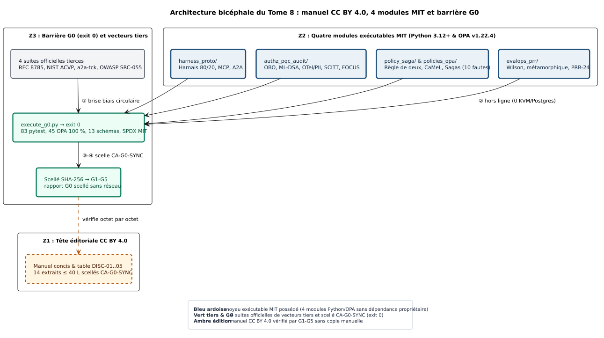
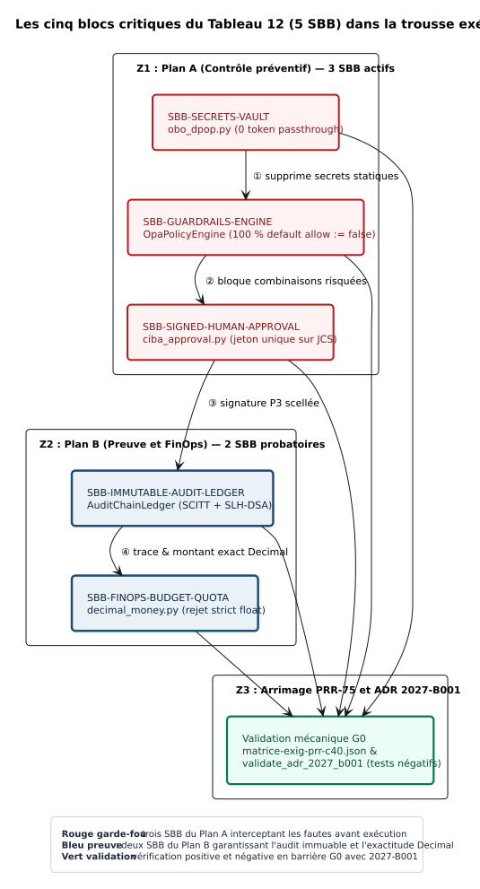
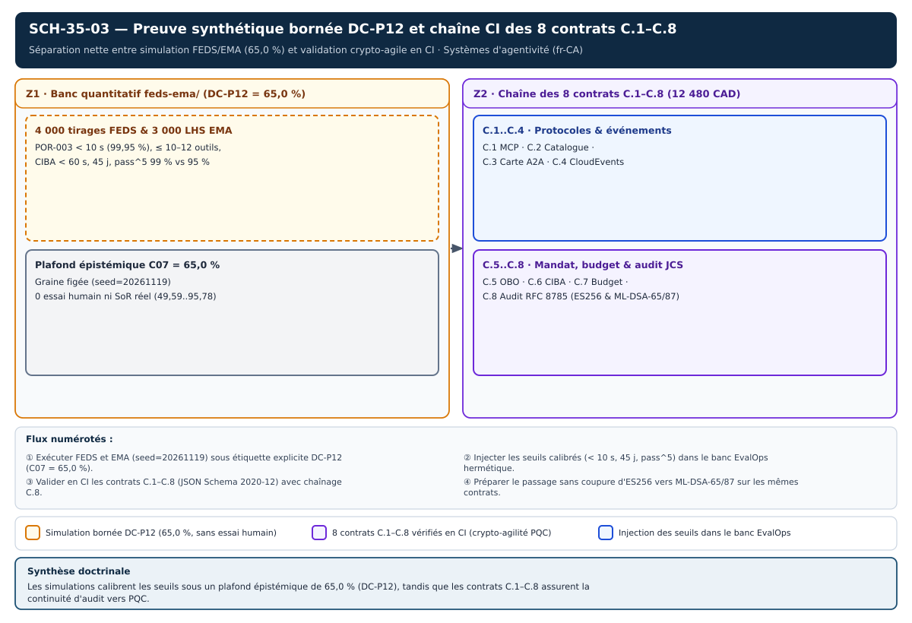

# Chapitre 35 — Trousse exécutable (Python/OPA), 5 SBB du Tableau 12, vecteurs tiers et calibration FEDS/EMA

*Question directrice : Comment matérialiser les prescriptions architecturales en une trousse logicielle Python et OPA/Rego portable qui exécute les cinq blocs critiques du Tableau 12, prouve sa non-circularité contre des vecteurs tiers et borne rigoureusement la simulation synthétique FEDS/EMA ?*

La définition d'une grille d'homologation unifiée (← Chapitre 34) demeure vulnérable tant que les contrôles qu'elle prescrit ne s'appuient pas sur du code testable capable d'émettre un verdict binaire reproductible. Dans les sept premiers tomes de la collection historique, plusieurs composants structurants — notamment la validation des harnais, les cinq blocs critiques de solution demeurés sans exemple retenu au `Tableau 12` du cadre de référence et les bancs `Borealis-Bench` (consignés au Corpus hors dépôt local, ← Chapitre 29) — ne disposaient d'aucune implémentation exécutable complète sur disque. Le présent chapitre comble ce déficit en exposant la trousse logicielle compagnon du Tome 8, conçue pour convertir chaque invariant clé en tests automatisés portables sous licence libre `MIT`.

Tout au long de ce chapitre, la démarcation méthodologique imposée par `DC-01` et `DC-P12` demeure absolue : l'ensemble de la trousse et du banc quantitatif s'exécute hors ligne contre des doublures hermétiques (*mock MCP servers*), sans accès réseau, sans modèle externe payant, sans essai humain et sans raccordement à un système d'enregistrement (`SoR`) réel d'entreprise. Les résultats obtenus attestent la cohérence mécanique des garde-fous logiciels au gel du **2 décembre 2026** ; conformément à la clause `non-avis` (`AO-05`), ils ne sauraient tenir lieu d'avis juridique ni d'homologation sur une infrastructure de production.

L'ingénierie exécutable du Tome 8 repose sur une **architecture bicéphale** qui dissocie clairement le discours doctrinal du code vérifié. La tête éditoriale, publiée sous licence `CC BY 4.0`, présente l'architecture et les contrats normatifs au moyen de schémas bornés et d'extraits de code concis d'au plus `40` lignes. À l'inverse, le corps logiciel compagnon, distribué sous licence `MIT` sous l'intitulé `8 - Manuel/trousse/` (archivé dans `Tomes/Tome 8 - Ingénierie exécutable et homologation vérifiable/trousse/`), regroupe l'implémentation intégrale exécutable en `Python 3.12+` et `OPA/Rego v1.22.4` [9, 10], complétée par des contrats stricts `JSON Schema Draft 2020-12` [1]. Un contrat de synchronisation cryptographique (`CA-G0-SYNC`) relie ces deux versants : chacun des `14` extraits publiés dans le manuel est vérifié octet pour octet par empreinte `SHA-256` contre le rapport scellé de la barrière logicielle `G0`.

Cette barrière logicielle, pilotée par le script portable `execute_g0.py` sur Windows et Linux (`EXIG-EXEC-01`), doit impérativement retourner le code de sortie `0` (`PASS`) sans privilège hôte ni infrastructure lourde. Afin de garantir une reproductibilité universelle sur poste de travail comme en intégration continue, `G0` exclut explicitement `Rust`, `Go`, `Firecracker`/`KVM`, `Postgres`, `OpenFGA` et `Cedar`. Au gel du `2 décembre 2026`, son exécution atteste (`EXIG-EXEC-02`) `83/83` tests `pytest` réussis (`0` échec, `0` test ignoré) et `45/45` cas `OPA/Rego` validés avec `100,0 %` de couverture sous refus par défaut (`default allow := false`) [9, 10]. Elle confirme également `13` schémas `JSON Schema Draft 2020-12` stricts [1] et `8` validations de registres de gouvernance (`21` contrôles sans violation au rapport scellé `G0`), ainsi que (`EXIG-EXEC-03`) l'épinglage `SHA-256` des `17` paquets verrouillés dans `requirements.lock` et la conformité `SPDX MIT` sur `50` fichiers ainsi que `18` distributions Python inspectées, en rejetant toute licence copyleft forte telle que `LGPL`.

Pour écarter tout biais d'auto-validation circulaire entre les tests et l'implémentation, la trousse affronte `50` fichiers issus de quatre suites officielles de vecteurs tiers : la canonisation `RFC 8785` (`JCS`) [7], les vecteurs cryptographiques `NIST ACVP` pour `FIPS 204` (`ML-DSA`) [3] et `FIPS 205` (`SLH-DSA`) [4], la suite de compatibilité `a2a-tck 1.0.0.alpha3` [8] et le référentiel des dix menaces agentiques `OWASP` [5]. Sur cette base vérifiée, le présent chapitre livre l'implémentation complète des `5 SBB` du `Tableau 12`, analyse le banc quantitatif synthétique `feds-ema/` sous plafond épistémique `DC-P12` (`C07 = 65,0 %`) et examine les huit contrats types `C.1` à `C.8` de l'Annexe C du Tome 2 (dont six `[Exécuté en CI]` et deux `[Schéma conceptuel]` à chaîne canonique vérifiée) [1, 3, 6, 7, 8].

## 35.1 Architecture bicéphale du Tome 8, barrière logicielle G0 (`execute_g0.py`) et cinq SBB du Tableau 12

La séparation matérielle entre la prose et le code exécutable répond à un défaut récurrent des traités techniques : des extraits de code rédigés manuellement finissent par diverger de la réalité testée dès la première révision. L'architecture bicéphale élimine cette dérive en organisant `8 - Manuel/trousse/` en quatre paquets logiciels complémentaires sous licence `MIT` :

- **`harness_proto/`** matérialise la partition `80/20` et le harnais typé à huit étapes (`pipeline.py`), le contrôle des schémas stricts `JSON Schema Draft 2020-12` [1], l'épinglage cryptographique `JCS SHA-256` et la validation d'en-têtes `MCP 2026-07-28` (`mcp_pinning.py`) [6, 7], ainsi que l'enveloppe signée des cartes `AgentCard` sous `A2A v1.0.1` (`a2a_card.py`) [8].
- **`authz_pqc_audit/`** implémente la délégation OAuth `OBO` bornée à deux sauts avec rejet du relais de jeton (`obo_dpop.py`) et l'approbation humaine hors bande `CIBA` liée au hachage exact d'action (`ciba_approval.py`). Ce paquet embarque aussi le banc `HTTP 431` (`pqc_http431.py`), qui oppose la croissance linéaire `O(sauts)` des chaînes `JWT`/`COSE` sous `FIPS 204` (`3 309` octets pour `ML-DSA-65`, `4 627` pour `ML-DSA-87`) [3] au modèle `Transaction Tokens` à empreinte contextuelle `tctx` `JCS` constante `O(1)` face au plafond de `8 192` octets [3, 7]. Sous cette limite, `JWT_EMBEDDED_JWK` et `JWT_X5C_CHAIN` débordent dès `1` saut (`8 298`/`14 139` octets en `ML-DSA-65`) et `JWT_KID_REF` comme `CBOR_COSE_CWT` dès `2` sauts (`9 624`/`9 413` octets en `ML-DSA-65`, `13 140`/`12 928` en `ML-DSA-87`). À l'inverse, les `Transaction Tokens` restent invariants de `1` à `5` sauts (`4 778`/`4 757` octets `ML-DSA-65` ; `6 536`/`6 514` `ML-DSA-87`, `HTTP 200`). Le paquet inclut enfin le caviardage `OTel`/`PII` bilingue (`otel_pii_mapper.py`) et le grand livre `JCS` + `SCITT` rescellé en `SLH-DSA` (`audit_scitt_focus.py`) [4, 7].
- **`policy_saga/` et `policies_opa/`** hébergent les politiques déclaratives hors modèle évaluées sous `OPA v1.22.4` [9, 10] — Règle de deux (`rule_of_two.rego`), suivi de contamination `CaMeL` (`camel_taint.rego`) et confinement — ainsi que le moteur Python `OpaPolicyEngine`, l'arithmétique monétaire exacte sans flottants (`decimal_money.py`) et l'orchestrateur durable de sagas à canal de compensation isolé (`saga_orchestrator.py`).
- **`evalops_prr/`** regroupe les harnais de doublures hermétiques (`mock_mcp_harness.py`), le dimensionnement statistique de Wilson (`wilson_bounds.py`) [2, 11], les quatre relations métamorphiques bilingues FR/EN (`metamorphic.py`) et les validateurs des `24` portes bloquantes `PRR-75`, du schéma `ADR 2027-B001` et des critères `C01–C40` (`prr_validators.py`).

La couverture de tests obtenue sur ces quatre paquets répond directement aux lacunes d'exécution laissées ouvertes dans les volumes théoriques. Ainsi, le module `policy_saga/saga_orchestrator.py` exécute une machine à états persistée localement sous `SQLite WAL` avec journal de compensation isolé (`CompensationChannel`). Il est soumis dans `tests/test_saga_10_faults.py` à `10` scénarios déterministes d'injection de fautes (pannes réseau après débit, expirations partielles, reprise idempotente et blocage de double dépense) prouvant qu'aucune anomalie d'exécution ne déclenche de compensation anarchique ni de perte d'état.

De façon analogue, `policies_opa/rule_of_two.rego` et `policies_opa/camel_taint.rego` appliquent la sémantique Datalog d'Open Policy Agent (`v1.22.4`) [9] afin d'interdire simultanément l'accès aux secrets sensibles, l'ingestion de contenu externe non fiable et l'appel d'un outil exfiltrant au sein d'une même session. Chaque règle est soumise à des épreuves négatives explicites sous `opa test --coverage --format=json` [10] pour démontrer qu'une entrée mal typée ou incomplète aboutit toujours à un rejet fermé plutôt qu'à une évaluation indéfinie silencieuse.

De son côté, le paquet `evalops_prr/` complète l'évaluation statistique par deux mécanismes complémentaires. D'une part, `metamorphic.py` vérifie quatre relations métamorphiques bilingues français-anglais sans recours à un oracle externe coûteux, garantissant que des reformulations équivalentes d'une requête ou d'une invite contaminée ne contournent pas les filtres de politique. D'autre part, `prr_validators.py` contrôle mécaniquement la conformité des `24` portes bloquantes `PRR-75`, l'implémentation effective des `5 SBB`, l'intégrité des schémas `Adr2027B001` [1] et la couverture des `40` critères des trois blueprints (`C01–C40`).

Cette structuration en quatre paquets porte une contrainte d'hygiène stricte (`EXIG-EXEC-03`) sur la chaîne d'approvisionnement logicielle. L'environnement Python vérifie par `--require-hashes` l'intégralité des `17` paquets verrouillés dans `requirements.lock`, et l'outil d'audit `SPDX` contrôle les `18` distributions Python inspectées dans l'environnement virtuel ainsi que les en-têtes de licence des `50` fichiers sources. Tout module copyleft fort (`GPL`, `AGPL`, `LGPL` ou `SSPL`) est immédiatement rejeté, raison pour laquelle le paquet tiers `slh-dsa` (`LGPL-3.0-or-later`, identifié dans la spécification interne d'architecture `G0` hors sources `L+`) a été proscrit dès la barrière `G0` au profit de l'implémentation interne `authz_pqc_audit/slh_dsa_fips205.py` (`MIT`) conforme à `FIPS 205` [4].

Afin d'empêcher tout extrait décoratif dans la documentation, le contrat `CA-G0-SYNC` exige que chacun des `14` extraits publiés (`G0-EX-CH01-01` à `G0-EX-CH04-03`, dont `G0-EX-CH04-03` au Chapitre 34 et `G0-EX-CH04-01` ci-après) provienne directement d'un fichier de la trousse dans une tranche d'au plus `40` lignes et porte un condensat `SHA-256` normalisé `LF` concordant au bit près avec le rapport scellé `G0`. Cette architecture est synthétisée à la *Figure 109*, qui illustre la liaison cryptographique entre la tête documentaire `CC BY 4.0`, les quatre modules `MIT`, les quatre suites de vecteurs tiers et le verrouillage `execute_g0.py` à `exit 0`.



*Figure 109 — SCH-35-01 : Architecture bicéphale du Tome 8 reliant la tête éditoriale `CC BY 4.0` (`14` extraits `CA-G0-SYNC`), les quatre modules `MIT` sous `Python 3.12+` et `OPA v1.22.4`, les quatre suites de vecteurs tiers et la barrière `execute_g0.py` à `exit 0`.*

L'exécution déterministe de `execute_g0.py` couvre six familles de vérifications auditées et horodatées au rapport scellé `G0`, dont le bilan exact au gel figure au *Tableau 35.1*. Sur le plan des suites tierces indépendantes (`vectors-manifest.json`, `50` fichiers), chaque jeu vérifie un maillon critique sans circularité entre l'oracle et l'implémentation :

- **`rfc8785`** (`20` vecteurs) éprouve le tri UTF-16 des clés et le formatage numérique ECMAScript de la canonisation `JCS` préalable à tout condensat `SHA-256` [7].
- **`nist_acvp`** (`12` vecteurs) valide la conformité cryptographique aux vecteurs officiels de test `FIPS 204` (`ML-DSA`) et `FIPS 205` (`SLH-DSA`) publiés le `13 août 2024` [3, 4].
- **`a2a_tck`** (`5` vecteurs issus du kit `a2a-tck v1.0.0.alpha3` daté du `20 octobre 2026`, commit `5daf0144`) contrôle la conformité structurelle `AgentCard` [8] ; l'inspection du code source primaire `tck/requirements/agent_card.py` établit formellement que les exigences `CARD-SIGN-001` à `CARD-SIGN-004` y restent marquées `NOT_AUTOMATABLE` et que le répertoire `conformance-vectors/a2a-jcs-v01` y est absent, justifiant l'implémentation de garde-fous dédiés dans `a2a_card.py`.
- **`owasp_src055`** (`13` vecteurs) vérifie la couverture négative des dix risques `ASI01` à `ASI10` issus du référentiel ouvert *OWASP Top 10 for Agentic Applications 2026* (`Version 2026`, décembre 2025) [5], récupéré en texte intégral ouvert après consignation en statut bloqué `F` du portail `genai.owasp.org` (`HTTP 403`).

| Contrôle de barrière `G0` (`execute_g0.py`) | Portée et modules vérifiés | Résultat mesuré (rapport scellé `G0`) |
|---|---|---|
| Suite unitaire et intégration `pytest` | `6` modules (`authz_pqc_audit`: `23`, `policy_saga`: `18`, `harness_proto`: `14`, `saga_10_faults`: `11`, `evalops_prr`: `10`, `third_party_vectors`: `7`) | `83/83` réussis (`0` échec, `0` ignoré) |
| Politiques `OPA / Rego v1.22.4` [9, 10] | `3` fichiers `.rego` sous `default allow := false` (`opa test --coverage --format=json`) | `45/45` cas réussis, couverture `100,0 %` |
| Validation `JSON Schema Draft 2020-12` [1] | `13` schémas stricts (`strict: true`, `additionalProperties: false`) et `8` contrôles de registres | `21` validations réussies, `0` violation |
| Hygiène `SPDX MIT` & `requirements.lock` | `50` fichiers sources, `17` paquets épinglés `--require-hashes` (`18` distributions inspectées) | `100,0 %` `MIT` (`0` violation), tous condensats vérifiés |
| Suites officielles de vecteurs tiers | `rfc8785` (`20`), `nist_acvp` (`12`), `a2a_tck` (`5`), `owasp_src055` (`13`) [3, 4, 5, 7, 8] | `50/50` fichiers (`4/4` `PASS` ; `CARD-SIGN-001..004` `NOT_AUTOMATABLE` compensés par `a2a_card.py`) |
| Contrat `CA-G0-SYNC` (`CA-20`) | `14` extraits (`G0-EX-CH01-01` à `G0-EX-CH04-03`, chacun `≤ 40` lignes) | `14/14` extraits scellés par `SHA-256` (`LF`) |

*Tableau 35.1 — Bilan vérifié de la barrière logicielle G0 (`execute_g0.py`, code de sortie 0).*

En parallèle de ce verrouillage `G0`, la trousse résout une lacune structurante du `Tableau 12` du cadre de référence (`2 - Cadre de Référence.md`), où cinq blocs de solution critiques (`5 SBB`) étaient demeurés sans exemple retenu ni code compagnon exécutable. Comme l'illustre la *Figure 110*, trois de ces blocs arment le Plan A (contrôle préventif avant exécution) et deux arment le Plan B (preuve immuable et comptabilité exacte), tous testés en scénarios positifs et négatifs et reliés aux portes `PRR-75` ainsi qu'au validateur `validate_adr_2027_b001` (`evalops_prr/prr_validators.py`).



*Figure 110 — SCH-35-02 : Matérialisation des cinq blocs critiques du Tableau 12 (`5 SBB`) répartis entre le Plan A préventif (`SBB-SECRETS-VAULT`, `SBB-GUARDRAILS-ENGINE`, `SBB-SIGNED-HUMAN-APPROVAL`) et le Plan B probatoire et financier (`SBB-IMMUTABLE-AUDIT-LEDGER`, `SBB-FINOPS-BUDGET-QUOTA`), raccordés aux validateurs `2027-B001`.*

Le *Tableau 35.2* détaille la correspondance exacte entre chaque bloc `SBB`, le module de la trousse qui l'implémente, son test de rejet négatif et les garanties qu'il fournit à l'architecture d'entreprise. À titre d'exemple, `SBB-FINOPS-BUDGET-QUOTA` rejette par `TypeError` tout montant transmis en flottant binaire (`float`) ou booléen (`bool`) afin d'éradiquer à la source les erreurs d'arrondi monétaire dans les décomptes `CPO` et `FOCUS v1.4`. De son côté, `SBB-GUARDRAILS-ENGINE` neutralise le piège classique de l'évaluation « indéfinie » dans `Rego` en imposant `default allow := false` en tête de chaque paquet et en exigeant une couverture de branches à `100,0 %` via `opa test --coverage --format=json` [9, 10].

| Identifiant `SBB` (Plan) | Composant et symbole exécutable | Comportement de rejet négatif vérifié en `G0` |
|---|---|---|
| `SBB-SECRETS-VAULT` (Plan A) | `authz_pqc_audit/obo_dpop.py` (`validate_obo_delegation`) | Élimine les secrets statiques via `DPoP`/`cnf` ; rejette tout relais direct de jeton (*passthrough*) et toute chaîne `OBO` dépassant `2` sauts ou sans preuve `DPoP` |
| `SBB-GUARDRAILS-ENGINE` (Plan A) | `policy_saga/opa_runner.py` (`OpaPolicyEngine`) + `policies_opa/{rule_of_two,camel_taint}.rego` | Impose `default allow := false` ; bloque toute triade létale (`EXIG-SEC-06`) ou donnée contaminée `CaMeL` (`45/45` cas, `100,0 %` de couverture) [9, 10] |
| `SBB-SIGNED-HUMAN-APPROVAL` (Plan A) | `authz_pqc_audit/ciba_approval.py` (`compute_action_hash_h`, `verify_ciba_approval_tokens`) | Refuse toute approbation textuelle et tout flottant `I-JSON` ; exige des jetons `CIBA` uniques liés au hachage `JCS` exact `H` de l'action et distincts du mandant [7] |
| `SBB-IMMUTABLE-AUDIT-LEDGER` (Plan B) | `authz_pqc_audit/audit_scitt_focus.py` (`AuditChainLedger`, `build_scitt_merkle_tree`, `seal_merkle_root`) | Détecte toute altération d'un seul octet par chaînage `JCS` `precedent_sha256`, preuve d'inclusion Merkle `SCITT` et sceau `SLH-DSA-SHA2-128s` [4, 7] |
| `SBB-FINOPS-BUDGET-QUOTA` (Plan B) | `policy_saga/decimal_money.py` (`MoneyAmount`, `from_decimal_str`) + `audit_scitt_focus.py` (`compute_cpo_and_focus`) | Lève `TypeError` sur tout `float` ou `bool` ; garantit l'arithmétique `Decimal` exacte des enveloppes budgétaires et du `CPO` |

*Tableau 35.2 — Matérialisation des cinq blocs critiques (5 SBB) du Tableau 12 dans la trousse exécutable MIT.*

## 35.2 Calibration synthétique FEDS/EMA (DC-P12), vecteurs tiers et contrats types exécutés C.1–C.8

Avant d'ouvrir l'homologation sur données réelles, le banc `evalops_prr/` impose une discipline statistique stricte afin d'éviter qu'un succès ponctuel sur quelques invites de démonstration ne masque un taux d'échec inacceptable en exploitation (`EXIG-EVA-03`). L'extrait `G0-EX-CH04-01` ci-dessous, issu de `evalops_prr/wilson_bounds.py` et scellé contre le rapport de barrière `G0`, met en œuvre le dimensionnement par borne supérieure unilatérale de Wilson à `95 %` (`z = 1,644854`) formulé dans le manuel statistique du NIST (`section 7.2.4.1`) [2] et analysé pour les événements rares par McGrath et Burke [11] :

<!-- CA-G0-SYNC id="G0-EX-CH04-01" path="Tomes/Tome 8 - Ingénierie exécutable et homologation vérifiable/trousse/evalops_prr/wilson_bounds.py" lines="43-70" sha256="3e685cbef8dea03f3c2c217d37c25e292295858505eae0769706570955f913ba" -->
```python
def wilson_failure_upper_bound(
    failures: int, n: int, z: float = Z_95_ONE_SIDED
) -> float:
    """Borne superieure de Wilson a 95 % du taux d'echec f/n."""
    if (type(failures) is not int or type(n) is not int or n <= 0
            or failures < 0 or failures > n
            or not math.isfinite(z) or z <= 0):
        raise ValueError("Parametres Wilson invalides")
    p_hat, z2 = failures / n, z * z
    rad = z * math.sqrt((p_hat * (1.0 - p_hat)) / n + z2 / (4.0 * n * n))
    return min(1.0, (p_hat + z2 / (2.0 * n) + rad) / (1.0 + z2 / n))

def evaluate_wilson_gate(
    independent_outcomes: Sequence[bool],
    scenario_ids: Sequence[str], target_max_failure_p: float,
) -> WilsonVerdict:
    """Exige scenarios distincts, n >= ceil(3/p) et Wilson 95 % < p."""
    outs, p_tgt = independent_outcomes, target_max_failure_p
    if _bad_wilson_seq(outs, scenario_ids, p_tgt):
        raise ValueError("Parametres Wilson ou listes invalides")
    if len(set(scenario_ids)) != len(outs):
        raise ValueError("Repetitions non independantes interdites")
    n, succ = len(outs), sum(1 for x in outs if x)
    ub = wilson_failure_upper_bound(n - succ, n, z=Z_95_ONE_SIDED)
    min_req = math.ceil(3.0 / p_tgt)
    ok = (n >= min_req) and (ub < p_tgt)
    why = "PASS" if ok else f"n={n}<{min_req} ou ub={ub:.6f}"
    return WilsonVerdict(succ, n, p_tgt, ub, min_req, ok, why)
```

Le contrôle exécuté par `evaluate_wilson_gate` verrouille deux propriétés mathématiques indispensables. D'une part, la règle \(n \ge \lceil 3/p \rceil\) exige au moins `300` scénarios distincts réussis sans le moindre échec pour démontrer une borne supérieure unilatérale à `95 %` de `0,8938 % < 1 %` (là où l'intervalle bilatéral à `z = 1,96` produirait `1,2643 %` pour `n = 300` et nécessiterait environ `381` essais) [2, 11]. D'autre part, la vérification `len(set(scenario_ids)) != len(outs)` bloque toute inflation artificielle de la taille d'échantillon par répétition d'un même scénario, obligeant chaque essai à couvrir un cas indépendant distinct.

C'est avec la même rigueur d'étanchéité épistémique que le traité encadre ses simulations quantitatives dans le banc reproductible `feds-ema/` (graine figée `seed=20261119`, remplaçant définitivement toute estimation fictive héritée de l'ancien fil rouge Groupe Boréal au profit des mesures synthétiques `Borealis-Bench`, ← Chapitre 29). Afin qu'aucun lecteur ni comité d'audit ne confonde un modèle paramétrique numérique avec une enquête empirique en entreprise, **toute sortie `FEDS` ou `EMA` porte obligatoirement l'étiquette `DC-P12`**, matérialisant le **plafond épistémique `C07 = 65,0 %`** avec zéro étude de cas humaine et zéro donnée de production.

Dans ces bornes explicites, la campagne `FEDS` exécute `4 000` tirages Monte Carlo par seuil pour étalonner cinq repères qui demeuraient auparavant purement heuristiques :

- **Coupe-circuit passerelle (`POR-003 < 10 s`)** : la simulation atteint `99,95 %` de conformité (`p99 = 3 732,68 ms`), mais révèle une traîne `p99 = 11 034,19 ms` lors d'une partition réseau ; elle impose en conséquence un bail local à fermeture automatique (`TTL ≤ 5 s`) pour garantir l'arrêt en moins de `10` secondes.
- **Enveloppe d'outils par agent (`≤ 15` outils)** : comme seuls `63,85 %` des tirages à `15` outils respectent le budget de risque `≤ 2 %`, le banc recommande de conserver `≤ 15` outils pour les profils `L1`–`L2`, mais de resserrer le plafond à `≤ 10–12` outils aux niveaux `L3`–`L4`.
- **Escalade humaine asynchrone (`CIBA < 60 s`)** : l'exercice dissocie la latence technique d'envoi hors bande (`< 5 s`, validée dans `96,78 %` des cas), le délai cible d'alerte (`60 s`) et le `TTL` maximal avant expiration sûre (`120–180 s`, `p95` bout en bout à `66,72 s`).
- **Rétention chaude des traces (`30` jours → `45` jours)** : si le plancher de `30` jours atteint `97,17 %` en régime nominal (`p95 = 24,69` jours), il fléchit à `89,10 %` sous panne sévère ; la cible est donc relevée à `45` jours en banque et assurance pour un surcoût simulé `SCITT` + `SLH-DSA-128s` (variante `FIPS 205` [4]) maîtrisé à `22,48 Mo` par `3` millions d'événements.
- **Constance `pass^5 ≥ 99 %`** : le contrôle distingue les couches déterministes du plan de contrôle (médiane simulée `p50 = 99,921 %`, conformité `99,50 %`) et la défense multicouche (`p50 = 99,812 %`, conformité `99,08 %`) — qui restent soumises à un objectif `≥ 99 %` en `L3`–`L4` — du cœur génératif `L1`–`L2` maintenu à `≥ 95 %`.

Complémentairement, l'analyse exploratoire `EMA` (*Exploratory Modeling and Analysis*, `3 000` réplications par hypercube latin `LHS`) compare les stratégies de portefeuille face à l'incertitude profonde. Alors qu'une trajectoire optimisant uniquement le coût total de possession (`Scénario A`, `1,233`) expose l'institution à un regret au 95e centile de `13,858` en cas de verrouillage ou de choc réglementaire, la stratégie d'architecture modulaire (`Scénario B`) domine en robustesse minimax avec `92,53 %` de satisfaction conjointe, `95,70 %` des futurs gagnés et un regret `p95 = 0,000`. Ce modèle déclenche en outre une bascule conditionnelle vers des capacités de résilience renforcée (`CAP-027`, `033`, `034` et `041`) au seuil simulé `X34 ≥ 0,386`.

En parallèle, le module d'analyse sectorielle du banc `Borealis-Bench/feds-ema` applique le référentiel `CRE-IA v1.2` (`305` exigences), les `52` capacités, les `15` portes `POR` et les `41` attentes AMF (`12 EXIG-AMF`) aux cinq profils financiers réglementés. La charge normalisée de conformité mesurée va ainsi du simple au double : `49,59 / 100` pour la gestion de patrimoine (plafond `L2` sur le conseil, ← Chapitre 28), `64,23 / 100` pour l'assurance de dommages, `68,36 / 100` pour la banque, `70,19 / 100` pour l'assurance de personnes et `95,78 / 100` pour un groupe financier diversifié (`52/52` capacités), donnant une moyenne sectorielle de `69,63 / 100` et une adéquation algorithmique moyenne de `81,10 / 100`.

Sur le versant des interfaces de l'Annexe C du Tome 2 (`DC-P11`), la trousse et le registre `CI` soumettent à validation les **huit contrats types `C.1` à `C.8`**. Les contrats `C.1`, `C.2`, `C.6`, `C.7` et `C.8` partagent un scénario d'achat de `12 480 $` émis par `agt-achats-indirects@1.2.0` (classe modérée, plafond `N3`, franchissant le seuil de `5 000 $`), tandis que `C.3`, `C.4` et `C.5` illustrent `AgentCard`, `CloudEvents` et la délégation `OBO` :

- **`C.1` Outil `MCP 2026-07-28` [6] et `C.2` Entrée de catalogue (`[Exécuté en CI]`)** : vérifient le schéma `JSON Schema Draft 2020-12` strict [1] et l'épinglage cryptographique du digest de définition.
- **`C.3` Carte `AgentCard` `A2A` signée `JWS` et `C.4` Événement `CloudEvents` (`[Exécuté en CI]`)** : valident l'interopérabilité horizontale et la propagation du contexte distribué `W3C Trace Context`.
- **`C.5` Jeton délégué `OBO` et `C.6` Jeton d'approbation humaine `CIBA` (`[Schéma conceptuel]`)** : marqués `[Schéma conceptuel]` à l'Annexe C du Tome 2 parce qu'ils assemblent des charges utiles composites multi-blocs dont les signatures restent omises hors exécution `CI` autonome ; en `G0`, leurs schémas (`delegated_token_claims`, `approval_token_c6`) et le calcul canonique `RFC 8785 SHA-256` (`action_sha256` `h`) [7] deviennent exécutables dans `obo_dpop.py` et `ciba_approval.py`. Pour `12 480 $`, la passerelle exige deux approbations hors bande distinctes (`apb-5e19c2` et `apb-91d4e8`) scellées sur le même condensat `h` et rejette tout écart d'argument ou de format `I-JSON`.
- **`C.7` Enveloppe budgétaire de tâche et `C.8` Enregistrement d'audit à cinq éléments (`[Exécuté en CI]`)** : bouclent la piste cryptographique sous schémas `Draft 2020-12` crypto-agiles acceptant indifféremment `ES256`, `ML-DSA-65` et `ML-DSA-87` [1, 3].

Cette validation continue prépare les échéances réglementaires et cryptographiques déjà actives ou programmées au calendrier du registre chronologique `SSOT` (← Chapitres 25, 26 et 34). Au Québec et au Canada, elle répond aux prescriptions régissant les décisions automatisées (Loi 25, article `12.1` applicable dès le `22 septembre 2023`), puis prépare l'entrée en vigueur de `BSIF E-23` et le repère attendu AMF (sous réserve documentaire) au `1er mai 2027`. À l'échelle internationale, elle s'aligne sur l'article `50` de l'EU AI Act applicable depuis `août 2026` (`2 août 2026`), prépare l'Annexe III à partir du `2 décembre 2027` et l'Annexe I le `2 août 2028`, tout en outillant la transition post-quantique coordonnée `G7` sur la fenêtre `2030–2035` fondée sur `FIPS 204` et `FIPS 205` [3, 4].

Sur le plan opérationnel, l'exécution de ces huit contrats `C.1` à `C.8` (et de leurs schémas associés) démontre trois propriétés décisives pour les architectes de solutions. Premièrement, la passerelle calcule elle-même le condensat canonique `action_sha256` et l'écran de validation humain à partir des arguments structurés, empêchant tout texte généré par le modèle de tromper l'approbateur. Deuxièmement, le type de jeton d'approbation reste distinct du jeton d'accès (`at+jwt`), bloquant toute substitution d'autorisation. Troisièmement, la transition d'`ES256` vers `ML-DSA-65` ou `ML-DSA-87` préserve l'intégrité du schéma `Draft 2020-12` sans casser l'enchaînement cryptographique du journal `C.8` [1, 3, 7].

La *Figure 111* met en regard ce banc de simulation borné `DC-P12` et la chaîne d'audit `C.1–C.8` crypto-agile.



*Figure 111 — SCH-35-03 : Mise en regard du banc quantitatif synthétique `feds-ema/` (`seed=20261119`, plafond épistémique `DC-P12` à `C07 = 65,0 %`, zéro étude humaine) et de la chaîne des huit contrats `C.1–C.8` (dont le scénario d'achat de `12 480 $` sur `C.1`, `C.2`, `C.6–C.8`) sous schémas crypto-agiles `ES256` / `ML-DSA-65` / `ML-DSA-87`.*

## 35.3 Synthèse transversale, livrables et portes de contrôle

La trousse exécutable outille l'ensemble du traité. En amont, elle remplace les estimations fictives (← Chapitre 29) et matérialise la porte d'homologation (← Chapitre 34). En aval, elle arme le harnais (→ Chapitre 04), les sagas sur `SQLite WAL` (→ Chapitre 15), l'agilité `HTTP 431` (→ Chapitre 18), les politiques `OPA/Rego` (→ Chapitre 20), le chaînage `JCS`/`SCITT` (→ Chapitre 22), le banc `EvalOps`/Wilson (→ Chapitre 23), la robustesse `DAPP` (→ Chapitre 31), et fonde à `exit 0` la chaîne `Wyvern G0–G5` clôturant l'ouvrage (→ Chapitre 36). Le *Tableau 35.3* récapitule ces livrables.

| Livrable logiciel ou banc d'essai | Paquets et exigences couvertes | Critère d'acceptation exécutable (`G0`–`G1`) |
|---|---|---|
| Trousse portable `8 - Manuel/trousse/` (`MIT`) | `harness_proto`, `authz_pqc_audit`, `policy_saga`/`policies_opa`, `evalops_prr` (`EXIG-EXEC-01`, `EXIG-EXEC-02`, `EXIG-EXEC-03`) | `execute_g0.py` à `exit 0` sous `Python 3.12+` et `OPA v1.22.4` sans réseau ni dépendance exclue ; `83/83 pytest`, `45/45 OPA 100,0 %`, `SPDX MIT` `50/50`, `17` paquets verrouillés (`18` distributions) [1, 9, 10] |
| Suites tierces et scellés `CA-G0-SYNC` | `vectors-manifest.json`, rapport scellé `G0` (`EXIG-EXEC-04`, `CA-20`) | `4/4` suites `PASS` (`RFC 8785`, `NIST ACVP FIPS 204/205`, `a2a-tck`, `OWASP SRC-055`) ; `14/14` extraits `≤ 40` L scellés `SHA-256` [3, 4, 5, 7, 8] |
| Implémentation des `5 SBB` et validateur `2027-B001` | `obo_dpop`, `policy_saga/opa_runner`, `ciba_approval`, `audit_scitt_focus`, `decimal_money`, `prr_validators` (`EXIG-EXEC-05`) | Tests positifs et négatifs sur les `5 SBB` du `Tableau 12` ; rejet `float`/`bool` ; validation `24` portes PRR bloquantes et `C01–C40` [1, 4, 7, 9, 10] |
| Banc synthétique `feds-ema/` (`DC-P12`) | `seed=20261119`, `wilson_bounds.py` (`G0-EX-CH04-01`), `scenarios_sectoriels.py` (`EXIG-EXEC-06`) | Plafond `C07 = 65,0 %` affiché ; `4 000` tirages `FEDS`, `3 000` `LHS` `EMA`, `5` profils (`49,59`–`95,78/100`), Wilson `n ≥ 300` (`0,8938 % < 1 %`) [2, 11] |
| Contrats types `C.1–C.8` crypto-agiles (`Annexe C`) | Scénario `12 480 $` (`C.1`, `C.2`, `C.6–C.8`), `RFC 8785`, `JSON Schema Draft 2020-12` (`EXIG-EXEC-05`) | Validation mécanique `C.1–C.4`, `C.7–C.8` (`[Exécuté en CI]`) et chaîne `C.5–C.6` (`[Schéma conceptuel]`) ; acceptation `ES256`, `ML-DSA-65`, `ML-DSA-87` [1, 3, 6, 7] |

*Tableau 35.3 — Livrables logiciels, modules de la trousse et critères d'acceptation du Chapitre 35.*

> **Trois invariants exécutables — Chapitre 35**
>
> 1. **Barrière `execute_g0.py` à `exit 0` et non-circularité (`EXIG-EXEC-01`, `EXIG-EXEC-02`, `EXIG-EXEC-03`, `EXIG-EXEC-04`)** : La trousse `MIT` prouve hors ligne `83/83` tests `pytest`, `45/45` cas `OPA` à `100,0 %` sous `default allow := false`, `13` schémas `JSON Schema Draft 2020-12` stricts (`21` contrôles avec registres), l'audit `SPDX MIT` sur `50` fichiers, l'épinglage `SHA-256` de `17` paquets (`18` distributions), `4/4` suites tierces (`50` fichiers) et la synchronisation `CA-G0-SYNC` sur `14/14` extraits.
> 2. **Exécution testable des `5 SBB` et du dimensionnement de Wilson (`G0-EX-CH04-01`, `EXIG-EVA-03`)** : Les cinq composants critiques du `Tableau 12` disposent d'implémentations et de tests négatifs vérifiés (dont arithmétique `Decimal` stricte), tandis que `evaluate_wilson_gate` rejette toute répétition de scénario et impose \(n \ge \lceil 3/p \rceil\) (`300` essais distincts à `0` échec donnant `0,8938 % < 1 %`).
> 3. **Bornage épistémique `DC-P12` et agilité `C.1–C.8` (`EXIG-EXEC-05`, `EXIG-EXEC-06`)** : Toute simulation `FEDS` (`4 000` tirages) ou `EMA` (`3 000` tirages `LHS`) reste bornée au plafond synthétique `C07 = 65,0 %` sans étude humaine ni `SoR` réel, pendant que les contrats `C.1–C.8` (scénario `12 480 $` sur `C.1`, `C.2`, `C.6–C.8`) valident la continuité `JCS SHA-256` d'`ES256` vers `ML-DSA-65/87`.
