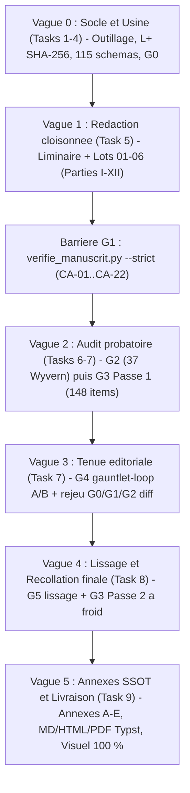

# Plan directeur de production, d'illustration et d'homologation vérifiable du Compendium

*Plan exécutable de rédaction, d'illustration vectorielle et d'homologation `G0`–`G5` du traité « Compendium de l'entreprise agentique » (`180 000` mots `± 8 %` · `42` unités · `115` schémas de vulgarisation · `260` thèmes canoniques)*

> **Version** : `1.0.0` · **Gel des faits** : `2026-12-02` (`2 décembre 2026`) · **Parution cible** : `janvier 2027` · **Auteur** : `André-Guy Bruneau, M.Sc IT` · **Statut** : Plan d'ingénierie éditoriale et de production (`non-avis`)  
> **Licences** : `CC-BY-4.0` (manuscrit et schémas) · `MIT` (outillage et contrats exécutables) · **Périmètre cible** : `Compendium/ouvrage/` (`12` domaines `D01–D12`, `36` chapitres `CH-01`–`CH-36`, `71` familles, `260` thèmes, `115` schémas `SCH-00-01`–`SCH-36-04`, `5` Annexes `A`–`E`)  
> **Navigation rapide** : [Table des matières](#table-des-matières-exhaustive) · [PRD maître (`prd.md`)](prd.md) · [PRD Web](../Tomes/Cartographie/PRD%20-%20R%C3%A9f%C3%A9rentiel%20directeur%20de%20l%27entreprise%20agentique.html) · [MindMap HTML](../Tomes/Cartographie/MindMap%20-%20Cartographie%20th%C3%A9matique%20du%20Corpus.html) · [Compendium (`Compendium/`)](README.md) · [Cartographie (`Tomes/Cartographie/`)](../Tomes/Cartographie/README.md) · [Corpus (`Corpus/`)](../Corpus/README.md) · [Tomes (`Tomes/`)](../Tomes/README.md) · [Gabarit PDF (`gabarit-pdf/`)](../gabarit-pdf/README.md) · [Index dépôt](../README.md)

> **REQUIRED SUB-SKILL** : Exécuter chaque tâche séquentielle (`Task 1` à `Task 9`) sous discipline stricte d'ingénierie dirigée par les spécifications, de tests échouants préalables (`TDD`), de cloisonnement `owned_concepts` et de validation indépendante (`G0`–`G5`), en appliquant intégralement la charte rédactionnelle `fr-CA` définie à la section § 5 de [`prd.md`](prd.md#5-cadre-réglementaire-jalons-20232035-statut-probatoire-non-avis-et-charte-rédactionnelle).
>
> - **Goal** : Produire sous `Compendium/ouvrage/` un traité complet de `180 000` mots (`± 8 %`, soit `[165 600, 194 400]` mots) répartis sur `42` unités (`00 - Liminaire`, `CH-01` à `CH-36`, `Annexes A` à `E`), illustrés par `115` schémas de vulgarisation (`SCH-00-01` à `SCH-36-04`), ancrés à `100,0 %` sur des sources ouvertes `L+` (`SHA-256`) et compilés en `.md`, `.html` autonome et `.pdf` (`Typst 6,14 × 9,21 po`).
> - **Architecture** : Usine éditoriale déterministe à cinq couches : (`1`) spécifications et registres `SSOT` (`specs/`, `registre/`, `sources/`) ; (`2`) usine iconographique (`schemas/`) adossée aux `267` figures rattachées des `319` diagrammes des Tomes ; (`3`) manuscrit cloisonné par vagues (`manuscrit/` + `ancrage/` Wyvern) ; (`4`) outillage Python déterministe et audits indépendants (`outils/`, `aq/`) ; (`5`) compilation triple (`gabarit-pdf/` + `Pandoc` + `Typst`).
> - **Tech Stack** : `Python 3.12+`, `pytest`, `jsonschema` (`Draft 2020-12`), `OPA / Rego`, `PlantUML` (`.svg` `-failfast2`), `Mermaid` (`.png` `300 DPI`), `Infographie SVG bilingue métier-tech`, `Pandoc` (`--embed-resources`), `Typst` (`../gabarit-pdf/gabarit-collection.typ`) et trousse exécutable du Tome 8 (`83/83` `pytest`, `45/45` `OPA`).
> - **Spec** : Référentiel directeur [`Compendium/prd.md`](prd.md), graphes et catalogues [`Tomes/Cartographie/donnees/`](../Tomes/Cartographie/README.md) (`prd-web-data.json`, `catalogue-schemas-prd.json`, `corpus-mindmap-data.json`), critères exécutables `CA-01` à `CA-22` et barrières `G0`–`G5`.

---

## Table des matières exhaustive

Cette table des matières est générée dynamiquement depuis les titres `H2`, `H3` et `H4` du présent plan directeur. Chaque lien interne pointe vers l'ancre `GFM` vérifiée de la section correspondante.

- [**1. Gouvernance éditoriale, contraintes globales (`AO-01` à `AO-08`), charte `fr-CA` et `Review Focus`**](#1-gouvernance-éditoriale-contraintes-globales-ao-01-à-ao-08-charte-fr-ca-et-review-focus)
  - [1.1 Objectif directeur, identité éditoriale et périmètre démontré (`DC-01`, `DC-P12`, `non-avis`)](#11-objectif-directeur-identité-éditoriale-et-périmètre-démontré-dc-01-dc-p12-non-avis)
  - [1.2 Contraintes globales impératives (`AO-01` à `AO-08`) et charte stylistique universitaire `fr-CA`](#12-contraintes-globales-impératives-ao-01-à-ao-08-et-charte-stylistique-universitaire-fr-ca)
  - [1.3 Points de vigilance prioritaires (`Review Focus`) et parades mécaniques](#13-points-de-vigilance-prioritaires-review-focus-et-parades-mécaniques)
  - [1.4 Architecture de l'usine `Compendium/ouvrage/` et table maîtresse de calibrage des 42 unités (`180 000` mots `± 8 %`)](#14-architecture-de-lusine-compendiumouvrage-et-table-maîtresse-de-calibrage-des-42-unités-180-000-mots--8-)
  - [1.5 Réalisation du Liminaire (`00 - Liminaire`) et intégration du Panorama visuel directeur (`SCH-00-01` à `SCH-00-04`)](#15-réalisation-du-liminaire-00---liminaire-et-intégration-du-panorama-visuel-directeur-sch-00-01-à-sch-00-04)
- [**2. Pipeline séquentiel d'exécution en neuf tâches découplées (`Task 1` à `Task 9`)**](#2-pipeline-séquentiel-dexécution-en-neuf-tâches-découplées-task-1-à-task-9)
  - [Task 1: Instanciation des spécifications et adaptation de l'outillage déterministe](#task-1-instanciation-des-spécifications-et-adaptation-de-loutillage-déterministe)
  - [Task 2: Consolidation et réancrage `L+` `SHA-256` et constitution des `37` bases fermées `sources/`](#task-2-consolidation-et-réancrage-l-sha-256-et-constitution-des-37-bases-fermées-sources)
  - [Task 3: Usine iconographique des `115` schémas de vulgarisation (`SCH-00-01` à `SCH-36-04`)](#task-3-usine-iconographique-des-115-schémas-de-vulgarisation-sch-00-01-à-sch-36-04)
  - [Task 4: Validation `G0` sur la trousse exécutable du Tome 8 et scellage `CA-G0-SYNC`](#task-4-validation-g0-sur-la-trousse-exécutable-du-tome-8-et-scellage-ca-g0-sync)
  - [Task 5: Rédaction cloisonnée par vagues des `37` unités narratives et barrière `G1`](#task-5-rédaction-cloisonnée-par-vagues-des-37-unités-narratives-et-barrière-g1)
  - [Task 6: Barrière `G2` — Ancrage atomique Wyvern par `37` auditeurs neufs](#task-6-barrière-g2--ancrage-atomique-wyvern-par-37-auditeurs-neufs)
  - [Task 7: Barrière `G3` passe 1 (`seed=20270901`) et boucle critique `G4` (`gauntlet-loop`)](#task-7-barrière-g3-passe-1-seed20270901-et-boucle-critique-g4-gauntlet-loop)
  - [Task 8: Lissage transversal `G5` et recollation finale à froid `G3` passe 2 (`seed=20270902`)](#task-8-lissage-transversal-g5-et-recollation-finale-à-froid-g3-passe-2-seed20270902)
  - [Task 9: Génération des `5` Annexes `A`–`E`, compilation triple et inspection visuelle `100,0 %`](#task-9-génération-des-5-annexes-ae-compilation-triple-et-inspection-visuelle-1000-)
- [**3. Fiches opérationnelles de réalisation par Partie (`Parties I` à `XII`, `D01`–`D12`) et par Chapitre (`CH-01` à `CH-36`)**](#3-fiches-opérationnelles-de-réalisation-par-partie-parties-i-à-xii-d01d12-et-par-chapitre-ch-01-à-ch-36)
  - [Partie I — D01 : Rupture épistémique, limites probabilistes et économie cognitive des Systèmes d'agentivité](#partie-i--d01--rupture-épistémique-limites-probabilistes-et-économie-cognitive-des-systèmes-dagentivité)
    - [Fiche CH-01 — Chapitre 01 : Rupture épistémique, Systèmes d'agentivité et fondements des acteurs autonomes](#fiche-ch-01--chapitre-01--rupture-épistémique-systèmes-dagentivité-et-fondements-des-acteurs-autonomes)
    - [Fiche CH-02 — Chapitre 02 : Fiabilité probabiliste, loi de Lusser, erreurs silencieuses et constance pass^k](#fiche-ch-02--chapitre-02--fiabilité-probabiliste-loi-de-lusser-erreurs-silencieuses-et-constance-passk)
    - [Fiche CH-03 — Chapitre 03 : Économie cognitive de Coase, matrices de portefeuille et quadruple dette agentique](#fiche-ch-03--chapitre-03--économie-cognitive-de-coase-matrices-de-portefeuille-et-quadruple-dette-agentique)
  - [Partie II — D02 : Architecture d'entreprise hybride 80/20, autonomie graduée L0–L4 et noyau de contrôle possédé](#partie-ii--d02--architecture-dentreprise-hybride-8020-autonomie-graduée-l0l4-et-noyau-de-contrôle-possédé)
    - [Fiche CH-04 — Chapitre 04 : Partition hybride 80/20, harnais déterministe à huit étapes et usine logicielle](#fiche-ch-04--chapitre-04--partition-hybride-8020-harnais-déterministe-à-huit-étapes-et-usine-logicielle)
    - [Fiche CH-05 — Chapitre 05 : Échelle d'autonomie unifiée N0–N4/L0–L4, règle du maillon et supervision anti-complaisance](#fiche-ch-05--chapitre-05--échelle-dautonomie-unifiée-n0n4l0l4-règle-du-maillon-et-supervision-anti-complaisance)
    - [Fiche CH-06 — Chapitre 06 : Architecture de référence unifiée, noyau possédé (42 CAP) et douze décisions neutres](#fiche-ch-06--chapitre-06--architecture-de-référence-unifiée-noyau-possédé-42-cap-et-douze-décisions-neutres)
  - [Partie III — D03 : Tissu conjonctif protocolaire, découverte fédérée et prévention du verrouillage SaaS](#partie-iii--d03--tissu-conjonctif-protocolaire-découverte-fédérée-et-prévention-du-verrouillage-saas)
    - [Fiche CH-07 — Chapitre 07 : Protocoles verticaux outil-modèle : épinglage MCP 2026-07-28, façades d'intention et intégrité SHA-256](#fiche-ch-07--chapitre-07--protocoles-verticaux-outil-modèle--épinglage-mcp-2026-07-28-façades-dintention-et-intégrité-sha-256)
    - [Fiche CH-08 — Chapitre 08 : Protocoles horizontaux pair-à-pair : A2A v1.0.1, pile AGNTCY/SLIM, paiements AP2 et fédération B2B](#fiche-ch-08--chapitre-08--protocoles-horizontaux-pair-à-pair--a2a-v101-pile-agntcyslim-paiements-ap2-et-fédération-b2b)
    - [Fiche CH-09 — Chapitre 09 : Passerelles PEP à neuf contrôles, découverte gouvernée, routage d'inférence et anti-verrouillage](#fiche-ch-09--chapitre-09--passerelles-pep-à-neuf-contrôles-découverte-gouvernée-routage-dinférence-et-anti-verrouillage)
  - [Partie IV — D04 : Gouvernance sémantique, mémoire CoALA à quatre tiroirs et encapsulation patrimoniale ACL/OT](#partie-iv--d04--gouvernance-sémantique-mémoire-coala-à-quatre-tiroirs-et-encapsulation-patrimoniale-aclot)
    - [Fiche CH-10 — Chapitre 10 : Sémantique métier, ontologies financières, contrats de données ODCS et compilation du contexte](#fiche-ch-10--chapitre-10--sémantique-métier-ontologies-financières-contrats-de-données-odcs-et-compilation-du-contexte)
    - [Fiche CH-11 — Chapitre 11 : Mémoire CoALA à quatre compartiments isolés, bi-temporalité auditable et filtrage ACL pré-récupération](#fiche-ch-11--chapitre-11--mémoire-coala-à-quatre-compartiments-isolés-bi-temporalité-auditable-et-filtrage-acl-pré-récupération)
    - [Fiche CH-12 — Chapitre 12 : Encapsulation patrimoniale déterministe (EBCDIC/COMP-3), extinction CUA, sas OT et six substrats d'état](#fiche-ch-12--chapitre-12--encapsulation-patrimoniale-déterministe-ebcdiccomp-3-extinction-cua-sas-ot-et-six-substrats-détat)
  - [Partie V — D05 : Orchestration sobre OO1–OO4, chorégraphie événementielle et exécution durable Saga](#partie-v--d05--orchestration-sobre-oo1oo4-chorégraphie-événementielle-et-exécution-durable-saga)
    - [Fiche CH-13 — Chapitre 13 : Sobriété d'orchestration OO1–OO4, catalogue fermé des topologies et maîtrise des défaillances MAST](#fiche-ch-13--chapitre-13--sobriété-dorchestration-oo1oo4-catalogue-fermé-des-topologies-et-maîtrise-des-défaillances-mast)
    - [Fiche CH-14 — Chapitre 14 : Chorégraphie Event Mesh sur CloudEvents/AsyncAPI, contrôle des boucles et passerelle vers l'IA physique](#fiche-ch-14--chapitre-14--chorégraphie-event-mesh-sur-cloudeventsasyncapi-contrôle-des-boucles-et-passerelle-vers-lia-physique)
    - [Fiche CH-15 — Chapitre 15 : Exécution durable hors processus, idempotence JCS, sémantique d'effet et sagas à canal isolé](#fiche-ch-15--chapitre-15--exécution-durable-hors-processus-idempotence-jcs-sémantique-deffet-et-sagas-à-canal-isolé)
  - [Partie VI — D06 : Identités non humaines (NHI), délégation OBO atténuée, PKI 47 jours et transition post-quantique](#partie-vi--d06--identités-non-humaines-nhi-délégation-obo-atténuée-pki-47-jours-et-transition-post-quantique)
    - [Fiche CH-16 — Chapitre 16 : Identités non humaines parrainées, attestations SPIFFE/SPIRE et fondations d'identité décentralisée](#fiche-ch-16--chapitre-16--identités-non-humaines-parrainées-attestations-spiffespire-et-fondations-didentité-décentralisée)
    - [Fiche CH-17 — Chapitre 17 : Chaîne de mandat OBO à deux sauts, approbation cryptographique CIBA, KYA tiers et asymétrie de révocation](#fiche-ch-17--chapitre-17--chaîne-de-mandat-obo-à-deux-sauts-approbation-cryptographique-ciba-kya-tiers-et-asymétrie-de-révocation)
    - [Fiche CH-18 — Chapitre 18 : Agilité cryptographique, cycles TLS à 47 jours et transition post-quantique ML-DSA/SLH-DSA](#fiche-ch-18--chapitre-18--agilité-cryptographique-cycles-tls-à-47-jours-et-transition-post-quantique-ml-dsaslh-dsa)
  - [Partie VII — D07 : Défense hors modèle, politiques OPA/Rego, Règle de deux et confinement déterministe](#partie-vii--d07--défense-hors-modèle-politiques-oparego-règle-de-deux-et-confinement-déterministe)
    - [Fiche CH-19 — Chapitre 19 : Surface d'attaque protocolaire, menaces OWASP ASI01–10 et chaîne logistique d'outils](#fiche-ch-19--chapitre-19--surface-dattaque-protocolaire-menaces-owasp-asi0110-et-chaîne-logistique-doutils)
    - [Fiche CH-20 — Chapitre 20 : Politiques hors modèle OPA/Rego/Cedar, Règle de deux et séparation contrôle/données CaMeL](#fiche-ch-20--chapitre-20--politiques-hors-modèle-oparegocedar-règle-de-deux-et-séparation-contrôledonnées-camel)
    - [Fiche CH-21 — Chapitre 21 : Confinement éphémère (SHADI/microVM/WASI), enclaves TEE/HYOK et coupe-circuit SOC/SOAR](#fiche-ch-21--chapitre-21--confinement-éphémère-shadimicrovmwasi-enclaves-teehyok-et-coupe-circuit-socsoar)
  - [Partie VIII — D08 : Observabilité probatoire, bancs EvalOps hermétiques et pilotage FinOps au résultat conforme](#partie-viii--d08--observabilité-probatoire-bancs-evalops-hermétiques-et-pilotage-finops-au-résultat-conforme)
    - [Fiche CH-22 — Chapitre 22 : Observabilité OpenTelemetry GenAI, double couloir PII et scellage probatoire JCS/SCITT + SLH-DSA](#fiche-ch-22--chapitre-22--observabilité-opentelemetry-genai-double-couloir-pii-et-scellage-probatoire-jcsscitt--slh-dsa)
    - [Fiche CH-23 — Chapitre 23 : Banc EvalOps hermétique (E1–E3), bornes de Wilson, tests métamorphiques FR/EN et distillation contrôlée](#fiche-ch-23--chapitre-23--banc-evalops-hermétique-e1e3-bornes-de-wilson-tests-métamorphiques-fren-et-distillation-contrôlée)
    - [Fiche CH-24 — Chapitre 24 : SRE agentique, FinOps FOCUS v1.4 au Cost-per-Outcome, routage frugal et comptabilité carbone](#fiche-ch-24--chapitre-24--sre-agentique-finops-focus-v14-au-cost-per-outcome-routage-frugal-et-comptabilité-carbone)
  - [Partie IX — D09 : Conformité juridique et prudentielle multi-juridictions (QC, CA, UE, int.) et réversibilité contractuelle](#partie-ix--d09--conformité-juridique-et-prudentielle-multi-juridictions-qc-ca-ue-int-et-réversibilité-contractuelle)
    - [Fiche CH-25 — Chapitre 25 : Droit québécois et cadre prudentiel financier canadien](#fiche-ch-25--chapitre-25--droit-québécois-et-cadre-prudentiel-financier-canadien)
    - [Fiche CH-26 — Chapitre 26 : Réglementation européenne et référentiels internationaux](#fiche-ch-26--chapitre-26--réglementation-européenne-et-référentiels-internationaux)
    - [Fiche CH-27 — Chapitre 27 : Approvisionnement réversible et clauses contractuelles](#fiche-ch-27--chapitre-27--approvisionnement-réversible-et-clauses-contractuelles)
  - [Partie X — D10 : Architectures sectorielles réglementées, trois blueprints C01–C40 et usine logicielle GitOps](#partie-x--d10--architectures-sectorielles-réglementées-trois-blueprints-c01c40-et-usine-logicielle-gitops)
    - [Fiche CH-28 — Chapitre 28 : Cinq profils financiers réglementés et 24 propositions PEX](#fiche-ch-28--chapitre-28--cinq-profils-financiers-réglementés-et-24-propositions-pex)
    - [Fiche CH-29 — Chapitre 29 : Trois blueprints de référence et cas Groupe Boréal (BEL)](#fiche-ch-29--chapitre-29--trois-blueprints-de-référence-et-cas-groupe-boréal-bel)
    - [Fiche CH-30 — Chapitre 30 : Usine logicielle GitOps et anti-patrons agentiques](#fiche-ch-30--chapitre-30--usine-logicielle-gitops-et-anti-patrons-agentiques)
  - [Partie XI — D11 : Prospective 2028–2035, trajectoires adaptatives DAPP, gouvernance AE/AS et capital humain](#partie-xi--d11--prospective-20282035-trajectoires-adaptatives-dapp-gouvernance-aeas-et-capital-humain)
    - [Fiche CH-31 — Chapitre 31 : Prospective stratégique 2027–2035, trajectoires adaptatives DAPP et portes d'homologation](#fiche-ch-31--chapitre-31--prospective-stratégique-20272035-trajectoires-adaptatives-dapp-et-portes-dhomologation)
    - [Fiche CH-32 — Chapitre 32 : Gouvernance duale AE ↔ AS, modèle en étoile à trois lignes, cycle de vie et sept pièges endogènes](#fiche-ch-32--chapitre-32--gouvernance-duale-ae--as-modèle-en-étoile-à-trois-lignes-cycle-de-vie-et-sept-pièges-endogènes)
    - [Fiche CH-33 — Chapitre 33 : Préservation du capital humain, parade à l'approbation réflexe et maintien du repli manuel](#fiche-ch-33--chapitre-33--préservation-du-capital-humain-parade-à-lapprobation-réflexe-et-maintien-du-repli-manuel)
  - [Partie XII — D12 : Homologation vérifiable, trousse exécutable du Tome 8, concordance inter-tomes et chaîne Wyvern G0–G5](#partie-xii--d12--homologation-vérifiable-trousse-exécutable-du-tome-8-concordance-inter-tomes-et-chaîne-wyvern-g0g5)
    - [Fiche CH-34 — Chapitre 34 : Référentiel d'homologation unifié : 305 exigences CRE-IA-2026-01, interdits GOV-17 et grille PRR-75](#fiche-ch-34--chapitre-34--référentiel-dhomologation-unifié--305-exigences-cre-ia-2026-01-interdits-gov-17-et-grille-prr-75)
    - [Fiche CH-35 — Chapitre 35 : Trousse exécutable (Python/OPA), 5 SBB du Tableau 12, vecteurs tiers et calibration FEDS/EMA](#fiche-ch-35--chapitre-35--trousse-exécutable-pythonopa-5-sbb-du-tableau-12-vecteurs-tiers-et-calibration-fedsema)
    - [Fiche CH-36 — Chapitre 36 : Concordance inter-tomes (DIV-02, DISC-01 à DISC-05), régime probatoire Wyvern G0–G5 et clause non-avis](#fiche-ch-36--chapitre-36--concordance-inter-tomes-div-02-disc-01-à-disc-05-régime-probatoire-wyvern-g0g5-et-clause-non-avis)
- [**4. Plan de génération déterministe des cinq Annexes (`Annexe A` à `Annexe E`)**](#4-plan-de-génération-déterministe-des-cinq-annexes-annexe-a-à-annexe-e)
  - [4.1 Annexe A — Traçabilité MindMap → PRD (`12` domaines, `36` chapitres, `71` familles, `260` thèmes)](#41-annexe-a--traçabilité-mindmap--prd-12-domaines-36-chapitres-71-familles-260-thèmes)
  - [4.2 Annexe B — Cartographie des `616` interrelations, nœuds carrefours et arbitrages](#42-annexe-b--cartographie-des-616-interrelations-nœuds-carrefours-et-arbitrages)
  - [4.3 Annexe C — Réconciliations inter-tomes (`DIV-02`, `DISC-01`–`DISC-05`) et calendrier `2023–2035`](#43-annexe-c--réconciliations-inter-tomes-div-02-disc-01disc-05-et-calendrier-20232035)
  - [4.4 Annexe D — Homologation `G0`–`G5`, matrice `EXIG / CAP / PRR-75 / C01–C40 / 5 SBB` et statut `non-avis`](#44-annexe-d--homologation-g0g5-matrice-exig--cap--prr-75--c01c40--5-sbb-et-statut-non-avis)
  - [4.5 Annexe E — Catalogue des `115` schémas de vulgarisation et concordance avec les `319` figures](#45-annexe-e--catalogue-des-115-schémas-de-vulgarisation-et-concordance-avec-les-319-figures)
- [**5. Référentiel des vingt-deux critères d'acceptation exécutables (`CA-01` à `CA-22`) et matrice des barrières `G0`–`G5`**](#5-référentiel-des-vingt-deux-critères-dacceptation-exécutables-ca-01-à-ca-22-et-matrice-des-barrières-g0g5)
- [**6. Ordonnancement d'exécution par vagues, gestion des risques et protocole de livraison**](#6-ordonnancement-dexécution-par-vagues-gestion-des-risques-et-protocole-de-livraison)
  - [Registre synthétique des risques d'exécution et parades](#registre-synthétique-des-risques-dexécution-et-parades)
  - [Protocole de livraison finale](#protocole-de-livraison-finale)

---

## 1. Gouvernance éditoriale, contraintes globales (`AO-01` à `AO-08`), charte `fr-CA` et `Review Focus`

### 1.1 Objectif directeur, identité éditoriale et périmètre démontré (`DC-01`, `DC-P12`, `non-avis`)

Le présent plan directeur gouverne l'industrialisation, la vérification probatoire et la compilation intégrale de l'ouvrage *Compendium de l'entreprise agentique* sous l'arborescence cible `Compendium/ouvrage/`. Fondé sur le référentiel maître [prd.md](prd.md), l'ouvrage consolide les huit volumes du Corpus (`4 542` pages PDF, `319` diagrammes) et la cartographie transversale (`12` domaines `D01–D12`, `36` sous-domaines, `71` familles thématiques, `260` thèmes canoniques et `616` interrelations typées) en un traité unifié de `180 000` mots (`± 8 %`, soit `[165 600, 194 400]` mots) répartis en `42` unités (`00 - Liminaire`, `CH-01` à `CH-36` et `5` Annexes `A`–`E`) et illustrés par `115` schémas de vulgarisation (`SCH-00-01` à `SCH-36-04`).

- **Auteur et calendrier éditorial** : `André-Guy Bruneau, M.Sc IT`. La date de gel documentaire et normative est fixée au **2 décembre 2026** (`2026-12-02`) et la parution est arrêtée à **janvier 2027**. Toute échéance située en `2027` ou au-delà (telles l'entrée en vigueur de la ligne directrice `BSIF E-23` au `1er mai 2027`, la révision cible `MCP SEP-3398` au `30 mars 2027`, les transitions `TLS` `100` jours / `47` jours ou l'Annexe III de l'`EU AI Act`) DOIT être rédigée comme une échéance future à venir.
- **Régime `non-avis` (`DC-P01`, `DC-P12`, `AO-05`)** : Le manuscrit, ses schémas et les extraits issus de la trousse compagnon forment un référentiel technique et architectural figé au `2026-12-02`. Leur conformité aux barrières `G0–G5` ne constitue **ni un avis juridique, ni une certification d'audit ou actuarielle, ni une homologation réglementaire** (`BSIF E-23`, `AMF`, `Loi 25`, `EU AI Act` ou `ISO/IEC 42001`) sur un système d'enregistrement (`SoR`) en exploitation réelle.
- **Licences duales (`CC-BY-4.0` / `MIT`)** : Le manuscrit consolidé, les `115` schémas et les figures vectorielles sont placés sous licence **`CC-BY-4.0`** ; l'outillage de production, les contrats `JSON Schema Draft 2020-12`, les paquets `OPA / Rego` et les modules Python exécutables relèvent de la licence **`MIT`**.
- **Périmètre démontré par rapport au non-éprouvé (`DC-01`, `DC-P12`)** : Toute affirmation de comportement exécutable s'appuie sur une source primaire ouverte `L+` hachée `SHA-256` ou sur un résultat consigné en `G0` par la trousse du Tome 8 (`83/83` tests `pytest`, `45/45` assertions `OPA` à `100,0 %`, `4/4` suites tierces totalisant `50` fichiers). Les cas synthétiques (`Groupe Boréal`, `Borealis-Bench`, calibrations `FEDS/EMA`) sont bornés comme modèles analytiques reproductibles.

### 1.2 Contraintes globales impératives (`AO-01` à `AO-08`) et charte stylistique universitaire `fr-CA`

L'usine `Compendium/ouvrage/` hérite et étend les huit contraintes bloquantes des plans de production des Tomes 7 ([plan-production-aq.md](../Tomes/Tome%207%20-%20Gouverner%20l%27industrialisation%20cognitive/specs/plan-production-aq.md)) et 8 ([plan-production-aq.md](../Tomes/Tome%208%20-%20Ing%C3%A9nierie%20ex%C3%A9cutable%20et%20homologation%20v%C3%A9rifiable/specs/plan-production-aq.md) et [contrat-aq.md](../Tomes/Tome%208%20-%20Ing%C3%A9nierie%20ex%C3%A9cutable%20et%20homologation%20v%C3%A9rifiable/specs/contrat-aq.md)) :

| Code | Intitulé | Règle exécutable et seuil bloquant |
|---|---|---|
| `AO-01` | Zéro contournement | Tout `HTTP 401`/`403`/`429`/`451`, WAF, CAPTCHA, Turnstile, Anubis ou mur payant stoppe après `1` tentative et classe l'URL en `statut F` (`0,0 %` `METADATA_ONLY`). |
| `AO-02` | Zéro preuve circulaire | `Corpus/Tome 1..8.md` servent uniquement de repérage en lecture seule ; tout fait est réancré sur sa source primaire `L+` `SHA-256` dans `sources/ch00..ch36-sources.md`. |
| `AO-03` | Propreté lexicale | `EXIG-*`, `CAP-*`, `ADR-*`, `POR-*`, `PRR`, `PEX-*`, `C01–C40`, `SBB` et `SCH-*` autorisés ; marqueurs bruts (`[S]`, `[D]`, `[A]`, `[M]`, `[N]`, `[L+]`) hors `CH-36` et clichés bannis (`CA-02`). |
| `AO-04` | Anti-auto-plagiat | Zéro collision de `12` mots normalisés face à `Corpus/*.md`, hors citations `≤ 40` mots `« … » [n]` et extraits `CA-G0-SYNC` (`CA-03`). |
| `AO-05` | Statut `non-avis` | Bandeau `non-avis` (`DC-P01` / `DC-P12`) en page de titre, au Liminaire, en `CH-36`, en Annexe D et dans le `README.md` de la trousse. |
| `AO-06` | Sûreté typographique | Zéro `$` nu hors code (`\$` obligatoire), formules uniquement en `\(...\)` ou `\[...\]`, `Pandoc` via `-f markdown-tex_math_dollars+tex_math_single_backslash` (`CA-06`). |
| `AO-07` | Étanchéité `G0`–`G5` | Aucun rédacteur n'audite son propre texte (`G2`–`G5`) ; `batisseur-code` ne touche pas aux oracles `G0` ; `G4` utilise `invoke_subagent` sans `swarm`. |
| `AO-08` | Séparation livre / code | Aucun code rédigé à la main : tout extrait (`≤ 40` L) provient mécaniquement de `Tome 8/trousse/` et est scellé par `SHA-256` (`CA-20`). |

**Charte rédactionnelle universitaire `fr-CA` (§ 5 de [prd.md](prd.md#5-cadre-réglementaire-jalons-20232035-statut-probatoire-non-avis-et-charte-rédactionnelle))** :
1. **Registre** : Français canadien universitaire, neutre et analytique, en phrases complètes. Le pronom « `on` » (y compris `l'on`) est proscrit hors code et citations `« ... »` ; les tournures impersonnelles ou sujets institutionnels le remplacent.
2. **Terminologie** : Employer exclusivement **`Systèmes d'agentivité`** / **`Système d'agentivité`**, jamais l'anglicisme hors backticks ou URLs. Marqueurs RFC 2119 en majuscules (`DOIT`, `DOIVENT`, `NE DOIT PAS`, `NE DOIT JAMAIS`, `DEVRAIT`).
3. **Typographie et encodage** : Hors code, utiliser `→`, `↔`, `≤`, `≥`, `×` et `–` (`L955–L970`, `2026–2035`, `CH-01–CH-36`). Zéro `->`, `<->`, `<=`, `>=`, `L\d+-L?\d+`, `vs`, `prod`, `org.`, marqueur d'attente ni mention à compléter hors code. Virgule décimale française et espace devant `%` (`99,0 %`, `100,0 %`, `± 8 %`). Encodage `UTF-8` sans BOM, `LF` (`\n`) strict.

### 1.3 Points de vigilance prioritaires (`Review Focus`) et parades mécaniques

Cinq modes de défaillance critiques disposent chacun de tests et de parades automatisées dans `Task 1` à `Task 9` :

1. **Dérive du comptage de mots et faux positifs `12-grammes` (`CA-01`, `CA-03`)** : `count_prose_words()` dans `verifie_manuscrit.py` exclut front matter, code clôturé, commentaires HTML et URLs ; l'analyseur `12-grammes` exclut uniquement les citations `« … » [n]` (`≤ 40` mots) et extraits `CA-G0-SYNC` (`test_12gram_ignores_quoted_statute_titles_only`, `Task 1`).
2. **Chevauchement des `owned_concepts` entre `36` chapitres (`CA-21`)** : `manifest.json` impose une partition bijective des `71` familles et `260` thèmes (`owned_concepts` par rapport aux renvois `→`/`←`), contrôlée par `verifie_specs.py`, `verifie_manuscrit.py` (`CA-21`) et purgée au lissage `G5` (`Task 5`, `Task 8`).
3. **Corruption typographique (`\$`, `\r\n`, `CA-G0-SYNC`) en `G4`–`G5` (`CA-06`, `CA-20`)** : `verifie_manuscrit.py` lève `_mask_fenced_code_preserving_lines` pour auditer chaque extrait (`≤ 40` L, `SHA-256` contre `rapports-g0.json`) et rejoue `execute_g0.py` + `verifie_manuscrit.py --strict` + `G2` différentiel après `Task 7` et `Task 8` (`test_ca_g0_sync_and_dollar_safety`).
4. **Étanchéité `G0` / `G3` (`CA-07`, `CA-13`, `CA-14`, `CA-19`)** : `Task 4` exécute `execute_g0.py` sur `4` suites tierces (`50` fichiers) et impose `default allow := false` à `100,0 %` `OPA` ; `echantillon_aq.py` tire `148` items (`4 × 37`, `≥ 4`/unité) sur deux graines disjointes (`20270901` / `20270902`) entre auditeurs distincts (`Task 7`, `Task 8`).
5. **Cohérence des `115` schémas et lisibilité PDF (`CA-08`, `CA-18`, `CA-22`)** : `compile_schemas_compendium.py` applique `-failfast2` (`PlantUML`), `300 DPI` (`Mermaid`), validation SVG et plafond `≤ 14` nœuds (`Task 3`) ; `Task 9` inspecte `100,0 %` des pages PDF `6,14 × 9,21 po`.

### 1.4 Architecture de l'usine `Compendium/ouvrage/` et table maîtresse de calibrage des 42 unités (`180 000` mots `± 8 %`)

Toute la production du Compendium réside sous `Compendium/ouvrage/`, en stricte séparation des données sources de cartographie (`Tomes/Cartographie/donnees/`) et de la trousse exécutable du Tome 8 (`Tomes/Tome 8 - Ingénierie exécutable et homologation vérifiable/trousse/`).

```text
Compendium/
├── prd.md                                    # Référentiel directeur maître (lecture seule)
├── plan.md                                   # Plan d'exécution assemblé depuis .plan_lots/
└── ouvrage/                                  # Usine de production du Compendium (180 000 mots)
    ├── specs/
    │   ├── manifest.json                     # Contrat des 42 unités, owned_concepts, 115 schémas
    │   └── protocole-mlr-compendium.json     # Protocole ouvert L+ (gel 2026-12-02)
    ├── outils/                               # Scripts Python déterministes (licence MIT)
    │   ├── _communs.py
    │   ├── verifie_specs.py
    │   ├── verifie_manuscrit.py
    │   ├── echantillon_aq.py
    │   ├── genere_annexes.py
    │   ├── execute_g0.py
    │   ├── collecte_mlr_ouverte.py
    │   ├── compile_schemas_compendium.py
    │   ├── assemble_livre.py
    │   └── test_*.py
    ├── registre/                             # Sources uniques de vérité JSON (SSOT)
    │   ├── mindmap-complet.json              # Export scellé 12/36/71/260 + 616 interrelations
    │   ├── specifications-lplus.json
    │   ├── matrice-exig-prr-c40.json         # 305 EXIG-*, 52 CAP, 24 PEX, PRR-75, C01–C40, 5 SBB
    │   ├── concordance-taxonomies.json       # DIV-02 + DISC-01..05
    │   ├── ancres-chronologiques.json        # Jalons vérifiés 2018–2035
    │   ├── faits-empiriques.json
    │   └── glossaire-termes.json
    ├── recherche/
    │   ├── manifeste-sources-sha256.json
    │   ├── registre-statut-f.json
    │   └── corpus_l_plus/                    # Textes intégraux UTF-8 hachés SHA-256
    ├── sources/                              # 37 bases fermées ch00-sources.md .. ch36-sources.md
    ├── schemas/                              # 115 sources (.puml, .mmd, .svg) + rendus/
    ├── manuscrit/                            # 42 unités (CC-BY-4.0)
    │   ├── 00 - Liminaire.md                 # 4 000 mots [3 680, 4 320]
    │   ├── 01 - Partie I/ .. 12 - Partie XII/ # 36 chapitres (161 000 mots)
    │   └── 13 - Annexes/                     # Annexe A..E générées (15 000 mots)
    ├── ancrage/                              # 37 journaux Wyvern G2 ch00..ch36-ancrage.md
    ├── aq/                                   # rapports-g0.json, recollation G3, gauntlet-log.md, visuel
    └── livrables/                            # Compendium.md, Compendium.html, Compendium.pdf
```

Le calibrage de chaque chapitre `CH-XX` (`01` à `36`) suit exactement la formule linéaire indexée sur son nombre `t` de thèmes dans [prd-web-data.json](../Tomes/Cartographie/donnees/prd-web-data.json) : \(C = 3\,100 + 190 \times t\), avec \(\text{min\_words} = \lceil 0,92 \times C \rceil\) et \(\text{max\_words} = \lfloor 1,08 \times C \rfloor\). Le total des `36` chapitres (`260` thèmes) s'établit à `36 × 3 100 + 190 × 260 = 111 600 + 49 400 = 161 000` mots ; l'ajout du Liminaire (`4 000` mots) porte le bloc narratif à `165 000` mots, et les cinq Annexes SSOT (`15 000` mots) complètent le volume cible de `180 000` mots (`± 8 %` = `[165 600, 194 400]`).

| Unité | Domaine / Sous-domaine | Familles | Thèmes | Schémas `SCH-*` | Cible (mots) | Plage `[min, max]` |
|---|---|---:|---:|---|---:|---:|
| [`00 - Liminaire`](prd.md#sommaire-exécutif-global) | `GLOBAL` / Sommaire exécutif & Panorama | 0 | 0 | `SCH-00-01` à `SCH-00-04` (4) | 4 000 | `[3 680, 4 320]` |
| [`CH-01`](prd.md#chapitre-01--rupture-épistémique-systèmes-dagentivité-et-fondements-des-acteurs-autonomes) | `D01` / `SUB_D01_01` | 2 | 8 | `SCH-01-01`, `SCH-01-02`, `SCH-01-03` (3) | 4 620 | `[4 251, 4 989]` |
| [`CH-02`](prd.md#chapitre-02--fiabilité-probabiliste-loi-de-lusser-erreurs-silencieuses-et-constance-passk) | `D01` / `SUB_D01_02` | 2 | 4 | `SCH-02-01`, `SCH-02-02`, `SCH-02-03` (3) | 3 860 | `[3 552, 4 168]` |
| [`CH-03`](prd.md#chapitre-03--économie-cognitive-de-coase-matrices-de-portefeuille-et-quadruple-dette-agentique) | `D01` / `SUB_D01_03` | 2 | 8 | `SCH-03-01`, `SCH-03-02`, `SCH-03-03` (3) | 4 620 | `[4 251, 4 989]` |
| [`CH-04`](prd.md#chapitre-04--partition-hybride-8020-harnais-déterministe-à-huit-étapes-et-usine-logicielle) | `D02` / `SUB_D02_01` | 2 | 7 | `SCH-04-01`, `SCH-04-02`, `SCH-04-03` (3) | 4 430 | `[4 076, 4 784]` |
| [`CH-05`](prd.md#chapitre-05--échelle-dautonomie-unifiée-n0n4l0l4-règle-du-maillon-et-supervision-anti-complaisance) | `D02` / `SUB_D02_02` | 2 | 4 | `SCH-05-01`, `SCH-05-02`, `SCH-05-03` (3) | 3 860 | `[3 552, 4 168]` |
| [`CH-06`](prd.md#chapitre-06--architecture-de-référence-unifiée-noyau-possédé-42-cap-et-douze-décisions-neutres) | `D02` / `SUB_D02_03` | 2 | 12 | `SCH-06-01`, `SCH-06-02`, `SCH-06-03`, `SCH-06-04` (4) | 5 380 | `[4 950, 5 810]` |
| [`CH-07`](prd.md#chapitre-07--protocoles-verticaux-outil-modèle--épinglage-mcp-2026-07-28-façades-dintention-et-intégrité-sha-256) | `D03` / `SUB_D03_01` | 2 | 6 | `SCH-07-01`, `SCH-07-02`, `SCH-07-03` (3) | 4 240 | `[3 901, 4 579]` |
| [`CH-08`](prd.md#chapitre-08--protocoles-horizontaux-pair-à-pair--a2a-v101-pile-agntcyslim-paiements-ap2-et-fédération-b2b) | `D03` / `SUB_D03_02` | 2 | 8 | `SCH-08-01`, `SCH-08-02`, `SCH-08-03` (3) | 4 620 | `[4 251, 4 989]` |
| [`CH-09`](prd.md#chapitre-09--passerelles-pep-à-neuf-contrôles-découverte-gouvernée-routage-dinférence-et-anti-verrouillage) | `D03` / `SUB_D03_03` | 2 | 11 | `SCH-09-01`, `SCH-09-02`, `SCH-09-03`, `SCH-09-04` (4) | 5 190 | `[4 775, 5 605]` |
| [`CH-10`](prd.md#chapitre-10--sémantique-métier-ontologies-financières-contrats-de-données-odcs-et-compilation-du-contexte) | `D04` / `SUB_D04_01` | 2 | 7 | `SCH-10-01`, `SCH-10-02`, `SCH-10-03` (3) | 4 430 | `[4 076, 4 784]` |
| [`CH-11`](prd.md#chapitre-11--mémoire-coala-à-quatre-compartiments-isolés-bi-temporalité-auditable-et-filtrage-acl-pré-récupération) | `D04` / `SUB_D04_02` | 2 | 5 | `SCH-11-01`, `SCH-11-02`, `SCH-11-03` (3) | 4 050 | `[3 726, 4 374]` |
| [`CH-12`](prd.md#chapitre-12--encapsulation-patrimoniale-déterministe-ebcdiccomp-3-extinction-cua-sas-ot-et-six-substrats-détat) | `D04` / `SUB_D04_03` | 2 | 7 | `SCH-12-01`, `SCH-12-02`, `SCH-12-03` (3) | 4 430 | `[4 076, 4 784]` |
| [`CH-13`](prd.md#chapitre-13--sobriété-dorchestration-oo1oo4-catalogue-fermé-des-topologies-et-maîtrise-des-défaillances-mast) | `D05` / `SUB_D05_01` | 2 | 10 | `SCH-13-01`, `SCH-13-02`, `SCH-13-03` (3) | 5 000 | `[4 600, 5 400]` |
| [`CH-14`](prd.md#chapitre-14--chorégraphie-event-mesh-sur-cloudeventsasyncapi-contrôle-des-boucles-et-passerelle-vers-lia-physique) | `D05` / `SUB_D05_02` | 2 | 3 | `SCH-14-01`, `SCH-14-02`, `SCH-14-03` (3) | 3 670 | `[3 377, 3 963]` |
| [`CH-15`](prd.md#chapitre-15--exécution-durable-hors-processus-idempotence-jcs-sémantique-deffet-et-sagas-à-canal-isolé) | `D05` / `SUB_D05_03` | 2 | 7 | `SCH-15-01`, `SCH-15-02`, `SCH-15-03` (3) | 4 430 | `[4 076, 4 784]` |
| [`CH-16`](prd.md#chapitre-16--identités-non-humaines-parrainées-attestations-spiffespire-et-fondations-didentité-décentralisée) | `D06` / `SUB_D06_01` | 2 | 8 | `SCH-16-01`, `SCH-16-02`, `SCH-16-03` (3) | 4 620 | `[4 251, 4 989]` |
| [`CH-17`](prd.md#chapitre-17--chaîne-de-mandat-obo-à-deux-sauts-approbation-cryptographique-ciba-kya-tiers-et-asymétrie-de-révocation) | `D06` / `SUB_D06_02` | 2 | 7 | `SCH-17-01`, `SCH-17-02`, `SCH-17-03` (3) | 4 430 | `[4 076, 4 784]` |
| [`CH-18`](prd.md#chapitre-18--agilité-cryptographique-cycles-tls-à-47-jours-et-transition-post-quantique-ml-dsaslh-dsa) | `D06` / `SUB_D06_03` | 2 | 4 | `SCH-18-01`, `SCH-18-02`, `SCH-18-03` (3) | 3 860 | `[3 552, 4 168]` |
| [`CH-19`](prd.md#chapitre-19--surface-dattaque-protocolaire-menaces-owasp-asi0110-et-chaîne-logistique-doutils) | `D07` / `SUB_D07_01` | 2 | 7 | `SCH-19-01`, `SCH-19-02`, `SCH-19-03` (3) | 4 430 | `[4 076, 4 784]` |
| [`CH-20`](prd.md#chapitre-20--politiques-hors-modèle-oparegocedar-règle-de-deux-et-séparation-contrôledonnées-camel) | `D07` / `SUB_D07_02` | 2 | 9 | `SCH-20-01`, `SCH-20-02`, `SCH-20-03` (3) | 4 810 | `[4 426, 5 194]` |
| [`CH-21`](prd.md#chapitre-21--confinement-éphémère-shadimicrovmwasi-enclaves-teehyok-et-coupe-circuit-socsoar) | `D07` / `SUB_D07_03` | 2 | 4 | `SCH-21-01`, `SCH-21-02`, `SCH-21-03` (3) | 3 860 | `[3 552, 4 168]` |
| [`CH-22`](prd.md#chapitre-22--observabilité-opentelemetry-genai-double-couloir-pii-et-scellage-probatoire-jcsscitt--slh-dsa) | `D08` / `SUB_D08_01` | 2 | 8 | `SCH-22-01`, `SCH-22-02`, `SCH-22-03` (3) | 4 620 | `[4 251, 4 989]` |
| [`CH-23`](prd.md#chapitre-23--banc-evalops-hermétique-e1e3-bornes-de-wilson-tests-métamorphiques-fren-et-distillation-contrôlée) | `D08` / `SUB_D08_02` | 2 | 7 | `SCH-23-01`, `SCH-23-02`, `SCH-23-03` (3) | 4 430 | `[4 076, 4 784]` |
| [`CH-24`](prd.md#chapitre-24--sre-agentique-finops-focus-v14-au-cost-per-outcome-routage-frugal-et-comptabilité-carbone) | `D08` / `SUB_D08_03` | 2 | 5 | `SCH-24-01`, `SCH-24-02`, `SCH-24-03` (3) | 4 050 | `[3 726, 4 374]` |
| [`CH-25`](prd.md#chapitre-25--droit-québécois-et-cadre-prudentiel-financier-canadien) | `D09` / `SUB_D09_01` | 2 | 10 | `SCH-25-01`, `SCH-25-02`, `SCH-25-03` (3) | 5 000 | `[4 600, 5 400]` |
| [`CH-26`](prd.md#chapitre-26--réglementation-européenne-et-référentiels-internationaux) | `D09` / `SUB_D09_02` | 2 | 8 | `SCH-26-01`, `SCH-26-02`, `SCH-26-03` (3) | 4 620 | `[4 251, 4 989]` |
| [`CH-27`](prd.md#chapitre-27--approvisionnement-réversible-et-clauses-contractuelles) | `D09` / `SUB_D09_03` | 2 | 5 | `SCH-27-01`, `SCH-27-02`, `SCH-27-03` (3) | 4 050 | `[3 726, 4 374]` |
| [`CH-28`](prd.md#chapitre-28--cinq-profils-financiers-réglementés-et-24-propositions-pex) | `D10` / `SUB_D10_01` | 2 | 10 | `SCH-28-01`, `SCH-28-02`, `SCH-28-03` (3) | 5 000 | `[4 600, 5 400]` |
| [`CH-29`](prd.md#chapitre-29--trois-blueprints-de-référence-et-cas-groupe-boréal-bel) | `D10` / `SUB_D10_02` | 2 | 8 | `SCH-29-01`, `SCH-29-02`, `SCH-29-03` (3) | 4 620 | `[4 251, 4 989]` |
| [`CH-30`](prd.md#chapitre-30--usine-logicielle-gitops-et-anti-patrons-agentiques) | `D10` / `SUB_D10_03` | 2 | 6 | `SCH-30-01`, `SCH-30-02`, `SCH-30-03` (3) | 4 240 | `[3 901, 4 579]` |
| [`CH-31`](prd.md#chapitre-31--prospective-stratégique-20272035-trajectoires-adaptatives-dapp-et-portes-dhomologation) | `D11` / `SUB_D11_01` | 2 | 11 | `SCH-31-01`, `SCH-31-02`, `SCH-31-03` (3) | 5 190 | `[4 775, 5 605]` |
| [`CH-32`](prd.md#chapitre-32--gouvernance-duale-ae--as-modèle-en-étoile-à-trois-lignes-cycle-de-vie-et-sept-pièges-endogènes) | `D11` / `SUB_D11_02` | 2 | 8 | `SCH-32-01`, `SCH-32-02`, `SCH-32-03` (3) | 4 620 | `[4 251, 4 989]` |
| [`CH-33`](prd.md#chapitre-33--préservation-du-capital-humain-parade-à-lapprobation-réflexe-et-maintien-du-repli-manuel) | `D11` / `SUB_D11_03` | 1 | 3 | `SCH-33-01`, `SCH-33-02`, `SCH-33-03` (3) | 3 670 | `[3 377, 3 963]` |
| [`CH-34`](prd.md#chapitre-34--référentiel-dhomologation-unifié--305-exigences-cre-ia-2026-01-interdits-gov-17-et-grille-prr-75) | `D12` / `SUB_D12_01` | 2 | 6 | `SCH-34-01`, `SCH-34-02`, `SCH-34-03` (3) | 4 240 | `[3 901, 4 579]` |
| [`CH-35`](prd.md#chapitre-35--trousse-exécutable-pythonopa-5-sbb-du-tableau-12-vecteurs-tiers-et-calibration-fedsema) | `D12` / `SUB_D12_02` | 2 | 5 | `SCH-35-01`, `SCH-35-02`, `SCH-35-03` (3) | 4 050 | `[3 726, 4 374]` |
| [`CH-36`](prd.md#chapitre-36--concordance-inter-tomes-div-02-disc-01-à-disc-05-régime-probatoire-wyvern-g0g5-et-clause-non-avis) | `D12` / `SUB_D12_03` | 2 | 14 | `SCH-36-01`, `SCH-36-02`, `SCH-36-03`, `SCH-36-04` (4) | 5 760 | `[5 300, 6 220]` |
| [`Annexe A`](prd.md#annexe-a--table-maîtresse-de-traçabilité-mindmap--prd-12-domaines-36-chapitres-71-familles-260-thèmes) | `ANNEXE` / Annexe A | 0 | 0 | SSOT déterministe | 3 000 | `[2 760, 3 240]` |
| [`Annexe B`](prd.md#annexe-b--cartographie-analytique-des-616-interrelations-systémiques-nœuds-carrefours-et-arbitrages) | `ANNEXE` / Annexe B | 0 | 0 | SSOT déterministe | 2 500 | `[2 300, 2 700]` |
| [`Annexe C`](prd.md#annexe-c--réconciliations-inter-tomes-div-02-disc-01-à-disc-05-et-calendrier-vérifié-20232035) | `ANNEXE` / Annexe C | 0 | 0 | SSOT déterministe | 3 000 | `[2 760, 3 240]` |
| [`Annexe D`](prd.md#annexe-d--homologation-exécutable-g0g5-matrice-exig--cap--prr-75--c01c40--5-sbb-licences-et-statut-non-avis) | `ANNEXE` / Annexe D | 0 | 0 | SSOT déterministe | 3 000 | `[2 760, 3 240]` |
| [`Annexe E`](prd.md#annexe-e--plan-directeur-et-catalogue-intégral-des-schémas-de-vulgarisation-à-intégrer-et-correspondance-avec-les-319-figures-du-corpus) | `ANNEXE` / Annexe E | 0 | 0 | `SCH-00`..`SCH-36` (catalogue) | 3 500 | `[3 220, 3 780]` |
| **Total (`42` unités)** | **`12` domaines + `5` annexes** | **71** | **260** | **`115` schémas** | **180 000** | **`[165 600, 194 400]`** *(somme bornes : `[165 615, 194 385]`)* |

### 1.5 Réalisation du Liminaire (`00 - Liminaire`) et intégration du Panorama visuel directeur (`SCH-00-01` à `SCH-00-04`)

Le fichier `Compendium/ouvrage/manuscrit/00 - Liminaire.md` (`C = 4 000` mots, plage `[3 680, 4 320]`) établit le contrat doctrinal, terminologique et probatoire de l'ensemble de l'ouvrage à partir du [Sommaire exécutif global](prd.md#sommaire-exécutif-global) et de l'[Annexe C](prd.md#annexe-c--réconciliations-inter-tomes-div-02-disc-01-à-disc-05-et-calendrier-vérifié-20232035). Il s'articule en cinq sections numérotées `0.1` à `0.5` : problématique industrielle (loi de Lusser, coûts de Coase, jardins clos), doctrine hybride `80/20` et harnais déterministe, topologie des `12` domaines et `616` interrelations, gouvernance duale `AE ↔ AS` avec tableau directeur `KPI / SLO`, et cadre réglementaire `2023–2035` assorti de la clause `non-avis` (`AO-05`) et de la date de gel (`2026-12-02`).

Le Liminaire intègre intégralement les **quatre schémas transversaux du [Panorama visuel directeur](prd.md#panorama-visuel-directeur--schémas-de-vulgarisation-transversaux)** issus de [catalogue-schemas-prd.json](../Tomes/Cartographie/donnees/catalogue-schemas-prd.json) :

- **`SCH-00-01` — Architecture de l'entreprise agentique : exosquelette déterministe à 80 % encadrant 20 % de cognition probabiliste** (`Adaptation vulgarisée`, `Métaphore architecturale en couches`, `Infographie SVG bilingue métier-tech`, inséré après § `0.2`) : oppose les zones `Z1` (`SoE`), `Z2` (exosquelette `80 %` : `42 CAP` et harnais à `8` étapes), `Z3` (`20 %` cognition substituable) et `Z4` (`SoR` sous couche `ACL`), avec `6` figures sources raccordées : `T5 · Fig. 2` ([Rendu](../Tomes/Tome%205%20-%20Synth%C3%A8se%20ex%C3%A9cutive%20et%20concordance%20architecturale/Diagrammes/rendus/Fig-02.svg), [Source](../Tomes/Tome%205%20-%20Synth%C3%A8se%20ex%C3%A9cutive%20et%20concordance%20architecturale/Diagrammes/Fig-02%20-%20Architecture%20de%20r%C3%A9f%C3%A9rence%20unifi%C3%A9e%20%C3%A0%205%20couches%20et%203%20volets.puml)), `T2 · Figure 1` ([Rendu](../Tomes/Tome%202%20-%20Cadre%20normatif%20et%20exigences%20d%27architecture/Diagrammes/rendus/Figure-01.svg), [Source](../Tomes/Tome%202%20-%20Cadre%20normatif%20et%20exigences%20d%27architecture/Diagrammes/Figure-01%20-%20Le%20cadre%20en%20une%20page.puml)), `T3 · Fig. 1` ([Rendu](../Tomes/Tome%203%20-%20Ing%C3%A9nierie%20du%20tissu%20conjonctif%20et%20%C3%A9tat%20de%20l%27art/Diagrammes/rendus/Fig-01.svg), [Source](../Tomes/Tome%203%20-%20Ing%C3%A9nierie%20du%20tissu%20conjonctif%20et%20%C3%A9tat%20de%20l%27art/Diagrammes/Fig-01%20-%20Architecture%20de%20r%C3%A9f%C3%A9rence%20%C3%A0%206%20couches%20et%202%20piliers%20transversaux.puml)), `T6 · Fig. 1` ([Rendu](../Tomes/Tome%206%20-%20Architecture%20multisectorielle%20et%20patrons%20de%20r%C3%A9f%C3%A9rence/Diagrammes/rendus/Fig-01.svg), [Source](../Tomes/Tome%206%20-%20Architecture%20multisectorielle%20et%20patrons%20de%20r%C3%A9f%C3%A9rence/Diagrammes/Fig-01%20-%20Stratification%20%C3%A9volutive%20du%20syst%C3%A8me%20d%27information%20-%20SoE%2C%20Systems.puml)), `T7 · Fig-08` ([Rendu](../Tomes/Tome%207%20-%20Gouverner%20l%27industrialisation%20cognitive/diagrammes/rendus/Fig-08.svg), [Source](../Tomes/Tome%207%20-%20Gouverner%20l%27industrialisation%20cognitive/diagrammes/Fig-08.puml)) et `T8 · Fig-01` ([Rendu](../Tomes/Tome%208%20-%20Ing%C3%A9nierie%20ex%C3%A9cutable%20et%20homologation%20v%C3%A9rifiable/diagrammes/rendus/Fig-01.svg), [Source](../Tomes/Tome%208%20-%20Ing%C3%A9nierie%20ex%C3%A9cutable%20et%20homologation%20v%C3%A9rifiable/diagrammes/Fig-01.puml)).
- **`SCH-00-02` — Chaîne de confiance protocolaire et juridique de bout en bout (MCP, A2A, OBO, OPA et conformité)** (`Adaptation vulgarisée`, `Parcours séquentiel illustré`, `PlantUML`, inséré après § `0.3`) : relie identité `NHI`/`OBO` (`D06`), passerelle `PEP` à `9` contrôles et politique `OPA` fermée par défaut (`D03` + `D07`), et double couloir probatoire `OTel`/`SCITT` (`D08` + `D09`), avec `6` figures sources raccordées : `T5 · Fig. 3` ([Rendu](../Tomes/Tome%205%20-%20Synth%C3%A8se%20ex%C3%A9cutive%20et%20concordance%20architecturale/Diagrammes/rendus/Fig-03.svg), [Source](../Tomes/Tome%205%20-%20Synth%C3%A8se%20ex%C3%A9cutive%20et%20concordance%20architecturale/Diagrammes/Fig-03%20-%20Passerelle%20d%27agents%20bidirectionnelle%20%28PEP%29%20%C3%A0%20neuf%20contr%C3%B4les%20ordonn%C3%A9s.puml)), `T5 · Fig. 7` ([Rendu](../Tomes/Tome%205%20-%20Synth%C3%A8se%20ex%C3%A9cutive%20et%20concordance%20architecturale/Diagrammes/rendus/Fig-07.svg), [Source](../Tomes/Tome%205%20-%20Synth%C3%A8se%20ex%C3%A9cutive%20et%20concordance%20architecturale/Diagrammes/Fig-07%20-%20Cha%C3%AEne%20de%20confiance%20multi-sauts%2C%20parades%20au%20choc%20PKI%20-%20ML-DSA.puml)), `T7 · Fig-00` ([Rendu](../Tomes/Tome%207%20-%20Gouverner%20l%27industrialisation%20cognitive/diagrammes/rendus/Fig-00.svg), [Source](../Tomes/Tome%207%20-%20Gouverner%20l%27industrialisation%20cognitive/diagrammes/Fig-00.puml)), `T7 · Fig-19` ([Rendu](../Tomes/Tome%207%20-%20Gouverner%20l%27industrialisation%20cognitive/diagrammes/rendus/Fig-19.svg), [Source](../Tomes/Tome%207%20-%20Gouverner%20l%27industrialisation%20cognitive/diagrammes/Fig-19.puml)), `T8 · Fig-03` ([Rendu](../Tomes/Tome%208%20-%20Ing%C3%A9nierie%20ex%C3%A9cutable%20et%20homologation%20v%C3%A9rifiable/diagrammes/rendus/Fig-03.svg), [Source](../Tomes/Tome%208%20-%20Ing%C3%A9nierie%20ex%C3%A9cutable%20et%20homologation%20v%C3%A9rifiable/diagrammes/Fig-03.puml)) et `T8 · Fig-05` ([Rendu](../Tomes/Tome%208%20-%20Ing%C3%A9nierie%20ex%C3%A9cutable%20et%20homologation%20v%C3%A9rifiable/diagrammes/rendus/Fig-05.svg), [Source](../Tomes/Tome%208%20-%20Ing%C3%A9nierie%20ex%C3%A9cutable%20et%20homologation%20v%C3%A9rifiable/diagrammes/Fig-05.puml)).
- **`SCH-00-03` — Trajectoire adaptative 2026–2035 et paliers d'autonomie L0–L4 sous gouvernance duale AE ↔ AS** (`Adaptation vulgarisée`, `Frise chronologique et jalons`, `Infographie SVG bilingue métier-tech`, inséré après § `0.5`) : superpose échéances juridiques/PKI (`2023–2035`), rampe sans regret (`J1–J3`) puis paliers `P1–P3` gouvernés par `15` `POR` et `27` `SIG`, échelle `L0–L4` et mesure `INI-043`, avec `7` figures sources raccordées : `T5 · Fig. 8` ([Rendu](../Tomes/Tome%205%20-%20Synth%C3%A8se%20ex%C3%A9cutive%20et%20concordance%20architecturale/Diagrammes/rendus/Fig-08.svg), [Source](../Tomes/Tome%205%20-%20Synth%C3%A8se%20ex%C3%A9cutive%20et%20concordance%20architecturale/Diagrammes/Fig-08%20-%20Frise%20chronologique%20et%20trajectoire%20adaptative%202026-2035%20-%20rampe.puml)), `T5 · Fig. 6` ([Rendu](../Tomes/Tome%205%20-%20Synth%C3%A8se%20ex%C3%A9cutive%20et%20concordance%20architecturale/Diagrammes/rendus/Fig-06.svg), [Source](../Tomes/Tome%205%20-%20Synth%C3%A8se%20ex%C3%A9cutive%20et%20concordance%20architecturale/Diagrammes/Fig-06%20-%20Matrice%20d%27autonomie%20unifi%C3%A9e.puml)), `T4 · Fig. 1` ([Rendu](../Tomes/Tome%204%20-%20Prospective%20strat%C3%A9gique%20et%20trajectoire%202028-2035/Diagrammes/rendus/Fig-01.svg), [Source](../Tomes/Tome%204%20-%20Prospective%20strat%C3%A9gique%20et%20trajectoire%202028-2035/Diagrammes/Fig-01%20-%20Frise%202027-2035%20des%20ancres%20r%C3%A9glementaires%2C%20normatives.puml)), `T4 · Fig. 6` ([Rendu](../Tomes/Tome%204%20-%20Prospective%20strat%C3%A9gique%20et%20trajectoire%202028-2035/Diagrammes/rendus/Fig-06.svg), [Source](../Tomes/Tome%204%20-%20Prospective%20strat%C3%A9gique%20et%20trajectoire%202028-2035/Diagrammes/Fig-06%20-%20Frise%202028-2035%20des%20trois%20paliers%2C%20de%20leurs%20portes%20et%20des%20%C3%A9ch%C3%A9ances.puml)), `T7 · Fig-01` ([Rendu](../Tomes/Tome%207%20-%20Gouverner%20l%27industrialisation%20cognitive/diagrammes/rendus/Fig-01.svg), [Source](../Tomes/Tome%207%20-%20Gouverner%20l%27industrialisation%20cognitive/diagrammes/Fig-01.puml)), `T7 · Fig-21` ([Rendu](../Tomes/Tome%207%20-%20Gouverner%20l%27industrialisation%20cognitive/diagrammes/rendus/Fig-21.svg), [Source](../Tomes/Tome%207%20-%20Gouverner%20l%27industrialisation%20cognitive/diagrammes/Fig-21.puml)) et `T7 · Fig-22` ([Rendu](../Tomes/Tome%207%20-%20Gouverner%20l%27industrialisation%20cognitive/diagrammes/rendus/Fig-22.png), [Source](../Tomes/Tome%207%20-%20Gouverner%20l%27industrialisation%20cognitive/diagrammes/Fig-22.mmd)).
- **`SCH-00-04` — Équation économique FinOps (CPO / FOCUS v1.4) et chaîne d'homologation vérifiable G0–G5 (CRE-IA × PRR-75)** (`Adaptation vulgarisée`, `Boucle de rétroaction et contrôle`, `Mermaid`, inséré après § `0.4`) : relie la loi de Lusser et l'amplification `15×` aux bancs `EvalOps` (`pass^k`, borne de Wilson `n ≥ ceil(3/p)`), au disjoncteur `CPO` (`80 %` / `100 %`) et aux `24` portes `[BLOQUANT]` `PRR-75`, avec `7` figures sources raccordées : `T7 · Fig-04` ([Rendu](../Tomes/Tome%207%20-%20Gouverner%20l%27industrialisation%20cognitive/diagrammes/rendus/Fig-04.svg), [Source](../Tomes/Tome%207%20-%20Gouverner%20l%27industrialisation%20cognitive/diagrammes/Fig-04.puml)), `T7 · Fig-18` ([Rendu](../Tomes/Tome%207%20-%20Gouverner%20l%27industrialisation%20cognitive/diagrammes/rendus/Fig-18.svg), [Source](../Tomes/Tome%207%20-%20Gouverner%20l%27industrialisation%20cognitive/diagrammes/Fig-18.puml)), `T6 · Fig. 47` ([Rendu](../Tomes/Tome%206%20-%20Architecture%20multisectorielle%20et%20patrons%20de%20r%C3%A9f%C3%A9rence/Diagrammes/rendus/Fig-47.svg), [Source](../Tomes/Tome%206%20-%20Architecture%20multisectorielle%20et%20patrons%20de%20r%C3%A9f%C3%A9rence/Diagrammes/Fig-47%20-%20Entonnoir%20d%27optimisation%20FinOps%20agentique%20-%20r%C3%A9duction%20du%20co%C3%BBt.puml)), `T5 · Fig. 1` ([Rendu](../Tomes/Tome%205%20-%20Synth%C3%A8se%20ex%C3%A9cutive%20et%20concordance%20architecturale/Diagrammes/rendus/Fig-01.svg), [Source](../Tomes/Tome%205%20-%20Synth%C3%A8se%20ex%C3%A9cutive%20et%20concordance%20architecturale/Diagrammes/Fig-01%20-%20Cartographie%20des%202%20541%20pages%20du%20corpus%20%28%2B%20Note%20AMF%20IA%29%2C%20hi%C3%A9rarchie.puml)), `T8 · Fig-04` ([Rendu](../Tomes/Tome%208%20-%20Ing%C3%A9nierie%20ex%C3%A9cutable%20et%20homologation%20v%C3%A9rifiable/diagrammes/rendus/Fig-04.png), [Source](../Tomes/Tome%208%20-%20Ing%C3%A9nierie%20ex%C3%A9cutable%20et%20homologation%20v%C3%A9rifiable/diagrammes/Fig-04.mmd)), `T8 · Fig-07` ([Rendu](../Tomes/Tome%208%20-%20Ing%C3%A9nierie%20ex%C3%A9cutable%20et%20homologation%20v%C3%A9rifiable/diagrammes/rendus/Fig-07.svg), [Source](../Tomes/Tome%208%20-%20Ing%C3%A9nierie%20ex%C3%A9cutable%20et%20homologation%20v%C3%A9rifiable/diagrammes/Fig-07.puml)) et `T8 · Fig-08` ([Rendu](../Tomes/Tome%208%20-%20Ing%C3%A9nierie%20ex%C3%A9cutable%20et%20homologation%20v%C3%A9rifiable/diagrammes/rendus/Fig-08.png), [Source](../Tomes/Tome%208%20-%20Ing%C3%A9nierie%20ex%C3%A9cutable%20et%20homologation%20v%C3%A9rifiable/diagrammes/Fig-08.mmd)).

Le Liminaire fixe la fermeture sur pièce de `DIV-02` ([Tome 5 `L19`](../Corpus/Tome%205%20-%20Synth%C3%A8se%20ex%C3%A9cutive%20et%20concordance%20architecturale.md#L19) : soudure `6` couches `CAD26` et `5` couches `PD28`, `52 CAP` dont `42` invariantes et `10` conditionnelles + `24 PEX` → `305 EXIG-*` `v1.2`) et impose aux `36` chapitres la résolution canonique des cinq discordances `DISC-01` à `DISC-05` ([Tome 8 § 0.2](../Corpus/Tome%208%20-%20Ing%C3%A9nierie%20ex%C3%A9cutable%20et%20homologation%20v%C3%A9rifiable.md#L34)) :

| ID | Sujet de discordance | Décision canonique imposée au Compendium | Référence vérifiée |
|---|---|---|---|
| `DISC-01` | Échelle `L0–L4` : flux déterministe sans IA par rapport à lecture assistée par IA | Gradation stricte des droits de mutation et de sortie externe ; séparation explicite entre automatisation déterministe pure et profil `L0–L1` en lecture seule. | [Tome 8 `L34`](../Corpus/Tome%208%20-%20Ing%C3%A9nierie%20ex%C3%A9cutable%20et%20homologation%20v%C3%A9rifiable.md#L34) |
| `DISC-02` | Échelles `N0–N4`, `P0–P3`, `R1–R4`, `Classes 1–6`, `Stades 0–4`, `Paliers 1–3` | Table d'équivalence unique au Liminaire ; le noyau exécutable `G0` emploie `BLOQUANT` / `OBLIGATOIRE` / `RECOMMANDE` et les paliers d'outils `P0–P3`. | [Tome 8 `L34`](../Corpus/Tome%208%20-%20Ing%C3%A9nierie%20ex%C3%A9cutable%20et%20homologation%20v%C3%A9rifiable.md#L34) |
| `DISC-03` | Découpages : `4` plans `SI`, `4` plans noyau, `6` couches + `3` plans, `C1–C5` | Ancrage simultané dans les Plans `A`/`B`/`C` de `CAD26`, les `5` couches `C1–C5` de `PD28` et les `4` modules exécutables de `Tome 8/trousse/`. | [Tome 5 `L19`](../Corpus/Tome%205%20-%20Synth%C3%A8se%20ex%C3%A9cutive%20et%20concordance%20architecturale.md#L19) |
| `DISC-04` | Notation `ArchiMate 3.2` par rapport à `ArchiMate 4.0 C260` | Neutralité de notation : compatibilité des stéréotypes contrôleur/acteur/politique sans dépendance propriétaire requise en `G0`. | [Tome 8 `L34`](../Corpus/Tome%208%20-%20Ing%C3%A9nierie%20ex%C3%A9cutable%20et%20homologation%20v%C3%A9rifiable.md#L34) |
| `DISC-05` | Révision `MCP 2025-11-25` par rapport à `MCP 2026-07-28` et `SEP-2596`/`SEP-3398` | Épinglage normatif sur `MCP 2026-07-28` sans état, rejet du transport `HTTP+SSE` et isolation adaptative pour l'échéance `SEP-3398` du `30 mars 2027`. | [Tome 8 `L34`](../Corpus/Tome%208%20-%20Ing%C3%A9nierie%20ex%C3%A9cutable%20et%20homologation%20v%C3%A9rifiable.md#L34) |

---

## 2. Pipeline séquentiel d'exécution en neuf tâches découplées (`Task 1` à `Task 9`)

L'exécution du Compendium s'enchaîne strictement de `Task 1` à `Task 9`, chaque tâche consommant des artefacts vérifiés de la tâche précédente et bloquant la suite en cas d'échec.

### Task 1: Instanciation des spécifications et adaptation de l'outillage déterministe

**Files:**
- Create: `Compendium/ouvrage/specs/manifest.json`
- Create: `Compendium/ouvrage/specs/protocole-mlr-compendium.json`
- Copy & Adapt (depuis `Tomes/Tome 8 - Ingénierie exécutable et homologation vérifiable/outils/`): `Compendium/ouvrage/outils/{_communs.py, verifie_specs.py, verifie_manuscrit.py, echantillon_aq.py, genere_annexes.py, execute_g0.py, collecte_mlr_ouverte.py, assemble_livre.py}` + `test_outillage_aq.py`, `test_verifie_specs.py`, `test_execute_g0.py`

**Interfaces:**
- Consumes: `Compendium/prd.md`, `../Tomes/Cartographie/donnees/prd-web-data.json`, `../Tomes/Cartographie/donnees/catalogue-schemas-prd.json`, `../Tomes/Tome 8 - Ingénierie exécutable et homologation vérifiable/outils/*.py`
- Produces:
  - `verifie_specs.validate_specs(book_dir: Path) -> list[str]` (valide `42` unités = `180 000` mots, `71` familles, `260` thèmes `owned_concepts`, `115` schémas, `CA-01`..`CA-22`)
  - `verifie_manuscrit.check_manuscrit(root: Path, strict: bool = True, sources_only: bool = False, unit_id: str | None = None, check_deliverables: bool = False) -> list[str]` (contrôle `CA-01`..`CA-11`, `CA-17`, `CA-20` `CA-G0-SYNC`, `CA-21`, `CA-22`)
  - `echantillon_aq.draw_stratified_sample(root: Path, seed: int, exclude_ids: set[str] | None = None) -> list[dict]` (`148` items = `4` strates × `37`, `≥ 4` par unité narrative)
  - `genere_annexes.build_annexes(root: Path, dry_run: bool = False) -> dict[Path, str]` (produit les `5` Annexes `A`–`E`)
  - `execute_g0.run_g0(trousse_dir: Path, out_report: Path, book_dir: Path | None = None, *, verify_sync_manifest: bool = False) -> int`

- [x] **Step 1: Écrire les tests unitaires échouants couvrant le calibrage `42` unités, la charte `fr-CA`, `CA-G0-SYNC` et `4` strates × `37` items**

```python
def test_compendium_budget_and_owned_concepts(tmp_compendium):
    errors = check_manuscrit(tmp_compendium, strict=True)
    assert any("CA-01" in e for e in errors)
    assert any("CA-21" in e for e in errors)

def test_compendium_fr_ca_hygiene_and_ca_g0_sync(tmp_compendium):
    errors = check_manuscrit(tmp_compendium, strict=True)
    assert any("CA-22" in e and "Systèmes d'agentivité" in e for e in errors)
    assert any("CA-G0-SYNC" in e for e in errors)

def test_disjoint_148_item_stratified_samples(populated_compendium):
    s1 = draw_stratified_sample(populated_compendium, seed=20270901, exclude_ids=set())
    s2 = draw_stratified_sample(populated_compendium, seed=20270902, exclude_ids={x["claim_loc"] for x in s1})
    assert len(s1) == 148 and len(s2) == 148
    assert {x["claim_loc"] for x in s1}.isdisjoint({x["claim_loc"] for x in s2})
    assert all(sum(1 for x in s1 if x["category"] == c) == 37 for c in ("empirique", "juridique", "spec_technique", "assertions_g0"))
```

- [x] **Step 2: Exécuter `pytest` pour confirmer l'échec initial avant adaptation**

Run: `python -B -m pytest "Compendium/ouvrage/outils/test_outillage_aq.py" "Compendium/ouvrage/outils/test_verifie_specs.py" -v`
Expected: FAIL (`ModuleNotFoundError` / échec sur les seuils `42` unités et `148` items)

- [x] **Step 3: Instancier `manifest.json` et `protocole-mlr-compendium.json`, puis adapter les modules d'outillage**

Externaliser dans `manifest.json` la table des `42` unités (`[min_words, max_words]`), la partition disjointe des `71` familles et `260` thèmes (`owned_concepts`), le catalogue des `115` schémas et les seuils `CA-01`..`CA-22`. Adapter `verifie_manuscrit.py` pour intégrer les contrôles `CA-21` (unicité thématique) et `CA-22` (proscription de `on`, `Systems of Agency`, comparateurs ASCII hors code, `$` nu), tout en conservant le contrôle octet par octet `CA-G0-SYNC` levant `_mask_fenced_code_preserving_lines`. Adapter `echantillon_aq.py` à `4 × 37 = 148` items (`≥ 4` par unité narrative) et `genere_annexes.py` aux `5` Annexes `A`–`E`.

- [x] **Step 4: Exécuter la suite complète des tests d'outillage et `verifie_specs.py`**

Run: `python -B -m pytest "Compendium/ouvrage/outils" -v; python "Compendium/ouvrage/outils/verifie_specs.py"`
Expected: PASS (`0` erreur)

---

### Task 2: Consolidation et réancrage `L+` `SHA-256` et constitution des `37` bases fermées `sources/`

**Files:**
- Create: `Compendium/ouvrage/registre/{mindmap-complet.json, specifications-lplus.json, matrice-exig-prr-c40.json, concordance-taxonomies.json, ancres-chronologiques.json, faits-empiriques.json, glossaire-termes.json}`
- Create: `Compendium/ouvrage/recherche/{manifeste-sources-sha256.json, registre-statut-f.json, corpus_l_plus/*.txt}`
- Create: `Compendium/ouvrage/sources/ch00-sources.md` .. `ch36-sources.md`

**Interfaces:**
- Consumes: `Compendium/ouvrage/specs/protocole-mlr-compendium.json`, `../Tomes/Cartographie/donnees/*.json`, `../Tomes/Tome 7 - Gouverner l'industrialisation cognitive/recherche/`, `../Tomes/Tome 8 - Ingénierie exécutable et homologation vérifiable/recherche/`
- Produces: socle ouvert `L+` haché `SHA-256` (`gel 2026-12-02`), `registre-statut-f.json`, `7` registres JSON SSOT et `37` bases documentaires fermées `sources/ch00..ch36-sources.md`

- [x] **Step 1: Écrire les tests unitaires vérifiant l'arrêt `AO-01`, le réancrage `AO-02` et l'exhaustivité des `37` bases `sources/`**

```python
def test_ao01_blocks_restricted_urls_and_ao02_forbids_unanchored_tomes(tmp_compendium):
    entry = fetch_open_source("https://genai.owasp.org/restricted")
    assert entry["status"] == "F" and entry["included_in_evidence"] is False
    errors = check_manuscrit(tmp_compendium, sources_only=True)
    assert any("CA-10" in e or "AO-02" in e for e in errors)
```

- [x] **Step 2: Exécuter `pytest` sur le module de collecte pour vérifier l'échec initial**

Run: `python -B -m pytest "Compendium/ouvrage/outils/test_collecte_mlr.py" -v`
Expected: FAIL tant que les répertoires `recherche/`, `registre/` et `sources/` ne sont pas peuplés

- [x] **Step 3: Réancrer les faits `L+` hachés `SHA-256`, consolider les registres SSOT et bâtir les `37` bases `sources/`**

Importer et dédupliquer les textes intégraux ouverts `L+` des Tomes 7 et 8 (antérieurs ou égaux au `2026-12-02`), compléter les sources primaires manquantes pour `D01–D12` sans contournement (`AO-01`, toute URL bloquée inscrite à `registre-statut-f.json`), verrouiller `mindmap-complet.json` (`12/36/71/260` + `616` interrelations) et `matrice-exig-prr-c40.json` (`305 EXIG-*`, `52 CAP`, `24 PEX`, `PRR-75`, `C01–C40`, `5 SBB`), puis assembler les `37` dossiers fermés `sources/ch00-sources.md` à `ch36-sources.md` avec résumés factuels lus sur texte complet.

- [x] **Step 4: Valider `CA-09`, `CA-10` et `CA-11`**

Run: `python -B -m pytest "Compendium/ouvrage/outils/test_collecte_mlr.py" -v; python "Compendium/ouvrage/outils/verifie_manuscrit.py" --sources-only`
Expected: PASS (`0,0 %` `METADATA_ONLY`, `0` fait non réancré `AO-02`, `37/37` bases conformes)

---

### Task 3: Usine iconographique des `115` schémas de vulgarisation (`SCH-00-01` à `SCH-36-04`)

**Files:**
- Create: `Compendium/ouvrage/outils/compile_schemas_compendium.py` et `test_compile_schemas.py`
- Create: `Compendium/ouvrage/schemas/{SCH-00-01..SCH-36-04}.{puml,mmd,svg}` et `Compendium/ouvrage/schemas/rendus/*`

**Interfaces:**
- Consumes: `../Tomes/Cartographie/donnees/catalogue-schemas-prd.json`, `../Tomes/Cartographie/donnees/inventaire-319-diagrammes.json`, `../Tomes/Tome 1..8/**/Diagrammes/*`
- Produces: `115` schémas compilés et validés (`52` `PlantUML .svg` via `-failfast2`, `23` `Mermaid .png` `300 DPI`, `40` `Infographies SVG bilingues métier-tech`), chacun `≤ 14` nœuds

- [x] **Step 1: Écrire les tests unitaires vérifiant le quota `115`, la borne `≤ 14` nœuds et la répartition `24` / `80` / `11`**

```python
def test_schema_factory_enforces_115_quota_and_14_nodes(tmp_schemas):
    errors = compile_schemas(tmp_schemas, strict=True, check_only=True)
    assert any("14" in e or "115" in e for e in errors)
```

- [x] **Step 2: Exécuter `pytest` sur `test_compile_schemas.py` pour confirmer l'échec initial**

Run: `python -B -m pytest "Compendium/ouvrage/outils/test_compile_schemas.py" -v`
Expected: FAIL (`ModuleNotFoundError` / absence des `115` fichiers sources)

- [x] **Step 3: Produire et compiler les `115` schémas (`24` réemplois directs, `80` adaptations depuis `267` figures `Tomes/`, `11` créations originales)**

Implémenter `compile_schemas_compendium.py` en réutilisant la logique d'extraction de nœuds et de validation de rendu de `Tome 8/outils/compile_figures.py` (`PlantUML -failfast2`, `Mermaid 300 DPI`, contrôle XML/dimensions des `40` infographies SVG bilingues `fr-CA`). Vérifier que l'union des champs `families_covered` couvre `100,0 %` des `71` familles thématiques et qu'aucun nom de produit interdit n'apparaît dans les `11` créations originales.

- [x] **Step 4: Exécuter les tests et la compilation stricte des `115` schémas (`CA-08`, `CA-22`)**

Run: `python -B -m pytest "Compendium/ouvrage/outils/test_compile_schemas.py" -v; python "Compendium/ouvrage/outils/compile_schemas_compendium.py" --strict`
Expected: PASS (`115/115` rendus générés sans avertissement, `≤ 14` nœuds chacun)

---

### Task 4: Validation `G0` sur la trousse exécutable du Tome 8 et scellage `CA-G0-SYNC`

**Files:**
- Read-Only Source: `Tomes/Tome 8 - Ingénierie exécutable et homologation vérifiable/trousse/**`
- Create: `Compendium/ouvrage/aq/rapports-g0.json`

**Interfaces:**
- Consumes: `../Tomes/Tome 8 - Ingénierie exécutable et homologation vérifiable/trousse/`, `Compendium/ouvrage/specs/manifest.json`
- Produces: rapport scellé `Compendium/ouvrage/aq/rapports-g0.json` exposant les `14` extraits `G0-EX-CH01-01`..`G0-EX-CH04-03` (`≤ 40` L) hachés `SHA-256`

- [x] **Step 1: Écrire un test unitaire vérifiant que `execute_g0.py` bloque toute dérive de vecteur tiers ou d'extrait `> 40` lignes**

```python
def test_g0_runner_seals_14_excerpts_and_blocks_over_40_lines(tmp_g0_env):
    rc = run_g0(tmp_g0_env / "trousse", tmp_g0_env / "rapports-g0.json", verify_sync_manifest=True)
    assert rc == 0
    report = json.loads((tmp_g0_env / "rapports-g0.json").read_text(encoding="utf-8"))
    assert report["pytest_check"]["passed"] == 83
    assert report["opa_check"]["coverage_pct"] == 100.0
    assert all(1 <= v["line_count"] <= 40 for v in report["synced_excerpts"].values())
```

- [x] **Step 2: Exécuter `test_execute_g0.py` pour vérifier le comportement attendu avant exécution sur la trousse réelle**

Run: `python -B -m pytest "Compendium/ouvrage/outils/test_execute_g0.py" -v`
Expected: FAIL puis PASS après branchement de l'extracteur `CA-G0-SYNC` sur la table des `14` extraits

- [x] **Step 3: Exécuter `execute_g0.py` contre `Tome 8/trousse/` et sceller `rapports-g0.json`**

Vérifier en environnement Python `3.12+` : `requirements.lock` `SHA-256`, conformité `SPDX MIT`, schémas `Draft 2020-12 strict: true`, `default allow := false` et `45/45` tests `OPA` à `100,0 %` de couverture, `4/4` suites de vecteurs tiers (`50` fichiers), `83/83` tests `pytest`, et sceller les `14` extraits `CA-G0-SYNC` (`≤ 40` L) consommés par `CH-04`, `CH-07`, `CH-09`, `CH-15`, `CH-17`, `CH-18`, `CH-20`, `CH-22`, `CH-23` et `CH-35`.

- [x] **Step 4: Confirmer la barrière `G0` (`CA-19`, `CA-20`)**

Run: `python "Compendium/ouvrage/outils/execute_g0.py" --trousse-dir "Tomes/Tome 8 - Ingénierie exécutable et homologation vérifiable/trousse" --book-dir "Compendium/ouvrage" --output "Compendium/ouvrage/aq/rapports-g0.json" --verify-sync-manifest`
Expected: PASS (`exit 0`, `83/83` `pytest`, `45/45` `OPA 100,0 %`, `4/4` vecteurs tiers, `14/14` extraits scellés)

---

### Task 5: Rédaction cloisonnée par vagues des `37` unités narratives et barrière `G1`

**Files:**
- Create: `Compendium/ouvrage/manuscrit/00 - Liminaire.md`
- Create: `Compendium/ouvrage/manuscrit/01 - Partie I/Chapitre 01..03.md` à `12 - Partie XII/Chapitre 34..36.md` (chemins exacts de `manifest.json`)

**Interfaces:**
- Consumes: `Compendium/ouvrage/specs/manifest.json`, `Compendium/ouvrage/registre/*.json`, `Compendium/ouvrage/sources/ch00..ch36-sources.md`, `Compendium/ouvrage/schemas/rendus/*`, `Compendium/ouvrage/aq/rapports-g0.json`
- Produces: `37` fichiers Markdown narratifs totalisant `165 000` mots (`± 8 %`), conformes à `owned_concepts`, `CA-G0-SYNC` et la charte `fr-CA`

- [x] **Step 1: Exécuter un test de fumée `verifie_manuscrit.py --strict` avant complétion du manuscrit**

Run: `python "Compendium/ouvrage/outils/verifie_manuscrit.py" --strict`
Expected: FAIL (`37` unités narratives manquantes)

- [x] **Step 2: Rédiger le Liminaire et les `12` Parties en `4` vagues cloisonnées**

Chaque rédacteur reçoit exclusivement la fiche opérationnelle de son lot (`Lots 01` à `06`), son contrat `owned_concepts` dans `manifest.json`, les registres SSOT, sa base fermée `sources/chXX-sources.md`, ses schémas `SCH-XX-*` et, le cas échéant, les extraits scellés `CA-G0-SYNC` (`≤ 40` L) issus de `rapports-g0.json`. Aucun bloc de code n'est rédigé à la main (`AO-08`).

- [x] **Step 3: Générer un premier jet des `5` Annexes `A`–`E` et passer la barrière déterministe `G1`**

Run: `python "Compendium/ouvrage/outils/genere_annexes.py"; python "Compendium/ouvrage/outils/verifie_manuscrit.py" --strict`
Expected: PASS (`0` erreur sur `CA-01`..`CA-11`, `CA-17`, `CA-20` `CA-G0-SYNC`, `CA-21`, `CA-22`)

---

### Task 6: Barrière `G2` — Ancrage atomique Wyvern par `37` auditeurs neufs

**Files:**
- Create: `Compendium/ouvrage/ancrage/ch00-ancrage.md` .. `ch36-ancrage.md`
- Modify: `Compendium/ouvrage/manuscrit/**` (rectifications d'ancrage uniquement)

**Interfaces:**
- Consumes: `Compendium/ouvrage/manuscrit/**`, `Compendium/ouvrage/sources/ch00..ch36-sources.md`, `Compendium/ouvrage/recherche/corpus_l_plus/*.txt`, `Compendium/ouvrage/aq/rapports-g0.json`
- Produces: `37` journaux d'ancrage `ancrage/ch00..ch36-ancrage.md` avec `100,0 %` d'affirmations atomiques au verdict `supporté` (`CA-12`)

- [x] **Step 1: Écrire un test vérifiant que `verifie_manuscrit.py` rejette tout journal `G2` comportant un verdict `imprécis` ou `non supporté` non résolu**

```python
def test_g2_gate_rejects_unresolved_unsupported_claims(tmp_compendium):
    errors = check_manuscrit(tmp_compendium, strict=True)
    assert any("CA-12" in e and "non supporté" in e for e in errors)
```

- [x] **Step 2: Dépêcher `37` auditeurs Wyvern neufs (étanchéité `AO-07` : aucun auditeur ne relit son propre texte)**

Chaque auditeur décompose chaque paragraphe en affirmations atomiques vérifiables, confronte chacune au résumé de `sources/chXX-sources.md`, au texte intégral `L+` dans `corpus_l_plus/*.txt` ou à `rapports-g0.json`, reformule tout énoncé `imprécis` et supprime ou réancre tout énoncé `non supporté` jusqu'à obtenir `100,0 %` de verdicts `supporté`.

- [x] **Step 3: Revalider `G1` après rectifications `G2`**

Run: `python -B -m pytest "Compendium/ouvrage/outils/test_outillage_aq.py" -k "g2" -v; python "Compendium/ouvrage/outils/verifie_manuscrit.py" --strict`
Expected: PASS (`37/37` journaux à `100,0 %` `supporté`, `0` erreur `G1`)

---

### Task 7: Barrière `G3` passe 1 (`seed=20270901`) et boucle critique `G4` (`gauntlet-loop`)

**Files:**
- Create: `Compendium/ouvrage/aq/recollation-seed-20270901.json` et `recollation-seed-20270901.md`
- Create: `Compendium/ouvrage/aq/gauntlet-log.md`
- Modify: `Compendium/ouvrage/manuscrit/**` (améliorations stylistiques préservant `CA-G0-SYNC` et les faits)

**Interfaces:**
- Consumes: `Compendium/ouvrage/manuscrit/**`, `Compendium/ouvrage/recherche/corpus_l_plus/*.txt`, `Compendium/ouvrage/aq/rapports-g0.json`, `Compendium/prd.md` (étalons `fr-CA`)
- Produces: rapport `G3` passe 1 (`148/148` à `100,0 %`), journal `aq/gauntlet-log.md` (`CA-15`) et manuscrit revalidé par `G0` + `G1` + `G2` différentiel

- [x] **Step 1: Tirer l'échantillon stratifié `G3` passe 1 (`4` strates × `37` = `148` items, `≥ 4` par unité narrative)**

Run: `python "Compendium/ouvrage/outils/echantillon_aq.py" --seed 20270901 -o "Compendium/ouvrage/aq/recollation-seed-20270901.json"`
Expected: PASS (`148` items extraits couvrant `37/37` unités narratives)

- [x] **Step 2: Exécuter la recollation à l'aveugle par un agent `recollateur-1` neuf et rectifier à `148/148` (`100,0 %`, `CA-13`)**

L'agent `recollateur-1` contrôle mot à mot les `148` énoncés face aux `.txt` bruts `L+` et à `rapports-g0.json`. Tout écart est corrigé dans le manuscrit et revérifié jusqu'à `148/148` (`100,0 %`).

- [x] **Step 3: Exécuter `G4` (`gauntlet-loop`) en comparaison A/B à l'aveugle via `invoke_subagent` (jamais `swarm`)**

Présenter en aveugle (`Texte A` / `Texte B`, ordre alterné) chaque unité narrative face aux étalons français de `Compendium/prd.md` (§ `1`–`5` du Sommaire exécutif et § `01.2` / `36.2`) jusqu'à victoire A/B, gains marginaux sur `2` tours consécutifs ou plafond budgétaire (`15,0 %` de la session). Consigner chaque tour dans `aq/gauntlet-log.md`.

- [x] **Step 4: Rejouer obligatoirement `G0`, `G1` et `G2` différentiel sur le `git diff`**

Run: `python "Compendium/ouvrage/outils/execute_g0.py" --verify-sync-manifest; python "Compendium/ouvrage/outils/verifie_manuscrit.py" --strict`
Expected: PASS (`0` régression `\$`, `0` dérive `CA-G0-SYNC`, `100,0 %` `G2` différentiel)

---

### Task 8: Lissage transversal `G5` et recollation finale à froid `G3` passe 2 (`seed=20270902`)

**Files:**
- Create: `Compendium/ouvrage/aq/recollation-seed-20270902.json` et `recollation-seed-20270902.md`
- Modify: `Compendium/ouvrage/manuscrit/**` (transitions inter-chapitres et suppression des redites résiduelles)

**Interfaces:**
- Consumes: `Compendium/ouvrage/manuscrit/**`, `Compendium/ouvrage/aq/recollation-seed-20270901.json`, `Compendium/ouvrage/specs/manifest.json`
- Produces: manuscrit lissé validé `G0` + `G1` + `G2` différentiel (`CA-16`) et recollation finale à froid `≥ 95,0 %` avant correction puis `100,0 %` (`CA-14`)

- [x] **Step 1: Dépêcher un agent `lisseur-editorial` neuf sur l'enchaînement continu des `37` unités (`CA-16`)**

Harmoniser les transitions entre Parties `I`–`XII` et chapitres `CH-01`–`CH-36`, vérifier le respect des renvois `→`/`←` et purger toute redite enfreignant `owned_concepts`. Limiter strictement les retouches aux transitions et doublons sans altérer les faits sourcés.

- [x] **Step 2: Rejouer `G0`, `G1` et la passe Wyvern `G2` différentielle sur le `git diff` du lissage**

Run: `python "Compendium/ouvrage/outils/execute_g0.py" --verify-sync-manifest; python "Compendium/ouvrage/outils/verifie_manuscrit.py" --strict`
Expected: PASS (`0` erreur)

- [x] **Step 3: Exécuter `G3` passe 2 à froid sur graine disjointe (`seed=20270902`, `CA-14`)**

Run: `python "Compendium/ouvrage/outils/echantillon_aq.py" --seed 20270902 --exclude "Compendium/ouvrage/aq/recollation-seed-20270901.json" -o "Compendium/ouvrage/aq/recollation-seed-20270902.json"`
Dépêcher un agent `recollateur-2` neuf, distinct de `recollateur-1`. Exiger un score initial `≥ 141/148` (`≥ 95,0 %`) avant correction et `148/148` (`100,0 %`) après rectification ; si le score initial est `< 95,0 %`, renvoyer les unités fautives en `G2` puis tirer une nouvelle graine disjointe (`20270903`).

---

### Task 9: Génération des `5` Annexes `A`–`E`, compilation triple et inspection visuelle `100,0 %`

**Files:**
- Create / Regenerate: `Compendium/ouvrage/manuscrit/13 - Annexes/Annexe A..E.md` (`15 000` mots `± 8 %`)
- Create: `Compendium/ouvrage/aq/rapport-lissage-et-visuel.md`
- Create: `Compendium/ouvrage/livrables/{Compendium.md, Compendium.html, Compendium.pdf}`

**Interfaces:**
- Consumes: `Compendium/ouvrage/manuscrit/**`, `Compendium/ouvrage/registre/*.json`, `Compendium/ouvrage/ancrage/*.md`, `Compendium/ouvrage/aq/*.json`, `Compendium/ouvrage/schemas/rendus/*`, `../gabarit-pdf/gabarit-collection.typ`
- Produces: éditions finales `.md`, `.html` autonome (`Pandoc --embed-resources`) et `.pdf` (`Typst 6,14 × 9,21 po`) inspectées visuellement à `100,0 %` (`CA-17`, `CA-18`)

- [x] **Step 1: Régénérer de façon déterministe les `5` Annexes `A`–`E` (`CA-17`)**

Run: `python "Compendium/ouvrage/outils/genere_annexes.py"`
Expected: PASS (`Annexe A` `3 000`, `Annexe B` `2 500`, `Annexe C` `3 000`, `Annexe D` `3 000`, `Annexe E` `3 500` mots `± 8 %`, zéro édition manuelle)

- [x] **Step 2: Compiler la triple édition (`.md`, `.html` et `.pdf` via `../gabarit-pdf/gabarit-collection.typ`)**

Run: `python "Compendium/ouvrage/outils/assemble_livre.py" --all`
Expected: Génération sans erreur de `Compendium.md`, `Compendium.html` (`Pandoc -f markdown-tex_math_dollars+tex_math_single_backslash --embed-resources`) et `Compendium.pdf` (`Typst 6,14 × 9,21 po`, corps `10,6 pt`, marges `0,90 / 0,78 / 0,92 / 0,90 po`, gabarit décrit dans [gabarit-pdf/README.md](../gabarit-pdf/README.md)).

- [x] **Step 3: Inspecter visuellement `100,0 %` des pages du PDF et exécuter la barrière finale bloquante**

Convertir `Compendium.pdf` en images de pages, inspecter `100,0 %` des pages dans `aq/rapport-lissage-et-visuel.md` (tableaux larges, `115` schémas, blocs `CA-G0-SYNC` `≤ 40` L, formules `\(...\)`, montants `\$`, coupures de pages, liens internes et externes), corriger tout défaut de mise en page et relancer la validation complète :

Run: `python "Compendium/ouvrage/outils/execute_g0.py" --verify-sync-manifest; python "Compendium/ouvrage/outils/verifie_manuscrit.py" --strict --check-deliverables`
Expected: PASS (`CA-01` à `CA-22` conformes à `100,0 %`, `0` erreur)

---

## 3. Fiches opérationnelles de réalisation par Partie (`Parties I` à `XII`, `D01`–`D12`) et par Chapitre (`CH-01` à `CH-36`)

Les fiches opérationnelles ci-après décomposent l'ouvrage en `12` Parties (`D01`–`D12`) et `36` Chapitres (`CH-01`–`CH-36`), assignés par paires de domaines aux six lots de rédaction parallèles (`Lots 01` à `06`). Chaque fiche prescrit cinq contrats exécutables non dérogeables : (1) le cadrage éditorial, l'ancrage exact dans [prd.md](prd.md), le calibrage `C` et `[min, max]` ainsi que les renvois vérifiés vers `../Corpus/*.md` ; (2) la partition exclusive `owned_concepts` des `FAM_*` et `THM_*` accompagnée des frontières de non-redite (`→` / `←`) ; (3) les exigences `EXIG-*`, le dossier fermé `sources/chXX-sources.md`, les réserves `statut F` et les extraits `CA-G0-SYNC` applicables ; (4) le plan d'intégration des schémas `SCH-XX-*` couvrant `100,0 %` des familles du chapitre ; et (5) les livrables et portes d'acceptation `G1`–`G5`.

### Partie I — D01 : Rupture épistémique, limites probabilistes et économie cognitive des Systèmes d'agentivité

La **Partie I (`D01`, `DOM_D01`)** pose le socle épistémique, mathématique et économique démontrant pourquoi une entreprise réglementée NE DOIT PAS greffer d'agents autonomes sur ses processus existants sans enveloppe déterministe ni comptabilité probatoire. Elle articule trois chapitres complémentaires couvrant `6` familles `FAM_*`, `20` thèmes canoniques et `9` schémas de vulgarisation (`SCH-01-01` à `SCH-03-03`), pour un budget cumulé de **`13 100` mots** (`CH-01` : `4 620` mots `[4 251, 4 989]` ; `CH-02` : `3 860` mots `[3 552, 4 168]` ; `CH-03` : `4 620` mots `[4 251, 4 989]`, somme des bornes `[12 054, 14 146]`). Le `CH-01` qualifie la strate `System of Action` (`SoA`) et le contrat comportemental probabiliste, le `CH-02` démontre l'effondrement en cascade sous la loi de Lusser et impose la constance `pass^k`, tandis que le `CH-03` chiffre la quadruple dette agentique au prisme de Coase pour imposer l'assemblage sur standards ouverts avant la construction du noyau `80/20` en **Partie II (`D02`)**.

#### Fiche CH-01 — Chapitre 01 : Rupture épistémique, Systèmes d'agentivité et fondements des acteurs autonomes

**1. Cadrage éditorial, ancrage PRD et calibrage**

Le Chapitre 01 s'ancre dans [prd.md#chapitre-01--rupture-épistémique-systèmes-dagentivité-et-fondements-des-acteurs-autonomes](prd.md#chapitre-01--rupture-épistémique-systèmes-dagentivité-et-fondements-des-acteurs-autonomes), relève du domaine `D01` et du sous-domaine `SUB_D01_01` (*Rupture épistémique et Systèmes d'agentivité*). Selon \(C = 3\,100 + 190 \times t\) pour \(t = 8\) thèmes, `Compendium/ouvrage/manuscrit/01 - Partie I/Chapitre 01.md` DOIT totaliser **`4 620` mots** (plage `[4 251, 4 989]`) au gel du `2 décembre 2026`. Les sept tomes mobilisés (`T1`–`T7`) s'appuient sur les ancrages vérifiés : [T1 L955](../Corpus/Tome%201%20-%20Confiance%20protocolaire%20et%20encadrement%20financier.md#L955) (agent en boucle), [T2 L549](../Corpus/Tome%202%20-%20Cadre%20normatif%20et%20exigences%20d%27architecture.md#L549) (état 2026), [T3 L405](../Corpus/Tome%203%20-%20Ing%C3%A9nierie%20du%20tissu%20conjonctif%20et%20%C3%A9tat%20de%20l%27art.md#L405) (taxonomie), [T5 L142](../Corpus/Tome%205%20-%20Synth%C3%A8se%20ex%C3%A9cutive%20et%20concordance%20architecturale.md#L142) (« soutien n'est pas production »), [T6 L202](../Corpus/Tome%206%20-%20Architecture%20multisectorielle%20et%20patrons%20de%20r%C3%A9f%C3%A9rence.md#L202) (`SoE`/`SoA`/`SoR`) et [T7 L586](../Corpus/Tome%207%20-%20Gouverner%20l%27industrialisation%20cognitive.md#L586) (couches).

**2. Périmètre exclusif (`owned_concepts`) et frontières d'interface**

Le `CH-01` détient l'exclusivité des `2` familles et `8` thèmes suivants :
- **`FAM_D01_01_01` — Paradigme des Systèmes d'agentivité** (`5` thèmes) : `THM_echanges-intentions-contrats-probabilistes` / `echanges-intentions-contrats-probabilistes` (contrats comportementaux probabilistes et engagements sociaux observables contre mentalisme `FIPA-ACL`) ; `THM_etat-des-lieux-adoption-map-2027` / `etat-des-lieux-adoption-map-2027` (`MAP v4` à `68 %` `≤ 10` étapes, alerte Gartner `> 40 %` d'annulations d'ici fin 2027) ; `THM_rupture-modele-conversationnel-agent-boucle` / `rupture-modele-conversationnel-agent-boucle` (cadres `PEAS`, `BDI` et `POMDP` sous optimalité bornée) ; `THM_systems-of-agency` / `systems-of-agency` (`System of Action` sous `ADR-001`, règle « soutien n'est pas production » et cas Nubank `KDD 2026`) ; `THM_taxonomie-acteurs-agentiques` / `taxonomie-acteurs-agentiques` (`5` paliers de trajectoire et `5` archétypes fonctionnels sans super-agent).
- **`FAM_D01_01_02` — Généalogie et fondements** (`3` thèmes) : `THM_hierarchie-preuves-etudes-cas` / `hierarchie-preuves-etudes-cas` (hiérarchie probante à `6` niveaux) ; `THM_raisonnement-inference-limites-planification` / `raisonnement-inference-limites-planification` (`test-time compute`, limites `PlanBench`, patron `LLM-Modulo`/`LLM+P`, rejet du `Chain-of-Thought` opposable) ; `THM_revue-litterature-mlr-prisma` / `revue-litterature-mlr-prisma` (protocole `MLR-PRISMA-SCR-AGENTIQUE-2026-W3.2`, `160` textes intégraux `OA` `SHA-256`, `0,0 %` sur résumé seul).

Frontières d'interface : `CH-01` → `CH-08` (rareté probante `A2A`/`MCP`), `CH-01` → `CH-09` (`N×M` → `N+M`), `CH-01` → `CH-10` (écart sémantique), `CH-01` → `CH-15` (`Temporal`) et `CH-01` → `CH-23` (vérification statistique). En retour, `CH-01` ← `CH-03` (Coase, généalogie, budgets), `CH-01` ← `CH-05` (`H-31`), `CH-01` ← `CH-12`/`CH-13` (`ACL`, `6` topologies) et `CH-01` ← `CH-25`/`CH-30`/`CH-32`/`CH-36`.

**3. Contrat d'exigences, socle probatoire `L+` et synchronisation `G0`**

Les cinq exigences `EXIG-D01-01.1` à `EXIG-D01-01.5` imposent le cadrage `SoA`/`SoR` (`ADR-001`, zéro SQL direct, `7` critères), la répudiation du super-agent, les contrats comportementaux et engagements observables, le vérificateur externe `LLM-Modulo` et la hiérarchie à `6` niveaux (`MLR W3.2`). La base `Compendium/ouvrage/sources/ch01-sources.md` ne retient que des sources `L+` `SHA-256` (`arXiv:2512.04123` MAP, `arXiv:2505.10468`, `arXiv:2402.01817`, `arXiv:2507.11473`, Nubank `KDD 2026`) et consigne en `statut F` bloqué Gartner (`25 juin 2025`, `HTTP 403`) et `statcan.gc.ca` HTML. Le chapitre ne contient aucun bloc `CA-G0-SYNC` propre (`0` code rédigé à la main) et respecte `DISC-01` (`L0` sans IA par rapport à `L0–L1` en lecture seule).

**4. Plan d'intégration des schémas de vulgarisation (`SCH-01-*`)**

Trois schémas couvrent `2 / 2` familles (`≤ 14` nœuds, rubrique **Synthèse doctrinale**) :
- **`SCH-01-01`** (*Du copilote passif à la boucle `System of Action` : cinq paliers d'autonomie de trajectoire et cinq archétypes sans super-agent*) — `Réemploi direct` (`PlantUML`), inséré au `§ 01.2.1` après `rupture-modele-conversationnel-agent-boucle`. Sources : `T3 · Fig. 2` ([Rendu](../Tomes/Tome%203%20-%20Ing%C3%A9nierie%20du%20tissu%20conjonctif%20et%20%C3%A9tat%20de%20l%27art/Diagrammes/rendus/Fig-02.svg) · [Source](../Tomes/Tome%203%20-%20Ing%C3%A9nierie%20du%20tissu%20conjonctif%20et%20%C3%A9tat%20de%20l%27art/Diagrammes/Fig-02%20-%20L%27assistant%20r%C3%A9pond%20en%20un%20tour%3B%20l%27agent%20boucle%20-%20le%20mod%C3%A8le%20utilise.puml)), `T3 · Fig. 3` ([Rendu](../Tomes/Tome%203%20-%20Ing%C3%A9nierie%20du%20tissu%20conjonctif%20et%20%C3%A9tat%20de%20l%27art/Diagrammes/rendus/Fig-03.svg) · [Source](../Tomes/Tome%203%20-%20Ing%C3%A9nierie%20du%20tissu%20conjonctif%20et%20%C3%A9tat%20de%20l%27art/Diagrammes/Fig-03%20-%20Les%20cinq%20termes%20retenus%20par%20ce%20chapitre%2C%20du%20plus%20simple%20au%20plus.puml)), `T1 · Figure 4.2` ([Rendu](../Tomes/Tome%201%20-%20Confiance%20protocolaire%20et%20encadrement%20financier/Diagrammes/rendus/Figure-04.2.png) · [Source](../Tomes/Tome%201%20-%20Confiance%20protocolaire%20et%20encadrement%20financier/Diagrammes/Figure-04.2%20-%20La%20boucle%20agentique%2C%20et%20le%20crit%C3%A8re%20d%27arr%C3%AAt%20qui%20la%20distingue%20d%27un.mmd)) et `T6 · Fig. 1` ([Rendu](../Tomes/Tome%206%20-%20Architecture%20multisectorielle%20et%20patrons%20de%20r%C3%A9f%C3%A9rence/Diagrammes/rendus/Fig-01.svg) · [Source](../Tomes/Tome%206%20-%20Architecture%20multisectorielle%20et%20patrons%20de%20r%C3%A9f%C3%A9rence/Diagrammes/Fig-01%20-%20Stratification%20%C3%A9volutive%20du%20syst%C3%A8me%20d%27information%20-%20SoE%2C%20Systems.puml)). Directives : `3` zones (`Z1` mono-tour, `Z2` boucle `PEAS`/`POMDP`, `Z3` `5` paliers/`5` archétypes), `4` flux, `≤ 12` nœuds.
- **`SCH-01-02`** (*Mirage de l'« agent washing » face à la réalité terrain MAP 2027 et passage aux engagements observables*) — `Création originale` (`Infographie SVG bilingue métier-tech`, aucune figure Tome), inséré au `§ 01.2.1` après `etat-des-lieux-adoption-map-2027`. Directives : `3` zones (discours face aux chiffres `MAP`, règle « soutien n'est pas production », engagements observables), `4` flux, `≤ 12` nœuds.
- **`SCH-01-03`** (*Tamiser la preuve : pyramide à six niveaux, filtre PRISMA-ScR W3.2 et vérificateur externe LLM-Modulo*) — `Adaptation vulgarisée` (`PlantUML`), inséré au `§ 01.2.2` après `revue-litterature-mlr-prisma`. Sources : `T3 · Fig. 64` ([Rendu](../Tomes/Tome%203%20-%20Ing%C3%A9nierie%20du%20tissu%20conjonctif%20et%20%C3%A9tat%20de%20l%27art/Diagrammes/rendus/Fig-64.svg) · [Source](../Tomes/Tome%203%20-%20Ing%C3%A9nierie%20du%20tissu%20conjonctif%20et%20%C3%A9tat%20de%20l%27art/Diagrammes/Fig-64%20-%20Diagramme%20de%20flux%20PRISMA-ScR%20-%20Garousi%20%28lot%20W3.2%20-%20CHANTIER-10%29%20-%20582.puml)), `T1 · Figure 4.3` ([Rendu](../Tomes/Tome%201%20-%20Confiance%20protocolaire%20et%20encadrement%20financier/Diagrammes/rendus/Figure-04.3.png) · [Source](../Tomes/Tome%201%20-%20Confiance%20protocolaire%20et%20encadrement%20financier/Diagrammes/Figure-04.3%20-%20Du%20raisonnement%20lin%C3%A9aire%20%C3%A0%20la%20recherche%20structur%C3%A9e%20-%20trois.mmd)) et `T3 · Fig. 63` ([Rendu](../Tomes/Tome%203%20-%20Ing%C3%A9nierie%20du%20tissu%20conjonctif%20et%20%C3%A9tat%20de%20l%27art/Diagrammes/rendus/Fig-63.svg) · [Source](../Tomes/Tome%203%20-%20Ing%C3%A9nierie%20du%20tissu%20conjonctif%20et%20%C3%A9tat%20de%20l%27art/Diagrammes/Fig-63%20-%20Du%20rep%C3%A9rage%20au%20corpus%20retenu%20-%20124%20notices%20rendues%20par%20dix%20requ%C3%AAtes.puml)). Directives : `3` zones (`W3.2`, pyramide `6` niveaux, `LLM-Modulo`), `4` flux, `≤ 14` nœuds.

**5. Livrables du chapitre et portes d'acceptation (`G1`–`G5`)**

Livrables : fiche `SoA` (`ADR-001`) et matrice des `5` archétypes ; spécification `PEAS`/`POMDP` des boucles ; harnais `LLM-Modulo` éprouvé sur `PlanBench` ; dossier probatoire à `6` niveaux aligné `MLR W3.2` (`SHA-256`) ; tableau de bord dissociant soutien (`≤ 10` étapes) et production. Portes : `G1` (`verifie_manuscrit.py --strict`, `[4 251, 4 989]`, `3/3` figures), `G2` (`100,0 %` `supporté`), `G3` (passes 1 et 2 à froid), `G4` (`gauntlet-loop` + rejeu) et `G5` (lissage et inspection visuelle `100,0 %`).

---

#### Fiche CH-02 — Chapitre 02 : Fiabilité probabiliste, loi de Lusser, erreurs silencieuses et constance pass^k

**1. Cadrage éditorial, ancrage PRD et calibrage**

Le Chapitre 02 s'ancre dans [prd.md#chapitre-02--fiabilité-probabiliste-loi-de-lusser-erreurs-silencieuses-et-constance-passk](prd.md#chapitre-02--fiabilité-probabiliste-loi-de-lusser-erreurs-silencieuses-et-constance-passk), relève de `D01` et de `SUB_D01_02` (*Fiabilité probabiliste et loi de Lusser*). Pour \(t = 4\) thèmes, `Compendium/ouvrage/manuscrit/01 - Partie I/Chapitre 02.md` cible **`3 860` mots** (plage `[3 552, 4 168]`) au `2 décembre 2026`. Les huit tomes (`T1`–`T8`) sont mobilisés : [T1 L1512](../Corpus/Tome%201%20-%20Confiance%20protocolaire%20et%20encadrement%20financier.md#L1512) (multi-agents), [T3 L9360](../Corpus/Tome%203%20-%20Ing%C3%A9nierie%20du%20tissu%20conjonctif%20et%20%C3%A9tat%20de%20l%27art.md#L9360) (loi de Lusser), [T4 L1166](../Corpus/Tome%204%20-%20Prospective%20strat%C3%A9gique%20et%20trajectoire%202028-2035.md#L1166) (capacité), [T6 L266](../Corpus/Tome%206%20-%20Architecture%20multisectorielle%20et%20patrons%20de%20r%C3%A9f%C3%A9rence.md#L266) (rupture non déterministe), [T7 L396](../Corpus/Tome%207%20-%20Gouverner%20l%27industrialisation%20cognitive.md#L396) (`pass^k`) et [T8 L1188](../Corpus/Tome%208%20-%20Ing%C3%A9nierie%20ex%C3%A9cutable%20et%20homologation%20v%C3%A9rifiable.md#L1188) (Wilson).

**2. Périmètre exclusif (`owned_concepts`) et frontières d'interface**

Le `CH-02` détient l'exclusivité des `2` familles et `4` thèmes suivants :
- **`FAM_D01_02_01` — Loi de Lusser et erreurs en cascade** (`3` thèmes) : `THM_erreurs-silencieuses-cascade` / `erreurs-silencieuses-cascade` (non-compositionnalité `H-24`, erreurs sémantiques sous `HTTP 200 OK`, `OWASP ASI08`, amplification `17,2×` contre `4,4×`, `xagenthopcount`/`xagentmaxhops`) ; `THM_loi-de-lusser` / `loi-de-lusser` (NIST/SEMATECH 8.1.8.1 \(R = p^n\), soit `0,94^10 ≈ 53,9 %`, `1 642` traces `MAST v3` à `41 %`–`86,7 %` d'échecs, chute `METR v1.1` `17,4 h` à `50 %` contre `3,1 h` à `80 %`) ; `THM_surcout-multi-agent-debat-mast` / `surcout-multi-agent-debat-mast` (effet Ringelmann `1,2`–`1,8` sur `30` agents, surcoût `~15×` jetons et `58 %`–`515 %` de coordination face au rédacteur unique continu).
- **`FAM_D01_02_02` — Constance pass^k et métriques de fiabilité** (`1` thème) : `THM_constance-pass-k` / `constance-pass-k` (rejet de `pass@1`/`pass@k` au profit de `pass^k`, `EXIG-EVA-02`/`03` avec \(k \ge 5\), borne unilatérale de Wilson à `95 %` exigeant \(n \ge \lceil 3/p \rceil\), courbe `HAL` et rejet des palmarès contaminés à `> 25 %`).

Frontières d'interface : `CH-02` → `CH-04` (arbitrage mono-agent contre multi-agents), `CH-02` → `CH-10` (schémas sémantiques), `CH-02` → `CH-13`/`CH-14` (`EXIG-ORC-01`/`02` et `xagenthopcount`), `CH-02` → `CH-24` (coût `pass^5`/`CPO`) et `CH-02` → `CH-31` (`METR`). Symétriquement, `CH-02` ← `CH-04`/`CH-05`/`CH-09`/`CH-12`/`CH-15`/`CH-17`/`CH-19`/`CH-21`/`CH-24`/`CH-30` (encapsulation `80/20`, complaisance `HITL`, `SLM`, `ACL`, `Saga`, `OBO`, `CaMeL`, coupe-circuits) et `CH-02` ← `CH-23` (`CH-02` pose la théorie mathématique sans empiéter sur l'architecture du banc hermétique `E1–E3` de `CH-23`).

**3. Contrat d'exigences, socle probatoire `L+` et synchronisation `G0`**

Les cinq exigences `EXIG-D01-02.1` à `EXIG-D01-02.5` prescrivent les assertions inter-étapes (`EXIG-INT-02`, `EXIG-EVT-06`, `EXIG-ORC-04`), la machine à états (`ADR-002`, `CAP-007`), la qualification `pass^k` sous Wilson (`EXIG-EVA-02`/`03`, `PRR O-04`, `PRR F-15`, `C31`), la preuve empirique avant multi-agents (`EXIG-ORC-01`/`02`) et le dimensionnement `METR`. La base `Compendium/ouvrage/sources/ch02-sources.md` ancre `NIST-HANDBOOK-8.1.8.1`, `arXiv:2512.02230`, `MAST` (`1 642` traces), `METR v1.1` et `τ-bench`, et exclut `genai.owasp.org` (`statut F` `HTTP 403`) au profit de `OWASP SRC-055 L+`. Sous `CA-G0-SYNC`, la preuve exécutable mobilise `G0-EX-CH04-01` (`evalops_prr/wilson_bounds.py`, `L43–L70`, `28` L, `SHA-256` `3e685cbef8dea03f3c2c217d37c25e292295858505eae0769706570955f913ba`, validant \(n = 300\) → `0,8938 % < 1 %`).

**4. Plan d'intégration des schémas de vulgarisation (`SCH-02-*`)**

Trois schémas couvrent `2 / 2` familles (`≤ 14` nœuds, rubrique **Synthèse doctrinale**) :
- **`SCH-02-01`** (*Loi de Lusser et piège du HTTP 200 OK : pourquoi 94 % de précision par étape chute à 53,9 % sur dix pas*) — `Adaptation vulgarisée` (`Infographie SVG bilingue métier-tech`), inséré au `§ 02.2.1` après `loi-de-lusser`. Sources : `T7 · Fig-04` ([Rendu](../Tomes/Tome%207%20-%20Gouverner%20l%27industrialisation%20cognitive/diagrammes/rendus/Fig-04.svg) · [Source](../Tomes/Tome%207%20-%20Gouverner%20l%27industrialisation%20cognitive/diagrammes/Fig-04.puml)), `T1 · Figure 37.3` ([Rendu](../Tomes/Tome%201%20-%20Confiance%20protocolaire%20et%20encadrement%20financier/Diagrammes/rendus/Figure-37.3.png) · [Source](../Tomes/Tome%201%20-%20Confiance%20protocolaire%20et%20encadrement%20financier/Diagrammes/Figure-37.3%20-%20La%20non-compositionnalit%C3%A9%20de%20la%20s%C3%BBret%C3%A9%20-%20deux%20ar%C3%AAtes%20s%C3%BBres.mmd)) et `T3 · Fig. 20` ([Rendu](../Tomes/Tome%203%20-%20Ing%C3%A9nierie%20du%20tissu%20conjonctif%20et%20%C3%A9tat%20de%20l%27art/Diagrammes/rendus/Fig-20.svg) · [Source](../Tomes/Tome%203%20-%20Ing%C3%A9nierie%20du%20tissu%20conjonctif%20et%20%C3%A9tat%20de%20l%27art/Diagrammes/Fig-20%20-%20L%27agent%20des%20ventes%20et%20l%27agent%20des%20finances%20%C3%A9changent%20un%20message.puml)). Directives : `3` zones (`HTTP 500` contre `HTTP 200 OK`, courbe \(R = p^n\), coupures `ADR-002` `17,2×` → `≤ 4,4×`), `4` flux, `≤ 12` nœuds.
- **`SCH-02-02`** (*Autopsie des 14 pannes MAST (1 642 traces) et arbitrage : agent unique continu par rapport au collectif à 15× le coût*) — `Adaptation vulgarisée` (`PlantUML`), inséré au `§ 02.2.1` après `surcout-multi-agent-debat-mast`. Sources : `T3 · Fig. 34` ([Rendu](../Tomes/Tome%203%20-%20Ing%C3%A9nierie%20du%20tissu%20conjonctif%20et%20%C3%A9tat%20de%20l%27art/Diagrammes/rendus/Fig-34.svg) · [Source](../Tomes/Tome%203%20-%20Ing%C3%A9nierie%20du%20tissu%20conjonctif%20et%20%C3%A9tat%20de%20l%27art/Diagrammes/Fig-34%20-%20Les%20quatorze%20modes%20d%27%C3%A9chec%20de%20MAST%2C%20group%C3%A9s%20en%20trois%20cat%C3%A9gories.puml)) et `T1 · Figure 6.1` ([Rendu](../Tomes/Tome%201%20-%20Confiance%20protocolaire%20et%20encadrement%20financier/Diagrammes/rendus/Figure-06.1.png) · [Source](../Tomes/Tome%201%20-%20Confiance%20protocolaire%20et%20encadrement%20financier/Diagrammes/Figure-06.1%20-%20Les%20quatre%20topologies%20de%20coordination%20multi-agents.mmd)). Directives : `3` zones (`14` pannes `MAST`, rédacteur unique contre `15×` et Ringelmann, critères `EXIG-ORC-01`/`02`), `4` flux, `≤ 14` nœuds.
- **`SCH-02-03`** (*De l'essai ponctuel (`pass@1`) à la constance industrielle (`pass^k` ≥ 0,95 et borne de Wilson à 95 %)*) — `Réemploi direct` (`PlantUML`), inséré au `§ 02.2.2` après `constance-pass-k`. Sources : `T1 · Figure 6.4` ([Rendu](../Tomes/Tome%201%20-%20Confiance%20protocolaire%20et%20encadrement%20financier/Diagrammes/rendus/Figure-06.4.svg) · [Source](../Tomes/Tome%201%20-%20Confiance%20protocolaire%20et%20encadrement%20financier/Diagrammes/Figure-06.4%20-%20Potentiel%20contre%20consistance%20-%20deux%20m%C3%A9triques%20dont%20la%20confusion.puml)) et `T8 · Fig-07` ([Rendu](../Tomes/Tome%208%20-%20Ing%C3%A9nierie%20ex%C3%A9cutable%20et%20homologation%20v%C3%A9rifiable/diagrammes/rendus/Fig-07.svg) · [Source](../Tomes/Tome%208%20-%20Ing%C3%A9nierie%20ex%C3%A9cutable%20et%20homologation%20v%C3%A9rifiable/diagrammes/Fig-07.puml)). Directives : `3` zones (`pass@k` biaisé, `pass^k` et `HAL`, porte Wilson `95 %`), `4` flux, `≤ 12` nœuds.

**5. Livrables du chapitre et portes d'acceptation (`G1`–`G5`)**

Livrables : suite CI `pass^k` et `wilson_bounds.py` ; jeu d'essais interne (`50`–`100` scénarios HT/TTC, fautes `HTTP 429` et injections) ; dossier comparatif mono-agent contre multi-agents ; matrice des points d'arrêt anti-`ASI08`. Portes : `G0` (`exit 0` sur `G0-EX-CH04-01`), `G1` (`[3 552, 4 168]`, `CA-G0-SYNC` exact), `G2` (`100,0 %` `supporté`), `G3`, `G4` et `G5`.

---

#### Fiche CH-03 — Chapitre 03 : Économie cognitive de Coase, matrices de portefeuille et quadruple dette agentique

**1. Cadrage éditorial, ancrage PRD et calibrage**

Le Chapitre 03 s'ancre dans [prd.md#chapitre-03--économie-cognitive-de-coase-matrices-de-portefeuille-et-quadruple-dette-agentique](prd.md#chapitre-03--économie-cognitive-de-coase-matrices-de-portefeuille-et-quadruple-dette-agentique), relève de `D01` et de `SUB_D01_03` (*Économie de Coase et dettes agentiques*). Avec \(t = 8\) thèmes, `Compendium/ouvrage/manuscrit/01 - Partie I/Chapitre 03.md` cible **`4 620` mots** (plage `[4 251, 4 989]`) au `2 décembre 2026`. Les six tomes (`T1`, `T3`, `T4`, `T5`, `T6`, `T7`) s'appuient sur : [T1 L131](../Corpus/Tome%201%20-%20Confiance%20protocolaire%20et%20encadrement%20financier.md#L131) (invariant à quatre termes), [T3 L1121](../Corpus/Tome%203%20-%20Ing%C3%A9nierie%20du%20tissu%20conjonctif%20et%20%C3%A9tat%20de%20l%27art.md#L1121) (généalogie), [T4 L231](../Corpus/Tome%204%20-%20Prospective%20strat%C3%A9gique%20et%20trajectoire%202028-2035.md#L231) (`[N]/[M]/[É]/[S]`), [T6 L723](../Corpus/Tome%206%20-%20Architecture%20multisectorielle%20et%20patrons%20de%20r%C3%A9f%C3%A9rence.md#L723) (Acheter / Assembler / Construire) et [T7 L426](../Corpus/Tome%207%20-%20Gouverner%20l%27industrialisation%20cognitive.md#L426) (Coase).

**2. Périmètre exclusif (`owned_concepts`) et frontières d'interface**

Le `CH-03` couvre en exclusivité `2` familles et `8` thèmes :
- **`FAM_D01_03_01` — Économie cognitive de Coase** (`5` thèmes) : `THM_couts-transaction-coase` / `couts-transaction-coase` (`NBER w34468`, matrice `2×2` `arXiv:2509.10147` visant le quadrant « conçue × perméable ») ; `THM_dette-cognitive-vs-technique` / `dette-cognitive-vs-technique` (marquage `[N]/[M]/[É]/[S]` et `[D]/[A]/[C]`, exclusion probante du cas fictif Boréal, obsolescence `< 2` ans des `SDK`, `arXiv:2603.22106` et `CACE`) ; `THM_economie-industrialisation-cognitive` / `economie-industrialisation-cognitive` (moteurs `10×`/an, piège SaaS « ouvert sur le fil, fermé sur le plan de contrôle », arbre `C04` Acheter / Assembler / Construire) ; `THM_economie-jetons-routage-slm` / `economie-jetons-routage-slm` (`SLM` `arXiv:2506.02153`, budgets de réflexion, `KV-cache`) ; `THM_marche-ia-agentique-dispersion` / `marche-ia-agentique-dispersion` (dispersion `1` à `59` soit `1,5`–88,2 G\$ US sur `6` périmètres, `StatCan` `19,2 %`).
- **`FAM_D01_03_02` — Dettes cognitive, technique et d'intention** (`3` thèmes) : `THM_cout-non-interop-dette-integration` / `cout-non-interop-dette-integration` (dette \(N(N-1)/2\) et invariant à `4` termes) ; `THM_genealogie-eai-soa-fipa-llm` / `genealogie-eai-soa-fipa-llm` (`EAI` → `SOA` → `API` → `EDA` et échec `FIPA-ACL SC00061G`) ; `THM_quadruple-dette-agentique` / `quadruple-dette-agentique` (dette technique/cognitive/intention/couplage, recensement Kraishan sept. 2026 sur `21 643` serveurs `MCP` : `51,09 %` de mutation, `40,58 %` de dérive silencieuse `OR = 2,96`).

Frontières d'interface : `CH-03` → `CH-01`/`CH-09`/`CH-14`/`CH-30` (Coase, `EIF+LCIM`, `OpenAPI`/`AsyncAPI`, arbitrage SaaS, `Event Mesh` et `Adapter Spaghetti`). Symétriquement, `CH-03` ← `CH-04`/`CH-09`/`CH-10`/`CH-24`/`CH-30`/`CH-31`/`CH-33`/`CH-36` (`AST`/`SCIP`, standards `N+M`, `ACL` amont, `CPO` `FOCUS v1.4` sans dupliquer son schéma, `AP-01..12`, `DAPP` et relève junior).

**3. Contrat d'exigences, socle probatoire `L+` et synchronisation `G0`**

Les six exigences `EXIG-D01-03.1` à `EXIG-D01-03.6` prescrivent l'assemblage sur noyau possédé (`BSIF B-10`), le marquage `[N]/[M]/[É]/[S]` adossé au `CPO` (`EXIG-FIN-01`, `CAP-045`), l'invariant à `4` termes (`ADR-004`), l'externalisation hors prose de l'intention (`ADR`, `BDD`), la parcimonie `SLM`/`KV-cache` (`CAP-029`, `CAP-034`) et l'épinglage contre la dérive `MCP` (`40,58 %`) et le ratio `NHI` `82:1`. La base `Compendium/ouvrage/sources/ch03-sources.md` ancre `NBER w34468` (compensant Coase 1937 Wiley `statut F` `HTTP 403`), `arXiv:2509.10147`, `arXiv:2609.14119`, `arXiv:2506.02153` et `arXiv:2603.22106`. Zéro extrait `CA-G0-SYNC` propre (`0` code écrit à la main).

**4. Plan d'intégration des schémas de vulgarisation (`SCH-03-*`)**

Trois schémas couvrent `2 / 2` familles (`≤ 14` nœuds, **Synthèse doctrinale**) :
- **`SCH-03-01`** (*Économie coasienne, piège des jardins clos SaaS et arbre à cinq portes Acheter / Assembler / Construire*) — `Adaptation vulgarisée` (`Mermaid`), inséré au `§ 03.2.1` après `economie-industrialisation-cognitive`. Sources : `T7 · Fig-06` ([Rendu](../Tomes/Tome%207%20-%20Gouverner%20l%27industrialisation%20cognitive/diagrammes/rendus/Fig-06.png) · [Source](../Tomes/Tome%207%20-%20Gouverner%20l%27industrialisation%20cognitive/diagrammes/Fig-06.mmd)), `T6 · Fig. 8` ([Rendu](../Tomes/Tome%206%20-%20Architecture%20multisectorielle%20et%20patrons%20de%20r%C3%A9f%C3%A9rence/Diagrammes/rendus/Fig-08.png) · [Source](../Tomes/Tome%206%20-%20Architecture%20multisectorielle%20et%20patrons%20de%20r%C3%A9f%C3%A9rence/Diagrammes/Fig-08%20-%20Arbre%20d%C3%A9cisionnel%20de%20gouvernance%20du%20portefeuille%20-%20Acheter%2C%20Assembler.mmd)), `T7 · Fig-05` ([Rendu](../Tomes/Tome%207%20-%20Gouverner%20l%27industrialisation%20cognitive/diagrammes/rendus/Fig-05.svg) · [Source](../Tomes/Tome%207%20-%20Gouverner%20l%27industrialisation%20cognitive/diagrammes/Fig-05.puml)) et `T3 · Fig. 66` ([Rendu](../Tomes/Tome%203%20-%20Ing%C3%A9nierie%20du%20tissu%20conjonctif%20et%20%C3%A9tat%20de%20l%27art/Diagrammes/rendus/Fig-66.svg) · [Source](../Tomes/Tome%203%20-%20Ing%C3%A9nierie%20du%20tissu%20conjonctif%20et%20%C3%A9tat%20de%20l%27art/Diagrammes/Fig-66%20-%20Tailles%20publi%C3%A9es%20du%20march%C3%A9%20de%20l%27IA%20agentique%20pour%202025%20et%20pour%202030.puml)). Directives : `3` zones (`Conçue × Perméable`, `5` portes `C04`, `5` critères), `4` flux, `≤ 14` nœuds.
- **`SCH-03-02`** (*Engrenage de la quadruple dette agentique, preuve `[N]/[M]/[É]/[S]` et économie des jetons SLM/LLM*) — `Adaptation vulgarisée` (`Infographie SVG bilingue métier-tech`), inséré au `§ 03.2.2` après `quadruple-dette-agentique`. Sources : `T6 · Fig. 4` ([Rendu](../Tomes/Tome%206%20-%20Architecture%20multisectorielle%20et%20patrons%20de%20r%C3%A9f%C3%A9rence/Diagrammes/rendus/Fig-04.svg) · [Source](../Tomes/Tome%206%20-%20Architecture%20multisectorielle%20et%20patrons%20de%20r%C3%A9f%C3%A9rence/Diagrammes/Fig-04%20-%20Boucles%20de%20dette%20cognitive%2C%20de%20dette%20d%27intention%20et%20de%20couplage.puml)), `T3 · Fig. 52` ([Rendu](../Tomes/Tome%203%20-%20Ing%C3%A9nierie%20du%20tissu%20conjonctif%20et%20%C3%A9tat%20de%20l%27art/Diagrammes/rendus/Fig-52.svg) · [Source](../Tomes/Tome%203%20-%20Ing%C3%A9nierie%20du%20tissu%20conjonctif%20et%20%C3%A9tat%20de%20l%27art/Diagrammes/Fig-52%20-%20Pour%20un%20document%20trait%C3%A9%20par%20un%20pipeline%20s%C3%A9quentiel%2C%20l%27entr%C3%A9e%20p%C3%A8se.puml)) et `T5 · Fig. 1` ([Rendu](../Tomes/Tome%205%20-%20Synth%C3%A8se%20ex%C3%A9cutive%20et%20concordance%20architecturale/Diagrammes/rendus/Fig-01.svg) · [Source](../Tomes/Tome%205%20-%20Synth%C3%A8se%20ex%C3%A9cutive%20et%20concordance%20architecturale/Diagrammes/Fig-01%20-%20Cartographie%20des%202%20541%20pages%20du%20corpus%20%28%2B%20Note%20AMF%20IA%29%2C%20hi%C3%A9rarchie.puml)). Directives : `3` zones (`4` dettes, bouclier `[N]/[M]/[É]/[S]`, routage `SLM`/`KV-cache`), `4` flux, `≤ 12` nœuds.
- **`SCH-03-03`** (*De vingt connecteurs fragiles (`N×M`) à neuf contrats ouverts (`N+M`) : vingt ans d'intégration et l'invariant à quatre termes*) — `Réemploi direct` (`PlantUML`), inséré au `§ 03.2.2` après `cout-non-interop-dette-integration`. Sources : `T2 · Figure 2` ([Rendu](../Tomes/Tome%202%20-%20Cadre%20normatif%20et%20exigences%20d%27architecture/Diagrammes/rendus/Figure-02.svg) · [Source](../Tomes/Tome%202%20-%20Cadre%20normatif%20et%20exigences%20d%27architecture/Diagrammes/Figure-02%20-%20Du%20maillage%20N%20%C3%97%20M%20aux%20contrats%20communs%20N%20%2B%20M.puml)), `T1 · Figure 1.0` ([Rendu](../Tomes/Tome%201%20-%20Confiance%20protocolaire%20et%20encadrement%20financier/Diagrammes/rendus/Figure-01.0.png) · [Source](../Tomes/Tome%201%20-%20Confiance%20protocolaire%20et%20encadrement%20financier/Diagrammes/Figure-01.0%20-%20L%27invariant%20de%20la%20somme%20-%20les%20trois%20termes%20que%20le%20chapitre.mmd)), `T1 · Figure 1.3` ([Rendu](../Tomes/Tome%201%20-%20Confiance%20protocolaire%20et%20encadrement%20financier/Diagrammes/rendus/Figure-01.3.png) · [Source](../Tomes/Tome%201%20-%20Confiance%20protocolaire%20et%20encadrement%20financier/Diagrammes/Figure-01.3%20-%20De%20la%20SOA%20au%20maillage%20-%20ce%20que%20chaque%20%C3%A9tage%20d%C3%A9place.mmd)) et `T3 · Fig. 6` ([Rendu](../Tomes/Tome%203%20-%20Ing%C3%A9nierie%20du%20tissu%20conjonctif%20et%20%C3%A9tat%20de%20l%27art/Diagrammes/rendus/Fig-06.svg) · [Source](../Tomes/Tome%203%20-%20Ing%C3%A9nierie%20du%20tissu%20conjonctif%20et%20%C3%A9tat%20de%20l%27art/Diagrammes/Fig-06%20-%20Quatre%20g%C3%A9n%C3%A9rations%20d%27int%C3%A9gration%2C%20avec%20pour%20chacune%20l%27unit%C3%A9%20int%C3%A9gr%C3%A9e.puml)). Directives : `3` zones (`N×M` et `FIPA-ACL`, bus `N+M`, invariant à `4` termes), `4` flux, `≤ 12` nœuds.

**5. Livrables du chapitre et portes d'acceptation (`G1`–`G5`)**

Livrables : grille Acheter / Assembler / Construire (`C04`) pour l'`ARB` ; modèle financier `CPO` ; registre d'artefacts d'intention (`ADR`, schémas, `BDD`) ; politique de routage `SLM`/`LLM` (`KV-cache`) ; audit `BSIF B-10`. Portes : `G1` (`[4 251, 4 989]`, montants en dollars échappés), `G2` (`100,0 %` `supporté`), `G3`, `G4` et `G5`.

---

### Partie II — D02 : Architecture d'entreprise hybride 80/20, autonomie graduée L0–L4 et noyau de contrôle possédé

La **Partie II (`D02`, `DOM_D02`)** convertit les limites probabilistes et économiques de `D01` en architecture d'entreprise et de solutions souveraine sur `6` familles `FAM_*`, `23` thèmes canoniques et `10` schémas (`SCH-04-01` à `SCH-06-04`), pour un budget cumulé de **`13 670` mots** (`CH-04` : `4 430` mots `[4 076, 4 784]` ; `CH-05` : `3 860` mots `[3 552, 4 168]` ; `CH-06` : `5 380` mots `[4 950, 5 810]`, somme des bornes `[12 578, 14 762]`). Le `CH-04` confine l'inférence dans l'enveloppe déterministe `80/20` à huit jalons ; le `CH-05` unifie l'échelle `N0–N4`/`L0–L4`, la règle du maillon et la supervision anti-complaisance ; le `CH-06` ferme `DIV-02` et sanctuarise le noyau possédé (`42 CAP`, `12 DEC`, `9` clauses de sortie) sans empiéter sur les protocoles (`D03`), `OPA` (`D07`) ni l'homologation (`D12`).

#### Fiche CH-04 — Chapitre 04 : Partition hybride 80/20, harnais déterministe à huit étapes et usine logicielle

**1. Cadrage éditorial, ancrage PRD et calibrage**

Le Chapitre 04 s'ancre dans [prd.md#chapitre-04--partition-hybride-8020-harnais-déterministe-à-huit-étapes-et-usine-logicielle](prd.md#chapitre-04--partition-hybride-8020-harnais-déterministe-à-huit-étapes-et-usine-logicielle), relève de `D02` et de `SUB_D02_01` (*Partition hybride 80/20 et harnais déterministe*). Pour \(t = 7\) thèmes, `Compendium/ouvrage/manuscrit/02 - Partie II/Chapitre 04.md` vise **`4 430` mots** (plage `[4 076, 4 784]`) au `2 décembre 2026`. Les huit tomes (`T1`–`T8`) s'appuient sur : [T1 L1027](../Corpus/Tome%201%20-%20Confiance%20protocolaire%20et%20encadrement%20financier.md#L1027) (régimes de contrôle), [T3 L9385](../Corpus/Tome%203%20-%20Ing%C3%A9nierie%20du%20tissu%20conjonctif%20et%20%C3%A9tat%20de%20l%27art.md#L9385) (encapsulation hybride), [T5 L344](../Corpus/Tome%205%20-%20Synth%C3%A8se%20ex%C3%A9cutive%20et%20concordance%20architecturale.md#L344) (noyau possédé), [T6 L960](../Corpus/Tome%206%20-%20Architecture%20multisectorielle%20et%20patrons%20de%20r%C3%A9f%C3%A9rence.md#L960) (ingénierie `80/20`), [T7 L606](../Corpus/Tome%207%20-%20Gouverner%20l%27industrialisation%20cognitive.md#L606) (`80/20`) et [T8 L135](../Corpus/Tome%208%20-%20Ing%C3%A9nierie%20ex%C3%A9cutable%20et%20homologation%20v%C3%A9rifiable.md#L135) (pipeline en `8` étapes).

**2. Périmètre exclusif (`owned_concepts`) et frontières d'interface**

Le `CH-04` détient l'exclusivité des `2` familles et `7` thèmes suivants :
- **`FAM_D02_01_01` — Partition 80/20 et séparation déterministe** (`5` thèmes) : `THM_harnais-deterministe-8-etapes` / `harnais-deterministe-8-etapes` (`DeterministicHarness`, jalons `1_size_utf8` à `8_seal`, isolement `SoA`/`SoR` et `5` horloges) ; `THM_partition-hybride-80-20` / `partition-hybride-80-20` (heuristique `80/20`, `OO1`/`OO2`/`N0`/`DMN` contre `OO3`/`OO4`) ; `THM_patrons-boucle-mono-agent-codeact` / `patrons-boucle-mono-agent-codeact` (`ReAct`, `ReWOO`, `LLMCompiler`, `Reflexion`, `CodeAct` isolé, `Set-of-Mark`) ; `THM_separation-controleur-executeur-determinisme` / `separation-controleur-executeur-determinisme` (moindre agence contre « agentivité non justifiée » et « plan rigide ») ; `THM_usine-logicielle-agentic-sdlc` / `usine-logicielle-agentic-sdlc` (identités `SPIFFE` Spécificateur/Oracle contre Bâtisseur, `AST`/`SCIP`, mutation `Meta ACH`, `RPG`/`COBOL` et `Shadow Mirroring` à 0,00 \$ sur `≥ 100 000` transactions).
- **`FAM_D02_01_02` — Harnais déterministe à huit étapes** (`2` thèmes) : `THM_pont-reglementation-frames-deterministes` / `pont-reglementation-frames-deterministes` (Tableau 29.1, `11` entrées → `9` contraintes, test `§ 29.4.1`) ; `THM_validation-json-schema-ambigu-escalade` / `validation-json-schema-ambigu-escalade` (`JSON Schema Draft 2020-12` `strict: true`, zéro `$ref` réseau `EXIG-MCP-19`, `AMBIGU_ESCALADE` et `DONNEES_INSUFFISANTES`).

Frontières : `CH-04` → `CH-02`/`CH-03`/`CH-09`/`CH-12`/`CH-13`/`CH-21`/`CH-24` (`pass^5`, dette patrimoniale, routage `3` paliers, retrait `CUA`, `OO1`/`OO2`, `OpenSandbox` et `CPO`). Symétriquement, `CH-04` ← `CH-02`/`CH-05`/`CH-11`/`CH-13`/`CH-25`/`CH-30`/`CH-32`/`CH-35`.

**3. Contrat d'exigences, socle probatoire `L+` et synchronisation `G0`**

Les six exigences `EXIG-D02-01.1` à `EXIG-D02-01.6` imposent le harnais à `8` jalons (`1_size_utf8` `≤ 65 536` octets avec `allow_nan=False`, `_INPUT_SCHEMA`, contexte trié, unique appel `4_model`, validation `5_schema`, ancrage `_check_grounding`, boucle `max_repair_retries = 2` et sceau `JCS SHA-256` ; `CAP-007`, `C09`, `R-01`), le profil `Draft 2020-12` `strict: true` (`EXIG-MCP-19`, `EXIG-ARC-03`), la minimisation de surface (`PRIN-08`, `EXIG-ORC-01`), les `5` horloges, `OO3`/`OO4` sous le test cumulatif `§ 29.4.1` (texte opposable, trace exigible par un tiers, préjudice non réparable) et l'usine `SDLC` (`ADR-029`, `CAP-052`). La base `Compendium/ouvrage/sources/ch04-sources.md` ancre `JSON Schema Draft 2020-12 Core`, `arXiv:2210.03629`, `arXiv:2305.18323`, `arXiv:2402.01030`, `BSIF E-23` et `LQ 2021, c. 25` (`LégisQuébec` et `lautorite.qc.ca` en `statut F`). Sous `CA-G0-SYNC`, deux extraits `≤ 40` L sont injectés mécaniquement depuis `T8/trousse/` : `G0-EX-CH01-01` (`schemas/harness_extraction.schema.json`, `L1–L24`, `24` L, `SHA-256` `6b4428a1f8a6abcd2029280cded86b0e983ddb349d0f05c6ba0192c010f95aac`) et `G0-EX-CH01-02` (`harness_proto/pipeline.py`, `L204–L232`, `29` L, `SHA-256` `75110799d751ee4b93c58c7aff4e2b6ce0c2c8d29c50b6d1668b4bf895dfc275`), sous `DISC-01` et `DISC-03`.

**4. Plan d'intégration des schémas de vulgarisation (`SCH-04-*`)**

Trois schémas couvrent `2 / 2` familles (`≤ 14` nœuds, **Synthèse doctrinale**) :
- **`SCH-04-01`** (*Anatomie du harnais 80/20 à huit étapes : l'enveloppe déterministe et la porte `AMBIGU_ESCALADE`*) — `Réemploi direct` (`Infographie SVG bilingue métier-tech`), inséré au `§ 04.2.1` après `harnais-deterministe-8-etapes`. Sources : `T8 · Fig-01` ([Rendu](../Tomes/Tome%208%20-%20Ing%C3%A9nierie%20ex%C3%A9cutable%20et%20homologation%20v%C3%A9rifiable/diagrammes/rendus/Fig-01.svg) · [Source](../Tomes/Tome%208%20-%20Ing%C3%A9nierie%20ex%C3%A9cutable%20et%20homologation%20v%C3%A9rifiable/diagrammes/Fig-01.puml)), `T7 · Fig-07` ([Rendu](../Tomes/Tome%207%20-%20Gouverner%20l%27industrialisation%20cognitive/diagrammes/rendus/Fig-07.svg) · [Source](../Tomes/Tome%207%20-%20Gouverner%20l%27industrialisation%20cognitive/diagrammes/Fig-07.puml)), `T6 · Fig. 11` ([Rendu](../Tomes/Tome%206%20-%20Architecture%20multisectorielle%20et%20patrons%20de%20r%C3%A9f%C3%A9rence/Diagrammes/rendus/Fig-11.png) · [Source](../Tomes/Tome%206%20-%20Architecture%20multisectorielle%20et%20patrons%20de%20r%C3%A9f%C3%A9rence/Diagrammes/Fig-11%20-%20Arbre%20de%20d%C3%A9cision%20d%27allocation%20des%20sous-t%C3%A2ches%20m%C3%A9tier%20selon%20la%20r%C3%A8gle.mmd)) et `T6 · Fig. 12` ([Rendu](../Tomes/Tome%206%20-%20Architecture%20multisectorielle%20et%20patrons%20de%20r%C3%A9f%C3%A9rence/Diagrammes/rendus/Fig-12.svg) · [Source](../Tomes/Tome%206%20-%20Architecture%20multisectorielle%20et%20patrons%20de%20r%C3%A9f%C3%A9rence/Diagrammes/Fig-12%20-%20S%C3%A9quence%20d%27ex%C3%A9cution%20d%27un%20contrat%20typ%C3%A9%20par%20d%C3%A9codage%20contraint%20CFG.puml)). Directives : `3` zones (`1_size_utf8`–`3_ctx`, `4_model`, `5_schema`–`8_seal`), `4` flux, `≤ 12` nœuds.
- **`SCH-04-02`** (*Traduction réglementaire (Tableau 29.1), test à trois conditions et choix de boucle ReAct / ReWOO / CodeAct*) — `Adaptation vulgarisée` (`PlantUML`), inséré au `§ 04.2.2` après `pont-reglementation-frames-deterministes`. Sources : `T1 · Figure 29.1` ([Rendu](../Tomes/Tome%201%20-%20Confiance%20protocolaire%20et%20encadrement%20financier/Diagrammes/rendus/Figure-29.1.svg) · [Source](../Tomes/Tome%201%20-%20Confiance%20protocolaire%20et%20encadrement%20financier/Diagrammes/Figure-29.1%20-%20Six%20exemples%20tir%C3%A9s%20de%20la%20table%20de%20traduction.puml)), `T1 · Figure 22.1` ([Rendu](../Tomes/Tome%201%20-%20Confiance%20protocolaire%20et%20encadrement%20financier/Diagrammes/rendus/Figure-22.1.svg) · [Source](../Tomes/Tome%201%20-%20Confiance%20protocolaire%20et%20encadrement%20financier/Diagrammes/Figure-22.1%20-%20Les%20quatre%20options%20d%27orchestration%2C%20ordonn%C3%A9es%20selon%20l%27axe.puml)), `T1 · Figure 4.1` ([Rendu](../Tomes/Tome%201%20-%20Confiance%20protocolaire%20et%20encadrement%20financier/Diagrammes/rendus/Figure-04.1.svg) · [Source](../Tomes/Tome%201%20-%20Confiance%20protocolaire%20et%20encadrement%20financier/Diagrammes/Figure-04.1%20-%20Flux%20de%20travail%20ou%20agent%20-%20qui%20tient%20la%20tuyauterie%2C%20le%20code.puml)) et `T1 · Figure 47.1` ([Rendu](../Tomes/Tome%201%20-%20Confiance%20protocolaire%20et%20encadrement%20financier/Diagrammes/rendus/Figure-47.1.svg) · [Source](../Tomes/Tome%201%20-%20Confiance%20protocolaire%20et%20encadrement%20financier/Diagrammes/Figure-47.1%20-%20Les%20cinq%20composants%20d%27un%20agent%20et%20leurs%20horloges%20propres%20-%20ce.puml)). Directives : `3` zones (`§ 29.4.1`, séparation contrôleur/exécuteur et `5` horloges, boucles), `4` flux, `≤ 13` nœuds.
- **`SCH-04-03`** (*Usine logicielle agentique (AST/SCIP), muraille Oracle–Bâtisseur et bascule RPG/COBOL en Shadow Mirroring*) — `Adaptation vulgarisée` (`PlantUML`), inséré au `§ 04.2.1` après `usine-logicielle-agentic-sdlc`. Sources : `T3 · Fig. 60` ([Rendu](../Tomes/Tome%203%20-%20Ing%C3%A9nierie%20du%20tissu%20conjonctif%20et%20%C3%A9tat%20de%20l%27art/Diagrammes/rendus/Fig-60.svg) · [Source](../Tomes/Tome%203%20-%20Ing%C3%A9nierie%20du%20tissu%20conjonctif%20et%20%C3%A9tat%20de%20l%27art/Diagrammes/Fig-60%20-%20Architecture%20de%20l%27usine%20logicielle%20Agentic%20SDLC%20et%20modernisation.puml)) et `T6 · Fig. 58` ([Rendu](../Tomes/Tome%206%20-%20Architecture%20multisectorielle%20et%20patrons%20de%20r%C3%A9f%C3%A9rence/Diagrammes/rendus/Fig-58.svg) · [Source](../Tomes/Tome%206%20-%20Architecture%20multisectorielle%20et%20patrons%20de%20r%C3%A9f%C3%A9rence/Diagrammes/Fig-58%20-%20Cycle%20de%20migration%20Strangler%20Fig%20agentique%20en%20quatre%20stades.puml)). Directives : `3` zones (muraille `SPIFFE`, mutation calibrée, `Shadow Mirroring` à 0,00 \$ d'écart), `4` flux, `≤ 13` nœuds.

**5. Livrables du chapitre et portes d'acceptation (`G1`–`G5`)**

Livrables : pipeline à `8` étapes (`test_harness_proto.py`) ; schémas `Draft 2020-12` (`x-license: MIT`, `strict: true`) validés par `validate_strict_schema` ; matrice `§ 29.4.1` ; manifeste `sdlc-modernization-gate.yaml` avec `shadow_parity_judge.py` (`Decimal`) ; matrice des `5` horloges et compensation. Portes : `G0` (`exit 0` + `G0-EX-CH01-01`/`02`), `G1` (`[4 076, 4 784]`), `G2` (`100,0 %` `supporté`), `G3`, `G4` (`gauntlet-loop` + rejeu) et `G5`.

---

#### Fiche CH-05 — Chapitre 05 : Échelle d'autonomie unifiée N0–N4/L0–L4, règle du maillon et supervision anti-complaisance

**1. Cadrage éditorial, ancrage PRD et calibrage**

Le Chapitre 05 s'ancre dans [prd.md#chapitre-05--échelle-dautonomie-unifiée-n0n4l0l4-règle-du-maillon-et-supervision-anti-complaisance](prd.md#chapitre-05--échelle-dautonomie-unifiée-n0n4l0l4-règle-du-maillon-et-supervision-anti-complaisance), relève de `D02` et de `SUB_D02_02` (*Échelle d'autonomie L0–L4 et supervision humaine*). Pour \(t = 4\) thèmes, `Compendium/ouvrage/manuscrit/02 - Partie II/Chapitre 05.md` vise **`3 860` mots** (plage `[3 552, 4 168]`) au `2 décembre 2026`. Les huit tomes (`T1`–`T8`) s'appuient sur : [T2 L713](../Corpus/Tome%202%20-%20Cadre%20normatif%20et%20exigences%20d%27architecture.md#L713) (Tableau 7), [T2 L3486](../Corpus/Tome%202%20-%20Cadre%20normatif%20et%20exigences%20d%27architecture.md#L3486) (règle du maillon), [T5 L891](../Corpus/Tome%205%20-%20Synth%C3%A8se%20ex%C3%A9cutive%20et%20concordance%20architecturale.md#L891) (matrice), [T5 L980](../Corpus/Tome%205%20-%20Synth%C3%A8se%20ex%C3%A9cutive%20et%20concordance%20architecturale.md#L980) (`PC3` contre art. 12.1), [T6 L377](../Corpus/Tome%206%20-%20Architecture%20multisectorielle%20et%20patrons%20de%20r%C3%A9f%C3%A9rence.md#L377) (biais `HITL`/`HOTL`) et [T8 L34](../Corpus/Tome%208%20-%20Ing%C3%A9nierie%20ex%C3%A9cutable%20et%20homologation%20v%C3%A9rifiable.md#L34) (`DISC-01`/`02`).

**2. Périmètre exclusif (`owned_concepts`) et frontières d'interface**

Le `CH-05` détient l'exclusivité des `2` familles et `4` thèmes suivants :
- **`FAM_D02_02_01` — Échelle L0–L4 et règle du maillon** (`2` thèmes) : `THM_echelle-autonomie-l0-l4` / `echelle-autonomie-l0-l4` (`DISC-01`/`DISC-02`, échelle `N0`–`N4`/`L0`–`L4` × `D1–D8` × `Stades 0–4` × `Classes 1–6` × `P0–P3`, interdiction `NX` / `Classe 6` `EXIG-GOV-17`/`EXIG-AUT-03`, zéro Stade 4 inter-organisations en `D2` et `D6`) ; `THM_regle-maillon-plus-eleve` / `regle-maillon-plus-eleve` (union la plus stricte en échec fermé `EXIG-AUT-10`/`11`, règle d'or `≤ N2` `EXIG-AUT-07`/`CAP-048`, régime *High-Water Mark* vérifié par `OPA` sur `deployment-footprint.yaml`).
- **`FAM_D02_02_02` — Supervision HITL / HOTL et abstention** (`2` thèmes) : `THM_distinction-agent-flux-ambiant` / `distinction-agent-flux-ambiant` (Tableau 7, blocage d'écriture sans approbation des agents non-`N4` sur déclencheur événementiel, triple exclusion identitaire `EXIG-IAM-03..05`) ; `THM_supervision-hitl-hotl-abstention` / `supervision-hitl-hotl-abstention` (`PC3`/HITL `H-31` contre révision Loi 25 art. 12.1 avec archive `≥ 1` an `EXIG-AUT-22..23`, différentiel `A2UI`/`I-JSON` contre `ASI09` `93 %`, plafond `≤ 33` dossiers/quart, `3 %`–`5 %` de témoins canaris `POR-014`, repli `< 60 s` `POR-015` et quota `INI-043` dès `> 70 %` d'automatisation).

Frontières : `CH-05` → `CH-01`/`CH-02`/`CH-04`/`CH-06`/`CH-09`/`CH-16`/`CH-17`/`CH-20`/`CH-25`/`CH-26`/`CH-28`/`CH-29`/`CH-33`/`CH-36` (`H-31`, `N0`, paradoxe de l'inversement, `EXIG-IAM-03..05`, `CIBA`, `OPA`, art. 12.1, `EXIG-CON-02`, `M-14..18`, Boréalis, préservation humaine). Symétriquement, `CH-05` ← `CH-13`/`CH-15`/`CH-17`/`CH-20`/`CH-22`/`CH-25`/`CH-26`/`CH-28`/`CH-31`/`CH-36`.

**3. Contrat d'exigences, socle probatoire `L+` et synchronisation `G0`**

Les cinq exigences `EXIG-D02-02.1` à `EXIG-D02-02.5` codifient le plafond `ODD` (`EXIG-AUT-01..05`, `EXIG-GOV-17`), la triple exclusion identitaire, la règle d'or `≤ N2` (`EXIG-AUT-07..11`), l'approbation hors bande `CIBA`/`FIDO2`/`RFC 9396` liée à `h = SHA-256(JCS(...))` (`EXIG-AUT-12..16`) et l'ergonomie différentielle `ASI09` distincte de l'article 12.1 (`EXIG-AUT-19..23`, `EXIG-CON-07..09`). La base `Compendium/ouvrage/sources/ch05-sources.md` ancre `BSIF E-23`, `EU AI Act` art. 14 (`SRC-060`/`061` `L+`), `LQ 2021, c. 25` art. 12.1, `arXiv:2606.05391` et `Nat. Sci. Rep. 2026` (compensant `PMC3240751` `statut F` CAPTCHA), ainsi que l'exclusion `statut F` de `lautorite.qc.ca` et `genai.owasp.org`. Sans bloc `CA-G0-SYNC` propre (`0` code écrit à la main), le chapitre renvoie à `G0-EX-CH02-02` (`CH-17`) et applique `DISC-01` et `DISC-02`.

**4. Plan d'intégration des schémas de vulgarisation (`SCH-05-*`)**

Trois schémas couvrent `2 / 2` familles (`≤ 14` nœuds, **Synthèse doctrinale**) :
- **`SCH-05-01`** (*L'escalier d'autonomie unifié `N0–N4` / `L0–L4`, l'interdit `NX` et la matrice `D1–D8` × `Classes 1–6`*) — `Réemploi direct` (`Infographie SVG bilingue métier-tech`), inséré au `§ 05.2.1` après `echelle-autonomie-l0-l4`. Sources : `T2 · Figure 14` ([Rendu](../Tomes/Tome%202%20-%20Cadre%20normatif%20et%20exigences%20d%27architecture/Diagrammes/rendus/Figure-14.svg) · [Source](../Tomes/Tome%202%20-%20Cadre%20normatif%20et%20exigences%20d%27architecture/Diagrammes/Figure-14%20-%20%C3%89chelle%20d%27autonomie%20N0%20%C3%A0%20N4.puml)), `T7 · Fig-01` ([Rendu](../Tomes/Tome%207%20-%20Gouverner%20l%27industrialisation%20cognitive/diagrammes/rendus/Fig-01.svg) · [Source](../Tomes/Tome%207%20-%20Gouverner%20l%27industrialisation%20cognitive/diagrammes/Fig-01.puml)), `T5 · Fig. 6` ([Rendu](../Tomes/Tome%205%20-%20Synth%C3%A8se%20ex%C3%A9cutive%20et%20concordance%20architecturale/Diagrammes/rendus/Fig-06.svg) · [Source](../Tomes/Tome%205%20-%20Synth%C3%A8se%20ex%C3%A9cutive%20et%20concordance%20architecturale/Diagrammes/Fig-06%20-%20Matrice%20d%27autonomie%20unifi%C3%A9e.puml)) et `T1 · Figure 43.4` ([Rendu](../Tomes/Tome%201%20-%20Confiance%20protocolaire%20et%20encadrement%20financier/Diagrammes/rendus/Figure-43.4.svg) · [Source](../Tomes/Tome%201%20-%20Confiance%20protocolaire%20et%20encadrement%20financier/Diagrammes/Figure-43.4%20-%20Trois%20%C3%A9chelles%20d%27autonomie%20homonymes%20-%20copilote%20ne%20d%C3%A9signe%20pas.puml)). Directives : `3` zones (`N0–N4`, matrice `D1–D8` × `Classes 1–6`, interdit `NX`), `4` flux, `≤ 13` nœuds.
- **`SCH-05-02`** (*Règle du maillon le plus élevé (`High-Water Mark`) et règle d'or `≤ N2` dans un graphe multi-agents*) — `Adaptation vulgarisée` (`Mermaid`), inséré au `§ 05.2.1` après `regle-maillon-plus-eleve`. Source : `T2 · Figure 15` ([Rendu](../Tomes/Tome%202%20-%20Cadre%20normatif%20et%20exigences%20d%27architecture/Diagrammes/rendus/Figure-15.svg) · [Source](../Tomes/Tome%202%20-%20Cadre%20normatif%20et%20exigences%20d%27architecture/Diagrammes/Figure-15%20-%20Contr%C3%B4le%20exig%C3%A9%20selon%20la%20classe%20de%20l%27agent%20et%20le%20palier%20de%20l%27outil.puml)). Directives : `3` zones (`High-Water Mark` `OPA`, règle d'or `≤ N2`, union la plus stricte), `4` flux, `≤ 12` nœuds.
- **`SCH-05-03`** (*Prévenir la validation réflexe à 93 % (ASI09) : circuit `CIBA`/`JCS`, vue différentielle et distinction `PC3` / Loi 25*) — `Adaptation vulgarisée` (`PlantUML`), inséré au `§ 05.2.2` après `supervision-hitl-hotl-abstention`. Sources : `T2 · Figure 16` ([Rendu](../Tomes/Tome%202%20-%20Cadre%20normatif%20et%20exigences%20d%27architecture/Diagrammes/rendus/Figure-16.svg) · [Source](../Tomes/Tome%202%20-%20Cadre%20normatif%20et%20exigences%20d%27architecture/Diagrammes/Figure-16%20-%20Approbation%20humaine%20sign%C3%A9e%2C%20li%C3%A9e%20%C3%A0%20l%27action%20exacte.puml)), `T3 · Fig. 35` ([Rendu](../Tomes/Tome%203%20-%20Ing%C3%A9nierie%20du%20tissu%20conjonctif%20et%20%C3%A9tat%20de%20l%27art/Diagrammes/rendus/Fig-35.svg) · [Source](../Tomes/Tome%203%20-%20Ing%C3%A9nierie%20du%20tissu%20conjonctif%20et%20%C3%A9tat%20de%20l%27art/Diagrammes/Fig-35%20-%20Les%20positions%20de%20l%27humain%20selon%20le%20moment%20o%C3%B9%20il%20intervient.puml)), `T7 · Fig-14` ([Rendu](../Tomes/Tome%207%20-%20Gouverner%20l%27industrialisation%20cognitive/diagrammes/rendus/Fig-14.svg) · [Source](../Tomes/Tome%207%20-%20Gouverner%20l%27industrialisation%20cognitive/diagrammes/Fig-14.puml)) et `T1 · Figure 27.1` ([Rendu](../Tomes/Tome%201%20-%20Confiance%20protocolaire%20et%20encadrement%20financier/Diagrammes/rendus/Figure-27.1.png) · [Source](../Tomes/Tome%201%20-%20Confiance%20protocolaire%20et%20encadrement%20financier/Diagrammes/Figure-27.1%20-%20S%C3%A9quence%20de%20d%C3%A9clenchement%20des%20trois%20r%C3%A9gimes%20de%20l%27article%2012.1.mmd)). Directives : `3` zones (Tableau 7, `CIBA`/`FIDO2` sur `h` + vue différentielle, `PC3` / art. 12.1), `4` flux, `≤ 14` nœuds.

**5. Livrables du chapitre et portes d'acceptation (`G1`–`G5`)**

Livrables : fiche d'agent au registre (`N1–N4`, `Classe 1–5`, `D1–D8`, `ODD`, `P0–P3`) ; manifeste `deployment-footprint.yaml` vérifié `OPA` ; passerelle testée en mode fermé (`JCS` + `jti`) ; console `A2UI` auditée mensuellement (`5 %` / `1 %`) ; dossier `PC3` contre Loi 25 art. 12.1 (`≥ 1` an). Portes : `G1` (`[3 552, 4 168]`), `G2` (`100,0 %` `supporté`), `G3`, `G4` et `G5`.

---

#### Fiche CH-06 — Chapitre 06 : Architecture de référence unifiée, noyau possédé (42 CAP) et douze décisions neutres

**1. Cadrage éditorial, ancrage PRD et calibrage**

Le Chapitre 06 s'ancre dans [prd.md#chapitre-06--architecture-de-référence-unifiée-noyau-possédé-42-cap-et-douze-décisions-neutres](prd.md#chapitre-06--architecture-de-référence-unifiée-noyau-possédé-42-cap-et-douze-décisions-neutres), relève de `D02` et de `SUB_D02_03` (*Architecture de référence, plans et noyau possédé*). Pour \(t = 12\) thèmes, `Compendium/ouvrage/manuscrit/02 - Partie II/Chapitre 06.md` totalise **`5 380` mots** (plage `[4 950, 5 810]`) au `2 décembre 2026`. Les huit tomes (`T1`–`T8`) convergent via : [T1 L9857](../Corpus/Tome%201%20-%20Confiance%20protocolaire%20et%20encadrement%20financier.md#L9857) (`6` couches et `PC1–PC5`), [T2 L837](../Corpus/Tome%202%20-%20Cadre%20normatif%20et%20exigences%20d%27architecture.md#L837) (`PRIN-01..12`), [T3 L22447](../Corpus/Tome%203%20-%20Ing%C3%A9nierie%20du%20tissu%20conjonctif%20et%20%C3%A9tat%20de%20l%27art.md#L22447) (`N1–N5` et `S_ready`), [T4 L3027](../Corpus/Tome%204%20-%20Prospective%20strat%C3%A9gique%20et%20trajectoire%202028-2035.md#L3027) (`DEC-001..012`), [T5 L352](../Corpus/Tome%205%20-%20Synth%C3%A8se%20ex%C3%A9cutive%20et%20concordance%20architecturale.md#L352) (fermeture `DIV-02`) et [T7 L634](../Corpus/Tome%207%20-%20Gouverner%20l%27industrialisation%20cognitive.md#L634) (`4` plans possédés).

**2. Périmètre exclusif (`owned_concepts`) et frontières d'interface**

Le `CH-06` détient l'exclusivité des `2` familles et `12` thèmes suivants :
- **`FAM_D02_03_01` — Noyau de contrôle possédé (42 CAP) et 31 ADR** (`5` thèmes) : `THM_cadre-togaf-archimate-4-plans` / `cadre-togaf-archimate-4-plans` (fermeture `DIV-02`, `C1–C5` + `Plans A/B/C` soudés aux `6` couches `CAD26`, pont `ABB → SBB` `EXIG-ARC-20`, `ArchiMate 4.0 C260` `DISC-04` typant `«Cognitive Actor»` en `Application Component`) ; `THM_catalogue-31-adr-12-dec` / `catalogue-31-adr-12-dec` (ventilation `8/7/16` des `31 ADR` vers `12` contrats `DEC-001`–`DEC-012`) ; `THM_clauses-sortie-portabilite-interchangeabilite` / `clauses-sortie-portabilite-interchangeabilite` (interchangeabilité contre transférabilité, dépôt `Git` des `SKILL.md`, `9` clauses Data Act / `BSIF B-10`) ; `THM_decisions-architecture-adr-001-031` / `decisions-architecture-adr-001-031` (`ADR-001..031` au gabarit `2027-B001`) ; `THM_noyau-controle-possede-cap` / `noyau-controle-possede-cap` (`3` conditions d'effectivité, `DISC-03`, `42 CAP` invariantes — `17` contrôle + `25` coupures — contre `10` conditionnelles `SIG-*`, gravité `≥ 85 %` local).
- **`FAM_D02_03_02` — Cadres TOGAF / ArchiMate et six couches** (`7` thèmes) : `THM_architecture-outils-fiables-erreurs-actionnables` / `architecture-outils-fiables-erreurs-actionnables` (contrats cognitifs et erreurs actionnables) ; `THM_architecture-reference-6-couches-2-piliers` / `architecture-reference-6-couches-2-piliers` (`6` couches + `2` piliers, non-substituabilité outil/pair `PRI-003`) ; `THM_architecture-reference-six-couches-pc1-pc5` / `architecture-reference-six-couches-pc1-pc5` (`PC1–PC5`, matrice `LCIM`) ; `THM_criteres-qos-cout-precision-latence` / `criteres-qos-cout-precision-latence` (`5` critères permanents et budgets `QoS` `Borealis-Bench`/`TCK A2A`) ; `THM_douze-principes-directeurs-prin` / `douze-principes-directeurs-prin` (`PRIN-01..12` et arbitrage `CAD26 § 4.3`) ; `THM_grille-evaluation-maturite-n1-n5` / `grille-evaluation-maturite-n1-n5` (`N1–N5`, portes `G1–G4` sans saut `N1 → N4`, \(S_{\text{ready}}\) avec \(c_{\text{sec}} \ge 60\)) ; `THM_principes-architecture-pri-001-015` / `principes-architecture-pri-001-015` (`PRI-001..015`).

Frontières : `CH-06` → `CH-09`/`CH-10`/`CH-29`/`CH-30`/`CH-32`/`CH-34` (substituabilité, registre, schémas, `C1–C8`, triage `S_ready`, étoile et `305 EXIG-*`/`PRR-75`). Symétriquement, `CH-06` ← `CH-05`/`CH-10`/`CH-23`/`CH-25`/`CH-26`/`CH-29`–`CH-32`/`CH-34`/`CH-36` (`ADR-009` en `DEC-003`, `QoS`, `B-10`, `EU AI Act`, Boréalis, `90` j, `DIV-02`/`DISC-03`/`DISC-04`).

**3. Contrat d'exigences, socle probatoire `L+` et synchronisation `G0`**

Les six exigences `EXIG-D02-03.1` à `EXIG-D02-03.6` régissent l'effectivité `42 CAP` (`EXIG-ARC-01`/`19`, `EXIG-GOV-07..08`), `ABB → SBB` (`EXIG-ARC-20/21`, `EXIG-GOV-16/18`, `EXIG-CON-06`), `CAD26 § 4.3` et `ArchiMate 4.0`, `31 ADR → 12 DEC` (`PRI-003`), \(S_{\text{ready}} \ge 50\) / \(c_{\text{sec}} \ge 60\) et les `9` clauses Data Act / `BSIF B-10`. La base `Compendium/ouvrage/sources/ch06-sources.md` ancre `(UE) 2023/2854`, `arXiv:2302.04761`, `arXiv:2305.15334`, `arXiv:2307.16789` et classe `TOGAF 10 ADM` en `statut F` (`DISC-04` : zéro artefact propriétaire requis en `G0`). Sous `CA-G0-SYNC`, le chapitre injecte `G0-EX-CH04-03` (`schemas/adr_2027_b001.schema.json`, `L1–L32`, `32` L, `SHA-256` `4f0a41e7280851ce413efeb6accb3632bb3ee6a0bfefc4fa7d92338156e36ae`).

**4. Plan d'intégration des schémas de vulgarisation (`SCH-06-*`)**

Quatre schémas couvrent `2 / 2` familles (`≤ 14` nœuds, **Synthèse doctrinale**) :
- **`SCH-06-01`** (*Fermeture `DIV-02` : le modèle unifié à cinq couches et trois volets, `ArchiMate 4.0` et points de contrôle `PC1–PC5`*) — `Adaptation vulgarisée` (`Infographie SVG bilingue métier-tech`), inséré au `§ 06.2.1` après `cadre-togaf-archimate-4-plans`. Sources : `T5 · Fig. 2` ([Rendu](../Tomes/Tome%205%20-%20Synth%C3%A8se%20ex%C3%A9cutive%20et%20concordance%20architecturale/Diagrammes/rendus/Fig-02.svg) · [Source](../Tomes/Tome%205%20-%20Synth%C3%A8se%20ex%C3%A9cutive%20et%20concordance%20architecturale/Diagrammes/Fig-02%20-%20Architecture%20de%20r%C3%A9f%C3%A9rence%20unifi%C3%A9e%20%C3%A0%205%20couches%20et%203%20volets.puml)), `T2 · Figure 3` ([Rendu](../Tomes/Tome%202%20-%20Cadre%20normatif%20et%20exigences%20d%27architecture/Diagrammes/rendus/Figure-03.svg) · [Source](../Tomes/Tome%202%20-%20Cadre%20normatif%20et%20exigences%20d%27architecture/Diagrammes/Figure-03%20-%20Architecture%20de%20r%C3%A9f%C3%A9rence%20-%20six%20couches%20et%20trois%20plans%20transversaux.puml)), `T1 · Figure 43.3` ([Rendu](../Tomes/Tome%201%20-%20Confiance%20protocolaire%20et%20encadrement%20financier/Diagrammes/rendus/Figure-43.3.png) · [Source](../Tomes/Tome%201%20-%20Confiance%20protocolaire%20et%20encadrement%20financier/Diagrammes/Figure-43.3%20-%20Les%20cinq%20points%20de%20contr%C3%B4le%20obligatoires.mmd)), `T1 · Figure 44.2` ([Rendu](../Tomes/Tome%201%20-%20Confiance%20protocolaire%20et%20encadrement%20financier/Diagrammes/rendus/Figure-44.2.svg) · [Source](../Tomes/Tome%201%20-%20Confiance%20protocolaire%20et%20encadrement%20financier/Diagrammes/Figure-44.2%20-%20Les%20sept%20patrons%20de%20mod%C3%A9lisation%20%28%C2%A7%2044.1.2%20%C3%A0%20%C2%A7%2044.1.8%29.puml)) et `T6 · Fig. 6` ([Rendu](../Tomes/Tome%206%20-%20Architecture%20multisectorielle%20et%20patrons%20de%20r%C3%A9f%C3%A9rence/Diagrammes/rendus/Fig-06.svg) · [Source](../Tomes/Tome%206%20-%20Architecture%20multisectorielle%20et%20patrons%20de%20r%C3%A9f%C3%A9rence/Diagrammes/Fig-06%20-%20Extension%20du%20m%C3%A9tamod%C3%A8le%20ArchiMate%203.2%20et%20st%C3%A9r%C3%A9otypes%20normatifs.puml)). Directives : `3` zones (`C1–C5` soudées `CAD26`, `Plans A/B/C` + `PC1–PC5`, `ABB → SBB` + `ArchiMate 4.0`), `4` flux, `≤ 14` nœuds.
- **`SCH-06-02`** (*Posséder son noyau (42 capacités invariantes par rapport à 10 sur signal), gravité des données et neuf clauses de sortie*) — `Adaptation vulgarisée` (`PlantUML`), inséré au `§ 06.2.1` après `noyau-controle-possede-cap`. Sources : `T4 · Fig. 4` ([Rendu](../Tomes/Tome%204%20-%20Prospective%20strat%C3%A9gique%20et%20trajectoire%202028-2035/Diagrammes/rendus/Fig-04.svg) · [Source](../Tomes/Tome%204%20-%20Prospective%20strat%C3%A9gique%20et%20trajectoire%202028-2035/Diagrammes/Fig-04%20-%20Matrice%20des%20capacit%C3%A9s%20invariantes%20et%20conditionnelles%20selon.puml)), `T4 · Fig. 3` ([Rendu](../Tomes/Tome%204%20-%20Prospective%20strat%C3%A9gique%20et%20trajectoire%202028-2035/Diagrammes/rendus/Fig-03.svg) · [Source](../Tomes/Tome%204%20-%20Prospective%20strat%C3%A9gique%20et%20trajectoire%202028-2035/Diagrammes/Fig-03%20-%20Carte%20des%20capacit%C3%A9s%20cibles%20par%20couche%20et%20par%20volet%20du%20plan%20de%20contr%C3%B4le.puml)), `T7 · Fig-08` ([Rendu](../Tomes/Tome%207%20-%20Gouverner%20l%27industrialisation%20cognitive/diagrammes/rendus/Fig-08.svg) · [Source](../Tomes/Tome%207%20-%20Gouverner%20l%27industrialisation%20cognitive/diagrammes/Fig-08.puml)), `T3 · Fig. 39` ([Rendu](../Tomes/Tome%203%20-%20Ing%C3%A9nierie%20du%20tissu%20conjonctif%20et%20%C3%A9tat%20de%20l%27art/Diagrammes/rendus/Fig-39.svg) · [Source](../Tomes/Tome%203%20-%20Ing%C3%A9nierie%20du%20tissu%20conjonctif%20et%20%C3%A9tat%20de%20l%27art/Diagrammes/Fig-39%20-%20Architecture%20de%20f%C3%A9d%C3%A9ration%20inter-SaaS%20gouvern%C3%A9e%20par%20gravit%C3%A9.puml)) et `T6 · Fig. 7` ([Rendu](../Tomes/Tome%206%20-%20Architecture%20multisectorielle%20et%20patrons%20de%20r%C3%A9f%C3%A9rence/Diagrammes/rendus/Fig-07.svg) · [Source](../Tomes/Tome%206%20-%20Architecture%20multisectorielle%20et%20patrons%20de%20r%C3%A9f%C3%A9rence/Diagrammes/Fig-07%20-%20Architecture%20cible%20de%20r%C3%A9f%C3%A9rence%20en%20quatre%20plans%20d%C3%A9coupl%C3%A9s.puml)). Directives : `3` zones (`42 CAP`, `10 CAP` sur `SIG-*`, gravité + `9` clauses), `4` flux, `≤ 13` nœuds.
- **`SCH-06-03`** (*Pyramide d'arbitrage (`12 PRIN` / `15 PRI`) et conversion des `31 ADR` de 2027 en `12 DEC` sans nom de produit*) — `Création originale` (`Mermaid`, aucune figure Tome), inséré au `§ 06.2.1` après `catalogue-31-adr-12-dec`. Directives : `3` zones (pyramide `CAD26 § 4.3`, tri `8/7/16`, `DEC-001`–`DEC-012`), `4` flux, `≤ 13` nœuds.
- **`SCH-06-04`** (*Maturité `N1–N5`, diagnostic patrimonial `S_ready` (`c_sec ≥ 60`), ergonomie d'outils et budgets `QoS`*) — `Réemploi direct` (`PlantUML`), inséré au `§ 06.2.2` après `grille-evaluation-maturite-n1-n5`. Sources : `T3 · Fig. 55` ([Rendu](../Tomes/Tome%203%20-%20Ing%C3%A9nierie%20du%20tissu%20conjonctif%20et%20%C3%A9tat%20de%20l%27art/Diagrammes/rendus/Fig-55.svg) · [Source](../Tomes/Tome%203%20-%20Ing%C3%A9nierie%20du%20tissu%20conjonctif%20et%20%C3%A9tat%20de%20l%27art/Diagrammes/Fig-55%20-%20Mod%C3%A8le%20de%20maturit%C3%A9%20de%20l%27entreprise%20agentique%20%28N1%20%C3%A0%20N5%29%20et%20portes.puml)), `T2 · Figure 27` ([Rendu](../Tomes/Tome%202%20-%20Cadre%20normatif%20et%20exigences%20d%27architecture/Diagrammes/rendus/Figure-27.svg) · [Source](../Tomes/Tome%202%20-%20Cadre%20normatif%20et%20exigences%20d%27architecture/Diagrammes/Figure-27%20-%20Mod%C3%A8le%20de%20maturit%C3%A9%20en%20cinq%20niveaux.puml)), `T3 · Fig. 11` ([Rendu](../Tomes/Tome%203%20-%20Ing%C3%A9nierie%20du%20tissu%20conjonctif%20et%20%C3%A9tat%20de%20l%27art/Diagrammes/rendus/Fig-11.svg) · [Source](../Tomes/Tome%203%20-%20Ing%C3%A9nierie%20du%20tissu%20conjonctif%20et%20%C3%A9tat%20de%20l%27art/Diagrammes/Fig-11%20-%20Comparaison%20architecturale%20-%20mappage%20na%C3%AFf%201%20-%201%20CRUD%20REST%20vers%20MCP.puml)) et `T6 · Fig. 14` ([Rendu](../Tomes/Tome%206%20-%20Architecture%20multisectorielle%20et%20patrons%20de%20r%C3%A9f%C3%A9rence/Diagrammes/rendus/Fig-14.svg) · [Source](../Tomes/Tome%206%20-%20Architecture%20multisectorielle%20et%20patrons%20de%20r%C3%A9f%C3%A9rence/Diagrammes/Fig-14%20-%20Comparaison%20structurelle%20entre%20l%27anti-patron%20Swagger-to-MCP%201%20-%201.puml)). Directives : `3` zones (`N1–N5`/`G1–G4`, \(S_{\text{ready}}\), `ACI` + `QoS`), `4` flux, `≤ 13` nœuds.

**5. Livrables du chapitre et portes d'acceptation (`G1`–`G5`)**

Livrables : matrice `DIV-02` / `ABB → SBB` trimestrielle en `ARB` ; modèles `ArchiMate 4.0` (`3.2` via `DISC-04`) sans exigence orpheline ; portefeuille `CAP-001..052` (`42` invariantes + `10` conditionnelles) ; registre `ADR`/`DEC` `2027-B001` (`PRR-75`, `C01–C08`) ; manifestes *Brownfield Readiness* (`S_ready`, `c_sec ≥ 60`) et procès-verbal d'essai de sortie `BSIF B-10` / Data Act. Portes : `G0` (`exit 0` + `G0-EX-CH04-03`), `G1` (`[4 950, 5 810]`, `4/4` figures), `G2` (`100,0 %` `supporté`), `G3`, `G4` et `G5`.

### Partie III — D03 : Tissu conjonctif protocolaire, découverte fédérée et prévention du verrouillage SaaS

La Partie III gouverne le domaine `D03` (*Interopérabilité protocolaire, découverte et passerelles : MCP, A2A, AGNTCY, AP2*), structuré en trois chapitres (`CH-07` à `CH-09`), six familles (`FAM_D03_01_01` à `FAM_D03_03_02`), `25` thèmes canoniques et `10` schémas de vulgarisation (`SCH-07-01` à `SCH-09-04`), pour un budget cumulé de `14 050` mots (plage `[12 927, 15 173]`) dans `Compendium/ouvrage/` au gel du `2 décembre 2026`. Cette partie trace une frontière normative stricte entre l'axe vertical outil-modèle (`CH-07`), l'axe horizontal pair-à-pair (`CH-08`) et la couche transversale d'arbitrage, de découverte, de routage et de confinement anti-verrouillage (`CH-09`). Aucun protocole ouvert ne se substitue aux contrôles réglementaires ni au catalogue d'entreprise unique ; toute déviation de transport ou de signature déclenche un rejet en échec fermé à la passerelle.

#### Fiche CH-07 — Chapitre 07 : Protocoles verticaux outil-modèle : épinglage MCP 2026-07-28, façades d'intention et intégrité SHA-256

**1. Cadrage éditorial, ancrage PRD et calibrage**

Le chapitre `CH-07` est ancré dans [prd.md#chapitre-07--protocoles-verticaux-outil-modèle--épinglage-mcp-2026-07-28-façades-dintention-et-intégrité-sha-256](prd.md#chapitre-07--protocoles-verticaux-outil-modèle--épinglage-mcp-2026-07-28-façades-dintention-et-intégrité-sha-256) sous le domaine `D03` et le sous-domaine `SUB_D03_01` (*Protocoles verticaux outil-modèle (MCP)*). Il comporte `2` familles et `t = 6` thèmes, ce qui fixe sa cible éditoriale à `C = 4 240` mots (`min_words = 3 901`, `max_words = 4 579`) dans `Compendium/ouvrage/ch07.md`, arrêté au `2 décembre 2026`. Il mobilise les huit tomes (`T1`, `T2`, `T3`, `T4`, `T5`, `T6`, `T7`, `T8`) et s'appuie sur les ancrages vérifiés suivants : [T1 L1984–L2132](../Corpus/Tome%201%20-%20Confiance%20protocolaire%20et%20encadrement%20financier.md#L1984), [T1 L12879–L12936](../Corpus/Tome%201%20-%20Confiance%20protocolaire%20et%20encadrement%20financier.md#L12879), [T2 L1751–L2134](../Corpus/Tome%202%20-%20Cadre%20normatif%20et%20exigences%20d%27architecture.md#L1751), [T3 L1833–L2738](../Corpus/Tome%203%20-%20Ing%C3%A9nierie%20du%20tissu%20conjonctif%20et%20%C3%A9tat%20de%20l%27art.md#L1833), [T6 L1176–L1246](../Corpus/Tome%206%20-%20Architecture%20multisectorielle%20et%20patrons%20de%20r%C3%A9f%C3%A9rence.md#L1176) et [T8 L371–L393](../Corpus/Tome%208%20-%20Ing%C3%A9nierie%20ex%C3%A9cutable%20et%20homologation%20v%C3%A9rifiable.md#L371).

**2. Périmètre exclusif (`owned_concepts`) et frontières d'interface**

Le périmètre exclusif de `CH-07` regroupe deux familles :
- `FAM_D03_01_01` (*Spécification MCP et façades d'intention*) : `THM_protocole-mcp` / `protocole-mcp` ; `THM_web-agentique-webmcp-webbotauth` / `web-agentique-webmcp-webbotauth` ; `THM_facades-mcp-intention-metier` / `facades-mcp-intention-metier` ; `THM_adaptateur-mcp-streamable-http-sep-3398` / `adaptateur-mcp-streamable-http-sep-3398` ; `THM_ergonomie-aci-anti-swagger` / `ergonomie-aci-anti-swagger`.
- `FAM_D03_01_02` (*Épinglage SHA-256 et sécurité MCP*) : `THM_epinglage-schemas-mcp` / `epinglage-schemas-mcp`.

Frontières de non-redite : `CH-07` possède la spécification interne de MCP `2026-07-28`, le plafond de `≤ 15` façades d'intention (`5` à `12` en cible), `structuredContent`, `resource_link > 8 Ko`, le patron MRTR (`input_required`), le rejet de `HTTP+SSE`, `WebMCP`/`NLWeb`/`RFC 9421` et le hachage `SHA-256` JCS. Il délègue `→ CH-08` la collaboration pair-à-pair `A2A v1.0.1` et les preuves d'intention commerciale (`AP2`), `→ CH-09` l'exécution des neuf contrôles `PEP` et la politique de cycle de vie au catalogue unique, `→ CH-12` l'encapsulation `EBCDIC`/`COMP-3` derrière les façades, `→ CH-16` l'infrastructure `OAuth 2.1` (`RFC 8707`, `RFC 9207`, `RFC 9728`), `→ CH-19` la modélisation générale `OWASP ASI04` et reçoit `← CH-22` la propagation `_meta` du W3C Trace Context ainsi que `← CH-36` la résolution `DISC-05`.

**3. Contrat d'exigences, socle probatoire `L+` et synchronisation `G0`**

Le chapitre `CH-07` DOIT rendre vérifiables les exigences `EXIG-MCP-01..22` (notamment `EXIG-MCP-01`, `EXIG-MCP-03`, `EXIG-MCP-04`, `EXIG-MCP-06`, `EXIG-MCP-09`, `EXIG-MCP-11`, `EXIG-MCP-14..22`), `EXIG-INT-13..19`, `EXIG-ORC-09`, `ADR-005`, `ADR-019`, `CAP-023`, `C11`, `C12` et `PRR S-07` (avec l'interdit `AP-04` Swagger-to-MCP 1:1). Tout serveur MCP en production DOIT être épinglé sur `MCP 2026-07-28` sans état sur `Streamable HTTP`, plafonné à `≤ 15` outils d'intention, et isolé derrière `McpTransportAdapter` afin d'absorber la cible `SEP-3398` du `30 mars 2027` et le retrait `SEP-2596` à compter du `28 juillet 2027` (`DISC-05`). Les extensions Beta (`Tasks SEP-3392`, `Skills`, `Server Cards`) DOIVENT demeurer désactivées par défaut et toute collecte de secrets via `elicitation` est proscrite (`EXIG-MCP-21`).

Le socle documentaire fermé réside dans `Compendium/ouvrage/sources/ch07-sources.md` (`0 %` de `METADATA_ONLY`, empreintes `SHA-256` des spécifications Git `MCP 2026-07-28` commit `5f5440bb`, `SEP-2596`, `SEP-3398`, `RFC 8707`, `RFC 8785`, `RFC 9207`, `RFC 9728`, `OWASP SRC-055`). Les pages bloquées de `genai.owasp.org` demeurent classées en `statut F` et exclues de la preuve. La discordance `DISC-05` relègue `MCP 2025-11-25` (Tome 7) au rang de témoin historique. Sous `CA-G0-SYNC`, le manuscrit injecte mécaniquement des extraits `≤ 40` lignes de `harness_proto/mcp_pinning.py` (`StreamableHttpAdapter`, `validate_mcp_headers`, `verify_tools_list_against_catalog`, `compute_tool_definition_digest` vérifiés contre `MCP 2026-07-28` et les tests `EXIG-MCP-03`, `15`, `16`, `18`, `19`, `20`).

**4. Plan d'intégration des schémas de vulgarisation (`SCH-07-*`)**

Tous les schémas respectent un plafond visuel de `≤ 14` nœuds :
- `SCH-07-01` — *MCP 2026-07-28 sans état, adaptateur SEP-3398 et confinement des surfaces Web agentiques* : `Adaptation vulgarisée`, `PlantUML`, insertion au §07.2.1 après `protocole-mcp` ; 3 zones (`Z1` `McpTransportAdapter`, `Z2` bus `Streamable HTTP` + MRTR, `Z3` frontière `WebMCP`/`NLWeb`/`RFC 9421`), 4 flux numérotés ①–④. Figures sources : `T1 · Figure 8.1` ([Rendu](../Tomes/Tome%201%20-%20Confiance%20protocolaire%20et%20encadrement%20financier/Diagrammes/rendus/Figure-08.1.svg) · [Source](../Tomes/Tome%201%20-%20Confiance%20protocolaire%20et%20encadrement%20financier/Diagrammes/Figure-08.1%20-%20La%20r%C3%A9duction%20de%20N%C3%97M%20%C3%A0%20N%2BM%20par%20une%20couche%20de%20contrat.puml)), `T1 · Figure 8.2` ([Rendu](../Tomes/Tome%201%20-%20Confiance%20protocolaire%20et%20encadrement%20financier/Diagrammes/rendus/Figure-08.2.png) · [Source](../Tomes/Tome%201%20-%20Confiance%20protocolaire%20et%20encadrement%20financier/Diagrammes/Figure-08.2%20-%20Cinq%20jalons%20du%20protocole%20agent-outil%20en%20moins%20de%20deux%20ans%2C%20et%20ce.mmd)), `T2 · Figure 7` ([Rendu](../Tomes/Tome%202%20-%20Cadre%20normatif%20et%20exigences%20d%27architecture/Diagrammes/rendus/Figure-07.svg) · [Source](../Tomes/Tome%202%20-%20Cadre%20normatif%20et%20exigences%20d%27architecture/Diagrammes/Figure-07%20-%20MCP%202026-07-28%20derri%C3%A8re%20la%20passerelle%20d%27agents.puml)), `T3 · Fig. 9` ([Rendu](../Tomes/Tome%203%20-%20Ing%C3%A9nierie%20du%20tissu%20conjonctif%20et%20%C3%A9tat%20de%20l%27art/Diagrammes/rendus/Fig-09.svg) · [Source](../Tomes/Tome%203%20-%20Ing%C3%A9nierie%20du%20tissu%20conjonctif%20et%20%C3%A9tat%20de%20l%27art/Diagrammes/Fig-09%20-%20Un%20%C3%A9change%20entre%20client%20et%20serveur%20avant%20et%20depuis%20la%20r%C3%A9vision%20du%2028.puml)), `T6 · Fig. 13` ([Rendu](../Tomes/Tome%206%20-%20Architecture%20multisectorielle%20et%20patrons%20de%20r%C3%A9f%C3%A9rence/Diagrammes/rendus/Fig-13.svg) · [Source](../Tomes/Tome%206%20-%20Architecture%20multisectorielle%20et%20patrons%20de%20r%C3%A9f%C3%A9rence/Diagrammes/Fig-13%20-%20S%C3%A9quence%20protocolaire%20MCP%202026-07-28%20-%20d%C3%A9couverte%20sans%20%C3%A9tat.puml)).
- `SCH-07-02` — *Anti-patron Swagger-to-MCP 1:1 face aux façades d'intention ACI (≤ 15 outils métier et Code Mode)* : `Adaptation vulgarisée`, `Infographie SVG bilingue métier-tech`, insertion au §07.2.1 ; 2 zones (`Z1` avant `AP-04` > 50 outils, `Z2` cible `ACI` 5–12 outils), 4 flux ①–④. Figures sources : `T3 · Fig. 11` ([Rendu](../Tomes/Tome%203%20-%20Ing%C3%A9nierie%20du%20tissu%20conjonctif%20et%20%C3%A9tat%20de%20l%27art/Diagrammes/rendus/Fig-11.svg) · [Source](../Tomes/Tome%203%20-%20Ing%C3%A9nierie%20du%20tissu%20conjonctif%20et%20%C3%A9tat%20de%20l%27art/Diagrammes/Fig-11%20-%20Comparaison%20architecturale%20-%20mappage%20na%C3%AFf%201%20-%201%20CRUD%20REST%20vers%20MCP.puml)), `T6 · Fig. 14` ([Rendu](../Tomes/Tome%206%20-%20Architecture%20multisectorielle%20et%20patrons%20de%20r%C3%A9f%C3%A9rence/Diagrammes/rendus/Fig-14.svg) · [Source](../Tomes/Tome%206%20-%20Architecture%20multisectorielle%20et%20patrons%20de%20r%C3%A9f%C3%A9rence/Diagrammes/Fig-14%20-%20Comparaison%20structurelle%20entre%20l%27anti-patron%20Swagger-to-MCP%201%20-%201.puml)), `T7 · Fig-09` ([Rendu](../Tomes/Tome%207%20-%20Gouverner%20l%27industrialisation%20cognitive/diagrammes/rendus/Fig-09.svg) · [Source](../Tomes/Tome%207%20-%20Gouverner%20l%27industrialisation%20cognitive/diagrammes/Fig-09.puml)).
- `SCH-07-03` — *Scellement SHA-256 et défense OAuth des outils MCP contre le rug-pull et les 102 failles NVD* : `Adaptation vulgarisée`, `PlantUML`, insertion au §07.2.2 ; 3 zones (`Z1` menaces `102` NVD / `ASI04`, `Z2` sceau `SHA-256` JCS, `Z3` bouclier `OAuth 2.1`), 4 flux ①–④. Figures sources : `T1 · Figure 11.2` ([Rendu](../Tomes/Tome%201%20-%20Confiance%20protocolaire%20et%20encadrement%20financier/Diagrammes/rendus/Figure-11.2.png) · [Source](../Tomes/Tome%201%20-%20Confiance%20protocolaire%20et%20encadrement%20financier/Diagrammes/Figure-11.2%20-%20Les%20trois%20surfaces%20d%27attaque%2C%20distingu%C3%A9es%20par%20ce%20que%20chacune.mmd)), `T3 · Fig. 10` ([Rendu](../Tomes/Tome%203%20-%20Ing%C3%A9nierie%20du%20tissu%20conjonctif%20et%20%C3%A9tat%20de%20l%27art/Diagrammes/rendus/Fig-10.svg) · [Source](../Tomes/Tome%203%20-%20Ing%C3%A9nierie%20du%20tissu%20conjonctif%20et%20%C3%A9tat%20de%20l%27art/Diagrammes/Fig-10%20-%20Architecture%20d%27entreprise%20du%20Model%20Context%20Protocol%20%28MCP%29.puml)), `T8 · Fig-02` ([Rendu](../Tomes/Tome%208%20-%20Ing%C3%A9nierie%20ex%C3%A9cutable%20et%20homologation%20v%C3%A9rifiable/diagrammes/rendus/Fig-02.svg) · [Source](../Tomes/Tome%208%20-%20Ing%C3%A9nierie%20ex%C3%A9cutable%20et%20homologation%20v%C3%A9rifiable/diagrammes/Fig-02.puml)).

**5. Livrables du chapitre et portes d'acceptation (`G1`–`G5`)**

Les livrables de `CH-07` comprennent `Compendium/ouvrage/ch07.md` (`[3 901, 4 579]` mots), `Compendium/ouvrage/sources/ch07-sources.md` et les trois schémas compilés `SCH-07-01` à `SCH-07-03`. La validation traverse : `G1` (`verifie_manuscrit.py --strict`, zéro collision `12-grammes`, conformité `CA-G0-SYNC` sur `mcp_pinning.py`, zéro `HTTP+SSE` ni `on` en prose) ; `G2` (audit Wyvern aveugle sur les `102` fiches NVD, les `40,58 %` de dérive et le calendrier `SEP-3398` / `SEP-2596`) ; `G3` (recollation stratifiée à froid sur deux graines distinctes, `100 %` des assertions soutenues) ; `G4` (`gauntlet-loop` A/B + rejeu différentiel `G0`–`G2`) ; `G5` (lissage éditorial, cohérence transversale avec `CH-08` et `CH-09`, rendu `.md`, `.html` et `.pdf` sans défaut visuel).

#### Fiche CH-08 — Chapitre 08 : Protocoles horizontaux pair-à-pair : A2A v1.0.1, pile AGNTCY/SLIM, paiements AP2 et fédération B2B

**1. Cadrage éditorial, ancrage PRD et calibrage**

Le chapitre `CH-08` est ancré dans [prd.md#chapitre-08--protocoles-horizontaux-pair-à-pair--a2a-v101-pile-agntcyslim-paiements-ap2-et-fédération-b2b](prd.md#chapitre-08--protocoles-horizontaux-pair-à-pair--a2a-v101-pile-agntcyslim-paiements-ap2-et-fédération-b2b) sous le domaine `D03` et le sous-domaine `SUB_D03_02` (*Protocoles horizontaux pair-à-pair (A2A, AGNTCY, AP2)*). Il couvre `2` familles et `t = 8` thèmes, fixant le budget à `C = 4 620` mots (`min_words = 4 251`, `max_words = 4 989`) dans `Compendium/ouvrage/ch08.md` au gel du `2 décembre 2026`. Il mobilise `T1`, `T2`, `T3`, `T4`, `T5`, `T6`, `T7`, `T8` et s'ancre aux passages vérifiés : [T1 L2133–L2928](../Corpus/Tome%201%20-%20Confiance%20protocolaire%20et%20encadrement%20financier.md#L2133), [T1 L8528–L8699](../Corpus/Tome%201%20-%20Confiance%20protocolaire%20et%20encadrement%20financier.md#L8528), [T2 L2135–L2713](../Corpus/Tome%202%20-%20Cadre%20normatif%20et%20exigences%20d%27architecture.md#L2135), [T3 L2804–L4723](../Corpus/Tome%203%20-%20Ing%C3%A9nierie%20du%20tissu%20conjonctif%20et%20%C3%A9tat%20de%20l%27art.md#L2804), [T3 L23375–L23429](../Corpus/Tome%203%20-%20Ing%C3%A9nierie%20du%20tissu%20conjonctif%20et%20%C3%A9tat%20de%20l%27art.md#L23375) et [T6 L1450–L1730](../Corpus/Tome%206%20-%20Architecture%20multisectorielle%20et%20patrons%20de%20r%C3%A9f%C3%A9rence.md#L1450).

**2. Périmètre exclusif (`owned_concepts`) et frontières d'interface**

Le périmètre exclusif de `CH-08` couvre deux familles :
- `FAM_D03_02_01` (*Protocole pair-à-pair A2A et ANP*) : `THM_protocole-a2a` / `protocole-a2a` ; `THM_protocole-ap2` / `protocole-ap2` ; `THM_protocole-anp-did-wba` / `protocole-anp-did-wba` ; `THM_protocoles-interfaces-agui-a2ui-webrtc` / `protocoles-interfaces-agui-a2ui-webrtc` ; `THM_fusion-acp-collision-terminologique` / `fusion-acp-collision-terminologique` ; `THM_rails-paiement-commerce-agentique` / `rails-paiement-commerce-agentique`.
- `FAM_D03_02_02` (*Piles AGNTCY/SLIM et paiements AP2*) : `THM_agntcy-slim` / `agntcy-slim` ; `THM_maillage-b2b-federe-edc-odrl` / `maillage-b2b-federe-edc-odrl`.

Frontières de non-redite : `CH-08` traite la délégation pair-à-pair `A2A v1.0.1`, la non-substituabilité `PRI-003`, la désambiguïsation à quatre branches du sigle `ACP`, le cantonnement `ANP`/`did:wba`, le transport `AG-UI` (`RFC 6902`) découplé de `A2UI`/`MCP-UI`/`WebRTC`, les rails commerciaux (`AP2 v0.2`, `UCP`, `x402`, `MPP`), la pile `AGNTCY` (`OASF`, `ADS`, `SLIM/MLS RFC 9420`) et les connecteurs `Dataspace EDC/DSP` (`ODRL 2.2`, `vLEI`). Il renvoie `→ CH-09` l'approbation des Agent Cards au catalogue et les neuf contrôles `PEP`, `→ CH-10` l'arrimage au rail canadien `Lynx`/`RTR`, `→ CH-13` l'arbitrage de sobriété `OO1–OO4` et l'opacité de raisonnement, `→ CH-16` les attestations `SPIFFE/SPIRE` et `vLEI`, `→ CH-17` la chaîne `OBO` (`RFC 8693`) et `CIBA` (`P3`), `→ CH-18` `X25519MLKEM768` sur `SLIM`, `→ CH-19` le vecteur *Whispers of Wealth*, `→ CH-21` le bac à sable `iframe` et intègre `← CH-26`/`← CH-27` les clauses B2B `EU Data Act` et `LCCJTI`/`LUCE`.

**3. Contrat d'exigences, socle probatoire `L+` et synchronisation `G0`**

Le chapitre `CH-08` DOIT formaliser `PRI-003`, `EXIG-A2A-01..15` (dont `EXIG-A2A-14` limitant le blocage CI aux tests stables `a2a-tck`), `EXIG-INT-04..05`, `EXIG-INT-20..22`, `EXIG-ARC-03`, `ADR-006`, `ADR-007`, `ADR-024`, `ADR-026`, `CAP-001`, `CAP-012`, `CAP-014`, `CAP-026`, `CAP-027`, `CAP-041`, `C13`, `C14`, `DEC-001` et `PRR F-01`, `F-03`, `G-13`, `S-13`. Tout paiement agentique (`AP2`, `ACP` commercial, `UCP`, `x402`, `MPP`) DOIT demeurer au statut `Surveiller` hors production réelle, soumis à l'approbation signée `CIBA/FIDO2` en palier `P3` (`EXIG-INT-22`), en raison notamment de la non-matérialisation du transfert `AP2` vers la `FIDO Alliance` (`S-090` par rapport à `S-091`). L'emploi du sigle « ACP » sans qualificatif explicite est proscrit (`Tableau 7.3`), de même que la génération de JavaScript libre (`EXIG-ARC-03`) et la négociation dynamique `ANP`.

Le dossier `Compendium/ouvrage/sources/ch08-sources.md` consigne les dépôts épinglés `A2A v1.0.1`, `a2aproject/a2a-tck 1.0.0.alpha3`, `RFC 6902`, `RFC 8785`, `RFC 9420`, `draft-mp-agntcy-ads-02`, `draft-mpsb-agntcy-slim-03` et `FMI 2026/004`. Les sources fermées ou payantes (`ISO/IEC 20151`, portails bloqués `HTTP 403`) restent classées en `statut F`. Sous `CA-G0-SYNC`, le chapitre s'aligne sur `harness_proto/a2a_card.py` (`AgentCardAdapter` pour `v1.1.0-rc → v1.0.1`, `validate_agent_card` vérifiant `JWS ES256` sur `JCS`, épinglage `jku/kid` et exclusion `password`/`implicit`) ainsi que sur les vecteurs `vectors/a2a_tck/`.

**4. Plan d'intégration des schémas de vulgarisation (`SCH-08-*`)**

Tous les schémas respectent la limite de `≤ 14` nœuds :
- `SCH-08-01` — *Loi de non-substituabilité (MCP, A2A v1.0.1 et ANP) et désambiguïsation ACP à quatre branches* : `Adaptation vulgarisée`, `Mermaid`, insertion au §08.2.1 ; 3 zones (`Z1` critères `PRI-003`, `Z2` cycle A2A + `Z1–Z5`, `Z3` désambiguïsation `ACP`), 4 flux ①–④. Figures sources : `T1 · Figure 7.5` ([Rendu](../Tomes/Tome%201%20-%20Confiance%20protocolaire%20et%20encadrement%20financier/Diagrammes/rendus/Figure-07.5.svg) · [Source](../Tomes/Tome%201%20-%20Confiance%20protocolaire%20et%20encadrement%20financier/Diagrammes/Figure-07.5%20-%20Les%20quatre%20branches%20de%20la%20collision%20ACP%20-%20%28agentic%29%20control.puml)), `T2 · Figure 8` ([Rendu](../Tomes/Tome%202%20-%20Cadre%20normatif%20et%20exigences%20d%27architecture/Diagrammes/rendus/Figure-08.svg) · [Source](../Tomes/Tome%202%20-%20Cadre%20normatif%20et%20exigences%20d%27architecture/Diagrammes/Figure-08%20-%20Cycle%20de%20vie%20d%27une%20t%C3%A2che%20A2A%201.0.puml)), `T6 · Fig. 17` ([Rendu](../Tomes/Tome%206%20-%20Architecture%20multisectorielle%20et%20patrons%20de%20r%C3%A9f%C3%A9rence/Diagrammes/rendus/Fig-17.svg) · [Source](../Tomes/Tome%206%20-%20Architecture%20multisectorielle%20et%20patrons%20de%20r%C3%A9f%C3%A9rence/Diagrammes/Fig-17%20-%20Dualit%C3%A9%20verticale%20MCP%20et%20horizontale%20A2A%20entre%20domaines%20opaques.puml)), `T6 · Fig. 18` ([Rendu](../Tomes/Tome%206%20-%20Architecture%20multisectorielle%20et%20patrons%20de%20r%C3%A9f%C3%A9rence/Diagrammes/rendus/Fig-18.png) · [Source](../Tomes/Tome%206%20-%20Architecture%20multisectorielle%20et%20patrons%20de%20r%C3%A9f%C3%A9rence/Diagrammes/Fig-18%20-%20Arbre%20de%20d%C3%A9cision%20entre%20API%20d%C3%A9terministe%2C%20MCP%2C%20A2A%20sur%20HTTP%20et%20pile.mmd)).
- `SCH-08-02` — *Commerce agentique (AP2, x402, MPP) face aux rails financiers et à la fédération B2B (AGNTCY / ODRL / vLEI)* : `Adaptation vulgarisée`, `Infographie SVG bilingue métier-tech`, insertion au §08.2.2 ; 3 zones (`Z1` veille `AP2`/`x402`/`MPP`, `Z2` `AGNTCY` `OASF`/`ADS`/`SLIM`, `Z3` B2B `vLEI`/`EDC`/`ODRL 2.2`), 4 flux ①–④. Figures sources : `T1 · Figure 10.4` ([Rendu](../Tomes/Tome%201%20-%20Confiance%20protocolaire%20et%20encadrement%20financier/Diagrammes/rendus/Figure-10.4.png) · [Source](../Tomes/Tome%201%20-%20Confiance%20protocolaire%20et%20encadrement%20financier/Diagrammes/Figure-10.4%20-%20Le%20mandat%20comme%20couche%20de%20preuve%20opposable%20-%20la%20cha%C3%AEne.mmd)), `T1 · Figure 36.2` ([Rendu](../Tomes/Tome%201%20-%20Confiance%20protocolaire%20et%20encadrement%20financier/Diagrammes/rendus/Figure-36.2.svg) · [Source](../Tomes/Tome%201%20-%20Confiance%20protocolaire%20et%20encadrement%20financier/Diagrammes/Figure-36.2%20-%20L%27achat%20non%20intentionnel%20-%20le%20trou%20que%20les%20cadres%20de%20litige.puml)), `T3 · Fig. 14` ([Rendu](../Tomes/Tome%203%20-%20Ing%C3%A9nierie%20du%20tissu%20conjonctif%20et%20%C3%A9tat%20de%20l%27art/Diagrammes/rendus/Fig-14.svg) · [Source](../Tomes/Tome%203%20-%20Ing%C3%A9nierie%20du%20tissu%20conjonctif%20et%20%C3%A9tat%20de%20l%27art/Diagrammes/Fig-14%20-%20Architecture%20de%20la%20pile%20r%C3%A9seau%20AGNTCY%20-%20d%C3%A9couverte%20f%C3%A9d%C3%A9r%C3%A9e%20OASF.puml)), `T3 · Fig. 57` ([Rendu](../Tomes/Tome%203%20-%20Ing%C3%A9nierie%20du%20tissu%20conjonctif%20et%20%C3%A9tat%20de%20l%27art/Diagrammes/rendus/Fig-57.svg) · [Source](../Tomes/Tome%203%20-%20Ing%C3%A9nierie%20du%20tissu%20conjonctif%20et%20%C3%A9tat%20de%20l%27art/Diagrammes/Fig-57%20-%20Architecture%20de%20maillage%20B2B%20inter-entreprises%20-%20s%C3%A9paration.puml)), `T6 · Fig. 20` ([Rendu](../Tomes/Tome%206%20-%20Architecture%20multisectorielle%20et%20patrons%20de%20r%C3%A9f%C3%A9rence/Diagrammes/rendus/Fig-20.svg) · [Source](../Tomes/Tome%206%20-%20Architecture%20multisectorielle%20et%20patrons%20de%20r%C3%A9f%C3%A9rence/Diagrammes/Fig-20%20-%20Architecture%20f%C3%A9d%C3%A9r%C3%A9e%20AGNTCY%20-%20enregistrement%20OASF-ADS%20et%20session.puml)).
- `SCH-08-03` — *Interfaces humain-agent sûres : transport AG-UI (JSON Patch), catalogue fermé A2UI et exclusion du code libre* : `Adaptation vulgarisée`, `PlantUML`, insertion au §08.2.1 ; 2 zones (`Z1` avant HTML/JS libre, `Z2` cible `AG-UI`/`A2UI`/`MCP-UI`), 4 flux ①–④. Figures sources : `T3 · Fig. 17` ([Rendu](../Tomes/Tome%203%20-%20Ing%C3%A9nierie%20du%20tissu%20conjonctif%20et%20%C3%A9tat%20de%20l%27art/Diagrammes/rendus/Fig-17.svg) · [Source](../Tomes/Tome%203%20-%20Ing%C3%A9nierie%20du%20tissu%20conjonctif%20et%20%C3%A9tat%20de%20l%27art/Diagrammes/Fig-17%20-%20Architecture%20convergente%20du%20dernier%20kilom%C3%A8tre%20-%20interfaces%20r%C3%A9actives.puml)), `T2 · Figure 9` ([Rendu](../Tomes/Tome%202%20-%20Cadre%20normatif%20et%20exigences%20d%27architecture/Diagrammes/rendus/Figure-09.svg) · [Source](../Tomes/Tome%202%20-%20Cadre%20normatif%20et%20exigences%20d%27architecture/Diagrammes/Figure-09%20-%20D%C3%A9l%C3%A9gation%20A2A%20avec%20appel%20MCP%20et%20approbation%20humaine.puml)).

**5. Livrables du chapitre et portes d'acceptation (`G1`–`G5`)**

Les livrables réunissent `Compendium/ouvrage/ch08.md` (`[4 251, 4 989]` mots), `Compendium/ouvrage/sources/ch08-sources.md` et les schémas `SCH-08-01` à `SCH-08-03`. Le contrôle qualité franchit : `G1` (`verifie_manuscrit.py`, concordance `CA-G0-SYNC` sur `a2a_card.py` et `a2a_tck`, zéro emploi d'« ACP » nu) ; `G2` (audit Wyvern vérifiant `S-090`/`S-091`, l'absence de production `AP2`/`SLIM` et la date de fusion `29 août 2025`) ; `G3` (recollation stratifiée à froid sur deux graines) ; `G4` (`gauntlet-loop` A/B + rejeu `G0`–`G2`) ; `G5` (lissage éditorial et compilation `.md`/`.html`/`.pdf`).

#### Fiche CH-09 — Chapitre 09 : Passerelles PEP à neuf contrôles, découverte gouvernée, routage d'inférence et anti-verrouillage

**1. Cadrage éditorial, ancrage PRD et calibrage**

Le chapitre `CH-09` est ancré dans [prd.md#chapitre-09--passerelles-pep-à-neuf-contrôles-découverte-gouvernée-routage-dinférence-et-anti-verrouillage](prd.md#chapitre-09--passerelles-pep-à-neuf-contrôles-découverte-gouvernée-routage-dinférence-et-anti-verrouillage) sous le domaine `D03` et le sous-domaine `SUB_D03_03` (*Passerelles, découverte et anti-verrouillage*). Avec `2` familles et `t = 11` thèmes, son budget est fixé à `C = 5 190` mots (`min_words = 4 775`, `max_words = 5 605`) dans `Compendium/ouvrage/ch09.md` au gel du `2 décembre 2026`. Il mobilise `T1`, `T2`, `T3`, `T4`, `T5`, `T6`, `T7`, `T8` et s'appuie sur : [T1 L2305–L2633](../Corpus/Tome%201%20-%20Confiance%20protocolaire%20et%20encadrement%20financier.md#L2305), [T1 L9725–L9838](../Corpus/Tome%201%20-%20Confiance%20protocolaire%20et%20encadrement%20financier.md#L9725), [T2 L1106–L2662](../Corpus/Tome%202%20-%20Cadre%20normatif%20et%20exigences%20d%27architecture.md#L1106), [T3 L3818–L23318](../Corpus/Tome%203%20-%20Ing%C3%A9nierie%20du%20tissu%20conjonctif%20et%20%C3%A9tat%20de%20l%27art.md#L3818), [T5 L437–L583](../Corpus/Tome%205%20-%20Synth%C3%A8se%20ex%C3%A9cutive%20et%20concordance%20architecturale.md#L437) et [T6 L1247–L1329](../Corpus/Tome%206%20-%20Architecture%20multisectorielle%20et%20patrons%20de%20r%C3%A9f%C3%A9rence.md#L1247).

**2. Périmètre exclusif (`owned_concepts`) et frontières d'interface**

Le périmètre exclusif de `CH-09` couvre deux familles :
- `FAM_D03_03_01` (*Découverte Agent Card et registres*) : `THM_agent-card-decouverte` / `agent-card-decouverte` ; `THM_contrats-interfaces-catalogue-entreprise` / `contrats-interfaces-catalogue-entreprise` ; `THM_contrats-api-versionnement-conformite` / `contrats-api-versionnement-conformite` ; `THM_plan-donnees-inference-kv-cache` / `plan-donnees-inference-kv-cache` ; `THM_routage-cognitif-hybride-3-paliers` / `routage-cognitif-hybride-3-paliers`.
- `FAM_D03_03_02` (*Passerelles PEP / AI Gateway et anti-verrouillage*) : `THM_anti-verrouillage-standards` / `anti-verrouillage-standards` ; `THM_passerelle-mcp-ai-gateway` / `passerelle-mcp-ai-gateway` ; `THM_cadre-eif-4-couches` / `cadre-eif-4-couches` ; `THM_metriques-soutien-vs-production` / `metriques-soutien-vs-production` ; `THM_maillage-agentique-trois-acceptions` / `maillage-agentique-trois-acceptions` ; `THM_matrice-protocoles-exigences-reglementaires` / `matrice-protocoles-exigences-reglementaires`.

Frontières : `CH-09` gouverne la passerelle `PEP` à neuf contrôles (`CAP-022`, `52,85 µs` p50 Borealis-Bench, cible `p95 < 98 ms`, coupure `< 10 s`), la découverte en quatre opérations, le catalogue unique à cinq statuts, `InferencePool`/`EPP`, le routage à trois paliers (`SLM` `70–78 %`), la matrice `0/15` (`Z1–Z5`), l'échelle `EIF`/`LCIM`, la règle « soutien déclaré ≠ production » et le confinement `EXIG-ARC-21`. Il délègue `→ CH-14` l'`Event Mesh`, `→ CH-20` `OPA/Rego` et Règle de deux, `→ CH-22` `OTel`/`SCITT`, `→ CH-24` `FinOps FOCUS`/`CPO`, `→ CH-25`/`CH-26`/`CH-27` le droit et les clauses `EXIG-APP-07..16`, `→ CH-32` les rentes SaaS, et reçoit `← CH-04`/`← CH-06` la partition `80/20` et le noyau possédé.

**3. Contrat d'exigences, socle probatoire `L+` et synchronisation `G0`**

Le chapitre `CH-09` DOIT implémenter `PRI-015`, `PRIN-09`, `CAP-013`, `CAP-022`, `DEC-002`, `DEC-007`, `ADR-004`, `ADR-014`, `ADR-020`, `EXIG-ARC-01`, `EXIG-ARC-08..13`, `EXIG-ARC-21`, `EXIG-INT-01..18`, `EXIG-INT-23`, `EXIG-A2A-02..06`, `EXIG-GOV-18..20`, `EXIG-IAM-17..19`, `EXIG-OBS-11`, `EXIG-SEC-04..06`, `EXIG-FIN-06..07`, `SBB-GUARDRAILS-ENGINE`, `POR-003`, `PRR O-10`, `O-11`, `S-06`, `C34` et `C40`. Toute rupture majeure impose `≥ 60 jours` de coexistence (`EXIG-INT-14`), toute révision d'incident s'exécute en `≤ 15 jours ouvrables` (`EXIG-GOV-18`), et chaque connecteur SaaS confiné DOIT réussir son test d'arrêt trimestriel (`EXIG-ARC-21`).

Le socle `Compendium/ouvrage/sources/ch09-sources.md` réunit les sources `L+` (`Règlement (UE) 2024/903`, `RFC 7515`, `8594`, `8615`, `8693`, `8785`, `9745`, `OpenAPI 3.1.1/3.2.0`, `AsyncAPI 3.0.0`, `Gateway API Inference Extension`, `Borealis-Bench`, `NIST CAISI`, `DAWN`/`AGENTPROTO` `ANC-024..029`) ; les normes payantes (`ISO 11354-1:2011`, `ISO/IEC 19941`, `GB/Z 185-2026`) restent en `statut F`. Sous `CA-G0-SYNC`, le chapitre référence `harness_proto/pipeline.py`, `harness_proto/jcs.py`, `harness_proto/a2a_card.py` et `policies_opa/rule_of_two.rego` (`EXIG-SEC-06`), `Nginx`/`Envoy` demeurant hors `G0` (`AO-08`).

**4. Plan d'intégration des schémas de vulgarisation (`SCH-09-*`)**

Tous les schémas respectent la limite de `≤ 14` nœuds :
- `SCH-09-01` — *Passerelle d'agents bidirectionnelle (PEP) à neuf contrôles ordonnés et budget Borealis-Bench* : `Réemploi direct`, `PlantUML`, insertion au §09.2.2 ; 3 zones (`Z1` contrôles aller 1–7 + pré-audit `EXIG-OBS-11`, `Z2` retour 8–9 + Règle de deux, `Z3` Borealis-Bench et `AgentMesh`), 4 flux ①–④. Figures sources : `T5 · Fig. 3` ([Rendu](../Tomes/Tome%205%20-%20Synth%C3%A8se%20ex%C3%A9cutive%20et%20concordance%20architecturale/Diagrammes/rendus/Fig-03.svg) · [Source](../Tomes/Tome%205%20-%20Synth%C3%A8se%20ex%C3%A9cutive%20et%20concordance%20architecturale/Diagrammes/Fig-03%20-%20Passerelle%20d%27agents%20bidirectionnelle%20%28PEP%29%20%C3%A0%20neuf%20contr%C3%B4les%20ordonn%C3%A9s.puml)), `T2 · Figure 18` ([Rendu](../Tomes/Tome%202%20-%20Cadre%20normatif%20et%20exigences%20d%27architecture/Diagrammes/rendus/Figure-18.png) · [Source](../Tomes/Tome%202%20-%20Cadre%20normatif%20et%20exigences%20d%27architecture/Diagrammes/Figure-18%20-%20Contr%C3%B4les%20appliqu%C3%A9s%20par%20la%20passerelle%20d%27agents%20%C3%A0%20chaque%20appel.mmd)), `T6 · Fig. 15` ([Rendu](../Tomes/Tome%206%20-%20Architecture%20multisectorielle%20et%20patrons%20de%20r%C3%A9f%C3%A9rence/Diagrammes/rendus/Fig-15.svg) · [Source](../Tomes/Tome%206%20-%20Architecture%20multisectorielle%20et%20patrons%20de%20r%C3%A9f%C3%A9rence/Diagrammes/Fig-15%20-%20Topologie%20C4%20d%27une%20MCP%20Gateway%20d%27entreprise%20assurant%20la%20m%C3%A9diation.puml)), `T3 · Fig. 37` ([Rendu](../Tomes/Tome%203%20-%20Ing%C3%A9nierie%20du%20tissu%20conjonctif%20et%20%C3%A9tat%20de%20l%27art/Diagrammes/rendus/Fig-37.svg) · [Source](../Tomes/Tome%203%20-%20Ing%C3%A9nierie%20du%20tissu%20conjonctif%20et%20%C3%A9tat%20de%20l%27art/Diagrammes/Fig-37%20-%20Les%20cinq%20contr%C3%B4les%20qu%27une%20passerelle%20applique%20%C3%A0%20un%20appel%20d%27outil.puml)).
- `SCH-09-02` — *Découverte en quatre opérations (Agent Card JWS/JCS), catalogue unique à cinq statuts et règle « soutien ≠ production »* : `Adaptation vulgarisée`, `Infographie SVG bilingue métier-tech`, insertion au §09.2.1 ; 3 zones (`Z1` 4 opérations + diligence, `Z2` 5 statuts, `Z3` cycle API `RFC 9745`/`8594`), 4 flux ①–④. Figures sources : `T1 · Figure 9.1` ([Rendu](../Tomes/Tome%201%20-%20Confiance%20protocolaire%20et%20encadrement%20financier/Diagrammes/rendus/Figure-09.1.png) · [Source](../Tomes/Tome%201%20-%20Confiance%20protocolaire%20et%20encadrement%20financier/Diagrammes/Figure-09.1%20-%20Les%20trois%20moments%20de%20la%20d%C3%A9couverte%20agentique%2C%20que%20le%20monde.mmd)), `T1 · Figure 15.1` ([Rendu](../Tomes/Tome%201%20-%20Confiance%20protocolaire%20et%20encadrement%20financier/Diagrammes/rendus/Figure-15.1.png) · [Source](../Tomes/Tome%201%20-%20Confiance%20protocolaire%20et%20encadrement%20financier/Diagrammes/Figure-15.1%20-%20La%20carte%20sign%C3%A9e%20et%20la%20question%20de%20l%27ancrage%20-%20qui%20signe.mmd)), `T1 · Figure 41.1` ([Rendu](../Tomes/Tome%201%20-%20Confiance%20protocolaire%20et%20encadrement%20financier/Diagrammes/rendus/Figure-41.1.svg) · [Source](../Tomes/Tome%201%20-%20Confiance%20protocolaire%20et%20encadrement%20financier/Diagrammes/Figure-41.1%20-%20Registre%20gouvern%C3%A9%20et%20catalogue%20interne%20-%20deux%20objets%2C%20deux.puml)), `T3 · Fig. 15` ([Rendu](../Tomes/Tome%203%20-%20Ing%C3%A9nierie%20du%20tissu%20conjonctif%20et%20%C3%A9tat%20de%20l%27art/Diagrammes/rendus/Fig-15.svg) · [Source](../Tomes/Tome%203%20-%20Ing%C3%A9nierie%20du%20tissu%20conjonctif%20et%20%C3%A9tat%20de%20l%27art/Diagrammes/Fig-15%20-%20Trois%20mod%C3%A8les%20de%20d%C3%A9couverte%2C%20distingu%C3%A9s%20par%20l%27endroit%20o%C3%B9%20r%C3%A9side.puml)).
- `SCH-09-03` — *Asymétrie 0/15, zones compensatoires Z1–Z5, strates EIF/LCIM et bouclier anti-verrouillage SaaS (EXIG-ARC-21)* : `Adaptation vulgarisée`, `Infographie SVG bilingue métier-tech`, insertion au §09.2.2 ; 3 zones (`Z1` matrice `0/15`, `Z2` `Z1–Z5` + `EIF`/`LCIM`, `Z3` bouclier `EXIG-ARC-21`), 4 flux ①–④. Figures sources : `T1 · Figure 1.1` ([Rendu](../Tomes/Tome%201%20-%20Confiance%20protocolaire%20et%20encadrement%20financier/Diagrammes/rendus/Figure-01.1.svg) · [Source](../Tomes/Tome%201%20-%20Confiance%20protocolaire%20et%20encadrement%20financier/Diagrammes/Figure-01.1%20-%20La%20pile%20canonique%20d%27interop%C3%A9rabilit%C3%A9%2C%20son%20extension%20par%20le%20LCIM.puml)), `T1 · Figure 42.1` ([Rendu](../Tomes/Tome%201%20-%20Confiance%20protocolaire%20et%20encadrement%20financier/Diagrammes/rendus/Figure-42.1.svg) · [Source](../Tomes/Tome%201%20-%20Confiance%20protocolaire%20et%20encadrement%20financier/Diagrammes/Figure-42.1%20-%20La%20matrice%20protocoles%20%C3%97%20textes%20canadiens%20-%20les%20quinze.puml)), `T1 · Figure 42.3` ([Rendu](../Tomes/Tome%201%20-%20Confiance%20protocolaire%20et%20encadrement%20financier/Diagrammes/rendus/Figure-42.3.png) · [Source](../Tomes/Tome%201%20-%20Confiance%20protocolaire%20et%20encadrement%20financier/Diagrammes/Figure-42.3%20-%20Les%20cinq%20zones%20de%20compensation%20architecturale%20-%20ce.mmd)), `T2 · Figure 5` ([Rendu](../Tomes/Tome%202%20-%20Cadre%20normatif%20et%20exigences%20d%27architecture/Diagrammes/rendus/Figure-05.svg) · [Source](../Tomes/Tome%202%20-%20Cadre%20normatif%20et%20exigences%20d%27architecture/Diagrammes/Figure-05%20-%20Quatre%20niveaux%20d%27interop%C3%A9rabilit%C3%A9%20appliqu%C3%A9s%20aux%20agents.puml)).
- `SCH-09-04` — *Aiguillage cognitif à trois paliers (SLM 70–78 %) et ordonnancement KV-cache Endpoint Picker* : `Adaptation vulgarisée`, `PlantUML`, insertion au §09.2.1 ; 2 zones (`Z1` aiguilleur 3 paliers `O-10`/`EXIG-FIN-06`, `Z2` `Endpoint Picker` `EPP`/`llm-d`), 4 flux ①–④. Figures sources : `T3 · Fig. 56` ([Rendu](../Tomes/Tome%203%20-%20Ing%C3%A9nierie%20du%20tissu%20conjonctif%20et%20%C3%A9tat%20de%20l%27art/Diagrammes/rendus/Fig-56.svg) · [Source](../Tomes/Tome%203%20-%20Ing%C3%A9nierie%20du%20tissu%20conjonctif%20et%20%C3%A9tat%20de%20l%27art/Diagrammes/Fig-56%20-%20Plan%20de%20donn%C3%A9es%20AI-natif%20-%20passerelle%20unifi%C3%A9e%20agentgateway%2C%20routage.puml)), `T6 · Fig. 50` ([Rendu](../Tomes/Tome%206%20-%20Architecture%20multisectorielle%20et%20patrons%20de%20r%C3%A9f%C3%A9rence/Diagrammes/rendus/Fig-50.svg) · [Source](../Tomes/Tome%206%20-%20Architecture%20multisectorielle%20et%20patrons%20de%20r%C3%A9f%C3%A9rence/Diagrammes/Fig-50%20-%20Topologie%20de%20l%27AI%20Gateway%20hybride%20reliant%20routage%20multi-nuages.puml)), `T6 · Fig. 10` ([Rendu](../Tomes/Tome%206%20-%20Architecture%20multisectorielle%20et%20patrons%20de%20r%C3%A9f%C3%A9rence/Diagrammes/rendus/Fig-10.svg) · [Source](../Tomes/Tome%206%20-%20Architecture%20multisectorielle%20et%20patrons%20de%20r%C3%A9f%C3%A9rence/Diagrammes/Fig-10%20-%20S%C3%A9quence%20de%20r%C3%A9cup%C3%A9ration%20en%20deux%20%C3%A9tages%20et%20cascade%20d%27inf%C3%A9rence%20SLM.puml)).

**5. Livrables du chapitre et portes d'acceptation (`G1`–`G5`)**

Les livrables incluent `Compendium/ouvrage/ch09.md` (`[4 775, 5 605]` mots), `Compendium/ouvrage/sources/ch09-sources.md` et les schémas `SCH-09-01` à `SCH-09-04`. La réception exige : `G1` (`verifie_manuscrit.py`, cohérence exacte de la séquence des neuf contrôles `PEP`, des seuils `52,85 µs` et `98 ms`, et de `CA-G0-SYNC`) ; `G2` (audit Wyvern sur la matrice `0/15`, la date du `26 août 2026` et la distinction Borealis-Bench en processus par rapport à la latence réseau) ; `G3` (recollation à froid à deux graines) ; `G4` (`gauntlet-loop` + rejeu `G0`–`G2`) ; `G5` (lissage final et rendu triple).

---

### Partie IV — D04 : Gouvernance sémantique, mémoire CoALA à quatre tiroirs et encapsulation patrimoniale ACL/OT

La Partie IV gouverne le domaine `D04` (*Sémantique métier, contexte, mémoire CoALA et intégration patrimoniale (ACL/OT)*), déployé sur trois chapitres (`CH-10` à `CH-12`), six familles (`FAM_D04_01_01` à `FAM_D04_03_02`), `19` thèmes canoniques et `9` schémas de vulgarisation (`SCH-10-01` à `SCH-12-03`), pour un budget total de `12 910` mots (plage `[11 878, 13 942]`) dans `Compendium/ouvrage/` au gel du `2 décembre 2026`. Là où `D03` sécurise le tuyau syntaxique, `D04` verrouille l'univocité du sens métier (`CH-10`), l'isolation et l'auditabilité bi-temporelle des quatre mémoires `CoALA` (`CH-11`) et l'intégrité arithmétique et juridictionnelle des patrimoines IT/OT et six substrats d'état (`CH-12`).

#### Fiche CH-10 — Chapitre 10 : Sémantique métier, ontologies financières, contrats de données ODCS et compilation du contexte

**1. Cadrage éditorial, ancrage PRD et calibrage**

Le chapitre `CH-10` est ancré dans [prd.md#chapitre-10--sémantique-métier-ontologies-financières-contrats-de-données-odcs-et-compilation-du-contexte](prd.md#chapitre-10--sémantique-métier-ontologies-financières-contrats-de-données-odcs-et-compilation-du-contexte) sous le domaine `D04` et le sous-domaine `SUB_D04_01` (*Sémantique métier, ontologies et compilation de contexte*). Il comprend `2` familles et `t = 7` thèmes, soit `C = 4 430` mots (`min_words = 4 076`, `max_words = 4 784`) dans `Compendium/ouvrage/ch10.md` au `2 décembre 2026`. Il mobilise `T1`, `T2`, `T3`, `T4`, `T5`, `T6`, `T7` et s'appuie sur : [T1 L492–L7719](../Corpus/Tome%201%20-%20Confiance%20protocolaire%20et%20encadrement%20financier.md#L492), [T2 L1523–L1553](../Corpus/Tome%202%20-%20Cadre%20normatif%20et%20exigences%20d%27architecture.md#L1523), [T3 L5729–L25760](../Corpus/Tome%203%20-%20Ing%C3%A9nierie%20du%20tissu%20conjonctif%20et%20%C3%A9tat%20de%20l%27art.md#L5729), [T4 L919–L2174](../Corpus/Tome%204%20-%20Prospective%20strat%C3%A9gique%20et%20trajectoire%202028-2035.md#L919), [T5 L584–L611](../Corpus/Tome%205%20-%20Synth%C3%A8se%20ex%C3%A9cutive%20et%20concordance%20architecturale.md#L584) et [T6 L1733–L2044](../Corpus/Tome%206%20-%20Architecture%20multisectorielle%20et%20patrons%20de%20r%C3%A9f%C3%A9rence.md#L1733).

**2. Périmètre exclusif (`owned_concepts`) et frontières d'interface**

Le périmètre exclusif de `CH-10` réunit deux familles :
- `FAM_D04_01_01` (*Ontologies métier (FIBO) et contrats ODCS*) : `THM_dette-semantique-ontologies` / `dette-semantique-ontologies` ; `THM_contrats-donnees-write-audit-publish` / `contrats-donnees-write-audit-publish` ; `THM_donnees-pretes-agents-odcs-openlineage` / `donnees-pretes-agents-odcs-openlineage` ; `THM_ecart-accord-protocolaire-comprehension` / `ecart-accord-protocolaire-comprehension` ; `THM_formats-echange-registres-schemas` / `formats-echange-registres-schemas` ; `THM_iso-20022-lynx-rtr` / `iso-20022-lynx-rtr`.
- `FAM_D04_01_02` (*Compilation de contexte et RAG agentique*) : `THM_rag-agentique-contexte` / `rag-agentique-contexte`.

Frontières de non-redite : `CH-10` possède la couche sémantique analytique neutre (`DEC-003` résolvant `ADR-009` sur Apache Ossie `0.1.1`), la séparation `OWL 2` (monde ouvert) par rapport à `SHACL` (monde clos), l'écart accord-compréhension (`27,9 %` sur 600 cas simulés), les contrats `ODCS v3.2.0` et le sas `Write-Audit-Publish` (`Iceberg`/`Nessie`, `OpenLineage`), les registres (`Protobuf`, `Avro`, `Arrow`), l'état des rails `ISO 20022` canadiens (`Lynx` achevé le `22 novembre 2025`, `RTR` visé `T4 2026`, `By-law No. 10` `DORS/2026-133`), le compilateur déterministe de contexte (`KV-cache`, `Agent Skills` signés) et la boucle RAG itérative. Il délègue `→ CH-07` l'incrément majeur des schémas MCP, `→ CH-11` le cloisonnement des quatre mémoires CoALA et la gouvernance d'accès par fragment (`OpenFGA`/`RLS`), `→ CH-17` la propagation `OBO` des habilitations vers l'entrepôt, `→ CH-19` les risques `OWASP ASI01` de fenêtre élargie, `→ CH-24` les gains `CPO` liés au préfixe `KV-cache`, et reçoit `← CH-12` la précision `Decimal` des montants `COMP-3` ainsi que `← CH-25` l'exigence d'ÉFVP préalable (Loi 25 art. 17) sur les index RAG externes.

**3. Contrat d'exigences, socle probatoire `L+` et synchronisation `G0`**

Le chapitre `CH-10` DOIT garantir `PRI-008`, `DEC-003`, `ADR-008`, `ADR-009`, `ADR-027`, `ADR-030`, `CAP-015`, `CAP-016`, `CAP-017`, `CAP-018`, `CAP-020`, `C15`, `EXIG-INT-02`, `EXIG-INT-12..16`, `EXIG-ARC-16`, `EXIG-ARC-22`, `EXIG-FIN-07`, `EXIG-ORC-23`, `PRR F-13`, `G-09` et `SIG-110`. Tout SQL libre sur les métriques réglementées et toute autogénération non revue d'Agent Skills en production SONT PROSCRITS ; toute rupture sémantique impose `60 jours` de coexistence (`SIG-110`) et une incrémentation de version majeure. L'ingestion analytique DOIT transiter par un sas `Write-Audit-Publish` vérifiant la dérive `PSI`, le signal `staleness` et l'héritage strict de l'ACL du mandant sans repli vers un compte de service (`EXIG-ARC-16`).

Le socle `Compendium/ouvrage/sources/ch10-sources.md` regroupe les sources ouvertes `L+` : `ODCS v3.2.0`, `OpenLineage`, `W3C RDF/OWL 2/SHACL`, `EDM Council FIBO`, `Paiements Canada` (`S-026`, `S-027`, `DORS/2026-133`), `Spider 2.0`, `RAGAS`/`ARES` et `SkillsBench`. Les normes ISO payantes (`ISO/IEC 25012`) et portails fermés restent classés en `statut F`. En l'absence de moteur `Apache Ossie` ou d'entrepôt `Iceberg` en exécution `G0`, `CA-G0-SYNC` borne le chapitre à l'alignement contractuel avec `harness_proto/pipeline.py` (strates de contexte et validation stricte `JSON Schema 2020-12` sans référence réseau externe, `EXIG-MCP-19`).

**4. Plan d'intégration des schémas de vulgarisation (`SCH-10-*`)**

Tous les schémas respectent le plafond de `≤ 14` nœuds :
- `SCH-10-01` — *Même schéma JSON, sens différents : couche sémantique neutre (DEC-003), ontologies FIBO et registres* : `Adaptation vulgarisée`, `PlantUML`, insertion au §10.2.1 ; 2 zones (`Z1` avant SQL libre et prose ambiguë, `Z2` couche neutre `DEC-003` + `SHACL`/`FIBO` + registres), 4 flux ①–④. Figures sources : `T3 · Fig. 20` ([Rendu](../Tomes/Tome%203%20-%20Ing%C3%A9nierie%20du%20tissu%20conjonctif%20et%20%C3%A9tat%20de%20l%27art/Diagrammes/rendus/Fig-20.svg) · [Source](../Tomes/Tome%203%20-%20Ing%C3%A9nierie%20du%20tissu%20conjonctif%20et%20%C3%A9tat%20de%20l%27art/Diagrammes/Fig-20%20-%20L%27agent%20des%20ventes%20et%20l%27agent%20des%20finances%20%C3%A9changent%20un%20message.puml)), `T1 · Figure 2.1` ([Rendu](../Tomes/Tome%201%20-%20Confiance%20protocolaire%20et%20encadrement%20financier/Diagrammes/rendus/Figure-02.1.svg) · [Source](../Tomes/Tome%201%20-%20Confiance%20protocolaire%20et%20encadrement%20financier/Diagrammes/Figure-02.1%20-%20Les%20quatre%20r%C3%A9gimes%20de%20compatibilit%C3%A9%20de%20sch%C3%A9ma%2C%20et%20le%20sens.puml)), `T1 · Figure 2.3` ([Rendu](../Tomes/Tome%201%20-%20Confiance%20protocolaire%20et%20encadrement%20financier/Diagrammes/rendus/Figure-02.3.svg) · [Source](../Tomes/Tome%201%20-%20Confiance%20protocolaire%20et%20encadrement%20financier/Diagrammes/Figure-02.3%20-%20La%20pile%20du%20Web%20s%C3%A9mantique%2C%20et%20ce%20que%20chaque%20brique%20ajoute.puml)), `T3 · Fig. 21` ([Rendu](../Tomes/Tome%203%20-%20Ing%C3%A9nierie%20du%20tissu%20conjonctif%20et%20%C3%A9tat%20de%20l%27art/Diagrammes/rendus/Fig-21.svg) · [Source](../Tomes/Tome%203%20-%20Ing%C3%A9nierie%20du%20tissu%20conjonctif%20et%20%C3%A9tat%20de%20l%27art/Diagrammes/Fig-21%20-%20Architecture%20duale%20couplant%20la%20couche%20s%C3%A9mantique%20analytique%20Apache.puml)).
- `SCH-10-02` — *Données prêtes pour agents : sas Write-Audit-Publish (ODCS v3.2.0) et observation ISO 20022 (Lynx et RTR)* : `Adaptation vulgarisée`, `PlantUML`, insertion au §10.2.1 ; 3 zones (`Z1` sas `WAP` `ODCS v3.2.0`, `Z2` exposition sous identité déléguée `EXIG-ARC-16`, `Z3` rails `Lynx`/`RTR`), 4 flux ①–④. Figures sources : `T6 · Fig. 23` ([Rendu](../Tomes/Tome%206%20-%20Architecture%20multisectorielle%20et%20patrons%20de%20r%C3%A9f%C3%A9rence/Diagrammes/rendus/Fig-23.svg) · [Source](../Tomes/Tome%206%20-%20Architecture%20multisectorielle%20et%20patrons%20de%20r%C3%A9f%C3%A9rence/Diagrammes/Fig-23%20-%20Cha%C3%AEne%20de%20souverainet%C3%A9%20s%C3%A9mantique%20-%20des%20contrats%20de%20donn%C3%A9es%20ODCS.puml)), `T1 · Figure 31.3` ([Rendu](../Tomes/Tome%201%20-%20Confiance%20protocolaire%20et%20encadrement%20financier/Diagrammes/rendus/Figure-31.3.png) · [Source](../Tomes/Tome%201%20-%20Confiance%20protocolaire%20et%20encadrement%20financier/Diagrammes/Figure-31.3%20-%20Hi%C3%A9rarchie%20d%27empilement%20des%20trois%20couches%20du%20substrat%20s%C3%A9mantique.mmd)), `T1 · Figure 33.2` ([Rendu](../Tomes/Tome%201%20-%20Confiance%20protocolaire%20et%20encadrement%20financier/Diagrammes/rendus/Figure-33.2.png) · [Source](../Tomes/Tome%201%20-%20Confiance%20protocolaire%20et%20encadrement%20financier/Diagrammes/Figure-33.2%20-%20La%20chronologie%20du%20rail%20de%20paiement%20en%20temps%20r%C3%A9el%2C%20telle.mmd)), `T1 · Figure 45.4` ([Rendu](../Tomes/Tome%201%20-%20Confiance%20protocolaire%20et%20encadrement%20financier/Diagrammes/rendus/Figure-45.4.png) · [Source](../Tomes/Tome%201%20-%20Confiance%20protocolaire%20et%20encadrement%20financier/Diagrammes/Figure-45.4%20-%20Flux%202%20-%20le%20paiement%20normalis%C3%A9%20vers%20le%20rail%20de%20grande%20valeur.mmd)).
- `SCH-10-03` — *Compilateur déterministe du contexte (KV-cache en tête, ACL amont), RAG itératif et Agent Skills signés* : `Adaptation vulgarisée`, `PlantUML`, insertion au §10.2.2 ; 2 zones (`Z1` compilateur à strates fixes `ADR-008`, `Z2` boucle RAG itérative), 4 flux ①–④. Figures sources : `T3 · Fig. 22` ([Rendu](../Tomes/Tome%203%20-%20Ing%C3%A9nierie%20du%20tissu%20conjonctif%20et%20%C3%A9tat%20de%20l%27art/Diagrammes/rendus/Fig-22.svg) · [Source](../Tomes/Tome%203%20-%20Ing%C3%A9nierie%20du%20tissu%20conjonctif%20et%20%C3%A9tat%20de%20l%27art/Diagrammes/Fig-22%20-%20Pipeline%20industriel%20de%20Context%20Engineering%20-%20filtrage%20ACL.puml)), `T1 · Figure 5.3` ([Rendu](../Tomes/Tome%201%20-%20Confiance%20protocolaire%20et%20encadrement%20financier/Diagrammes/rendus/Figure-05.3.svg) · [Source](../Tomes/Tome%201%20-%20Confiance%20protocolaire%20et%20encadrement%20financier/Diagrammes/Figure-05.3%20-%20Du%20RAG%20statique%20au%20RAG%20agentique%20-%20d%27une%20passe%20unique.puml)), `T6 · Fig. 22` ([Rendu](../Tomes/Tome%206%20-%20Architecture%20multisectorielle%20et%20patrons%20de%20r%C3%A9f%C3%A9rence/Diagrammes/rendus/Fig-22.svg) · [Source](../Tomes/Tome%206%20-%20Architecture%20multisectorielle%20et%20patrons%20de%20r%C3%A9f%C3%A9rence/Diagrammes/Fig-22%20-%20Pipeline%20d%27Agentic%20RAG%20f%C3%A9d%C3%A9r%C3%A9%20-%20routage%20adaptatif%2C%20recherche%20hybride.puml)).

**5. Livrables du chapitre et portes d'acceptation (`G1`–`G5`)**

Les livrables comprennent `Compendium/ouvrage/ch10.md` (`[4 076, 4 784]` mots), `Compendium/ouvrage/sources/ch10-sources.md` et les schémas `SCH-10-01` à `SCH-10-03`. Les portes imposent : `G1` (`verifie_manuscrit.py --strict`, résolution `DEC-003`/`ADR-009` sans couplage à Ossie `0.1.1`) ; `G2` (audit Wyvern vérifiant les dates exactes `Lynx`, le statut conditionnel de `RTR`, le chiffre `27,9 %` et les `97 %` de jetons relus) ; `G3` (recollation à froid à deux graines) ; `G4` (`gauntlet-loop` A/B + rejeu différentiel) ; `G5` (lissage éditorial et rendu triple).

#### Fiche CH-11 — Chapitre 11 : Mémoire CoALA à quatre compartiments isolés, bi-temporalité auditable et filtrage ACL pré-récupération

**1. Cadrage éditorial, ancrage PRD et calibrage**

Le chapitre `CH-11` est ancré dans [prd.md#chapitre-11--mémoire-coala-à-quatre-compartiments-isolés-bi-temporalité-auditable-et-filtrage-acl-pré-récupération](prd.md#chapitre-11--mémoire-coala-à-quatre-compartiments-isolés-bi-temporalité-auditable-et-filtrage-acl-pré-récupération) sous le domaine `D04` et le sous-domaine `SUB_D04_02` (*Mémoire CoALA, bi-temporalité et filtrage ACL*). Il regroupe `2` familles et `t = 5` thèmes, soit `C = 4 050` mots (`min_words = 3 726`, `max_words = 4 374`) dans `Compendium/ouvrage/ch11.md` au `2 décembre 2026`. Il mobilise `T1`, `T2`, `T3`, `T4`, `T5`, `T6`, `T7` et s'appuie sur : [T1 L1302–L9336](../Corpus/Tome%201%20-%20Confiance%20protocolaire%20et%20encadrement%20financier.md#L1302), [T2 L1367–L1463](../Corpus/Tome%202%20-%20Cadre%20normatif%20et%20exigences%20d%27architecture.md#L1367), [T3 L7172–L19919](../Corpus/Tome%203%20-%20Ing%C3%A9nierie%20du%20tissu%20conjonctif%20et%20%C3%A9tat%20de%20l%27art.md#L7172), [T4 L2130–L3085](../Corpus/Tome%204%20-%20Prospective%20strat%C3%A9gique%20et%20trajectoire%202028-2035.md#L2130), [T5 L612–L655](../Corpus/Tome%205%20-%20Synth%C3%A8se%20ex%C3%A9cutive%20et%20concordance%20architecturale.md#L612) et [T6 L1733–L2044](../Corpus/Tome%206%20-%20Architecture%20multisectorielle%20et%20patrons%20de%20r%C3%A9f%C3%A9rence.md#L1733).

**2. Périmètre exclusif (`owned_concepts`) et frontières d'interface**

Le périmètre exclusif de `CH-11` réunit deux familles :
- `FAM_D04_02_01` (*Architecture mémorielle CoALA à quatre compartiments*) : `THM_memoire-coala-4-tiroirs` / `memoire-coala-4-tiroirs` ; `THM_memoire-partagee-concurrence-effacement` / `memoire-partagee-concurrence-effacement` ; `THM_memoire-bi-temporelle-et-purge` / `memoire-bi-temporelle-et-purge` ; `THM_propagation-acl-memoire-silo` / `propagation-acl-memoire-silo`.
- `FAM_D04_02_02` (*Filtrage ACL amont et gouvernance RAG*) : `THM_gouvernance-acces-rag-ancrage` / `gouvernance-acces-rag-ancrage`.

Frontières de non-redite : `CH-11` régit l'isolation des quatre compartiments `CoALA` (travail, épisodique, sémantique, procédurale figée `PC4`), la désactivation par défaut (`PRIN-11`, `DEC-004`), l'interdiction d'écriture partagée (`EXIG-ARC-25`), le modèle à écrivain unique, la bi-temporalité (`valid_from`/`valid_to` par rapport à l'ingestion système), l'effacement crypto-sélectif (`Crypto-Shredding`), le filtrage `RBAC`/`ABAC` pré-récupération (`OpenFGA`, `PostgreSQL RLS`, modes `Silo`/`Bridge`/`Pool`), l'attribution énoncé par énoncé et l'évaluation `Recall@K` face à `RAGAS`/`ARES`/`CRAG`. Il délègue `→ CH-04` les boucles mono-agent, `→ CH-10` l'ontologie métier et le compilateur de contexte, `→ CH-16` la tension entre apprentissage continu et validité figée du passeport (`§39.5`), `→ CH-19` le harnais Red Team sur `ASI06`, `→ CH-25` l'exégèse juridique de la Loi 25 (art. 3.3, 12.1, 17, 23) et reçoit `← CH-23` les tensions liées à la réutilisation des traces en distillation `LoRA`.

**3. Contrat d'exigences, socle probatoire `L+` et synchronisation `G0`**

Le chapitre `CH-11` DOIT faire respecter `PRIN-11`, `PRI-008`, `DEC-004`, `ADR-010`, `CAP-019`, `C15`, `C16`, `EXIG-ARC-05`, `EXIG-ARC-06`, `EXIG-ARC-16`, `EXIG-ARC-22..25`, `EXIG-CON-10`, `EXIG-SEC-03..04`, `PRR G-10`, `S-12` et les parades contre `OWASP ASI06`, `OWASP LLM08:2025` et `AP-11`. La mémoire longue inter-sessions DOIT rester désactivée par défaut ; lorsqu'elle est activée, chaque souvenir persisté DOIT porter une étiquette de contenu non fiable et un sceau `HMAC`, sans jamais autoriser seul une action `P2`/`P3` ni permettre l'auto-modification de la mémoire procédurale en production (`PC4`).

Le socle `Compendium/ouvrage/sources/ch11-sources.md` ancre en `L+` le papier `CoALA` (`arXiv:2309.02427`), `OWASP ASI06` / `LLM08:2025` (`SRC-055`), `LQ-2021-C25` (`SRC-063`), `BSIF E-23` (`SRC-065`), `LongMemEval`/`LoCoMo` et les architectures `Letta`/`Graphiti`. La version consolidée LégisQuébec (`legisquebec.gouv.qc.ca`) et `genai.owasp.org` restent en `statut F`. Conformément à `AO-08`, `OpenFGA` et `PostgreSQL RLS` sont exclus du périmètre exécutable `G0` ; `CA-G0-SYNC` raccorde néanmoins les invariants de teinte et d'isolation multilocataire du chapitre aux extraits `≤ 40` lignes de `policy_saga/taint_camel.py` (`SessionTaintTracker`, `C15`, `R-14`) et `policies_opa/camel_taint.rego` (`C16`).

**4. Plan d'intégration des schémas de vulgarisation (`SCH-11-*`)**

Tous les schémas respectent la limite de `≤ 14` nœuds :
- `SCH-11-01` — *Architecture des quatre mémoires CoALA isolées (zéro écriture partagée) et échelle de risque* : `Réemploi direct`, `PlantUML`, insertion au §11.2.1 ; 4 zones (`Z1` travail, `Z2` épisodique, `Z3` sémantique, `Z4` procédurale `PC4` figée), 4 flux ①–④. Figures sources : `T7 · Fig-10` ([Rendu](../Tomes/Tome%207%20-%20Gouverner%20l%27industrialisation%20cognitive/diagrammes/rendus/Fig-10.svg) · [Source](../Tomes/Tome%207%20-%20Gouverner%20l%27industrialisation%20cognitive/diagrammes/Fig-10.puml)), `T3 · Fig. 23` ([Rendu](../Tomes/Tome%203%20-%20Ing%C3%A9nierie%20du%20tissu%20conjonctif%20et%20%C3%A9tat%20de%20l%27art/Diagrammes/rendus/Fig-23.svg) · [Source](../Tomes/Tome%203%20-%20Ing%C3%A9nierie%20du%20tissu%20conjonctif%20et%20%C3%A9tat%20de%20l%27art/Diagrammes/Fig-23%20-%20Les%20quatre%20types%20de%20m%C3%A9moire%20distingu%C3%A9s%20par%20CoALA%2C%20avec%20ce%20que%20chacun.puml)), `T2 · Figure 4` ([Rendu](../Tomes/Tome%202%20-%20Cadre%20normatif%20et%20exigences%20d%27architecture/Diagrammes/rendus/Figure-04.svg) · [Source](../Tomes/Tome%202%20-%20Cadre%20normatif%20et%20exigences%20d%27architecture/Diagrammes/Figure-04%20-%20Quatre%20types%20de%20m%C3%A9moire%20et%20contr%C3%B4les%20d%27%C3%A9criture.puml)), `T6 · Fig. 21` ([Rendu](../Tomes/Tome%206%20-%20Architecture%20multisectorielle%20et%20patrons%20de%20r%C3%A9f%C3%A9rence/Diagrammes/rendus/Fig-21.svg) · [Source](../Tomes/Tome%206%20-%20Architecture%20multisectorielle%20et%20patrons%20de%20r%C3%A9f%C3%A9rence/Diagrammes/Fig-21%20-%20Topologie%20des%20quatre%20m%C3%A9moires%20cognitives%20d%27entreprise%20et%20boucle.puml)).
- `SCH-11-02` — *Mémoire bi-temporelle (BSIF E-23), concurrence multi-agents et effacement crypto-sélectif (Loi 25 art. 23)* : `Adaptation vulgarisée`, `PlantUML`, insertion au §11.2.1 ; 3 zones (`Z1` écrivain unique + `HMAC`, `Z2` double chronologie `Graphiti`, `Z3` purge sélective Loi 25 / RGPD), 4 flux ①–④. Figures sources : `T3 · Fig. 24` ([Rendu](../Tomes/Tome%203%20-%20Ing%C3%A9nierie%20du%20tissu%20conjonctif%20et%20%C3%A9tat%20de%20l%27art/Diagrammes/rendus/Fig-24.svg) · [Source](../Tomes/Tome%203%20-%20Ing%C3%A9nierie%20du%20tissu%20conjonctif%20et%20%C3%A9tat%20de%20l%27art/Diagrammes/Fig-24%20-%20Architecture%20de%20m%C3%A9moire%20agentique%20combinant%20les%20blocs%20hi%C3%A9rarchiques.puml)), `T1 · Figure 5.0` ([Rendu](../Tomes/Tome%201%20-%20Confiance%20protocolaire%20et%20encadrement%20financier/Diagrammes/rendus/Figure-05.0.png) · [Source](../Tomes/Tome%201%20-%20Confiance%20protocolaire%20et%20encadrement%20financier/Diagrammes/Figure-05.0%20-%20Fronti%C3%A8res%20de%20gouvernance%20entre%20m%C3%A9moire%20interne%2C%20r%C3%A9cup%C3%A9ration.mmd)).
- `SCH-11-03` — *Filtrage RBAC/ABAC pré-récupération (OpenFGA/RLS), modèles Silo/Bridge/Pool et évaluation RAG* : `Adaptation vulgarisée`, `PlantUML`, insertion au §11.2.2 ; 3 zones (`Z1` filtre pré-récupération, `Z2` `Silo`/`Bridge`/`Pool`, `Z3` ancrage énoncé par énoncé et `Recall@K`), 4 flux ①–④. Figures sources : `T6 · Fig. 24` ([Rendu](../Tomes/Tome%206%20-%20Architecture%20multisectorielle%20et%20patrons%20de%20r%C3%A9f%C3%A9rence/Diagrammes/rendus/Fig-24.svg) · [Source](../Tomes/Tome%206%20-%20Architecture%20multisectorielle%20et%20patrons%20de%20r%C3%A9f%C3%A9rence/Diagrammes/Fig-24%20-%20S%C3%A9quence%20de%20propagation%20des%20ACL%20%28OpenFGA%29%2C%20garde%20d%27%C3%A9criture.puml)), `T7 · Fig-10` ([Rendu](../Tomes/Tome%207%20-%20Gouverner%20l%27industrialisation%20cognitive/diagrammes/rendus/Fig-10.svg) · [Source](../Tomes/Tome%207%20-%20Gouverner%20l%27industrialisation%20cognitive/diagrammes/Fig-10.puml)).

**5. Livrables du chapitre et portes d'acceptation (`G1`–`G5`)**

Les livrables comprennent `Compendium/ouvrage/ch11.md` (`[3 726, 4 374]` mots), `Compendium/ouvrage/sources/ch11-sources.md` et les schémas `SCH-11-01` à `SCH-11-03`. La validation impose : `G1` (`verifie_manuscrit.py --strict`, séparation claire entre `OpenFGA`/`RLS` conceptuels et `taint_camel.py` exécutable en `G0`) ; `G2` (audit Wyvern sur `arXiv:2309.02427`, `Loi 25` art. 23 et `BSIF E-23`) ; `G3` (recollation à froid) ; `G4` (`gauntlet-loop` + rejeu `G0`–`G2`) ; `G5` (lissage final et rendu triple).

#### Fiche CH-12 — Chapitre 12 : Encapsulation patrimoniale déterministe (EBCDIC/COMP-3), extinction CUA, sas OT et six substrats d'état

**1. Cadrage éditorial, ancrage PRD et calibrage**

Le chapitre `CH-12` est ancré dans [prd.md#chapitre-12--encapsulation-patrimoniale-déterministe-ebcdiccomp-3-extinction-cua-sas-ot-et-six-substrats-détat](prd.md#chapitre-12--encapsulation-patrimoniale-déterministe-ebcdiccomp-3-extinction-cua-sas-ot-et-six-substrats-détat) sous le domaine `D04` et le sous-domaine `SUB_D04_03` (*Encapsulation patrimoniale, IT/OT et 6 substrats*). Il comprend `2` familles et `t = 7` thèmes, soit `C = 4 430` mots (`min_words = 4 076`, `max_words = 4 784`) dans `Compendium/ouvrage/ch12.md` au `2 décembre 2026`. Il mobilise `T1`, `T2`, `T3`, `T4`, `T5`, `T6`, `T7` et s'appuie sur : [T1 L308–L10425](../Corpus/Tome%201%20-%20Confiance%20protocolaire%20et%20encadrement%20financier.md#L308), [T2 L1244–L1936](../Corpus/Tome%202%20-%20Cadre%20normatif%20et%20exigences%20d%27architecture.md#L1244), [T3 L12983–L24812](../Corpus/Tome%203%20-%20Ing%C3%A9nierie%20du%20tissu%20conjonctif%20et%20%C3%A9tat%20de%20l%27art.md#L12983), [T4 L1604–L4346](../Corpus/Tome%204%20-%20Prospective%20strat%C3%A9gique%20et%20trajectoire%202028-2035.md#L1604), [T5 L656–L1322](../Corpus/Tome%205%20-%20Synth%C3%A8se%20ex%C3%A9cutive%20et%20concordance%20architecturale.md#L656) et [T6 L4669–L4805](../Corpus/Tome%206%20-%20Architecture%20multisectorielle%20et%20patrons%20de%20r%C3%A9f%C3%A9rence.md#L4669).

**2. Périmètre exclusif (`owned_concepts`) et frontières d'interface**

Le périmètre exclusif de `CH-12` regroupe deux familles :
- `FAM_D04_03_01` (*Couche anti-corruption (ACL) et mainframes*) : `THM_couche-anti-corruption-acl` / `couche-anti-corruption-acl` ; `THM_encapsulation-patrimoine-it-ot` / `encapsulation-patrimoine-it-ot` ; `THM_confinement-cua-patrimoine-sans-api` / `confinement-cua-patrimoine-sans-api` ; `THM_mediation-b2b-esb-traducteurs` / `mediation-b2b-esb-traducteurs` ; `THM_coexistence-bpm-ipaas-rpa` / `coexistence-bpm-ipaas-rpa`.
- `FAM_D04_03_02` (*Encapsulation IT/OT et six substrats d'état*) : `THM_six-substrats-etat-souverainete` / `six-substrats-etat-souverainete` ; `THM_synchronisation-edge-crdt` / `synchronisation-edge-crdt`.

Frontières de non-redite : `CH-12` couvre la couche anti-corruption `MCP` devant `IBM i`, `z/OS`, `CICS COMMAREA`, `SAP BAPI`, `Guidewire`/`Majesco` (transcodage `EBCDIC CP037/CP1147`, conversion `COMP-3` en `Decimal` exact, protection `MIPS` par `CQRS`/`CDC`, `QSYS2.SET_CLIENT_INFO`), la hiérarchie `MCP (≥ 92 %) → RPA → CUA (≤ 8 %, bail ≤ 12 mois)`, l'interdiction du grattage client (`LSAC art. 171`), la coexistence `BPMN 2.0`/`iPaaS`/`EDI` sous `Strangler Fig` en quatre stades, le sas `OT` `Purdue`/`IDMZ 3.5`/`OPC UA`/`FMI 3.0`/`Simplex` (cantonné hors champ financier démontré), la cellule `Edge CRDT` (`72 h` sans WAN) et la cartographie souveraine des six substrats d'état. Il délègue `→ CH-07` l'ergonomie générale des façades `MCP`, `→ CH-15` la reprise durable `Temporal`/`Restate`, `→ CH-16` `SPIFFE`/`TPM 2.0` en périphérie, `→ CH-21` l'exécution matérielle des enclaves `TEE`/`HYOK`, `→ CH-28` l'exclusion probatoire des `SIS SIL 2/3` et reçoit `← CH-04`/`← CH-30` la feuille de modernisation `360 jours` et l'extraction `Golden Master`.

**3. Contrat d'exigences, socle probatoire `L+` et synchronisation `G0`**

Le chapitre `CH-12` DOIT satisfaire `PRI-011`, `EXIG-ARC-14..18`, `EXIG-MCP-06`, `EXIG-CON-05`, `EXIG-APP-11`, `ADR-016`, `ADR-017`, `ADR-027`, `ADR-028`, `CAP-024`, `CAP-025`, `CAP-028`, `CAP-032`, `DEC-008`, `C07`, `C08`, `C12`, `INI-006`, `INI-011`, `INI-015`, `INI-029`, `PEX-001`, `PEX-015`, `POR-002`, `POR-004`, `POR-008`, `PRR F-04`, `F-08`, `R-01`, `R-12`, `R-13`, tout en bannissant les anti-patrons `AP-05` et `AP-06`. L'arithmétique `IEEE 754` sur les montants financiers est rigoureusement proscrite (`PEX-015`), tout comme le SQL direct sur les systèmes d'enregistrement (`R-01`) et le maintien de cellules `CUA` au-delà de `POR-008` (`≤ 12 mois`).

Le socle `Compendium/ouvrage/sources/ch12-sources.md` rassemble les textes ouverts (`Loi sur les banques` `SRC-070`, `LSAC art. 171`, `LQ-2021-C25`, `BSIF E-23`, `FMI 3.0`) et maintient les normes industrielles payantes (`IEC 62443-3-3`, `IEC 62541`, `IEC 61511`, `ISO 10218-1`, `ASC X12`) en `statut F` sans inférence circulaire. Sous `CA-G0-SYNC`, le chapitre injecte depuis `policy_saga/decimal_money.py` (`MoneyAmount`, `from_decimal_str` rejetant `float` par `TypeError` avec arrondi `ROUND_HALF_EVEN`) et `evalops_prr/prr_validators.py` (`validate_prr_24_blocking` pour `F-04` et `R-01`).

**4. Plan d'intégration des schémas de vulgarisation (`SCH-12-*`)**

Tous les schémas respectent le plafond de `≤ 14` nœuds :
- `SCH-12-01` — *Couche anticorruption MCP (EBCDIC/COMP-3 Decimal exact), médiation B2B/EDI et Strangler Fig en quatre stades* : `Adaptation vulgarisée`, `PlantUML`, insertion au §12.2.1 ; 3 zones (`Z1` façade `MCP` anticorruption, `Z2` traduction `EBCDIC`/`COMP-3` `Decimal` exact, `Z3` `BPMN 2.0`/`iPaaS` + `Strangler Fig`), 4 flux ①–④. Figures sources : `T6 · Fig. 16` ([Rendu](../Tomes/Tome%206%20-%20Architecture%20multisectorielle%20et%20patrons%20de%20r%C3%A9f%C3%A9rence/Diagrammes/rendus/Fig-16.svg) · [Source](../Tomes/Tome%206%20-%20Architecture%20multisectorielle%20et%20patrons%20de%20r%C3%A9f%C3%A9rence/Diagrammes/Fig-16%20-%20Topologie%20C4%20d%27encapsulation%20du%20SI%20patrimonial%20par%20couche.puml)), `T6 · Fig. 57` ([Rendu](../Tomes/Tome%206%20-%20Architecture%20multisectorielle%20et%20patrons%20de%20r%C3%A9f%C3%A9rence/Diagrammes/rendus/Fig-57.svg) · [Source](../Tomes/Tome%206%20-%20Architecture%20multisectorielle%20et%20patrons%20de%20r%C3%A9f%C3%A9rence/Diagrammes/Fig-57%20-%20Topologie%20de%20coexistence%20patrimoniale%20unissant%20BPMN%20hybride%2C%20iPaaS.puml)), `T6 · Fig. 58` ([Rendu](../Tomes/Tome%206%20-%20Architecture%20multisectorielle%20et%20patrons%20de%20r%C3%A9f%C3%A9rence/Diagrammes/rendus/Fig-58.svg) · [Source](../Tomes/Tome%206%20-%20Architecture%20multisectorielle%20et%20patrons%20de%20r%C3%A9f%C3%A9rence/Diagrammes/Fig-58%20-%20Cycle%20de%20migration%20Strangler%20Fig%20agentique%20en%20quatre%20stades.puml)), `T3 · Fig. 38` ([Rendu](../Tomes/Tome%203%20-%20Ing%C3%A9nierie%20du%20tissu%20conjonctif%20et%20%C3%A9tat%20de%20l%27art/Diagrammes/rendus/Fig-38.svg) · [Source](../Tomes/Tome%203%20-%20Ing%C3%A9nierie%20du%20tissu%20conjonctif%20et%20%C3%A9tat%20de%20l%27art/Diagrammes/Fig-38%20-%20Architecture%20hybride%20d%27int%C3%A9gration%20patrimoniale%20-%20orchestration.puml)).
- `SCH-12-02` — *Hiérarchie MCP (≥ 92 %) → RPA → CUA confiné (bail 12 mois) et sas OT/Edge (Purdue, Simplex, CRDT)* : `Adaptation vulgarisée`, `PlantUML`, insertion au §12.2.1–§12.2.2 ; 3 zones (`Z1` hiérarchie sans API + extinction `CUA`, `Z2` sas `OT` lecture seule `IDMZ`, `Z3` cellule `Edge CRDT` `72 h`), 4 flux ①–④. Figures sources : `T7 · Fig-09` ([Rendu](../Tomes/Tome%207%20-%20Gouverner%20l%27industrialisation%20cognitive/diagrammes/rendus/Fig-09.svg) · [Source](../Tomes/Tome%207%20-%20Gouverner%20l%27industrialisation%20cognitive/diagrammes/Fig-09.puml)), `T3 · Fig. 40` ([Rendu](../Tomes/Tome%203%20-%20Ing%C3%A9nierie%20du%20tissu%20conjonctif%20et%20%C3%A9tat%20de%20l%27art/Diagrammes/rendus/Fig-40.svg) · [Source](../Tomes/Tome%203%20-%20Ing%C3%A9nierie%20du%20tissu%20conjonctif%20et%20%C3%A9tat%20de%20l%27art/Diagrammes/Fig-40%20-%20Architecture%20de%20convergence%20IT-OT%20conforme%20IEC%2062443%20%28mod%C3%A8le%20Purdue%29.puml)), `T3 · Fig. 59` ([Rendu](../Tomes/Tome%203%20-%20Ing%C3%A9nierie%20du%20tissu%20conjonctif%20et%20%C3%A9tat%20de%20l%27art/Diagrammes/rendus/Fig-59.svg) · [Source](../Tomes/Tome%203%20-%20Ing%C3%A9nierie%20du%20tissu%20conjonctif%20et%20%C3%A9tat%20de%20l%27art/Diagrammes/Fig-59%20-%20Architecture%20d%27orchestration%20Edge%20d%C3%A9connect%C3%A9e%20-%20cellule%20locale%20SLM%20%2B.puml)).
- `SCH-12-03` — *Résidence physique ≠ souveraineté : maîtrise des six substrats d'état sous clés HYOK face au CLOUD Act* : `Adaptation vulgarisée`, `Infographie SVG bilingue métier-tech`, insertion au §12.2.2 ; 2 zones (`Z1` substrats 1–3, `Z2` substrats 4–6), 4 flux ①–④. Figures sources : `T3 · Fig. 58` ([Rendu](../Tomes/Tome%203%20-%20Ing%C3%A9nierie%20du%20tissu%20conjonctif%20et%20%C3%A9tat%20de%20l%27art/Diagrammes/rendus/Fig-58.svg) · [Source](../Tomes/Tome%203%20-%20Ing%C3%A9nierie%20du%20tissu%20conjonctif%20et%20%C3%A9tat%20de%20l%27art/Diagrammes/Fig-58%20-%20Architecture%20de%20souverainet%C3%A9%20cognitive%20-%20routage%20par%20g%C3%A9orep%C3%A9rage.puml)), `T6 · Fig. 55` ([Rendu](../Tomes/Tome%206%20-%20Architecture%20multisectorielle%20et%20patrons%20de%20r%C3%A9f%C3%A9rence/Diagrammes/rendus/Fig-55.svg) · [Source](../Tomes/Tome%206%20-%20Architecture%20multisectorielle%20et%20patrons%20de%20r%C3%A9f%C3%A9rence/Diagrammes/Fig-55%20-%20Architecture%20de%20r%C3%A9f%C3%A9rence%20C4%20Container%20du%20Blueprint%203%20-%20Enclave.puml)), `T5 · Fig. 4` ([Rendu](../Tomes/Tome%205%20-%20Synth%C3%A8se%20ex%C3%A9cutive%20et%20concordance%20architecturale/Diagrammes/rendus/Fig-04.svg) · [Source](../Tomes/Tome%205%20-%20Synth%C3%A8se%20ex%C3%A9cutive%20et%20concordance%20architecturale/Diagrammes/Fig-04%20-%20Architecture%20des%20quatre%20m%C3%A9moires%20CoALA%2C%20pipeline%20d%C3%A9terministe.puml)).

**5. Livrables du chapitre et portes d'acceptation (`G1`–`G5`)**

Les livrables réunissent `Compendium/ouvrage/ch12.md` (`[4 076, 4 784]` mots), `Compendium/ouvrage/sources/ch12-sources.md` et les schémas `SCH-12-01` à `SCH-12-03`. La réception exige : `G1` (`verifie_manuscrit.py --strict`, concordance `CA-G0-SYNC` sur `decimal_money.py` et `prr_validators.py`, zéro float IEEE 754) ; `G2` (audit Wyvern sur le cantonnement `OT` hors champ financier démontré, `LSAC art. 171`, `CUA ≤ 8 %` et `6 substrats`) ; `G3` (recollation à froid à deux graines) ; `G4` (`gauntlet-loop` + rejeu `G0`–`G2`) ; `G5` (lissage final et compilation `.md`/`.html`/`.pdf`).

### Partie V — D05 : Orchestration sobre OO1–OO4, chorégraphie événementielle et exécution durable Saga

> **Domaine source** : `D05` (`DOM_D05`) — *Orchestration hybride, chorégraphie événementielle et exécution durable (Saga)* · **Ancrage PRD** : [Partie V — D05](prd.md#partie-v--d05--orchestration-sobre-oo1oo4-chorégraphie-événementielle-et-exécution-durable-saga) · **Sous-total calibré** : `13 100` mots (`[12 053, 14 147]`), `6` familles, `20` thèmes canoniques, `9` schémas (`SCH-13-01`–`SCH-15-03`).

La cinquième partie de `Compendium/ouvrage/` transpose le domaine `D05` (`OO1–OO4`, `CloudEvents`, `AsyncAPI`, `Temporal`, `Saga`, `idem-v1`, `EXIG-ORC-*`, `EXIG-EVT-*`) en une doctrine opérationnelle de sobriété et de réversibilité transactionnelle. Conformément à la gouvernance `80/20` et au gel factuel du `2 décembre 2026`, la coordination des Systèmes d'agentivité DOIT rester subordonnée au déterminisme par défaut, à l'encapsulation des cadriciels aux frontières `MCP`/`A2A`, au journal immuable précédant l'inférence réactive ainsi qu'à la persistance hors processus dotée de compensations isolées (`EXIG-ORC-28`). Chaque chapitre (`CH-13` à `CH-15`) s'appuie exclusivement sur une base fermée `L+` (`Compendium/ouvrage/sources/chXX-sources.md`), respecte la séparation stricte des concepts détenus (`owned_concepts`) et traverse de façon étanche la chaîne `G0`–`G5` sous clause de non-avis (`DC-P01`, `DC-P12`, `AO-05`).

#### Fiche CH-13 — Chapitre 13 : Sobriété d'orchestration OO1–OO4, catalogue fermé des topologies et maîtrise des défaillances MAST

**1. Cadrage éditorial, ancrage PRD et calibrage**

Le chapitre 13 ancre la gouvernance d'orchestration dans [prd.md#chapitre-13--sobriété-dorchestration-oo1oo4-catalogue-fermé-des-topologies-et-maîtrise-des-défaillances-mast](prd.md#chapitre-13--sobriété-dorchestration-oo1oo4-catalogue-fermé-des-topologies-et-maîtrise-des-défaillances-mast) pour le domaine `D05` et le sous-domaine `SUB_D05_01` (*Sobriété OO1–OO4 et topologies d'orchestration*). Avec \(t = 10\) thèmes canoniques, son budget cible s'établit par la formule \(C = 3\,100 + 190 \times 10 = 5\,000\) mots, soit une plage d'acceptation `[4 600, 5 400]` mots dans le fichier cible `Compendium/ouvrage/manuscrit/05 - Partie V/Chapitre 13 - Sobriete orchestration OO1-OO4 et topologies MAST.md`. La synthèse éditoriale mobilise les huit tomes (`T1`–`T8`) et s'appuie sur les ancrages vérifiés du Corpus : [T1 L5171](../Corpus/Tome%201%20-%20Confiance%20protocolaire%20et%20encadrement%20financier.md#L5171) (`Ch. 22`, `OO1–OO4` et `APM`), [T2 L2734](../Corpus/Tome%202%20-%20Cadre%20normatif%20et%20exigences%20d%27architecture.md#L2734) (`EXIG-ORC-01..10`, `EXIG-ORC-23..25`), [T3 L8089](../Corpus/Tome%203%20-%20Ing%C3%A9nierie%20du%20tissu%20conjonctif%20et%20%C3%A9tat%20de%20l%27art.md#L8089) (`ADR-011`, `BPMN`/`CMMN`/`Routine`), [T3 L11440](../Corpus/Tome%203%20-%20Ing%C3%A9nierie%20du%20tissu%20conjonctif%20et%20%C3%A9tat%20de%20l%27art.md#L11440) (taxonomie `MAST`), [T3 L23430](../Corpus/Tome%203%20-%20Ing%C3%A9nierie%20du%20tissu%20conjonctif%20et%20%C3%A9tat%20de%20l%27art.md#L23430) (Diplomate DMZ / Évaluateur TEE) et [T7 L862](../Corpus/Tome%207%20-%20Gouverner%20l%27industrialisation%20cognitive.md#L862) (effet Ringelmann).

**2. Périmètre exclusif (`owned_concepts`) et frontières d'interface**

Le chapitre détient en exclusivité `2` familles et `10` thèmes canoniques :
- `FAM_D05_01_01` (*Arbre de sobriété OO1–OO4 et APM*) : `THM_arbre-sobriete-oo1-oo4` / `arbre-sobriete-oo1-oo4`, `THM_enveloppes-bpmn-cas-routine` / `enveloppes-bpmn-cas-routine`, `THM_paradigme-apm-autonomie-encadree` / `paradigme-apm-autonomie-encadree`.
- `FAM_D05_01_02` (*Topologies multi-agents, cadriciels et MAST*) : `THM_topologies-patrons-orchestration` / `topologies-patrons-orchestration`, `THM_cadriciels-orchestration-portabilite` / `cadriciels-orchestration-portabilite`, `THM_negociation-b2b-diplomate-evaluateur` / `negociation-b2b-diplomate-evaluateur`, `THM_fiabilite-coordination-taxonomie-mast` / `fiabilite-coordination-taxonomie-mast`, `THM_modes-echecs-emergents-frontiere` / `modes-echecs-emergents-frontiere`, `THM_contexte-minimal-delegation-interagents` / `contexte-minimal-delegation-interagents`, `THM_frameworks-orchestration-entreprise` / `frameworks-orchestration-entreprise`.

Frontières d'interface : le chapitre reçoit (`←`) la justification mathématique de la loi de Lusser depuis `CH-02` (`erreurs-silencieuses-cascade`), l'arbitrage déterministe par défaut depuis `CH-04` (`partition-hybride-80-20`), le découplage `A2A` depuis `CH-08` (`protocole-a2a`), la prévention de la dérive flipper depuis `CH-14` (`choregraphie-event-mesh`), les compensations Saga depuis `CH-15` (`saga-compensatoire`), la non-compositionnalité sécuritaire depuis `CH-19` (`non-compositionnalite-surete-surface-attaques`), les coupe-circuits `< 10 s` depuis `CH-21` (`soc-soar-coupe-circuit`) et l'interdiction des salles virtuelles \(O(n^2)\) depuis `CH-30` (`anti-patrons-agentiques`). Il alimente (`→`) `CH-01` (`systems-of-agency`), `CH-04` (`partition-hybride-80-20`), `CH-05` (`supervision-hitl-hotl-abstention`), `CH-08`, `CH-09` (`anti-verrouillage-standards`), `CH-14` (`pathologies-reactives-backpressure`), `CH-24` (`finops-focus-cpo`), `CH-27` (`responsabilite-mandat-contrats-b2b`), `CH-30` et `CH-32` (`gouvernance-duale-ae-as`). L'exposé NE DOIT PAS dupliquer le calcul FinOps détaillé (`CH-24`) ni la sémantique événementielle `CloudEvents` (`CH-14`).

**3. Contrat d'exigences, socle probatoire `L+` et synchronisation `G0`**

La rédaction DOIT couvrir intégralement les prescriptions `EXIG-ORC-01..10`, `EXIG-ORC-23..25`, `EXIG-ORC-29`, `ADR-002`, `ADR-011`, `ADR-026`, `CAP-007`, `CAP-010`, `PRI-002`, `PRIN-08`, `PRR O-06` et `OWASP ASI08` : arbre de sobriété `OO1–OO4` avec bascule réglementaire `OO2 → OO3` (`C26 § 29.4.1`) et preuve économique (`IC 95 %`, \(pass^k\), `CPO` face au surcoût `3×`–`15×` en jetons) ; catalogue fermé de huit patrons et d'une variante débat (`≤ 3` agents, `≤ 3` itérations, `≤ 2` sauts) proscrivant les dix anti-patrons d'`EXIG-ORC-29` ; encapsulation `BPMN 2.0` (`≤ 10` appels), `CMMN`, `Routine` et frames `APM` ; objet minimal de délégation `EXIG-ORC-23..25` sans historique conversationnel ni jeton ; scission Diplomate `DMZ` (`≤ 4` tours) / Évaluateur `TEE` sous arbitre `Cedar` ; évaluation des cadriciels `GA` (`MAF 1.0`, `LangGraph`, `Confluent`, `Temporal`, `CrewAI`) et maîtrise des `14` modes `MAST v3` (`FM-1.1..FM-3.3` sur `1 642` traces, \(\kappa = 0{,}88\), dont `44,2 %` liés à la conception) et `7` modes frontaliers. Les faits sont exclusivement tirés de `Compendium/ouvrage/sources/ch13-sources.md` en `L+` (`arXiv:2512.08296`, `arXiv:2604.02460`, `arXiv:2606.02646`, `SRC-055`/`059`), avec mention des exclusions `statut F` (`genai.owasp.org` `HTTP 403`, `gartner.com` `HTTP 403`, `hbs.edu` `HTTP 403`). Les schémas JSON d'enveloppe de délégation s'appuient sur la validation `JSON Schema 2020-12` (`strict: true`) exécutée en `G0`, sans bloc de code synchronisé `CA-G0-SYNC` dédié au-delà des contrats typés.

**4. Plan d'intégration des schémas de vulgarisation (`SCH-XX-*`)**

Le chapitre intègre `3` schémas (`≤ 14` nœuds chacun) :
- `SCH-13-01` — *L'échelle de sobriété OO1–OO4 et l'encapsulation BPMN/APM : conditionner le multi-agents au gain démontré* (`Adaptation vulgarisée`, `Infographie SVG bilingue métier-tech`) : inséré en section `13.2.1` (`FAM_D05_01_01`). Sources : `T1 · Figure 22.1` ([Rendu](../Tomes/Tome%201%20-%20Confiance%20protocolaire%20et%20encadrement%20financier/Diagrammes/rendus/Figure-22.1.svg) · [Source](../Tomes/Tome%201%20-%20Confiance%20protocolaire%20et%20encadrement%20financier/Diagrammes/Figure-22.1%20-%20Les%20quatre%20options%20d%27orchestration%2C%20ordonn%C3%A9es%20selon%20l%27axe.puml)), `T1 · Figure 22.6` ([Rendu](../Tomes/Tome%201%20-%20Confiance%20protocolaire%20et%20encadrement%20financier/Diagrammes/rendus/Figure-22.6.svg) · [Source](../Tomes/Tome%201%20-%20Confiance%20protocolaire%20et%20encadrement%20financier/Diagrammes/Figure-22.6%20-%20Encadrer%20plut%C3%B4t%20que%20superviser%20-%20la%20ligne%20de%20partage.puml)), `T7 · Fig-11` ([Rendu](../Tomes/Tome%207%20-%20Gouverner%20l%27industrialisation%20cognitive/diagrammes/rendus/Fig-11.png) · [Source](../Tomes/Tome%207%20-%20Gouverner%20l%27industrialisation%20cognitive/diagrammes/Fig-11.mmd)), `T3 · Fig. 27` ([Rendu](../Tomes/Tome%203%20-%20Ing%C3%A9nierie%20du%20tissu%20conjonctif%20et%20%C3%A9tat%20de%20l%27art/Diagrammes/rendus/Fig-27.svg) · [Source](../Tomes/Tome%203%20-%20Ing%C3%A9nierie%20du%20tissu%20conjonctif%20et%20%C3%A9tat%20de%20l%27art/Diagrammes/Fig-27%20-%20Les%20quatre%20positions%20que%20le%20chapitre%20distingue%20entre%20les%20p%C3%B4les.puml)) et `T3 · Fig. 28` ([Rendu](../Tomes/Tome%203%20-%20Ing%C3%A9nierie%20du%20tissu%20conjonctif%20et%20%C3%A9tat%20de%20l%27art/Diagrammes/rendus/Fig-28.svg) · [Source](../Tomes/Tome%203%20-%20Ing%C3%A9nierie%20du%20tissu%20conjonctif%20et%20%C3%A9tat%20de%20l%27art/Diagrammes/Fig-28%20-%20Architecture%20d%27encapsulation%20hybride%20-%20%C3%A9pine%20dorsale%20d%C3%A9terministe.puml)). Directives visuelles : `3` zones (`OO1–OO2`, capsules `BPMN`/`CMMN`/`Routine`/`APM`, porte `OO4`), `4` flux numérotés, `≤ 12` nœuds.
- `SCH-13-02` — *Catalogue fermé des huit topologies autorisées et portabilité des cadriciels aux frontières MCP/A2A* (`Adaptation vulgarisée`, `Infographie SVG bilingue métier-tech`) : inséré en section `13.2.2` (`FAM_D05_01_02`). Sources : `T2 · Figure 11` ([Rendu](../Tomes/Tome%202%20-%20Cadre%20normatif%20et%20exigences%20d%27architecture/Diagrammes/rendus/Figure-11.svg) · [Source](../Tomes/Tome%202%20-%20Cadre%20normatif%20et%20exigences%20d%27architecture/Diagrammes/Figure-11%20-%20Huit%20patrons%20d%27orchestration%20autoris%C3%A9s.puml)), `T2 · Figure 12` ([Rendu](../Tomes/Tome%202%20-%20Cadre%20normatif%20et%20exigences%20d%27architecture/Diagrammes/rendus/Figure-12.svg) · [Source](../Tomes/Tome%202%20-%20Cadre%20normatif%20et%20exigences%20d%27architecture/Diagrammes/Figure-12%20-%20Arbre%20de%20d%C3%A9cision%20du%20patron%20d%27orchestration.puml)), `T6 · Fig. 25` ([Rendu](../Tomes/Tome%206%20-%20Architecture%20multisectorielle%20et%20patrons%20de%20r%C3%A9f%C3%A9rence/Diagrammes/rendus/Fig-25.svg) · [Source](../Tomes/Tome%206%20-%20Architecture%20multisectorielle%20et%20patrons%20de%20r%C3%A9f%C3%A9rence/Diagrammes/Fig-25%20-%20Arbitrage%20architectural%20entre%20fragmentation%20pr%C3%A9matur%C3%A9e%20et%20escalade.puml)), `T6 · Fig. 26` ([Rendu](../Tomes/Tome%206%20-%20Architecture%20multisectorielle%20et%20patrons%20de%20r%C3%A9f%C3%A9rence/Diagrammes/rendus/Fig-26.svg) · [Source](../Tomes/Tome%206%20-%20Architecture%20multisectorielle%20et%20patrons%20de%20r%C3%A9f%C3%A9rence/Diagrammes/Fig-26%20-%20Comparaison%20entre%20topologie%20Supervisor%20%C3%A0%20sous-agents%20outill%C3%A9s.puml)), `T6 · Fig. 27` ([Rendu](../Tomes/Tome%206%20-%20Architecture%20multisectorielle%20et%20patrons%20de%20r%C3%A9f%C3%A9rence/Diagrammes/rendus/Fig-27.svg) · [Source](../Tomes/Tome%206%20-%20Architecture%20multisectorielle%20et%20patrons%20de%20r%C3%A9f%C3%A9rence/Diagrammes/Fig-27%20-%20S%C3%A9quences%20d%27orchestration%20des%20topologies%20Handoff%2C%20Scatter-Gather.puml)) et `T1 · Figure 23.5` ([Rendu](../Tomes/Tome%201%20-%20Confiance%20protocolaire%20et%20encadrement%20financier/Diagrammes/rendus/Figure-23.5.svg) · [Source](../Tomes/Tome%201%20-%20Confiance%20protocolaire%20et%20encadrement%20financier/Diagrammes/Figure-23.5%20-%20Les%20cinq%20patrons%20livr%C3%A9s%2C%20dont%20deux%20situ%C3%A9s%20sur%20la%20taxonomie%20du%20ch.puml)). Directives visuelles : comparatif Avant/Après en `3` zones (`10` anti-patrons, `8` patrons + `1` variante, frontières `MCP`/`A2A`), `4` flux, `≤ 14` nœuds.
- `SCH-13-03` — *Parades aux 14 modes d'échec MAST : enveloppe de délégation minimale (EXIG-ORC-23..25) et scission B2B DMZ/TEE* (`Adaptation vulgarisée`, `PlantUML`) : inséré en section `13.2.2` (`FAM_D05_01_02`). Sources : `T3 · Fig. 34` ([Rendu](../Tomes/Tome%203%20-%20Ing%C3%A9nierie%20du%20tissu%20conjonctif%20et%20%C3%A9tat%20de%20l%27art/Diagrammes/rendus/Fig-34.svg) · [Source](../Tomes/Tome%203%20-%20Ing%C3%A9nierie%20du%20tissu%20conjonctif%20et%20%C3%A9tat%20de%20l%27art/Diagrammes/Fig-34%20-%20Les%20quatorze%20modes%20d%27%C3%A9chec%20de%20MAST%2C%20group%C3%A9s%20en%20trois%20cat%C3%A9gories.puml)), `T6 · Fig. 28` ([Rendu](../Tomes/Tome%206%20-%20Architecture%20multisectorielle%20et%20patrons%20de%20r%C3%A9f%C3%A9rence/Diagrammes/rendus/Fig-28.svg) · [Source](../Tomes/Tome%206%20-%20Architecture%20multisectorielle%20et%20patrons%20de%20r%C3%A9f%C3%A9rence/Diagrammes/Fig-28%20-%20Transfert%20d%27%C3%A9tat%20par%20r%C3%A9f%C3%A9rence%20via%20Artifact%20URI%20et%20contr%C3%B4leur.puml)), `T3 · Fig. 57` ([Rendu](../Tomes/Tome%203%20-%20Ing%C3%A9nierie%20du%20tissu%20conjonctif%20et%20%C3%A9tat%20de%20l%27art/Diagrammes/rendus/Fig-57.svg) · [Source](../Tomes/Tome%203%20-%20Ing%C3%A9nierie%20du%20tissu%20conjonctif%20et%20%C3%A9tat%20de%20l%27art/Diagrammes/Fig-57%20-%20Architecture%20de%20maillage%20B2B%20inter-entreprises%20-%20s%C3%A9paration.puml)) et `T1 · Figure 11.1` ([Rendu](../Tomes/Tome%201%20-%20Confiance%20protocolaire%20et%20encadrement%20financier/Diagrammes/rendus/Figure-11.1.png) · [Source](../Tomes/Tome%201%20-%20Confiance%20protocolaire%20et%20encadrement%20financier/Diagrammes/Figure-11.1%20-%20Ce%20que%20la%20composition%20ajoute%20%C3%A0%20la%20menace%20-%20surface%20non.mmd)). Directives visuelles : `3` zones (`MAST v3`, enveloppe `EXIG-ORC-23..25`, scission `DMZ`/`TEE` `ADR-026`), traits pleins déterministes et pointillés probabilistes, `≤ 14` nœuds.

**5. Livrables du chapitre et portes d'acceptation (`G1`–`G5`)**

Le chapitre livre : (1) le dossier d'arbitrage `OO1–OO4` signé (`AE` et `AS`) justifiant l'éventuel passage multi-agents via \(pass^k\), `IC 95 %` et `CPO` (`EXIG-ORC-01/02`, `PRR O-06`) ; (2) le graphe d'orchestration homologué (`ADR-011`, écrivain unique et `maxRemainingHops ≤ 2`) ; (3) le schéma JSON validé de l'enveloppe minimale `EXIG-ORC-23..25` avec `Claim-Check` URI ; (4) le rapport d'essais d'injection de fautes couvrant les `14` modes `MAST v3` et les `7` modes frontaliers. Validation étanche : `G1` (`verifie_manuscrit.py`, plage `[4 600, 5 400]` mots, `0` dollar non échappé, `0` collision `12-grammes` avec `Corpus/`), `G2` (ancrage atomique Wyvern à `100 %` `supporté` sur `ch13-sources.md`), `G3` (passes `1` et `2` disjointes en recollation aveugle), `G4` (`gauntlet-loop` A/B face aux extraits étalons français) et `G5` (lissage inter-chapitres et inspection visuelle `100 %` `.pdf`/`.html`).

#### Fiche CH-14 — Chapitre 14 : Chorégraphie Event Mesh sur CloudEvents/AsyncAPI, contrôle des boucles et passerelle vers l'IA physique

**1. Cadrage éditorial, ancrage PRD et calibrage**

Le chapitre 14 s'ancre dans [prd.md#chapitre-14--chorégraphie-event-mesh-sur-cloudeventsasyncapi-contrôle-des-boucles-et-passerelle-vers-lia-physique](prd.md#chapitre-14--chorégraphie-event-mesh-sur-cloudeventsasyncapi-contrôle-des-boucles-et-passerelle-vers-lia-physique) (`D05`, `SUB_D05_02` — *Chorégraphie Event Mesh et négociation asynchrone*). Pour \(t = 3\) thèmes canoniques, son budget cible est \(C = 3\,100 + 190 \times 3 = 3\,670\) mots, soit `[3 377, 3 963]` mots dans `Compendium/ouvrage/manuscrit/05 - Partie V/Chapitre 14 - Choregraphie Event Mesh et passerelle IA physique.md`. La rédaction mobilise `T1`–`T8` à travers les ancrages : [T1 L326](../Corpus/Tome%201%20-%20Confiance%20protocolaire%20et%20encadrement%20financier.md#L326) (journal avant le cadre), [T2 L2391](../Corpus/Tome%202%20-%20Cadre%20normatif%20et%20exigences%20d%27architecture.md#L2391) (`EXIG-EVT-01..10`), [T3 L10734](../Corpus/Tome%203%20-%20Ing%C3%A9nierie%20du%20tissu%20conjonctif%20et%20%C3%A9tat%20de%20l%27art.md#L10734) (`EDAA` et `CloudEvents 1.0`, `ADR-013`), [T3 L24043](../Corpus/Tome%203%20-%20Ing%C3%A9nierie%20du%20tissu%20conjonctif%20et%20%C3%A9tat%20de%20l%27art.md#L24043) (passerelle `MCP ↔ ROS 2/DDS`, `LOTO` et `Simplex`), [T6 L2396](../Corpus/Tome%206%20-%20Architecture%20multisectorielle%20et%20patrons%20de%20r%C3%A9f%C3%A9rence.md#L2396) (pathologies réactives et `DLQ`) et [T7 L934](../Corpus/Tome%207%20-%20Gouverner%20l%27industrialisation%20cognitive.md#L934).

**2. Périmètre exclusif (`owned_concepts`) et frontières d'interface**

Le chapitre détient en exclusivité `2` familles et `3` thèmes canoniques :
- `FAM_D05_02_01` (*Dorsale Event Mesh (CloudEvents / AsyncAPI)*) : `THM_choregraphie-event-mesh` / `choregraphie-event-mesh`, `THM_pathologies-reactives-backpressure` / `pathologies-reactives-backpressure`.
- `FAM_D05_02_02` (*Protocoles d'échange et négociation asynchrone*) : `THM_pont-ia-physique-ros2-simplex` / `pont-ia-physique-ros2-simplex`.

Frontières d'interface : le chapitre reçoit (`←`) l'atténuation des erreurs en cascade depuis `CH-02` (`erreurs-silencieuses-cascade`), l'invariant d'interopérabilité depuis `CH-03` (`cout-non-interop-dette-integration`), l'inspection en passerelle depuis `CH-09` (`passerelle-mcp-ai-gateway`), l'arbre `OO1–OO4` depuis `CH-13` (`arbre-sobriete-oo1-oo4`), l'ancrage durable depuis `CH-15` (`execution-durable-temporal`), le coupe-circuit `SOC`/`SOAR` depuis `CH-21` (`soc-soar-coupe-circuit`), la corrélation `OTel` depuis `CH-22` (`observabilite-otel-genai`) et la veille `METR` sur les bornes physiques depuis `CH-31` (`frontiere-capacites-metr-veille`). Il exporte (`→`) l'atténuation de cascade vers `CH-02`, l'arbitrage hybride macro-orchestration / chorégraphie intra-domaine vers `CH-13` (`topologies-patrons-orchestration`) et la dépendance événementielle vers `CH-15` (`execution-durable-temporal`, `saga-compensatoire`). Il NE DOIT PAS réexposer le détail du moteur `Temporal` (`CH-15`) ni les protocoles d'acquisition `OPC UA` patrimoniaux (`CH-12`).

**3. Contrat d'exigences, socle probatoire `L+` et synchronisation `G0`**

La spécification couvre `EXIG-EVT-01..10`, `DEC-005`, `CAP-011..013`, `ADR-013`, `ADR-028`, `OWASP ASI08`, `OWASP ASI10`, `IEC 61508` et `ISO 10218-1` : réserve de la dorsale événementielle au découplage, au rejeu et à la diffusion un-vers-N selon le patron hybride ; normalisation `CloudEvents v1.0.2` (`≤ 64 Ko`, type inversé versionné, `dataschema`, `traceparent` W3C, zéro PII directe en attributs) sous contrat `AsyncAPI 3.0.0` ; garde-fous anti-tempête (`xagenthopcount`, `xagentmaxhops = 4`, plafond de largeur par trace, `Transactional Outbox` + `CDC`, rétention isolée `≥ 90 j` modérée / `≥ 1 an` élevée) ; parades aux pathologies réactives (`DLQ` non bloquante, `ce_ttl`, rétro-pression adaptative et repli `FORCED_OPEN` vers `L0`) ; découplage de l'IA physique (`ROS 2/DDS` `10–30 ms` face aux sagas `0,5–5 s`) par missions discrètes vérifiées `LOTO`, arbitre matériel `Simplex` (`≤ 1 ms`) et artefacts signés `TUF`/`Sigstore`. Le dossier fermé `Compendium/ouvrage/sources/ch14-sources.md` recense uniquement les sources ouvertes `L+` (`CloudEvents 1.0.2`, `AsyncAPI 3.0.0`, `W3C Trace Context`, `SRC-055`/`059`), en écartant `genai.owasp.org` (`statut F`, `HTTP 403`) et les normes payantes non publiques. Les validateurs `JSON Schema 2020-12` et `OPA` de `G0` vérifient les enveloppes sans PII sans recourir à un extrait de code `CA-G0-SYNC` spécifique au chapitre.

**4. Plan d'intégration des schémas de vulgarisation (`SCH-XX-*`)**

Le chapitre intègre `3` schémas (`≤ 14` nœuds chacun) :
- `SCH-14-01` — *Dorsale Event Mesh et patron hybride : « le journal avant le cadre » sous enveloppe CloudEvents/AsyncAPI* (`Réemploi direct`, `Infographie SVG bilingue métier-tech`) : inséré en section `14.2.1` (`FAM_D05_02_01`). Sources : `T6 · Fig. 32` ([Rendu](../Tomes/Tome%206%20-%20Architecture%20multisectorielle%20et%20patrons%20de%20r%C3%A9f%C3%A9rence/Diagrammes/rendus/Fig-32.svg) · [Source](../Tomes/Tome%206%20-%20Architecture%20multisectorielle%20et%20patrons%20de%20r%C3%A9f%C3%A9rence/Diagrammes/Fig-32%20-%20Topologie%20C4%20du%20patron%20hybride%20cible%20-%20macro-orchestration.puml)), `T3 · Fig. 33` ([Rendu](../Tomes/Tome%203%20-%20Ing%C3%A9nierie%20du%20tissu%20conjonctif%20et%20%C3%A9tat%20de%20l%27art/Diagrammes/rendus/Fig-33.svg) · [Source](../Tomes/Tome%203%20-%20Ing%C3%A9nierie%20du%20tissu%20conjonctif%20et%20%C3%A9tat%20de%20l%27art/Diagrammes/Fig-33%20-%20Architecture%20%C3%89v%C3%A9nementielle%20Agentique%20%28EDAA%29%20combinant%20Solace.puml)) et `T2 · Figure 10` ([Rendu](../Tomes/Tome%202%20-%20Cadre%20normatif%20et%20exigences%20d%27architecture/Diagrammes/rendus/Figure-10.svg) · [Source](../Tomes/Tome%202%20-%20Cadre%20normatif%20et%20exigences%20d%27architecture/Diagrammes/Figure-10%20-%20Chor%C3%A9graphie%20%C3%A9v%C3%A9nementielle%20et%20compteur%20de%20sauts.puml)). Directives : `3` zones (strate macro, dorsale `CloudEvents`/`AsyncAPI`, réacteurs intra-domaine), `4` flux, `≤ 12` nœuds.
- `SCH-14-02` — *Boucle de rétroaction anti-tempête : endiguer « l'effet flipper », les boucles d'écho et les messages poisons DLQ* (`Adaptation vulgarisée`, `Mermaid`) : inséré en section `14.2.1` (`FAM_D05_02_01`). Sources : `T6 · Fig. 30` ([Rendu](../Tomes/Tome%206%20-%20Architecture%20multisectorielle%20et%20patrons%20de%20r%C3%A9f%C3%A9rence/Diagrammes/rendus/Fig-30.svg) · [Source](../Tomes/Tome%206%20-%20Architecture%20multisectorielle%20et%20patrons%20de%20r%C3%A9f%C3%A9rence/Diagrammes/Fig-30%20-%20Contraste%20topologique%20entre%20orchestration%20dirig%C3%A9e%20et%20d%C3%A9rive%20flipper.puml)) et `T6 · Fig. 31` ([Rendu](../Tomes/Tome%206%20-%20Architecture%20multisectorielle%20et%20patrons%20de%20r%C3%A9f%C3%A9rence/Diagrammes/rendus/Fig-31.svg) · [Source](../Tomes/Tome%206%20-%20Architecture%20multisectorielle%20et%20patrons%20de%20r%C3%A9f%C3%A9rence/Diagrammes/Fig-31%20-%20S%C3%A9quence%20de%20confinement%20des%20pathologies%20r%C3%A9actives%20-%20anti-%C3%A9cho%2C%20files.puml)). Directives : `3` zones (`MAST`/`ASI08`/`ASI10`, régulateurs `ce_ttl`/`xagentmaxhops = 4`/`DLQ`, repli `FORCED_OPEN`), `4` flux, rendu `300 DPI`, `≤ 12` nœuds.
- `SCH-14-03` — *Passerelle IA physique MCP ↔ ROS 2/DDS : missions discrètes LOTO et arbitre de sûreté matériel Simplex (≤ 1 ms)* (`Adaptation vulgarisée`, `PlantUML`) : inséré en section `14.2.2` (`FAM_D05_02_02`). Sources : `T3 · Fig. 59` ([Rendu](../Tomes/Tome%203%20-%20Ing%C3%A9nierie%20du%20tissu%20conjonctif%20et%20%C3%A9tat%20de%20l%27art/Diagrammes/rendus/Fig-59.svg) · [Source](../Tomes/Tome%203%20-%20Ing%C3%A9nierie%20du%20tissu%20conjonctif%20et%20%C3%A9tat%20de%20l%27art/Diagrammes/Fig-59%20-%20Architecture%20d%27orchestration%20Edge%20d%C3%A9connect%C3%A9e%20-%20cellule%20locale%20SLM%20%2B.puml)) et `T3 · Fig. 40` ([Rendu](../Tomes/Tome%203%20-%20Ing%C3%A9nierie%20du%20tissu%20conjonctif%20et%20%C3%A9tat%20de%20l%27art/Diagrammes/rendus/Fig-40.svg) · [Source](../Tomes/Tome%203%20-%20Ing%C3%A9nierie%20du%20tissu%20conjonctif%20et%20%C3%A9tat%20de%20l%27art/Diagrammes/Fig-40%20-%20Architecture%20de%20convergence%20IT-OT%20conforme%20IEC%2062443%20%28mod%C3%A8le%20Purdue%29.puml)). Directives : `3` zones (`IT` `0,5–5 s`, sas `IDMZ`/`LOTO`, temps réel `OT` `10–30 ms` / `Simplex ≤ 1 ms`), `4` flux, `≤ 11` nœuds.

**5. Livrables du chapitre et portes d'acceptation (`G1`–`G5`)**

Livrables obligatoires : (1) spécifications `AsyncAPI 3.0.0` et schémas `CloudEvents v1.0.2` vérifiés en intégration continue sans PII (`EXIG-EVT-01..04`) ; (2) preuve d'injection de boucle arrêtée à `xagenthopcount > 4` (`EXIG-EVT-06`) avec routage `DLQ` non bloquant ; (3) configuration `Transactional Outbox` + `CDC` validée avec rejeu isolé et `traceparent` W3C sur `Kafka` et `Solace` ; (4) dossier `IEC 61508` / `ISO 10218-1` attestant la coupure `Simplex` (`≤ 1 ms`) et le verrou `LOTO`. Portes d'acceptation : `G1` (calibrage `[3 377, 3 963]` mots, compilation `3/3` figures), `G2` (ancrage Wyvern sur `ch14-sources.md`), `G3` (passes `1` et `2` disjointes), `G4` (`gauntlet-loop` A/B) et `G5` (lissage et inspection visuelle).

#### Fiche CH-15 — Chapitre 15 : Exécution durable hors processus, idempotence JCS, sémantique d'effet et sagas à canal isolé

**1. Cadrage éditorial, ancrage PRD et calibrage**

Le chapitre 15 s'ancre dans [prd.md#chapitre-15--exécution-durable-hors-processus-idempotence-jcs-sémantique-deffet-et-sagas-à-canal-isolé](prd.md#chapitre-15--exécution-durable-hors-processus-idempotence-jcs-sémantique-deffet-et-sagas-à-canal-isolé) (`D05`, `SUB_D05_03` — *Exécution durable, idempotence et compensations Saga*). Pour \(t = 7\) thèmes canoniques, son budget cible vaut \(C = 3\,100 + 190 \times 7 = 4\,430\) mots, soit `[4 076, 4 784]` mots dans `Compendium/ouvrage/manuscrit/05 - Partie V/Chapitre 15 - Execution durable idempotence JCS et sagas.md`. Il mobilise `T1`–`T8` via les ancrages : [T1 L434](../Corpus/Tome%201%20-%20Confiance%20protocolaire%20et%20encadrement%20financier.md#L434) (sémantique d'effet et `UETR`), [T2 L2986](../Corpus/Tome%202%20-%20Cadre%20normatif%20et%20exigences%20d%27architecture.md#L2986) (`EXIG-ORC-11..30`), [T3 L3702](../Corpus/Tome%203%20-%20Ing%C3%A9nierie%20du%20tissu%20conjonctif%20et%20%C3%A9tat%20de%20l%27art.md#L3702) (`LAP v0.1`), [T3 L9749](../Corpus/Tome%203%20-%20Ing%C3%A9nierie%20du%20tissu%20conjonctif%20et%20%C3%A9tat%20de%20l%27art.md#L9749) (`Temporal`/`Restate`, `TOCTOU`), [T5 L754](../Corpus/Tome%205%20-%20Synth%C3%A8se%20ex%C3%A9cutive%20et%20concordance%20architecturale.md#L754) (`EXIG-ORC-28`) et [T8 L1034](../Corpus/Tome%208%20-%20Ing%C3%A9nierie%20ex%C3%A9cutable%20et%20homologation%20v%C3%A9rifiable.md#L1034) (`test_saga_10_faults.py`, `EXIG-ORC-20`).

**2. Périmètre exclusif (`owned_concepts`) et frontières d'interface**

Le chapitre détient en exclusivité `2` familles et `7` thèmes canoniques :
- `FAM_D05_03_01` (*Exécution durable (Temporal) et résilience*) : `THM_execution-durable-temporal` / `execution-durable-temporal`, `THM_resilience-orchestration-repli-plafonds` / `resilience-orchestration-repli-plafonds`, `THM_protocoles-ressources-physiques-lap` / `protocoles-ressources-physiques-lap`.
- `FAM_D05_03_02` (*Idempotence JCS et Saga compensatoire*) : `THM_saga-compensatoire` / `saga-compensatoire`, `THM_canal-compensation-isole-outbox` / `canal-compensation-isole-outbox`, `THM_saga-dix-scenarios-fautes` / `saga-dix-scenarios-fautes`, `THM_semantique-effet-idempotence-uetr` / `semantique-effet-idempotence-uetr`.

Frontières d'interface : le chapitre reçoit (`←`) l'impulsion `System of Action` depuis `CH-01` (`systems-of-agency`), l'encapsulation patrimoniale depuis `CH-12` (`couche-anti-corruption-acl`), les événements `CloudEvents` depuis `CH-14` (`choregraphie-event-mesh`), la revalidation des mandats et identités `NHI` au réveil depuis `CH-16` (`identite-non-humaine-nhi`) et `CH-17` (`approbation-ciba`), la corrélation d'audit depuis `CH-22` (`journalisation-probatoire-audit`), le déploiement GitOps depuis `CH-30` (`plateforme-iap-gitops-cognitif`) et les tests de la trousse depuis `CH-35` (`trousse-executable-tome-8`). Il émet (`→`) vers `CH-02`, `CH-05` (`supervision-hitl-hotl-abstention`), `CH-12`, `CH-13` (`modes-echecs-emergents-frontiere`), `CH-14`, `CH-17`, `CH-21` (`soc-soar-coupe-circuit`), `CH-24` (`finops-focus-cpo`) et `CH-28` (`tampon-deterministe-rtr-iso20022`). Il NE DOIT PAS traiter des paiements `RTR` (`CH-28`) ni du calcul complet de canonicalisation `JCS` probatoire (`CH-22`).

**3. Contrat d'exigences, socle probatoire `L+` et synchronisation `G0`**

Le chapitre formalise `EXIG-ARC-05/06`, `EXIG-ORC-11..22`, `EXIG-ORC-26..30`, `EXIG-AUT-17`, `PRIN-12`, `ADR-012`, `ADR-013`, `RFC 8785` (`JCS`), `RFC 9562` (`UUIDv7`) et `ISO 20022` (`UETR`) : persistance hors mémoire volatile (`Temporal`, `Restate`, `Step Functions`) avec garde `TOCTOU` au réveil ; patron Saga à point pivot et tampon d'irréversibilité (`P3` au pivot ou au-delà), journal préalable et escalade humaine après `2` échecs (`EXIG-ORC-18`) ; clé d'idempotence calculée hors modèle `` `idem-v1 = hex(SHA-256(JCS(["idem-v1", task_id, step_id])))` `` vérifiée côté outil avec corrélation `UETR` ; canal de compensation isolé pourvu d'une identité `NHI` et d'un budget propres (`EXIG-ORC-28`) survivant à la révocation de l'agent ; cinq plafonds déclarés (`EXIG-ORC-26`), `POC` à neuf capacités et patron `LAP` (`InstrumentCard` signée, bail exclusif). Le socle `Compendium/ouvrage/sources/ch15-sources.md` répertorie les textes ouverts `L+` (`RFC 8785`, `RFC 9562`, `Temporal`/`Restate`, vecteurs `cyberphone/json-canonicalization`) en documentant le `statut F` des publications fermées (`dl.acm.org` `HTTP 403`). En synchronisation `CA-G0-SYNC`, le chapitre intègre l'extrait `≤ 34` lignes `G0-EX-CH03-03` issu de `Tomes/Tome 8 - Ingénierie exécutable et homologation vérifiable/trousse/policy_saga/saga_orchestrator.py` (dérivation `idem-v1`, `Outbox` et `CompensationChannel` isolé `EXIG-ORC-28`), couplé au banc `tests/test_saga_10_faults.py` (`11/11` cas en `G0`, `EXIG-ORC-20`), vérifiés octet pour octet par `SHA-256` dans `aq/rapports-g0.json`.

**4. Plan d'intégration des schémas de vulgarisation (`SCH-XX-*`)**

Le chapitre intègre `3` schémas (`≤ 14` nœuds chacun) :
- `SCH-15-01` — *De la boucle volatile au moteur durable (Temporal/Restate) : revalidation au réveil et cinq plafonds EXIG-ORC-26* (`Adaptation vulgarisée`, `Infographie SVG bilingue métier-tech`) : inséré en section `15.2.1` (`FAM_D05_03_01`). Sources : `T6 · Fig. 33` ([Rendu](../Tomes/Tome%206%20-%20Architecture%20multisectorielle%20et%20patrons%20de%20r%C3%A9f%C3%A9rence/Diagrammes/rendus/Fig-33.svg) · [Source](../Tomes/Tome%206%20-%20Architecture%20multisectorielle%20et%20patrons%20de%20r%C3%A9f%C3%A9rence/Diagrammes/Fig-33%20-%20Anatomie%20des%20modes%20de%20d%C3%A9faillance%20d%27une%20boucle%20agentique%20ex%C3%A9cut%C3%A9e.puml)), `T6 · Fig. 34` ([Rendu](../Tomes/Tome%206%20-%20Architecture%20multisectorielle%20et%20patrons%20de%20r%C3%A9f%C3%A9rence/Diagrammes/rendus/Fig-34.svg) · [Source](../Tomes/Tome%206%20-%20Architecture%20multisectorielle%20et%20patrons%20de%20r%C3%A9f%C3%A9rence/Diagrammes/Fig-34%20-%20Topologie%20comparative%20des%20moteurs%20d%27ex%C3%A9cution%20durable%20-%20Temporal.puml)), `T3 · Fig. 30` ([Rendu](../Tomes/Tome%203%20-%20Ing%C3%A9nierie%20du%20tissu%20conjonctif%20et%20%C3%A9tat%20de%20l%27art/Diagrammes/rendus/Fig-30.svg) · [Source](../Tomes/Tome%203%20-%20Ing%C3%A9nierie%20du%20tissu%20conjonctif%20et%20%C3%A9tat%20de%20l%27art/Diagrammes/Fig-30%20-%20M%C3%A9canisme%20d%27ex%C3%A9cution%20durable%20par%20journalisation%20immuable%2C%20barri%C3%A8re.puml)) et `T6 · Fig. 36` ([Rendu](../Tomes/Tome%206%20-%20Architecture%20multisectorielle%20et%20patrons%20de%20r%C3%A9f%C3%A9rence/Diagrammes/rendus/Fig-36.svg) · [Source](../Tomes/Tome%206%20-%20Architecture%20multisectorielle%20et%20patrons%20de%20r%C3%A9f%C3%A9rence/Diagrammes/Fig-36%20-%20S%C3%A9quence%20de%20bascule%20multi-fournisseurs%20journalis%C3%A9e%20et%20d%27escalade.puml)). Directives : `3` zones (`AP-08` volatile, exécution durable et garde `TOCTOU`, enveloppe `PRIN-12`), `4` flux, `≤ 12` nœuds.
- `SCH-15-02` — *Orchestrateur Saga à point pivot, journal préalable Outbox et canal de compensation isolé EXIG-ORC-28* (`Réemploi direct`, `PlantUML`) : inséré en section `15.2.2` (`FAM_D05_03_02`). Sources : `T8 · Fig-06` ([Rendu](../Tomes/Tome%208%20-%20Ing%C3%A9nierie%20ex%C3%A9cutable%20et%20homologation%20v%C3%A9rifiable/diagrammes/rendus/Fig-06.svg) · [Source](../Tomes/Tome%208%20-%20Ing%C3%A9nierie%20ex%C3%A9cutable%20et%20homologation%20v%C3%A9rifiable/diagrammes/Fig-06.puml)), `T2 · Figure 13` ([Rendu](../Tomes/Tome%202%20-%20Cadre%20normatif%20et%20exigences%20d%27architecture/Diagrammes/rendus/Figure-13.svg) · [Source](../Tomes/Tome%202%20-%20Cadre%20normatif%20et%20exigences%20d%27architecture/Diagrammes/Figure-13%20-%20Saga%20-%20transactions%20locales%2C%20pivot%20et%20compensations.puml)), `T5 · Fig. 5` ([Rendu](../Tomes/Tome%205%20-%20Synth%C3%A8se%20ex%C3%A9cutive%20et%20concordance%20architecturale/Diagrammes/rendus/Fig-05.svg) · [Source](../Tomes/Tome%205%20-%20Synth%C3%A8se%20ex%C3%A9cutive%20et%20concordance%20architecturale/Diagrammes/Fig-05%20-%20Enveloppe%20d%27orchestration%20durable%20OO3-OO4%20autour%20de%20cellules.puml)), `T6 · Fig. 35` ([Rendu](../Tomes/Tome%206%20-%20Architecture%20multisectorielle%20et%20patrons%20de%20r%C3%A9f%C3%A9rence/Diagrammes/rendus/Fig-35.svg) · [Source](../Tomes/Tome%206%20-%20Architecture%20multisectorielle%20et%20patrons%20de%20r%C3%A9f%C3%A9rence/Diagrammes/Fig-35%20-%20Cha%C3%AEne%20de%20coh%C3%A9rence%20sans%20verrou%20distribu%C3%A9%20-%20Transactional%20Outbox.puml)) et `T1 · Figure 48.3` ([Rendu](../Tomes/Tome%201%20-%20Confiance%20protocolaire%20et%20encadrement%20financier/Diagrammes/rendus/Figure-48.3.png) · [Source](../Tomes/Tome%201%20-%20Confiance%20protocolaire%20et%20encadrement%20financier/Diagrammes/Figure-48.3%20-%20Compensation%20et%20sagas%20au%20grain%20de%20l%27agent%20-%20ce%20qui%20se%20d%C3%A9fait.mmd)). Directives : `3` zones (pré-pivot `Outbox`, tampon et pivot `P3`, canal `EXIG-ORC-28` et `10` fautes), `4` flux, `≤ 13` nœuds.
- `SCH-15-03` — *Sémantique d'effet (Lecture / Écriture / Engagement), clé idem-v1 côté outil, UETR et bail exclusif LAP* (`Adaptation vulgarisée`, `Mermaid`) : inséré en section `15.2.2` (`FAM_D05_03_02`). Sources : `T1 · Figure 48.1` ([Rendu](../Tomes/Tome%201%20-%20Confiance%20protocolaire%20et%20encadrement%20financier/Diagrammes/rendus/Figure-48.1.svg) · [Source](../Tomes/Tome%201%20-%20Confiance%20protocolaire%20et%20encadrement%20financier/Diagrammes/Figure-48.1%20-%20Les%20trois%20classes%20d%27effet%20d%27une%20action%20d%27agent%2C%20et%20ce%20qu%27une.puml)), `T1 · Figure 48.2` ([Rendu](../Tomes/Tome%201%20-%20Confiance%20protocolaire%20et%20encadrement%20financier/Diagrammes/rendus/Figure-48.2.png) · [Source](../Tomes/Tome%201%20-%20Confiance%20protocolaire%20et%20encadrement%20financier/Diagrammes/Figure-48.2%20-%20La%20seule%20composition%20qui%20tienne%20sous%20pannes%20-%20livraison.mmd)) et `T3 · Fig. 29` ([Rendu](../Tomes/Tome%203%20-%20Ing%C3%A9nierie%20du%20tissu%20conjonctif%20et%20%C3%A9tat%20de%20l%27art/Diagrammes/rendus/Fig-29.svg) · [Source](../Tomes/Tome%203%20-%20Ing%C3%A9nierie%20du%20tissu%20conjonctif%20et%20%C3%A9tat%20de%20l%27art/Diagrammes/Fig-29%20-%20Le%20patron%20Saga%20-%20une%20suite%20de%20transactions%20locales%3B%20quand%20T3%20%C3%A9choue.puml)). Directives : `3` zones (`Lecture`/`Écriture`/`Engagement`, `idem-v1` + `UETR`, `LAP v0.1`), `4` flux, `300 DPI`, `≤ 12` nœuds.

**5. Livrables du chapitre et portes d'acceptation (`G1`–`G5`)**

Livrables du chapitre : (1) flux durables `Temporal`/`Restate` dotés de `patched()` / `Worker Versioning` et de la garde `TOCTOU` ; (2) suite `test_saga_10_faults.py` validée à `11/11` cas en `G0` (`EXIG-ORC-20` et canal `EXIG-ORC-28`) ; (3) fiche de `POC` démontrant les `9` capacités et les `5` plafonds `EXIG-ORC-26` ; (4) adaptateur `idem-v1` (`JCS` `SHA-256`) et jointure `UETR` `ISO 20022` en intégration continue. Contrôles : `G0` (`exit 0` et empreinte `CA-G0-SYNC`), `G1` (`[4 076, 4 784]` mots, concordance `G0-EX-CH03-03`), `G2` (`ch15-sources.md`), `G3`, `G4` et `G5`.

---

### Partie VI — D06 : Identités non humaines (NHI), délégation OBO atténuée, PKI 47 jours et transition post-quantique

> **Domaine source** : `D06` (`DOM_D06`) — *Identité non humaine (NHI), chaîne de mandat et post-quantique* · **Ancrage PRD** : [Partie VI — D06](prd.md#partie-vi--d06--identités-non-humaines-nhi-délégation-obo-atténuée-pki-47-jours-et-transition-post-quantique) · **Sous-total calibré** : `12 910` mots (`[11 879, 13 941]`), `6` familles, `19` thèmes canoniques, `9` schémas (`SCH-16-01`–`SCH-18-03`).

La sixième partie de `Compendium/ouvrage/` décline le domaine `D06` (`NHI`, `SPIFFE`, `SVID`, `RFC 8693`, `DPoP`, `RAR`, `CIBA`, `TLS 47j`, `ML-DSA`, `SLH-DSA`) en une chaîne d'imputabilité cryptographique sans secret statique. Elle impose d'abord des identités machines parrainées et attestées (`CH-16`), résout ensuite la perte de mandat au deuxième saut ainsi que l'approbation hors bande (`CH-17`), puis planifie l'automatisation `ACME` face aux certificats `TLS` de `47` jours et la migration post-quantique maîtrisant le choc d'en-têtes `HTTP 431` (`CH-18`). Soumis au gel du `2 décembre 2026`, ces trois chapitres articulent leurs preuves `L+` et les bancs exécutables `G0` (`obo_dpop.py`, `ciba_approval.py`, `pqc_http431.py`, `a2a_card.py`) sous la clause de non-avis (`DC-P01`, `DC-P12`, `AO-05`).

#### Fiche CH-16 — Chapitre 16 : Identités non humaines parrainées, attestations SPIFFE/SPIRE et fondations d'identité décentralisée

**1. Cadrage éditorial, ancrage PRD et calibrage**

Le chapitre 16 s'ancre dans [prd.md#chapitre-16--identités-non-humaines-parrainées-attestations-spiffespire-et-fondations-didentité-décentralisée](prd.md#chapitre-16--identités-non-humaines-parrainées-attestations-spiffespire-et-fondations-didentité-décentralisée) (`D06`, `SUB_D06_01` — *Identité non humaine (NHI) et attestation SPIFFE/vLEI*). Avec \(t = 8\) thèmes canoniques, son budget cible est \(C = 3\,100 + 190 \times 8 = 4\,620\) mots, soit `[4 251, 4 989]` mots dans `Compendium/ouvrage/manuscrit/06 - Partie VI/Chapitre 16 - Identites non humaines NHI SPIFFE et vLEI.md`. Les sources du Corpus couvrent `T1`–`T8` via les ancrages : [T1 L3296](../Corpus/Tome%201%20-%20Confiance%20protocolaire%20et%20encadrement%20financier.md#L3296) (héritage `OAuth`/`SCIM`, grille `Q-A`..`Q-E`, `Agent Card`), [T1 L8764](../Corpus/Tome%201%20-%20Confiance%20protocolaire%20et%20encadrement%20financier.md#L8764) (`SPIFFE`/`SPIRE`), [T2 L813](../Corpus/Tome%202%20-%20Cadre%20normatif%20et%20exigences%20d%27architecture.md#L813) (`EXIG-IAM-01..07`), [T3 L15241](../Corpus/Tome%203%20-%20Ing%C3%A9nierie%20du%20tissu%20conjonctif%20et%20%C3%A9tat%20de%20l%27art.md#L15241) (`Blueprint` et `DID`/`VC`), [T3 L23406](../Corpus/Tome%203%20-%20Ing%C3%A9nierie%20du%20tissu%20conjonctif%20et%20%C3%A9tat%20de%20l%27art.md#L23406) (`GLEIF vLEI`) et [T6 L3115](../Corpus/Tome%206%20-%20Architecture%20multisectorielle%20et%20patrons%20de%20r%C3%A9f%C3%A9rence.md#L3115) (`OWASP NHI Top 10`).

**2. Périmètre exclusif (`owned_concepts`) et frontières d'interface**

Le chapitre détient en exclusivité `2` familles et `8` thèmes canoniques :
- `FAM_D06_01_01` (*Identités NHI, OAuth 2.1 et registres*) : `THM_identite-non-humaine-nhi` / `identite-non-humaine-nhi`, `THM_grille-cinq-questions-identite` / `grille-cinq-questions-identite`, `THM_annuaires-commerciaux-risque-standard-de-fait` / `annuaires-commerciaux-risque-standard-de-fait`, `THM_socle-iam-federe-oauth-fapi` / `socle-iam-federe-oauth-fapi`, `THM_registres-gouvernes-trois-modeles` / `registres-gouvernes-trois-modeles`.
- `FAM_D06_01_02` (*Attestation SPIFFE/SPIRE, DID/VC et vLEI*) : `THM_did-vc-passeport-agent` / `did-vc-passeport-agent`, `THM_spiffe-spire-attestation` / `spiffe-spire-attestation`, `THM_signature-agent-card-ancrage` / `signature-agent-card-ancrage`.

Frontières d'interface : le chapitre reçoit (`←`) l'exclusion des comptes humains partagés depuis `CH-05` (`distinction-agent-flux-ambiant`), l'autorisation `MCP` depuis `CH-07` (`protocole-mcp`), les canaux `SLIM`/`AGNTCY` et `EDC`/`ODRL` depuis `CH-08`, la signature de découverte depuis `CH-09` (`agent-card-decouverte`), le gel temporel mémoriel depuis `CH-11`, l'IDMZ `IEC 62443 SL-3` et le mode `Edge TPM 2.0` depuis `CH-12`, la délégation `OBO` et la révocation depuis `CH-17`, la migration `ML-DSA` des autorités `SVID` depuis `CH-18`, la conformité `Zero Trust` `OPA`/`Cedar` depuis `CH-20`, les agents défensifs `SOC` depuis `CH-21`, la canonicalisation `JCS` depuis `CH-22` et les cadres `BSIF E-23`/`AMF` depuis `CH-25`. Il alimente (`→`) `CH-08`, `CH-09`, `CH-15`, `CH-17`, `CH-19`, `CH-21`, `CH-22` et `CH-31`. Il NE DOIT PAS détailler l'échange `RFC 8693` à deux sauts ni `CIBA` (`CH-17`), ni la migration post-quantique (`CH-18`).

**3. Contrat d'exigences, socle probatoire `L+` et synchronisation `G0`**

La rédaction applique `EXIG-IAM-01..07`, `EXIG-IAM-14..16`, `EXIG-A2A-03/09`, `EXIG-INT-21`, `ADR-018`, `CAP-006`, `CAP-035`, `CAP-041`, `PRI-004`, `PRIN-03`, `PRR S-01`, `SBB-SECRETS-VAULT`, `OWASP ASI03`, `OWASP NHI Top 10`, `BCP 240` (`RFC 9700`), `FAPI 2.0`, `RFC 7515` (`JWS`), `RFC 8785` (`JCS`), `W3C VC 2.0` et `ISO 17442-3` (`GLEIF vLEI`) : séparation `Blueprint`/`Instance`, double parrainage `SIRH` (réaffectation `< 72 h`), bannissement des secrets statiques face au ratio `82:1`, grille falsifiable `Q-A`..`Q-E` (`0/15` en 2026), encapsulation des annuaires commerciaux (`Entra`, `GCP`, `AWS`), attestation `SPIFFE`/`SPIRE` (`X.509-SVID` `1 h`, `JWT-SVID` `15 min`, `Envoy SDS`, veille `WIMSE` zéro `RFC` au gel), ancrage externe de l'`AgentCard` `A2A` et préparation `vLEI` sous signaux `SIG-007`/`103`. La base fermée `Compendium/ouvrage/sources/ch16-sources.md` exploite les textes ouverts `L+` (`SRC-055`/`059`, `SRC-079` `GLEIF-IT`/`WebOfTrust`, `IETF`, `W3C`) en consignant explicitement les exclusions `statut F` (`genai.owasp.org` `HTTP 403`, sous-page `gleif.org` `HTTP 404` compensée, `lautorite.qc.ca` `HTTP 403` compensé sous réserve `SRC-071`). En `CA-G0-SYNC`, le chapitre synchronise `G0-EX-CH01-04` (`≤ 28` lignes, `Tomes/Tome 8 - Ingénierie exécutable et homologation vérifiable/trousse/harness_proto/a2a_card.py`) validant `AgentCard` `A2A v1.0.1` par `JWS ES256` sur `JCS` et épinglage `jku`/`kid` (vecteurs `a2aproject/a2a-tck` étiquette `1.0.0.alpha3`).

**4. Plan d'intégration des schémas de vulgarisation (`SCH-XX-*`)**

Le chapitre intègre `3` schémas (`≤ 14` nœuds chacun) :
- `SCH-16-01` — *Fin des secrets fixes (ratio 82:1) : identité NHI parrainée au SIRH et audit par les cinq questions (Q-A à Q-E)* (`Adaptation vulgarisée`, `Infographie SVG bilingue métier-tech`) : inséré en section `16.2.1` (`FAM_D06_01_01`). Sources : `T1 · Figure 12.1` ([Rendu](../Tomes/Tome%201%20-%20Confiance%20protocolaire%20et%20encadrement%20financier/Diagrammes/rendus/Figure-12.1.png) · [Source](../Tomes/Tome%201%20-%20Confiance%20protocolaire%20et%20encadrement%20financier/Diagrammes/Figure-12.1%20-%20Quatre%20jalons%20document%C3%A9s%20%282012%2C%202015%2C%202020-2026%29%20-%20l%27hypoth%C3%A8se.mmd)), `T1 · Figure 12.4` ([Rendu](../Tomes/Tome%201%20-%20Confiance%20protocolaire%20et%20encadrement%20financier/Diagrammes/rendus/Figure-12.4.svg) · [Source](../Tomes/Tome%201%20-%20Confiance%20protocolaire%20et%20encadrement%20financier/Diagrammes/Figure-12.4%20-%20L%27agent%20dans%20OAuth%20-%20client%20ou%20d%C3%A9tenteur%20de%20ressource%20Les%20deux.puml)), `T1 · Figure 14.1` ([Rendu](../Tomes/Tome%201%20-%20Confiance%20protocolaire%20et%20encadrement%20financier/Diagrammes/rendus/Figure-14.1.svg) · [Source](../Tomes/Tome%201%20-%20Confiance%20protocolaire%20et%20encadrement%20financier/Diagrammes/Figure-14.1%20-%20La%20grille%20des%20cinq%20questions%2C%20et%20ce%20que%20chacune%20exige%20d%27un.puml)), `T1 · Figure 3.2` ([Rendu](../Tomes/Tome%201%20-%20Confiance%20protocolaire%20et%20encadrement%20financier/Diagrammes/rendus/Figure-03.2.png) · [Source](../Tomes/Tome%201%20-%20Confiance%20protocolaire%20et%20encadrement%20financier/Diagrammes/Figure-03.2%20-%20SAML%2C%20OAuth%202.x%20et%20OpenID%20Connect%20-%20trois%20protocoles%2C%20et%20ce.mmd)) et `T1 · Figure 24.3` ([Rendu](../Tomes/Tome%201%20-%20Confiance%20protocolaire%20et%20encadrement%20financier/Diagrammes/rendus/Figure-24.3.png) · [Source](../Tomes/Tome%201%20-%20Confiance%20protocolaire%20et%20encadrement%20financier/Diagrammes/Figure-24.3%20-%20Le%20cycle%20de%20vie%20de%20l%27identit%C3%A9%20d%27agent%20%C3%A0%20l%27%C3%A9chelle%20du%20parc.mmd)). Directives : `3` zones (`AVANT` secrets statiques, `APRÈS` `NHI` `SIRH < 72 h`, crible `Q-A`..`Q-E`), `4` flux, `≤ 12` nœuds.
- `SCH-16-02` — *Cartes A2A, annuaires commerciaux et trois modèles de registres : distinguer ce qui est signé de ce qui fait foi* (`Adaptation vulgarisée`, `Infographie SVG bilingue métier-tech`) : inséré en section `16.2.1` (`FAM_D06_01_01`–`02`). Sources : `T1 · Figure 15.1` ([Rendu](../Tomes/Tome%201%20-%20Confiance%20protocolaire%20et%20encadrement%20financier/Diagrammes/rendus/Figure-15.1.png) · [Source](../Tomes/Tome%201%20-%20Confiance%20protocolaire%20et%20encadrement%20financier/Diagrammes/Figure-15.1%20-%20La%20carte%20sign%C3%A9e%20et%20la%20question%20de%20l%27ancrage%20-%20qui%20signe.mmd)), `T1 · Figure 15.3` ([Rendu](../Tomes/Tome%201%20-%20Confiance%20protocolaire%20et%20encadrement%20financier/Diagrammes/rendus/Figure-15.3.svg) · [Source](../Tomes/Tome%201%20-%20Confiance%20protocolaire%20et%20encadrement%20financier/Diagrammes/Figure-15.3%20-%20Deux%20moiti%C3%A9s%20d%27un%20m%C3%AAme%20m%C3%A9canisme%20-%20le%20protocole%20normalise.puml)) et `T1 · Figure 41.1` ([Rendu](../Tomes/Tome%201%20-%20Confiance%20protocolaire%20et%20encadrement%20financier/Diagrammes/rendus/Figure-41.1.svg) · [Source](../Tomes/Tome%201%20-%20Confiance%20protocolaire%20et%20encadrement%20financier/Diagrammes/Figure-41.1%20-%20Registre%20gouvern%C3%A9%20et%20catalogue%20interne%20-%20deux%20objets%2C%20deux.puml)). Directives : `3` zones (`Agent Card` `JWS`/`JCS`, `3` registres non substituables, encapsulation `Entra`/`GCP`/`AWS`), `4` flux, `≤ 12` nœuds.
- `SCH-16-03` — *Attestations éphémères SPIFFE/SPIRE (1 h) en interne et trajectoire conditionnelle vLEI / passeport B2B* (`Réemploi direct`, `PlantUML`) : inséré en section `16.2.2` (`FAM_D06_01_02`). Sources : `T6 · Fig. 37` ([Rendu](../Tomes/Tome%206%20-%20Architecture%20multisectorielle%20et%20patrons%20de%20r%C3%A9f%C3%A9rence/Diagrammes/rendus/Fig-37.svg) · [Source](../Tomes/Tome%206%20-%20Architecture%20multisectorielle%20et%20patrons%20de%20r%C3%A9f%C3%A9rence/Diagrammes/Fig-37%20-%20Cycle%20d%27attestation%20SPIFFE-SPIRE%20%C3%A0%20deux%20%C3%A9tages%2C%20d%C3%A9livrance%20de%20SVID.puml)), `T1 · Figure 13.4` ([Rendu](../Tomes/Tome%201%20-%20Confiance%20protocolaire%20et%20encadrement%20financier/Diagrammes/rendus/Figure-13.4.svg) · [Source](../Tomes/Tome%201%20-%20Confiance%20protocolaire%20et%20encadrement%20financier/Diagrammes/Figure-13.4%20-%20Trois%20ancrages%20en%20deux%20familles.puml)), `T1 · Figure 16.1` ([Rendu](../Tomes/Tome%201%20-%20Confiance%20protocolaire%20et%20encadrement%20financier/Diagrammes/rendus/Figure-16.1.svg) · [Source](../Tomes/Tome%201%20-%20Confiance%20protocolaire%20et%20encadrement%20financier/Diagrammes/Figure-16.1%20-%20Les%20quatre%20pi%C3%A8ces%20du%20passeport%20d%27agent%20-%20ce%20que%20le%20socle%20%C3%A9tablit.puml)) et `T1 · Figure 16.2` ([Rendu](../Tomes/Tome%201%20-%20Confiance%20protocolaire%20et%20encadrement%20financier/Diagrammes/rendus/Figure-16.2.svg) · [Source](../Tomes/Tome%201%20-%20Confiance%20protocolaire%20et%20encadrement%20financier/Diagrammes/Figure-16.2%20-%20Port%C3%A9e%20intra-organisationnelle%20des%20quatre%20substituts%20provisoires.puml)). Directives : `3` zones (`SPIFFE`/`SPIRE` interne, passeport à `4` pièces, `GLEIF vLEI` Palier `3`), `4` flux, `≤ 13` nœuds.

**5. Livrables du chapitre et portes d'acceptation (`G1`–`G5`)**

Livrables : (1) registre `IAM` reliant `Blueprint` et instance à un parrain `SIRH` avec gel automatisé `< 72 h` (`PRR S-01`) ; (2) contrôles en intégration continue et `SOC` confirmant zéro secret statique et le renouvellement `X.509-SVID` via `Envoy SDS` (`SBB-SECRETS-VAULT`) ; (3) matrice `Q-A`..`Q-E` et magasin d'ancrage hors protocole `AgentCard` `JWS`/`RFC 8785` ; (4) plan conditionnel `GLEIF vLEI` / `W3C VC 2.0` (`SIG-007`, `SIG-103`). Validation par `G0` (`a2a_card.py`), `G1` (`[4 251, 4 989]` mots), `G2` (`ch16-sources.md`), `G3`, `G4` et `G5`.

#### Fiche CH-17 — Chapitre 17 : Chaîne de mandat OBO à deux sauts, approbation cryptographique CIBA, KYA tiers et asymétrie de révocation

**1. Cadrage éditorial, ancrage PRD et calibrage**

Le chapitre 17 s'ancre dans [prd.md#chapitre-17--chaîne-de-mandat-obo-à-deux-sauts-approbation-cryptographique-ciba-kya-tiers-et-asymétrie-de-révocation](prd.md#chapitre-17--chaîne-de-mandat-obo-à-deux-sauts-approbation-cryptographique-ciba-kya-tiers-et-asymétrie-de-révocation) (`D06`, `SUB_D06_02` — *Délégation OBO, CIBA et révocation SSF/CAEP*). Pour \(t = 7\) thèmes canoniques, son budget cible est \(C = 3\,100 + 190 \times 7 = 4\,430\) mots, soit `[4 076, 4 784]` mots dans `Compendium/ouvrage/manuscrit/06 - Partie VI/Chapitre 17 - Chaine de mandat OBO CIBA KYA et revocation.md`. La rédaction s'appuie sur `T1`–`T8` via les ancrages : [T1 L716](../Corpus/Tome%201%20-%20Confiance%20protocolaire%20et%20encadrement%20financier.md#L716) (chaîne de mandat, `2e` saut, `KYA` et inventaire de révocation), [T2 L3601](../Corpus/Tome%202%20-%20Cadre%20normatif%20et%20exigences%20d%27architecture.md#L3601) (`Annexe C.6`, `RFC 8693`/`9700`, `CIBA`), [T3 L14320](../Corpus/Tome%203%20-%20Ing%C3%A9nierie%20du%20tissu%20conjonctif%20et%20%C3%A9tat%20de%20l%27art.md#L14320) (`OBO`, `RAR`, `DPoP`, `SoD`), [T5 L917](../Corpus/Tome%205%20-%20Synth%C3%A8se%20ex%C3%A9cutive%20et%20concordance%20architecturale.md#L917) (liaison `JCS SHA-256` `CIBA`), [T6 L3189](../Corpus/Tome%206%20-%20Architecture%20multisectorielle%20et%20patrons%20de%20r%C3%A9f%C3%A9rence.md#L3189) (`Transaction Tokens`) et [T8 L519](../Corpus/Tome%208%20-%20Ing%C3%A9nierie%20ex%C3%A9cutable%20et%20homologation%20v%C3%A9rifiable.md#L519) (`obo_dpop.py`, `revocation_fsm.py`, `ciba_approval.py`).

**2. Périmètre exclusif (`owned_concepts`) et frontières d'interface**

Le chapitre détient en exclusivité `2` familles et `7` thèmes canoniques :
- `FAM_D06_02_01` (*Délégation OBO (RFC 8693), DPoP et RAR*) : `THM_delegation-obo-deux-sauts` / `delegation-obo-deux-sauts`, `THM_requetes-riches-rar-txn-tokens` / `requetes-riches-rar-txn-tokens`, `THM_liaison-jetons-dpop-mtls` / `liaison-jetons-dpop-mtls`, `THM_profil-oauth-9700-et-liaison-expediteur` / `profil-oauth-9700-et-liaison-expediteur`.
- `FAM_D06_02_02` (*Approbation CIBA, KYA et révocation SSF/CAEP*) : `THM_approbation-ciba` / `approbation-ciba`, `THM_kya-verification-agent-tiers` / `kya-verification-agent-tiers`, `THM_inventaire-revocation-asymetrie` / `inventaire-revocation-asymetrie`.

Frontières d'interface : le chapitre reçoit (`←`) l'ergonomie `HITL` anti-complaisance depuis `CH-05` (`supervision-hitl-hotl-abstention`), la délégation `A2A`/`AP2` depuis `CH-08`, la médiation `PEP` depuis `CH-09`, le lignage `ODCS` depuis `CH-10`, l'attente durable `Temporal` depuis `CH-15`, les identités `NHI`/`SVID` depuis `CH-16`, l'impact de taille `ML-DSA` depuis `CH-18`, l'audit `OTel` depuis `CH-22`, le cadre `EU AI Act` depuis `CH-26` et le tri prospectif depuis `CH-31`. Il alimente (`→`) `CH-16`, `CH-19` (`injection-indirecte-prompt`), `CH-22` (`scellage-jcs-scitt`), `CH-30` (`anti-patrons-agentiques`) et `CH-34`. Il NE DOIT PAS répéter la construction du passeport `NHI` (`CH-16`) ni l'arithmétique octets `ML-DSA` (`CH-18`).

**3. Contrat d'exigences, socle probatoire `L+` et synchronisation `G0`**

La spécification impose `EXIG-IAM-08..15`, `EXIG-MCP-11`, `EXIG-AUT-09`, `EXIG-AUT-12..15`, `EXIG-SEC-25`, `SBB-SIGNED-HUMAN-APPROVAL`, `RFC 8693`, `RFC 8705` (`mTLS`), `RFC 8707` (audience unique), `RFC 9207` (`iss`), `RFC 9396` (`RAR`), `RFC 9449` (`DPoP`), `RFC 9700`, `RFC 9728`, `RFC 7493` (`I-JSON`) et `SSF`/`CAEP` : interdiction stricte du `token passthrough` ; échange `OBO` `RFC 8693` par saut (`≤ 2` niveaux dans `act[]`), intersection monotone à trois termes (`mandant ∩ agent ∩ tâche`), liaison `DPoP`/`mTLS` et `TTL ≤ 15 min` en `P2`/`P3` et classe élevée ; approbation hors bande `CIBA` + `FIDO2` scellée sur `h = SHA-256(JCS(...))` (rejet non-`I-JSON`, `jti` atomique, `approver != sub`, rétention au `PEP`) ; automate de révocation `SSF`/`CAEP` face aux `10` rangées de révocation et évaluation `KYA` (`0/9` normes ratifiées). La base fermée `Compendium/ouvrage/sources/ch17-sources.md` s'appuie sur les `RFC` ouvertes, `OpenID CIBA`/`SSF`, et les substituts `L+` (`SRC-071` pour l'échéance `AMF`/`BSIF E-23` du `1er mai 2027` sous réserve `statut F` de `lautorite.qc.ca` `HTTP 403`). En `CA-G0-SYNC`, le chapitre synchronise `G0-EX-CH02-01` (`≤ 30` lignes, `authz_pqc_audit/obo_dpop.py`) et `G0-EX-CH02-02` (`≤ 24` lignes, `authz_pqc_audit/ciba_approval.py`), complétés par l'automate `authz_pqc_audit/revocation_fsm.py`, sous concordance `SHA-256` dans `aq/rapports-g0.json`.

**4. Plan d'intégration des schémas de vulgarisation (`SCH-XX-*`)**

Le chapitre intègre `3` schémas (`≤ 14` nœuds chacun) :
- `SCH-17-01` — *Délégation OBO à deux sauts (RFC 8693), réduction monotone RAR, preuve DPoP/mTLS et profil RFC 9700 (≤ 15 min)* (`Réemploi direct`, `PlantUML`) : inséré en section `17.2.1` (`FAM_D06_02_01`). Sources : `T2 · Figure 17` ([Rendu](../Tomes/Tome%202%20-%20Cadre%20normatif%20et%20exigences%20d%27architecture/Diagrammes/rendus/Figure-17.svg) · [Source](../Tomes/Tome%202%20-%20Cadre%20normatif%20et%20exigences%20d%27architecture/Diagrammes/Figure-17%20-%20D%C3%A9l%C3%A9gation%20par%20%C3%A9change%20de%20jetons%20et%20droits%20effectifs.puml)), `T3 · Fig. 41` ([Rendu](../Tomes/Tome%203%20-%20Ing%C3%A9nierie%20du%20tissu%20conjonctif%20et%20%C3%A9tat%20de%20l%27art/Diagrammes/rendus/Fig-41.svg) · [Source](../Tomes/Tome%203%20-%20Ing%C3%A9nierie%20du%20tissu%20conjonctif%20et%20%C3%A9tat%20de%20l%27art/Diagrammes/Fig-41%20-%20Une%20cha%C3%AEne%20de%20d%C3%A9l%C3%A9gation%20%C3%A0%20deux%20sauts%20selon%20la%20RFC%208693.puml)), `T3 · Fig. 42` ([Rendu](../Tomes/Tome%203%20-%20Ing%C3%A9nierie%20du%20tissu%20conjonctif%20et%20%C3%A9tat%20de%20l%27art/Diagrammes/rendus/Fig-42.svg) · [Source](../Tomes/Tome%203%20-%20Ing%C3%A9nierie%20du%20tissu%20conjonctif%20et%20%C3%A9tat%20de%20l%27art/Diagrammes/Fig-42%20-%20D%C3%A9l%C3%A9gation%20cryptographique%20multi-sauts%20-%20attestation%20SPIFFE%2C%20%C3%A9change.puml)), `T6 · Fig. 38` ([Rendu](../Tomes/Tome%206%20-%20Architecture%20multisectorielle%20et%20patrons%20de%20r%C3%A9f%C3%A9rence/Diagrammes/rendus/Fig-38.svg) · [Source](../Tomes/Tome%206%20-%20Architecture%20multisectorielle%20et%20patrons%20de%20r%C3%A9f%C3%A9rence/Diagrammes/Fig-38%20-%20S%C3%A9quence%20d%27autorisation%20dynamique%20-%20%C3%A9change%20OAuth%202.0%20OBO.puml)), `T7 · Fig-13` ([Rendu](../Tomes/Tome%207%20-%20Gouverner%20l%27industrialisation%20cognitive/diagrammes/rendus/Fig-13.svg) · [Source](../Tomes/Tome%207%20-%20Gouverner%20l%27industrialisation%20cognitive/diagrammes/Fig-13.puml)) et `T1 · Figure 17.6` ([Rendu](../Tomes/Tome%201%20-%20Confiance%20protocolaire%20et%20encadrement%20financier/Diagrammes/rendus/Figure-17.6.png) · [Source](../Tomes/Tome%201%20-%20Confiance%20protocolaire%20et%20encadrement%20financier/Diagrammes/Figure-17.6%20-%20Le%20probl%C3%A8me%20des%20deux%20sauts%20-%20o%C3%B9%20la%20cha%C3%AEne%20de%20mandat%20cesse%20d%27%C3%AAtre.mmd)). Directives : `3` zones (saut `1`, saut `2 max` avec `RAR`/`Transaction Tokens`, liaison `DPoP`/`mTLS ≤ 15 min`), `4` flux, `≤ 12` nœuds.
- `SCH-17-02` — *Approbation humaine hors bande CIBA + FIDO2 liée à l'empreinte JCS (h) : scellement cryptographique de l'acte* (`Réemploi direct`, `PlantUML`) : inséré en section `17.2.2` (`FAM_D06_02_02`). Sources : `T2 · Figure 16` ([Rendu](../Tomes/Tome%202%20-%20Cadre%20normatif%20et%20exigences%20d%27architecture/Diagrammes/rendus/Figure-16.svg) · [Source](../Tomes/Tome%202%20-%20Cadre%20normatif%20et%20exigences%20d%27architecture/Diagrammes/Figure-16%20-%20Approbation%20humaine%20sign%C3%A9e%2C%20li%C3%A9e%20%C3%A0%20l%27action%20exacte.puml)), `T7 · Fig-14` ([Rendu](../Tomes/Tome%207%20-%20Gouverner%20l%27industrialisation%20cognitive/diagrammes/rendus/Fig-14.svg) · [Source](../Tomes/Tome%207%20-%20Gouverner%20l%27industrialisation%20cognitive/diagrammes/Fig-14.puml)) et `T5 · Fig. 6` ([Rendu](../Tomes/Tome%205%20-%20Synth%C3%A8se%20ex%C3%A9cutive%20et%20concordance%20architecturale/Diagrammes/rendus/Fig-06.svg) · [Source](../Tomes/Tome%205%20-%20Synth%C3%A8se%20ex%C3%A9cutive%20et%20concordance%20architecturale/Diagrammes/Fig-06%20-%20Matrice%20d%27autonomie%20unifi%C3%A9e.puml)). Directives : `3` zones (gel `I-JSON`/`JCS`, canal `CIBA` + `FIDO2` et `SoD`, rétention `PEP`), `4` flux, `≤ 11` nœuds.
- `SCH-17-03` — *Angles morts B2B : 0/9 norme KYA ratifiée et asymétrie émission/révocation compensée par SSF/CAEP* (`Adaptation vulgarisée`, `Infographie SVG bilingue métier-tech`) : inséré en section `17.2.2` (`FAM_D06_02_02`). Sources : `T1 · Figure 18.1` ([Rendu](../Tomes/Tome%201%20-%20Confiance%20protocolaire%20et%20encadrement%20financier/Diagrammes/rendus/Figure-18.1.svg) · [Source](../Tomes/Tome%201%20-%20Confiance%20protocolaire%20et%20encadrement%20financier/Diagrammes/Figure-18.1%20-%20Neuf%20chantiers%2C%20six%20organisations%2C%20z%C3%A9ro%20texte%20ratifi%C3%A9.puml)), `T1 · Figure 18.2` ([Rendu](../Tomes/Tome%201%20-%20Confiance%20protocolaire%20et%20encadrement%20financier/Diagrammes/rendus/Figure-18.2.svg) · [Source](../Tomes/Tome%201%20-%20Confiance%20protocolaire%20et%20encadrement%20financier/Diagrammes/Figure-18.2%20-%20Asym%C3%A9trie%20d%27admission%20%C3%A0%20la%20fronti%C3%A8re%20inter-organisationnelle.puml)) et `T1 · Figure 20.6` ([Rendu](../Tomes/Tome%201%20-%20Confiance%20protocolaire%20et%20encadrement%20financier/Diagrammes/rendus/Figure-20.6.png) · [Source](../Tomes/Tome%201%20-%20Confiance%20protocolaire%20et%20encadrement%20financier/Diagrammes/Figure-20.6%20-%20La%20r%C3%A9vocation%20en%20cascade%20-%20ce%20qui%20tombe%20quand%20le%20mandat.mmd)). Directives : `3` zones (`KYA` `0/9`, asymétrie sur `10` rangées, parades `TTL ≤ 15 min` et `SSF`/`CAEP`), `4` flux, `≤ 12` nœuds.

**5. Livrables du chapitre et portes d'acceptation (`G1`–`G5`)**

Livrables : (1) courtier `RFC 8693` / `8707` / `9396` / `DPoP` validé au `PEP` bloquant tout `token passthrough` et profondeur `> 2` sauts (`Annexe C.6`, `Extrait 27.2`) ; (2) suite vérifiant `I-JSON`/`JCS`, l'unicité `jti` et la séparation des tâches `approver != sub` (`SBB-SIGNED-HUMAN-APPROVAL`) ; (3) automate `SSF`/`CAEP` relié à l'expulsion des sessions `Temporal` en attente ; (4) protocole contractuel `KYA` provisoire antérieur au `1er mai 2027`. Portes : `G0` (`obo_dpop.py`, `ciba_approval.py`, `revocation_fsm.py`), `G1` (`[4 076, 4 784]` mots, concordance `G0-EX-CH02-01/02`), `G2` (`ch17-sources.md`), `G3`, `G4` et `G5`.

#### Fiche CH-18 — Chapitre 18 : Agilité cryptographique, cycles TLS à 47 jours et transition post-quantique ML-DSA/SLH-DSA

**1. Cadrage éditorial, ancrage PRD et calibrage**

Le chapitre 18 s'ancre dans [prd.md#chapitre-18--agilité-cryptographique-cycles-tls-à-47-jours-et-transition-post-quantique-ml-dsaslh-dsa](prd.md#chapitre-18--agilité-cryptographique-cycles-tls-à-47-jours-et-transition-post-quantique-ml-dsaslh-dsa) (`D06`, `SUB_D06_03` — *PKI automatisée 47 jours et cryptographie post-quantique*). Avec \(t = 4\) thèmes canoniques, son budget cible est \(C = 3\,100 + 190 \times 4 = 3\,860\) mots, soit `[3 552, 4 168]` mots dans `Compendium/ouvrage/manuscrit/06 - Partie VI/Chapitre 18 - Agilite cryptographique TLS 47j et post-quantique.md`. Les ancrages couvrent `T1`, `T2`, `T3`, `T4`, `T5`, `T7` et `T8` : [T1 L4922](../Corpus/Tome%201%20-%20Confiance%20protocolaire%20et%20encadrement%20financier.md#L4922) (`Mosca 2026–2029` et `NIST IR 8547`), [T2 L4704](../Corpus/Tome%202%20-%20Cadre%20normatif%20et%20exigences%20d%27architecture.md#L4704) (`EXIG-SEC-27/28`), [T3 L3365](../Corpus/Tome%203%20-%20Ing%C3%A9nierie%20du%20tissu%20conjonctif%20et%20%C3%A9tat%20de%20l%27art.md#L3365) (`MLS X25519MLKEM768` sur `SLIM` et `HTTP 431`), [T4 L997](../Corpus/Tome%204%20-%20Prospective%20strat%C3%A9gique%20et%20trajectoire%202028-2035.md#L997) (`Borealis-Bench` Campagne `4`), [T7 L1627](../Corpus/Tome%207%20-%20Gouverner%20l%27industrialisation%20cognitive.md#L1627) (collision cryptographique) et [T8 L617](../Corpus/Tome%208%20-%20Ing%C3%A9nierie%20ex%C3%A9cutable%20et%20homologation%20v%C3%A9rifiable.md#L617) (`pqc_http431.py`).

**2. Périmètre exclusif (`owned_concepts`) et frontières d'interface**

Le chapitre détient en exclusivité `2` familles et `4` thèmes canoniques :
- `FAM_D06_03_01` (*Certificats TLS 100 j / 47 j et ACME*) : `THM_certificats-tls-47-jours` / `certificats-tls-47-jours`.
- `FAM_D06_03_02` (*Transition post-quantique ML-DSA / SLH-DSA*) : `THM_post-quantique-ml-dsa-slh-dsa` / `post-quantique-ml-dsa-slh-dsa`, `THM_crypto-agilite-migration-pqc` / `crypto-agilite-migration-pqc`, `THM_saturation-http-431-ml-dsa-kid` / `saturation-http-431-ml-dsa-kid`.

Frontières d'interface : le chapitre reçoit (`←`) les tunnels `SLIM`/`MLS` depuis `CH-08` (`agntcy-slim`), l'échéancier `DAPP` depuis `CH-31` (`trajectoire-90j-18m-p1-p3`), les schémas de l'Annexe `C` depuis `CH-35` (`contrats-types-executes-ci-annexe-c`) et la péremption depuis `CH-36`. Il projette (`→`) la latence et les tampons `AI Gateway` vers `CH-09` (`passerelle-mcp-ai-gateway`), le renouvellement des autorités `SVID` vers `CH-16` (`spiffe-spire-attestation`), la maîtrise de taille des jetons `OBO` vers `CH-17` (`delegation-obo-deux-sauts`, `inventaire-revocation-asymetrie`), le rescellement probatoire vers `CH-22` (`scellage-jcs-scitt`), l'alignement prudentiel vers `CH-25` (`bsif-e-23`) et les jalons vers `CH-31` (`trajectoires-adaptatives-dapp`). Il NE DOIT PAS dupliquer la construction du double couloir probatoire (`CH-22`).

**3. Contrat d'exigences, socle probatoire `L+` et synchronisation `G0`**

La spécification couvre `EXIG-SEC-27`, `EXIG-SEC-28`, `PRI-012`, `POR-001`, `POR-007`, `RFC 8555` (`ACME`), `CA/Browser Forum SC-081v3`, `FIPS 203`/`204`/`205`, `NIST IR 8547`, `RFC 9943` (`SCITT`) et `RFC 9964` (`COSE`) : automatisation à `100 %` `ACME`/`SPIFFE` pour les cycles `100 j` (`15 mars 2027`) et `47 j` (`15 mars 2029`, réutilisation de validation `≤ 10 j`) ; inventaire `CBOM` séparant strictement `NIST IR 8547` (`2030`/`2035`), décret `14412`/`OMB M-26-15`, `ITSM.40.001` canadien (`2031`/`2035`), `G7` et bulletin `BSIF` de mars 2026 ; trois conditions de crypto-agilité et inégalité de Mosca (\(x + y > z\)) sur `2026–2029` ; parades au choc `ML-DSA-65` (`3 309 o`) / `ML-DSA-87` (`4 627 o`) face au plafond `HTTP 431` (`8 192 o`) via `kid`/`JWKS`, tampons `≥ 32 Ko` et `Transaction Tokens CBOR-COSE O(1)` (`4 757 o`–`6 514 o`) ; rescellement `≤ 5 ans` en `SCITT` + `SLH-DSA` et `TLS`/`MLS` hybride `X25519MLKEM768`. La base `Compendium/ouvrage/sources/ch18-sources.md` exploite les textes `L+` (`NIST`, `IETF RFC`, vecteurs `usnistgov/ACVP-Server` `ML-DSA`/`SLH-DSA`) en mentionnant les exclusions `statut F` (`iso.org` `HTTP 403`). En `CA-G0-SYNC`, le chapitre synchronise `G0-EX-CH02-03` (`≤ 30` lignes, `Tomes/Tome 8 - Ingénierie exécutable et homologation vérifiable/trousse/authz_pqc_audit/pqc_http431.py`), appuyé sur `slh_dsa_fips205.py` et les vecteurs `ACVP` `G0`.

**4. Plan d'intégration des schémas de vulgarisation (`SCH-XX-*`)**

Le chapitre intègre `3` schémas (`≤ 14` nœuds chacun) :
- `SCH-18-01` — *Compte à rebours TLS 2027–2029 (100 j → 47 j) : éradiquer la collision cryptographique par ACME dès le Palier 1* (`Création originale`, `Mermaid`) : création originale neuve (aucune figure source antérieure rattachée), insérée en section `18.2.1` (`FAM_D06_03_01`). Directives visuelles : frise chronologique en `3` zones (`SC-081v3` `2026 → 2027 → 2029`, piège de collision sur billets manuels, automatisation `ACME`/`Envoy SDS` `POR-001`/`007`), `4` flux numérotés, export `300 DPI`, `≤ 11` nœuds.
- `SCH-18-02` — *Horloge post-quantique multi-sources (NIST IR 8547 2030/2035), fenêtre de Mosca 2026–2029 et rescellement SCITT* (`Adaptation vulgarisée`, `Infographie SVG bilingue métier-tech`) : inséré en section `18.2.2` (`FAM_D06_03_02`). Sources : `T1 · Figure 21.2` ([Rendu](../Tomes/Tome%201%20-%20Confiance%20protocolaire%20et%20encadrement%20financier/Diagrammes/rendus/Figure-21.2.svg) · [Source](../Tomes/Tome%201%20-%20Confiance%20protocolaire%20et%20encadrement%20financier/Diagrammes/Figure-21.2%20-%20R%C3%A9colter%20maintenant%2C%20d%C3%A9chiffrer%20plus%20tard%20-%20ce%20que%20le%20socle.puml)), `T1 · Figure 21.9` ([Rendu](../Tomes/Tome%201%20-%20Confiance%20protocolaire%20et%20encadrement%20financier/Diagrammes/rendus/Figure-21.9.png) · [Source](../Tomes/Tome%201%20-%20Confiance%20protocolaire%20et%20encadrement%20financier/Diagrammes/Figure-21.9%20-%20La%20fen%C3%AAtre%20d%27action%20lue%20%C3%A0%20rebours%20depuis%20l%27%C3%A9ch%C3%A9ance%20applicable.mmd)), `T4 · Fig. 1` ([Rendu](../Tomes/Tome%204%20-%20Prospective%20strat%C3%A9gique%20et%20trajectoire%202028-2035/Diagrammes/rendus/Fig-01.svg) · [Source](../Tomes/Tome%204%20-%20Prospective%20strat%C3%A9gique%20et%20trajectoire%202028-2035/Diagrammes/Fig-01%20-%20Frise%202027-2035%20des%20ancres%20r%C3%A9glementaires%2C%20normatives.puml)), `T3 · Fig. 65` ([Rendu](../Tomes/Tome%203%20-%20Ing%C3%A9nierie%20du%20tissu%20conjonctif%20et%20%C3%A9tat%20de%20l%27art/Diagrammes/rendus/Fig-65.svg) · [Source](../Tomes/Tome%203%20-%20Ing%C3%A9nierie%20du%20tissu%20conjonctif%20et%20%C3%A9tat%20de%20l%27art/Diagrammes/Fig-65%20-%20%C3%89ch%C3%A9ances%20de%202027%20%C3%A0%202031%20sur%20trois%20lignes%20-%20jalons%20de%20normalisation.puml)) et `T5 · Fig. 7` ([Rendu](../Tomes/Tome%205%20-%20Synth%C3%A8se%20ex%C3%A9cutive%20et%20concordance%20architecturale/Diagrammes/rendus/Fig-07.svg) · [Source](../Tomes/Tome%205%20-%20Synth%C3%A8se%20ex%C3%A9cutive%20et%20concordance%20architecturale/Diagrammes/Fig-07%20-%20Cha%C3%AEne%20de%20confiance%20multi-sauts%2C%20parades%20au%20choc%20PKI%20-%20ML-DSA.puml)). Directives : `3` zones (calendriers distincts `2024–2035`, inégalité de Mosca, défense hybride et rescellement `≤ 5 ans`), `4` flux, `≤ 13` nœuds.
- `SCH-18-03` — *Choc d'en-têtes HTTP 431 sous ML-DSA (50–72×) : passer des chaînes O(sauts) aux Transaction Tokens O(1) et `kid`/JWKS* (`Adaptation vulgarisée`, `Mermaid`) : inséré en section `18.2.2` (`FAM_D06_03_02`). Sources : `T8 · Fig-03` ([Rendu](../Tomes/Tome%208%20-%20Ing%C3%A9nierie%20ex%C3%A9cutable%20et%20homologation%20v%C3%A9rifiable/diagrammes/rendus/Fig-03.svg) · [Source](../Tomes/Tome%208%20-%20Ing%C3%A9nierie%20ex%C3%A9cutable%20et%20homologation%20v%C3%A9rifiable/diagrammes/Fig-03.puml)) et `T5 · Fig. 7` ([Rendu](../Tomes/Tome%205%20-%20Synth%C3%A8se%20ex%C3%A9cutive%20et%20concordance%20architecturale/Diagrammes/rendus/Fig-07.svg) · [Source](../Tomes/Tome%205%20-%20Synth%C3%A8se%20ex%C3%A9cutive%20et%20concordance%20architecturale/Diagrammes/Fig-07%20-%20Cha%C3%AEne%20de%20confiance%20multi-sauts%2C%20parades%20au%20choc%20PKI%20-%20ML-DSA.puml)). Directives : comparatif Avant/Après en `2` zones (`O(sauts) > 8 192 o` face à `CBOR-COSE O(1)` + `kid`/`JWKS`), `4` flux, `300 DPI`, `≤ 11` nœuds.

**5. Livrables du chapitre et portes d'acceptation (`G1`–`G5`)**

Livrables : (1) pipeline `ACME RFC 8555` / `Envoy SDS` testé garantissant une rotation `TLS ≤ 47 j` (`POR-001`, `POR-007`) ; (2) inventaire `CBOM` complet (`EXIG-SEC-27/28`) couvrant certificats, jetons `OBO`, cartes `A2A`, tunnels `SLIM` (`X25519MLKEM768`) et journaux ; (3) banc exécutable `pqc_http431.py` / `Borealis-Bench` Campagne `4` prouvant le dépassement `> 8 192 o` en `O(sauts)` et le maintien `O(1)` (`4 757 o` / `6 514 o`) ; (4) procédure de rescellement `≤ 5 ans` sous `SCITT` + `SLH-DSA`. Portes : `G0` (`pqc_http431.py`, `slh_dsa_fips205.py`, vecteurs `ACVP`), `G1` (`[3 552, 4 168]` mots, concordance `G0-EX-CH02-03`), `G2` (`ch18-sources.md`), `G3`, `G4` et `G5`.

### Partie VII — D07 : Défense hors modèle, politiques OPA/Rego, Règle de deux et confinement déterministe

La septième partie arrête le dispositif de sécurité hors modèle des Systèmes d'agentivité pour le Compendium (`Compendium/ouvrage/`), au gel factuel du `2 décembre 2026`. Parce que la montée en capacité d'un modèle probabiliste ne garantit ni son alignement ni l'étanchéité de ses instructions, l'ensemble des verrous critiques est déporté hors de l'invite vers une architecture de défense en profondeur à trois lignes : modélisation de la surface d'attaque et scellement cryptographique de la chaîne logistique (`CH-19`, `7` thèmes), évaluation déterministe des politiques `OPA/Rego` et `Cedar` en mode fermé avec Règle de deux et séparation contrôle/données `CaMeL` (`CH-20`, `9` thèmes), et confinement éphémère matériel ou `WASI`, souveraineté `TEE`/`HYOK` et coupe-circuit `SOC/SOAR` (`CH-21`, `4` thèmes). Cette partie totalise `6` familles `FAM_*`, `20` thèmes canoniques, `9` schémas de vulgarisation (`SCH-19-01` à `SCH-21-03`) et un budget narratif cumulé de `13 100` mots (`[12 054, 14 146]`). Sur le plan architectural, `D07` consomme les identités non humaines et chaînes de mandat `D06`, applique les contrôles de bordure sur les passerelles `D03` et préserve impérativement le canal de compensation `Saga` de `D05` lors du déclenchement des arrêts d'urgence.

#### Fiche CH-19 — Chapitre 19 : Surface d'attaque protocolaire, menaces OWASP ASI01–10 et chaîne logistique d'outils

**1. Cadrage éditorial, ancrage PRD et calibrage**
Rattaché au domaine `D07` (`DOM_D07`) et au sous-domaine `SUB_D07_01`, ce chapitre est ancré dans le document maître à [prd.md#chapitre-19--surface-dattaque-protocolaire-menaces-owasp-asi0110-et-chaîne-logistique-doutils](prd.md#chapitre-19--surface-dattaque-protocolaire-menaces-owasp-asi0110-et-chaîne-logistique-doutils). Son gabarit cible s'établit à `C = 4 430` mots (`7` thèmes : `3 100 + 190 × 7`), borné dans l'intervalle `[4 076, 4 784]` mots au sein de `Compendium/ouvrage/07 - Partie VII/Chapitre 19 - Surface d'attaque protocolaire, menaces OWASP ASI01-10 et chaine logistique d'outils.md`. La rédaction mobilise les huit tomes du corpus (`T1`–`T8`), en particulier les ancres vérifiées : [T1 · L3005–L3024 (triade létale amplifiée)](../Corpus/Tome%201%20-%20Confiance%20protocolaire%20et%20encadrement%20financier.md#L3005), [T2 · L4237–L4295 (menaces propres aux agents)](../Corpus/Tome%202%20-%20Cadre%20normatif%20et%20exigences%20d%27architecture.md#L4237), [T3 · L6798–L6864 (surface d'injection indirecte)](../Corpus/Tome%203%20-%20Ing%C3%A9nierie%20du%20tissu%20conjonctif%20et%20%C3%A9tat%20de%20l%27art.md#L6798), [T6 · L3058–L3112 (OWASP Agentic Top 10)](../Corpus/Tome%206%20-%20Architecture%20multisectorielle%20et%20patrons%20de%20r%C3%A9f%C3%A9rence.md#L3058), [T7 · L1172–L1203 (injection indirecte et chaîne des registres)](../Corpus/Tome%207%20-%20Gouverner%20l%27industrialisation%20cognitive.md#L1172) et [T8 · L277–L286 (dérive silencieuse 40,58 % et défaut F-52)](../Corpus/Tome%208%20-%20Ing%C3%A9nierie%20ex%C3%A9cutable%20et%20homologation%20v%C3%A9rifiable.md#L277).

**2. Périmètre exclusif (`owned_concepts`) et frontières d'interface**
Le chapitre détient l'exclusivité rédactionnelle de `2` familles et `7` thèmes canoniques :
- `FAM_D07_01_01` (*Injection indirecte et empoisonnement MCP*) : `THM_injection-indirecte-prompt` (`injection-indirecte-prompt`), `THM_tool-poisoning-rug-pull` (`tool-poisoning-rug-pull`), `THM_non-compositionnalite-surete-surface-attaques` (`non-compositionnalite-surete-surface-attaques`), `THM_chaine-approvisionnement-agent-skills` (`chaine-approvisionnement-agent-skills`).
- `FAM_D07_01_02` (*Taxonomies OWASP ASI, ATLAS et mandataire confus*) : `THM_taxonomie-attaques-identite-mandataire-confus` (`taxonomie-attaques-identite-mandataire-confus`), `THM_taxonomie-owasp-asi-mcp-maestro` (`taxonomie-owasp-asi-mcp-maestro`), `THM_red-teaming-continu-empoisonnement-memoire` (`red-teaming-continu-empoisonnement-memoire`).

Frontières de non-redite : `CH-19` caractérise les surfaces d'attaque et exigences préventives de scellement, sans empiéter sur l'encodage `Rego`/`Cedar` ni la mécanique de session composée de la Règle de deux (`→ CH-20`), ni sur l'exécution en microVM (`→ CH-21`). Il reçoit les contrôles d'épinglage en passerelle et de médiation sémantique (`← CH-07`, `← CH-09`, `← CH-10`), l'isolation mémoire `CoALA` (`← CH-11`), les fondations identitaires `NHI`/`SPIFFE`/`OBO` (`← CH-16`, `← CH-17`), l'attestation `AIBOM` (`← CH-22`) et alimente la grille bloquante `PRR` (`→ CH-34`).

**3. Contrat d'exigences, socle probatoire `L+` et synchronisation `G0`**
Le chapitre formalise le profil `EXIG-D07-01.*` adossé aux identifiants normatifs `EXIG-SEC-01`, `EXIG-SEC-02`, `EXIG-SEC-03`, `EXIG-SEC-05`, `EXIG-SEC-18` à `EXIG-SEC-22`, `EXIG-SEC-24`, `EXIG-MCP-20`, `CAP-038`, `ADR-008`, `ADR-010`, `ADR-019`, `PRIN-07`, `PRR S-06`, `PRR S-08` et `PRR S-12`. Tout contenu tiers DOIT être étiqueté `UNTRUSTED_EXTERNAL` et les détecteurs probabilistes isolés sont proscrits. Les preuves `L+` sont consignées dans `Compendium/ouvrage/sources/ch19-sources.md` avec empreintes `SHA-256` et respect strict d'`AO-01` : le portail `genai.owasp.org` (refus `HTTP 403`) demeure formellement exclu en `statut F` dans `registre-statut-f.json`, compensé par l'archive ouverte `CC BY-SA 4.0` `OWASP SRC-055` et le crosswalk ouvert `SRC-059`. Aucun bloc `CA-G0-SYNC` propre à `CH-19` n'est exposé directement ici ; la vérification des vecteurs `owasp_src055` (`100,0 %` `ASI01`–`ASI10`) et du condensat `JCS SHA-256` des outils (`mcp_pinning.py`, `G0-EX-CH01-03`) relève du verrou `G0` partagé avec `CH-07` et `CH-20`.

**4. Plan d'intégration des schémas de vulgarisation (`SCH-XX-*`)**
Les `3` schémas du chapitre DOIVENT respecter le plafond strict de `≤ 14` nœuds :
- `SCH-19-01` (*La triade létale et la non-compositionnalité de la sûreté*) — Statut : `Adaptation vulgarisée` ; notation : `Infographie SVG bilingue métier-tech` ; point d'insertion : section `19.2.1` ; directives visuelles : trois zones (`Z1` trois outils bénins isolés, `Z2` reconstitution de la triade `EchoLeak` `CVE-2025-32711`, `Z3` sas `SLM` sans outil et `CaMeL` à `77 %` au regard de `84 %` sur `AgentDojo`, `95,83 %` de rappel sur `Borealis-Bench`). Sources et rendus : [T1 Fig. 19.2 Rendu](../Tomes/Tome%201%20-%20Confiance%20protocolaire%20et%20encadrement%20financier/Diagrammes/rendus/Figure-19.2.png) ([Source](../Tomes/Tome%201%20-%20Confiance%20protocolaire%20et%20encadrement%20financier/Diagrammes/Figure-19.2%20-%20La%20triade%20l%C3%A9tale%20-%20trois%20propri%C3%A9t%C3%A9s.mmd)), [T1 Fig. 11.1 Rendu](../Tomes/Tome%201%20-%20Confiance%20protocolaire%20et%20encadrement%20financier/Diagrammes/rendus/Figure-11.1.png) ([Source](../Tomes/Tome%201%20-%20Confiance%20protocolaire%20et%20encadrement%20financier/Diagrammes/Figure-11.1%20-%20Ce%20que%20la%20composition%20ajoute%20%C3%A0%20la%20menace%20-%20surface%20non.mmd)), [T3 Fig. 43 Rendu](../Tomes/Tome%203%20-%20Ing%C3%A9nierie%20du%20tissu%20conjonctif%20et%20%C3%A9tat%20de%20l%27art/Diagrammes/rendus/Fig-43.svg) ([Source](../Tomes/Tome%203%20-%20Ing%C3%A9nierie%20du%20tissu%20conjonctif%20et%20%C3%A9tat%20de%20l%27art/Diagrammes/Fig-43%20-%20Le%20trajet%20d%27une%20injection%20indirecte%20-%20un%20tiers%20d%C3%A9pose%20une%20consigne.puml)), [T3 Fig. 44 Rendu](../Tomes/Tome%203%20-%20Ing%C3%A9nierie%20du%20tissu%20conjonctif%20et%20%C3%A9tat%20de%20l%27art/Diagrammes/rendus/Fig-44.svg) ([Source](../Tomes/Tome%203%20-%20Ing%C3%A9nierie%20du%20tissu%20conjonctif%20et%20%C3%A9tat%20de%20l%27art/Diagrammes/Fig-44%20-%20Anatomie%20d%27une%20attaque%20trans-agent%20%28OWASP%20ASI%20%26%20MCP%29%20et%20barri%C3%A8res.puml)).
- `SCH-19-02` (*Outils MCP empoisonnés, « rug-pull » et Agent Skills vulnérables*) — Statut : `Adaptation vulgarisée` ; notation : `PlantUML` ; point d'insertion : section `19.2.1` ; directives visuelles : comparatif avant/après exposant les `40,58 %` de dérives `MCP` (`F-52`) et `26,1 %` de vulnérabilités `SKILL.md` face au scellement `SHA-256 JCS` (`EXIG-MCP-20`, `EXIG-SEC-18`). Sources et rendus : [T1 Fig. 11.2 Rendu](../Tomes/Tome%201%20-%20Confiance%20protocolaire%20et%20encadrement%20financier/Diagrammes/rendus/Figure-11.2.png) ([Source](../Tomes/Tome%201%20-%20Confiance%20protocolaire%20et%20encadrement%20financier/Diagrammes/Figure-11.2%20-%20Les%20trois%20surfaces%20d%27attaque%2C%20distingu%C3%A9es%20par%20ce%20que%20chacune.mmd)), [T1 Fig. 20.0 Rendu](../Tomes/Tome%201%20-%20Confiance%20protocolaire%20et%20encadrement%20financier/Diagrammes/rendus/Figure-20.0.png) ([Source](../Tomes/Tome%201%20-%20Confiance%20protocolaire%20et%20encadrement%20financier/Diagrammes/Figure-20.0%20-%20La%20classe%20d%27attaques%20dont%20la%20particularit%C3%A9%20n%27est%20pas%20le%20maillon.mmd)), [T1 Fig. 47.2 Rendu](../Tomes/Tome%201%20-%20Confiance%20protocolaire%20et%20encadrement%20financier/Diagrammes/rendus/Figure-47.2.svg) ([Source](../Tomes/Tome%201%20-%20Confiance%20protocolaire%20et%20encadrement%20financier/Diagrammes/Figure-47.2%20-%20Le%20retournement%20du%20ch.puml)).
- `SCH-19-03` (*Mandataire confus, matrice OWASP ASI01–10 / MAESTRO et suivi de teinte HMAC*) — Statut : `Création originale` ; notation : `Mermaid` ; point d'insertion : section `19.2.2` ; directives visuelles : parcours séquentiel en `3` zones liant maillons `Q-A`..`Q-D` (`UNC6395`, `AgentPoison`), teinte `HMAC` `UNTRUSTED_EXTERNAL`, verrou `Cedar` (`ASI06`) et pipeline Red Team CI/CD (`ASR_action = 0,0 %`).

**5. Livrables du chapitre et portes d'acceptation (`G1`–`G5`)**
Les livrables incluent la matrice `OWASP ASI01–ASI10 × MCP01–MCP10 × CSA MAESTRO` raccordée aux maillons `Q-A`..`Q-D` et aux signaux `OTel`/`SIEM`, la spécification du registre interne signé des serveurs `MCP` et `Agent Skills`, ainsi que le harnais Red Team bilingue `FR`/`EN`. L'acceptation exige : `G1` (`verifie_manuscrit.py --strict`, volume `[4 076, 4 784]` mots, `0` défaut charte `fr-CA`), `G2` (`100,0 %` d'affirmations atomiques `supporté` dans `ancrage/ch19-ancrage.md`), `G3` (passes 1 et 2 sur `100,0 %` des énoncés échantillonnés), `G4` (revue critique `gauntlet-loop` A/B) et `G5` (cohérence `non-avis`, rendu visuel des `3` figures `SCH-19-*` et `exit 0` global).

#### Fiche CH-20 — Chapitre 20 : Politiques hors modèle OPA/Rego/Cedar, Règle de deux et séparation contrôle/données CaMeL

**1. Cadrage éditorial, ancrage PRD et calibrage**
Rattaché au domaine `D07` (`DOM_D07`) et au sous-domaine `SUB_D07_02`, ce chapitre est ancré à [prd.md#chapitre-20--politiques-hors-modèle-oparegocedar-règle-de-deux-et-séparation-contrôledonnées-camel](prd.md#chapitre-20--politiques-hors-modèle-oparegocedar-règle-de-deux-et-séparation-contrôledonnées-camel). Son budget cible s'élève à `C = 4 810` mots (`9` thèmes : `3 100 + 190 × 9`), borné dans `[4 426, 5 194]` mots dans `Compendium/ouvrage/07 - Partie VII/Chapitre 20 - Politiques hors modele OPA-Rego-Cedar, Regle de deux et separation CaMeL.md`. La rédaction s'appuie sur les huit tomes (`T1`–`T8`), notamment [T1 · L8854–L8887 (PEP et PDP agentiques)](../Corpus/Tome%201%20-%20Confiance%20protocolaire%20et%20encadrement%20financier.md#L8854), [T2 · L4177–L4236 (passerelle d'agents PEP)](../Corpus/Tome%202%20-%20Cadre%20normatif%20et%20exigences%20d%27architecture.md#L4177), [T4 · L2417–L2432 (`CAP-037`)](../Corpus/Tome%204%20-%20Prospective%20strat%C3%A9gique%20et%20trajectoire%202028-2035.md#L2417), [T6 · L3242–L3258 (Intent Gates OPA/Rego et Cedar)](../Corpus/Tome%206%20-%20Architecture%20multisectorielle%20et%20patrons%20de%20r%C3%A9f%C3%A9rence.md#L3242), [T7 · L1233–L1278 (séparation contrôle/données et Règle de deux)](../Corpus/Tome%207%20-%20Gouverner%20l%27industrialisation%20cognitive.md#L1233) et [T8 · L855–L981 (contrats `rule_of_two.rego` et `camel_taint.rego`)](../Corpus/Tome%208%20-%20Ing%C3%A9nierie%20ex%C3%A9cutable%20et%20homologation%20v%C3%A9rifiable.md#L855).

**2. Périmètre exclusif (`owned_concepts`) et frontières d'interface**
Le chapitre couvre exclusivement `2` familles et `9` thèmes canoniques :
- `FAM_D07_02_01` (*Politiques OPA/Rego en échec fermé*) : `THM_politiques-opa-rego-hors-modele` (`politiques-opa-rego-hors-modele`), `THM_echec-ferme-opa-default-deny` (`echec-ferme-opa-default-deny`), `THM_controle-surete-stamp-stpa` (`controle-surete-stamp-stpa`), `THM_maillage-agents-pep-pdp-zero-trust` (`maillage-agents-pep-pdp-zero-trust`).
- `FAM_D07_02_02` (*Règle de deux et séparation contrôle/données CaMeL*) : `THM_regle-de-deux-opa` (`regle-de-deux-opa`), `THM_separation-controle-donnees-camel` (`separation-controle-donnees-camel`), `THM_sre-autonome-rayon-impact-cedar` (`sre-autonome-rayon-impact-cedar`), `THM_defense-hors-modele-camel-confinement` (`defense-hors-modele-camel-confinement`), `THM_alignement-deceptif-red-teaming-adversarial` (`alignement-deceptif-red-teaming-adversarial`).

Frontières de non-redite : `CH-20` spécifie la logique normative `OPA/Rego`, `Cedar`/`AuthZEN` (`< 1,5 ms`, sémantique `forbid` prioritaire et preuve `SMT`), `STAMP/STPA`, la Règle de deux sur session composée et le suivi de contamination `CaMeL`, sans refaire l'inventaire des attaques `ASI` (`← CH-19`) ni traiter l'isolation noyau des bacs à sable ou des coupe-circuits (`→ CH-21`). Il reçoit les contrôles de passerelle (`← CH-09`), la qualification `High-Water Mark` (`← CH-05`), le couplage `DataOps` (`← CH-10`), l'identité `NHI`/`SPIFFE` (`← CH-16`) et le moteur exécutable (`← CH-35`), et arbitre la latence et le coût des contrôles par arête (`→ CH-24`).

**3. Contrat d'exigences, socle probatoire `L+` et synchronisation `G0`**
Le profil `EXIG-D07-02.*` fédère `EXIG-SEC-04`, `EXIG-SEC-06`, `EXIG-SEC-07`, `EXIG-SEC-25`, `EXIG-IAM-18`, `EXIG-IAM-21`, `EXIG-GOV-17`, `PRI-005`, `CAP-037`, `DEC-009`, `ADR-020`, `ADR-030`, `PRR S-08`, `PRR S-09` et l'interdiction d'antipatron `AP-10`. Toute politique `.rego` DOIT déclarer `default allow := false` et atteindre `100,0 %` de couverture sur `45/45` cas `OPA` en barrière `G0` ; tout `SRE` autonome demeure confiné en lecture seule (`R0`) et en runbooks typés `Cedar` (`R1–R3`, refroidissement `30 min`, zéro shell libre). Le socle `L+` (`Compendium/ouvrage/sources/ch20-sources.md`) exclut `genai.owasp.org` (`HTTP 403`, `statut F`) au profit d'`OWASP SRC-055`. Deux extraits `CA-G0-SYNC` `≤ 40` L issus de `Tomes/Tome 8 - Ingénierie exécutable et homologation vérifiable/trousse/` sont obligatoirement synchronisés :
- `G0-EX-CH03-01` (`policies_opa/rule_of_two.rego`, `L3–L26`, `24` L) : Règle de deux en échec fermé et vérification de l'approbation `CIBA` liée à `computed_action_sha256` ;
- `G0-EX-CH03-02` (`policies_opa/camel_taint.rego`, `L3–L25`, `23` L) : séparation flot de contrôle `TRUSTED_PLAN` et propagation de teinte `A2A`.

**4. Plan d'intégration des schémas de vulgarisation (`SCH-XX-*`)**
Les `3` schémas (`≤ 14` nœuds chacun) s'intègrent selon le plan suivant :
- `SCH-20-01` (*Le modèle n'est jamais juge et partie : politiques hors modèle OPA/Rego/Cedar*) — Statut : `Adaptation vulgarisée` ; notation : `PlantUML` ; point d'insertion : section `20.2.1` ; directives visuelles : trois strates (`Z1` raisonnement LLM et enquête `SRE R0`, `Z2` poste `PEP agentgateway`, `Z3` moteur `PDP OPA/Cedar` à `< 1,5 ms` et runbooks `R1–R3`). Sources et rendus : [T1 Fig. 37.5 Rendu](../Tomes/Tome%201%20-%20Confiance%20protocolaire%20et%20encadrement%20financier/Diagrammes/rendus/Figure-37.5.svg) ([Source](../Tomes/Tome%201%20-%20Confiance%20protocolaire%20et%20encadrement%20financier/Diagrammes/Figure-37.5%20-%20O%C3%B9%20se%20prend%20la%20d%C3%A9cision%20d%27autorisation%2C%20et%20o%C3%B9%20elle%20s%27applique.puml)), [T1 Fig. 37.7 Rendu](../Tomes/Tome%201%20-%20Confiance%20protocolaire%20et%20encadrement%20financier/Diagrammes/rendus/Figure-37.7.svg) ([Source](../Tomes/Tome%201%20-%20Confiance%20protocolaire%20et%20encadrement%20financier/Diagrammes/Figure-37.7%20-%20Zero%20trust%20transpos%C3%A9%20-%20de%20jamais%20confiance%20au%20r%C3%A9seau%20%C3%A0%20jamais.puml)), [T5 Fig. 3 Rendu](../Tomes/Tome%205%20-%20Synth%C3%A8se%20ex%C3%A9cutive%20et%20concordance%20architecturale/Diagrammes/rendus/Fig-03.svg) ([Source](../Tomes/Tome%205%20-%20Synth%C3%A8se%20ex%C3%A9cutive%20et%20concordance%20architecturale/Diagrammes/Fig-03%20-%20Passerelle%20d%27agents%20bidirectionnelle%20%28PEP%29%20%C3%A0%20neuf%20contr%C3%B4les%20ordonn%C3%A9s.puml)), [T3 Fig. 61 Rendu](../Tomes/Tome%203%20-%20Ing%C3%A9nierie%20du%20tissu%20conjonctif%20et%20%C3%A9tat%20de%20l%27art/Diagrammes/rendus/Fig-61.svg) ([Source](../Tomes/Tome%203%20-%20Ing%C3%A9nierie%20du%20tissu%20conjonctif%20et%20%C3%A9tat%20de%20l%27art/Diagrammes/Fig-61%20-%20Architecture%20conjointe%20Agentic%20DataOps%20et%20SRE%20autonome%20-%20branchement.puml)).
- `SCH-20-02` (*Pourquoi un filtre IA ne protège pas d'un attaquant adaptatif : STAMP/STPA*) — Statut : `Création originale` ; notation : `Mermaid` ; point d'insertion : sections `20.2.1` et `20.2.2` ; directives visuelles : arbre décisionnel opposant les classifieurs probabilistes vulnérables à la traduction `STAMP/STPA` sur `AgentDojo`, `InjecAgent` et `AgentHarm`.
- `SCH-20-03` (*La Règle de deux et le marquage CaMeL*) — Statut : `Réemploi direct` ; notation : `Infographie SVG bilingue métier-tech` ; point d'insertion : section `20.2.2` ; directives visuelles : retrait automatique de `[C]` sur conjonction `[A]+[B]` (`64,01 µs` en Campagne 3 `Borealis-Bench`) et maintien de la teinte `A2A`. Sources et rendus : [T2 Fig. 19 Rendu](../Tomes/Tome%202%20-%20Cadre%20normatif%20et%20exigences%20d%27architecture/Diagrammes/rendus/Figure-19.svg) ([Source](../Tomes/Tome%202%20-%20Cadre%20normatif%20et%20exigences%20d%27architecture/Diagrammes/Figure-19%20-%20D%C3%A9fense%20contre%20l%27injection%20-%20%C3%A9viter%20la%20triade%20l%C3%A9tale.puml)), [T7 Fig-15 Rendu](../Tomes/Tome%207%20-%20Gouverner%20l%27industrialisation%20cognitive/diagrammes/rendus/Fig-15.svg) ([Source](../Tomes/Tome%207%20-%20Gouverner%20l%27industrialisation%20cognitive/diagrammes/Fig-15.puml)), [T7 Fig-16 Rendu](../Tomes/Tome%207%20-%20Gouverner%20l%27industrialisation%20cognitive/diagrammes/rendus/Fig-16.svg) ([Source](../Tomes/Tome%207%20-%20Gouverner%20l%27industrialisation%20cognitive/diagrammes/Fig-16.puml)), [T8 Fig-05 Rendu](../Tomes/Tome%208%20-%20Ing%C3%A9nierie%20ex%C3%A9cutable%20et%20homologation%20v%C3%A9rifiable/diagrammes/rendus/Fig-05.svg) ([Source](../Tomes/Tome%208%20-%20Ing%C3%A9nierie%20ex%C3%A9cutable%20et%20homologation%20v%C3%A9rifiable/diagrammes/Fig-05.puml)).

**5. Livrables du chapitre et portes d'acceptation (`G1`–`G5`)**
Les livrables comprennent les contrats `rule_of_two.rego`, `camel_taint.rego`, les politiques `Cedar` (`AuthZEN < 1,5 ms`), la preuve `opa test --coverage == 100,0 %`, l'analyse `STAMP/STPA` et le catalogue des runbooks `SRE` `R0–R3`. Portes bloquantes : `G0` (`SHA-256` exact de `G0-EX-CH03-01` et `G0-EX-CH03-02`), `G1` (`[4 426, 5 194]` mots, `0` défaut typographique), `G2` (`100,0 %` `supporté` dans `ancrage/ch20-ancrage.md`), `G3` (audit stratifié passes 1 et 2), `G4` (`gauntlet-loop`) et `G5` (cohérence `SCH-20-*` et compilation multi-formats).

#### Fiche CH-21 — Chapitre 21 : Confinement éphémère (SHADI/microVM/WASI), enclaves TEE/HYOK et coupe-circuit SOC/SOAR

**1. Cadrage éditorial, ancrage PRD et calibrage**
Rattaché au domaine `D07` (`DOM_D07`) et au sous-domaine `SUB_D07_03`, ce chapitre est ancré à [prd.md#chapitre-21--confinement-éphémère-shadimicrovmwasi-enclaves-teehyok-et-coupe-circuit-socsoar](prd.md#chapitre-21--confinement-éphémère-shadimicrovmwasi-enclaves-teehyok-et-coupe-circuit-socsoar). Son budget cible s'établit à `C = 3 860` mots (`4` thèmes : `3 100 + 190 × 4`), borné dans `[3 552, 4 168]` mots dans `Compendium/ouvrage/07 - Partie VII/Chapitre 21 - Confinement ephemere, enclaves TEE-HYOK et coupe-circuit SOC-SOAR.md`. Les ancres corpus principales sont : [T1 · L4793–L4836 (attaque autonome démontrée et SOC agentique)](../Corpus/Tome%201%20-%20Confiance%20protocolaire%20et%20encadrement%20financier.md#L4793), [T2 · L4426–L4593 (cloisonnement de l'exécution du code)](../Corpus/Tome%202%20-%20Cadre%20normatif%20et%20exigences%20d%27architecture.md#L4426), [T4 · L2305–L2319 (`CAP-030`)](../Corpus/Tome%204%20-%20Prospective%20strat%C3%A9gique%20et%20trajectoire%202028-2035.md#L2305), [T6 · L3265–L3377 (microVM, gVisor, WASM et AISPM/AIDR)](../Corpus/Tome%206%20-%20Architecture%20multisectorielle%20et%20patrons%20de%20r%C3%A9f%C3%A9rence.md#L3265), [T7 · L1279–L1314 (confinement matériel des exécutions)](../Corpus/Tome%207%20-%20Gouverner%20l%27industrialisation%20cognitive.md#L1279) et [T8 · L982–L1033 (profils déclaratifs et `Decimal`)](../Corpus/Tome%208%20-%20Ing%C3%A9nierie%20ex%C3%A9cutable%20et%20homologation%20v%C3%A9rifiable.md#L982).

**2. Périmètre exclusif (`owned_concepts`) et frontières d'interface**
Le chapitre détient l'exclusivité de `2` familles et `4` thèmes canoniques :
- `FAM_D07_03_01` (*Confinement SHADI, microVM, WASI et TEE*) : `THM_confinement-shadi-sandbox` (`confinement-shadi-sandbox`), `THM_confidentialite-materielle-tee-hyok` (`confidentialite-materielle-tee-hyok`), `THM_confinement-opensandbox-firecracker-wasi` (`confinement-opensandbox-firecracker-wasi`).
- `FAM_D07_03_02` (*Défense SOC/SOAR, Red Team et coupe-circuit*) : `THM_soc-soar-coupe-circuit` (`soc-soar-coupe-circuit`).

Frontières de non-redite : `CH-21` traite l'isolation d'exécution (`SHADI`, `OpenSandbox`, `Firecracker`, `gVisor`, `WASI 0.2`), la confidentialité matérielle `TEE`/`HYOK` (avertie de la sonde `DDR5 TEE.fail`) et la boucle `SOC`/`SOAR`, sans redécrire les règles d'autorisation `Rego` (`← CH-20`) ni la logique de compensation `Saga` (`← CH-15`, dont il garantit la préservation du canal dédié `EXIG-ORC-28`). Il reçoit l'attestation `SPIFFE` (`← CH-16`), isole l'usine logicielle (`← CH-04`) et les interfaces `A2UI`/`MCP-UI` (`← CH-08`), protège la souveraineté d'état (`→ CH-12`) et les budgets (`→ CH-24`).

**3. Contrat d'exigences, socle probatoire `L+` et synchronisation `G0`**
Le profil `EXIG-D07-03.*` couvre `EXIG-ARC-10`, `EXIG-SEC-08` à `EXIG-SEC-17`, `EXIG-SEC-23` à `EXIG-SEC-26`, `EXIG-IAM-20`, `EXIG-ORC-28`, `CAP-030`, `CAP-031`, `CAP-033`, `CAP-039`, `POR-003` (`< 10 s` `PEP` / `0,050 ms` mesuré), `POR-006`, `POR-015` (`< 60 s`), `PRR S-11` et `PRR S-14`. Tout conteneur `runc` nu à noyau partagé est interdit pour du code généré ; tout bac à sable DOIT appliquer `defaultEgress: DENY_ALL`, bloquer `IMDSv2` (`169.254.169.254`) et les `11` plages spéciales `IANA`, injecter les jetons hors mémoire invitée via `vsock` et respecter les délais `30 s` / `1 200 s` / `3 600 s`. La base `Compendium/ouvrage/sources/ch21-sources.md` exclut `genai.owasp.org` (`HTTP 403`, `statut F`) au profit d'`OWASP SRC-055`. En `Task 4`, un extrait `CA-G0-SYNC` `≤ 40` L sera prélevé depuis `policies_opa/sandbox_confinement.rego` (`default allow := false`, validation sans `KVM` en `G0`, complété par `policy_saga/sandbox_manifest.py`).

**4. Plan d'intégration des schémas de vulgarisation (`SCH-XX-*`)**
Les `3` schémas (`≤ 14` nœuds chacun) couvrent les `4` thèmes :
- `SCH-21-01` (*Du cloisonnement poreux au caisson étanche éphémère*) — Statut : `Adaptation vulgarisée` ; notation : `Infographie SVG bilingue métier-tech` ; point d'insertion : section `21.2.1` ; directives visuelles : échelle d'isolation proscrivant `runc` et détaillant les quatre verrous `OpenSandbox`/`SHADI` (`DENY_ALL`, zéro secret local, délais, porte anti-`eval` / `Decimal`). Sources et rendus : [T2 Fig. 20 Rendu](../Tomes/Tome%202%20-%20Cadre%20normatif%20et%20exigences%20d%27architecture/Diagrammes/rendus/Figure-20.svg) ([Source](../Tomes/Tome%202%20-%20Cadre%20normatif%20et%20exigences%20d%27architecture/Diagrammes/Figure-20%20-%20Niveaux%20d%27isolation%20pour%20le%20code%20g%C3%A9n%C3%A9r%C3%A9.puml)), [T6 Fig. 39 Rendu](../Tomes/Tome%206%20-%20Architecture%20multisectorielle%20et%20patrons%20de%20r%C3%A9f%C3%A9rence/Diagrammes/rendus/Fig-39.svg) ([Source](../Tomes/Tome%206%20-%20Architecture%20multisectorielle%20et%20patrons%20de%20r%C3%A9f%C3%A9rence/Diagrammes/Fig-39%20-%20Arbre%20de%20d%C3%A9cision%20architectural%20pour%20la%20s%C3%A9lection%20du%20confinement.puml)), [T6 Fig. 9 Rendu](../Tomes/Tome%206%20-%20Architecture%20multisectorielle%20et%20patrons%20de%20r%C3%A9f%C3%A9rence/Diagrammes/rendus/Fig-09.svg) ([Source](../Tomes/Tome%206%20-%20Architecture%20multisectorielle%20et%20patrons%20de%20r%C3%A9f%C3%A9rence/Diagrammes/Fig-09%20-%20Architecture%20C4%20Component%20d%27un%20Agent%20Harness%20de%20production%20et%20de%20son.puml)), [T3 Fig. 45 Rendu](../Tomes/Tome%203%20-%20Ing%C3%A9nierie%20du%20tissu%20conjonctif%20et%20%C3%A9tat%20de%20l%27art/Diagrammes/rendus/Fig-45.svg) ([Source](../Tomes/Tome%203%20-%20Ing%C3%A9nierie%20du%20tissu%20conjonctif%20et%20%C3%A9tat%20de%20l%27art/Diagrammes/Fig-45%20-%20Architecture%20de%20d%C3%A9fense%20en%20profondeur%20-%20garde-fous%20neuro-symboliques.puml)).
- `SCH-21-02` (*Enclaves TEE, clés HYOK et continuité bimodèle*) — Statut : `Adaptation vulgarisée` ; notation : `PlantUML` ; point d'insertion : section `21.2.1` ; directives visuelles : trois couches (`Z1` clés `HYOK` client `RTT ≤ 35 ms`, `Z2` enclaves `TDX`/`SEV-SNP`/`NVIDIA CC` avec limite `TEE.fail < 1 000 $ US`, `Z3` grappe de secours à poids ouverts exercée trimestriellement `POR-006`). Source et rendu : [T3 Fig. 58 Rendu](../Tomes/Tome%203%20-%20Ing%C3%A9nierie%20du%20tissu%20conjonctif%20et%20%C3%A9tat%20de%20l%27art/Diagrammes/rendus/Fig-58.svg) ([Source](../Tomes/Tome%203%20-%20Ing%C3%A9nierie%20du%20tissu%20conjonctif%20et%20%C3%A9tat%20de%20l%27art/Diagrammes/Fig-58%20-%20Architecture%20de%20souverainet%C3%A9%20cognitive%20-%20routage%20par%20g%C3%A9orep%C3%A9rage.puml)).
- `SCH-21-03` (*Coupe-circuits hiérarchisés, révocation SSF/CAEP et repli < 60 s*) — Statut : `Adaptation vulgarisée` ; notation : `PlantUML` ; point d'insertion : section `21.2.2` ; directives visuelles : automate à `5` états, `4` paliers de coupure (`< 10 s` `PEP`, `≤ 15 min` global `CAD26`) et préservation explicite du canal `Saga` `EXIG-ORC-28`. Sources et rendus : [T6 Fig. 44 Rendu](../Tomes/Tome%206%20-%20Architecture%20multisectorielle%20et%20patrons%20de%20r%C3%A9f%C3%A9rence/Diagrammes/rendus/Fig-44.svg) ([Source](../Tomes/Tome%206%20-%20Architecture%20multisectorielle%20et%20patrons%20de%20r%C3%A9f%C3%A9rence/Diagrammes/Fig-44%20-%20Automate%20coupe-circuit%20cognitif%20%C3%A0%20%C3%A9tats%20%C3%A9tendus%2C%20plafonds.puml)), [T5 Fig. 5 Rendu](../Tomes/Tome%205%20-%20Synth%C3%A8se%20ex%C3%A9cutive%20et%20concordance%20architecturale/Diagrammes/rendus/Fig-05.svg) ([Source](../Tomes/Tome%205%20-%20Synth%C3%A8se%20ex%C3%A9cutive%20et%20concordance%20architecturale/Diagrammes/Fig-05%20-%20Enveloppe%20d%27orchestration%20durable%20OO3-OO4%20autour%20de%20cellules.puml)), [T1 Fig. 20.6 Rendu](../Tomes/Tome%201%20-%20Confiance%20protocolaire%20et%20encadrement%20financier/Diagrammes/rendus/Figure-20.6.png) ([Source](../Tomes/Tome%201%20-%20Confiance%20protocolaire%20et%20encadrement%20financier/Diagrammes/Figure-20.6%20-%20La%20r%C3%A9vocation%20en%20cascade%20-%20ce%20qui%20tombe%20quand%20le%20mandat.mmd)), [T1 Fig. 39.2 Rendu](../Tomes/Tome%201%20-%20Confiance%20protocolaire%20et%20encadrement%20financier/Diagrammes/rendus/Figure-39.2.png) ([Source](../Tomes/Tome%201%20-%20Confiance%20protocolaire%20et%20encadrement%20financier/Diagrammes/Figure-39.2%20-%20R%C3%A9voquer%2C%20confiner%2C%20imputer%20-%20la%20s%C3%A9quence%20de%20r%C3%A9ponse%20%C3%A0%20incident.mmd)).

**5. Livrables du chapitre et portes d'acceptation (`G1`–`G5`)**
Les livrables réunissent les manifestes `sandbox_manifest.py` / `sandbox_confinement.rego`, le profil `OpenSandbox` `Firecracker`/`WASI 0.2`, les directives `CSP` des cadres `MCP-UI`, la matrice `HYOK`/`TEE` et les procédures `SOAR` d'éviction `SPIRE`/`SSF-CAEP`. Portes d'acceptation : `G0` (validation `sandbox_confinement.rego` `100,0 %`), `G1` (`[3 552, 4 168]` mots), `G2` (`100,0 %` `supporté` dans `ancrage/ch21-ancrage.md`), `G3` (deux passes à l'aveugle), `G4` (`gauntlet-loop`) et `G5` (cohérence `non-avis` et maquette PDF).

---

### Partie VIII — D08 : Observabilité probatoire, bancs EvalOps hermétiques et pilotage FinOps au résultat conforme

La huitième partie établit l'instrumentation mesurable, l'évaluation statistiquement fondée et le pilotage économique des Systèmes d'agentivité pour `Compendium/ouvrage/` (gel au `2 décembre 2026`). Elle articule trois piliers complémentaires : la télémétrie `OpenTelemetry GenAI` épinglée à double couloir sans renseignements personnels ni contenu brut et le scellage probatoire `JCS` + `SCITT` + `SLH-DSA` (`CH-22`, `8` thèmes), les bancs `EvalOps` hermétiques `E1–E3` dimensionnés par borne unilatérale de Wilson, tests métamorphiques bilingues `FR`/`EN` et volant de distillation `DSPy` → `Multi-LoRA` (`CH-23`, `7` thèmes), ainsi que le `SRE` agentique, la comptabilité `FinOps FOCUS v1.4` au coût par résultat conforme (`CPO`), l'affinité `KV-cache` et la mesure énergétique portée 3 `BSIF B-15` (`CH-24`, `5` thèmes). Cette partie totalise `6` familles `FAM_*`, `20` thèmes canoniques, `9` schémas de vulgarisation (`SCH-22-01` à `SCH-24-03`) et un budget narratif de `13 100` mots (`[12 054, 14 146]`). Elle reçoit la propagation de traces de `D03`/`D05`, répond aux exigences d'explicabilité et d'effacement de `D09` (`Loi 25`, `BSIF E-23`, `B-15`) et fournit les preuves quantitatives aux portes `PRR` de `D12`.

#### Fiche CH-22 — Chapitre 22 : Observabilité OpenTelemetry GenAI, double couloir PII et scellage probatoire JCS/SCITT + SLH-DSA

**1. Cadrage éditorial, ancrage PRD et calibrage**
Rattaché au domaine `D08` (`DOM_D08`) et au sous-domaine `SUB_D08_01`, ce chapitre est ancré à [prd.md#chapitre-22--observabilité-opentelemetry-genai-double-couloir-pii-et-scellage-probatoire-jcsscitt--slh-dsa](prd.md#chapitre-22--observabilité-opentelemetry-genai-double-couloir-pii-et-scellage-probatoire-jcsscitt--slh-dsa). Son gabarit cible vaut `C = 4 620` mots (`8` thèmes : `3 100 + 190 × 8`), borné dans `[4 251, 4 989]` mots dans `Compendium/ouvrage/08 - Partie VIII/Chapitre 22 - Observabilite OpenTelemetry GenAI, double couloir PII et scellage JCS-SCITT.md`. Les ancres corpus vérifiées incluent : [T1 · L915–L928 (traçage distribué OpenTelemetry et W3C Trace Context)](../Corpus/Tome%201%20-%20Confiance%20protocolaire%20et%20encadrement%20financier.md#L915), [T2 · L4732–L4914 (traçage de bout en bout et contenu des invites)](../Corpus/Tome%202%20-%20Cadre%20normatif%20et%20exigences%20d%27architecture.md#L4732), [T4 · L2494–L2573 (`CAP-042` à `CAP-046`)](../Corpus/Tome%204%20-%20Prospective%20strat%C3%A9gique%20et%20trajectoire%202028-2035.md#L2494), [T5 · L1193–L1217 (double couloir PII et journal chaîné RFC 8785)](../Corpus/Tome%205%20-%20Synth%C3%A8se%20ex%C3%A9cutive%20et%20concordance%20architecturale.md#L1193), [T6 · L3390–L3493 (instrumentation unifiée OTel GenAI)](../Corpus/Tome%206%20-%20Architecture%20multisectorielle%20et%20patrons%20de%20r%C3%A9f%C3%A9rence.md#L3390) et [T8 · L711–L784 (mappage `OTel v1.41.0 ↔ semantic-conventions-genai`, caviardage FR/EN et lacune 21)](../Corpus/Tome%208%20-%20Ing%C3%A9nierie%20ex%C3%A9cutable%20et%20homologation%20v%C3%A9rifiable.md#L711).

**2. Périmètre exclusif (`owned_concepts`) et frontières d'interface**
Le chapitre détient l'exclusivité de `2` familles et `8` thèmes canoniques :
- `FAM_D08_01_01` (*Télémétrie OpenTelemetry GenAI et provenance*) : `THM_observabilite-otel-genai` (`observabilite-otel-genai`), `THM_provenance-artefacts-aibom-5-horloges` (`provenance-artefacts-aibom-5-horloges`).
- `FAM_D08_01_02` (*Double couloir PII, JCS et scellage SCITT*) : `THM_double-couloir-probatoire-pii` (`double-couloir-probatoire-pii`), `THM_scellage-jcs-scitt` (`scellage-jcs-scitt`), `THM_caviardage-pii-rp-bilingue` (`caviardage-pii-rp-bilingue`), `THM_canonisation-deterministe-jcs` (`canonisation-deterministe-jcs`), `THM_canonicalisation-jcs-rfc8785` (`canonicalisation-jcs-rfc8785`), `THM_journalisation-probatoire-audit` (`journalisation-probatoire-audit`).

Frontières de non-redite : `CH-22` gouverne la télémétrie `OTel`, l'`AIBOM`, la séparation des trois magasins, le caviardage bilingue et la cryptographie `JCS`/`SCITT`/`SLH-DSA`, sans développer les protocoles d'évaluation `E1–E3` (`→ CH-23`) ni les disjoncteurs budgétaires `FOCUS` (`→ CH-24`). Il s'appuie sur la propagation `_meta` et `CloudEvents` (`← CH-07`, `← CH-14`), le bouclage `UETR` (`← CH-15`), les identités `SPIFFE`/`Agent Card` (`← CH-16`), la preuve `CIBA` (`← CH-17`), la transition `PQC` (`← CH-18`) et la protection `Loi 25` (`→ CH-25`).

**3. Contrat d'exigences, socle probatoire `L+` et synchronisation `G0`**
Le profil `EXIG-D08-01.*` réunit `EXIG-OBS-01` à `EXIG-OBS-13`, `EXIG-CON-09`, `EXIG-SEC-28`, `EXIG-GOV-17`, `PRI-013`, `CAP-040`, `CAP-042`, `CAP-049`, `ADR-021`, `PRR O-01`, `PRR O-02`, `PRR G-15` et `SBB-IMMUTABLE-AUDIT-LEDGER`. L'architecture DOIT épingler le collecteur `OTel v1.41.0` (`60` entrées `gen_ai.*` : `50` `Development`, `10` `Deprecated`) derrière un adaptateur bidirectionnel vers `semantic-conventions-genai@244465e9` (`85` attributs `Development`), exiger les `4` clés de jointure trace ↔ mandat (`lacune 21`), bannir tout texte brut et purger la voûte « bris de glace » en `≤ 14` jours. Le registre `Compendium/ouvrage/sources/ch22-sources.md` consigne en `statut F` le portail consolidé `legisquebec.gouv.qc.ca` (`HTTP 403`, compensé par `LQ 2021, c. 25` `SRC-063`) et `genai.owasp.org`. L'extrait `CA-G0-SYNC` `G0-EX-CH02-04` (`authz_pqc_audit/otel_pii_mapper.py`, `L235–L265`, `31` L) est synchronisé au bit près (`map_span_attributes` et `redact_pii_bilingual`), épaulé par les vecteurs `rfc8785` et `nist_acvp` (`FIPS 205` `SLH-DSA`).

**4. Plan d'intégration des schémas de vulgarisation (`SCH-XX-*`)**
Les `3` schémas (`≤ 14` nœuds chacun) couvrent l'ensemble des `8` thèmes :
- `SCH-22-01` (*Enregistreur de vol OpenTelemetry GenAI, jointure trace ↔ mandat et AIBOM*) — Statut : `Adaptation vulgarisée` ; notation : `PlantUML` ; point d'insertion : section `22.2.1` ; directives visuelles : trois zones (`Z1` propagation `W3C Trace Context` sans `RP` dans `baggage`, `Z2` adaptateur `OTel v1.41.0 ↔ semantic-conventions-genai` et `4` clés `lacune 21`, `Z3` nomenclature `AIBOM` `5+1` horloges). Sources et rendus : [T2 Fig. 21 Rendu](../Tomes/Tome%202%20-%20Cadre%20normatif%20et%20exigences%20d%27architecture/Diagrammes/rendus/Figure-21.svg) ([Source](../Tomes/Tome%202%20-%20Cadre%20normatif%20et%20exigences%20d%27architecture/Diagrammes/Figure-21%20-%20Une%20trace%20distribu%C3%A9e%20de%20bout%20en%20bout.puml)), [T1 Fig. 38.3 Rendu](../Tomes/Tome%201%20-%20Confiance%20protocolaire%20et%20encadrement%20financier/Diagrammes/rendus/Figure-38.3.png) ([Source](../Tomes/Tome%201%20-%20Confiance%20protocolaire%20et%20encadrement%20financier/Diagrammes/Figure-38.3%20-%20La%20propagation%20de%20trace%20%C3%A0%20travers%20les%20fronti%C3%A8res%20d%27agents.mmd)), [T1 Fig. 38.5 Rendu](../Tomes/Tome%201%20-%20Confiance%20protocolaire%20et%20encadrement%20financier/Diagrammes/rendus/Figure-38.5.png) ([Source](../Tomes/Tome%201%20-%20Confiance%20protocolaire%20et%20encadrement%20financier/Diagrammes/Figure-38.5%20-%20L%27identit%C3%A9%20comme%20cl%C3%A9%20de%20jointure%20entre%20la%20trace%20et%20le%20passeport.mmd)), [T1 Fig. 47.1 Rendu](../Tomes/Tome%201%20-%20Confiance%20protocolaire%20et%20encadrement%20financier/Diagrammes/rendus/Figure-47.1.svg) ([Source](../Tomes/Tome%201%20-%20Confiance%20protocolaire%20et%20encadrement%20financier/Diagrammes/Figure-47.1%20-%20Les%20cinq%20composants%20d%27un%20agent%20et%20leurs%20horloges%20propres%20-%20ce.puml)).
- `SCH-22-02` (*Le double couloir PII : diagnostiquer sans enfreindre la Loi 25 ni le RGPD*) — Statut : `Réemploi direct` ; notation : `Infographie SVG bilingue métier-tech` ; point d'insertion : section `22.2.2` ; directives visuelles : séparation entre couloir opérationnel `100,0 %` métadonnées caviardées `FR`/`EN`, voûte `≤ 14` jours et dossier `art. 12.1` chiffré par clé `DEK` client. Sources et rendus : [T7 Fig-17 Rendu](../Tomes/Tome%207%20-%20Gouverner%20l%27industrialisation%20cognitive/diagrammes/rendus/Fig-17.svg) ([Source](../Tomes/Tome%207%20-%20Gouverner%20l%27industrialisation%20cognitive/diagrammes/Fig-17.puml)), [T3 Fig. 46 Rendu](../Tomes/Tome%203%20-%20Ing%C3%A9nierie%20du%20tissu%20conjonctif%20et%20%C3%A9tat%20de%20l%27art/Diagrammes/rendus/Fig-46.svg) ([Source](../Tomes/Tome%203%20-%20Ing%C3%A9nierie%20du%20tissu%20conjonctif%20et%20%C3%A9tat%20de%20l%27art/Diagrammes/Fig-46%20-%20Trace%20distribu%C3%A9e%20OpenTelemetry%20%28gen_ai.%29%20de%20bout%20en%20bout%20et%20pipeline.puml)), [T5 Fig. 7 Rendu](../Tomes/Tome%205%20-%20Synth%C3%A8se%20ex%C3%A9cutive%20et%20concordance%20architecturale/Diagrammes/rendus/Fig-07.svg) ([Source](../Tomes/Tome%205%20-%20Synth%C3%A8se%20ex%C3%A9cutive%20et%20concordance%20architecturale/Diagrammes/Fig-07%20-%20Cha%C3%AEne%20de%20confiance%20multi-sauts%2C%20parades%20au%20choc%20PKI%20-%20ML-DSA.puml)).
- `SCH-22-03` (*Notaire cryptographique à 5 éléments : JCS, SCITT et SLH-DSA*) — Statut : `Réemploi direct` ; notation : `Mermaid` ; point d'insertion : section `22.2.2` ; directives visuelles : séquence `C.8` (`precedent_sha256`, ancrage `SCITT` horaire `0,786` octet/événement, rescellement `SLH-DSA ≤ 5` ans pour rétention `24` mois à `40` ans). Sources et rendus : [T8 Fig-04 Rendu](../Tomes/Tome%208%20-%20Ing%C3%A9nierie%20ex%C3%A9cutable%20et%20homologation%20v%C3%A9rifiable/diagrammes/rendus/Fig-04.png) ([Source](../Tomes/Tome%208%20-%20Ing%C3%A9nierie%20ex%C3%A9cutable%20et%20homologation%20v%C3%A9rifiable/diagrammes/Fig-04.mmd)), [T1 Fig. 15.3 Rendu](../Tomes/Tome%201%20-%20Confiance%20protocolaire%20et%20encadrement%20financier/Diagrammes/rendus/Figure-15.3.svg) ([Source](../Tomes/Tome%201%20-%20Confiance%20protocolaire%20et%20encadrement%20financier/Diagrammes/Figure-15.3%20-%20Deux%20moiti%C3%A9s%20d%27un%20m%C3%AAme%20m%C3%A9canisme%20-%20le%20protocole%20normalise.puml)), [T6 Fig. 41 Rendu](../Tomes/Tome%206%20-%20Architecture%20multisectorielle%20et%20patrons%20de%20r%C3%A9f%C3%A9rence/Diagrammes/rendus/Fig-41.svg) ([Source](../Tomes/Tome%206%20-%20Architecture%20multisectorielle%20et%20patrons%20de%20r%C3%A9f%C3%A9rence/Diagrammes/Fig-41%20-%20Topologie%20d%27instrumentation%20unifi%C3%A9e%20OpenTelemetry%20GenAI%2C%20corr%C3%A9lation.puml)).

**5. Livrables du chapitre et portes d'acceptation (`G1`–`G5`)**
Les livrables comprennent la configuration épinglée du collecteur `OTel v1.41.0` dotée de l'adaptateur `otel_pii_mapper.py`, le service `SBB-IMMUTABLE-AUDIT-LEDGER` (`C.8` + `SCITT` + `SLH-DSA`), la matrice `AIBOM` `5+1` horloges et le procès-verbal de purge `≤ 14` jours. Portes : `G0` (`G0-EX-CH02-04` + `rfc8785`/`nist_acvp`), `G1` (`[4 251, 4 989]` mots, `0` défaut charte), `G2` (`100,0 %` `supporté` dans `ancrage/ch22-ancrage.md`), `G3` (passes 1 et 2), `G4` (`gauntlet-loop`) et `G5` (rendu visuel et non-avis).

#### Fiche CH-23 — Chapitre 23 : Banc EvalOps hermétique (E1–E3), bornes de Wilson, tests métamorphiques FR/EN et distillation contrôlée

**1. Cadrage éditorial, ancrage PRD et calibrage**
Rattaché au domaine `D08` (`DOM_D08`) et au sous-domaine `SUB_D08_02`, ce chapitre est ancré à [prd.md#chapitre-23--banc-evalops-hermétique-e1e3-bornes-de-wilson-tests-métamorphiques-fren-et-distillation-contrôlée](prd.md#chapitre-23--banc-evalops-hermétique-e1e3-bornes-de-wilson-tests-métamorphiques-fren-et-distillation-contrôlée). Son gabarit cible vaut `C = 4 430` mots (`7` thèmes : `3 100 + 190 × 7`), borné dans `[4 076, 4 784]` mots dans `Compendium/ouvrage/08 - Partie VIII/Chapitre 23 - Banc EvalOps hermetique, bornes de Wilson et distillation controlee.md`. Les ancres corpus principales sont : [T1 · L9199–L9260 (évaluation en production)](../Corpus/Tome%201%20-%20Confiance%20protocolaire%20et%20encadrement%20financier.md#L9199), [T2 · L4974–L5070 (évaluation continue)](../Corpus/Tome%202%20-%20Cadre%20normatif%20et%20exigences%20d%27architecture.md#L4974), [T3 · L12861–L12875 (`Borealis-Bench` FEDS)](../Corpus/Tome%203%20-%20Ing%C3%A9nierie%20du%20tissu%20conjonctif%20et%20%C3%A9tat%20de%20l%27art.md#L12861), [T4 · L2513–L2543 (`CAP-043` et `CAP-044`)](../Corpus/Tome%204%20-%20Prospective%20strat%C3%A9gique%20et%20trajectoire%202028-2035.md#L2513), [T6 · L3494–L3573 (pipeline EvalOps industriel)](../Corpus/Tome%206%20-%20Architecture%20multisectorielle%20et%20patrons%20de%20r%C3%A9f%C3%A9rence.md#L3494) et [T8 · L1188–L1377 (banc hermétique, Wilson et relations métamorphiques)](../Corpus/Tome%208%20-%20Ing%C3%A9nierie%20ex%C3%A9cutable%20et%20homologation%20v%C3%A9rifiable.md#L1188).

**2. Périmètre exclusif (`owned_concepts`) et frontières d'interface**
Le chapitre détient l'exclusivité de `2` familles et `7` thèmes canoniques :
- `FAM_D08_02_01` (*Bancs EvalOps E1–E3 et bornes de Wilson*) : `THM_banc-evalops-hermetique` (`banc-evalops-hermetique`), `THM_evaluation-agentique-bancs-capacite` (`evaluation-agentique-bancs-capacite`), `THM_dimensionnement-wilson-evalops` (`dimensionnement-wilson-evalops`).
- `FAM_D08_02_02` (*Tests métamorphiques, juges et dérives*) : `THM_volant-distillation-dspy-multilora` (`volant-distillation-dspy-multilora`), `THM_tests-metamorphiques-fr-en-sans-oracle` (`tests-metamorphiques-fr-en-sans-oracle`), `THM_evaluation-continue-derives` (`evaluation-continue-derives`), `THM_modele-comme-juge-biais-calibration` (`modele-comme-juge-biais-calibration`).

Frontières de non-redite : `CH-23` formalise les bancs `E1–E3`, le calcul statistique de Wilson, les relations métamorphiques, l'étalonnage des juges, les `3+1` dérives et le volant `DSPy` → `Multi-LoRA`, sans dupliquer l'instrumentation `OTel` ni la purge `PII` (`← CH-22`), ni le routage économique `FOCUS` (`→ CH-24`). Il opérationnalise `pass^k` (`← CH-02`), reçoit les contrôles `AMF`/`E-23` (`← CH-25`), alimente la réémission de la fabrique (`→ CH-30`) et la séparation Oracle/Bâtisseur (`→ CH-32`).

**3. Contrat d'exigences, socle probatoire `L+` et synchronisation `G0`**
Le profil `EXIG-D08-02.*` englobe `EXIG-EVA-01` à `EXIG-EVA-06`, `EXIG-GOV-12`, `EXIG-SEC-24`, `EXIG-AMF-11`, `CAP-043`, `CAP-044`, `DEC-010`, `ADR-022`, `ADR-031`, `POR-015` et `PRR O-04`. Tout déploiement `SemVer+Intent` (zéro alias `latest`) DOIT réussir `E1` et `E2` sur doublures `MockMcpServer` sous contrainte de Wilson unilatérale à `95 % < p` : \(n \ge \lceil 3/p \rceil\) scénarios indépendants sans échec (soit `n = 300` donnant `0,8938 % < 1 %`, invalidant Wald et `n = 299`), complétés par `≥ 100` scénarios métamorphiques `FR`/`EN` et un modèle-juge hétérogène étalonné (`kappa ≥ 0,6`). Dans `Compendium/ouvrage/sources/ch23-sources.md`, `dl.acm.org/doi/10.1145/3143561` (`HTTP 403`, mur payant `ACM`) est consigné en `statut F` et compensé en `L+` par `SRC-091` (`hal-02526355`), `SRC-092` (`arXiv:2412.15557`) et `SRC-093` (`arXiv:2608.07076`), avec exclusion continue de `genai.owasp.org`. Deux extraits `CA-G0-SYNC` `≤ 40` L sont scellés en `G0` :
- `G0-EX-CH04-01` (`evalops_prr/wilson_bounds.py`, `L43–L70`, `28` L) : `wilson_failure_upper_bound` et `evaluate_wilson_gate` (`len(set(scenario_ids)) == len(outs)`) ;
- `G0-EX-CH04-02` (`evalops_prr/metamorphic.py`, `L38–L63`, `26` L) : `verify_metamorphic_pair` sur les quatre relations sans oracle (`FR`/`EN` et monotonie `Decimal`).

**4. Plan d'intégration des schémas de vulgarisation (`SCH-XX-*`)**
Les `3` schémas (`≤ 14` nœuds chacun) couvrent les `7` thèmes :
- `SCH-23-01` (*Banc EvalOps hermétique E1–E3, constance pass^k et borne de Wilson*) — Statut : `Réemploi direct` ; notation : `PlantUML` ; point d'insertion : section `23.2.1` ; directives visuelles : parcours `E1 → E2 → E3`, `MockMcpServer`, `n = 300` Wilson (`0,8938 % < 1 %`) et abaissement d'autonomie après `3` mois hors `SLO`. Sources et rendus : [T2 Fig. 22 Rendu](../Tomes/Tome%202%20-%20Cadre%20normatif%20et%20exigences%20d%27architecture/Diagrammes/rendus/Figure-22.svg) ([Source](../Tomes/Tome%202%20-%20Cadre%20normatif%20et%20exigences%20d%27architecture/Diagrammes/Figure-22%20-%20%C3%89valuation%20en%20trois%20paliers.puml)), [T8 Fig-07 Rendu](../Tomes/Tome%208%20-%20Ing%C3%A9nierie%20ex%C3%A9cutable%20et%20homologation%20v%C3%A9rifiable/diagrammes/rendus/Fig-07.svg) ([Source](../Tomes/Tome%208%20-%20Ing%C3%A9nierie%20ex%C3%A9cutable%20et%20homologation%20v%C3%A9rifiable/diagrammes/Fig-07.puml)), [T6 Fig. 42 Rendu](../Tomes/Tome%206%20-%20Architecture%20multisectorielle%20et%20patrons%20de%20r%C3%A9f%C3%A9rence/Diagrammes/rendus/Fig-42.svg) ([Source](../Tomes/Tome%206%20-%20Architecture%20multisectorielle%20et%20patrons%20de%20r%C3%A9f%C3%A9rence/Diagrammes/Fig-42%20-%20Pipeline%20EvalOps%20continu%20-%20portes%20CI-CD%2C%20simulation%20herm%C3%A9tique.puml)).
- `SCH-23-02` (*Évaluer sans oracle unique : invariance bilingue FR/EN, juges IA étalonnés et 3+1 dérives*) — Statut : `Adaptation vulgarisée` ; notation : `Infographie SVG bilingue métier-tech` ; point d'insertion : section `23.2.2` ; directives visuelles : `4` relations métamorphiques `FR`/`EN`, biais de juge (`kappa ≥ 0,6`) et radar des dérives (`F-23`, `F-52`, `H-12`, apprentissage). Sources et rendus : [T1 Fig. 39.1 Rendu](../Tomes/Tome%201%20-%20Confiance%20protocolaire%20et%20encadrement%20financier/Diagrammes/rendus/Figure-39.1.svg) ([Source](../Tomes/Tome%201%20-%20Confiance%20protocolaire%20et%20encadrement%20financier/Diagrammes/Figure-39.1%20-%20Les%20trois%20d%C3%A9rives%20trait%C3%A9es%20par%20la%20section%20et%20la%20quatri%C3%A8me%20source.puml)), [T8 Fig-07 Rendu](../Tomes/Tome%208%20-%20Ing%C3%A9nierie%20ex%C3%A9cutable%20et%20homologation%20v%C3%A9rifiable/diagrammes/rendus/Fig-07.svg) ([Source](../Tomes/Tome%208%20-%20Ing%C3%A9nierie%20ex%C3%A9cutable%20et%20homologation%20v%C3%A9rifiable/diagrammes/Fig-07.puml)), [T6 Fig. 43 Rendu](../Tomes/Tome%206%20-%20Architecture%20multisectorielle%20et%20patrons%20de%20r%C3%A9f%C3%A9rence/Diagrammes/rendus/Fig-43.svg) ([Source](../Tomes/Tome%206%20-%20Architecture%20multisectorielle%20et%20patrons%20de%20r%C3%A9f%C3%A9rence/Diagrammes/Fig-43%20-%20Cha%C3%AEne%20SRE%20agentique%20-%20calcul%20multi-fen%C3%AAtres%20burn%20rate%2C%20d%C3%A9tection.puml)).
- `SCH-23-03` (*Le volant de distillation DSPy → Multi-LoRA*) — Statut : `Adaptation vulgarisée` ; notation : `PlantUML` ; point d'insertion : section `23.2.2` ; directives visuelles : boucle fermée collecte `OTel`/`HOTL` → sas `Loi 25` et canaris `Carlini` → `DSPy`/`MIPROv2` `SLM 3B–8B` → porte `pass^5` et sentinelle `2 %` (`V_min`). Source et rendu : [T3 Fig. 62 Rendu](../Tomes/Tome%203%20-%20Ing%C3%A9nierie%20du%20tissu%20conjonctif%20et%20%C3%A9tat%20de%20l%27art/Diagrammes/rendus/Fig-62.svg) ([Source](../Tomes/Tome%203%20-%20Ing%C3%A9nierie%20du%20tissu%20conjonctif%20et%20%C3%A9tat%20de%20l%27art/Diagrammes/Fig-62%20-%20Architecture%20du%20volant%20d%27inertie%20cognitif%20%28Data%20Flywheel%29%20-%20collecte.puml)).

**5. Livrables du chapitre et portes d'acceptation (`G1`–`G5`)**
Les livrables incluent la suite `evalops_prr/wilson_bounds.py` et `metamorphic.py`, le banc `E1–E2` sur `MockMcpServer`, le registre d'étalonnage humain des juges (`kappa ≥ 0,6`) et le tableau de détection des `3+1` dérives. Portes : `G0` (`G0-EX-CH04-01` et `G0-EX-CH04-02` à `SHA-256` exact), `G1` (`[4 076, 4 784]` mots), `G2` (`100,0 %` `supporté` dans `ancrage/ch23-ancrage.md`), `G3` (deux passes), `G4` (`gauntlet-loop`) et `G5` (rendu visuel et non-avis).

#### Fiche CH-24 — Chapitre 24 : SRE agentique, FinOps FOCUS v1.4 au Cost-per-Outcome, routage frugal et comptabilité carbone

**1. Cadrage éditorial, ancrage PRD et calibrage**
Rattaché au domaine `D08` (`DOM_D08`) et au sous-domaine `SUB_D08_03`, ce chapitre est ancré à [prd.md#chapitre-24--sre-agentique-finops-focus-v14-au-cost-per-outcome-routage-frugal-et-comptabilité-carbone](prd.md#chapitre-24--sre-agentique-finops-focus-v14-au-cost-per-outcome-routage-frugal-et-comptabilité-carbone). Son budget cible s'établit à `C = 4 050` mots (`5` thèmes : `3 100 + 190 × 5`), borné dans `[3 726, 4 374]` mots dans `Compendium/ouvrage/08 - Partie VIII/Chapitre 24 - SRE agentique, FinOps FOCUS v1.4 au Cost-per-Outcome et carbone.md`. Les ancres corpus principales sont : [T1 · L9499–L9561 (modèle de coût agentique)](../Corpus/Tome%201%20-%20Confiance%20protocolaire%20et%20encadrement%20financier.md#L9499), [T2 · L5111–L5206 (maîtrise des coûts)](../Corpus/Tome%202%20-%20Cadre%20normatif%20et%20exigences%20d%27architecture.md#L5111), [T4 · L4858–L4874 (méthode `EF-13` du CPO)](../Corpus/Tome%204%20-%20Prospective%20strat%C3%A9gique%20et%20trajectoire%202028-2035.md#L4858), [T5 · L1228–L1261 (gouvernance économique FinOps CPO)](../Corpus/Tome%205%20-%20Synth%C3%A8se%20ex%C3%A9cutive%20et%20concordance%20architecturale.md#L1228), [T6 · L3860–L3982 (Showback/Chargeback et TCO/ROI)](../Corpus/Tome%206%20-%20Architecture%20multisectorielle%20et%20patrons%20de%20r%C3%A9f%C3%A9rence.md#L3860) et [T8 · L809–L827 (calculateur CPO exact et FOCUS v1.4 carbone)](../Corpus/Tome%208%20-%20Ing%C3%A9nierie%20ex%C3%A9cutable%20et%20homologation%20v%C3%A9rifiable.md#L809).

**2. Périmètre exclusif (`owned_concepts`) et frontières d'interface**
Le chapitre détient l'exclusivité de `2` familles et `5` thèmes canoniques :
- `FAM_D08_03_01` (*FinOps FOCUS v1.4, CPO et carbone*) : `THM_finops-focus-cpo` (`finops-focus-cpo`), `THM_plan-inference-routage-carbone` (`plan-inference-routage-carbone`), `THM_comptabilite-carbone-cap-046-bsif-b15` (`comptabilite-carbone-cap-046-bsif-b15`).
- `FAM_D08_03_02` (*SRE agentique et volant de distillation SLM*) : `THM_cycle-vie-operationnel-derives-gitops` (`cycle-vie-operationnel-derives-gitops`), `THM_indicateurs-agentops-horizon-tache` (`indicateurs-agentops-horizon-tache`).

Frontières de non-redite : `CH-24` gouverne le calcul `Decimal` du `CPO`, l'extension carbone `FOCUS v1.4`, les disjoncteurs budgétaires, l'affinité `KV-cache`, le `GitOps` à trois objets et la grille `AgentOps` vers `BSIF E-23`, sans répéter les protocoles de télémétrie (`← CH-22`) ni les bancs `EvalOps` (`← CH-23`). Il intègre les plafonds d'exécution (`← CH-15`), l'orientation par passerelle (`← CH-09`), le compilateur de contexte (`← CH-10`), l'arrêt d'urgence (`← CH-21`) et alimente la gouvernance du registre et l'échéance du `1er mai 2027` (`→ CH-25`, `→ CH-32`).

**3. Contrat d'exigences, socle probatoire `L+` et synchronisation `G0`**
Le profil `EXIG-D08-03.*` couvre `EXIG-FIN-01` à `EXIG-FIN-10`, `EXIG-ARC-08`, `EXIG-ARC-09`, `PRI-014`, `CAP-029`, `CAP-034`, `CAP-045`, `CAP-046`, `DEC-006`, `DEC-011`, `ADR-014`, `ADR-015`, `ADR-023`, `ADR-031`, `ANC-106` (`BSIF B-15` fin 2028), `PRR O-09`, `PRR O-12` et `PRR O-13`. Tout calcul financier ou `CPO` DOIT utiliser l'arithmétique `Decimal` exacte (rejet `IEEE-754` et antipatron `AP-03`) avec enveloppes atomiques côté passerelle (repli `SLM` à `70 %`, alerte `80 %`, coupure à `100 %` préservant la compensation `Saga`). Dans `Compendium/ouvrage/sources/ch24-sources.md`, la spécification ouverte `FOCUS v1.4` (`4 juin 2026`) et le socle `OTel v1.41.0 ↔ semantic-conventions-genai` (`cost_center`, `gen_ai.usage.*`) figurent en `L+`, tandis que les sources fermées `gartner.com` et `iso.org` (`HTTP 403`) restent exclues en `statut F`. En `Task 4`, l'extrait `CA-G0-SYNC` `≤ 40` L de `compute_cpo_and_focus` (`authz_pqc_audit/audit_scitt_focus.py`, `L253–L282`, `30` L) sera balisé pour exposer la validation `Decimal` de `FOCUS v1.4` et `x_carbon_gco2e`/`x_energy_kwh`, déjà couverte par `test_authz_pqc_audit.py` et `schemas/focus_carbon_record.schema.json` en `G0`.

**4. Plan d'intégration des schémas de vulgarisation (`SCH-XX-*`)**
Les `3` schémas (`≤ 14` nœuds chacun) couvrent les `5` thèmes :
- `SCH-24-01` (*Du prix trompeur du jeton au Cost-per-Outcome FOCUS v1.4*) — Statut : `Adaptation vulgarisée` ; notation : `Infographie SVG bilingue métier-tech` ; point d'insertion : section `24.2.1` ; directives visuelles : comparatif opposant `> 97 %` de relecture et l'incident de `41 000 $ CAD` en `11` heures au routage `SLM` (`73–86 %`), cache `KV` (`~90 %`), disjoncteurs `70 %`/`80 %`/`100 %` et champs carbone `BSIF B-15`. Sources et rendus : [T7 Fig-18 Rendu](../Tomes/Tome%207%20-%20Gouverner%20l%27industrialisation%20cognitive/diagrammes/rendus/Fig-18.svg) ([Source](../Tomes/Tome%207%20-%20Gouverner%20l%27industrialisation%20cognitive/diagrammes/Fig-18.puml)), [T6 Fig. 47 Rendu](../Tomes/Tome%206%20-%20Architecture%20multisectorielle%20et%20patrons%20de%20r%C3%A9f%C3%A9rence/Diagrammes/rendus/Fig-47.svg) ([Source](../Tomes/Tome%206%20-%20Architecture%20multisectorielle%20et%20patrons%20de%20r%C3%A9f%C3%A9rence/Diagrammes/Fig-47%20-%20Entonnoir%20d%27optimisation%20FinOps%20agentique%20-%20r%C3%A9duction%20du%20co%C3%BBt.puml)), [T6 Fig. 48 Rendu](../Tomes/Tome%206%20-%20Architecture%20multisectorielle%20et%20patrons%20de%20r%C3%A9f%C3%A9rence/Diagrammes/rendus/Fig-48.svg) ([Source](../Tomes/Tome%206%20-%20Architecture%20multisectorielle%20et%20patrons%20de%20r%C3%A9f%C3%A9rence/Diagrammes/Fig-48%20-%20Cha%C3%AEne%20d%27attribution%2C%20de%20refacturation%20interne%20%28Showback-Chargeback%29.puml)), [T3 Fig. 52 Rendu](../Tomes/Tome%203%20-%20Ing%C3%A9nierie%20du%20tissu%20conjonctif%20et%20%C3%A9tat%20de%20l%27art/Diagrammes/rendus/Fig-52.svg) ([Source](../Tomes/Tome%203%20-%20Ing%C3%A9nierie%20du%20tissu%20conjonctif%20et%20%C3%A9tat%20de%20l%27art/Diagrammes/Fig-52%20-%20Pour%20un%20document%20trait%C3%A9%20par%20un%20pipeline%20s%C3%A9quentiel%2C%20l%27entr%C3%A9e%20p%C3%A8se.puml)), [T3 Fig. 53 Rendu](../Tomes/Tome%203%20-%20Ing%C3%A9nierie%20du%20tissu%20conjonctif%20et%20%C3%A9tat%20de%20l%27art/Diagrammes/rendus/Fig-53.svg) ([Source](../Tomes/Tome%203%20-%20Ing%C3%A9nierie%20du%20tissu%20conjonctif%20et%20%C3%A9tat%20de%20l%27art/Diagrammes/Fig-53%20-%20Architecture%20du%20moteur%20FinOps%20agentique%20-%20agr%C3%A9gation%20temps%20r%C3%A9el.puml)).
- `SCH-24-02` (*GitOps agentique à trois objets indissociables*) — Statut : `Adaptation vulgarisée` ; notation : `PlantUML` ; point d'insertion : section `24.2.2` ; directives visuelles : parcours séquentiel scellant agent + schéma outil + politique sous `SemVer+Intent` vers déploiement fantôme puis canari avec épinglage `Temporal`. Sources et rendus : [T6 Fig. 51 Rendu](../Tomes/Tome%206%20-%20Architecture%20multisectorielle%20et%20patrons%20de%20r%C3%A9f%C3%A9rence/Diagrammes/rendus/Fig-51.svg) ([Source](../Tomes/Tome%206%20-%20Architecture%20multisectorielle%20et%20patrons%20de%20r%C3%A9f%C3%A9rence/Diagrammes/Fig-51%20-%20Cha%C3%AEne%20compl%C3%A8te%20du%20GitOps%20cognitif%20-%20d%C3%A9p%C3%B4t%20unifi%C3%A9%2C%20portes%20CI.puml)), [T6 Fig. 52 Rendu](../Tomes/Tome%206%20-%20Architecture%20multisectorielle%20et%20patrons%20de%20r%C3%A9f%C3%A9rence/Diagrammes/rendus/Fig-52.svg) ([Source](../Tomes/Tome%206%20-%20Architecture%20multisectorielle%20et%20patrons%20de%20r%C3%A9f%C3%A9rence/Diagrammes/Fig-52%20-%20S%C3%A9quence%20de%20d%C3%A9ploiement%20progressif%20%28Shadow%2C%20Canary%29%20articul%C3%A9e.puml)), [T3 Fig. 47 Rendu](../Tomes/Tome%203%20-%20Ing%C3%A9nierie%20du%20tissu%20conjonctif%20et%20%C3%A9tat%20de%20l%27art/Diagrammes/rendus/Fig-47.svg) ([Source](../Tomes/Tome%203%20-%20Ing%C3%A9nierie%20du%20tissu%20conjonctif%20et%20%C3%A9tat%20de%20l%27art/Diagrammes/Fig-47%20-%20Pipeline%20CI-CD%20probabiliste%20du%20cycle%20de%20vie%20ADLC%20-%20du%20registre.puml)).
- `SCH-24-03` (*Tableau de bord du conseil : grille minimale AgentOps vers KPI BSIF E-23 et AMF*) — Statut : `Adaptation vulgarisée` ; notation : `Mermaid` ; point d'insertion : section `24.2.2` ; directives visuelles : arbre reliant les `4` familles `AgentOps` et les `4` prérequis manquants (`parc`, `trace-mandat`, `retrait`, `horodatage`) aux indicateurs `BSIF E-23` / `AMF` du `1er mai 2027`. Sources et rendus : [T1 Fig. 40.1 Rendu](../Tomes/Tome%201%20-%20Confiance%20protocolaire%20et%20encadrement%20financier/Diagrammes/rendus/Figure-40.1.svg) ([Source](../Tomes/Tome%201%20-%20Confiance%20protocolaire%20et%20encadrement%20financier/Diagrammes/Figure-40.1%20-%20La%20grille%20minimale%20d%27indicateurs%20et%20ce%20qui%20manque%20pour%20calculer.puml)), [T1 Fig. 46.1 Rendu](../Tomes/Tome%201%20-%20Confiance%20protocolaire%20et%20encadrement%20financier/Diagrammes/rendus/Figure-46.1.png) ([Source](../Tomes/Tome%201%20-%20Confiance%20protocolaire%20et%20encadrement%20financier/Diagrammes/Figure-46.1%20-%20Le%20compte%20%C3%A0%20rebours%20vers%20le%201er%20mai%202027%20-%20trois%20mouvements.mmd)), [T3 Fig. 56 Rendu](../Tomes/Tome%203%20-%20Ing%C3%A9nierie%20du%20tissu%20conjonctif%20et%20%C3%A9tat%20de%20l%27art/Diagrammes/rendus/Fig-56.svg) ([Source](../Tomes/Tome%203%20-%20Ing%C3%A9nierie%20du%20tissu%20conjonctif%20et%20%C3%A9tat%20de%20l%27art/Diagrammes/Fig-56%20-%20Plan%20de%20donn%C3%A9es%20AI-natif%20-%20passerelle%20unifi%C3%A9e%20agentgateway%2C%20routage.puml)).

**5. Livrables du chapitre et portes d'acceptation (`G1`–`G5`)**
Les livrables comprennent le calculateur `CPO` exact en `Decimal` sur `FOCUS v1.4` (`x_carbon_gco2e`, `x_energy_kwh`), la configuration d'alias logiques et de disjoncteurs (`70 %` / `80 %` / `100 %`), le dépôt `GitOps` à trois objets et le tableau de traduction `AgentOps → BSIF E-23 / AMF`. Portes : `G0` (`compute_cpo_and_focus` et `focus_carbon_record.schema.json`), `G1` (`[3 726, 4 374]` mots, `0` défaut charte `fr-CA`), `G2` (`100,0 %` `supporté` dans `ancrage/ch24-ancrage.md`), `G3` (deux passes à l'aveugle), `G4` (`gauntlet-loop`) et `G5` (rendu visuel `SCH-24-*` et mention `non-avis`).

### Partie IX — D09 : Conformité juridique et prudentielle multi-juridictions (QC, CA, UE, int.) et réversibilité contractuelle

La neuvième partie (`D09`, nœud `DOM_D09`) ancre l'architecture agentique dans les obligations légales, prudentielles et contractuelles datées au gel du `2 décembre 2026` (`2026-12-02`), sous statut explicite de `non-avis` (`DC-P01`, `DC-P12`, `AO-05`). Elle couvre trois chapitres totalisant `6` familles `FAM_*`, `23` thèmes canoniques et `9` schémas de vulgarisation (`SCH-25-01` à `SCH-27-03`), pour un budget cumulé dans `Compendium/ouvrage/` de `13 670` mots (`[12 577, 14 763]` mots à `± 8 %` : `5 000` mots en `CH-25`, `4 620` mots en `CH-26` et `4 050` mots en `CH-27`). Sa cohérence interne repose sur le passage progressif du droit positif québécois et prudentiel canadien vers l'empreinte extraterritoriale européenne et internationale, puis vers les clauses d'approvisionnement réversible qui rendent ces exigences opposables aux fournisseurs.

#### Fiche CH-25 — Chapitre 25 : Droit québécois et cadre prudentiel financier canadien

**1. Cadrage éditorial, ancrage PRD et calibrage**

Le Chapitre 25 est ancré sur [prd.md#chapitre-25--droit-québécois-et-cadre-prudentiel-financier-canadien](prd.md#chapitre-25--droit-québécois-et-cadre-prudentiel-financier-canadien) (`D09`, sous-domaine `SUB_D09_01`). Ses `10` thèmes fixent un budget cible de \(C = 3\,100 + 190 \times 10 = 5\,000\) mots (`[4 600, 5 400]` mots). La rédaction mobilise `T1` à `T8` : [T1 L4114–L4133](../Corpus/Tome%201%20-%20Confiance%20protocolaire%20et%20encadrement%20financier.md#L4114), [T1 L6050–L6227](../Corpus/Tome%201%20-%20Confiance%20protocolaire%20et%20encadrement%20financier.md#L6050), [T2 L5742–L5804](../Corpus/Tome%202%20-%20Cadre%20normatif%20et%20exigences%20d%27architecture.md#L5742), [T3 L19824–L19883](../Corpus/Tome%203%20-%20Ing%C3%A9nierie%20du%20tissu%20conjonctif%20et%20%C3%A9tat%20de%20l%27art.md#L19824), [T5 L1388–L1406](../Corpus/Tome%205%20-%20Synth%C3%A8se%20ex%C3%A9cutive%20et%20concordance%20architecturale.md#L1388) et [T7 L1472–L1507](../Corpus/Tome%207%20-%20Gouverner%20l%27industrialisation%20cognitive.md#L1472).

**2. Périmètre exclusif (`owned_concepts`) et frontières d'interface**

`CH-25` détient exclusivement `2` familles et `10` thèmes :
- `FAM_D09_01_01` — *Droit québécois : Loi 25, ÉFVP et encadrement de l'AMF* : `THM_loi-25-article-12-1` / `loi-25-article-12-1` (art. 12.1 depuis `22 septembre 2023`, F-89, `PC3`), `THM_ligne-directrice-amf` / `ligne-directrice-amf` (`CRE-IA-2026-01-QC`, `41` attentes en `EXIG-AMF-01` à `EXIG-AMF-12`, statut `F`), `THM_droit-effacement-portabilite-loi-25` / `droit-effacement-portabilite-loi-25` (art. 27, art. 23, crypto-effacement DEK), `THM_efvp-transfert-hors-quebec` / `efvp-transfert-hors-quebec` (art. 3.3, 17, 18.3, `CLOUD Act` `18 U.S.C. 2713`, LPRPDE).
- `FAM_D09_01_02` — *Cadre prudentiel canadien : BSIF E-23, ACVM et LSAC* : `THM_bsif-e-23` / `bsif-e-23` (`1er mai 2027`, modal « should », `B-10`, `B-13`, `E-21`, `B-15`, `2033`, bulletin quantique), `THM_avis-acvm-11-348` / `avis-acvm-11-348` (`NC 31-103`, `OCRI`, écart `CA-5`, `7` ans), `THM_gouvernance-interne-registre-trois-lignes` / `gouvernance-interne-registre-trois-lignes` (`G-01`, `MCN-2026`, `3` lignes IIA, suspension RH), `THM_services-bancaires-consommateurs-c15` / `services-bancaires-consommateurs-c15` (`C-15`, Banque du Canada, Gazette I/II), `THM_feuille-route-1er-mai-2027` / `feuille-route-1er-mai-2027` (`278` j en `3` mouvements), `THM_vide-federal-ia-c27-c36` / `vide-federal-ia-c27-c36` (échec `C-27`, portée `C-36`, `Tableau 26.1`).

Frontières d'interface : `CH-25` formule les prescriptions légales sans réécrire les *frames* déterministes (`→` [CH-04](prd.md#chapitre-04--partition-hybride-8020-harnais-déterministe-à-huit-étapes-et-usine-logicielle)), l'ergonomie `PC3` (`↔` [CH-05](prd.md#chapitre-05--échelle-dautonomie-unifiée-n0n4l0l4-règle-du-maillon-et-supervision-anti-complaisance)), la passerelle `PEP` (`→` [CH-09](prd.md#chapitre-09--passerelles-pep-à-neuf-contrôles-découverte-gouvernée-routage-dinférence-et-anti-verrouillage)), la purge `CoALA` (`↔` [CH-11](prd.md#chapitre-11--mémoire-coala-à-quatre-compartiments-isolés-bi-temporalité-auditable-et-filtrage-acl-pré-récupération)), le double couloir (`→` [CH-22](prd.md#chapitre-22--observabilité-opentelemetry-genai-double-couloir-pii-et-scellage-probatoire-jcsscitt--slh-dsa)), les tests FR/EN (`→` [CH-23](prd.md#chapitre-23--banc-evalops-hermétique-e1e3-bornes-de-wilson-tests-métamorphiques-fren-et-distillation-contrôlée)) ni les `PEX` (`→` [CH-28](prd.md#chapitre-28--cinq-profils-financiers-réglementés-et-24-propositions-pex)).

**3. Contrat d'exigences, socle probatoire `L+` et synchronisation `G0`**

Le chapitre DOIT couvrir `EXIG-AUT-22`, `EXIG-AUT-23`, `EXIG-CON-04` à `EXIG-CON-12`, `EXIG-CON-19` à `EXIG-CON-22`, `EXIG-CON-27`, `EXIG-CON-28`, `EXIG-APP-11`, `EXIG-AMF-01` à `EXIG-AMF-12`, `ADR-024`, `PRR` (`G-01`, `G-04`, `G-05`, `G-06`, `G-10`), `C37`, `CAP-003` et `SIG-101`–`SIG-109`. La base `Compendium/ouvrage/sources/ch25-sources.md` s'appuie sur les textes `L+` hachés `SHA-256` : `Loi 25` `LQ-2021-C25` (`SRC-063`), `CAI-RQ-2026` (`SRC-064`), `BSIF E-23` (`SRC-065`), `OSFI B-10` (`SRC-068`), `LC-1991-C46` (`SRC-070`) et `AIBanks.ca` (`SRC-071`). Sous `AO-01`, `lautorite.qc.ca` (`HTTP 403` Cloudflare WAF), `legisquebec.gouv.qc.ca` (`HTTP 403`), `ciro.ca` (`HTTP 403`) et `securities-administrators.ca` (`HTTP 403`) demeurent strictement en `statut F` et NE DOIVENT JAMAIS être cités en source primaire directe ; le `1er mai 2027` pour `CRE-IA-2026-01-QC` reste rapporté sous réserve explicite via `SRC-071` et `osc.ca` (`NC 31-103`). En synchronisation `G0`, `Tome 8/trousse/` prouve la faisabilité mécanique (masquage `PII`, `JCS`, journal DEK et portes `G-01`, `G-05`, `G-06`, `G-10`) sous clause `non-avis` (`CA-G0-SYNC`).

**4. Plan d'intégration des schémas de vulgarisation (`SCH-25-*`)**

Trois schémas (`≤ 14` nœuds chacun) couvrent `2 / 2` familles :
- `SCH-25-01` — *Parcours Loi 25 complet : ÉFVP préalable (articles 3.3 et 17), décision selon l'article 12.1 (PC3) et crypto-effacement CoALA/RAG (articles 23 et 27)* (`Adaptation vulgarisée`, `PlantUML`, insertion à l'issue de `FAM_D09_01_01`, thèmes `loi-25-article-12-1`, `efvp-transfert-hors-quebec`, `droit-effacement-portabilite-loi-25`). Rattaché à `T1 · Figure 27.1` ([Rendu](../Tomes/Tome%201%20-%20Confiance%20protocolaire%20et%20encadrement%20financier/Diagrammes/rendus/Figure-27.1.png) · [Source](../Tomes/Tome%201%20-%20Confiance%20protocolaire%20et%20encadrement%20financier/Diagrammes/Figure-27.1%20-%20S%C3%A9quence%20de%20d%C3%A9clenchement%20des%20trois%20r%C3%A9gimes%20de%20l%27article%2012.1.mmd)) et `T1 · Figure 27.2` ([Rendu](../Tomes/Tome%201%20-%20Confiance%20protocolaire%20et%20encadrement%20financier/Diagrammes/rendus/Figure-27.2.png) · [Source](../Tomes/Tome%201%20-%20Confiance%20protocolaire%20et%20encadrement%20financier/Diagrammes/Figure-27.2%20-%20Le%20crit%C3%A8re%20exclusivement%20-%20l%27adverbe%20sur%20lequel%20tout%20se%20joue.mmd)). Directives : trois postes séquentiels `Z1`–`Z3`, flux `①`–`④`, légende bleu/ambre/vert isolant la portée de « exclusivement » et le crypto-effacement DEK.
- `SCH-25-02` — *Compte à rebours de 278 jours vers le 1er mai 2027 : convergence entre BSIF E-23 et Note AMF IA (EXIG-AMF-01..12 sous statut F)* (`Adaptation vulgarisée`, `Infographie SVG bilingue métier-tech`, insertion à la croisée des thèmes `bsif-e-23`, `ligne-directrice-amf`, `feuille-route-1er-mai-2027`). Rattaché à `T1 · Figure 46.1` ([Rendu](../Tomes/Tome%201%20-%20Confiance%20protocolaire%20et%20encadrement%20financier/Diagrammes/rendus/Figure-46.1.png) · [Source](../Tomes/Tome%201%20-%20Confiance%20protocolaire%20et%20encadrement%20financier/Diagrammes/Figure-46.1%20-%20Le%20compte%20%C3%A0%20rebours%20vers%20le%201er%20mai%202027%20-%20trois%20mouvements.mmd)), `T1 · Figure 25.1` ([Rendu](../Tomes/Tome%201%20-%20Confiance%20protocolaire%20et%20encadrement%20financier/Diagrammes/rendus/Figure-25.1.png) · [Source](../Tomes/Tome%201%20-%20Confiance%20protocolaire%20et%20encadrement%20financier/Diagrammes/Figure-25.1%20-%20E-23%20-%20de%20la%20publication%20%C3%A0%20la%20date%20de%20prise%20d%27effet.mmd)), `T1 · Figure 25.3` ([Rendu](../Tomes/Tome%201%20-%20Confiance%20protocolaire%20et%20encadrement%20financier/Diagrammes/rendus/Figure-25.3.png) · [Source](../Tomes/Tome%201%20-%20Confiance%20protocolaire%20et%20encadrement%20financier/Diagrammes/Figure-25.3%20-%20Comment%20un%20texte%20qui%20ne%20nomme%20pas%20l%27agent%20l%27atteint%20quand%20m%C3%AAme.mmd)) et `T1 · Figure 30.2` ([Rendu](../Tomes/Tome%201%20-%20Confiance%20protocolaire%20et%20encadrement%20financier/Diagrammes/rendus/Figure-30.2.svg) · [Source](../Tomes/Tome%201%20-%20Confiance%20protocolaire%20et%20encadrement%20financier/Diagrammes/Figure-30.2%20-%20L%27axe%20Canada%20-%20Qu%C3%A9bec%20-%20trois%20%C3%A9tats%20temporels%20%28art.puml)). Directives : frise `27 juillet 2026` → `1er mai 2027` (`Z1`–`Z3`, flux `①`–`④`), balisage explicite `statut F` gris sur `lautorite.qc.ca`.
- `SCH-25-03` — *Mosaïque canadienne en l'absence de loi générale : vide C-27/C-36, ACVM 11-348, banque ouverte C-15 et registre à trois lignes IIA* (`Adaptation vulgarisée`, `Infographie SVG bilingue métier-tech`, insertion à l'issue de `FAM_D09_01_02`, thèmes `vide-federal-ia-c27-c36`, `avis-acvm-11-348`, `services-bancaires-consommateurs-c15`, `gouvernance-interne-registre-trois-lignes`). Rattaché à `T1 · Figure 26.3` ([Rendu](../Tomes/Tome%201%20-%20Confiance%20protocolaire%20et%20encadrement%20financier/Diagrammes/rendus/Figure-26.3.svg) · [Source](../Tomes/Tome%201%20-%20Confiance%20protocolaire%20et%20encadrement%20financier/Diagrammes/Figure-26.3%20-%20Le%20vide%20f%C3%A9d%C3%A9ral%2C%20et%20les%20quatre%20instruments%20auxquels%20il%20renvoie.puml)), `T1 · Figure 32.4` ([Rendu](../Tomes/Tome%201%20-%20Confiance%20protocolaire%20et%20encadrement%20financier/Diagrammes/rendus/Figure-32.4.png) · [Source](../Tomes/Tome%201%20-%20Confiance%20protocolaire%20et%20encadrement%20financier/Diagrammes/Figure-32.4%20-%20Le%20cadre%20des%20services%20bancaires%20ax%C3%A9s%20sur%20les%20consommateurs.mmd)) et `T3 · Fig. 51` ([Rendu](../Tomes/Tome%203%20-%20Ing%C3%A9nierie%20du%20tissu%20conjonctif%20et%20%C3%A9tat%20de%20l%27art/Diagrammes/rendus/Fig-51.svg) · [Source](../Tomes/Tome%203%20-%20Ing%C3%A9nierie%20du%20tissu%20conjonctif%20et%20%C3%A9tat%20de%20l%27art/Diagrammes/Fig-51%20-%20Les%20six%20%C3%A9tapes%20du%20cycle%20de%20vie%20d%27un%20agent%20et%20la%20d%C3%A9cision%20prise.puml)). Directives : toiture sectorielle `Z1`–`Z3`, quatre versants actifs, maillon `C-15` abstrait, pilier central IIA à 6 portes.

**5. Livrables du chapitre et portes d'acceptation (`G1`–`G5`)**

Livrables : chapitre `Compendium/ouvrage/manuscrit/09 - Partie IX/Chapitre 25 - Droit quebecois et cadre prudentiel financier canadien.md` (`[4 600, 5 400]` mots), base `sources/ch25-sources.md` avec journal `statut F`, trois schémas rendus `SCH-25-01` à `SCH-25-03`, dossier modèle ÉFVP, démonstrateur art. 12.1 / 23 / 27 et matrice de conformité `278` jours (`CRE-IA-2026-01-QC` × `BSIF E-23`). Portes : `G1` (`verifie_manuscrit.py` sans défaut `CA-01`–`CA-11`, `0` omission `10/10` thèmes) ; `G2` (ancrage atomique Wyvern `100,0 %` `supporté` vérifiant la mention explicite `non-avis` et les réserves `SRC-071` / `statut F`) ; `G3` passes 1 et 2 (recollation à l'aveugle sur `Loi 25` art. 12.1, sanctions `10` M\$ CA / `25` M\$ CA, `BSIF E-23` `1er mai 2027` et `C-15`) ; `G4` (`gauntlet-loop` A/B) ; `G5` (lissage anti-redite `CH-04`, `CH-11`, `CH-22`, `CH-28` et compilation triple).

---

#### Fiche CH-26 — Chapitre 26 : Réglementation européenne et référentiels internationaux

**1. Cadrage éditorial, ancrage PRD et calibrage**

Le Chapitre 26 est ancré sur [prd.md#chapitre-26--réglementation-européenne-et-référentiels-internationaux](prd.md#chapitre-26--réglementation-européenne-et-référentiels-internationaux) (`D09`, sous-domaine `SUB_D09_02`). Avec `t = 8` thèmes, le budget cible s'établit à \(C = 3\,100 + 190 \times 8 = 4\,620\) mots, soit l'intervalle `[4 251, 4 989]` mots. Les huit tomes (`T1` à `T8`) sont mobilisés, notamment via [T1 L276–L350](../Corpus/Tome%201%20-%20Confiance%20protocolaire%20et%20encadrement%20financier.md#L276) (triple qualification), [T2 L5844–L5920](../Corpus/Tome%202%20-%20Cadre%20normatif%20et%20exigences%20d%27architecture.md#L5844) (exigences `EXIG-CON-*`), [T3 L152–L220](../Corpus/Tome%203%20-%20Ing%C3%A9nierie%20du%20tissu%20conjonctif%20et%20%C3%A9tat%20de%20l%27art.md#L152) (souveraineté et `EU AI Act`), [T4 L709–L770](../Corpus/Tome%204%20-%20Prospective%20strat%C3%A9gique%20et%20trajectoire%202028-2035.md#L709) (calendrier `2026–2035`), [T6 L3808–L3860](../Corpus/Tome%206%20-%20Architecture%20multisectorielle%20et%20patrons%20de%20r%C3%A9f%C3%A9rence.md#L3808) (index de preuves) et [T8 L1392–L1435](../Corpus/Tome%208%20-%20Ing%C3%A9nierie%20ex%C3%A9cutable%20et%20homologation%20v%C3%A9rifiable.md#L1392) (substitution `EN 18286:2026`).

**2. Périmètre exclusif (`owned_concepts`) et frontières d'interface**

`CH-26` détient exclusivement `2` familles et `8` thèmes :
- `FAM_D09_02_01` — *Droit de l'Union européenne : EU AI Act, DORA, CRA et EN 18286:2026* : `THM_eu-ai-act` / `eu-ai-act` (Règlement `(UE) 2024/1689` art. 14 et 50 depuis le `2 août 2026`, `Digital Omnibus (UE) 2026/1744` reportant l'Annexe III au `2 décembre 2027` et l'Annexe I au `2 août 2028`, `(UE) 2024/903`, `eIDAS 2.0`, `PSD2`), `THM_systeme-qualite-en-18286-dora-cra` / `systeme-qualite-en-18286-dora-cra` (SMQ `EN 18286:2026`, `DORA` art. 24–26, `CRA`), `THM_maillage-reglementaire-international` / `maillage-reglementaire-international` (triple qualification modèle, TIC et marché : `US SR 26-2`, `UK SS1/23`, `AMLR` `2027`, `BSIF B-13`, Directive `(UE) 2024/2853`).
- `FAM_D09_02_02` — *Référentiels internationaux : NIST, ISO/IEC 42001 et G7* : `THM_iso-iec-42001-nist` / `iso-iec-42001-nist` (portée limitée d'`ISO/IEC 42001:2023` en `statut F`, `ISO/IEC 42005:2025`, `NIST AI RMF 1.0`, `AI 600-1`, `FDIS 24970`, `DIS 42102–42105`), `THM_souverainete-espaces-donnees-tee-hyok` / `souverainete-espaces-donnees-tee-hyok` (grille `SEAL-0..4`, `Gaia-X`, `SecNumCloud`, `ADR-027`, `HYOK HMAC-FPE` en C2 et `GPU TEE` `SEV-SNP`/`TDX`/`H100` en C3 sur six couches d'état), `THM_cadres-internationaux-imda-aica-g7` / `cadres-internationaux-imda-aica-g7` (`IMDA Agentic AI v1.5` de juin `2026`, `AICA`/`IAIS`, feuille de route `G7 CEG`), `THM_classes-risque-agents-et-plafonds` / `classes-risque-agents-et-plafonds` (source unique `EXIG-CON-02` sans moyenne compensatoire : Élevée `≤ N2`, Modérée `≤ N3`, Faible `≤ N3` ou `N4` sur comité, `Tableau 46`), `THM_incidents-agentiques-et-notification-multiregime` / `incidents-agentiques-et-notification-multiregime` (`S1`–`S4`, réponse en `5` temps avec gel des bacs à sable, cumul `24` h BSIF, `2`/`10`/`15` j EU AI Act, `72` h CAI/RGPD).

Frontières d'interface : `CH-26` interdit toute transposition mécanique du droit européen vers le droit canadien (`↔` [CH-25](prd.md#chapitre-25--droit-québécois-et-cadre-prudentiel-financier-canadien)), laisse l'ergonomie `HOTL` à [CH-05](prd.md#chapitre-05--échelle-dautonomie-unifiée-n0n4l0l4-règle-du-maillon-et-supervision-anti-complaisance), les connecteurs `EDC`/`ODRL` à [CH-08](prd.md#chapitre-08--protocoles-horizontaux-pair-à-pair--a2a-v101-pile-agntcyslim-paiements-ap2-et-fédération-b2b), le détail technique des microVM/TEE à [CH-21](prd.md#chapitre-21--confinement-éphémère-shadimicrovmwasi-enclaves-teehyok-et-coupe-circuit-socsoar) et les clauses fournisseurs à [CH-27](prd.md#chapitre-27--approvisionnement-réversible-et-clauses-contractuelles).

**3. Contrat d'exigences, socle probatoire `L+` et synchronisation `G0`**

Le chapitre DOIT couvrir `EXIG-CON-01` à `EXIG-CON-03`, `EXIG-CON-13` à `EXIG-CON-18`, `EXIG-CON-23` à `EXIG-CON-26`, `EXIG-CON-30`, `EXIG-GOV-12`, `EXIG-IAM-20`, `ADR-027`, `PRR` (`G-02`, `G-07`, `G-08`), `F-04`–`F-06`, `ANC-001`..`009` et `SIG-001`, `SIG-002`, `SIG-008`. La base `Compendium/ouvrage/sources/ch26-sources.md` repose sur `SRC-060` (`EU AI Act` `CELEX:32024R1689`), `SRC-061` (`Digital Omnibus` `CELEX:32026R1744`), `SRC-062` (`DORA` `CELEX:32022R2554`), `SRC-067` (Décision d'exécution `(UE) 2026/2274` publiant `EN 18286:2026`), `SRC-069` (Commission européenne sur `EN 18286:2026`) et `SRC-052` (`G7 CEG`). Sous `AO-01`, `ISO/IEC 42001:2023` (`https://www.iso.org/standard/81230.html`, `HTTP 403` payant), le portail `standards.cencenelec.eu` (`HTTP 500`) et le miroir HTML `eur-lex.europa.eu` (`AWS WAF`) restent strictement exclus en `statut F` : toutes les preuves `L+` relatives au système de management de la qualité basculent vers `SRC-067` et `SRC-069` (`EN 18286:2026`) ainsi que vers les PDF officiels EUR-Lex Cellar. En synchronisation `G0`, les tests d'infrastructure `Tome 8/trousse/` (`sandbox_confinement.rego`, `audit_scitt_focus.py`, `prr_validators.py`) ancrent les contrôles de confinement et la conservation horodatée sans simuler d'enclave matérielle `GPU TEE` réelle (écart documenté).

**4. Plan d'intégration des schémas de vulgarisation (`SCH-26-*`)**

Trois schémas (`≤ 14` nœuds chacun) couvrent `2 / 2` familles :
- `SCH-26-01` — *Triple qualification et calendrier européen : EU AI Act et Digital Omnibus 2026/1744, EN 18286:2026, DORA et CRA* (`Adaptation vulgarisée`, `Infographie SVG bilingue métier-tech`, insertion à l'issue de `FAM_D09_02_01`, thèmes `eu-ai-act`, `maillage-reglementaire-international`, `systeme-qualite-en-18286-dora-cra`). Rattaché à `T1 · Figure 30.1` ([Rendu](../Tomes/Tome%201%20-%20Confiance%20protocolaire%20et%20encadrement%20financier/Diagrammes/rendus/Figure-30.1.svg) · [Source](../Tomes/Tome%201%20-%20Confiance%20protocolaire%20et%20encadrement%20financier/Diagrammes/Figure-30.1%20-%20La%20grille%20de%20qualification%20multiple%20-%20un%20agent%20financier%20peut.puml)), `T3 · Fig. 48` ([Rendu](../Tomes/Tome%203%20-%20Ing%C3%A9nierie%20du%20tissu%20conjonctif%20et%20%C3%A9tat%20de%20l%27art/Diagrammes/rendus/Fig-48.svg) · [Source](../Tomes/Tome%203%20-%20Ing%C3%A9nierie%20du%20tissu%20conjonctif%20et%20%C3%A9tat%20de%20l%27art/Diagrammes/Fig-48%20-%20Dates%20d%27application%20de%20l%27AI%20Act%20telles%20que%20les%20fixe%20le%20Digital.puml)) et `T6 · Fig. 46` ([Rendu](../Tomes/Tome%206%20-%20Architecture%20multisectorielle%20et%20patrons%20de%20r%C3%A9f%C3%A9rence/Diagrammes/rendus/Fig-46.svg) · [Source](../Tomes/Tome%206%20-%20Architecture%20multisectorielle%20et%20patrons%20de%20r%C3%A9f%C3%A9rence/Diagrammes/Fig-46%20-%20Cartographie%20crois%C3%A9e%20des%20obligations%20r%C3%A9glementaires.puml)). Directives : trois colonnes (Modèle, TIC, Marché) × double détente temporelle (`Z1`–`Z3`, flux `①`–`④`).
- `SCH-26-02` — *Boucle de maîtrise PDCA : plafonds par pire cas (EXIG-CON-02), index unique NIST/ISO/IMDA et riposte aux incidents S1–S4* (`Adaptation vulgarisée`, `Mermaid`, insertion dans `FAM_D09_02_02`, thèmes `classes-risque-agents-et-plafonds`, `incidents-agentiques-et-notification-multiregime`, `iso-iec-42001-nist`, `cadres-internationaux-imda-aica-g7`). Rattaché à `T2 · Figure 26` ([Rendu](../Tomes/Tome%202%20-%20Cadre%20normatif%20et%20exigences%20d%27architecture/Diagrammes/rendus/Figure-26.png) · [Source](../Tomes/Tome%202%20-%20Cadre%20normatif%20et%20exigences%20d%27architecture/Diagrammes/Figure-26%20-%20R%C3%A9ponse%20%C3%A0%20un%20incident%20agentique.mmd)), `T3 · Fig. 50` ([Rendu](../Tomes/Tome%203%20-%20Ing%C3%A9nierie%20du%20tissu%20conjonctif%20et%20%C3%A9tat%20de%20l%27art/Diagrammes/rendus/Fig-50.svg) · [Source](../Tomes/Tome%203%20-%20Ing%C3%A9nierie%20du%20tissu%20conjonctif%20et%20%C3%A9tat%20de%20l%27art/Diagrammes/Fig-50%20-%20Gouvernance%20r%C3%A9glementaire%20crois%C3%A9e%20-%20boucle%20AIMS%20ISO-IEC%2042001.puml)) et `T7 · Fig-19` ([Rendu](../Tomes/Tome%207%20-%20Gouverner%20l%27industrialisation%20cognitive/diagrammes/rendus/Fig-19.svg) · [Source](../Tomes/Tome%207%20-%20Gouverner%20l%27industrialisation%20cognitive/diagrammes/Fig-19.puml)). Directives : couplage régime nominal `EXIG-CON-02` / `EXIG-CON-18` et boucle d'urgence `5` temps (`24` h BSIF, `72` h CAI).
- `SCH-26-03` — *Souveraineté cognitive et coffre matériel : géorepérage des 6 couches d'état, grille SEAL, HYOK HMAC-FPE et GPU TEE* (`Réemploi direct`, `PlantUML`, insertion à l'issue de `FAM_D09_02_02`, thème `souverainete-espaces-donnees-tee-hyok`). Rattaché à `T3 · Fig. 58` ([Rendu](../Tomes/Tome%203%20-%20Ing%C3%A9nierie%20du%20tissu%20conjonctif%20et%20%C3%A9tat%20de%20l%27art/Diagrammes/rendus/Fig-58.svg) · [Source](../Tomes/Tome%203%20-%20Ing%C3%A9nierie%20du%20tissu%20conjonctif%20et%20%C3%A9tat%20de%20l%27art/Diagrammes/Fig-58%20-%20Architecture%20de%20souverainet%C3%A9%20cognitive%20-%20routage%20par%20g%C3%A9orep%C3%A9rage.puml)) et `T1 · Figure 31.4` ([Rendu](../Tomes/Tome%201%20-%20Confiance%20protocolaire%20et%20encadrement%20financier/Diagrammes/rendus/Figure-31.4.svg) · [Source](../Tomes/Tome%201%20-%20Confiance%20protocolaire%20et%20encadrement%20financier/Diagrammes/Figure-31.4%20-%20Les%20quatre%20plans%20o%C3%B9%20circule%20la%20donn%C3%A9e%20r%C3%A9gul%C3%A9e%20dans%20une%20boucle.puml)). Directives : `Z1` grille `SEAL-0..4`, `Z2` six substrats d'état, `Z3` boucliers `C2` (`HYOK`) et `C3` (`GPU TEE`).

**5. Livrables du chapitre et portes d'acceptation (`G1`–`G5`)**

Livrables : manuscrit du Chapitre 26 (`[4 251, 4 989]` mots), `sources/ch26-sources.md` avec exclusions `statut F` (`ISO/IEC 42001`, `CEN/CENELEC`, `EUR-Lex` HTML), trois schémas `SCH-26-01` à `SCH-26-03`, matrice multirégimes `EXIG-CON-18`, règles `OPA`/`Cedar` de plafond `EXIG-CON-02`, playbook `SOAR` `S1`–`S4` et audit `SEAL`. Portes : `G1` (`verifie_manuscrit.py`, `8/8` thèmes) ; `G2` (`100,0 %` `supporté` sur `CELEX` Cellar et `EN 18286:2026`) ; `G3` passes 1 et 2 (recollation des dates `2 août 2026`, `2 décembre 2027`, `2 août 2028` et plafonds `N2`–`N4`) ; `G4` (`gauntlet-loop` A/B) ; `G5` (lissage avec `CH-21`, `CH-25`, `CH-27`, `CH-34`).

---

#### Fiche CH-27 — Chapitre 27 : Approvisionnement réversible et clauses contractuelles

**1. Cadrage éditorial, ancrage PRD et calibrage**

Le Chapitre 27 est ancré sur [prd.md#chapitre-27--approvisionnement-réversible-et-clauses-contractuelles](prd.md#chapitre-27--approvisionnement-réversible-et-clauses-contractuelles) (`D09`, sous-domaine `SUB_D09_03`). Ses `5` thèmes déterminent un budget cible de \(C = 3\,100 + 190 \times 5 = 4\,050\) mots, soit `[3 726, 4 374]` mots. Il s'appuie sur les Tomes `T1` à `T5` via cinq ancrages vérifiés : [T1 L7430–L7465](../Corpus/Tome%201%20-%20Confiance%20protocolaire%20et%20encadrement%20financier.md#L7430) (responsabilité et `CLOUD Act`), [T1 L11027–L11090](../Corpus/Tome%201%20-%20Confiance%20protocolaire%20et%20encadrement%20financier.md#L11027) (contrats B2B), [T2 L6367–L6430](../Corpus/Tome%202%20-%20Cadre%20normatif%20et%20exigences%20d%27architecture.md#L6367) (clauses `EXIG-APP-01` à `EXIG-APP-17`), [T3 L19398–L19495](../Corpus/Tome%203%20-%20Ing%C3%A9nierie%20du%20tissu%20conjonctif%20et%20%C3%A9tat%20de%20l%27art.md#L19398) (grille fournisseurs et mandat apparent), [T4 L2639–L2680](../Corpus/Tome%204%20-%20Prospective%20strat%C3%A9gique%20et%20trajectoire%202028-2035.md#L2639) (sortie `Data Act`) et [T5 L1498–L1545](../Corpus/Tome%205%20-%20Synth%C3%A8se%20ex%C3%A9cutive%20et%20concordance%20architecturale.md#L1498) (clauses `POR-016`).

**2. Périmètre exclusif (`owned_concepts`) et frontières d'interface**

`CH-27` détient exclusivement `2` familles et `5` thèmes :
- `FAM_D09_03_01` — *Clauses contractuelles EXIG-APP et réversibilité de sortie* : `THM_approvisionnement-reversible-contrats` / `approvisionnement-reversible-contrats` (`EXIG-APP-01` à `EXIG-APP-17`, interdiction des allégations déclaratives sous `EXIG-APP-04`, `CAP-051`, `INI-014`, `POR-004`, `POR-016`, `PRR O-15`), `THM_clauses-reversibilite-cloud-souverain` / `clauses-reversibilite-cloud-souverain` (`EU Data Act` `12 janvier 2027`, suppression des frais de sortie, préavis de dépréciation `12` mois, `DORA`, cibles souveraines), `THM_clauses-contractuelles-normatives-app` / `clauses-contractuelles-normatives-app` (dix clauses minimales `EXIG-APP-07` à `EXIG-APP-16`, `RFC 8693` `act`, Loi 25 art. 17 et 18.3, `EU AI Act` art. 25(4), cohérence `EXIG-GOV-17`).
- `FAM_D09_03_02` — *Grille d'évaluation des fournisseurs et souveraineté infonuagique* : `THM_responsabilite-mandat-contrats-b2b` / `responsabilite-mandat-contrats-b2b` (`Moffatt c. Air Canada`, Californie `AB-316` art. `1714.46`, Directive `(UE) 2024/2853`, `LCCJTI` / `LUCE` / `CNUDCI-2024`, anti-collusion, exclusions `Verisk`/`ISO`, `G-14`), `THM_criteres-evaluation-fournisseurs-grille` / `criteres-evaluation-fournisseurs-grille` (`Tableau 54`, `7` critères éliminatoires sur `8`, banc `a2a-tck`, export `OTLP` et `FOCUS 1.4+`).

Frontières d'interface : `CH-27` traduit juridiquement la portabilité technique (`←` [CH-09](prd.md#chapitre-09--passerelles-pep-à-neuf-contrôles-découverte-gouvernée-routage-dinférence-et-anti-verrouillage)) et les protocoles `AP2` (`↔` [CH-08](prd.md#chapitre-08--protocoles-horizontaux-pair-à-pair--a2a-v101-pile-agntcyslim-paiements-ap2-et-fédération-b2b)), consomme l'entente écrite art. 17 de [CH-25](prd.md#chapitre-25--droit-québécois-et-cadre-prudentiel-financier-canadien) et l'art. 25(4) de [CH-26](prd.md#chapitre-26--réglementation-européenne-et-référentiels-internationaux), puis contraint la portabilité des blueprints ([CH-29](prd.md#chapitre-29--trois-blueprints-de-référence-et-cas-groupe-boréal-bel)).

**3. Contrat d'exigences, socle probatoire `L+` et synchronisation `G0`**

Le chapitre DOIT couvrir `EXIG-APP-01` à `EXIG-APP-17`, `EXIG-GOV-17`, `CAP-051`, `INI-014`, `POR-004`, `POR-016`, `PRR O-15` et `G-14`. La base `Compendium/ouvrage/sources/ch27-sources.md` fonde ses preuves sur les textes `L+` du `Data Act` (`CELEX:32023R2854`), de la Directive `(UE) 2024/2853`, de `LQ-2021-C25` (`SRC-063`), d'`OSFI B-10` (`SRC-068`) et de la suite ouverte `a2a-tck` archivée en `Tome 8/trousse/vectors/a2a_tck/`. Toute décision ou source commerciale protégée par mur payant ou `HTTP 403` reste en `statut F` et NE DOIT PAS étayer la grille `Tableau 54`. En synchronisation `G0`, les tests d'appel d'offres renvoient explicitement à la batterie de vecteurs `a2a_tck` (`test_third_party_vectors.py`) exécutée dans `Tome 8/trousse/`, et l'annexe contractuelle porte le bandeau `non-avis` (`AO-05`) exigeant la validation par un conseiller juridique habilité avant signature.

**4. Plan d'intégration des schémas de vulgarisation (`SCH-27-*`)**

Trois schémas (`≤ 14` nœuds chacun, dont deux créations originales sans figure source) couvrent `2 / 2` familles :
- `SCH-27-01` — *Banc d'essai éliminatoire des fournisseurs : 7 critères bloquants sur 8 (Tableau 54, MCP, A2A a2a-tck et export FOCUS 1.4+)* (`Création originale`, `Mermaid`, aucune figure source dans `Tomes/`, insertion à l'issue de `FAM_D09_03_02`, thème `criteres-evaluation-fournisseurs-grille`). Directives : arbre décisionnel en trois sas `Z1` (rejet allégations `EXIG-APP-04` et refus `DOIT`), `Z2` (banc `a2a-tck`, `MCP 2026-07-28`, `P50`/`P99` sous politiques actives, `OTLP`, `FOCUS 1.4+`, `OBO`, arrêt), `Z3` (grille `0` à `3` du `Tableau 54`), flux `①`–`④`, légende rouge/ambre/vert.
- `SCH-27-02` — *Bouclier d'approvisionnement réversible : les 10 clauses minimales EXIG-APP-07..16 et le droit de sortie annuel POR-016* (`Création originale`, `Infographie SVG bilingue métier-tech`, aucune figure source dans `Tomes/`, insertion à l'issue de `FAM_D09_03_01`, thèmes `approvisionnement-reversible-contrats`, `clauses-contractuelles-normatives-app`, `clauses-reversibilite-cloud-souverain`). Directives : comparatif Avant/Après `Z1` (contrat captif) par rapport à `Z2` (clauses `07`–`10` : portabilité, `RFC 8693`, `OTLP`, zéro entraînement art. 18.3) et `Z3` (clauses `11`–`16` : préavis `90` j, incident `24` h / `4` h IFF, audit `B-10`, sortie sans frais `12 janvier 2027` et assistance `6` mois, art. 25(4), révocation `NHI` `24` h), rejeu annuel à `POR-016`.
- `SCH-27-03` — *Écart du mandat apparent B2B : responsabilité (Moffatt c. Air Canada, AB-316), contrats LCCJTI/LUCE et anti-collusion* (`Réemploi direct`, `PlantUML`, insertion à l'issue de `FAM_D09_03_02`, thème `responsabilite-mandat-contrats-b2b`). Rattaché à `T3 · Fig. 49` ([Rendu](../Tomes/Tome%203%20-%20Ing%C3%A9nierie%20du%20tissu%20conjonctif%20et%20%C3%A9tat%20de%20l%27art/Diagrammes/rendus/Fig-49.svg) · [Source](../Tomes/Tome%203%20-%20Ing%C3%A9nierie%20du%20tissu%20conjonctif%20et%20%C3%A9tat%20de%20l%27art/Diagrammes/Fig-49%20-%20L%27autorit%C3%A9%20r%C3%A9elle%20d%27un%20agent%20logiciel%2C%20ce%20que%20le%20mandant%20configure.puml)). Directives : superposition autorité réelle ↔ autorité apparente (`Z1`–`Z3`, flux `①`–`④`), mandats `AP2` plafonnés, avenants `LCCJTI`/`LUCE`, exclusions `Verisk`/`ISO`.

**5. Livrables du chapitre et portes d'acceptation (`G1`–`G5`)**

Livrables : manuscrit du Chapitre 27 (`[3 726, 4 374]` mots), `sources/ch27-sources.md`, deux créations originales `SCH-27-01`–`SCH-27-02` + réemploi `SCH-27-03`, protocole de banc d'essai `Tableau 54`, annexe contractuelle `EXIG-APP-07` à `EXIG-APP-16`, plan d'exercice annuel `POR-016` et avenant juridique B2B. Portes : `G1` (`verifie_manuscrit.py`, `5/5` thèmes) ; `G2` (`100,0 %` `supporté`) ; `G3` passes 1 et 2 (contrôle des délais `24` h / `4` h IFF, `90` j préavis, `6` mois d'assistance, `12 janvier 2027`, `7/8` éliminatoires) ; `G4` (`gauntlet-loop` A/B) ; `G5` (cohérence `CH-09`, `CH-25`, `CH-26`, `CH-29`, `CH-34`).

---

### Partie X — D10 : Architectures sectorielles réglementées, trois blueprints C01–C40 et usine logicielle GitOps

La dixième partie (`D10`, nœud `DOM_D10`) matérialise l'assemblage des huit domaines techniques et du socle juridique `D09` au sein d'architectures sectorielles déployables et auditables. Elle réunit trois chapitres totalisant `6` familles `FAM_*`, `24` thèmes canoniques et `9` schémas de vulgarisation (`SCH-28-01` à `SCH-30-03`), pour un budget cumulé dans `Compendium/ouvrage/` de `13 860` mots (`[12 752, 14 968]` mots à `± 8 %` : `5 000` mots en `CH-28`, `4 620` mots en `CH-29` et `4 240` mots en `CH-30`). Elle articule la spécialisation sans re-dérivation des cinq profils financiers (`24 PEX`), l'instanciation exécutable des trois blueprints (`C01–C40`, `5 SBB`, `Borealis-Bench`) et la gouvernance industrielle `IAP` / `GitOps` / `AAGMM` sous rejet bloquant des anti-patrons.

#### Fiche CH-28 — Chapitre 28 : Cinq profils financiers réglementés et 24 propositions PEX

**1. Cadrage éditorial, ancrage PRD et calibrage**

Le Chapitre 28 est ancré sur [prd.md#chapitre-28--cinq-profils-financiers-réglementés-et-24-propositions-pex](prd.md#chapitre-28--cinq-profils-financiers-réglementés-et-24-propositions-pex) (`D10`, sous-domaine `SUB_D10_01`). Ses `10` thèmes établissent un budget cible de \(C = 3\,100 + 190 \times 10 = 5\,000\) mots, soit `[4 600, 5 400]` mots. Six Tomes (`T1`, `T2`, `T3`, `T4`, `T5`, `T7`) alimentent le chapitre via les ancrages vérifiés : [T1 L7738–L8207](../Corpus/Tome%201%20-%20Confiance%20protocolaire%20et%20encadrement%20financier.md#L7738) (sous-domaines financiers), [T1 L8216–L8487](../Corpus/Tome%201%20-%20Confiance%20protocolaire%20et%20encadrement%20financier.md#L8216) (dix institutions canadiennes), [T2 L6149–L6156](../Corpus/Tome%202%20-%20Cadre%20normatif%20et%20exigences%20d%27architecture.md#L6149) (`EXIG-CON-29` RTR), [T4 L3931–L4064](../Corpus/Tome%204%20-%20Prospective%20strat%C3%A9gique%20et%20trajectoire%202028-2035.md#L3931) (synthèse `M-14`–`M-18`), [T5 L1407–L1420](../Corpus/Tome%205%20-%20Synth%C3%A8se%20ex%C3%A9cutive%20et%20concordance%20architecturale.md#L1407) (`24 PEX` et fermeture `DIV-02`) et [T7 L1543–L1594](../Corpus/Tome%207%20-%20Gouverner%20l%27industrialisation%20cognitive.md#L1543) (cinq frontières métier non délégables).

**2. Périmètre exclusif (`owned_concepts`) et frontières d'interface**

`CH-28` détient exclusivement `2` familles et `10` thèmes :
- `FAM_D10_01_01` — *Cinq profils financiers réglementés (M-14 à M-18)* : `THM_profils-financiers-5-secteurs` / `profils-financiers-5-secteurs` (`DIV-02`, `24 PEX` : `13` spécialisations + `11` comblements `PEX-001` à `PEX-044`, `MISMO`, `ACORD`, `HL7 FHIR`, `CDM`, Loi sur les banques art. 415/416 et Partie XI), `THM_profil-assurance-dommages-m17` / `profil-assurance-dommages-m17` (`M-17`, `FEDS` `64,23 / 100`, `PEX-031`–`PEX-035`, `LDPSF` art. 38, `≥ 3` assureurs, Loi sur les assureurs art. 71, sas photo, `SIG-109`–`SIG-110`), `THM_profil-assurance-personnes-m16` / `profil-assurance-personnes-m16` (`M-16`, `FEDS` `70,19 / 100`, `PEX-021`–`PEX-025`, `L.C. 2017 ch. 3` purge génétique pénale, `L.Q. 2023 c. 5`, `PQC` `20`–`40` ans), `THM_profil-banque-m14` / `profil-banque-m14` (`M-14`, `FEDS` `68,36 / 100`, `PEX-001`–`PEX-005`, `LSAC` art. 171, disponibilité `99,5 %`, `POR-008`, muraille `416` / `DORS/92-330`, `pacs.008`, `5` / `7` ans, `56` j), `THM_profil-gestion-patrimoine-m15` / `profil-gestion-patrimoine-m15` (`M-15`, `FEDS` `49,59 / 100`, `PEX-011`–`PEX-015`, `OCRI` `3400`/`3240`/`3241`/`3600`/`3803`, `NC 31-103`, `Decimal`, `1er octobre 2028`), `THM_profil-groupe-diversifie-m18` / `profil-groupe-diversifie-m18` (`M-18`, `FEDS` `95,78 / 100`, `52/52 CAP`, `PEX-041`–`PEX-044`, `PRI-010`, `CAP-021`, mutualisation technique et cloisonnement juridique par personne morale).
- `FAM_D10_01_02` — *Spécialisations financières, rail RTR et terrain canadien* : `THM_eclats-sectoriels-extrapoles` / `eclats-sectoriels-extrapoles` (démarcation stricte finance / `Borealis-Bench` par rapport aux extrapolations illustratives `HL7 FHIR R4`, `IEC 62443`, `NERC CIP`, `IEC 61511 SIL 2/3`), `THM_vertical-financier-durci` / `vertical-financier-durci` (`6` facteurs structurels, `Moffatt c. Air Canada`, `FSB`/`BoE`/`ESRB`, `FINOS v2.0`), `THM_tampon-deterministe-rtr-iso20022` / `tampon-deterministe-rtr-iso20022` (`EXIG-CON-29`, `Paiements Canada RTR` `9 novembre 2026`, `pacs.008`/`camt.*`, `Decimal`, `UETR`, signature `P3` / `JCS`, rétention `≥ 30` s), `THM_production-agentique-canadienne-2025-2026` / `production-agentique-canadienne-2025-2026` (`Tableau 35.1`, `10` institutions en `5+4+1` classes d'accès, `5` invariants `§35.9`, homonymie `Sun Life ACP`).

Frontières d'interface : `CH-28` reçoit les verrous légaux de [CH-25](prd.md#chapitre-25--droit-québécois-et-cadre-prudentiel-financier-canadien) et [CH-26](prd.md#chapitre-26--réglementation-européenne-et-référentiels-internationaux), s'appuie sur les vocabulaires sémantiques ([CH-10](prd.md#chapitre-10--sémantique-métier-ontologies-financières-contrats-de-données-odcs-et-compilation-du-contexte)), exclut la compensation Saga a posteriori sur RTR ([CH-15](prd.md#chapitre-15--exécution-durable-hors-processus-idempotence-jcs-sémantique-deffet-et-sagas-à-canal-isolé)), sépare le périmètre démontré des extrapolations `BEL` ([CH-29](prd.md#chapitre-29--trois-blueprints-de-référence-et-cas-groupe-boréal-bel)) et prépare l'industrialisation ([CH-30](prd.md#chapitre-30--usine-logicielle-gitops-et-anti-patrons-agentiques)) sous clôture `DIV-02` ([CH-36](prd.md#chapitre-36--concordance-inter-tomes-div-02-disc-01-à-disc-05-régime-probatoire-wyvern-g0g5-et-clause-non-avis)).

**3. Contrat d'exigences, socle probatoire `L+` et synchronisation `G0`**

Le chapitre DOIT couvrir intégralement les `24 PEX` (`PEX-001` à `PEX-005`, `PEX-011` à `PEX-015`, `PEX-021` à `PEX-025`, `PEX-031` à `PEX-035`, `PEX-041` à `PEX-044`), `EXIG-CON-06`, `EXIG-CON-25`, `EXIG-CON-27` à `EXIG-CON-29`, `EXIG-AMF-06`, `EXIG-AMF-11`, `EXIG-AMF-12`, `POR-008` et `SIG-103`–`SIG-110`. La base `Compendium/ouvrage/sources/ch28-sources.md` ancre les régimes canadiens sur `SRC-063` (`LQ-2021-C25`), `SRC-065` (`BSIF E-23`), `SRC-068` (`BSIF B-10`), `SRC-070` (`LC-1991-C46`), `SRC-071` (`AIBanks.ca`) et `osc.ca` (`NC 31-103`), en maintenant en `statut F` `lautorite.qc.ca`, `ciro.ca` et `securities-administrators.ca` (`AO-01`). En synchronisation `G0`, le tampon déterministe RTR `EXIG-CON-29` et l'arithmétique exacte s'appuient sur `policy_saga/decimal_money.py` et `authz_pqc_audit/ciba_approval.py` (`JCS` + `CIBA`), tandis que `Borealis-Bench` et la calibration `FEDS` sont bornés au périmètre financier et logiciel démontré.

**4. Plan d'intégration des schémas de vulgarisation (`SCH-28-*`)**

Trois schémas (`≤ 14` nœuds chacun) couvrent `2 / 2` familles :
- `SCH-28-01` — *Carte des cinq profils financiers réglementés (M-14..M-18) et 24 verrous PEX : mutualiser le socle, cloisonner les données clients* (`Adaptation vulgarisée`, `Infographie SVG bilingue métier-tech`, insertion à l'issue de `FAM_D10_01_01`, thèmes `profils-financiers-5-secteurs`, `profil-banque-m14`, `profil-gestion-patrimoine-m15`, `profil-assurance-personnes-m16`, `profil-assurance-dommages-m17`, `profil-groupe-diversifie-m18`). Rattaché à `T4 · Fig. 5` ([Rendu](../Tomes/Tome%204%20-%20Prospective%20strat%C3%A9gique%20et%20trajectoire%202028-2035/Diagrammes/rendus/Fig-05.svg) · [Source](../Tomes/Tome%204%20-%20Prospective%20strat%C3%A9gique%20et%20trajectoire%202028-2035/Diagrammes/Fig-05%20-%20Stades%20vis%C3%A9s%20en%202035%20par%20sous-secteur%20et%20par%20domaine%20d%27affaires.puml)), `T1 · Figure 34.1` ([Rendu](../Tomes/Tome%201%20-%20Confiance%20protocolaire%20et%20encadrement%20financier/Diagrammes/rendus/Figure-34.1.svg) · [Source](../Tomes/Tome%201%20-%20Confiance%20protocolaire%20et%20encadrement%20financier/Diagrammes/Figure-34.1%20-%20Le%20tri%20par%20r%C3%A9gime%20d%27usage%20-%20productivit%C3%A9%20assist%C3%A9e%20ou%20autonomie.puml)), `T1 · Figure 34.2` ([Rendu](../Tomes/Tome%201%20-%20Confiance%20protocolaire%20et%20encadrement%20financier/Diagrammes/rendus/Figure-34.2.png) · [Source](../Tomes/Tome%201%20-%20Confiance%20protocolaire%20et%20encadrement%20financier/Diagrammes/Figure-34.2%20-%20La%20cha%C3%AEne%20du%20sinistre%20-%20un%20coordinateur%20de%20sp%C3%A9cialistes%2C%20non.mmd)) et `T1 · Figure 34.3` ([Rendu](../Tomes/Tome%201%20-%20Confiance%20protocolaire%20et%20encadrement%20financier/Diagrammes/rendus/Figure-34.3.png) · [Source](../Tomes/Tome%201%20-%20Confiance%20protocolaire%20et%20encadrement%20financier/Diagrammes/Figure-34.3%20-%20La%20souscription%20vie%20acc%C3%A9l%C3%A9r%C3%A9e%20-%20la%20cha%C3%AEne%20d%27orchestration.mmd)). Directives : cinq ailes spécialisées sur socle partagé (`Z1`–`Z3`, flux `①`–`④`, cloisons `416`, `OEO` et `PEX-042`).
- `SCH-28-02` — *Frontière d'irréversibilité financière : tampon déterministe Paiements Canada RTR (pacs.008, EXIG-CON-29) face à la compensation impossible* (`Adaptation vulgarisée`, `PlantUML`, insertion dans `FAM_D10_01_02`, thèmes `tampon-deterministe-rtr-iso20022`, `vertical-financier-durci`, `profil-banque-m14`). Rattaché à `T1 · Figure 31.1` ([Rendu](../Tomes/Tome%201%20-%20Confiance%20protocolaire%20et%20encadrement%20financier/Diagrammes/rendus/Figure-31.1.png) · [Source](../Tomes/Tome%201%20-%20Confiance%20protocolaire%20et%20encadrement%20financier/Diagrammes/Figure-31.1%20-%20L%27irr%C3%A9versibilit%C3%A9%20-%20le%20point%20de%20la%20cha%C3%AEne%20au-del%C3%A0%20duquel%20rien%20ne.mmd)), `T1 · Figure 33.2` ([Rendu](../Tomes/Tome%201%20-%20Confiance%20protocolaire%20et%20encadrement%20financier/Diagrammes/rendus/Figure-33.2.png) · [Source](../Tomes/Tome%201%20-%20Confiance%20protocolaire%20et%20encadrement%20financier/Diagrammes/Figure-33.2%20-%20La%20chronologie%20du%20rail%20de%20paiement%20en%20temps%20r%C3%A9el%2C%20telle.mmd)) et `T1 · Figure 45.4` ([Rendu](../Tomes/Tome%201%20-%20Confiance%20protocolaire%20et%20encadrement%20financier/Diagrammes/rendus/Figure-45.4.png) · [Source](../Tomes/Tome%201%20-%20Confiance%20protocolaire%20et%20encadrement%20financier/Diagrammes/Figure-45.4%20-%20Flux%202%20-%20le%20paiement%20normalis%C3%A9%20vers%20le%20rail%20de%20grande%20valeur.mmd)). Directives : trois zones `Z1` proposition amont, `Z2` tampon `EXIG-CON-29` (`Decimal`, `UETR`, antifraude, liquidité), `Z3` sas `P3`/`JCS` `≥ 30` s vers `RTR`.
- `SCH-28-03` — *Terrain canadien vérifié (10 institutions 2025–2026) et frontière probante face aux extrapolations santé FHIR et industrielles SIL 2/3* (`Adaptation vulgarisée`, `Infographie SVG bilingue métier-tech`, insertion à l'issue de `FAM_D10_01_02`, thèmes `production-agentique-canadienne-2025-2026`, `eclats-sectoriels-extrapoles`, `vertical-financier-durci`). Rattaché à `T1 · Figure 35.1` ([Rendu](../Tomes/Tome%201%20-%20Confiance%20protocolaire%20et%20encadrement%20financier/Diagrammes/rendus/Figure-35.1.svg) · [Source](../Tomes/Tome%201%20-%20Confiance%20protocolaire%20et%20encadrement%20financier/Diagrammes/Figure-35.1%20-%20Les%20trois%20classes%20d%27acc%C3%A8s%20documentaire.puml)), `T1 · Figure 35.2` ([Rendu](../Tomes/Tome%201%20-%20Confiance%20protocolaire%20et%20encadrement%20financier/Diagrammes/rendus/Figure-35.2.svg) · [Source](../Tomes/Tome%201%20-%20Confiance%20protocolaire%20et%20encadrement%20financier/Diagrammes/Figure-35.2%20-%20Cinq%20dispositifs%20de%20gouvernance%20sur%20dix%20institutions.puml)) et `T3 · Fig. 40` ([Rendu](../Tomes/Tome%203%20-%20Ing%C3%A9nierie%20du%20tissu%20conjonctif%20et%20%C3%A9tat%20de%20l%27art/Diagrammes/rendus/Fig-40.svg) · [Source](../Tomes/Tome%203%20-%20Ing%C3%A9nierie%20du%20tissu%20conjonctif%20et%20%C3%A9tat%20de%20l%27art/Diagrammes/Fig-40%20-%20Architecture%20de%20convergence%20IT-OT%20conforme%20IEC%2062443%20%28mod%C3%A8le%20Purdue%29.puml)). Directives : démarcation `5+4+1` prouvé contre extrapolations `HL7 FHIR R4` / `IEC 62443` / `SIL 2/3` en lecture seule.

**5. Livrables du chapitre et portes d'acceptation (`G1`–`G5`)**

Livrables : manuscrit du Chapitre 28 (`[4 600, 5 400]` mots), `sources/ch28-sources.md`, trois schémas `SCH-28-01` à `SCH-28-03`, dossier de traçabilité `PEX-001` à `PEX-044` (clôture `DIV-02`), banc du tampon RTR `EXIG-CON-29`, jeux d'essais sectoriels (`M-14`–`M-18`) et tableau de démarcation probatoire. Portes : `G1` (`verifie_manuscrit.py`, `10/10` thèmes) ; `G2` (`100,0 %` `supporté`) ; `G3` passes 1 et 2 (vérification des charges FEDS `68,36`, `49,59`, `70,19`, `64,23`, `95,78` et des `24 PEX`) ; `G4` (`gauntlet-loop` A/B) ; `G5` (lissage `CH-15`, `CH-25`, `CH-29`, `CH-36`).

---

#### Fiche CH-29 — Chapitre 29 : Trois blueprints de référence et cas Groupe Boréal (BEL)

**1. Cadrage éditorial, ancrage PRD et calibrage**

Le Chapitre 29 est ancré sur [prd.md#chapitre-29--trois-blueprints-de-référence-et-cas-groupe-boréal-bel](prd.md#chapitre-29--trois-blueprints-de-référence-et-cas-groupe-boréal-bel) (`D10`, sous-domaine `SUB_D10_02`). Avec `t = 8` thèmes, le budget cible est de \(C = 3\,100 + 190 \times 8 = 4\,620\) mots, soit `[4 251, 4 989]` mots. Les Tomes `T1`, `T3`, `T4`, `T5`, `T6` et `T8` sont mobilisés par six ancrages vérifiés : [T1 L10334–L10439](../Corpus/Tome%201%20-%20Confiance%20protocolaire%20et%20encadrement%20financier.md#L10334) (couches `C1–C8` et quatre flux Boréalis), [T3 L2739–L2810](../Corpus/Tome%203%20-%20Ing%C3%A9nierie%20du%20tissu%20conjonctif%20et%20%C3%A9tat%20de%20l%27art.md#L2739) (fédération multi-SaaS `ADR-015`), [T4 L181–L240](../Corpus/Tome%204%20-%20Prospective%20strat%C3%A9gique%20et%20trajectoire%202028-2035.md#L181) (ouverture Palier 3 `POR-013`), [T5 L31–L80](../Corpus/Tome%205%20-%20Synth%C3%A8se%20ex%C3%A9cutive%20et%20concordance%20architecturale.md#L31) (concordance), [T6 L4311–L4450](../Corpus/Tome%206%20-%20Architecture%20multisectorielle%20et%20patrons%20de%20r%C3%A9f%C3%A9rence.md#L4311) (Blueprints 1 à 3) et [T8 L1442–L1510](../Corpus/Tome%208%20-%20Ing%C3%A9nierie%20ex%C3%A9cutable%20et%20homologation%20v%C3%A9rifiable.md#L1442) (contrats `C01–C40`, `5 SBB`, `Borealis-Bench`).

**2. Périmètre exclusif (`owned_concepts`) et frontières d'interface**

`CH-29` détient exclusivement `2` familles et `8` thèmes :
- `FAM_D10_02_01` — *Trois blueprints multisectoriels (C01–C40)* : `THM_blueprints-reference-multisectoriels` / `blueprints-reference-multisectoriels` (`C1–C8`, `565` contrôles, `6` principes `Tableau 45.1`, `7` ancrages réglementaires, `5 SBB`, `C01–C40`), `THM_blueprint-1-assistant-sor` / `blueprint-1-assistant-sor` (`bp1_assistant_interne`, `Temporal`, passerelle `MCP`, `OBO`, `WORM`, zéro SQL direct), `THM_blueprint-2-enclave-rag-acl` / `blueprint-2-enclave-rag-acl` (`bp2_rag_entreprise_acl`, `OpenFGA` ACL, `Qdrant`, `microVM` Zero-Egress, `C15`, `C16`), `THM_blueprint-3-maillage-b2b` / `blueprint-3-maillage-b2b` (`bp3_orchestration_multi_agents_b2b`, `A2A`, `AGNTCY`/`SLIM`, `OASF`, `Event Mesh`, `OBO` deux sauts, `C13`, `C20`).
- `FAM_D10_02_02` — *Cas fil rouge Groupe Boréal (BEL) et fédération multi-SaaS* : `THM_fil-rouge-groupe-boreal-bel` / `fil-rouge-groupe-boreal-bel` (exclusion probante `DC-P11`, `DC-P12`, `C27`, `CA-10` des chiffres fictifs `BEL`/`BCA`/`BSN`, substitution par `Borealis-Bench` à `108` blocs CI, `ADR-003`, `ADR-014`, `ADR-027`, `ADR-029`, `L0–L3`), `THM_federation-multi-plateformes-gravite` / `federation-multi-plateformes-gravite` (`ADR-015`, `5` suites SaaS, gravité `≥ 85 %` local, `RFC 8693`, `SAP CIS`, vecteur signé anti-boucle), `THM_reprise-sinistre-cognitif-continuite` / `reprise-sinistre-cognitif-continuite` (`ADR-027` Cognitive DR, `RTO < 15` min, `RPO = 0`, `Open Responses`, `vLLM`/`SGLang`, resserrement `HOTL` `15`–`25 %`, `F-07`, `R-11`), `THM_reseaux-b2b-federes-p3` / `reseaux-b2b-federes-p3` (Palier 3 `POR-013`, `GLEIF vLEI`/`OOR`, `ODRL 2.2`, scission Diplomate/Évaluateur, `CAP-014`, `CAP-026`, `CAP-027`, `CAP-041`, `DEC-012`, `EXIG-INT-22`, `INI-046`–`048`).

Frontières d'interface : `CH-29` assemble les capacités de [CH-06](prd.md#chapitre-06--architecture-de-référence-unifiée-noyau-possédé-42-cap-et-douze-décisions-neutres), consomme la passerelle ([CH-09](prd.md#chapitre-09--passerelles-pep-à-neuf-contrôles-découverte-gouvernée-routage-dinférence-et-anti-verrouillage)), les plongements ouverts ([CH-10](prd.md#chapitre-10--sémantique-métier-ontologies-financières-contrats-de-données-odcs-et-compilation-du-contexte)), la scission Diplomate/Évaluateur ([CH-13](prd.md#chapitre-13--sobriété-dorchestration-oo1oo4-catalogue-fermé-des-topologies-et-maîtrise-des-défaillances-mast)), le `vLEI` ([CH-16](prd.md#chapitre-16--identités-non-humaines-parrainées-attestations-spiffespire-et-fondations-didentité-décentralisée)), la distillation `SLM` ([CH-23](prd.md#chapitre-23--banc-evalops-hermétique-e1e3-bornes-de-wilson-tests-métamorphiques-fren-et-distillation-contrôlée)) et respecte la permutation documentée `T6 Fig. 54 ↔ bp3` et `T6 Fig. 55 ↔ bp2` ([CH-36](prd.md#chapitre-36--concordance-inter-tomes-div-02-disc-01-à-disc-05-régime-probatoire-wyvern-g0g5-et-clause-non-avis)).

**3. Contrat d'exigences, socle probatoire `L+` et synchronisation `G0`**

Le chapitre DOIT verrouiller les `3 blueprints C01–C40` (`bp1_assistant_interne`, `bp2_rag_entreprise_acl`, `bp3_orchestration_multi_agents_b2b`), les `5 SBB` du `Tableau 12` (`secrets_vault`, `guardrails_engine`, `signed_human_approval_service`, `immutable_audit_ledger`, `finops_budget_quota_controller`), `EXIG-INT-22`, `ADR-003`, `ADR-014`, `ADR-015`, `ADR-026`, `ADR-027`, `ADR-029` et `POR-013`. La base `Compendium/ouvrage/sources/ch29-sources.md` exclut formellement toute métrique narrative fictive du Groupe Boréal (`DC-P11`, `DC-P12`, `C27`) et consigne `GLEIF EGF` sous-page (`HTTP 404`) en `statut F` compensé par `SRC-079` (`WebOfTrust`/`GLEIF`). En synchronisation `G0` (`CA-G0-SYNC`), les extraits `≤ 40` lignes scellés `SHA-256` proviennent directement de `Tome 8/trousse/evalops_prr/prr_validators.py` (`validate_blueprints_and_c40`, `REQUIRED_BLUEPRINT_IDS`, `REQUIRED_5_SBB_SLOTS`, `_REQUIRED_C40`) et des schémas JSON Schema `Draft 2020-12` (`prr_24_evidence.schema.json`, `sandbox_manifest.schema.json`), validés par `83/83` tests `pytest` et `45/45` règles `OPA`.

**4. Plan d'intégration des schémas de vulgarisation (`SCH-29-*`)**

Trois schémas (`≤ 14` nœuds chacun) couvrent `2 / 2` familles :
- `SCH-29-01` — *Anatomie comparée des trois blueprints de référence (`bp1` SoR, `bp2` enclave RAG ACL, `bp3` maillage B2B) sur C1–C8 et C01–C40* (`Adaptation vulgarisée`, `PlantUML`, insertion à l'issue de `FAM_D10_02_01`, thèmes `blueprint-1-assistant-sor`, `blueprint-2-enclave-rag-acl`, `blueprint-3-maillage-b2b`, `blueprints-reference-multisectoriels`). Rattaché à `T6 · Fig. 53` ([Rendu](../Tomes/Tome%206%20-%20Architecture%20multisectorielle%20et%20patrons%20de%20r%C3%A9f%C3%A9rence/Diagrammes/rendus/Fig-53.svg) · [Source](../Tomes/Tome%206%20-%20Architecture%20multisectorielle%20et%20patrons%20de%20r%C3%A9f%C3%A9rence/Diagrammes/Fig-53%20-%20Architecture%20de%20r%C3%A9f%C3%A9rence%20C4%20Container%20du%20Blueprint%201%20-%20Traitement.puml)), `T6 · Fig. 54` ([Rendu](../Tomes/Tome%206%20-%20Architecture%20multisectorielle%20et%20patrons%20de%20r%C3%A9f%C3%A9rence/Diagrammes/rendus/Fig-54.svg) · [Source](../Tomes/Tome%206%20-%20Architecture%20multisectorielle%20et%20patrons%20de%20r%C3%A9f%C3%A9rence/Diagrammes/Fig-54%20-%20Architecture%20de%20r%C3%A9f%C3%A9rence%20C4%20Container%20du%20Blueprint%202%20-%20Maillage.puml)), `T6 · Fig. 55` ([Rendu](../Tomes/Tome%206%20-%20Architecture%20multisectorielle%20et%20patrons%20de%20r%C3%A9f%C3%A9rence/Diagrammes/rendus/Fig-55.svg) · [Source](../Tomes/Tome%206%20-%20Architecture%20multisectorielle%20et%20patrons%20de%20r%C3%A9f%C3%A9rence/Diagrammes/Fig-55%20-%20Architecture%20de%20r%C3%A9f%C3%A9rence%20C4%20Container%20du%20Blueprint%203%20-%20Enclave.puml)), `T1 · Figure 45.1` ([Rendu](../Tomes/Tome%201%20-%20Confiance%20protocolaire%20et%20encadrement%20financier/Diagrammes/rendus/Figure-45.1.png) · [Source](../Tomes/Tome%201%20-%20Confiance%20protocolaire%20et%20encadrement%20financier/Diagrammes/Figure-45.1%20-%20La%20vue%20en%20couches%20C1-C8%20du%20blueprint%20instanci%C3%A9.mmd)) et `T8 · Fig-08` ([Rendu](../Tomes/Tome%208%20-%20Ing%C3%A9nierie%20ex%C3%A9cutable%20et%20homologation%20v%C3%A9rifiable/diagrammes/rendus/Fig-08.png) · [Source](../Tomes/Tome%208%20-%20Ing%C3%A9nierie%20ex%C3%A9cutable%20et%20homologation%20v%C3%A9rifiable/diagrammes/Fig-08.mmd)). Directives : trois architectures sur `C1–C8` et `5 SBB` (`Z1`–`Z3`, flux `①`–`④`), mention explicite du mappage `T6 Fig. 54 ↔ bp3` et `T6 Fig. 55 ↔ bp2`.
- `SCH-29-02` — *Fédération multi-SaaS par gravité (≥ 85 % local), reprise Cognitive DR (RTO < 15 minutes) et sas B2B Palier 3 (vLEI / Diplomate ↔ Évaluateur)* (`Adaptation vulgarisée`, `Mermaid`, insertion en ouverture de `FAM_D10_02_02`, thèmes `federation-multi-plateformes-gravite`, `reprise-sinistre-cognitif-continuite`, `reseaux-b2b-federes-p3`). Rattaché à `T3 · Fig. 39` ([Rendu](../Tomes/Tome%203%20-%20Ing%C3%A9nierie%20du%20tissu%20conjonctif%20et%20%C3%A9tat%20de%20l%27art/Diagrammes/rendus/Fig-39.svg) · [Source](../Tomes/Tome%203%20-%20Ing%C3%A9nierie%20du%20tissu%20conjonctif%20et%20%C3%A9tat%20de%20l%27art/Diagrammes/Fig-39%20-%20Architecture%20de%20f%C3%A9d%C3%A9ration%20inter-SaaS%20gouvern%C3%A9e%20par%20gravit%C3%A9.puml)), `T3 · Fig. 57` ([Rendu](../Tomes/Tome%203%20-%20Ing%C3%A9nierie%20du%20tissu%20conjonctif%20et%20%C3%A9tat%20de%20l%27art/Diagrammes/rendus/Fig-57.svg) · [Source](../Tomes/Tome%203%20-%20Ing%C3%A9nierie%20du%20tissu%20conjonctif%20et%20%C3%A9tat%20de%20l%27art/Diagrammes/Fig-57%20-%20Architecture%20de%20maillage%20B2B%20inter-entreprises%20-%20s%C3%A9paration.puml)) et `T6 · Fig. 36` ([Rendu](../Tomes/Tome%206%20-%20Architecture%20multisectorielle%20et%20patrons%20de%20r%C3%A9f%C3%A9rence/Diagrammes/rendus/Fig-36.svg) · [Source](../Tomes/Tome%206%20-%20Architecture%20multisectorielle%20et%20patrons%20de%20r%C3%A9f%C3%A9rence/Diagrammes/Fig-36%20-%20S%C3%A9quence%20de%20bascule%20multi-fournisseurs%20journalis%C3%A9e%20et%20d%27escalade.puml)). Directives : trois boucles `Z1` gravité `≥ 85 %`, `Z2` bascule `Cognitive DR`, `Z3` sas `P3` (`vLEI`, `ODRL 2.2`, `Diplomate ↔ Évaluateur`).
- `SCH-29-03` — *Du fil rouge illustratif Groupe Boréal Inc. (BEL/BCA/BSN) au banc reproductible Borealis-Bench (108 blocs CI, DC-P11 et DC-P12)* (`Adaptation vulgarisée`, `Infographie SVG bilingue métier-tech`, insertion à l'issue de `FAM_D10_02_02`, thème `fil-rouge-groupe-boreal-bel`). Rattaché à `T3 · Fig. 5` ([Rendu](../Tomes/Tome%203%20-%20Ing%C3%A9nierie%20du%20tissu%20conjonctif%20et%20%C3%A9tat%20de%20l%27art/Diagrammes/rendus/Fig-05.svg) · [Source](../Tomes/Tome%203%20-%20Ing%C3%A9nierie%20du%20tissu%20conjonctif%20et%20%C3%A9tat%20de%20l%27art/Diagrammes/Fig-05%20-%20Superposition%20du%20System%20of%20Action%20%28Fabrique%20Agentique%20Bor%C3%A9al%29.puml)), `T1 · Figure 45.3` ([Rendu](../Tomes/Tome%201%20-%20Confiance%20protocolaire%20et%20encadrement%20financier/Diagrammes/rendus/Figure-45.3.png) · [Source](../Tomes/Tome%201%20-%20Confiance%20protocolaire%20et%20encadrement%20financier/Diagrammes/Figure-45.3%20-%20Flux%201%20-%20la%20d%C3%A9cision%20de%20cr%C3%A9dit%20assist%C3%A9e%20par%20agents.mmd)), `T1 · Figure 45.5` ([Rendu](../Tomes/Tome%201%20-%20Confiance%20protocolaire%20et%20encadrement%20financier/Diagrammes/rendus/Figure-45.5.png) · [Source](../Tomes/Tome%201%20-%20Confiance%20protocolaire%20et%20encadrement%20financier/Diagrammes/Figure-45.5%20-%20L%27exemple%20de%20bout%20en%20bout%20-%20la%20souscription%20vie%20augment%C3%A9e.mmd)) et `T8 · Fig-07` ([Rendu](../Tomes/Tome%208%20-%20Ing%C3%A9nierie%20ex%C3%A9cutable%20et%20homologation%20v%C3%A9rifiable/diagrammes/rendus/Fig-07.svg) · [Source](../Tomes/Tome%208%20-%20Ing%C3%A9nierie%20ex%C3%A9cutable%20et%20homologation%20v%C3%A9rifiable/diagrammes/Fig-07.puml)). Directives : filtre rouge `DC-P11`/`DC-P12` excluant les chiffres fictifs (tel 6,8 G\$ CAD) au profit des `108` blocs CI `Borealis-Bench`.

**5. Livrables du chapitre et portes d'acceptation (`G1`–`G5`)**

Livrables : manuscrit du Chapitre 29 (`[4 251, 4 989]` mots), `sources/ch29-sources.md`, trois schémas `SCH-29-01` à `SCH-29-03`, manifestes reproductibles des `3 blueprints C01–C40` et `5 SBB`, matrice `C1–C8` (`565` contrôles), exercice mesuré `Cognitive DR` (`RTO < 15` min, `RPO = 0`) et note d'exclusion `DC-P11`/`DC-P12`. Portes : `G0` + `G1` (`CA-G0-SYNC` `SHA-256` sur `prr_validators.py` et `8/8` thèmes) ; `G2` (`100,0 %` `supporté` sans métrique fictive `BEL`) ; `G3` passes 1 et 2 ; `G4` (`gauntlet-loop` A/B) ; `G5` (lissage `CH-06`, `CH-28`, `CH-30`, `CH-35`, `CH-36`).

---

#### Fiche CH-30 — Chapitre 30 : Usine logicielle GitOps et anti-patrons agentiques

**1. Cadrage éditorial, ancrage PRD et calibrage**

Le Chapitre 30 est ancré sur [prd.md#chapitre-30--usine-logicielle-gitops-et-anti-patrons-agentiques](prd.md#chapitre-30--usine-logicielle-gitops-et-anti-patrons-agentiques) (`D10`, sous-domaine `SUB_D10_03`). Ses `6` thèmes donnent un budget cible de \(C = 3\,100 + 190 \times 6 = 4\,240\) mots, soit `[3 901, 4 579]` mots. Six Tomes (`T1` à `T6`) fournissent les ancrages vérifiés : [T1 L9578–L9640](../Corpus/Tome%201%20-%20Confiance%20protocolaire%20et%20encadrement%20financier.md#L9578) (fabrique d'agents `§41`), [T1 L11397–L11460](../Corpus/Tome%201%20-%20Confiance%20protocolaire%20et%20encadrement%20financier.md#L11397) (anti-patrons `Tableau 44.2`), [T2 L3269–L3315](../Corpus/Tome%202%20-%20Cadre%20normatif%20et%20exigences%20d%27architecture.md#L3269) (`EXIG-ORC-29`), [T3 L13674–L13860](../Corpus/Tome%203%20-%20Ing%C3%A9nierie%20du%20tissu%20conjonctif%20et%20%C3%A9tat%20de%20l%27art.md#L13674) (asymétrie des `10` plateformes SaaS), [T4 L2829–L2885](../Corpus/Tome%204%20-%20Prospective%20strat%C3%A9gique%20et%20trajectoire%202028-2035.md#L2829) (maturité et `360` jours) et [T6 L3997–L4080](../Corpus/Tome%206%20-%20Architecture%20multisectorielle%20et%20patrons%20de%20r%C3%A9f%C3%A9rence.md#L3997) (`IAP` et `GitOps` cognitif).

**2. Périmètre exclusif (`owned_concepts`) et frontières d'interface**

`CH-30` détient exclusivement `2` familles et `6` thèmes :
- `FAM_D10_03_01` — *Usine logicielle, GitOps et reprise cognitive* : `THM_plateformes-saas-et-asymetrie-tiers` / `plateformes-saas-et-asymetrie-tiers` (`10` plateformes SaaS `T3` ch. 26, `A2A 0.3` face à `1.0`, `TCK A2A`, `Borealis-Bench`, quatre statuts d'agents tiers), `THM_fabrique-agents-certification-reemission` / `fabrique-agents-certification-reemission` (fabrique `§41`, gabarit gouverné, barrière d'admission `PC1`–`PC5`, boucle de réémission, risque `SPOF`, `Tableau 41.1`/`41.3`), `THM_passage-echelle-parc-agents` / `passage-echelle-parc-agents` (`3` plans d'intégration, `CoE` *hub-and-spoke*, `LCIM` `§24.9`), `THM_plateforme-iap-gitops-cognitif` / `plateforme-iap-gitops-cognitif` (`IAP`, *Golden Paths* `Backstage`/`Kratix`/`Crossplane`, `OpenGitOps v1.0.0`, `SLSA v1.2`, `Sigstore`, `Worker Versioning Temporal`, `C33`, `C35`, `C36`).
- `FAM_D10_03_02` — *Catalogue des anti-patrons agentiques et feuille de route* : `THM_anti-patrons-agentiques` / `anti-patrons-agentiques` (`EXIG-ORC-29`, `10` antipatrons `AP-01` à `AP-12`, `5` exclusions, `9` défauts ArchiMate `Tableau 44.2`, `OWASP ASI02`/`ASI03`/`ASI08`/`ASI09`, `ADR-001`/`005`/`009`/`011`), `THM_modele-maturite-feuille-360j` / `modele-maturite-feuille-360j` (`AAGMM M1–M5`, `ARB 1` à `J90`, `ARB 2` à `J180`, `ARB 3` à `J360`, sortie `Strangler Fig` du RPA).

Frontières d'interface : `CH-30` interdit la ré-explication des cinq archétypes ([CH-01](prd.md#chapitre-01--rupture-épistémique-systèmes-dagentivité-et-fondements-des-acteurs-autonomes)), de la loi de Lusser ([CH-02](prd.md#chapitre-02--fiabilité-probabiliste-loi-de-lusser-erreurs-silencieuses-et-constance-passk)), des façades `MCP` ([CH-07](prd.md#chapitre-07--protocoles-verticaux-outil-modèle--épinglage-mcp-2026-07-28-façades-dintention-et-intégrité-sha-256)), des topologies ([CH-13](prd.md#chapitre-13--sobriété-dorchestration-oo1oo4-catalogue-fermé-des-topologies-et-maîtrise-des-défaillances-mast)), du `Worker Versioning` ([CH-15](prd.md#chapitre-15--exécution-durable-hors-processus-idempotence-jcs-sémantique-deffet-et-sagas-à-canal-isolé)) et des bancs `EvalOps` ([CH-23](prd.md#chapitre-23--banc-evalops-hermétique-e1e3-bornes-de-wilson-tests-métamorphiques-fren-et-distillation-contrôlée)) ; il reçoit le `Strangler Fig` ([CH-12](prd.md#chapitre-12--encapsulation-patrimoniale-déterministe-ebcdiccomp-3-extinction-cua-sas-ot-et-six-substrats-détat)), les constats `2025–2026` ([CH-28](prd.md#chapitre-28--cinq-profils-financiers-réglementés-et-24-propositions-pex)) et les priorités `90` j ([CH-31](prd.md#chapitre-31--prospective-stratégique-20272035-trajectoires-adaptatives-dapp-et-portes-dhomologation)).

**3. Contrat d'exigences, socle probatoire `L+` et synchronisation `G0`**

Le chapitre DOIT faire respecter `EXIG-ORC-29` (rejet bloquant `ARB` sans dérogation), `EXIG-ORC-06`, `EXIG-ORC-07`, `PC1`–`PC5`, `C33`, `C35`, `C36`, `ADR-001`, `ADR-005`, `ADR-009` et `ADR-011`. La base `Compendium/ouvrage/sources/ch30-sources.md` s'ancre dans les spécifications ouvertes `L+` (`OpenGitOps v1.0.0`, `SLSA v1.2`, `OWASP Top 10 v1.0` `SRC-055`, `a2a-tck`) et écarte en `statut F` toute documentation SaaS ou analyste fermée (`Gartner` `SRC-011` cité secondairement, `McKinsey`, `Forrester`, `genai.owasp.org` `HTTP 403`). En synchronisation `G0`, le tri `brownfield` (`DECOMMISSION`, `QUARANTINE_L1`, `REMEDIATE`, `PROMOTE`) et l'audit des politiques hors prompt renvoient aux validateurs `OPA` (`policies_opa/*.rego`, `45/45` à `100,0 %`) et aux tests de la trousse `Tome 8` (`CA-G0-SYNC`).

**4. Plan d'intégration des schémas de vulgarisation (`SCH-30-*`)**

Trois schémas (`≤ 14` nœuds chacun) couvrent `2 / 2` familles :
- `SCH-30-01` — *Chaîne d'industrialisation IAP et fabrique d'agents : Golden Paths GitOps cognitif, barrière d'admission et asymétrie des 10 suites SaaS* (`Adaptation vulgarisée`, `PlantUML`, insertion à l'issue de `FAM_D10_03_01`, thèmes `fabrique-agents-certification-reemission`, `passage-echelle-parc-agents`, `plateforme-iap-gitops-cognitif`, `plateformes-saas-et-asymetrie-tiers`). Rattaché à `T1 · Figure 41.1` ([Rendu](../Tomes/Tome%201%20-%20Confiance%20protocolaire%20et%20encadrement%20financier/Diagrammes/rendus/Figure-41.1.svg) · [Source](../Tomes/Tome%201%20-%20Confiance%20protocolaire%20et%20encadrement%20financier/Diagrammes/Figure-41.1%20-%20Registre%20gouvern%C3%A9%20et%20catalogue%20interne%20-%20deux%20objets%2C%20deux.puml)), `T1 · Figure 41.2` ([Rendu](../Tomes/Tome%201%20-%20Confiance%20protocolaire%20et%20encadrement%20financier/Diagrammes/rendus/Figure-41.2.png) · [Source](../Tomes/Tome%201%20-%20Confiance%20protocolaire%20et%20encadrement%20financier/Diagrammes/Figure-41.2%20-%20La%20barri%C3%A8re%20de%20certification%20-%20ce%20qu%27un%20agent%20d%C3%A9montre%20avant.mmd)), `T1 · Figure 41.3` ([Rendu](../Tomes/Tome%201%20-%20Confiance%20protocolaire%20et%20encadrement%20financier/Diagrammes/rendus/Figure-41.3.png) · [Source](../Tomes/Tome%201%20-%20Confiance%20protocolaire%20et%20encadrement%20financier/Diagrammes/Figure-41.3%20-%20La%20boucle%20de%20r%C3%A9%C3%A9mission%20-%20de%20l%27indicateur%20et%20de%20la%20d%C3%A9rive.mmd)), `T6 · Fig. 49` ([Rendu](../Tomes/Tome%206%20-%20Architecture%20multisectorielle%20et%20patrons%20de%20r%C3%A9f%C3%A9rence/Diagrammes/rendus/Fig-49.svg) · [Source](../Tomes/Tome%206%20-%20Architecture%20multisectorielle%20et%20patrons%20de%20r%C3%A9f%C3%A9rence/Diagrammes/Fig-49%20-%20Architecture%20de%20r%C3%A9f%C3%A9rence%20d%27une%20Internal%20Agentic%20Platform%20%28IAP%29.puml)), `T6 · Fig. 51` ([Rendu](../Tomes/Tome%206%20-%20Architecture%20multisectorielle%20et%20patrons%20de%20r%C3%A9f%C3%A9rence/Diagrammes/rendus/Fig-51.svg) · [Source](../Tomes/Tome%206%20-%20Architecture%20multisectorielle%20et%20patrons%20de%20r%C3%A9f%C3%A9rence/Diagrammes/Fig-51%20-%20Cha%C3%AEne%20compl%C3%A8te%20du%20GitOps%20cognitif%20-%20d%C3%A9p%C3%B4t%20unifi%C3%A9%2C%20portes%20CI.puml)) et `T6 · Fig. 52` ([Rendu](../Tomes/Tome%206%20-%20Architecture%20multisectorielle%20et%20patrons%20de%20r%C3%A9f%C3%A9rence/Diagrammes/rendus/Fig-52.svg) · [Source](../Tomes/Tome%206%20-%20Architecture%20multisectorielle%20et%20patrons%20de%20r%C3%A9f%C3%A9rence/Diagrammes/Fig-52%20-%20S%C3%A9quence%20de%20d%C3%A9ploiement%20progressif%20%28Shadow%2C%20Canary%29%20articul%C3%A9e.puml)). Directives : postes `Z1`–`Z3`, flux `①`–`④`, légende plateforme/certification/asymétrie SaaS.
- `SCH-30-02` — *Verrou d'architecture : les 10 antipatrons bloquants (EXIG-ORC-29, AP-01..AP-12) et 9 défauts ArchiMate face aux patrons sûrs* (`Adaptation vulgarisée`, `Mermaid`, insertion en ouverture de `FAM_D10_03_02`, thème `anti-patrons-agentiques`). Rattaché à `T1 · Figure 43.2` ([Rendu](../Tomes/Tome%201%20-%20Confiance%20protocolaire%20et%20encadrement%20financier/Diagrammes/rendus/Figure-43.2.png) · [Source](../Tomes/Tome%201%20-%20Confiance%20protocolaire%20et%20encadrement%20financier/Diagrammes/Figure-43.2%20-%20Quand%20agentifier%2C%20quand%20s%27abstenir.mmd)), `T1 · Figure 44.3` ([Rendu](../Tomes/Tome%201%20-%20Confiance%20protocolaire%20et%20encadrement%20financier/Diagrammes/rendus/Figure-44.3.svg) · [Source](../Tomes/Tome%201%20-%20Confiance%20protocolaire%20et%20encadrement%20financier/Diagrammes/Figure-44.3%20-%20Les%20neuf%20anti-patrons%20du%20Tableau%2044.2%20et%20leur%20regroupement.puml)) et `T6 · Fig. 14` ([Rendu](../Tomes/Tome%206%20-%20Architecture%20multisectorielle%20et%20patrons%20de%20r%C3%A9f%C3%A9rence/Diagrammes/rendus/Fig-14.svg) · [Source](../Tomes/Tome%206%20-%20Architecture%20multisectorielle%20et%20patrons%20de%20r%C3%A9f%C3%A9rence/Diagrammes/Fig-14%20-%20Comparaison%20structurelle%20entre%20l%27anti-patron%20Swagger-to-MCP%201%20-%201.puml)). Directives : trois filtres `ARB` bloquants (`Z1`–`Z3`), flux `①`–`④`, levée des trois homonymies.
- `SCH-30-03` — *Échelle de maturité AAGMM (M1 → M5) et feuille de route à 90, 180 et 360 jours sous portes ARB 1–3 et sortie Strangler Fig du RPA* (`Réemploi direct`, `Infographie SVG bilingue métier-tech`, insertion à l'issue de `FAM_D10_03_02`, thèmes `modele-maturite-feuille-360j`, `passage-echelle-parc-agents`). Rattaché à `T6 · Fig. 59` ([Rendu](../Tomes/Tome%206%20-%20Architecture%20multisectorielle%20et%20patrons%20de%20r%C3%A9f%C3%A9rence/Diagrammes/rendus/Fig-59.svg) · [Source](../Tomes/Tome%206%20-%20Architecture%20multisectorielle%20et%20patrons%20de%20r%C3%A9f%C3%A9rence/Diagrammes/Fig-59%20-%20Trajectoire%20d%27urbanisation%20ArchiMate%20et%20feuille%20de%20route%20s%C3%A9quenc%C3%A9e.puml)), `T6 · Fig. 58` ([Rendu](../Tomes/Tome%206%20-%20Architecture%20multisectorielle%20et%20patrons%20de%20r%C3%A9f%C3%A9rence/Diagrammes/rendus/Fig-58.svg) · [Source](../Tomes/Tome%206%20-%20Architecture%20multisectorielle%20et%20patrons%20de%20r%C3%A9f%C3%A9rence/Diagrammes/Fig-58%20-%20Cycle%20de%20migration%20Strangler%20Fig%20agentique%20en%20quatre%20stades.puml)), `T2 · Figure 27` ([Rendu](../Tomes/Tome%202%20-%20Cadre%20normatif%20et%20exigences%20d%27architecture/Diagrammes/rendus/Figure-27.svg) · [Source](../Tomes/Tome%202%20-%20Cadre%20normatif%20et%20exigences%20d%27architecture/Diagrammes/Figure-27%20-%20Mod%C3%A8le%20de%20maturit%C3%A9%20en%20cinq%20niveaux.puml)) et `T7 · Fig-22` ([Rendu](../Tomes/Tome%207%20-%20Gouverner%20l%27industrialisation%20cognitive/diagrammes/rendus/Fig-22.png) · [Source](../Tomes/Tome%207%20-%20Gouverner%20l%27industrialisation%20cognitive/diagrammes/Fig-22.mmd)). Directives : trois horizons `ARB 1`–`ARB 3` (`Z1`–`Z3`), règle du maillon le plus faible, réduction simulée `-94,3 %` d'étalement et `-96,4 %` d'incidents.

**5. Livrables du chapitre et portes d'acceptation (`G1`–`G5`)**

Livrables : manuscrit du Chapitre 30 (`[3 901, 4 579]` mots), `sources/ch30-sources.md`, trois schémas `SCH-30-01` à `SCH-30-03`, gabarits `Golden Path` (`Backstage`/`Kratix`/`Crossplane`), pipeline `GitOps` signé `SLSA v1.2`, grille de triage `brownfield`, liste bloquante `ARB` (`AP-01`–`AP-12`) et feuille de route `AAGMM` (`ARB 1`–`ARB 3`). Portes : `G1` (`verifie_manuscrit.py`, `6/6` thèmes) ; `G2` (`100,0 %` `supporté`) ; `G3` passes 1 et 2 ; `G4` (`gauntlet-loop` A/B) ; `G5` (lissage `CH-12`, `CH-28`, `CH-29`, `CH-31`, `CH-36` et compilation triple).

### Partie XI — D11 : Prospective 2028–2035, trajectoires adaptatives DAPP, gouvernance AE/AS et capital humain

La onzième partie arrime la gouvernance pluriannuelle de l'entreprise agentique à trois verrous complémentaires : la planification adaptative sans probabilité sous incertitude profonde (`DAPP` 2026–2035, `43` initiatives, `15` portes `POR` et `27` signaux `SIG`), la gouvernance conjointe entre l'Architecte d'entreprise (`AE`) et l'Architecte de solutions (`AS`) fondée sur les dix thèses `T1–T10` et une matrice `RACI` à responsable unique (`A`), ainsi que la préservation active du capital humain face à l'atrophie des compétences et au biais d'approbation réflexe (`ASI09`). Couvrant les chapitres `CH-31` à `CH-33` (`SUB_D11_01` à `SUB_D11_03`), ce domaine regroupe `5` familles `FAM_*`, `22` thèmes canoniques et `9` schémas de vulgarisation (`SCH-31-01` à `SCH-33-03`), pour un budget rédactionnel cumulé de `13 480` mots (`[12 403, 14 557]` mots selon `\(C = 3\,100 + 190 \times t\)`, au gel des faits du `2 décembre 2026`). Les chapitres `CH-31` à `CH-33` transforment la prospective et la théorie organisationnelle en obligations vérifiables avant tout passage au palier `P1–P3` et alimentent directement les contrôles d'homologation de la Partie XII (`D12`).

#### Fiche CH-31 — Chapitre 31 : Prospective stratégique 2027–2035, trajectoires adaptatives DAPP et portes d'homologation

**1. Cadrage éditorial, ancrage PRD et calibrage**

Le chapitre `CH-31` ([prd.md#chapitre-31--prospective-stratégique-20272035-trajectoires-adaptatives-dapp-et-portes-dhomologation](prd.md#chapitre-31--prospective-stratégique-20272035-trajectoires-adaptatives-dapp-et-portes-dhomologation)) relève du domaine `D11` et du sous-domaine `SUB_D11_01` (*Scénarios 2028–2035, trajectoires DAPP et portes POR/SIG*). Avec `t = 11` thèmes canoniques, son budget cible s'établit à `C = 5 190` mots (`[4 775, 5 605]` mots). La rédaction mobilise principalement les Tomes `T1`, `T2`, `T3`, `T4`, `T5` et `T7`, avec six ancrages vérifiés : [T1 L2929–L2962](../Corpus/Tome%201%20-%20Confiance%20protocolaire%20et%20encadrement%20financier.md#L2929) (tri prospectif et plus de 40 lacunes 2027–2032), [T2 L6486–L6769](../Corpus/Tome%202%20-%20Cadre%20normatif%20et%20exigences%20d%27architecture.md#L6486) (modèle de maturité 5×5 et feuille de route `J1–J5`), [T3 L1717–L1735](../Corpus/Tome%203%20-%20Ing%C3%A9nierie%20du%20tissu%20conjonctif%20et%20%C3%A9tat%20de%20l%27art.md#L1717) (trois horloges, scénarios et frontière `METR`), [T4 L1453–L1514](../Corpus/Tome%204%20-%20Prospective%20strat%C3%A9gique%20et%20trajectoire%202028-2035.md#L1453) (scénarios `A/B/C` et simulation `EMA` sous `DC-P12`), [T4 L4234–L4970](../Corpus/Tome%204%20-%20Prospective%20strat%C3%A9gique%20et%20trajectoire%202028-2035.md#L4234) (paliers `P1–P3`, `43` initiatives, `15` portes `POR` et `27` signaux `SIG`) et [T7 L1718–L2162](../Corpus/Tome%207%20-%20Gouverner%20l%27industrialisation%20cognitive.md#L1718) (six priorités des 90 premiers jours et chronologie 2026–2035).

**2. Périmètre exclusif (`owned_concepts`) et frontières d'interface**

Ce chapitre détient l'exclusivité conceptuelle de `2` familles et `11` thèmes canoniques :
- `FAM_D11_01_01` (*Trajectoires adaptatives DAPP, portes POR, signaux SIG et rampe de 90 jours à 18 mois*) : `THM_trajectoires-adaptatives-dapp` / `trajectoires-adaptatives-dapp` ; `THM_vingt-sept-signaux-veille-sig` / `vingt-sept-signaux-veille-sig` ; `THM_quinze-portes-homologation-por` / `quinze-portes-homologation-por` ; `THM_trajectoire-90j-18m-p1-p3` / `trajectoire-90j-18m-p1-p3` ; `THM_feuille-de-route-phases-90-jours-indicateurs` / `feuille-de-route-phases-90-jours-indicateurs` ; `THM_trajectoire-consolidation-standards-2027-2028` / `trajectoire-consolidation-standards-2027-2028` ; `THM_priorites-90-jours-gouvernance` / `priorites-90-jours-gouvernance`.
- `FAM_D11_01_02` (*Prospective, tri épistémique des feuilles de route, frontière METR et modèle de maturité*) : `THM_tri-prospectif-peremption-feuilles-route` / `tri-prospectif-peremption-feuilles-route` ; `THM_frontiere-capacites-metr-veille` / `frontiere-capacites-metr-veille` ; `THM_modele-maturite-5-niveaux-dimensions` / `modele-maturite-5-niveaux-dimensions` ; `THM_horizon-2027-2032-tri-prospectif` / `horizon-2027-2032-tri-prospectif`.

Frontières de non-redite : `→` projette les enveloppes budgétaires et les échéances sans dupliquer le calcul économique de Coase (`CH-03`), la mécanique des niveaux d'autonomie (`CH-05`), le catalogue des `42 CAP` (`CH-06`), les détails protocolaires (`CH-07`, `CH-08`, `CH-09`), l'agilité cryptographique (`CH-18`) ni les obligations juridiques primaires (`CH-25`, `CH-26`) ; `←` reçoit de `CH-01`, `CH-02`, `CH-12`, `CH-16`, `CH-18`, `CH-25`, `CH-26`, `CH-33` et `CH-35` les constats empiriques, contraintes réglementaires, arbitrages `INI-043` et résultats `EMA` (`seed=20261119`) qui cadencent les portes `POR-001–POR-016` et les signaux `SIG-001–SIG-110`.

**3. Contrat d'exigences, socle probatoire `L+` et synchronisation `G0`**

La rédaction DOIT satisfaire aux six exigences normatives du chapitre (`EXIG-DAPP-01` à `EXIG-DAPP-06`), dont l'évaluation non probabilisée sous les scénarios `A` (Socle étendu), `B` (Archipel propriétaire : `92,53 %` de satisfaction, couverture de `95,70 %`, regret `p95` nul, bifurcation vers `C` dès `X34 ≥ 0,386`) et `C` (Blocs souverains), l'interdiction d'accorder tout droit d'écriture avant le verrouillage des six priorités des 90 premiers jours, la rétrogradation d'autonomie en moins de `60 s` (`POR-015`), l'arbitrage budgétaire sous `30 jours` sur signal `SIG`, et le tri strict `FAIT ÉTABLI` / `PROGRAMMÉ` / `PROJETÉ` / `SPÉCULATIF`. Le fichier fermé `Compendium/ouvrage/sources/ch31-sources.md` recense les textes ouverts `L+` hachés `SHA-256` (normes `CA/B Forum SC-081v3`, `NIST IR 8547`, textes `BSIF E-23`, `EU AI Act`, rapports `METR`) et consigne les accès bloqués en `Statut F` sans contournement (`AO-01` / `A4`). L'ensemble respecte la clause `non-avis` (`DC-P01` / `AO-05`) et le plafond synthétique `DC-P12` (`C07 = 65,0 %`) sur la simulation `EMA` (`3 000` tirages `LHS`), sans bloc `CA-G0-SYNC` direct requis dans ce chapitre stratégique.

**4. Plan d'intégration des schémas de vulgarisation (`SCH-31-*`)**

Les `3` schémas du chapitre respectent la charte `fr-CA`, la limite de `≤ 14` nœuds, la distinction trait plein déterministe / trait pointillé probabiliste et les sorties vectorielles (`PlantUML -failfast2`) ou `Mermaid` (`300 DPI`) :
- `SCH-31-01` (`Adaptation vulgarisée`, `Infographie SVG bilingue métier-tech`, `Arbre de décision opérationnel`) — *Trajectoire DAPP 2028–2035 : parcours A/B/C, 15 portes POR et bifurcation sur 27 signaux SIG* ; insertion : `§ 31.2.1` après `trajectoires-adaptatives-dapp` ; directives : 3 zones (`Z1` tronc commun `29` `INI-001–INI-029`, `Z2` voies `A/B/C`, `Z3` `27` signaux `SIG` et `POR-015`/`POR-016`), 4 flux numérotés, `≤ 14` nœuds ; sources : `T5 · Fig. 8` ([Rendu](../Tomes/Tome%205%20-%20Synth%C3%A8se%20ex%C3%A9cutive%20et%20concordance%20architecturale/Diagrammes/rendus/Fig-08.svg) · [Source](../Tomes/Tome%205%20-%20Synth%C3%A8se%20ex%C3%A9cutive%20et%20concordance%20architecturale/Diagrammes/Fig-08%20-%20Frise%20chronologique%20et%20trajectoire%20adaptative%202026-2035%20-%20rampe.puml)), `T4 · Fig. 4` ([Rendu](../Tomes/Tome%204%20-%20Prospective%20strat%C3%A9gique%20et%20trajectoire%202028-2035/Diagrammes/rendus/Fig-04.svg) · [Source](../Tomes/Tome%204%20-%20Prospective%20strat%C3%A9gique%20et%20trajectoire%202028-2035/Diagrammes/Fig-04%20-%20Matrice%20des%20capacit%C3%A9s%20invariantes%20et%20conditionnelles%20selon.puml)), `T4 · Fig. 6` ([Rendu](../Tomes/Tome%204%20-%20Prospective%20strat%C3%A9gique%20et%20trajectoire%202028-2035/Diagrammes/rendus/Fig-06.svg) · [Source](../Tomes/Tome%204%20-%20Prospective%20strat%C3%A9gique%20et%20trajectoire%202028-2035/Diagrammes/Fig-06%20-%20Frise%202028-2035%20des%20trois%20paliers%2C%20de%20leurs%20portes%20et%20des%20%C3%A9ch%C3%A9ances.puml)).
- `SCH-31-02` (`Adaptation vulgarisée`, `Mermaid`, `Frise chronologique et jalons`) — *Rampe des 90 premiers jours aux jalons J1–J5 face aux trois horloges et échéances 2027–2035* ; insertion : `§ 31.2.1` après `priorites-90-jours-gouvernance` ; directives : 3 métronomes d'horloges, sas des 6 priorités `J0–J90`, 4 phases `J1–J5` et `J2a`, `≤ 14` nœuds ; sources : `T7 · Fig-22` ([Rendu](../Tomes/Tome%207%20-%20Gouverner%20l%27industrialisation%20cognitive/diagrammes/rendus/Fig-22.png) · [Source](../Tomes/Tome%207%20-%20Gouverner%20l%27industrialisation%20cognitive/diagrammes/Fig-22.mmd)), `T2 · Figure 28` ([Rendu](../Tomes/Tome%202%20-%20Cadre%20normatif%20et%20exigences%20d%27architecture/Diagrammes/rendus/Figure-28.svg) · [Source](../Tomes/Tome%202%20-%20Cadre%20normatif%20et%20exigences%20d%27architecture/Diagrammes/Figure-28%20-%20Feuille%20de%20route%20-%20quatre%20phases%20et%20leurs%20jalons.puml)), `T4 · Fig. 1` ([Rendu](../Tomes/Tome%204%20-%20Prospective%20strat%C3%A9gique%20et%20trajectoire%202028-2035/Diagrammes/rendus/Fig-01.svg) · [Source](../Tomes/Tome%204%20-%20Prospective%20strat%C3%A9gique%20et%20trajectoire%202028-2035/Diagrammes/Fig-01%20-%20Frise%202027-2035%20des%20ancres%20r%C3%A9glementaires%2C%20normatives.puml)), `T3 · Fig. 65` ([Rendu](../Tomes/Tome%203%20-%20Ing%C3%A9nierie%20du%20tissu%20conjonctif%20et%20%C3%A9tat%20de%20l%27art/Diagrammes/rendus/Fig-65.svg) · [Source](../Tomes/Tome%203%20-%20Ing%C3%A9nierie%20du%20tissu%20conjonctif%20et%20%C3%A9tat%20de%20l%27art/Diagrammes/Fig-65%20-%20%C3%89ch%C3%A9ances%20de%202027%20%C3%A0%202031%20sur%20trois%20lignes%20-%20jalons%20de%20normalisation.puml)).
- `SCH-31-03` (`Adaptation vulgarisée`, `PlantUML`, `Échelle graduée de maturité / autonomie`) — *Boussole prospective : tri PROGRAMMÉ / PROJETÉ / SPÉCULATIF, falaise METR (50 % par rapport à 80 %) et maturité 5×5* ; insertion : `§ 31.2.2` après `horizon-2027-2032-tri-prospectif` ; directives : cône temporel, écart `METR` (`17,4 h` par rapport à `3,1 h`), grille 5×5 au maillon le plus faible, `≤ 14` nœuds ; sources : `T1 · Figure 49.1` ([Rendu](../Tomes/Tome%201%20-%20Confiance%20protocolaire%20et%20encadrement%20financier/Diagrammes/rendus/Figure-49.1.svg) · [Source](../Tomes/Tome%201%20-%20Confiance%20protocolaire%20et%20encadrement%20financier/Diagrammes/Figure-49.1%20-%20Le%20c%C3%B4ne%20d%27incertitude%202027-2032.puml)), `T2 · Figure 27` ([Rendu](../Tomes/Tome%202%20-%20Cadre%20normatif%20et%20exigences%20d%27architecture/Diagrammes/rendus/Figure-27.svg) · [Source](../Tomes/Tome%202%20-%20Cadre%20normatif%20et%20exigences%20d%27architecture/Diagrammes/Figure-27%20-%20Mod%C3%A8le%20de%20maturit%C3%A9%20en%20cinq%20niveaux.puml)), `T3 · Fig. 55` ([Rendu](../Tomes/Tome%203%20-%20Ing%C3%A9nierie%20du%20tissu%20conjonctif%20et%20%C3%A9tat%20de%20l%27art/Diagrammes/rendus/Fig-55.svg) · [Source](../Tomes/Tome%203%20-%20Ing%C3%A9nierie%20du%20tissu%20conjonctif%20et%20%C3%A9tat%20de%20l%27art/Diagrammes/Fig-55%20-%20Mod%C3%A8le%20de%20maturit%C3%A9%20de%20l%27entreprise%20agentique%20%28N1%20%C3%A0%20N5%29%20et%20portes.puml)), `T7 · Fig-21` ([Rendu](../Tomes/Tome%207%20-%20Gouverner%20l%27industrialisation%20cognitive/diagrammes/rendus/Fig-21.svg) · [Source](../Tomes/Tome%207%20-%20Gouverner%20l%27industrialisation%20cognitive/diagrammes/Fig-21.puml)).

**5. Livrables du chapitre et portes d'acceptation (`G1`–`G5`)**

Livrables cibles : `Compendium/ouvrage/manuscrit/11-partie-xi/ch31-prospective-dapp.md` (`5 190` mots `[4 775, 5 605]`), `Compendium/ouvrage/sources/ch31-sources.md`, `Compendium/ouvrage/ancrage/ch31-ancrage.md` et les `3` schémas rendus `SCH-31-01` à `SCH-31-03`. Portes : `G1` (`verifie_manuscrit.py --strict` : zéro erreur `CA-01`..`CA-11`, zéro balise lacunaire, typographie `fr-CA`), `G2` (audit Wyvern sur `100 %` des assertions atomiques de la matrice `43 INI × 15 POR × 27 SIG`), `G3` (double recollation aveugle `CA-16` sur `corpus_l_plus/*.txt`), `G4` (`gauntlet-loop` A/B sans régression factuelle) et `G5` (lissage éditorial et inspection visuelle à `100 %` des figures et tableaux).

---

#### Fiche CH-32 — Chapitre 32 : Gouvernance duale AE ↔ AS, modèle en étoile à trois lignes, cycle de vie et sept pièges endogènes

**1. Cadrage éditorial, ancrage PRD et calibrage**

Le chapitre `CH-32` ([prd.md#chapitre-32--gouvernance-duale-ae--as-modèle-en-étoile-à-trois-lignes-cycle-de-vie-et-sept-pièges-endogènes](prd.md#chapitre-32--gouvernance-duale-ae--as-modèle-en-étoile-à-trois-lignes-cycle-de-vie-et-sept-pièges-endogènes)) relève du domaine `D11` et du sous-domaine `SUB_D11_02` (*Gouvernance duale AE ↔ AS, thèses T1–T10 et pièges*). Avec `t = 8` thèmes canoniques, son budget cible est fixé à `C = 4 620` mots (`[4 251, 4 989]` mots). La rédaction s'appuie sur les Tomes `T1`, `T2`, `T3`, `T4`, `T5`, `T6` et `T7` via six ancrages vérifiés : [T1 L2834–L2867](../Corpus/Tome%201%20-%20Confiance%20protocolaire%20et%20encadrement%20financier.md#L2834) (responsabilité, litiges `AP2` et non-répudiation), [T2 L5229–L5612](../Corpus/Tome%202%20-%20Cadre%20normatif%20et%20exigences%20d%27architecture.md#L5229) (rôles, `RACI` à `A` unique, modèle en étoile, registre à sept états et dérogations), [T3 L243–L281](../Corpus/Tome%203%20-%20Ing%C3%A9nierie%20du%20tissu%20conjonctif%20et%20%C3%A9tat%20de%20l%27art.md#L243) (parcours `AE/AS` et `ADR`), [T3 L21356–L21950](../Corpus/Tome%203%20-%20Ing%C3%A9nierie%20du%20tissu%20conjonctif%20et%20%C3%A9tat%20de%20l%27art.md#L21356) (`Hub-and-Spoke`, `CoE` et propriétaires `SIRH`), [T5 L95–L118](../Corpus/Tome%205%20-%20Synth%C3%A8se%20ex%C3%A9cutive%20et%20concordance%20architecturale.md#L95) (dix thèses `T1–T10` et six décisions `AE ↔ AS`) et [T7 L1607–L1716](../Corpus/Tome%207%20-%20Gouverner%20l%27industrialisation%20cognitive.md#L1607) (sept pièges endogènes et disjoncteurs du Tableau 11.2).

**2. Périmètre exclusif (`owned_concepts`) et frontières d'interface**

Ce chapitre détient l'exclusivité conceptuelle de `2` familles et `8` thèmes canoniques :
- `FAM_D11_02_01` (*Gouvernance duale AE ↔ AS, thèses T1–T10, RACI à A unique, registre à sept états et dérogations*) : `THM_gouvernance-duale-ae-as` / `gouvernance-duale-ae-as` ; `THM_modele-operationnel-hub-and-spoke` / `modele-operationnel-hub-and-spoke` ; `THM_dix-theses-t1-t10-tome-5` / `dix-theses-t1-t10-tome-5` ; `THM_gouvernance-raci-modele-en-etoile` / `gouvernance-raci-modele-en-etoile` ; `THM_regime-derogations-et-transition-cohorte` / `regime-derogations-et-transition-cohorte` ; `THM_registre-agents-cycle-de-vie-et-attestations` / `registre-agents-cycle-de-vie-et-attestations`.
- `FAM_D11_02_02` (*Sept pièges endogènes de gouvernance et imputabilité des litiges sans présence humaine*) : `THM_pieges-gouvernance` / `pieges-gouvernance` ; `THM_responsabilite-litiges-commerce-agentique` / `responsabilite-litiges-commerce-agentique`.

Frontières de non-redite : `→` gouverne la répartition organisationnelle des rôles et des cycles de vie sans réexposer le harnais technique `80/20` (`CH-04`), la matrice des `52 CAP` (`CH-06`), la comptabilité `FOCUS v1.4` (`CH-24`) ni le détail des `305 EXIG-*` (`CH-34`) ; `←` reçoit de `CH-06`, `CH-09`, `CH-13`, `CH-23`, `CH-24`, `CH-25`, `CH-26`, `CH-30`, `CH-31`, `CH-33` et `CH-34` les prérequis de mutualisation (`EXIG-ARC-19`), les seuils `EvalOps E1–E2` (`EXIG-EVA-01`), les déclencheurs `BSIF E-23`, les `Golden Paths` et la liste fermée des `10` interdictions non dérogeables (`EXIG-GOV-17`).

**3. Contrat d'exigences, socle probatoire `L+` et synchronisation `G0`**

Les spécifications DOIVENT implémenter les six exigences `EXIG-GOV-RACI`, `EXIG-GOV-CYCLE`, `EXIG-GOV-ATTEST`, `EXIG-GOV-DEROG`, `EXIG-GOV-PIEGES` et `EXIG-GOV-USINE` en cohérence avec `EXIG-GOV-01` à `EXIG-GOV-20` : parrain métier nominatif couplé au `SIRH` avec rétrogradation sous `72 heures` en cas de vacance, matrice `RACI` à `A` unique (`EXIG-GOV-04`), registre à sept états et rapprochement mensuel des agents fantômes (`EXIG-GOV-10`), réattestation tous les `6` ou `12 mois` et préavis minimal de `60 jours` au retrait (`EXIG-GOV-12` à `EXIG-GOV-14`), dérogations bornées à `≤ 6 mois` (`≤ 90 jours` en classe faible) sans jamais contourner `EXIG-GOV-17`, séparation matérielle Oracle/Bâtisseur (score de mutation cible `≥ 85 % [S]`, `Shadow Mirroring` de `30 jours [S]`, interdiction du shell libre en exploitation `SRE`), et qualification au degré 3 d'absence des trois impasses juridiques sur les litiges `AP2`. Le dossier `Compendium/ouvrage/sources/ch32-sources.md` répertorie exclusivement des sources ouvertes `L+` `SHA-256` et consigne en `Statut F` toute source réglementaire ou normative fermée (`ISO/IEC 42001`, `lautorite.qc.ca`), sous clause `non-avis` (`DC-P01` / `AO-05`).

**4. Plan d'intégration des schémas de vulgarisation (`SCH-32-*`)**

Les `3` schémas respectent `≤ 14` nœuds et la charte graphique `fr-CA` :
- `SCH-32-01` (`Réemploi direct`, `PlantUML`, `Métaphore architecturale en couches`) — *Contrat dual AE ↔ AS et modèle opérationnel en étoile / Hub-and-Spoke à A unique* ; insertion : `§ 32.2.1` après `gouvernance-raci-modele-en-etoile` ; directives : 3 zones (moyeu `CoE`, contrat `AE ↔ AS` à 10 thèses et 6 décisions, rayons `SIRH` et 3 lignes de défense), 4 flux, `≤ 14` nœuds ; sources : `T2 · Figure 24` ([Rendu](../Tomes/Tome%202%20-%20Cadre%20normatif%20et%20exigences%20d%27architecture/Diagrammes/rendus/Figure-24.svg) · [Source](../Tomes/Tome%202%20-%20Cadre%20normatif%20et%20exigences%20d%27architecture/Diagrammes/Figure-24%20-%20Mod%C3%A8le%20op%C3%A9rationnel%20en%20%C3%A9toile.puml)), `T3 · Fig. 54` ([Rendu](../Tomes/Tome%203%20-%20Ing%C3%A9nierie%20du%20tissu%20conjonctif%20et%20%C3%A9tat%20de%20l%27art/Diagrammes/rendus/Fig-54.svg) · [Source](../Tomes/Tome%203%20-%20Ing%C3%A9nierie%20du%20tissu%20conjonctif%20et%20%C3%A9tat%20de%20l%27art/Diagrammes/Fig-54%20-%20Mod%C3%A8le%20op%C3%A9rationnel%20cible%20Hub-and-Spoke%20-%20Centre%20d%27Excellence.puml)), `T6 · Fig. 45` ([Rendu](../Tomes/Tome%206%20-%20Architecture%20multisectorielle%20et%20patrons%20de%20r%C3%A9f%C3%A9rence/Diagrammes/rendus/Fig-45.svg) · [Source](../Tomes/Tome%206%20-%20Architecture%20multisectorielle%20et%20patrons%20de%20r%C3%A9f%C3%A9rence/Diagrammes/Fig-45%20-%20Mod%C3%A8le%20op%C3%A9rationnel%20cible%20EA%20-%20registre%20central%2C%20homologation.puml)).
- `SCH-32-02` (`Adaptation vulgarisée`, `Mermaid`, `Parcours séquentiel illustré`) — *Passeport d'existence : registre à sept états, détection mensuelle des agents fantômes et dérogations bornées* ; insertion : `§ 32.2.1` après `registre-agents-cycle-de-vie-et-attestations` ; directives : 7 états, blocage `E1–E2`, quarantaine mensuelle, sas dérogations `≤ 6 mois` et verrou `EXIG-GOV-17`, `≤ 14` nœuds (`300 DPI`) ; sources : `T2 · Figure 25` ([Rendu](../Tomes/Tome%202%20-%20Cadre%20normatif%20et%20exigences%20d%27architecture/Diagrammes/rendus/Figure-25.png) · [Source](../Tomes/Tome%202%20-%20Cadre%20normatif%20et%20exigences%20d%27architecture/Diagrammes/Figure-25%20-%20Cycle%20de%20vie%20d%27un%20agent%20et%20jalons.mmd)), `T3 · Fig. 51` ([Rendu](../Tomes/Tome%203%20-%20Ing%C3%A9nierie%20du%20tissu%20conjonctif%20et%20%C3%A9tat%20de%20l%27art/Diagrammes/rendus/Fig-51.svg) · [Source](../Tomes/Tome%203%20-%20Ing%C3%A9nierie%20du%20tissu%20conjonctif%20et%20%C3%A9tat%20de%20l%27art/Diagrammes/Fig-51%20-%20Les%20six%20%C3%A9tapes%20du%20cycle%20de%20vie%20d%27un%20agent%20et%20la%20d%C3%A9cision%20prise.puml)), `T1 · Figure 24.3` ([Rendu](../Tomes/Tome%201%20-%20Confiance%20protocolaire%20et%20encadrement%20financier/Diagrammes/rendus/Figure-24.3.png) · [Source](../Tomes/Tome%201%20-%20Confiance%20protocolaire%20et%20encadrement%20financier/Diagrammes/Figure-24.3%20-%20Le%20cycle%20de%20vie%20de%20l%27identit%C3%A9%20d%27agent%20%C3%A0%20l%27%C3%A9chelle%20du%20parc.mmd)).
- `SCH-32-03` (`Adaptation vulgarisée`, `Infographie SVG bilingue métier-tech`, `Matrice visuelle de risques et garde-fous`) — *Les sept pièges endogènes qui entravent la gouvernance et l'angle mort juridique des litiges AP2* ; insertion : `§ 32.2.2` après `responsabilite-litiges-commerce-agentique` ; directives : 3 zones (pièges 1–4, pièges 5–7 et disjoncteurs, zone grise juridique `AP2` au degré 3), `≤ 14` nœuds ; sources : `T1 · Figure 10.3` ([Rendu](../Tomes/Tome%201%20-%20Confiance%20protocolaire%20et%20encadrement%20financier/Diagrammes/rendus/Figure-10.3.png) · [Source](../Tomes/Tome%201%20-%20Confiance%20protocolaire%20et%20encadrement%20financier/Diagrammes/Figure-10.3%20-%20Les%20trois%20r%C3%B4les%20que%20le%20commerce%20agentique%20dissocie%2C%20et%20ce.mmd)), `T1 · Figure 10.4` ([Rendu](../Tomes/Tome%201%20-%20Confiance%20protocolaire%20et%20encadrement%20financier/Diagrammes/rendus/Figure-10.4.png) · [Source](../Tomes/Tome%201%20-%20Confiance%20protocolaire%20et%20encadrement%20financier/Diagrammes/Figure-10.4%20-%20Le%20mandat%20comme%20couche%20de%20preuve%20opposable%20-%20la%20cha%C3%AEne.mmd)).

**5. Livrables du chapitre et portes d'acceptation (`G1`–`G5`)**

Livrables cibles : `Compendium/ouvrage/manuscrit/11-partie-xi/ch32-gouvernance-duale-pieges.md` (`4 620` mots `[4 251, 4 989]`), `Compendium/ouvrage/sources/ch32-sources.md`, `Compendium/ouvrage/ancrage/ch32-ancrage.md` et les schémas `SCH-32-01` à `SCH-32-03`. Critères : contrat croisé `AE ↔ AS`, procédure de couloir rapide en lecture seule, script mensuel anti-fantômes et dossier des trois impasses `AP2` validés en `G1` (`verifie_manuscrit.py --strict`), `G2` (Wyvern `100 %`), `G3` (`CA-16` en double passe), `G4` (`gauntlet-loop`) et `G5` (cohérence terminologique `DISC-01–DISC-05` et rendu visuel).

---

#### Fiche CH-33 — Chapitre 33 : Préservation du capital humain, parade à l'approbation réflexe et maintien du repli manuel

**1. Cadrage éditorial, ancrage PRD et calibrage**

Le chapitre `CH-33` ([prd.md#chapitre-33--préservation-du-capital-humain-parade-à-lapprobation-réflexe-et-maintien-du-repli-manuel](prd.md#chapitre-33--préservation-du-capital-humain-parade-à-lapprobation-réflexe-et-maintien-du-repli-manuel)) relève du domaine `D11` et du sous-domaine `SUB_D11_03` (*Capital humain, atrophie des compétences et dynamique énergie/marché*). Avec `t = 3` thèmes canoniques, son budget cible est établi à `C = 3 670` mots (`[3 377, 3 963]` mots). La rédaction s'appuie sur les Tomes `T1`, `T3`, `T4`, `T5` et `T7` via cinq ancrages vérifiés : [T1 L5990–L6025](../Corpus/Tome%201%20-%20Confiance%20protocolaire%20et%20encadrement%20financier.md#L5990) (déqualification, `Dir. 2019/882` et emploi), [T3 L21388–L21760](../Corpus/Tome%203%20-%20Ing%C3%A9nierie%20du%20tissu%20conjonctif%20et%20%C3%A9tat%20de%20l%27art.md#L21388) (complémentarité humain-agent et reconversion `RH-IT`), [T4 L1348–L1359](../Corpus/Tome%204%20-%20Prospective%20strat%C3%A9gique%20et%20trajectoire%202028-2035.md#L1348) (contraction du vivier junior, `INI-043` et `CAP-002`/`CAP-048`), [T5 L986–L1010](../Corpus/Tome%205%20-%20Synth%C3%A8se%20ex%C3%A9cutive%20et%20concordance%20architecturale.md#L986) (ergonomie anti-complaisance `ASI09`) et [T7 L1629–L1715](../Corpus/Tome%207%20-%20Gouverner%20l%27industrialisation%20cognitive.md#L1629) (approbation réflexe, relève et quatre parades du Tableau 11.1).

**2. Périmètre exclusif (`owned_concepts`) et frontières d'interface**

Ce chapitre détient l'exclusivité conceptuelle de `1` famille et `3` thèmes canoniques :
- `FAM_D11_03_01` (*Atrophie des compétences humaines, sanctuarisation du vivier junior et anti-complaisance*) : `THM_atrophie-competences-humaines` / `atrophie-competences-humaines` ; `THM_sanctuarisation-vivier-junior-reprise` / `sanctuarisation-vivier-junior-reprise` ; `THM_approbation-reflexe-biais-automatisation` / `approbation-reflexe-biais-automatisation`.

Frontières de non-redite : `→` traite l'impact organisationnel et ergonomique sur la relève junior (`-20 %` chez les `22–25 ans` selon le `Stanford AI Index 2026`, `18 %` de frein d'embauche dans l'enquête `BoC-SAP-2026-22`), la reconversion `Hub-and-Spoke`, les quotas `INI-043` et les exercices `game days`, sans refaire l'économie générale de Coase (`CH-03`), la planification `DAPP` (`CH-31`) ni la cartographie des sept pièges (`CH-32`), et en excluant le droit individuel du travail et les négociations salariales ; `←` reçoit de `CH-05` le modèle technique de supervision `HITL/HOTL` (`supervision-hitl-hotl-abstention`) et de `CH-25` les obligations réglementaires de repli manuel (`BSIF E-23`, `B-10`, `E-21`, `Loi 25 art. 12.1`).

**3. Contrat d'exigences, socle probatoire `L+` et synchronisation `G0`**

Les développements DOIVENT respecter `EXIG-HUM-01` à `EXIG-HUM-05` : quota plancher de dossiers instruits manuellement dès `> 70 %` d'automatisation (`INI-043` / `CAP-048`), masquage préalable de la recommandation avec vue différentielle hors modèle et visa `CIBA` lié cryptographiquement (`EXIG-AUT-19`), injection à l'aveugle de dossiers témoins gelant l'autonomie si le taux d'infirmation chute sous le seuil de vigilance (`PRR G-11` / `G-12`), exercices de bascule manuelle sans agent au moins annuels et semestriels sur fonctions critiques (`POR-009`, `POR-014`), et maintien des exigences d'accessibilité (`Dir. 2019/882`). Le socle `Compendium/ouvrage/sources/ch33-sources.md` archive en `L+` `SHA-256` les rapports ouverts (`Stanford AI Index 2026`, `BoC-SAP-2026-22`, `EU AI Act art. 14`, `Dir. 2019/882`, `BSIF`) et consigne `legisquebec.gouv.qc.ca` ou toute source restreinte en `Statut F` (`AO-01`), sous clause `non-avis` (`DC-P01` / `AO-05`).

**4. Plan d'intégration des schémas de vulgarisation (`SCH-33-*`)**

Les `3` schémas (`1` réemploi direct, `2` créations originales) respectent la barre `≤ 14` nœuds et la charte `fr-CA` :
- `SCH-33-01` (`Réemploi direct`, `PlantUML`, `Boucle de rétroaction et contrôle`) — *Boucle d'érosion cognitive : comment l'automatisation des tâches simples fragilise la relève et le repli manuel* ; insertion : `§ 33.2.1` après `atrophie-competences-humaines` ; directives : boucle `E1 → E5` face aux trois disjoncteurs `D1–D3`, `≤ 14` nœuds ; source : `T7 · Fig-20` ([Rendu](../Tomes/Tome%207%20-%20Gouverner%20l%27industrialisation%20cognitive/diagrammes/rendus/Fig-20.svg) · [Source](../Tomes/Tome%207%20-%20Gouverner%20l%27industrialisation%20cognitive/diagrammes/Fig-20.puml)).
- `SCH-33-02` (`Création originale`, `Infographie SVG bilingue métier-tech`, `Comparatif Avant / Après`) — *Écrans différentiels, CIBA et cas témoins à l'aveugle contre la validation réflexe (Loi 25 art. 12.1)* ; insertion : `§ 33.2.1` après `approbation-reflexe-biais-automatisation` ; directives : création originale sans figure source préexistante dans les Tomes `1–8`, opposant en 2 zones l'approbation mécanique (10 M\$ CA / 25 M\$ CA sous `Loi 25 art. 12.1`) au poste différentiel avec masquage initial, `CIBA` et cas témoins (`PRR G-11/G-12`), `≤ 14` nœuds.
- `SCH-33-03` (`Création originale`, `Mermaid`, `Parcours séquentiel illustré`) — *Sanctuarisation de la relève (quota > 70 % INI-043) et exercices périodiques de bascule sans agent* ; insertion : `§ 33.2.1` après `sanctuarisation-vivier-junior-reprise` ; directives : création originale sans figure source préexistante dans les Tomes `1–8`, 2 zones (déclencheur `> 70 %` `INI-043` et `Game Days` `POR-009`/`POR-014`), 4 flux numérotés, `300 DPI`, `≤ 14` nœuds.

**5. Livrables du chapitre et portes d'acceptation (`G1`–`G5`)**

Livrables cibles : `Compendium/ouvrage/manuscrit/11-partie-xi/ch33-capital-humain.md` (`3 670` mots `[3 377, 3 963]`), `Compendium/ouvrage/sources/ch33-sources.md`, `Compendium/ouvrage/ancrage/ch33-ancrage.md` et les schémas `SCH-33-01` à `SCH-33-03`. Validation : poste de supervision anti-complaisance, programme de cas témoins, tableau de bord `RH-IT` du quota `INI-043` et comptes rendus d'exercices sans agent contrôlés par `G1` (`verifie_manuscrit.py --strict`), `G2` (Wyvern), `G3` (`CA-16`), `G4` (`gauntlet-loop`) et `G5` (inspection visuelle à `100 %`).

---

### Partie XII — D12 : Homologation vérifiable, trousse exécutable du Tome 8, concordance inter-tomes et chaîne Wyvern G0–G5

La douzième et dernière partie soude l'architecture normative, la preuve logicielle exécutable hors ligne et la traçabilité documentaire de l'ensemble de la collection. Elle unifie le référentiel opposable `CRE-IA-2026-01 v1.2` (`305 EXIG-*`, `10` interdictions sans dérogation `EXIG-GOV-17`, `75` points `PRR` dont `24 [BLOQUANT]` et fiche `2027-B001` au chapitre `CH-34`), déploie la trousse exécutable sous licence `MIT` du Tome 8 (`Python 3.12+` / `OPA v1.22.4` / `JSON Schema Draft 2020-12`, `5 SBB` du Tableau 12, barrière `G0` à `exit 0`, quatre suites de vecteurs tiers et calibration synthétique `FEDS/EMA` sous `DC-P12` au chapitre `CH-35`), puis scelle la concordance inter-tomes (`DIV-02`, `DISC-01` à `DISC-05`), l'audit probatoire `Wyvern G0–G5`, l'hygiène `L+` / `Statut F`, la chaîne `Typst` et la clause de `non-avis` (`DC-P01` / `AO-05` au chapitre `CH-36`). Couvrant `SUB_D12_01` à `SUB_D12_03`, elle totalise `6` familles `FAM_*`, `25` thèmes canoniques et `10` schémas (`SCH-34-01` à `SCH-36-04`), pour un budget cumulé de `14 050` mots (`[12 927, 15 174]` mots au gel du `2 décembre 2026`).

#### Fiche CH-34 — Chapitre 34 : Référentiel d'homologation unifié : 305 exigences CRE-IA-2026-01, interdits GOV-17 et grille PRR-75

**1. Cadrage éditorial, ancrage PRD et calibrage**

Le chapitre `CH-34` ([prd.md#chapitre-34--référentiel-dhomologation-unifié--305-exigences-cre-ia-2026-01-interdits-gov-17-et-grille-prr-75](prd.md#chapitre-34--référentiel-dhomologation-unifié--305-exigences-cre-ia-2026-01-interdits-gov-17-et-grille-prr-75)) relève du domaine `D12` et du sous-domaine `SUB_D12_01` (*Exigences CRE-IA-2026-01, PRR-75 et 24 portes bloquantes*). Avec `t = 6` thèmes canoniques, son budget cible est fixé à `C = 4 240` mots (`[3 901, 4 579]` mots). La rédaction mobilise les Tomes `T1`, `T2`, `T3`, `T5`, `T6` et `T8` selon quatre ancrages vérifiés : [T1 L12937–L12968](../Corpus/Tome%201%20-%20Confiance%20protocolaire%20et%20encadrement%20financier.md#L12937) (reports `CRE-IA-2026-01-QC` de la Note AMF IA en Annexe N.3), [T2 L31–L544](../Corpus/Tome%202%20-%20Cadre%20normatif%20et%20exigences%20d%27architecture.md#L31) (historique `v1.2`, portée `RFC 2119` et `305 EXIG-*` ; complété par Annexes A et B `L6788–L7804`), [T3 L27612–L28594](../Corpus/Tome%203%20-%20Ing%C3%A9nierie%20du%20tissu%20conjonctif%20et%20%C3%A9tat%20de%20l%27art.md#L27612) (`PRR-75`, `24` bloquants et sept fiches protocoles) et [T8 L2928–L3108](../Corpus/Tome%208%20-%20Ing%C3%A9nierie%20ex%C3%A9cutable%20et%20homologation%20v%C3%A9rifiable.md#L2928) (matrice `EXIG` / `PRR_BLOCKING` / `C01–C40` / `2027-B001`).

**2. Périmètre exclusif (`owned_concepts`) et frontières d'interface**

Ce chapitre détient l'exclusivité conceptuelle de `2` familles et `6` thèmes canoniques :
- `FAM_D12_01_01` (*Socle CRE-IA-2026-01 v1.2 (305 EXIG-*), dix interdictions GOV-17 et force normative RFC 2119*) : `THM_exigences-cre-ia-305` / `exigences-cre-ia-305` ; `THM_dix-interdictions-exig-gov-17` / `dix-interdictions-exig-gov-17` ; `THM_portee-et-force-normative-cre-ia` / `portee-et-force-normative-cre-ia`.
- `FAM_D12_01_02` (*Grille d'homologation PRR-75, 24 portes bloquantes, fiche d'agent et annexes protocolaires*) : `THM_homologation-prr-75-points` / `homologation-prr-75-points` ; `THM_referentiel-annexes-protocoles-chronologie` / `referentiel-annexes-protocoles-chronologie` ; `THM_grille-homologation-et-fiche-agent` / `grille-homologation-et-fiche-agent`.

Frontières de non-redite : `→` fédère le référentiel normatif (`exigences.json` `v1.2`, `16` préfixes `EXIG-ARC` à `EXIG-APP`, `255 DOIT`, `34 NE DOIT PAS`, `16 DEVRAIT`), les `10` interdictions `EXIG-GOV-17` (`46 ND`) et la grille `PRR-75` sans réécrire les politiques `Rego` (`CH-20`), les campagnes `EvalOps` (`CH-23`) ni l'implémentation Python de la trousse (`CH-35`) ; `←` reçoit de `CH-06` les `12` principes `PRIN-01–PRIN-12` et `31 ADR`, de `CH-19` la couverture `OWASP ASI01–ASI10`, de `CH-21` et `CH-22` les arbitrages `CAD26` (`< 10 s` / `≤ 15 min` et purge `≤ 14 jours`), de `CH-25` et `CH-26` les cadres `AMF`, `BSIF`, `EU AI Act` et `EN 18286:2026`, et de `CH-35` les validateurs exécutables `evalops_prr/prr_validators.py`.

**3. Contrat d'exigences, socle probatoire `L+` et synchronisation `G0`**

La rédaction DOIT satisfaire `EXIG-HOM-01` à `EXIG-HOM-06` : soumission de tout composant agentique à `exigences.json` `v1.2` (`305 EXIG-*`, règle du doute incluse), tolérance zéro sur les `10` interdictions d'`EXIG-GOV-17` (`46 ND`), réussite de `100 %` des `24 [BLOQUANT]` sur `75` points `PRR` (domaines `S`, `R`, `O`, `G` et `F`) adossés à des preuves vérifiées, dépôt de la fiche d'agent `Tableau 63` (Annexe B) et validation mécanique de l'`ADR 2027-B001` contre `adr_2027_b001.schema.json` (synchronisé par `CA-G0-SYNC` `G0-EX-CH04-03` sur `32` lignes au Tome 8), qualification des preuves en `[N]`, `[M]`, `[É]` ou `[S]` et séparation nette entre obligations légales externes et choix internes. `Compendium/ouvrage/sources/ch34-sources.md` documente les sources `L+` `SHA-256` et exclut en `Statut F` `lautorite.qc.ca` et `ISO/IEC 42001` (`AO-01`), tout en affichant la clause `non-avis` (`DC-P01` / `AO-05`).

**4. Plan d'intégration des schémas de vulgarisation (`SCH-34-*`)**

Les `3` schémas respectent `≤ 14` nœuds et la charte `fr-CA` :
- `SCH-34-01` (`Adaptation vulgarisée`, `PlantUML`, `Métaphore architecturale en couches`) — *Porte unique d'homologation : 305 exigences CRE-IA v1.2, 16 préfixes et 10 lignes rouges sans dérogation* ; insertion : `§ 34.2.1` après `dix-interdictions-exig-gov-17` ; directives : 3 strates (`exigences.json` `v1.2`, socle multi-régulateurs unifié et veto `EXIG-GOV-17`), `≤ 14` nœuds ; sources : `T2 · Figure 1` ([Rendu](../Tomes/Tome%202%20-%20Cadre%20normatif%20et%20exigences%20d%27architecture/Diagrammes/rendus/Figure-01.svg) · [Source](../Tomes/Tome%202%20-%20Cadre%20normatif%20et%20exigences%20d%27architecture/Diagrammes/Figure-01%20-%20Le%20cadre%20en%20une%20page.puml)), `T7 · Fig-19` ([Rendu](../Tomes/Tome%207%20-%20Gouverner%20l%27industrialisation%20cognitive/diagrammes/rendus/Fig-19.svg) · [Source](../Tomes/Tome%207%20-%20Gouverner%20l%27industrialisation%20cognitive/diagrammes/Fig-19.puml)).
- `SCH-34-02` (`Adaptation vulgarisée`, `Mermaid`, `Arbre de décision opérationnel`) — *Règle du doute, force RFC 2119 et parcours d'application : fiche d'agent, grille A.1–A.8 et sept protocoles* ; insertion : `§ 34.2.2` après `grille-homologation-et-fiche-agent` ; directives : filtre capacité d'action, trois degrés `RFC 2119`, fiche `Tableau 63`, grille `A.1–A.8`, `300 DPI`, `≤ 14` nœuds ; sources : `T3 · Fig. 67` ([Rendu](../Tomes/Tome%203%20-%20Ing%C3%A9nierie%20du%20tissu%20conjonctif%20et%20%C3%A9tat%20de%20l%27art/Diagrammes/rendus/Fig-67.svg) · [Source](../Tomes/Tome%203%20-%20Ing%C3%A9nierie%20du%20tissu%20conjonctif%20et%20%C3%A9tat%20de%20l%27art/Diagrammes/Fig-67%20-%20Arbre%20de%20d%C3%A9cision%20normatif%20pour%20le%20choix%20du%20protocole.puml)), `T3 · Fig. 68` ([Rendu](../Tomes/Tome%203%20-%20Ing%C3%A9nierie%20du%20tissu%20conjonctif%20et%20%C3%A9tat%20de%20l%27art/Diagrammes/rendus/Fig-68.svg) · [Source](../Tomes/Tome%203%20-%20Ing%C3%A9nierie%20du%20tissu%20conjonctif%20et%20%C3%A9tat%20de%20l%27art/Diagrammes/Fig-68%20-%20Arbre%20de%20d%C3%A9cision%20normatif%20arbitrant%20entre%20service%20d%C3%A9terministe%20L0.puml)).
- `SCH-34-03` (`Réemploi direct`, `Mermaid`, `Arbre de décision opérationnel`) — *Grille PRR-75 en cinq domaines (S/R/O/G/F) et arbre mécanique des 24 portes [BLOQUANT] + fiche 2027-B001* ; insertion : `§ 34.2.2` après `homologation-prr-75-points` ; directives : cinq grilles `S/R/O/G/F`, qualification `[N]/[M]/[É]/[S]`, validation `2027-B001` et `5 SBB`, `300 DPI`, `≤ 14` nœuds ; source : `T8 · Fig-08` ([Rendu](../Tomes/Tome%208%20-%20Ing%C3%A9nierie%20ex%C3%A9cutable%20et%20homologation%20v%C3%A9rifiable/diagrammes/rendus/Fig-08.png) · [Source](../Tomes/Tome%208%20-%20Ing%C3%A9nierie%20ex%C3%A9cutable%20et%20homologation%20v%C3%A9rifiable/diagrammes/Fig-08.mmd)).

**5. Livrables du chapitre et portes d'acceptation (`G1`–`G5`)**

Livrables cibles : `Compendium/ouvrage/manuscrit/12-partie-xii/ch34-referentiel-homologation.md` (`4 240` mots `[3 901, 4 579]`), `Compendium/ouvrage/sources/ch34-sources.md`, `Compendium/ouvrage/ancrage/ch34-ancrage.md` et les schémas `SCH-34-01` à `SCH-34-03`. Contrôles : alignement `100 %` avec `exigences.json` `v1.2`, matrice d'évidence `PRR-75` (`24 [BLOQUANT]`), validation JSON Schema `2027-B001`, passages `G1` (`verifie_manuscrit.py --strict`), `G2` (Wyvern), `G3` (`CA-16`), `G4` (`gauntlet-loop`) et `G5` (inspection visuelle).

---

#### Fiche CH-35 — Chapitre 35 : Trousse exécutable (Python/OPA), 5 SBB du Tableau 12, vecteurs tiers et calibration FEDS/EMA

**1. Cadrage éditorial, ancrage PRD et calibrage**

Le chapitre `CH-35` ([prd.md#chapitre-35--trousse-exécutable-pythonopa-5-sbb-du-tableau-12-vecteurs-tiers-et-calibration-fedsema](prd.md#chapitre-35--trousse-exécutable-pythonopa-5-sbb-du-tableau-12-vecteurs-tiers-et-calibration-fedsema)) relève du domaine `D12` et du sous-domaine `SUB_D12_02` (*Trousse exécutable Tome 8 et vecteurs tiers*). Avec `t = 5` thèmes canoniques, son budget cible est établi à `C = 4 050` mots (`[3 726, 4 374]` mots). Il mobilise l'index `R` et les Tomes `T2`, `T4`, `T5` et `T8` selon cinq ancrages vérifiés : [R L9–L29](../Corpus/README.md#L9) (compteurs `G0`, paquets et licences), [T2 L7001–L7492](../Corpus/Tome%202%20-%20Cadre%20normatif%20et%20exigences%20d%27architecture.md#L7001) (huit contrats types `C.1–C.8` exécutés en `CI`), [T4 L1085–L1107](../Corpus/Tome%204%20-%20Prospective%20strat%C3%A9gique%20et%20trajectoire%202028-2035.md#L1085) (calibration artificielle `FEDS/EMA` `DC-P12`), [T5 L1458–L1463](../Corpus/Tome%205%20-%20Synth%C3%A8se%20ex%C3%A9cutive%20et%20concordance%20architecturale.md#L1458) (unification des seuils `[S]`) et [T8 L52–L100](../Corpus/Tome%208%20-%20Ing%C3%A9nierie%20ex%C3%A9cutable%20et%20homologation%20v%C3%A9rifiable.md#L52) (architecture bicéphale, `G0`, `5 SBB` et `CA-G0-SYNC`).

**2. Périmètre exclusif (`owned_concepts`) et frontières d'interface**

Ce chapitre détient l'exclusivité conceptuelle de `2` familles et `5` thèmes canoniques :
- `FAM_D12_02_01` (*Architecture bicéphale du Tome 8, barrière logicielle G0 (`execute_g0.py`) et cinq SBB du Tableau 12*) : `THM_barriere-logicielle-g0-execute-g0` / `barriere-logicielle-g0-execute-g0` ; `THM_trousse-executable-tome-8` / `trousse-executable-tome-8` ; `THM_cinq-blocs-sbb-tableau-12` / `cinq-blocs-sbb-tableau-12`.
- `FAM_D12_02_02` (*Calibration synthétique FEDS/EMA (DC-P12), vecteurs tiers et contrats types exécutés C.1–C.8*) : `THM_calibration-feds-ema` / `calibration-feds-ema` ; `THM_contrats-types-executes-ci-annexe-c` / `contrats-types-executes-ci-annexe-c`.

Frontières de non-redite : `→` porte exclusivement la trousse `MIT` (`harness_proto`, `authz_pqc_audit`, `policy_saga`/`policies_opa`, `evalops_prr`), les `5 SBB` (`secrets_vault`, `guardrails_engine`, `signed_human_approval_service`, `immutable_audit_ledger`, `finops_budget_quota_controller`), la barrière `G0` (`83/83 pytest`, `45/45 OPA 100 %`, `21` validations sur `13` schémas, `4` suites tierces sur `50` fichiers) et `feds-ema/`, sans réexpliquer le harnais (`CH-04`), la sémantique Saga (`CH-15`), `HTTP 431` (`CH-18`), `OPA` (`CH-20`), `JCS/SCITT` (`CH-22`) ni `Wilson` (`CH-23`) ; `←` reçoit de `CH-29` le remplacement du Groupe Boréal par `Borealis-Bench` et alimente `CH-31`, `CH-34` et `CH-36` en preuves `exit 0`.

**3. Contrat d'exigences, socle probatoire `L+` et synchronisation `G0`**

La rédaction DOIT satisfaire `EXIG-EXEC-01` à `EXIG-EXEC-06` : exécution hors ligne de `execute_g0.py` (`exit 0`, Python `3.12+` et `OPA v1.22.4`, excluant Rust, Go, Firecracker/KVM, Postgres, OpenFGA et Cedar en `G0`), épinglage `SHA-256` de `18` paquets dans `requirements.lock` et audit `SPDX MIT` sur `50` fichiers, passage des quatre suites tierces (`RFC 8785`, `NIST ACVP FIPS 204/205`, `a2a-tck 1.0.0.alpha3`, `OWASP SRC-055`), couverture positive et négative des `5 SBB` et des contrats `C.1–C.8` (12 480 \$, `ES256` / `ML-DSA-65` / `ML-DSA-87`), et étiquetage `DC-P12` (`C07 = 65,0 %`, zéro essai humain) des `4 000` tirages `FEDS` et `3 000` tirages `EMA`. `Compendium/ouvrage/sources/ch35-sources.md` trace les sources ouvertes `L+` et exclut `genai.owasp.org` en `Statut F`. Tout extrait publié DOIT provenir de la trousse via `CA-G0-SYNC` (`≤ 40` lignes, scellé contre [rapports-g0.json](../Tomes/Tome%208%20-%20Ing%C3%A9nierie%20ex%C3%A9cutable%20et%20homologation%20v%C3%A9rifiable/aq/rapports-g0.json)), tel l'extrait `G0-EX-CH04-01` (`28` lignes, `SHA-256` `3e685cbef8dea03f3c2c217d37c25e292295858505eae0769706570955f913ba`, issu de [wilson_bounds.py](../Tomes/Tome%208%20-%20Ing%C3%A9nierie%20ex%C3%A9cutable%20et%20homologation%20v%C3%A9rifiable/trousse/evalops_prr/wilson_bounds.py#L43)) :

```python
# CA-G0-SYNC-BEGIN:G0-EX-CH04-01
def wilson_failure_upper_bound(
    failures: int, n: int, z: float = Z_95_ONE_SIDED
) -> float:
    """Borne superieure de Wilson a 95 % du taux d'echec f/n."""
    if (type(failures) is not int or type(n) is not int or n <= 0
            or failures < 0 or failures > n
            or not math.isfinite(z) or z <= 0):
        raise ValueError("Parametres Wilson invalides")
    p_hat, z2 = failures / n, z * z
    rad = z * math.sqrt((p_hat * (1.0 - p_hat)) / n + z2 / (4.0 * n * n))
    return min(1.0, (p_hat + z2 / (2.0 * n) + rad) / (1.0 + z2 / n))

def evaluate_wilson_gate(
    independent_outcomes: Sequence[bool],
    scenario_ids: Sequence[str], target_max_failure_p: float,
) -> WilsonVerdict:
    """Exige scenarios distincts, n >= ceil(3/p) et Wilson 95 % < p."""
    outs, p_tgt = independent_outcomes, target_max_failure_p
    if _bad_wilson_seq(outs, scenario_ids, p_tgt):
        raise ValueError("Parametres Wilson ou listes invalides")
    if len(set(scenario_ids)) != len(outs):
        raise ValueError("Repetitions non independantes interdites")
    n, succ = len(outs), sum(1 for x in outs if x)
    ub = wilson_failure_upper_bound(n - succ, n, z=Z_95_ONE_SIDED)
    min_req = math.ceil(3.0 / p_tgt)
    ok = (n >= min_req) and (ub < p_tgt)
    why = "PASS" if ok else f"n={n}<{min_req} ou ub={ub:.6f}"
    return WilsonVerdict(succ, n, p_tgt, ub, min_req, ok, why)
# CA-G0-SYNC-END:G0-EX-CH04-01
```

**4. Plan d'intégration des schémas de vulgarisation (`SCH-35-*`)**

Les `3` schémas (`1` réemploi direct, `1` adaptation vulgarisée, `1` création originale) respectent `≤ 14` nœuds et la charte `fr-CA` :
- `SCH-35-01` (`Réemploi direct`, `PlantUML`, `Métaphore architecturale en couches`) — *Architecture bicéphale du Tome 8 : manuel CC BY 4.0, quatre modules Python/OPA MIT et barrière G0 à exit 0* ; insertion : `§ 35.2.1` après `trousse-executable-tome-8` ; directives : tête `CC BY 4.0` (`14` extraits `CA-G0-SYNC`), quatre modules `MIT`, `execute_g0.py` à `exit 0` et quatre vecteurs tiers, `≤ 14` nœuds ; source : `T8 · Fig-00` ([Rendu](../Tomes/Tome%208%20-%20Ing%C3%A9nierie%20ex%C3%A9cutable%20et%20homologation%20v%C3%A9rifiable/diagrammes/rendus/Fig-00.svg) · [Source](../Tomes/Tome%208%20-%20Ing%C3%A9nierie%20ex%C3%A9cutable%20et%20homologation%20v%C3%A9rifiable/diagrammes/Fig-00.puml)).
- `SCH-35-02` (`Adaptation vulgarisée`, `PlantUML`, `Métaphore architecturale en couches`) — *Les cinq blocs critiques du Tableau 12 (5 SBB) matérialisés dans la trousse exécutable* ; insertion : `§ 35.2.1` après `cinq-blocs-sbb-tableau-12` ; directives : Plan A (`3` `SBB` actifs) et Plan B (`2` `SBB` probatoires dont `Decimal`) reliés à `2027-B001`, `≤ 14` nœuds ; sources : `T8 · Fig-03` ([Rendu](../Tomes/Tome%208%20-%20Ing%C3%A9nierie%20ex%C3%A9cutable%20et%20homologation%20v%C3%A9rifiable/diagrammes/rendus/Fig-03.svg) · [Source](../Tomes/Tome%208%20-%20Ing%C3%A9nierie%20ex%C3%A9cutable%20et%20homologation%20v%C3%A9rifiable/diagrammes/Fig-03.puml)), `T8 · Fig-04` ([Rendu](../Tomes/Tome%208%20-%20Ing%C3%A9nierie%20ex%C3%A9cutable%20et%20homologation%20v%C3%A9rifiable/diagrammes/rendus/Fig-04.png) · [Source](../Tomes/Tome%208%20-%20Ing%C3%A9nierie%20ex%C3%A9cutable%20et%20homologation%20v%C3%A9rifiable/diagrammes/Fig-04.mmd)), `T8 · Fig-05` ([Rendu](../Tomes/Tome%208%20-%20Ing%C3%A9nierie%20ex%C3%A9cutable%20et%20homologation%20v%C3%A9rifiable/diagrammes/rendus/Fig-05.svg) · [Source](../Tomes/Tome%208%20-%20Ing%C3%A9nierie%20ex%C3%A9cutable%20et%20homologation%20v%C3%A9rifiable/diagrammes/Fig-05.puml)).
- `SCH-35-03` (`Création originale`, `Infographie SVG bilingue métier-tech`, `Comparatif Avant / Après`) — *Preuve synthétique bornée DC-P12 (FEDS/EMA C07 = 65 %) et chaîne CI des 8 contrats crypto-agiles C.1–C.8* ; insertion : `§ 35.2.2` après `contrats-types-executes-ci-annexe-c` ; directives : création originale sans figure source préexistante dans les Tomes `1–8`, mettant en regard le banc `feds-ema/` (`seed=20261119`, `C07 = 65,0 %`) et la chaîne `C.1–C.8` (12 480 \$, `ES256`, `ML-DSA-65/87`), `≤ 14` nœuds.

**5. Livrables du chapitre et portes d'acceptation (`G1`–`G5`)**

Livrables cibles : `Compendium/ouvrage/manuscrit/12-partie-xii/ch35-trousse-executable.md` (`4 050` mots `[3 726, 4 374]`), `Compendium/ouvrage/sources/ch35-sources.md`, `Compendium/ouvrage/ancrage/ch35-ancrage.md` et les schémas `SCH-35-01` à `SCH-35-03`. Contrôles : passage préalable de `G0` (`execute_g0.py` à `exit 0` et `CA-G0-SYNC` `14/14` extraits scellés `SHA-256`), `G1` (`verifie_manuscrit.py --strict`), `G2` (Wyvern `100 %`), `G3` (`CA-16` incluant la 4e strate `assertions_g0`), `G4` (`gauntlet-loop` + rejeu `G0`) et `G5` (inspection visuelle).

---

#### Fiche CH-36 — Chapitre 36 : Concordance inter-tomes (DIV-02, DISC-01 à DISC-05), régime probatoire Wyvern G0–G5 et clause non-avis

**1. Cadrage éditorial, ancrage PRD et calibrage**

Le chapitre `CH-36` ([prd.md#chapitre-36--concordance-inter-tomes-div-02-disc-01-à-disc-05-régime-probatoire-wyvern-g0g5-et-clause-non-avis](prd.md#chapitre-36--concordance-inter-tomes-div-02-disc-01-à-disc-05-régime-probatoire-wyvern-g0g5-et-clause-non-avis)) relève du domaine `D12` et du sous-domaine `SUB_D12_03` (*Concordance inter-tomes (DIV-02, DISC-01..05) et Wyvern G0–G5*). Avec `t = 14` thèmes canoniques, son budget cible atteint `C = 5 760` mots (`[5 300, 6 220]` mots). Il fédère l'index `R` et les Tomes `T1`, `T2`, `T3`, `T4`, `T5`, `T6`, `T7` et `T8` selon sept ancrages vérifiés : [R L1–L30](../Corpus/README.md#L1) (index des `8` tomes, `4 542` pages, `319` diagrammes et gabarit `Typst`), [T1 L9857–L9893](../Corpus/Tome%201%20-%20Confiance%20protocolaire%20et%20encadrement%20financier.md#L9857) (réconciliation interne et Annexes B, I, N `L11439–L13017`), [T2 L7805–L8780](../Corpus/Tome%202%20-%20Cadre%20normatif%20et%20exigences%20d%27architecture.md#L7805) (glossaire, audit `121` réf./`449` sources et unification `v1.2`), [T3 L11–L35](../Corpus/Tome%203%20-%20Ing%C3%A9nierie%20du%20tissu%20conjonctif%20et%20%C3%A9tat%20de%20l%27art.md#L11) (rapprochement des éditions, `Statut F` / `A4` et `1 101 URLs` `L26431–L28298`), [T4 L31–L68](../Corpus/Tome%204%20-%20Prospective%20strat%C3%A9gique%20et%20trajectoire%202028-2035.md#L31) (`DIV-02` et recollations `CA-16` `120` items), [T5 L19–L53](../Corpus/Tome%205%20-%20Synth%C3%A8se%20ex%C3%A9cutive%20et%20concordance%20architecturale.md#L19) (fermeture `DIV-02` et matrices `CAP/PEX → EXIG` `L263–L332`, `L1748–L2033`) et [T8 L34–L96](../Corpus/Tome%208%20-%20Ing%C3%A9nierie%20ex%C3%A9cutable%20et%20homologation%20v%C3%A9rifiable.md#L34) (`DISC-01–DISC-05`, `Statut F`, `Wyvern G0–G5` et `CA-16`).

**2. Périmètre exclusif (`owned_concepts`) et frontières d'interface**

Ce chapitre détient l'exclusivité conceptuelle de `2` familles et `14` thèmes canoniques :
- `FAM_D12_03_01` (*Concordance inter-tomes (DIV-02), résolution DISC-01 à DISC-05, glossaire et réconciliation interne*) : `THM_concordance-inter-tomes-div02` / `concordance-inter-tomes-div02` ; `THM_architecture-collection-tome-1-preambule` / `architecture-collection-tome-1-preambule` ; `THM_reconciliation-inter-volumes-tome1` / `reconciliation-inter-volumes-tome1` ; `THM_cinq-discordances-inter-volumes-tome-8` / `cinq-discordances-inter-volumes-tome-8` ; `THM_glossaire-normatif-tome-2` / `glossaire-normatif-tome-2`.
- `FAM_D12_03_02` (*Chaîne probatoire Wyvern, G0–G5, Statut F / L+, gabarit Typst (4 542 pages) et clause non-avis*) : `THM_clause-non-avis-licences` / `clause-non-avis-licences` ; `THM_protocole-wyvern-g0-g5` / `protocole-wyvern-g0-g5` ; `THM_regime-preuve-trois-degres-absence` / `regime-preuve-trois-degres-absence` ; `THM_gabarit-typst-edition-4542-pages` / `gabarit-typst-edition-4542-pages` ; `THM_protocole-probatoire-l-plus-statut-f` / `protocole-probatoire-l-plus-statut-f` ; `THM_audit-validation-sources-121-449` / `audit-validation-sources-121-449` ; `THM_actualisation-novembre-2026-unification-v1-2` / `actualisation-novembre-2026-unification-v1-2` ; `THM_peremption-revalidation-annexe-n` / `peremption-revalidation-annexe-n` ; `THM_registre-sources-tracees-annexe-b` / `registre-sources-tracees-annexe-b`.

Frontières de non-redite : `→` codifie la soudure structurale `52 CAP + 24 PEX → 305 EXIG-*` (`DIV-02`), la table `DISC-01–DISC-05` (`MCP 2026-07-28` empreinte `5f5440bb`), le protocole `Wyvern G0–G5` et la chaîne `Typst`, sans réexposer le fond technique des domaines `D01–D10` (`CH-01`, `CH-03`, `CH-05`–`CH-08`, `CH-18`, `CH-19`, `CH-25`, `CH-26`, `CH-28`, `CH-30`) ; `←` intègre les arbitrages d'échelle (`CH-05`), les exclusions `Statut F` (`CH-25`, `CH-26`), le mappage des blueprints (`CH-29`), l'indexation `exigences.json` `v1.2` (`CH-34`) et le scellage `execute_g0.py` (`CH-35`).

**3. Contrat d'exigences, socle probatoire `L+` et synchronisation `G0`**

La rédaction DOIT satisfaire `EXIG-CONC-01` à `EXIG-CONC-06` : application stricte de `DISC-01` à `DISC-05` et du pont `DIV-02`, exigence de textes intégraux ouverts `L+` `SHA-256` (`AACODS ≥ 9,0/12`, catégories `A` ou `B`) et consignation en `Statut F` sous `AO-01` / `A4` pour tout accès bloqué (`lautorite.qc.ca`, `legisquebec.gouv.qc.ca`, `genai.owasp.org`, `ISO/IEC 42001`), exécution complète de `G0–G5` incluant la double recollation aveugle `CA-16` / `G3` (`60/60` aux Tomes 4, 7 et 8 ; `40/40` au Tome 5) et la génération mécanique des annexes (`CA-17`), qualification des énoncés négatifs selon les trois degrés d'absence et la réserve `F-01` (« démontre » plutôt que « promet »), veille de péremption au seuil de `30 jours`, affichage opposable de la clause `non-avis` (`DC-P01` / `AO-05`), démarcation `EF-06` privé/public et licences `CC-BY-4.0` / `MIT`. `Compendium/ouvrage/sources/ch36-sources.md` fédère les manifestes `SHA-256`, les registres `S-001–S-159`, `999` notices et `449` sources, avec liaison `CA-G0-SYNC` vers `aq/rapports-g0.json`.

**4. Plan d'intégration des schémas de vulgarisation (`SCH-36-*`)**

Les `4` schémas (`3` adaptations vulgarisées, `1` création originale) respectent `≤ 14` nœuds et la charte `fr-CA` :
- `SCH-36-01` (`Adaptation vulgarisée`, `PlantUML`, `Métaphore architecturale en couches`) — *Fermeture de DIV-02 et pont unifié : 52 CAP + 24 PEX → 305 EXIG-*, réconciliation Tome 1 et glossaire* ; insertion : `§ 36.2.1` après `reconciliation-inter-volumes-tome1` ; directives : pont `DIV-02` (`DC-P07`), fusion `Tableaux 43.1` / `43.3` et préséance `Tableau 65`, `≤ 14` nœuds ; sources : `T5 · Fig. 1` ([Rendu](../Tomes/Tome%205%20-%20Synth%C3%A8se%20ex%C3%A9cutive%20et%20concordance%20architecturale/Diagrammes/rendus/Fig-01.svg) · [Source](../Tomes/Tome%205%20-%20Synth%C3%A8se%20ex%C3%A9cutive%20et%20concordance%20architecturale/Diagrammes/Fig-01%20-%20Cartographie%20des%202%20541%20pages%20du%20corpus%20%28%2B%20Note%20AMF%20IA%29%2C%20hi%C3%A9rarchie.puml)), `T5 · Fig. 2` ([Rendu](../Tomes/Tome%205%20-%20Synth%C3%A8se%20ex%C3%A9cutive%20et%20concordance%20architecturale/Diagrammes/rendus/Fig-02.svg) · [Source](../Tomes/Tome%205%20-%20Synth%C3%A8se%20ex%C3%A9cutive%20et%20concordance%20architecturale/Diagrammes/Fig-02%20-%20Architecture%20de%20r%C3%A9f%C3%A9rence%20unifi%C3%A9e%20%C3%A0%205%20couches%20et%203%20volets.puml)).
- `SCH-36-02` (`Création originale`, `Infographie SVG bilingue métier-tech`, `Comparatif Avant / Après`) — *Table canonique de passage des cinq discordances inter-volumes (DISC-01 à DISC-05)* ; insertion : `§ 36.2.1` après `cinq-discordances-inter-volumes-tome-8` ; directives : création originale sans figure source préexistante dans les Tomes `1–8`, comparant les variantes `T1–T7` à `concordance-taxonomies.json` (`DISC-01–DISC-05`, épinglage `MCP 2026-07-28` `5f5440bb`), `≤ 14` nœuds.
- `SCH-36-03` (`Adaptation vulgarisée`, `PlantUML`, `Parcours séquentiel illustré`) — *Chaîne probatoire Wyvern (G0–G5), réconciliation CA-16, hygiène L+ / Statut F et degrés d'absence* ; insertion : `§ 36.2.2` après `audit-validation-sources-121-449` ; directives : collecte `L+` `SHA-256` et `Statut F` (`AO-01`/`A4`), appareil `[A]/[B]/[C]` et réserve `F-01`, pipeline `G0–G5` et `CA-16`, `≤ 14` nœuds ; sources : `T3 · Fig. 64` ([Rendu](../Tomes/Tome%203%20-%20Ing%C3%A9nierie%20du%20tissu%20conjonctif%20et%20%C3%A9tat%20de%20l%27art/Diagrammes/rendus/Fig-64.svg) · [Source](../Tomes/Tome%203%20-%20Ing%C3%A9nierie%20du%20tissu%20conjonctif%20et%20%C3%A9tat%20de%20l%27art/Diagrammes/Fig-64%20-%20Diagramme%20de%20flux%20PRISMA-ScR%20-%20Garousi%20%28lot%20W3.2%20-%20CHANTIER-10%29%20-%20582.puml)), `T8 · Fig-00` ([Rendu](../Tomes/Tome%208%20-%20Ing%C3%A9nierie%20ex%C3%A9cutable%20et%20homologation%20v%C3%A9rifiable/diagrammes/rendus/Fig-00.svg) · [Source](../Tomes/Tome%208%20-%20Ing%C3%A9nierie%20ex%C3%A9cutable%20et%20homologation%20v%C3%A9rifiable/diagrammes/Fig-00.puml)).
- `SCH-36-04` (`Adaptation vulgarisée`, `Mermaid`, `Boucle de rétroaction et contrôle`) — *Usine éditoriale Typst (4 542 pages, 319 figures), cycle de péremption de 30 jours et clause non-avis* ; insertion : `§ 36.2.2` après `registre-sources-tracees-annexe-b` ; directives : boucle à `30 jours` (`Annexe N` / `v1.2`), chaîne `gabarit-pdf/` (`Typst 6,14 × 9,21 po`) et bouclier `DC-P01` / `EF-06` / `CC-BY-4.0` / `MIT`, `300 DPI`, `≤ 14` nœuds ; sources : `T1 · Figure 50.2` ([Rendu](../Tomes/Tome%201%20-%20Confiance%20protocolaire%20et%20encadrement%20financier/Diagrammes/rendus/Figure-50.2.png) · [Source](../Tomes/Tome%201%20-%20Confiance%20protocolaire%20et%20encadrement%20financier/Diagrammes/Figure-50.2%20-%20Le%20protocole%20de%20revalidation%20-%20la%20boucle%20compl%C3%A8te.mmd)), `T1 · Figure 50.1` ([Rendu](../Tomes/Tome%201%20-%20Confiance%20protocolaire%20et%20encadrement%20financier/Diagrammes/rendus/Figure-50.1.svg) · [Source](../Tomes/Tome%201%20-%20Confiance%20protocolaire%20et%20encadrement%20financier/Diagrammes/Figure-50.1%20-%20Les%20quatorze%20%C3%A9v%C3%A9nements%20de%20p%C3%A9remption%20du%20Tableau%2050.1%20illustr%C3%A9s.puml)), `T1 · Figure 50.3` ([Rendu](../Tomes/Tome%201%20-%20Confiance%20protocolaire%20et%20encadrement%20financier/Diagrammes/rendus/Figure-50.3.svg) · [Source](../Tomes/Tome%201%20-%20Confiance%20protocolaire%20et%20encadrement%20financier/Diagrammes/Figure-50.3%20-%20Vue%20synth%C3%A9tique%20par%20Livre%20du%20gel%20unique%20%2827%20juillet%202026%29.puml)).

**5. Livrables du chapitre et portes d'acceptation (`G1`–`G5`)**

Livrables cibles : `Compendium/ouvrage/manuscrit/12-partie-xii/ch36-concordance-wyvern.md` (`5 760` mots `[5 300, 6 220]`), `Compendium/ouvrage/sources/ch36-sources.md`, `Compendium/ouvrage/ancrage/ch36-ancrage.md` et les schémas `SCH-36-01` à `SCH-36-04`. Clôture probatoire : `concordance-taxonomies.json`, `registre-statut-f.json`, validation `verifie_manuscrit.py --strict` (`G1`), `100 %` d'assertions Wyvern (`G2`), double recollation `G3` / `CA-16` (`60/60`), duel `G4` (`gauntlet-loop`) et compilation triple `gabarit-pdf/` inspectée à `100 %` (`G5`).

## 4. Plan de génération déterministe des cinq Annexes (`Annexe A` à `Annexe E`)

Conformément au critère `CA-17` et au principe d'unicité de la source de vérité (`SSOT`), aucune des cinq annexes de `Compendium/ouvrage/manuscrit/13 - Annexes/` NE DOIT être rédigée ni retouchée manuellement. Le script `Compendium/ouvrage/outils/genere_annexes.py` régénère intégralement les cinq fichiers après la passe `2` à froid de `G3` (`Task 9`) à partir des registres JSON scellés (`Compendium/ouvrage/registre/*.json`), de la base ouverte `recherche/`, des `37` journaux `ancrage/` (`G2`), des rapports `aq/` (`G0`, `G3`, `G4`) et des catalogues de [Tomes/Cartographie/donnees/](../Tomes/Cartographie/donnees/catalogue-schemas-prd.json). Toute divergence d'un seul octet entre les fichiers sur disque et la sortie déterministe de `genere_annexes.py --dry-run` bloque `verifie_manuscrit.py --strict`.

### 4.1 Annexe A — Traçabilité MindMap → PRD (`12` domaines, `36` chapitres, `71` familles, `260` thèmes)

- **Ancrage et cible** : [prd.md#annexe-a--table-maîtresse-de-traçabilité-mindmap--prd-12-domaines-36-chapitres-71-familles-260-thèmes](prd.md#annexe-a--table-maîtresse-de-traçabilité-mindmap--prd-12-domaines-36-chapitres-71-familles-260-thèmes) → `Compendium/ouvrage/manuscrit/13 - Annexes/Annexe A - Tracabilite MindMap et socle probatoire.md` (`C = 3 000`, `[2 760, 3 240]`).
- **Algorithme (`CA-17`)** : itère `D01`–`D12` et `CH-01`–`CH-36` depuis `registre/mindmap-complet.json`, agrège les bilans `G2` via `_parse_ancrage_claims()` sur `ancrage/ch00..ch36-ancrage.md` (`100,0 %` `supporté`), liste les URLs `statut F` (`registre-statut-f.json`, `AO-01`) et ajuste le commentaire synthétique par `_fit_word_budget()`.
- **Vérification** : `36` rangées, `71` familles, `260` thèmes, `0,0 %` `METADATA_ONLY`, concordance octet par octet avec `genere_annexes.py`.

### 4.2 Annexe B — Cartographie des `616` interrelations, nœuds carrefours et arbitrages

- **Ancrage et cible** : [prd.md#annexe-b--cartographie-analytique-des-616-interrelations-systémiques-nœuds-carrefours-et-arbitrages](prd.md#annexe-b--cartographie-analytique-des-616-interrelations-systémiques-nœuds-carrefours-et-arbitrages) → `Compendium/ouvrage/manuscrit/13 - Annexes/Annexe B - Cartographie des 616 interrelations et arbitrages.md` (`C = 2 500`, `[2 300, 2 700]`).
- **Algorithme (`CA-17`)** : compile depuis `registre/mindmap-complet.json` la distribution des `8` types canoniques (`operationnalisation` `132`, `dependance_technique` `93`, `encadrement_normatif` `82`, `attenuation_risque` `81`, `amplification_synergie` `63`, `tension_arbitrage` `62`, `projection_temporelle` `52`, `concordance_inter_tomes` `51`), classe le top `20` par degré (`bsif-e-23` `30`, `protocole-mcp` `25`, `passerelle-mcp-ai-gateway` `24`, `finops-focus-cpo` `24`, `exigences-cre-ia-305` `23`) et restitue les `62` relations `tension_arbitrage`.
- **Vérification** : somme `== 616`, top `20` déterministe, `62/62` arbitrages présents, plage `[2 300, 2 700]` mots.

### 4.3 Annexe C — Réconciliations inter-tomes (`DIV-02`, `DISC-01`–`DISC-05`) et calendrier `2023–2035`

- **Ancrage et cible** : [prd.md#annexe-c--réconciliations-inter-tomes-div-02-disc-01-à-disc-05-et-calendrier-vérifié-20232035](prd.md#annexe-c--réconciliations-inter-tomes-div-02-disc-01-à-disc-05-et-calendrier-vérifié-20232035) → `Compendium/ouvrage/manuscrit/13 - Annexes/Annexe C - Reconciliations inter-tomes et calendrier 2023-2035.md` (`C = 3 000`, `[2 760, 3 240]`).
- **Algorithme (`CA-17`)** : extrait depuis `registre/concordance-taxonomies.json`, `ancres-chronologiques.json` et `glossaire-termes.json` le procès-verbal `DIV-02` ([Tome 5 `L19`](../Corpus/Tome%205%20-%20Synth%C3%A8se%20ex%C3%A9cutive%20et%20concordance%20architecturale.md#L19)), la table `DISC-01`–`DISC-05` ([Tome 8 `L34`](../Corpus/Tome%208%20-%20Ing%C3%A9nierie%20ex%C3%A9cutable%20et%20homologation%20v%C3%A9rifiable.md#L34)) et les `86` jalons `2018–2035` triés avec séparation nette entre acquis au gel `2026-12-02` et échéances `2027+`.
- **Vérification** : `DIV-02` + `5/5` `DISC-*`, `86` jalons datés, aucune date de gel divergente, plage `[2 760, 3 240]` mots.

### 4.4 Annexe D — Homologation `G0`–`G5`, matrice `EXIG / CAP / PRR-75 / C01–C40 / 5 SBB` et statut `non-avis`

- **Ancrage et cible** : [prd.md#annexe-d--homologation-exécutable-g0g5-matrice-exig--cap--prr-75--c01c40--5-sbb-licences-et-statut-non-avis](prd.md#annexe-d--homologation-exécutable-g0g5-matrice-exig--cap--prr-75--c01c40--5-sbb-licences-et-statut-non-avis) → `Compendium/ouvrage/manuscrit/13 - Annexes/Annexe D - Homologation G0-G5 et matrice EXIG-PRR-C40.md` (`C = 3 000`, `[2 760, 3 240]`).
- **Algorithme (`CA-17`)** : compile depuis `registre/matrice-exig-prr-c40.json` et `aq/` les `16` familles (`305 EXIG-*` : `255` `DOIT`, `34` `NE_DOIT_PAS`, `16` `DEVRAIT`), les `52 CAP`, les `24 PEX`, la grille `PRR-75` (`24 [BLOQUANT]`), les `5 SBB`, les `40` critères `C01–C40` (`18`/`15`/`7`), les métriques `G0` (`83/83` `pytest`, `45/45` `OPA`, `4/4` vecteurs tiers sur `50` fichiers), `G3`/`G4` et la clause `non-avis` (`CC-BY-4.0` / `MIT`).
- **Vérification** : concordance intégrale avec `rapports-g0.json` et `matrice-exig-prr-c40.json`, plage `[2 760, 3 240]` mots.

### 4.5 Annexe E — Catalogue des `115` schémas de vulgarisation et concordance avec les `319` figures

- **Ancrage et cible** : [prd.md#annexe-e--plan-directeur-et-catalogue-intégral-des-schémas-de-vulgarisation-à-intégrer-et-correspondance-avec-les-319-figures-du-corpus](prd.md#annexe-e--plan-directeur-et-catalogue-intégral-des-schémas-de-vulgarisation-à-intégrer-et-correspondance-avec-les-319-figures-du-corpus) → `Compendium/ouvrage/manuscrit/13 - Annexes/Annexe E - Catalogue des 115 schemas et 319 figures.md` (`C = 3 500`, `[3 220, 3 780]`).
- **Algorithme (`CA-17`)** : lit `../Tomes/Cartographie/donnees/catalogue-schemas-prd.json` et `../Tomes/Cartographie/donnees/inventaire-319-diagrammes.json`, publie les répartitions (`24` réemplois / `20,9 %`, `80` adaptations / `69,6 %`, `11` créations / `9,6 %` ; `52` `PlantUML`, `23` `Mermaid`, `40` `SVG`), la matrice des `319` figures (`267` uniques liées = `83,70 %`, `356` liens) et l'index complet `SCH-00-01`..`SCH-36-04`.
- **Vérification** : `115/115` schémas, `100,0 %` des `71` familles et `260` thèmes couverts, `0` lien brisé, plage `[3 220, 3 780]` mots.

---

## 5. Référentiel des vingt-deux critères d'acceptation exécutables (`CA-01` à `CA-22`) et matrice des barrières `G0`–`G5`

Le référentiel d'acceptation transpose les `20` critères bloquants de [contrat-aq.md](../Tomes/Tome%208%20-%20Ing%C3%A9nierie%20ex%C3%A9cutable%20et%20homologation%20v%C3%A9rifiable/specs/contrat-aq.md) à l'échelle des `42` unités du Compendium (`180 000` mots) et leur adjoint deux critères spécifiques au traité consolidé (`CA-21` sur la partition thématique `owned_concepts` et les `616` interrelations, et `CA-22` sur la charte stylistique `fr-CA` et la couverture des `115` schémas).

| Critère | Objet du contrôle et seuil bloquant | Barrière(s) | Outil ou agent vérificateur |
|---|---|---|---|
| `CA-01` | Calibrage volumétrique : `180 000` mots `± 8 %` (`[165 600, 194 400]`) et plage `[min, max]` sur chacune des `42` unités | `G1` | `verifie_manuscrit.py` (`count_prose_words`) |
| `CA-02` | Propreté lexicale adaptée (`AO-03`) : `EXIG-*`/`CAP-*`/`PRR` permis ; marqueurs bruts et formules creuses bannis | `G1` | `verifie_manuscrit.py` (`_check_ca02_unit`) |
| `CA-03` | Anti-auto-plagiat (`AO-04`) : `0` collision `12-grammes` face à `Corpus/*.md` hors citations `« … » [n]` (`≤ 40` mots) et `CA-G0-SYNC` | `G1` | `verifie_manuscrit.py` |
| `CA-04` | Conformité structurelle : sections obligatoires, encadrés normatifs, légendes `*Figure N*` / `*Tableau X.Y*`, `non-avis` | `G1` | `verifie_manuscrit.py` |
| `CA-05` | Densité éditoriale : plafonds tabulaires et proportion maximale de listes à puces (`≤ 25,0 %` par unité) | `G1` | `verifie_manuscrit.py` |
| `CA-06` | Sûreté typographique (`AO-06`) : `0` dollar `$` non échappé hors code (`\$`), formules uniquement en `\(...\)` / `\[...\]`, gel `2026-12-02` | `G1`, `G5` | `verifie_manuscrit.py` |
| `CA-07` | Concordance des `7` registres JSON SSOT (chiffres, dates, exigences, taxonomies `DIV-02` / `DISC-01..05`) | `G1`, `G3` | `verifie_manuscrit.py`, `recollateur` |
| `CA-08` | Compilation stricte des `115` schémas (`52` `PlantUML`, `23` `Mermaid` `300 DPI`, `40` `SVG`), chacun `≤ 14` nœuds | `G1` | `compile_schemas_compendium.py` |
| `CA-09` | Traçabilité cryptographique `SHA-256` de `100,0 %` des sources ouvertes `L+` dans `manifeste-sources-sha256.json` | `G1` | `collecte_mlr_ouverte.py`, `verifie_manuscrit.py` |
| `CA-10` | Respect strict `AO-01` (`0` preuve en `statut F`, `0,0 %` `METADATA_ONLY`) et `AO-02` (`0` tome `1`–`8` non réancré) | `G1`, `G2` | `verifie_manuscrit.py`, `auditeur-wyvern` |
| `CA-11` | Couverture `L+` exhaustive sur les `12` domaines `D01`–`D12` et `0` renvoi `[n]` orphelin dans `sources/ch00..ch36-sources.md` | `G1`, `G2` | `verifie_manuscrit.py` |
| `CA-12` | Ancrage atomique Wyvern : `100,0 %` des affirmations au verdict `supporté` consigné dans `ancrage/ch00..ch36-ancrage.md` | `G2` | `37` agents `auditeur-wyvern` neufs |
| `CA-13` | Recollation stratifiée Passe 1 (`seed=20270901`, `4 × 37 = 148` items, `≥ 4`/unité narrative) ramenée à `148/148` (`100,0 %`) | `G3` | `echantillon_aq.py`, `recollateur-1` |
| `CA-14` | Recollation Passe 2 à froid (`seed=20270902`, `0` chevauchement) : `≥ 141/148` (`≥ 95,0 %`) avant correction et `148/148` après | `G3` | `echantillon_aq.py`, `recollateur-2` |
| `CA-15` | Boucle critique à l'aveugle `gauntlet-loop` A/B (`invoke_subagent`, sans `swarm`) suivie du rejeu `G0` + `G1` + `G2` différentiel | `G4` | Paires `batisseur` / `critique` isolées |
| `CA-16` | Lissage transversal sur les `37` unités narratives (`0` redite inter-chapitres) suivi du rejeu `G0` + `G1` + `G2` différentiel | `G5` | Agent `lisseur-editorial` neuf |
| `CA-17` | Régénération `100,0 %` déterministe des `5` Annexes `A`–`E` sans aucune édition manuelle | `G1`, `G5` | `genere_annexes.py`, `verifie_manuscrit.py` |
| `CA-18` | Compilation triple (`.md`, `.html` `--embed-resources`, `.pdf` `Typst 6,14 × 9,21 po`) et inspection visuelle de `100,0 %` des pages | `G5` | `assemble_livre.py`, agent visuel |
| `CA-19` | Validation logicielle `G0` sur `Tome 8/trousse/` (`exit 0`, `83/83` `pytest`, `45/45` `OPA` à `100,0 %`, `4/4` vecteurs tiers, `MIT`) | `G0` | `execute_g0.py` |
| `CA-20` | Synchronisation `CA-G0-SYNC` (`AO-08`) : `100,0 %` des extraits `≤ 40` L identiques octet par octet et `SHA-256` à `rapports-g0.json` | `G0`, `G1` | `execute_g0.py`, `verifie_manuscrit.py` |
| `CA-21` | Partition thématique `owned_concepts` : `100,0 %` des `71` familles, `260` thèmes et `616` interrelations sans duplication ni oubli | `G1`, `G5` | `verifie_specs.py`, `verifie_manuscrit.py` |
| `CA-22` | Charte `fr-CA` et couverture iconographique : `0` `on` hors code/citations, `Systèmes d'agentivité` exclusif, `LF` strict, `115/115` schémas | `G1`, `G5` | `verifie_manuscrit.py`, `compile_schemas_compendium.py` |

La matrice ci-dessous récapitule l'ordonnancement chronologique strict et les conditions de sortie bloquantes des six barrières `G0` à `G5` :

| Barrière | Exécuteur étanche (`AO-07`) | Entrées inspectées | Condition de sortie bloquante |
|---|---|---|---|
| **`G0`** | `outils/execute_g0.py` (`Tome 8/trousse/` en lecture seule) | Modules Python, `policies_opa/*.rego`, `schemas/*.json`, `vectors/*`, `requirements.lock` | `exit 0` : `83/83` `pytest`, `45/45` `OPA` (`default allow := false`, `100,0 %` couverture), `4/4` vecteurs tiers, `14/14` extraits `CA-G0-SYNC` scellés |
| **`G1`** | `outils/verifie_manuscrit.py --strict` | `42` unités `.md`, `manifest.json`, `registre/*.json`, `sources/*`, `115` schémas, `rapports-g0.json` | `exit 0` (`0` erreur) sur `CA-01`–`CA-11`, `CA-17`, `CA-20`, `CA-21` et `CA-22` |
| **`G2`** | `37` agents `auditeur-wyvern` neufs (un par unité narrative) | `00 - Liminaire` + `CH-01`–`CH-36`, `sources/ch00..ch36-sources.md`, `corpus_l_plus/*.txt` | `100,0 %` des affirmations atomiques au verdict `supporté` dans `ancrage/ch00..ch36-ancrage.md` |
| **`G3`** | `echantillon_aq.py` + `recollateur-1` (Passe 1) ≠ `recollateur-2` (Passe 2) | Deux tirages disjoints de `148` items (`4 × 37`, `≥ 4`/unité) face aux `.txt` `L+` et `rapports-g0.json` | Passe 1 `148/148` (`100,0 %`) ; Passe 2 à froid sur texte final `≥ 141/148` (`≥ 95,0 %`) avant correction puis `148/148` |
| **`G4`** | `invoke_subagent` `batisseur` / `critique` à l'aveugle (hors `swarm`) | Chaque unité narrative anonymisée comparée en ordre alterné `A`/`B` aux étalons de `Compendium/prd.md` | Victoire A/B ou convergence sur `2` tours consécutifs + rejeu obligatoire `G0` + `G1` + `G2` différentiel |
| **`G5`** | `lisseur-editorial` neuf + `genere_annexes.py` + `assemble_livre.py` + agent visuel | Manuscrit complet (`165 000` mots narratifs + `15 000` mots d'annexes), `Compendium.{md,html,pdf}` | `0` redite + rejeu `G0`/`G1`/`G2` diff + `5` Annexes SSOT exactes + `100,0 %` des pages PDF inspectées sans défaut |

---

## 6. Ordonnancement d'exécution par vagues, gestion des risques et protocole de livraison

La fabrication du Compendium se déploie en **cinq vagues séquentielles** optimisant le parallélisme des lots cloisonnés tout en préservant l'étanchéité absolue des barrières `G0`–`G5` :



1. **Vague 0 — Socle déterministe, collecte `L+`, schémas et `G0` (`Tasks 1–4`)** : Prépare `manifest.json`, l'outillage adapté, les `7` registres SSOT, les `37` bases `sources/`, les `115` schémas compilés et le rapport scellé `aq/rapports-g0.json` (`exit 0`). Aucune rédaction narrative NE DOIT démarrer avant la réussite de `Task 4`.
2. **Vague 1 — Rédaction cloisonnée par lots parallèles (`Task 5`)** : Le Liminaire (`00`) et les six paires de Parties (`Lots 01` à `06` : `D01–D02`, `D03–D04`, `D05–D06`, `D07–D08`, `D09–D10`, `D11–D12`) sont rédigés en parallèle sur fichiers strictement disjoints sous contrat `owned_concepts`. La barrière `G1` sanctionne l'assemblage initial.
3. **Vague 2 — Ancrage Wyvern et recollation initiale (`Tasks 6–7`)** : `37` auditeurs neufs exécutent `G2`, puis `recollateur-1` conduit `G3` passe 1 (`seed=20270901`, `148` items).
4. **Vague 3 — Boucle critique `G4` (`Task 7`)** : Exécution isolée de `gauntlet-loop` via `invoke_subagent` suivie immédiatement du rejeu `G0` + `G1` + `G2` différentiel.
5. **Vague 4 — Lissage transversal et recollation finale à froid (`Task 8`)** : `lisseur-editorial` harmonise les transitions et purge toute redite résiduelle ; après rejeu `G0` + `G1` + `G2` diff, `recollateur-2` exécute `G3` passe 2 sur `seed=20270902` (`≥ 95,0 %` avant correction, `100,0 %` après).
6. **Vague 5 — Régénération SSOT, compilation triple et inspection visuelle (`Task 9`)** : `genere_annexes.py` produit les `5` Annexes `A`–`E` ; `assemble_livre.py --all` génère `Compendium.md`, `Compendium.html` et `Compendium.pdf` (`Typst 6,14 × 9,21 po`) ; l'inspection visuelle couvre `100,0 %` des pages avant l'ultime validation `execute_g0.py` + `verifie_manuscrit.py --strict --check-deliverables`.

### Registre synthétique des risques d'exécution et parades

| Risque identifié | Impact potentiel | Parade exécutable et porte de rattrapage |
|---|---|---|
| Dépassement ou sous-calibrage de volume sur une unité (`CA-01`) | Échec bloquant en `G1` ou déséquilibre entre parties | Contrôle incrémental `count_prose_words()` dès la fin de chaque lot ; ajustement ciblé avant `G2`. |
| Fuite ou chevauchement d'`owned_concepts` entre lots parallèles (`CA-21`) | Redites de fond entre chapitres carrefours (`CH-06`, `CH-09`, `CH-25`, `CH-34`) | Frontières `→`/`←` inscrites dans `manifest.json` et vérifiées en `G1` puis purgées par `lisseur-editorial` en `G5`. |
| Blocage d'accès primaire (`HTTP 403` / `429` / paywall) à la collecte `L+` | Tentation d'inférence sans preuve ou de contournement (`AO-01`) | Arrêt immédiat après `1` tentative, inscription en `statut F` et retrait ou réancrage sur source `L+` alternative. |
| Désynchronisation `CA-G0-SYNC` ou corruption de `\$` en `G4`/`G5` | Échec de compilation `Pandoc`/`Typst` ou code mensonger en prose | Masquage levé dans `verifie_manuscrit.py` et rejeu obligatoire `execute_g0.py` + `G1` + `G2` diff après chaque retouche. |
| Score `< 95,0 %` en `G3` passe 2 à froid (`seed=20270902`) | Défaut de fiabilité résiduelle sur l'ouvrage final | Retour ciblé des unités fautives en barrière `G2` complète (et `G0` si erreur logicielle), suivi d'un retirage disjoint `seed=20270903`. |

### Protocole de livraison finale

La livraison du Compendium n'est prononcée qu'après vérification conjointe des cinq conditions suivantes :
1. **`0` erreur** retournée par `execute_g0.py --verify-sync-manifest` et `verifie_manuscrit.py --strict --check-deliverables` sur le jeu complet `CA-01` à `CA-22`.
2. **Preuves `G2`–`G4` archivées** dans `Compendium/ouvrage/ancrage/` (`37` journaux à `100,0 %` `supporté`) et `Compendium/ouvrage/aq/` (`recollation-seed-20270901`, `recollation-seed-20270902` et `gauntlet-log.md`).
3. **Intégrité des `115` schémas et des `5` Annexes SSOT** confirmée sans écart d'un seul octet face à `genere_annexes.py --dry-run` et `compile_schemas_compendium.py --strict`.
4. **Procès-verbal visuel `100,0 %`** consigné dans `Compendium/ouvrage/aq/rapport-lissage-et-visuel.md` attestant la lisibilité intégrale de `Compendium.pdf` (`Typst 6,14 × 9,21 po`) et l'autonomie de `Compendium.html` (`--embed-resources`).
5. **Traçabilité Git propre** sur la branche de travail, conservant en lecture seule absolue `Compendium/prd.md`, `Tomes/Cartographie/donnees/` et `Tomes/Tome 8 - Ingénierie exécutable et homologation vérifiable/trousse/`.
