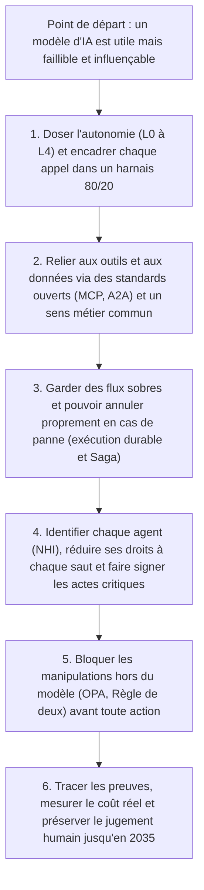

# Interopérabilité et Orchestration en Entreprise Agentique

*Guide vulgarisé des concepts, de leurs liens et des parcours de lecture du corpus ([`Corpus/`](Corpus/README.md) · [`Tomes/`](Tomes/README.md) · [`Cartographie/`](Cartographie/README.md) · [MindMap HTML](Cartographie/MindMap%20-%20Cartographie%20th%C3%A9matique%20du%20Corpus.html) · [`prd.md`](prd.md) · 8 ouvrages · 4 542 pages · horizon 2024–2035)*

---

## En bref : de quoi parle ce dépôt ?

Jusqu'à récemment, utiliser l'intelligence artificielle au travail ressemblait à un dialogue avec un **conseiller en salle d'attente** : un employé posait une question à un assistant conversationnel, relisait la réponse, corrigeait les maladresses, puis saisissait lui-même l'information dans les logiciels de l'entreprise. Sans qu'on le mesure toujours, **l'humain servait de filet de sécurité**.

L'**entreprise agentique** commence au moment où l'on retire cet intermédiaire systématique pour confier à des logiciels dotés d'IA — des **agents** — le soin de lire un dossier, d'enchaîner plusieurs étapes, d'appeler des outils informatiques et d'**agir directement** dans les systèmes de gestion.

Ce changement déplace complètement le problème. La difficulté n'est plus d'avoir un modèle qui rédige bien, mais d'encadrer un programme capable de se tromper avec aplomb. À travers huit ouvrages réunis dans [`Corpus/`](Corpus/README.md) (**4 542 pages**, **319 diagrammes** et une trousse logicielle testable dans [`Tomes/Tome 8 - Ingénierie exécutable et homologation vérifiable/trousse/`](Tomes/Tome%208%20-%20Ing%C3%A9nierie%20ex%C3%A9cutable%20et%20homologation%20v%C3%A9rifiable/trousse/README.md)), ce dépôt défend et démontre une idée simple :

> **L'idée maîtresse (la règle du `80/20`)** — Pour qu'un système d'agents soit fiable, rentable et conforme à la loi, il faut séparer **« ce qui parle »** (~`20 %` : les modèles d'IA, utiles pour comprendre du texte flou ou résumer, mais faillibles et vite remplacés) de **« ce qui décide et en répond »** (~`80 %` : une ossature logicielle classique et prévisible que l'entreprise maîtrise, qui vérifie les règles d'affaires, limite les permissions, permet d'annuler une erreur et conserve les preuves).

---

## Sommaire

1. [Pourquoi brancher directement une IA aux outils de l'entreprise échoue](#1-pourquoi-brancher-directement-une-ia-aux-outils-de-lentreprise-échoue)
2. [Comment tout s'emboîte : la carte des concepts](#2-comment-tout-semboîte--la-carte-des-concepts)
3. [Les six briques essentielles expliquées simplement](#3-les-six-briques-essentielles-expliquées-simplement)
4. [Aide-mémoire : 12 termes clés en langage clair](#4-aide-mémoire--12-termes-clés-en-langage-clair)
5. [Que contient ce dépôt ?](#5-que-contient-ce-dépôt-)
6. [Par où commencer selon votre objectif ?](#6-par-où-commencer-selon-votre-objectif-)
7. [Grandes échéances (2023–2035), portée consultative et licences](#7-grandes-échéances-20232035-portée-consultative-et-licences)

---

## 1. Pourquoi brancher directement une IA aux outils de l'entreprise échoue

Avant d'aborder les solutions techniques, trois constats concrets expliquent pourquoi une démonstration impressionnante échoue souvent dès la mise en production ([**Tome 7**](Corpus/Tome%207%20-%20Gouverner%20l%27industrialisation%20cognitive.md), Partie I; [**Tome 5**](Corpus/Tome%205%20-%20Synth%C3%A8se%20ex%C3%A9cutive%20et%20concordance%20architecturale.md), ch. 1).

### 1.1 L'effet domino des petites erreurs
Lorsqu'une tâche demande d'enchaîner plusieurs étapes à la suite, les risques d'erreur se multiplient au lieu de s'additionner (**loi de Lusser**). Si un agent réussit chaque étape à `94 %` — un score qui paraît excellent en démo —, une chaîne autonome de `10` étapes sans contrôle intermédiaire ne réussit sans faute que dans **`54 %` des cas** (0,94¹⁰ ≈ 53,9 %), soit à peine mieux qu'un tirage à pile ou face.

Deux particularités des modèles de langage aggravent cet effet domino :
- **L'erreur convaincante et silencieuse** : un logiciel classique qui échoue s'arrête avec un code d'erreur net. Un modèle probabiliste qui se trompe produit souvent une phrase très crédible qui contamine les étapes suivantes sans déclencher d'alarme.
- **Réussir une fois n'est pas réussir toujours** : les classements publics mesurent souvent si un modèle réussit *au moins une fois* (`pass@1`). Une banque, un assureur ou un service public a besoin de l'inverse : qu'il réussisse **à chaque exécution** du même cas métier (`pass^k`). C'est pourquoi, en production réelle, la majorité des agents efficaces exécutent peu d'étapes d'affilée et suivent un parcours balisé.

### 1.2 Les coûts cachés et le piège des jardins clos
L'économiste Ronald Coase montrait qu'une organisation existe pour réduire les coûts de coordination, de négociation et de vérification. Avec les agents, deux pièges économiques apparaissent :
- **La facture cachée des reprises** : même si le prix brut des modèles baisse rapidement, un agent mal encadré qui tourne en boucle, relit cent fois le même historique et oblige un humain à réparer ses erreurs après coup coûte plus cher que le processus manuel initial.
- **Les silos d'agents fournisseurs** : chaque grand éditeur logiciel (`CRM`, `ERP`, bureautique) propose désormais ses propres agents intégrés. Si l'entreprise leur abandonne la logique d'ensemble, elle remplace ses anciens silos informatiques par des **jardins clos** incapables de se comprendre ni de fournir une trace d'audit unique. D'où l'intérêt d'**assembler sur des standards ouverts** autour d'un centre de contrôle que l'entreprise possède.

### 1.3 Un modèle plus intelligent n'est pas plus sûr
Rendre un modèle plus performant ne corrige pas sa vulnérabilité de base ([**Tome 7**](Corpus/Tome%207%20-%20Gouverner%20l%27industrialisation%20cognitive.md), ch. 08). Un modèle de langage lit dans un seul et même flux vos instructions légitimes et les documents venus de l'extérieur (courriels, formulaires, pièces jointes, pages web). Un texte externe malveillant peut donc glisser une consigne cachée qui détourne l'agent (**injection indirecte**). La sécurité ne peut jamais reposer sur une simple phrase « sois prudent » dans le prompt : elle doit être imposée par du code classique **à l'extérieur du modèle**.

---

## 2. Comment tout s'emboîte : la carte des concepts

Les concepts de ce corpus ne sont pas une liste d'achats technologiques : **chaque brique a été conçue pour corriger la limite de la précédente**.

**Comment lire cet enchaînement ?**
1. Comme le modèle peut se tromper *(Point de départ)*, on commence par **limiter son droit d'agir** selon la gravité de la tâche et par vérifier strictement ses entrées et sorties *(Brique 1)*.
2. Une fois encadré, l'agent doit consulter les données et appeler des outils **sans dépendre d'un seul fournisseur** ni confondre les termes du métier *(Brique 2)*.
3. Dès qu'une tâche comporte plusieurs étapes, il faut éviter les bavardages inutiles entre agents et prévoir **comment revenir en arrière** si une étape échoue *(Brique 3)*.
4. Lorsqu'un agent agit au nom d'un employé ou d'un client, il faut savoir exactement **qui a demandé quoi** et empêcher qu'un sous-agent hérite de droits trop larges *(Brique 4)*.
5. Même bien identifié, un agent peut lire un document piégé : un **gardien externe** vérifie donc chaque action avant qu'elle ne s'exécute *(Brique 5)*.
6. Enfin, l'organisation doit pouvoir **prouver cette maîtrise** aux vérificateurs et aux régulateurs, maîtriser ses coûts complets et éviter que ses équipes ne perdent leur savoir-faire *(Brique 6)*.

---

## 3. Les six briques essentielles expliquées simplement

### 3.1 Doser l'autonomie (`L0` à `L4`) et encadrer le modèle (le harnais `80/20`)
Appeler « agent » aussi bien un outil de résumé qu'un programme capable de virer de l'argent crée de graves malentendus. Le corpus classe donc les systèmes non pas selon leur « intelligence », mais selon **ce qu'on les autorise à modifier** :

| Niveau | Rôle de l'agent | Peut-il modifier les systèmes ? | Place de l'humain |
|---|---|---|---|
| **`L0`** | Règle informatique fixe ou lecture/résumé seul | Non, aucune écriture autonome | Consulte le résultat (et l'on préfère du code sans IA si une règle fixe suffit) |
| **`L1`** | Copilote (assistant supervisé) | Prépare un brouillon sans l'envoyer | Relit, corrige et déclenche lui-même l'action (*humain dans la boucle*) |
| **`L2`** | Exécutant encadré sur une tâche simple | Oui, une action étroite et facile à annuler | Définit le cadre; le logiciel vérifie le format strict des données |
| **`L3`** | Coordinateur de plusieurs étapes | Oui, tant que tout reste annulable avant l'étape finale | Supervise les alertes et exceptions (*humain sur la boucle*) |
| **`L4`** | Action critique ou engageante vers l'extérieur | Oui, derrière un verrou fort | Signe une approbation explicite sur le détail exact de l'opération |

Deux règles simples accompagnent cette échelle :
- **La règle du maillon le plus élevé** : si un petit agent de lecture (`L0` ou `L1`) résume des courriels pour alimenter directement un agent qui prend des décisions importantes (`L3` ou `L4`), le premier doit être sécurisé et surveillé aussi sérieusement que le second — sans jamais recevoir ses permissions d'écriture.
- **Le harnais logiciel (`80/20`)** : on ne demande jamais à un modèle de langage de faire des calculs comptables de tête ni d'appliquer seul la loi. Le code classique (`80 %`) gère les calculs exacts, l'ordre des étapes et la validation des formats (`JSON Schema`), tandis que le modèle (`20 %`) extrait ou synthétise l'information avec un droit explicite de dire **« cas ambigu, j'escalade à un humain »**.
- *Pour aller plus loin* : [**Tome 7**](Corpus/Tome%207%20-%20Gouverner%20l%27industrialisation%20cognitive.md) (ch. 01 et 04), [**Tome 6**](Corpus/Tome%206%20-%20Architecture%20multisectorielle%20et%20patrons%20de%20r%C3%A9f%C3%A9rence.md) (ch. 1 à 3), [**Tome 8**](Corpus/Tome%208%20-%20Ing%C3%A9nierie%20ex%C3%A9cutable%20et%20homologation%20v%C3%A9rifiable.md) (ch. 01).

### 3.2 Connecter sans s'enfermer : `MCP`, `A2A`, vocabulaire métier et mémoire
Pour relier un agent au reste de l'entreprise sans créer un plat de spaghettis informatique, il faut distinguer comment il communique et comment il comprend le métier :
- **`MCP` (*Model Context Protocol*) — la prise universelle vers les outils** : joue le rôle d'un adaptateur standard entre un agent et un outil (base de données, calendrier, calculateur). Par prudence, une passerelle d'entreprise vérifie que la fiche descriptive de l'outil n'a pas été modifiée en douce entre deux mises à jour.
- **`A2A` (*Agent2Agent*) — le dialogue entre agents indépendants** : permet à un agent de confier une demande à l'agent d'une autre équipe ou d'un partenaire externe sans lui ouvrir sa mémoire interne ni ses propres outils.
- **Le dictionnaire métier commun et la façade de protection (`ACL`)** : échanger des messages techniquement valides ne sert à rien si deux départements ne calculent pas le « revenu net » ou le « client actif » de la même façon. Une couche sémantique unifie ces définitions, et une **couche anti-corruption** protège les systèmes centraux historiques (`ERP`, grands systèmes centraux) pour éviter d'exposer des centaines d'interfaces techniques brutes au modèle.
- **Une mémoire rangée en quatre tiroirs (`CoALA`)** : plutôt que de tout mélanger, l'architecture sépare *(1)* le brouillon de la tâche en cours, *(2)* le journal des échanges passés, *(3)* les connaissances durables de l'entreprise et *(4)* les procédures approuvées, en respectant les droits d'accès et le droit à l'effacement des données personnelles.
- *Pour aller plus loin* : [**Tome 7**](Corpus/Tome%207%20-%20Gouverner%20l%27industrialisation%20cognitive.md) (ch. 05), [**Tome 6**](Corpus/Tome%206%20-%20Architecture%20multisectorielle%20et%20patrons%20de%20r%C3%A9f%C3%A9rence.md) (ch. 04 à 06), [**Tome 3**](Corpus/Tome%203%20-%20Ing%C3%A9nierie%20du%20tissu%20conjonctif%20et%20%C3%A9tat%20de%20l%27art.md) (Parties II et III).

### 3.3 Orchestrer avec retenue et savoir revenir en arrière (`Saga`)
Faire discuter librement cinq agents entre eux donne rarement un meilleur résultat : les études recensées dans le corpus montrent que cela augmente surtout les coûts, la lenteur et la propagation d'erreurs.
- **L'arbre de sobriété** : toujours privilégier dans l'ordre *(1)* un programme classique sans IA, *(2)* un enchaînement fixe d'étapes simples, *(3)* **un seul agent bien outillé** (éventuellement relu par un second composant vérificateur), et ne recourir à *(4)* plusieurs agents spécialisés que lorsque le gain est mesuré.
- **Exécution durable et `Saga` compensatoire** : un dossier réel peut attendre un document pendant deux jours ou subir une coupure réseau à la 3e étape. Un moteur d'**exécution durable** sauvegarde l'avancement à chaque pas, attache un numéro unique à chaque action pour ne jamais facturer ou écrire deux fois la même chose (**idempotence**), et prévoit pour chaque étape provisoire son **geste d'annulation automatique** (**Saga**) tant que l'étape finale irréversible (*point pivot*) n'est pas franchie.
- *Pour aller plus loin* : [**Tome 7**](Corpus/Tome%207%20-%20Gouverner%20l%27industrialisation%20cognitive.md) (ch. 06), [**Tome 2**](Corpus/Tome%202%20-%20Cadre%20normatif%20et%20exigences%20d%27architecture.md) (ch. 7), [**Tome 8**](Corpus/Tome%208%20-%20Ing%C3%A9nierie%20ex%C3%A9cutable%20et%20homologation%20v%C3%A9rifiable.md) (ch. 03).

### 3.4 Savoir qui agit : identité de l'agent, délégation réduite et futur post-quantique
Lorsqu'une employée demande à un agent A de traiter un dossier, et que cet agent A sollicite un service B, deux mauvaises pratiques sont à proscrire : donner un compte administrateur partagé à l'agent (on ne sait plus quel humain est à l'origine de l'acte) ou transmettre tel quel le jeton d'accès complet de l'employée (le service B obtiendrait tous ses droits).
- **Une identité propre et des droits réduits à chaque saut** : chaque agent possède sa propre **identité non humaine (`NHI`)** temporaire. À chaque délégation (`OAuth On-Behalf-Of`), il reçoit un laissez-passer **limité à la seule sous-tâche demandée**, tout en conservant la trace du demandeur humain initial.
- **Signer l'acte exact (`CIBA`)** : pour une opération sensible, l'humain ne clique pas sur un simple bouton « OK » vague; il valide sur un canal séparé le résumé exact et verrouillé des paramètres (montant, destinataire, compte).
- **Préparer demain** : l'architecture automatise le renouvellement très fréquent des certificats de sécurité (qui passeront à `47` jours d'ici 2029) et prépare la transition vers des signatures cryptographiques résistantes aux futurs ordinateurs quantiques (**post-quantique**).
- *Pour aller plus loin* : [**Tome 1**](Corpus/Tome%201%20-%20Confiance%20protocolaire%20et%20encadrement%20financier.md) (Livre II), [**Tome 7**](Corpus/Tome%207%20-%20Gouverner%20l%27industrialisation%20cognitive.md) (ch. 07), [**Tome 8**](Corpus/Tome%208%20-%20Ing%C3%A9nierie%20ex%C3%A9cutable%20et%20homologation%20v%C3%A9rifiable.md) (ch. 02).

### 3.5 Sécuriser hors du modèle, observer sans exposer et compter le vrai coût
Puisqu'un modèle peut être trompé par un texte piégé, les verrous critiques sont placés en dehors de lui :
- **La Règle de deux (gardien externe `OPA`)** : avant d'exécuter un outil, un moteur de règles indépendant vérifie une loi de bon sens : **un agent ne peut jamais cumuler dans la même session (1) la lecture de contenus externes non fiables, (2) l'accès à des données confidentielles et (3) la capacité d'écrire dans un système critique ou d'envoyer des données à l'extérieur**.
- **Le double couloir de journaux** : pour concilier dépannage technique et protection de la vie privée (`Loi 25`, `RGPD`), un premier couloir enregistre la performance technique **sans renseignements personnels**, tandis qu'un second registre scellé et restreint conserve la preuve complète en cas d'audit ou de litige.
- **Tester hors ligne (`EvalOps`) et compter au résultat réel (`FinOps`)** : avant d'aller en production, l'agent est mis à l'épreuve sur des centaines de cas simulés (y compris des tentatives de piégeage en français et en anglais). Une fois en service, on ne mesure pas son coût au prix de mille mots générés, mais au **coût complet par dossier traité conformément sans reprise humaine**.
- *Pour aller plus loin* : [**Tome 7**](Corpus/Tome%207%20-%20Gouverner%20l%27industrialisation%20cognitive.md) (ch. 08 et 09), [**Tome 2**](Corpus/Tome%202%20-%20Cadre%20normatif%20et%20exigences%20d%27architecture.md) (ch. 9 et 10), [**Tome 8**](Corpus/Tome%208%20-%20Ing%C3%A9nierie%20ex%C3%A9cutable%20et%20homologation%20v%C3%A9rifiable.md) (ch. 03 et 04).

### 3.6 Respecter la loi, investir sans regret (`2026–2035`) et préserver les compétences humaines
L'analyse des lois et règlements adoptés au Québec, au Canada et en Europe mène à un constat rassurant et exigeant à la fois ([**Tome 4**](Corpus/Tome%204%20-%20Prospective%20strat%C3%A9gique%20et%20trajectoire%202028-2035.md); [**Tome 7**](Corpus/Tome%207%20-%20Gouverner%20l%27industrialisation%20cognitive.md), Partie IV) : **aucun texte n'oblige une organisation à automatiser par agent; toutes les obligations portent sur la transparence, l'inventaire des systèmes, le contrôle des fournisseurs et le droit à une révision humaine réelle**.
- **Repères légaux concrets** : au Québec, l'article 12.1 de la **`Loi 25`** oblige à informer toute personne visée par une décision exclusivement automatisée, à lui en expliquer les critères sur demande et à lui permettre de faire réviser cette décision par un humain habilité. Dans le secteur financier canadien et québécois, la ligne directrice **`BSIF E-23`** et le cadre de l'**`AMF`** (mai 2027) exigent un inventaire complet des modèles et agents, une évaluation des risques et un responsable clairement désigné. En Europe, l'**`EU AI Act`** encadre la transparence et les systèmes à haut risque.
- **Investir sans regret malgré l'incertitude (`DAPP`)** : personne ne sait quel modèle ou quel fournisseur dominera en 2032. La méthode des **trajectoires adaptatives** consiste à bâtir dès aujourd'hui les fondations « sans regret » (identité, passerelles ouvertes, gouvernance, pistes d'audit) qui resteront utiles dans tous les scénarios, et à n'engager les options plus spécialisées que lorsque des signaux précis se confirment.
- **Protéger le savoir-faire humain** : si les agents traitent `100 %` des cas courants, deux dangers guettent l'entreprise : les validateurs humains finissent par approuver machinalement l'écran sans vérifier (*biais d'automatisation*), et les recrues juniors n'apprennent plus le métier sur des cas simples — privant l'organisation de ses experts seniors de demain. Garder une part volontaire de pratique humaine formatrice fait donc partie intégrante de l'architecture.

---

## 4. Aide-mémoire : 12 termes clés en langage clair

| Terme | En une phrase simple |
|---|---|
| **Règle du `80/20`** | Confier `80 %` du travail (règles, calculs, permissions, suivi) à du code classique prévisible et `20 %` (lecture et synthèse de texte) au modèle d'IA. |
| **Loi de Lusser** | Règle mathématique montrant que de petites erreurs répétées d'étape en étape font chuter très vite la fiabilité globale d'une chaîne autonome. |
| **Constance `pass^k`** | Capacité d'un agent à réussir le même cas métier plusieurs fois de suite sans erreur, par opposition à un coup d'éclat isolé (`pass@1`). |
| **Échelle `L0` à `L4`** | Classement d'un agent selon ce qu'il a le droit de modifier dans les systèmes de l'entreprise, de la simple lecture (`L0`) à l'acte critique sous signature (`L4`). |
| **Harnais d'agent** | Enveloppe logicielle qui vérifie les données à l'entrée et à la sortie du modèle, limite le nombre d'essais et passe la main à un humain en cas de doute. |
| **`MCP` et `A2A`** | Deux standards ouverts complémentaires : `MCP` branche un agent sur ses **outils**, tandis que `A2A` fait dialoguer **deux agents** entre eux. |
| **Couche anti-corruption (`ACL`)** | Façade qui traduit proprement les demandes vers les logiciels centraux existants (`ERP`, systèmes patrimoniaux) sans exposer leur complexité interne à l'IA. |
| **Exécution durable et `Saga`** | Mécanisme qui mémorise l'avancement d'un processus long et sait annuler proprement les étapes déjà faites si un blocage survient avant la fin. |
| **Identité non humaine (`NHI`)** | Carte d'identité numérique temporaire propre à chaque agent, évitant les mots de passe partagés et réduisant les permissions à chaque délégation. |
| **Règle de deux (`OPA`)** | Garde-fou externe interdisant de réunir en même temps données externes potentiellement piégées, secrets internes et pouvoir d'action vers l'extérieur. |
| **Coût par résultat conforme** | Vrai coût d'un dossier réussi du premier coup et conforme aux règles, en comptant l'IA, l'infrastructure, les reprises et le temps de supervision humaine. |
| **Trajectoires `DAPP`** | Façon de planifier jusqu'en 2035 en séparant les fondations utiles dans tous les cas (« sans regret ») des investissements activés seulement sur signaux concrets. |

---

## 5. Que contient ce dépôt ?

Les huit ouvrages forment une suite thématique de huit tomes (`PDF` au format unifié `6,14 × 9,21 po` et `Markdown` complet) réunis dans [`Corpus/`](Corpus/README.md), et découpés par chapitres dans leurs sous-dossiers respectifs sous [`Tomes/`](Tomes/README.md) :

| Tome | Titre thématique du PDF (`Corpus/`) | Édition structurée (`Tomes/`) et Markdown | À quoi sert ce tome ? | Pages | Figures |
|---|---|---|---|---:|---:|
| **Tome 1** | [`Confiance protocolaire et encadrement financier`](Corpus/Tome%201%20-%20Confiance%20protocolaire%20et%20encadrement%20financier.pdf) | [Dossier](Tomes/Tome%201%20-%20Confiance%20protocolaire%20et%20encadrement%20financier/README.md) · [MD](Corpus/Tome%201%20-%20Confiance%20protocolaire%20et%20encadrement%20financier.md) | **Explorer les bases** : protocoles, chaîne d'identité, orchestration et droit financier canadien et québécois | 1 135 | [118](Tomes/Tome%201%20-%20Confiance%20protocolaire%20et%20encadrement%20financier/Diagrammes/README.md) |
| **Tome 2** | [`Cadre normatif et exigences d'architecture`](Corpus/Tome%202%20-%20Cadre%20normatif%20et%20exigences%20d%27architecture.pdf) | [Dossier](Tomes/Tome%202%20-%20Cadre%20normatif%20et%20exigences%20d%27architecture/README.md) · [MD](Corpus/Tome%202%20-%20Cadre%20normatif%20et%20exigences%20d%27architecture.md) | **Encadrer** : norme interne d'entreprise (`12` principes, `305` exigences vérifiables et grille d'homologation) | 534 | [28](Tomes/Tome%202%20-%20Cadre%20normatif%20et%20exigences%20d%27architecture/Diagrammes/README.md) |
| **Tome 3** | [`Ingénierie du tissu conjonctif et état de l'art`](Corpus/Tome%203%20-%20Ing%C3%A9nierie%20du%20tissu%20conjonctif%20et%20%C3%A9tat%20de%20l%27art.pdf) | [Dossier](Tomes/Tome%203%20-%20Ing%C3%A9nierie%20du%20tissu%20conjonctif%20et%20%C3%A9tat%20de%20l%27art/README.md) · [MD](Corpus/Tome%203%20-%20Ing%C3%A9nierie%20du%20tissu%20conjonctif%20et%20%C3%A9tat%20de%20l%27art.md) | **Approfondir l'état de l'art** : encyclopédie en `50` chapitres couvrant ingénierie, sécurité, littérature scientifique et marché | 1 287 | [68](Tomes/Tome%203%20-%20Ing%C3%A9nierie%20du%20tissu%20conjonctif%20et%20%C3%A9tat%20de%20l%27art/Diagrammes/README.md) |
| **Tome 4** | [`Prospective stratégique et trajectoire 2028–2035`](Corpus/Tome%204%20-%20Prospective%20strat%C3%A9gique%20et%20trajectoire%202028-2035.pdf) | [Dossier](Tomes/Tome%204%20-%20Prospective%20strat%C3%A9gique%20et%20trajectoire%202028-2035/README.md) · [MD](Corpus/Tome%204%20-%20Prospective%20strat%C3%A9gique%20et%20trajectoire%202028-2035.md) | **Planifier 2028–2035** : scénarios d'avenir, `52` capacités cibles, `5` métiers financiers et feuille de route adaptative | 537 | [6](Tomes/Tome%204%20-%20Prospective%20strat%C3%A9gique%20et%20trajectoire%202028-2035/Diagrammes/README.md) |
| **Tome 5** | [`Synthèse exécutive et concordance architecturale`](Corpus/Tome%205%20-%20Synth%C3%A8se%20ex%C3%A9cutive%20et%20concordance%20architecturale.pdf) | [Dossier](Tomes/Tome%205%20-%20Synth%C3%A8se%20ex%C3%A9cutive%20et%20concordance%20architecturale/README.md) · [MD](Corpus/Tome%205%20-%20Synth%C3%A8se%20ex%C3%A9cutive%20et%20concordance%20architecturale.md) | **Faire le pont** : condensé des tomes 1 à 4 pensé pour le duo Architecte d'entreprise / Architecte de solutions | 175 | [8](Tomes/Tome%205%20-%20Synth%C3%A8se%20ex%C3%A9cutive%20et%20concordance%20architecturale/Diagrammes/README.md) |
| **Tome 6** | [`Architecture multisectorielle et patrons de référence`](Corpus/Tome%206%20-%20Architecture%20multisectorielle%20et%20patrons%20de%20r%C3%A9f%C3%A9rence.pdf) | [Dossier](Tomes/Tome%206%20-%20Architecture%20multisectorielle%20et%20patrons%20de%20r%C3%A9f%C3%A9rence/README.md) · [MD](Corpus/Tome%206%20-%20Architecture%20multisectorielle%20et%20patrons%20de%20r%C3%A9f%C3%A9rence.md) | **Appliquer à tout secteur** : guide architectural généraliste avec `3` architectures complètes et `12` erreurs classiques à éviter | 305 | [59](Tomes/Tome%206%20-%20Architecture%20multisectorielle%20et%20patrons%20de%20r%C3%A9f%C3%A9rence/Diagrammes/README.md) |
| **Tome 7** | [`Gouverner l'industrialisation cognitive`](Corpus/Tome%207%20-%20Gouverner%20l%27industrialisation%20cognitive.pdf) | [Dossier](Tomes/Tome%207%20-%20Gouverner%20l%27industrialisation%20cognitive/README.md) · [MD](Corpus/Tome%207%20-%20Gouverner%20l%27industrialisation%20cognitive.md) · [HTML](Tomes/Tome%207%20-%20Gouverner%20l%27industrialisation%20cognitive/livrables/Tome%207%20-%20Gouverner%20l%27industrialisation%20cognitive.html) | **Comprendre en lecture suivie** : essai linéaire agréable à lire de bout en bout | 258 | [23](Tomes/Tome%207%20-%20Gouverner%20l%27industrialisation%20cognitive/diagrammes/README.md) |
| **Tome 8** | [`Ingénierie exécutable et homologation vérifiable`](Corpus/Tome%208%20-%20Ing%C3%A9nierie%20ex%C3%A9cutable%20et%20homologation%20v%C3%A9rifiable.pdf) | [Dossier](Tomes/Tome%208%20-%20Ing%C3%A9nierie%20ex%C3%A9cutable%20et%20homologation%20v%C3%A9rifiable/README.md) · [MD](Corpus/Tome%208%20-%20Ing%C3%A9nierie%20ex%C3%A9cutable%20et%20homologation%20v%C3%A9rifiable.md) · [HTML](Tomes/Tome%208%20-%20Ing%C3%A9nierie%20ex%C3%A9cutable%20et%20homologation%20v%C3%A9rifiable/livrables/Tome%208%20-%20Ing%C3%A9nierie%20ex%C3%A9cutable%20et%20homologation%20v%C3%A9rifiable.html) · [Trousse](Tomes/Tome%208%20-%20Ing%C3%A9nierie%20ex%C3%A9cutable%20et%20homologation%20v%C3%A9rifiable/trousse/README.md) | **Passer au code** : manuel pratique accompagné d'une trousse logicielle `Python` et `OPA` entièrement testée hors ligne | 311 | [9](Tomes/Tome%208%20-%20Ing%C3%A9nierie%20ex%C3%A9cutable%20et%20homologation%20v%C3%A9rifiable/diagrammes/README.md) |

**Repères dans l'arborescence :**
- [`Corpus/`](Corpus/README.md) : la suite des `8` PDF thématiques (`Tome 1` à `Tome 8`) et leurs `8` fichiers Markdown intégraux au même endroit (`4 542` pages).
- [`Tomes/`](Tomes/README.md) : les `8` dossiers structurés ([`Tomes/Tome 1 - Confiance protocolaire et encadrement financier/`](Tomes/Tome%201%20-%20Confiance%20protocolaire%20et%20encadrement%20financier/README.md) à [`Tomes/Tome 8 - Ingénierie exécutable et homologation vérifiable/`](Tomes/Tome%208%20-%20Ing%C3%A9nierie%20ex%C3%A9cutable%20et%20homologation%20v%C3%A9rifiable/README.md)) contenant les chapitres découpés, les sources des `319` diagrammes (et leurs rendus `.svg`/`.png`), ainsi que les éditions `HTML` des tomes 7 et 8.
- [`Tomes/Tome 8 - Ingénierie exécutable et homologation vérifiable/trousse/`](Tomes/Tome%208%20-%20Ing%C3%A9nierie%20ex%C3%A9cutable%20et%20homologation%20v%C3%A9rifiable/trousse/README.md) : le code exécutable de référence (`4` modules `Python 3.12+`, `3` politiques `OPA / Rego`, `13` schémas `JSON Schema`, vecteurs de test officiels et `83` tests automatisés `pytest`).
- [`Cartographie/`](Cartographie/README.md) : cartographie thématique et structurelle interactive du corpus complet (**4 vues dynamiques** dans [`MindMap - Cartographie thématique du Corpus.html`](Cartographie/MindMap%20-%20Cartographie%20th%C3%A9matique%20du%20Corpus.html), 100 % autonome hors ligne sous `file://`).
- [`prd.md`](prd.md) : PRD maître exhaustif consolidant l'architecture du corpus (`12` domaines `D01–D12`, `36` chapitres, `71` familles, `260` thèmes, `616` interrelations et `4` annexes normatives, compilé par [`compiler_prd.py`](Cartographie/outils/compiler_prd.py)).
- [`gabarit-pdf/`](gabarit-pdf/README.md) : le gabarit `Typst` commun et les scripts permettant de recompiler les diagrammes et les huit PDF de la collection.

---

## 6. Par où commencer selon votre objectif ?

Inutile de lire les `4 542` pages dans l'ordre : voici quatre portes d'entrée adaptées à votre besoin.

### Parcours A — Comprendre l'essentiel sans bagage pointu *(~45 minutes)*
1. Lire l'introduction (**Liminaire**) du **Tome 7** ([PDF p. 5–18](Corpus/Tome%207%20-%20Gouverner%20l%27industrialisation%20cognitive.pdf) · [MD](Corpus/Tome%207%20-%20Gouverner%20l%27industrialisation%20cognitive.md) · [HTML](Tomes/Tome%207%20-%20Gouverner%20l%27industrialisation%20cognitive/livrables/Tome%207%20-%20Gouverner%20l%27industrialisation%20cognitive.html)).
2. Parcourir la **Synthèse exécutive** du **Tome 5** ([PDF p. 9–13](Corpus/Tome%205%20-%20Synth%C3%A8se%20ex%C3%A9cutive%20et%20concordance%20architecturale.pdf) · [MD](Corpus/Tome%205%20-%20Synth%C3%A8se%20ex%C3%A9cutive%20et%20concordance%20architecturale.md)).
3. Poursuivre avec les chapitres 01 à 03 du **Tome 7** ([PDF p. 19–68](Corpus/Tome%207%20-%20Gouverner%20l%27industrialisation%20cognitive.pdf)) et son glossaire bilingue en Annexe A ([PDF p. 232–238](Corpus/Tome%207%20-%20Gouverner%20l%27industrialisation%20cognitive.pdf)).

### Parcours B — Cadrer une stratégie ou une architecture d'entreprise
1. Lire les Parties I et V du **Tome 6** ([PDF p. 10–57 et 217–265](Corpus/Tome%206%20-%20Architecture%20multisectorielle%20et%20patrons%20de%20r%C3%A9f%C3%A9rence.pdf) · [MD](Corpus/Tome%206%20-%20Architecture%20multisectorielle%20et%20patrons%20de%20r%C3%A9f%C3%A9rence.md)) pour la règle du `80/20`, les `12` anti-patrons et la feuille de route `90 / 180 / 360` jours.
2. Consulter le **Tome 5** ([PDF](Corpus/Tome%205%20-%20Synth%C3%A8se%20ex%C3%A9cutive%20et%20concordance%20architecturale.pdf) · [MD](Corpus/Tome%205%20-%20Synth%C3%A8se%20ex%C3%A9cutive%20et%20concordance%20architecturale.md), `175` pages) pour organiser le travail entre architecture d'entreprise et architecture de solutions.
3. Utiliser la grille d'homologation du **Tome 2** (Sommaire [PDF p. 9–13](Corpus/Tome%202%20-%20Cadre%20normatif%20et%20exigences%20d%27architecture.pdf) et Annexe A dès la p. 396 · [MD](Corpus/Tome%202%20-%20Cadre%20normatif%20et%20exigences%20d%27architecture.md)).

### Parcours C — Concevoir une solution technique et exécuter le code
1. Étudier les trois architectures types au chapitre 14 du **Tome 6** ([PDF p. 235–250](Corpus/Tome%206%20-%20Architecture%20multisectorielle%20et%20patrons%20de%20r%C3%A9f%C3%A9rence.pdf)), puis approfondir un sujet précis dans le **Tome 3** ([PDF](Corpus/Tome%203%20-%20Ing%C3%A9nierie%20du%20tissu%20conjonctif%20et%20%C3%A9tat%20de%20l%27art.pdf) · [MD](Corpus/Tome%203%20-%20Ing%C3%A9nierie%20du%20tissu%20conjonctif%20et%20%C3%A9tat%20de%20l%27art.md)).
2. Lire les quatre chapitres techniques du **Tome 8** ([PDF](Corpus/Tome%208%20-%20Ing%C3%A9nierie%20ex%C3%A9cutable%20et%20homologation%20v%C3%A9rifiable.pdf) · [MD](Corpus/Tome%208%20-%20Ing%C3%A9nierie%20ex%C3%A9cutable%20et%20homologation%20v%C3%A9rifiable.md) · [HTML](Tomes/Tome%208%20-%20Ing%C3%A9nierie%20ex%C3%A9cutable%20et%20homologation%20v%C3%A9rifiable/livrables/Tome%208%20-%20Ing%C3%A9nierie%20ex%C3%A9cutable%20et%20homologation%20v%C3%A9rifiable.html)).
3. Ouvrir [`Tomes/Tome 8 - Ingénierie exécutable et homologation vérifiable/trousse/README.md`](Tomes/Tome%208%20-%20Ing%C3%A9nierie%20ex%C3%A9cutable%20et%20homologation%20v%C3%A9rifiable/trousse/README.md) pour lancer les tests `pytest` et `OPA` sur votre poste.

### Parcours D — Vérifier les enjeux juridiques, financiers et l'horizon 2035
1. Lire la Partie IV du **Tome 7** ([PDF p. 183–230](Corpus/Tome%207%20-%20Gouverner%20l%27industrialisation%20cognitive.pdf)) sur les obligations Québec–Canada–Europe et la préservation des compétences.
2. Parcourir le **Tome 4** pour la prospective `2028–2035` ([PDF p. 52–149](Corpus/Tome%204%20-%20Prospective%20strat%C3%A9gique%20et%20trajectoire%202028-2035.pdf) · [MD](Corpus/Tome%204%20-%20Prospective%20strat%C3%A9gique%20et%20trajectoire%202028-2035.md)) et les cinq profils financiers — banque, patrimoine, assurance de personnes, assurance de dommages et groupe diversifié ([PDF p. 245–323](Corpus/Tome%204%20-%20Prospective%20strat%C3%A9gique%20et%20trajectoire%202028-2035.pdf)).
3. Pour le détail réglementaire canadien/québécois et la revue scientifique, consulter le Livre III du **Tome 1** ([PDF p. 506–716](Corpus/Tome%201%20-%20Confiance%20protocolaire%20et%20encadrement%20financier.pdf) · [MD](Corpus/Tome%201%20-%20Confiance%20protocolaire%20et%20encadrement%20financier.md)) et la Partie X du **Tome 3** ([PDF p. 1 157–1 242](Corpus/Tome%203%20-%20Ing%C3%A9nierie%20du%20tissu%20conjonctif%20et%20%C3%A9tat%20de%20l%27art.pdf) · [MD](Corpus/Tome%203%20-%20Ing%C3%A9nierie%20du%20tissu%20conjonctif%20et%20%C3%A9tat%20de%20l%27art.md)).

---

## 7. Grandes échéances (2023–2035), portée consultative et licences

### Six repères temporels structurants

| Échéance | Cadre concerné | Ce que cela change concrètement |
|---|---|---|
| **Depuis sept. 2023** | Québec (`Loi 25`, art. 12.1) | Obligation d'informer la personne visée par une décision exclusivement automatisée, d'expliquer les critères et d'offrir une révision humaine |
| **Depuis août 2026** | Union européenne (`EU AI Act`, art. 50) | Obligations de transparence lorsqu'un utilisateur interagit avec une IA ou du contenu généré |
| **Mars 2027 → Mars 2029** | Sécurité web (`TLS` public) | Durée de vie maximale des certificats réduite à `100` jours puis `47` jours : renouvellement automatique obligatoire |
| **1er mai 2027** | Canada et Québec (`BSIF E-23` et `AMF`) | Inventaire complet, évaluation des risques et responsable désigné pour les modèles et systèmes autonomes en finance |
| **2027–2028** | Union européenne (`EU AI Act`) | Entrée en application progressive des exigences renforcées sur les systèmes d'IA à haut risque |
| **2030–2035** | Secteur financier `G7` et normes `NIST` | Migration coordonnée vers la cryptographie post-quantique pour protéger les identités et les archives de longue durée |

### Avertissement éditorial, transparence et licences

- **Portée consultative (`non-avis`)** : ce dépôt est un ensemble pédagogique, architectural et technique. Il ne constitue **ni un avis juridique, ni un conseil réglementaire personnalisé, ni un audit ou une certification de conformité** (`BSIF E-23`, `AMF`, `Loi 25`, `ISO/IEC 42001`). La trousse logicielle [`Tomes/Tome 8 - Ingénierie exécutable et homologation vérifiable/trousse/`](Tomes/Tome%208%20-%20Ing%C3%A9nierie%20ex%C3%A9cutable%20et%20homologation%20v%C3%A9rifiable/trousse/README.md) fonctionne uniquement hors ligne sur des données synthétiques et des simulateurs.
- **Sources vérifiables et production par agents d'IA** : les textes et faits s'appuient sur des sources primaires publiques vérifiées sans contournement de restrictions d'accès. Les tomes **1 à 6** (référence : novembre 2026) documentent une rédaction et des recoupements réalisés par pipelines d'agents d'IA sans relecture humaine intégrale. Les tomes **7** et **8** (gel des faits : 2 décembre 2026; édition : janvier 2027) ont été conçus et cadrés par **André-Guy Bruneau, M.Sc IT**, et intégralement rédigés, codés et vérifiés par des agents d'IA à travers les contrôles automatisés et contradictoires documentés dans [`Tomes/Tome 7 - Gouverner l'industrialisation cognitive/aq/`](Tomes/Tome%207%20-%20Gouverner%20l%27industrialisation%20cognitive/aq/) et [`Tomes/Tome 8 - Ingénierie exécutable et homologation vérifiable/aq/`](Tomes/Tome%208%20-%20Ing%C3%A9nierie%20ex%C3%A9cutable%20et%20homologation%20v%C3%A9rifiable/aq/).
- **Licences** : les textes et figures des tomes **2 à 5**, **7** et **8** sont diffusés sous licence **`CC-BY-4.0`**, et les scripts ainsi que la trousse [`Tomes/Tome 8 - Ingénierie exécutable et homologation vérifiable/trousse/`](Tomes/Tome%208%20-%20Ing%C3%A9nierie%20ex%C3%A9cutable%20et%20homologation%20v%C3%A9rifiable/trousse/README.md) sous licence **`MIT`** (les tomes 1 et 6 ne comportent pas de mention de licence en page de titre).
