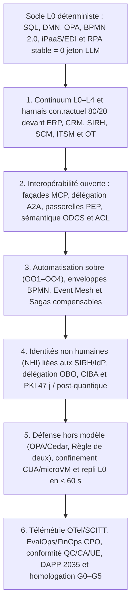

# Interopérabilité et automatisation agentique des systèmes d'entreprise

*Traité unifié d'architecture hybride, de gouvernance hors modèle et d'homologation vérifiable (non-avis)*

*Navigation rapide : [`Compendium/`](Compendium/README.md) ([PDF](Compendium/Compendium.pdf) · [MD](Compendium/Compendium.md)) · [`Tomes/`](Tomes/README.md) (`8` tomes historiques figés) · [`Sources/`](Sources/README.md) (usine éditoriale et gabarit) · [MindMap HTML](Sources/Cartographie/MindMap%20-%20Cartographie%20th%C3%A9matique%20du%20Compendium.html) (`4` vues hors ligne) · Compendium (`872` p.) + `8` tomes (`4 542` p.) · `5 414` pages · horizon `2023–2035`*

---

## En bref : de quoi parle ce dépôt ?

Dans la réalité opérationnelle d'une organisation, l'intelligence artificielle n'arrive pas sur une page blanche : elle rencontre un **parc existant de systèmes d'entreprise** hétérogènes — progiciels comptables et achats (`ERP`), gestion de la relation client (`CRM`), ressources humaines (`SIRH`), chaîne logistique (`SCM`/`WMS`), gestion des services TI (`ITSM`), cœurs transactionnels patrimoniaux (`z/OS`, `IBM i`, `EDI`) et environnements industriels cyber-physiques (`OT`/`SCADA`/`MES`).

Tant qu'un employé interrogeait un assistant conversationnel isolé puis recopiait lui-même le résultat dans le progiciel métier, **l'humain absorbait les erreurs du modèle et les écarts de format entre applications**. Dès que l'on connecte des agents logiciels en boucle fermée pour lire un dossier dans un système, appliquer des règles et muter un état transactionnel dans un autre, trois exigences indissociables gouvernent l'architecture :

1. **L'interopérabilité de bout en bout (`6` strates `EIF` / `LCIM`)** — Aucun agent ne peut traverser plusieurs systèmes d'entreprise sans contrats explicites couvrant le transport (`MCP 2026-07-28`, `A2A v1.0.1`, `Event Mesh`, `API Gateway`, `iPaaS`), la syntaxe stricte (`JSON Schema Draft 2020-12`, `ODCS v3.2.0`), la sémantique métier canonique (`MDM`, `UBL`/`GS1`, `HL7 FHIR`, `OPC UA`, `FIBO`/`ISO 20022`), la pragmatique transactionnelle (`Saga` compensable, identité `NHI` et délégation `OBO`), la télémétrie probatoire (`OpenTelemetry`, `SCITT`, `FOCUS v1.4`) et la réversibilité contractuelle.
2. **Le continuum d'automatisation (`L0 → L1–L4`)** — L'**automatisation agentique** ne remplace pas l'automatisation déterministe (`L0`) : elle la prolonge uniquement là où l'ambiguïté non structurée l'exige. **Règle de subsidiarité** : zéro jeton `LLM` lorsqu'une contrainte `SQL`, une table de décision `DMN`, une politique `OPA/Rego`, un flux `iPaaS`/`EDI`, un processus `BPMN 2.0` ou une `RPA` déterministe stable résout le cas à moindre risque et moindre coût.
3. **La maîtrise hors modèle de l'agentivité des systèmes (*system agency*)** — L'initiative conférée à la strate d'action (`SoA`) reste strictement subordonnée aux systèmes d'enregistrement (`SoR`), d'engagement (`SoE`) et industriels (`OT`) sur six verticaux d'entreprise, avec le secteur financier réglementé comme étalon prudentiel de haute assurance (*high-water mark*).

À travers son ouvrage maître unifié — [**Interopérabilité et automatisation agentique des systèmes d'entreprise**](Compendium/README.md) ([`Compendium.pdf`](Compendium/Compendium.pdf), **872 pages**, **139 schémas**) — appuyé par l'archive historique des huit tomes dans [`Tomes/`](Tomes/README.md) (**4 542 pages**, **319 diagrammes**) et la trousse logicielle exécutable dans [`Sources/Tomes/Tome 8 - Ingénierie exécutable et homologation vérifiable/trousse/`](Sources/Tomes/Tome%208%20-%20Ing%C3%A9nierie%20ex%C3%A9cutable%20et%20homologation%20v%C3%A9rifiable/trousse/README.md), ce référentiel démontre une règle cardinale :

> **La partition hybride `80/20`** — Pour qu'une automatisation traversant les systèmes d'entreprise soit fiable, rentable et homologable, **`80 %` du flux** (routage, validation `JSON Schema`, permissions `PEP`/`OPA`, calculs exacts, idempotence, compensation `Saga` et preuve d'audit) doit demeurer dans un **exosquelette déterministe possédé par l'entreprise**, qui encadre **`20 %` de cellules cognitives bornées** vouées à l'interprétation contextuelle avec droit explicite d'abstention vers l'humain.

---

## Sommaire

1. [Pourquoi brancher directement un agent aux progiciels d'entreprise échoue](#1-pourquoi-brancher-directement-un-agent-aux-progiciels-dentreprise-échoue)
2. [Comment tout s'emboîte : l'architecture d'ensemble](#2-comment-tout-semboîte--larchitecture-densemble)
3. [Les six briques essentielles expliquées simplement](#3-les-six-briques-essentielles-expliquées-simplement)
4. [Aide-mémoire : 12 termes clés en langage clair](#4-aide-mémoire--12-termes-clés-en-langage-clair)
5. [Que contient ce dépôt ?](#5-que-contient-ce-dépôt-)
6. [Par où commencer selon votre rôle ?](#6-par-où-commencer-selon-votre-rôle-)
7. [Grandes échéances (2023–2035), portée consultative et licences](#7-grandes-échéances-20232035-portée-consultative-et-licences)

---

## 1. Pourquoi brancher directement un agent aux progiciels d'entreprise échoue

Trois lois vérifiées expliquent l'écart entre un prototype conversationnel séduisant et l'exploitation industrielle sur un parc `ERP` / `CRM` / `SCM` / `ITSM` ([**Compendium**](Compendium/Compendium.md), Partie I, ch. 01–03).

### 1.1 La loi de Lusser face au déterminisme inter-systèmes
Dans un flux classique `BPMN` ou `iPaaS` bien typé ($p \ge 0{,}9999$), cinquante étapes composent avec plus de `99,5 %` de succès. À l'inverse, dans une chaîne d'étapes probabilistes non vérifiées, les fiabilités se multiplient (**loi de Lusser**, $R = p^n$) : un agent réussissant chaque pas à `94 %` tombe à **`53,9 %` de réussite sans faute** au bout de `10` étapes (`0,94¹⁰`). Deux phénomènes aggravent cette dérive entre progiciels :
- **La cascade silencieuse (`HTTP 200 OK`)** : un connecteur peut accepter une charge utile techniquement valide mais sémantiquement erronée (devise, unité logistique, hors taxes vs TTC), propageant la corruption du `CRM` vers l'`ERP` puis le `WMS` sans lever d'exception.
- **L'écart entre `pass@1` et `pass^k`** : réussir une fois en démonstration (`pass@1`) ne suffit pas en exploitation comptable, clinique, industrielle ou financière ; seule compte la constance répétée sur le même cas métier (`pass^k`).

### 1.2 L'économie de l'interopérabilité (Coase) et le piège des silos d'agents captifs
Chaque éditeur de suite d'entreprise (`ERP`, `CRM`, `SIRH`, `ITSM`, bureautique) commercialise désormais ses propres agents intégrés. Si l'entreprise délègue l'orchestration de bout en bout (*Order-to-Cash*, *Procure-to-Pay*, *Joiner-Mover-Leaver*) à ces jardins clos :
- elle remplace l'intégration point-à-point $N \times M$ par des **silos cognitifs incompatibles**, facturés à la tâche et dépourvus de piste d'audit unifiée ;
- elle accumule une **quadruple dette agentique** (technique, sémantique, cognitive/d'intention et réglementaire) lorsque les règles d'affaires migrent subrepticement dans des invites propriétaires non versionnées.
La réponse architecturale consiste à imposer $N + M$ contrats ouverts (`MCP`, `A2A`, `CloudEvents`, `ODCS`) autour d'un **noyau d'interopérabilité possédé** (`42` capacités `CAP` invariantes sur `52`).

### 1.3 Un modèle plus capable ne remplace jamais un contrôle d'accès hors modèle
Un modèle de langage traite dans le même espace de représentation les consignes système et les données externes non fiables (courriels fournisseurs, tickets `ITSM`, pièces jointes `GED`, pages web). Une **injection indirecte de consignes** peut donc détourner un agent doté de permissions excessives ([**Compendium**](Compendium/Compendium.md), Partie VII, ch. 19–20). La sécurité ne repose jamais sur le prompt : elle s'exécute **hors modèle** dans des passerelles déterministes (`PEP`, `OPA/Rego`, `Cedar`).

---

## 2. Comment tout s'emboîte : l'architecture d'ensemble

Chaque couche du traité répond au risque résiduel de la couche précédente pour raccorder sans corruption la strate cognitive aux systèmes d'entreprise :

---

## 3. Les six briques essentielles expliquées simplement

### 3.1 Situer chaque flux sur le continuum `L0` à `L4` et l'encapsuler dans un harnais `80/20`
Plutôt que d'« agentifier » aveuglément un processus existant, l'architecture qualifie d'abord son niveau d'autonomie selon ses effets de bord sur les systèmes d'enregistrement (`SoR`) :

| Niveau | Régime d'automatisation | Effet sur les systèmes d'entreprise (`SoR` / `SoE` / `OT`) | Rôle de l'humain et de l'exosquelette |
|---|---|---|---|
| **`L0`** | Automatisme déterministe pur (`SQL`, `DMN`, `OPA`, `BPMN`, `iPaaS`/`EDI`) ou lecture sans action | Zéro écriture décidée par un modèle probabiliste | Le code déterministe exécute `100 %` de la règle (`0` jeton `LLM`) |
| **`L1`** | Copilote / assistant supervisé sur poste de travail | Prépare un brouillon ou extrait structuré sans muter le `SoR` | L'humain relit, valide et déclenche l'écriture (*HITL*) |
| **`L2`** | Automatisation agentique bornée sur tâche circonscrite | Écriture étroite, idempotente et immédiatement réversible | Harnais `JSON Schema` strict et plafonds déterministes |
| **`L3`** | Automatisation multi-étapes inter-systèmes sous `Saga` | Mutations provisoires compensables jusqu'au *point pivot* | Supervision sur exception (*HOTL*) et compensation isolée |
| **`L4`** | Acte critique ou irréversible (`ERP`, virement, commande externe) | Engagement externe derrière sas pré-engagement déterministe | Signature hors bande `CIBA`/`FIDO2` liée au hachage exact (`C.6`) |

- **Règle du maillon le plus élevé** : un agent de lecture (`L0`/`L1`) dont la synthèse alimente sans filtre humain une décision `L3`/`L4` hérite des exigences de sécurité et de qualification du maillon aval, sans jamais recevoir ses droits d'écriture.
- *Référence* : [**Compendium**](Compendium/Compendium.md) (Parties I–II, ch. 01–06).

### 3.2 Interopérer sans verrouillage : `MCP`, `A2A`, passerelles `PEP`, sémantique `ODCS` et patrimoine `ACL`/`OT`
- **Interopérabilité verticale (`MCP`) et horizontale (`A2A`)** : `MCP 2026-07-28` expose `≤ 15` façades d'intention métier (au lieu de centaines d'endpoints `OpenAPI` bruts d'`ERP` ou d'`ITSM`) avec épinglage `SHA-256` anti-dérive, tandis qu'`A2A v1.0.1` fédère les agents inter-domaines et `B2B` via des `AgentCard` signées derrière une passerelle d'entreprise `PEP` à neuf contrôles.
- **Sémantique canonique (`ODCS`), mémoire `CoALA` et encapsulation patrimoniale** : des contrats de données `ODCS v3.2.0` alignent les dialectes `ERP`/`CRM`/`SCM`/`FHIR`/`OPC UA`/`ISO 20022` ; la mémoire `CoALA` à quatre tiroirs respecte les `ACL` en amont sans créer de *Shadow SoR* ; une **couche anti-corruption (`ACL`)** protège les mainframes (`COBOL`/`RPG`) et `ERP`, confine transitoirement les agents d'interface (`CUA ≤ 8 %`, bail maximal de `12` mois) et impose une diode/sas lecture seule `Purdue IDMZ` devant les systèmes industriels `OT` (`SIL 2/3`).
- *Référence* : [**Compendium**](Compendium/Compendium.md) (Parties III–IV, ch. 07–12).

### 3.3 Automatiser avec sobriété (`OO1–OO4`), enveloppes `BPMN` et exécution durable `Saga`
- **Arbre de sobriété d'orchestration** : privilégier systématiquement `L0` (code/règles), puis `OO1` (chaîne fixe), `OO2` (agent unique outillé), `OO3` (**patron cible par défaut** : enveloppe déterministe `BPMN 2.0` ou workflow durable appelant localement un agent borné), et réserver `OO4` (collectif multi-agents) aux cas où le gain net surpasse l'effet Ringelmann et les défaillances `MAST`.
- **Event Mesh, idempotence et `Saga` compensable** : sur `CloudEvents`/`AsyncAPI` et moteurs durables (`Temporal`, `Restate`), chaque mutation porte une clé d'idempotence canonisée (`JCS RFC 8785`) et chaque étape avant le *point pivot* dispose d'une compensation exécutée par un canal isolé (`EXIG-ORC-28`).
- *Référence* : [**Compendium**](Compendium/Compendium.md) (Partie V, ch. 13–15).

### 3.4 Fédérer les identités non humaines (`NHI`) aux `SIRH`/`IdP` et préparer le post-quantique
- **Cycle de vie `NHI` et délégation `OBO` à deux sauts** : chaque agent reçoit une identité non humaine (`NHI`) éphémère rattachée à un propriétaire dans le `SIRH`/`IdP` (`SPIFFE`/`SPIRE`, `SCIM`), échange ses jetons par délégation atténuée (`RFC 8693 OBO`, `DPoP`, `RAR`) sans jamais relayer le jeton maître de l'employé, et soumet les actes `P3` à une approbation cryptographique hors bande (`CIBA`).
- **Automatisation `PKI` à `47` jours et agilité post-quantique** : renouvellement `ACME`/`SDS` sans coupure et migration vers `ML-KEM`, `ML-DSA` et `SLH-DSA` par jetons de référence (`Txn-Token`) évitant le rejet `HTTP 431` sur les passerelles d'entreprise.
- *Référence* : [**Compendium**](Compendium/Compendium.md) (Partie VI, ch. 16–18).

### 3.5 Gouverner hors modèle (`OPA`, Règle de deux), replier vers `L0` et mesurer le vrai coût (`CPO`)
- **Politiques interopérables hors modèle et coupe-circuit** : `OPA/Rego`, `Cedar` et `AuthZEN` imposent la **Règle de deux** (interdiction de cumuler entrée externe non fiable, accès sensible et capacité d'écriture/exfiltration) et le suivi de contamination `CaMeL`. En cas d'alerte `SOC`/`SOAR`, le coupe-circuit abaisse la passerelle `PEP` en `< 10 s` et bascule le processus métier vers son **flux déterministe `L0` en `< 60 s`**.
- **Télémétrie `OpenTelemetry`/`SCITT`, `EvalOps` et `FinOps FOCUS`** : double couloir séparant observabilité opérationnelle sans `PII` et voûte probatoire scellée ; qualification `CI/CD` hermétique (`E1–E3`, bornes de Wilson, tests métamorphiques `FR/EN`) ; pilotage économique au **coût par résultat conforme (`CPO`)** comparé en continu à la variante déterministe `L0`.
- *Référence* : [**Compendium**](Compendium/Compendium.md) (Parties VII–VIII, ch. 19–24).

### 3.6 Conformité multisectorielle, trajectoires `DAPP 2028–2035` et homologation exécutable `G0–G5`
- **Deux étages réglementaires et sectoriels** : un tronc universel applicable à tout système d'entreprise (`Loi 25` art. `12.1` et `27` portabilité, `EU AI Act`, `RGPD`, `CRA`, `NIS 2`, `Data Act`, clauses de sortie `SaaS`) coiffé d'un étalon de haute régulation (`BSIF E-23`/`B-10`/`B-13`, `AMF`, `DORA`, `SOX`, `SIL` industriel, santé `FHIR`) décliné en `3` blueprints `C01–C40` et sur le groupe tricéphale illustratif *Groupe Boréal Inc.* (`BEL` industrie/logistique, `BCA` finance/assurance, `BSN` services numériques).
- **Planification `DAPP`, repli humain et preuve exécutable** : trajectoires adaptatives `2028–2035`, préservation du vivier junior et maintien d'interfaces manuelles `L0` directement opérables sur les `SoR`, le tout vérifié par les `305` exigences `CRE-IA-2026-01`, la grille `PRR-75` et la trousse logicielle exécutable du Tome 8 (`G0–G5`).
- *Référence* : [**Compendium**](Compendium/Compendium.md) (Parties IX–XII, ch. 25–36, et Annexes `A–E`).

---

## 4. Aide-mémoire : 12 termes clés en langage clair

| Terme | En une phrase simple |
|---|---|
| **Continuum `L0–L4`** | Règle ordonnant d'épuiser d'abord l'automatisation déterministe sans IA (`L0` : `SQL`, `DMN`, `BPMN`, `iPaaS`) avant d'introduire des agents gradués (`L1` à `L4`). |
| **Partition `80/20`** | Confier `80 %` du flux (contrats, permissions, calculs, compensation, audit) à du code déterministe possédé et `20 %` à des appels cognitifs bornés. |
| **Loi de Lusser** | Loi multiplicative ($R = p^n$) expliquant pourquoi une chaîne d'agents sans validation déterministe intermédiaire s'effondre dès quelques sauts inter-systèmes. |
| **Constance `pass^k`** | Capacité d'une automatisation agentique à réussir `k` exécutions consécutives du même cas métier sans dérive, par opposition à un succès isolé (`pass@1`). |
| **Harnais déterministe** | Enveloppe logicielle à `8` jalons validant les schémas `JSON Schema`, bornant les essais et déclenchant l'abstention vers un humain en cas d'ambiguïté. |
| **`MCP` et `A2A`** | Protocoles ouverts complémentaires : `MCP` normalise l'accès vertical aux outils et façades métier, tandis qu'`A2A` fédère le dialogue horizontal entre agents. |
| **Sémantique `ODCS` et `ACL`** | Contrats de données métier unifiant le sens des entités entre `ERP`/`CRM`/`SCM` et façade anti-corruption isolant les cœurs patrimoniaux et `OT`. |
| **Sobriété `OO1–OO4` et `Saga`** | Discipline privilégiant une enveloppe déterministe `BPMN`/durable (`OO3`) munie de compensations isolées (`Saga`) plutôt qu'un essaim libre d'agents. |
| **Identité non humaine (`NHI`)** | Identité cryptographique éphémère propre à chaque agent, fédérée au `SIRH`/`IdP` et réduisant ses droits à chaque délégation `OBO`. |
| **Règle de deux (`OPA`)** | Garde-fou hors modèle interdisant de cumuler données externes non fiables, accès à des secrets métier et pouvoir d'écriture ou d'exfiltration. |
| **Coût par résultat conforme (`CPO`)** | Coût complet d'une transaction métier réussie sans reprise ni non-conformité, systématiquement mis en concurrence avec un flux déterministe `L0`. |
| **Trajectoires `DAPP`** | Planification adaptative `2028–2035` distinguant les fondations d'interopérabilité « sans regret » des bascules activées sur signaux objectifs (`POR`/`SIG`). |

---

## 5. Que contient ce dépôt ?

Le dépôt sépare les **éditions publiées prêtes à lire** ([`Compendium/`](Compendium/README.md) et [`Tomes/`](Tomes/README.md)) des **composants sources servant à les compiler et à les homologuer** ([`Sources/`](Sources/README.md)).

### 5.1 L'ouvrage maître unifié ([`Compendium/`](Compendium/README.md))

Le traité [**Interopérabilité et automatisation agentique des systèmes d'entreprise**](Compendium/README.md) — *Traité unifié d'architecture hybride, de gouvernance hors modèle et d'homologation vérifiable (non-avis)* — est publié sous les chemins canoniques stables [`Compendium/Compendium.pdf`](Compendium/Compendium.pdf) et [`Compendium/Compendium.md`](Compendium/Compendium.md) (*Compendium* désignant le Volume `0` unifié de la collection). Au format `6,14 × 9,21 po`, il réunit en `872` pages physiques (`25 300 905` octets PDF, `8 638` lignes, `1 924 974` octets et `247 581` mots dans le Markdown consolidé, `42` unités éditoriales : Liminaire, `12` parties `D01–D12` en `36` chapitres, `37` bibliographies fermées sur `135` sources `L+` hachées `SHA-256`, `5` annexes déterministes `A–E` et `139` schémas compilés) la référence architecturale, méthodologique et probatoire actuelle du dépôt.

### 5.2 L'archive historique figée des 8 Tomes thématiques ([`Tomes/`](Tomes/README.md))

> **Statut d'archive historique en lecture seule** — Les huit tomes ci-dessous (`4 542` pages, `319` diagrammes) constituent le corpus préparatoire figé dont l'ouvrage maître ([`Compendium/`](Compendium/README.md)) opère la synthèse, la généralisation multisectorielle aux systèmes d'entreprise et la réconciliation formelle (`DIV-02`, `DISC-01` à `DISC-05`). Leurs titres, leur pagination et leurs sources dans [`Sources/Tomes/`](Sources/Tomes/README.md) demeurent scellés à l'identique ; la trousse logicielle [`Sources/Tomes/Tome 8 - Ingénierie exécutable et homologation vérifiable/trousse/`](Sources/Tomes/Tome%208%20-%20Ing%C3%A9nierie%20ex%C3%A9cutable%20et%20homologation%20v%C3%A9rifiable/trousse/README.md) est consommée en lecture seule par la barrière `G0` du Compendium (`14/14` extraits `CA-G0-SYNC`).

| Tome | Ouvrage publié (`Tomes/`) | Sources (`Sources/Tomes/`) | Rôle historique dans le corpus | Pages | Figures |
|---|---|---|---|---:|---:|
| **Tome 1** | [`Confiance protocolaire et encadrement financier`](Tomes/Tome%201%20-%20Confiance%20protocolaire%20et%20encadrement%20financier.pdf) · [MD](Tomes/Tome%201%20-%20Confiance%20protocolaire%20et%20encadrement%20financier.md) | [Dossier](Sources/Tomes/Tome%201%20-%20Confiance%20protocolaire%20et%20encadrement%20financier/README.md) | **Explorer les bases** : protocoles, chaîne d'identité, orchestration et droit financier canadien et québécois | 1 135 | [118](Sources/Tomes/Tome%201%20-%20Confiance%20protocolaire%20et%20encadrement%20financier/Diagrammes/README.md) |
| **Tome 2** | [`Cadre normatif et exigences d'architecture`](Tomes/Tome%202%20-%20Cadre%20normatif%20et%20exigences%20d%27architecture.pdf) · [MD](Tomes/Tome%202%20-%20Cadre%20normatif%20et%20exigences%20d%27architecture.md) | [Dossier](Sources/Tomes/Tome%202%20-%20Cadre%20normatif%20et%20exigences%20d%27architecture/README.md) | **Encadrer** : norme interne d'entreprise (`12` principes, `305` exigences vérifiables et grille d'homologation) | 534 | [28](Sources/Tomes/Tome%202%20-%20Cadre%20normatif%20et%20exigences%20d%27architecture/Diagrammes/README.md) |
| **Tome 3** | [`Ingénierie du tissu conjonctif et état de l'art`](Tomes/Tome%203%20-%20Ing%C3%A9nierie%20du%20tissu%20conjonctif%20et%20%C3%A9tat%20de%20l%27art.pdf) · [MD](Tomes/Tome%203%20-%20Ing%C3%A9nierie%20du%20tissu%20conjonctif%20et%20%C3%A9tat%20de%20l%27art.md) | [Dossier](Sources/Tomes/Tome%203%20-%20Ing%C3%A9nierie%20du%20tissu%20conjonctif%20et%20%C3%A9tat%20de%20l%27art/README.md) | **Approfondir l'état de l'art** : encyclopédie en `50` chapitres couvrant ingénierie, sécurité, littérature scientifique et marché | 1 287 | [68](Sources/Tomes/Tome%203%20-%20Ing%C3%A9nierie%20du%20tissu%20conjonctif%20et%20%C3%A9tat%20de%20l%27art/Diagrammes/README.md) |
| **Tome 4** | [`Prospective stratégique et trajectoire 2028–2035`](Tomes/Tome%204%20-%20Prospective%20strat%C3%A9gique%20et%20trajectoire%202028-2035.pdf) · [MD](Tomes/Tome%204%20-%20Prospective%20strat%C3%A9gique%20et%20trajectoire%202028-2035.md) | [Dossier](Sources/Tomes/Tome%204%20-%20Prospective%20strat%C3%A9gique%20et%20trajectoire%202028-2035/README.md) | **Planifier 2028–2035** : scénarios d'avenir, `52` capacités cibles, `5` métiers financiers et feuille de route adaptative | 537 | [6](Sources/Tomes/Tome%204%20-%20Prospective%20strat%C3%A9gique%20et%20trajectoire%202028-2035/Diagrammes/README.md) |
| **Tome 5** | [`Synthèse exécutive et concordance architecturale`](Tomes/Tome%205%20-%20Synth%C3%A8se%20ex%C3%A9cutive%20et%20concordance%20architecturale.pdf) · [MD](Tomes/Tome%205%20-%20Synth%C3%A8se%20ex%C3%A9cutive%20et%20concordance%20architecturale.md) | [Dossier](Sources/Tomes/Tome%205%20-%20Synth%C3%A8se%20ex%C3%A9cutive%20et%20concordance%20architecturale/README.md) | **Faire le pont** : condensé des tomes 1 à 4 pensé pour le duo Architecte d'entreprise / Architecte de solutions | 175 | [8](Sources/Tomes/Tome%205%20-%20Synth%C3%A8se%20ex%C3%A9cutive%20et%20concordance%20architecturale/Diagrammes/README.md) |
| **Tome 6** | [`Architecture multisectorielle et patrons de référence`](Tomes/Tome%206%20-%20Architecture%20multisectorielle%20et%20patrons%20de%20r%C3%A9f%C3%A9rence.pdf) · [MD](Tomes/Tome%206%20-%20Architecture%20multisectorielle%20et%20patrons%20de%20r%C3%A9f%C3%A9rence.md) | [Dossier](Sources/Tomes/Tome%206%20-%20Architecture%20multisectorielle%20et%20patrons%20de%20r%C3%A9f%C3%A9rence/README.md) | **Appliquer à tout secteur** : guide architectural généraliste avec `3` architectures complètes et `12` erreurs classiques à éviter | 305 | [59](Sources/Tomes/Tome%206%20-%20Architecture%20multisectorielle%20et%20patrons%20de%20r%C3%A9f%C3%A9rence/Diagrammes/README.md) |
| **Tome 7** | [`Gouverner l'industrialisation cognitive`](Tomes/Tome%207%20-%20Gouverner%20l%27industrialisation%20cognitive.pdf) · [MD](Tomes/Tome%207%20-%20Gouverner%20l%27industrialisation%20cognitive.md) | [Dossier](Sources/Tomes/Tome%207%20-%20Gouverner%20l%27industrialisation%20cognitive/README.md) | **Comprendre en lecture suivie** : essai linéaire agréable à lire de bout en bout | 258 | [23](Sources/Tomes/Tome%207%20-%20Gouverner%20l%27industrialisation%20cognitive/diagrammes/README.md) |
| **Tome 8** | [`Ingénierie exécutable et homologation vérifiable`](Tomes/Tome%208%20-%20Ing%C3%A9nierie%20ex%C3%A9cutable%20et%20homologation%20v%C3%A9rifiable.pdf) · [MD](Tomes/Tome%208%20-%20Ing%C3%A9nierie%20ex%C3%A9cutable%20et%20homologation%20v%C3%A9rifiable.md) | [Dossier](Sources/Tomes/Tome%208%20-%20Ing%C3%A9nierie%20ex%C3%A9cutable%20et%20homologation%20v%C3%A9rifiable/README.md) · [Trousse](Sources/Tomes/Tome%208%20-%20Ing%C3%A9nierie%20ex%C3%A9cutable%20et%20homologation%20v%C3%A9rifiable/trousse/README.md) | **Passer au code** : manuel pratique accompagné d'une trousse logicielle `Python` et `OPA` entièrement testée hors ligne | 311 | [9](Sources/Tomes/Tome%208%20-%20Ing%C3%A9nierie%20ex%C3%A9cutable%20et%20homologation%20v%C3%A9rifiable/diagrammes/README.md) |

### 5.3 Les composants sources de publication ([`Sources/`](Sources/README.md))

- [`Sources/Compendium/`](Sources/Compendium/README.md) : usine éditoriale [`ouvrage/`](Sources/Compendium/ouvrage/) produisant `Compendium/Compendium.pdf` et `Compendium/Compendium.md` (`12` parties `D01–D12`, `36` chapitres, `5` annexes `A–E`, `7` registres SSOT et `139` schémas raccordés aux `319` diagrammes historiques).
- [`Sources/Cartographie/`](Sources/Cartographie/README.md) : navigateur interactif hors ligne ([`MindMap - Cartographie thématique du Compendium.html`](Sources/Cartographie/MindMap%20-%20Cartographie%20th%C3%A9matique%20du%20Compendium.html), `4` vues dynamiques, `15` sections, `42` unités, `380` nœuds, `616` interrelations, `139` schémas prévisualisables, `56` vedettes du glossaire, `5` parcours guidés et ancrage direct `Compendium.pdf#page=N`).
- [`Sources/gabarit-pdf/`](Sources/gabarit-pdf/README.md) : gabarit `Typst` partagé (`6,14 × 9,21 po`), catalogue `volumes.json` (`0` Compendium et `1–8` Tomes) et scripts de compilation.
- [`Sources/Tomes/`](Sources/Tomes/README.md) : dossiers sources figés des Tomes `1` à `8` (`319` diagrammes, ateliers des Tomes `7` et `8` et trousse exécutable [`trousse/`](Sources/Tomes/Tome%208%20-%20Ing%C3%A9nierie%20ex%C3%A9cutable%20et%20homologation%20v%C3%A9rifiable/trousse/README.md) à `83` tests `pytest` et `45` tests `OPA`).

---

## 6. Par où commencer selon votre rôle ?

Entrez directement par l'ouvrage maître ([`Compendium/`](Compendium/README.md)) et ses **cinq parcours guidés interactifs** dans la [**MindMap HTML**](Sources/Cartographie/MindMap%20-%20Cartographie%20th%C3%A9matique%20du%20Compendium.html) (`file://` hors ligne), puis consultez les tomes historiques pour l'encadrement sectoriel approfondi :

1. [**Parcours Essentiel — Interopérabilité, 80/20 & Systèmes d'entreprise**](Sources/Cartographie/MindMap%20-%20Cartographie%20th%C3%A9matique%20du%20Compendium.html#view=mindmap&tour=essentiel) *(Direction & tous publics — `7` unités)* : `Liminaire`, `ch01` (continuum `L0` → agentique), `ch02` (loi de Lusser et `pass^k`), `ch04` (harnais `80/20`), `ch07` (façades `MCP`), `ch13` (sobriété `OO1–OO4`) et `Annexe E` ([galerie des `139` schémas](Sources/Cartographie/MindMap%20-%20Cartographie%20th%C3%A9matique%20du%20Compendium.html#view=concordance&tab=schemas_gallery)).
2. [**Architecte d'Entreprise (AE) — Systèmes d'entreprise, Anti-verrouillage & Portefeuille**](Sources/Cartographie/MindMap%20-%20Cartographie%20th%C3%A9matique%20du%20Compendium.html#view=mindmap&tour=ae-strategie) *(`9` unités)* : `Liminaire`, `ch03` (économie de Coase), `ch06` (noyau possédé `42 CAP`), `ch09` (passerelles `PEP` et anti-verrouillage `SaaS`), `ch10` (sémantique canonique), `ch27` (réversibilité contractuelle), `ch28` (matrice sectorielle), `ch30` (`GitOps` et sortie du `RPA`) et `ch31` (`DAPP 2028–2035`).
3. [**Architecte de Solutions (AS) — Interopérabilité MCP/A2A, Patrimoine & Automatisation Saga**](Sources/Cartographie/MindMap%20-%20Cartographie%20th%C3%A9matique%20du%20Compendium.html#view=mindmap&tour=as-ingenierie) *(`11` unités)* : `ch04`, `ch07`–`ch15` (contrats `MCP`/`A2A`, `PEP`, `ODCS`, mémoire `CoALA`, encapsulation `ERP`/`ACL`/`OT`, `OO1–OO4`, `Event Mesh`, `Saga` à canal isolé) et `ch29` (`3` blueprints `C01–C40` et cas *Groupe Boréal*). Pour exécuter le code compagnon : [`Tome 8 .../trousse/README.md`](Sources/Tomes/Tome%208%20-%20Ing%C3%A9nierie%20ex%C3%A9cutable%20et%20homologation%20v%C3%A9rifiable/trousse/README.md).
4. [**RSSI & Sécurité — Identité NHI, Passerelles PEP & Sûreté des systèmes d'entreprise**](Sources/Cartographie/MindMap%20-%20Cartographie%20th%C3%A9matique%20du%20Compendium.html#view=mindmap&tour=rssi-securite) *(`9` unités)* : `ch09`, `ch16`–`ch22` (`NHI`/`SIRH`, `OBO`/`CIBA`, `PKI 47` j et post-quantique, `OWASP ASI01–10`, `OPA`/`Cedar`/Règle de deux/`CaMeL`, confinement et coupe-circuit vers `L0`, `OTel`/`SCITT`) et `ch24` (`SRE`/`FinOps`).
5. [**Juridique, Conformité & Homologation vérifiable des systèmes d'entreprise**](Sources/Cartographie/MindMap%20-%20Cartographie%20th%C3%A9matique%20du%20Compendium.html#view=mindmap&tour=juridique-2035) *(`9` unités)* : `ch05` (anti-complaisance), `ch25`–`ch26` (`Loi 25` art. `12.1`/`27`, étalon `BSIF E-23`/`AMF`, `EU AI Act`/`DORA`/`CRA`/`Data Act`), `ch33` (repli manuel `L0`), `ch34`–`ch36` (`CRE-IA`, trousse exécutable, `Wyvern G0–G5`) et `Annexes C–D`.

---

## 7. Grandes échéances (2023–2035), portée consultative et licences

### Six repères temporels structurants

| Échéance | Cadre concerné | Impact concret sur les systèmes d'entreprise |
|---|---|---|
| **Depuis sept. 2023** | Québec (`Loi 25`, art. `12.1` et `27`) | Transparence, explication des paramètres et droit de révision humaine pour toute décision exclusivement automatisée ; portabilité structurée des renseignements |
| **Depuis août 2026** | Union européenne (`EU AI Act`, art. `50`) | Marquage et transparence obligatoires des interactions assistées par IA sur les systèmes d'engagement (`SoE`) |
| **Mars 2027 → Mars 2029** | Passerelles et `PKI` publique (`SC-081v3`) | Durée maximale des certificats `TLS` abaissée à `100` jours puis `47` jours : automatisation `ACME`/`SDS` indispensable |
| **1er mai 2027** | Étalon canadien et québécois (`BSIF E-23` / `AMF`) | Inventaire exhaustif, classification de matérialité et gouvernance hors modèle des systèmes automatisés et agentiques (étalon haute assurance) |
| **2027–2028** | Union européenne (`EU AI Act`, Annexes III et I) | Application progressive des exigences sur les systèmes d'entreprise et composants de sécurité à haut risque (`2 déc. 2027` / `2 août 2028`) |
| **2030–2035** | Transition post-quantique (`G7` / `NIST` / `CST`) | Migration coordonnée vers `ML-KEM`, `ML-DSA` et `SLH-DSA` pour les identités `NHI`, passerelles `PEP` et archives probatoires |

### Avertissement éditorial, transparence et licences

- **Portée consultative (`non-avis`)** : ce dépôt constitue un référentiel architectural, méthodologique et pédagogique. Il ne fournit **ni avis juridique, ni conseil réglementaire personnalisé, ni audit ou certification de conformité** (`Loi 25`, `EU AI Act`, `BSIF E-23`, `AMF`, `DORA`, `ISO/IEC 42001`). La trousse logicielle [`Sources/Tomes/Tome 8 - Ingénierie exécutable et homologation vérifiable/trousse/`](Sources/Tomes/Tome%208%20-%20Ing%C3%A9nierie%20ex%C3%A9cutable%20et%20homologation%20v%C3%A9rifiable/trousse/README.md) s'exécute exclusivement hors ligne sur des données synthétiques et des simulateurs.
- **Sources vérifiables et ingénierie éditoriale** : les assertions factuelles du Compendium sont ancrées sur `135` sources primaires publiques ouvertes `L+` hachées `SHA-256` sans contournement de restrictions d'accès (`27` exclusions `Statut F` consignées). Les tomes **1 à 6** (novembre 2026) constituent une archive exploratoire produite par pipelines d'agents sans relecture humaine intégrale. Le traité maître ([`Compendium/`](Compendium/README.md)) ainsi que les tomes **7** et **8** (gel des faits : `2 décembre 2026` ; parution : `janvier 2027`) ont été conçus et cadrés par **André-Guy Bruneau, M.Sc IT**, et rédigés, codés et audités contradictoirement par agents sous les barrières automatisées documentées dans [`Sources/Compendium/ouvrage/aq/`](Sources/Compendium/ouvrage/aq/), [`Sources/Tomes/Tome 7 - Gouverner l'industrialisation cognitive/aq/`](Sources/Tomes/Tome%207%20-%20Gouverner%20l%27industrialisation%20cognitive/aq/) et [`Sources/Tomes/Tome 8 - Ingénierie exécutable et homologation vérifiable/aq/`](Sources/Tomes/Tome%208%20-%20Ing%C3%A9nierie%20ex%C3%A9cutable%20et%20homologation%20v%C3%A9rifiable/aq/).
- **Licences** : textes, registres et figures du **Compendium** et des tomes **2 à 5**, **7** et **8** sous licence **`CC-BY-4.0`** ; scripts d'outillage et trousse exécutable [`trousse/`](Sources/Tomes/Tome%208%20-%20Ing%C3%A9nierie%20ex%C3%A9cutable%20et%20homologation%20v%C3%A9rifiable/trousse/README.md) sous licence **`MIT`** (les tomes `1` et `6` historiques ne comportent pas de mention de licence en page de titre).
