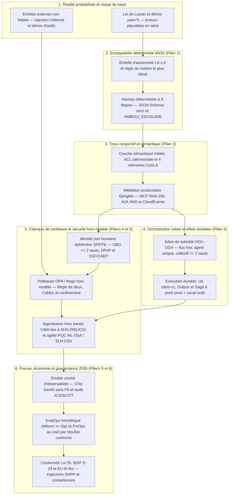

# Interopérabilité et Orchestration en Entreprise Agentique

*Synthèse académique, appareil conceptuel et guide d'apprentissage du corpus ([`0 - PDF-MD/`](0%20-%20PDF-MD/README.md) · 8 ouvrages · 4 542 pages · horizon 2024–2035)*

---

## Résumé et problématique centrale

Entre 2023 et 2025, l'adoption des modèles de langage en entreprise reposait sur un **amortisseur humain implicite** : un employé interrogeait un assistant conversationnel, vérifiait la pertinence de la réponse, traduisait les termes métier d'un logiciel à l'autre, appliquait ses propres droits d'accès et validait manuellement chaque écriture dans les systèmes centraux. L'**entreprise agentique** naît au moment précis où l'organisation retire cet intégrateur humain du dernier kilomètre pour permettre à des programmes dotés de modèles probabilistes de percevoir un contexte, de planifier plusieurs étapes, d'appeler des outils et de modifier directement l'état des systèmes d'information.

Ce basculement déplace le problème scientifique et industriel. La difficulté principale ne réside plus dans la capacité linguistique d'un modèle pris isolément, mais dans l'**ingénierie des frontières** qui encadrent son action. À travers les huit ouvrages intégraux réunis dans [`0 - PDF-MD/`](0%20-%20PDF-MD/README.md) (**4 542 pages** au format unifié `6,14 × 9,21 po`, **319 diagrammes** et une trousse logicielle exécutable dans [`8 - Manuel/trousse/`](8%20-%20Manuel/trousse/README.md)), ce dépôt instruit et démontre une thèse unificatrice :

> **Thèse directrice** — La viabilité opérationnelle, économique et juridique d'une entreprise agentique repose sur la séparation stricte entre **« ce qui parle »** — des modèles probabilistes faillibles et à obsolescence rapide, confinés à environ `20 %` du système — et **« ce qui en répond »** — un **noyau de contrôle déterministe** et un **tissu conjonctif d'interopérabilité** possédés en propre par l'organisation (`80 %`), garantissant le typage des échanges, la réduction cryptographique des privilèges, la réversibilité transactionnelle et la preuve d'audit.

Ce document a pour vocation de **vulgariser l'ensemble des concepts du corpus**, d'**expliciter les liens de causalité qui les unissent** et de **guider leur apprentissage progressif** dans les textes intégraux de [`0 - PDF-MD/`](0%20-%20PDF-MD/README.md).

---

## Sommaire

1. [Fondements théoriques et empiriques : pourquoi l'autonomie brute échoue](#1-fondements-théoriques-et-empiriques--pourquoi-lautonomie-brute-échoue)
2. [Carte conceptuelle intégrée : l'enchaînement causal des concepts](#2-carte-conceptuelle-intégrée--lenchaînement-causal-des-concepts)
3. [Les six piliers conceptuels expliqués](#3-les-six-piliers-conceptuels-expliqués)
4. [Harmonisation du corpus et lexique raisonné des concepts clés](#4-harmonisation-du-corpus-et-lexique-raisonné-des-concepts-clés)
5. [Architecture du corpus (`0 - PDF-MD/` et répertoires structurés)](#5-architecture-du-corpus-0---pdf-md-et-répertoires-structurés)
6. [Parcours d'apprentissage progressifs](#6-parcours-dapprentissage-progressifs)
7. [Chronologie de référence (2023–2035), méthode probatoire et licences](#7-chronologie-de-référence-20232035-méthode-probatoire-et-licences)

---

## 1. Fondements théoriques et empiriques : pourquoi l'autonomie brute échoue

Avant d'étudier les protocoles ou les architectures, il faut comprendre pourquoi le simple raccordement d'un modèle performant aux interfaces d'une entreprise échoue lors du passage à l'échelle. Trois mécanismes fondamentaux — mathématique, économique et sécuritaire — gouvernent tout le corpus ([`5 - Memoire.md`](0%20-%20PDF-MD/5%20-%20Memoire.md), ch. 1; [`7 - Livre.md`](0%20-%20PDF-MD/7%20-%20Livre.md), Partie I; [`8 - Manuel.md`](0%20-%20PDF-MD/8%20-%20Manuel.md), Liminaire).

### 1.1 La composition multiplicative des erreurs (loi de Lusser) et l'illusion du premier essai

En ingénierie de la fiabilité, lorsqu'une tâche exige l'enchaînement en série de `k` étapes indépendantes et que la défaillance d'un seul maillon compromet le résultat final, la fiabilité globale est le produit des fiabilités unitaires (**loi de Lusser**) :

$$
R_{\text{chaîne}} = \prod_{i=1}^{k} R_i
$$

Si un agent réussit chaque étape complexe avec une fiabilité jugée flatteuse en démonstration de `94 %`, une séquence autonome non vérifiée de `10` étapes tombe à $0{,}94^{10} \approx 53{,}9\ \%$ de réussite sans erreur — à peine mieux qu'un tirage à pile ou face. Deux phénomènes aggravent cette dégradation en contexte cognitif :

- **L'erreur plausible silencieuse.** Un service informatique déterministe échoue de manière explicite (code d'erreur, exception typée). Un modèle probabiliste qui se trompe génère au contraire une rationalisation grammaticalement impeccable qui contamine silencieusement les étapes aval : sur `1 642` traces analysées à travers sept cadriciels multi-agents ouverts, la taxonomie empirique `MAST` relève entre `41 %` et `86,7 %` d'échecs, dominés par les défauts de conception système (`44,2 %`) et les désalignements inter-agents (`32,4 %`).
- **L'écart entre performance de pointe (`pass@1`) et constance industrielle (`pass^k`).** Les palmarès publics mesurent souvent la probabilité qu'un modèle réussisse *au moins une fois* (`pass@1`). L'entreprise réglementée exige l'inverse : qu'il réussisse à chacun des `k` essais consécutifs sur la même situation métier (`pass^k`). Les mesures d'horizon temporel (`METR`) confirment cet écart : un modèle capable d'accomplir des tâches de `~17,4` heures humaines avec `50 %` de succès voit son horizon chuter d'un facteur cinq (`~3,1` heures) dès que l'on exige `80 %` de fiabilité. C'est pourquoi, sur le terrain (`Measuring Agents in Production`, `MAP`), `68 %` des agents déployés exécutent au plus `10` étapes avant intervention humaine et `80 %` suivent un graphe de flux fixe plutôt qu'une planification ouverte.

### 1.2 Les coûts de transaction cognitifs (Ronald Coase) et le piège des jardins clos

Dans *The Nature of the Firm* (1937), Ronald Coase explique que les frontières d'une entreprise dépendent des **coûts de transaction** : chercher l'information, négocier un contrat, surveiller l'exécution et corriger les écarts. Appliquée aux agents ([`7 - Livre.md`](0%20-%20PDF-MD/7%20-%20Livre.md), ch. 03), cette grille révèle un paradoxe :

- Bien que le prix unitaire de l'inférence à performance constante chute rapidement (`5×` à `13×` par an depuis 2023), le **coût complet d'une transaction conforme** peut exploser à cause des boucles de réessai, de la relecture de contexte (`> 97 %` des jetons), des garde-fous et de la supervision humaine.
- En parallèle, chaque grand éditeur de progiciels (`CRM`, `ERP`, `ITSM`, suites bureautiques) intègre ses propres agents captifs. Si l'entreprise délègue sa logique d'orchestration à ces **jardins clos** (*walled gardens*), elle remplace ses anciens silos applicatifs par des silos d'agents incapables de partager un vocabulaire métier cohérent ni une piste d'audit commune. Elle doit donc arbitrer son portefeuille selon trois modes : **Acheter** (commodités locales sans état critique), **Assembler sur standards ouverts** (posture cible par défaut autour d'un plan de contrôle possédé) ou **Construire** (cœur différenciateur à haute sensibilité).

### 1.3 L'asymétrie capacité–sécurité et le vide d'imputabilité des protocoles

Contrairement à une intuition répandue, **rendre un modèle plus intelligent ne le rend pas plus sûr** ([`7 - Livre.md`](0%20-%20PDF-MD/7%20-%20Livre.md), ch. 08). Parce qu'un modèle de langage traite dans une même séquence de jetons les instructions légitimes du système et les données externes non fiables (courriels, pièces jointes, pages web, réponses d'outils), toute donnée lue peut contenir une **injection indirecte de consignes** détournant ses objectifs. Par ailleurs, la standardisation d'un protocole d'échange (`MCP` ou `A2A`) résout uniquement la question syntaxique (*comment formuler l'appel*), jamais la question juridique et prudentielle (*qui agit, en vertu de quel mandat, avec quelle preuve opposable*) : la matrice croisée du [`1 - Compendium 2026.md`](0%20-%20PDF-MD/1%20-%20Compendium%202026.md) (ch. 42) démontre `0/15` correspondance native entre ces protocoles et les obligations réglementaires financières.

---

## 2. Carte conceptuelle intégrée : l'enchaînement causal des concepts

Les concepts de ce dépôt ne forment pas un catalogue de briques indépendantes : **chaque concept a été introduit pour fermer la vulnérabilité ouverte par le précédent**. Le schéma ci-dessous résume cette architecture causale de bout en bout.

### Lecture pédagogique des six transitions causales

1. **De la fragilité probabiliste au harnais `80/20`** : puisque l'enchaînement libre d'inférences dégrade exponentiellement la fiabilité (loi de Lusser), on gradue d'abord le droit d'agir selon le risque (`L0`–`L4`) et l'on enferme chaque appel au modèle dans un **harnais déterministe** qui valide les schémas d'entrée/sortie et escalade toute ambiguïté (`AMBIGU_ESCALADE`).
2. **Du harnais isolé au tissu conjonctif sémantique et protocolaire** : un agent borné doit lire le contexte de l'entreprise et invoquer des outils sans s'enfermer chez un fournisseur. Il passe donc par une **couche sémantique commune**, des **mémoires `CoALA` cloisonnées** et des protocoles ouverts épinglés cryptographiquement (`MCP` vers les outils, `A2A` vers les pairs, `CloudEvents` pour les événements).
3. **De la connectivité à la sémantique d'effet durable (Sagas)** : communiquer ne suffit pas lorsqu'une panne survient à la 4e étape d'un processus métier. L'**arbre de sobriété** limite le nombre de sauts, et un moteur d'**exécution durable** protège chaque écriture par une clé d'idempotence (`idem-v1`) et une **Saga compensatoire** dotée d'un canal d'annulation indépendant.
4. **De l'action distribuée à l'identité non humaine et au post-quantique** : dès qu'un agent délègue une sous-tâche à un outil ou à un second agent (**problème des deux sauts**), un secret partagé ferait perdre la trace du donneur d'ordre humain. Chaque agent reçoit donc une **identité non humaine (`NHI`)** éphémère, échange des jetons restreints (`OAuth 2.0 OBO` + `DPoP`), exige une signature humaine hors bande (`CIBA` sur empreinte `JCS`) avant tout acte irréversible et prépare la migration **post-quantique** (`ML-DSA`, `SLH-DSA`).
5. **De l'identité légitime à la sécurité hors modèle (`OPA` / `CaMeL`)** : même dûment authentifié, un agent peut être manipulé par une donnée externe piégée (*député confus*). Le contrôle d'autorisation est donc extrait du prompt pour être confié à un moteur déterministe externe (`OPA / Rego`, refus par défaut) qui applique la **Règle de deux** et le suivi de contamination **`CaMeL`**.
6. **Du contrôle en temps réel à la preuve réglementaire et humaine sur le long terme** : enfin, pour démontrer cette maîtrise aux régulateurs sans exposer les renseignements personnels ni éroder le jugement des équipes, l'architecture sépare la télémétrie en un **double couloir** (`OTel` opérationnel vs registre `SCITT` probatoire), évalue la constance hors ligne (`EvalOps` / bornes de Wilson), facture au **coût complet par résultat conforme** (`CPO`) et pilote ses investissements `2026–2035` par **trajectoires adaptatives (`DAPP`)** tout en préservant les compétences humaines.

---

## 3. Les six piliers conceptuels expliqués

### 3.1 Graduation de l'autonomie (`L0`–`L4`), règle du maillon le plus élevé et harnais `80/20`

Le mot « agent » prête à confusion lorsqu'il désigne indifféremment un moteur de résumé et un programme autorisé à virer des fonds. Le corpus normalise une **échelle opérationnelle à cinq niveaux (`L0` à `L4`)** fondée non pas sur l'intelligence prêtée au modèle, mais sur **les droits de mutation accordés sur les systèmes d'enregistrement (`Systems of Record`)** :

| Niveau | Régime opérationnel | Droits d'écriture et réversibilité | Rôle de l'humain et contrôles déterministes |
|---|---|---|---|
| **`L0`** | Flux déterministe ou lecture/synthèse pure | Aucune écriture autonome par modèle | Filtrage des droits d'accès (`ACL`) en amont, assainissement des entrées, journalisation |
| **`L1`** | Assistant supervisé (copilote) | Brouillon ou recommandation sans effet direct | **Humain dans la boucle (`HITL`)** qui valide et exécute l'acte; marquage de transparence |
| **`L2`** | Exécution bornée unitaire | Écriture locale étroite, typée et aisément annulable | Contrats `JSON Schema` stricts, clé d'idempotence, privilège minimal, plafond de tours |
| **`L3`** | Orchestration déléguée multi-étapes | Chaîne coordonnée compensable avant tout point pivot | **Humain sur la boucle (`HOTL`)** par exception; exécution durable, Saga, coupe-circuit budgétaire |
| **`L4`** | Autonomie sous mandat critique ou externe | Acte engageant ou seuil critique isolé derrière un pivot | Identité `NHI` éphémère, délégation réduite `OBO`, approbation hors bande `CIBA` signée sur l'acte exact |

> *Note de lecture inter-volumes (`DISC-01`)* : dans les volumes 3 et 6, `L0` désigne le traitement purement déterministe sans IA (qu'il faut toujours préférer lorsqu'une règle fixe suffit), tandis que le volume 7 utilise `L0` pour la consultation IA en lecture seule. Le volume 8 réconcilie les deux : écarter d'abord tout cas solvable sans modèle, puis graduer strictement par droit de mutation et de sortie externe.

Trois concepts complètent ce premier pilier :
- **La règle du maillon le plus élevé (*High-Water Mark Rule*)** : lorsqu'un agent de lecture (`L0`/`L1`) alimente sans sas d'assainissement déterministe un agent d'écriture critique (`L3`/`L4`), le maillon amont hérite intégralement des exigences de sécurité, d'inventaire et de traçabilité du maillon aval — **sans jamais hériter de ses droits d'écriture**.
- **La partition hybride `80/20` et la quadruple dette** : placer des règles métier dans un prompt engendre simultanément une dette technique, une dette cognitive (comportement opaque), une dette d'intention (objectifs incomplets) et un couplage caché aux mises à jour du modèle. L'heuristique `80/20` maintient ~`80 %` du flux (routage, calculs monétaires en arithmétique `Decimal` exacte, autorisations, gestion d'état) en code déterministe et confine ~`20 %` (extraction non structurée, synthèse, classification nuancée) au modèle derrière un **harnais à huit étapes** doté d'une porte explicite `AMBIGU_ESCALADE`.
- **Pour approfondir dans `0 - PDF-MD/`** : [`2 - Cadre de Référence.md`](0%20-%20PDF-MD/2%20-%20Cadre%20de%20R%C3%A9f%C3%A9rence.md) (ch. 5 et 8), [`6 - Livre Blanc.md`](0%20-%20PDF-MD/6%20-%20Livre%20Blanc.md) (ch. 1 à 3), [`7 - Livre.md`](0%20-%20PDF-MD/7%20-%20Livre.md) (ch. 01 et 04), [`8 - Manuel.md`](0%20-%20PDF-MD/8%20-%20Manuel.md) (ch. 01).

### 3.2 Interopérabilité au-delà de la syntaxe : protocoles (`MCP`, `A2A`), sémantique et mémoire (`CoALA`)

Connecter un agent au système d'information exige de distinguer **trois plans de communication** et **deux couches de sens** :

1. **Interopérabilité verticale agent → outil (`MCP`, *Model Context Protocol*)** : standardise en `JSON-RPC 2.0` sur `Streamable HTTP` sans état (`MCP 2026-07-28`) l'exposition d'outils et de ressources. Parce que `40,58 %` des serveurs `MCP` publics multi-versions étudiés fin 2026 modifient silencieusement leurs définitions entre versions (*rug-pull* ou dérive sémantique d'outil), l'entreprise ne connecte jamais un agent en direct : une passerelle épingle l'empreinte canonique `SHA-256(JCS(tools/list))` du catalogue approuvé et limite le nombre d'outils exposés par tâche.
2. **Interopérabilité horizontale agent ↔ agent (`A2A`, *Agent2Agent*)** : lorsqu'un agent coopère avec le pair autonome d'un autre domaine ou d'un partenaire externe sans partager sa mémoire interne ni ses outils, il dialogue par tâches asynchrones via `A2A v1.0.1`. L'identité et les capacités annoncées dans l'`AgentCard` sont vérifiées par signature `JWS` et canonisation `JCS`.
3. **Chorégraphie événementielle (`CloudEvents` / `AsyncAPI`)** : découple les réactions asynchrones sur courtiers d'événements en imposant un compteur maximal de sauts (`max_hops`) et des files de lettres mortes (`DLQ`) pour briser les tempêtes d'écho entre agents ambiants.
4. **Couche sémantique métier et couche anti-corruption (`ACL`)** : deux agents qui échangent du `JSON` valide échouent s'ils calculent différemment l'« exposition nette » ou le « client actif ». Une couche sémantique gouvernée unifie les définitions métier, tandis qu'une **couche anti-corruption** protège les systèmes patrimoniaux (`ERP`, mainframes `IBM i` / `COBOL COMP-3`) contre tout accès `SQL` brut et contre l'anti-patron *Swagger-to-MCP* (exposer des centaines d'API techniques brutes au modèle).
5. **Architecture mémorielle `CoALA` à quatre compartiments** : inspirée de *Cognitive Architectures for Language Agents*, la mémoire d'entreprise sépare strictement la **mémoire de travail** (contexte courant éphémère), la **mémoire épisodique** (historique horodaté d'interactions), la **mémoire sémantique** (faits et graphes de connaissances bi-temporels) et la **mémoire procédurale** (instructions, schémas et règles versionnés sous `Git`), avec filtrage des habilitations en amont de toute recherche documentaire (`RAG`) et droit à la purge (`Loi 25`).
- **Pour approfondir dans `0 - PDF-MD/`** : [`1 - Compendium 2026.md`](0%20-%20PDF-MD/1%20-%20Compendium%202026.md) (Livre I), [`3 - Compendium 2027.md`](0%20-%20PDF-MD/3%20-%20Compendium%202027.md) (Parties II et III), [`6 - Livre Blanc.md`](0%20-%20PDF-MD/6%20-%20Livre%20Blanc.md) (ch. 04 à 06), [`7 - Livre.md`](0%20-%20PDF-MD/7%20-%20Livre.md) (ch. 05), [`8 - Manuel.md`](0%20-%20PDF-MD/8%20-%20Manuel.md) (ch. 01).

### 3.3 Sobriété d'orchestration (`OO1`–`OO4`), exécution durable et Sagas compensatoires

Multiplier les agents qui débattent librement entre eux dégrade souvent la précision sur les tâches séquentielles couplées (jusqu'à `-70 %` à budget de calcul égal dans la littérature analysée au [`3 - Compendium 2027.md`](0%20-%20PDF-MD/3%20-%20Compendium%202027.md), ch. 16 et 48 — **effet Ringelmann multi-agents**) tout en multipliant la latence et la surface d'attaque.

- **Taxonomie `OO1`–`OO4` et arbre de sobriété** : le corpus classe l'orchestration de `OO1` (conversation libre entre agents, proscrite en production critique) et `OO2` (routage souple supervisé par un modèle) vers `OO3` et `OO4` (**machines à états et graphes dirigés déterministes** invoquant des cellules cognitives bornées). L'arbre de décision impose de retenir par défaut : *(1)* un algorithme déterministe sans IA, sinon *(2)* un flux fixe à appels ponctuels, sinon *(3)* un **agent unique bien outillé** (éventuellement doublé d'un vérificateur indépendant : patron *Generator-Verifier*), et de n'autoriser *(4)* un collectif multi-agents (`≤ 2` sauts de délégation) que sur gain empirique prouvé.
- **Exécution durable et Sagas à point pivot** : les processus d'entreprise durent des minutes ou des jours (attente d'une pièce ou d'un humain) et ne peuvent maintenir de verrous sur les bases centrales (`2PC` impraticable). Un moteur d'**exécution durable** journalise chaque étape pour rejouer l'état après panne sans réexécuter le modèle, attache une **clé d'idempotence déterministe** (`idem-v1` dérivée par `JCS` + `SHA-256`) via un `Transactional Outbox`, et structure le flux en **Saga** (Garcia-Molina et Salem, 1987) : toute écriture accomplie avant l'**acte pivot irréversible** possède une action compensatoire automatique acheminée sur un **canal de compensation isolé** (`EXIG-ORC-28`), hors d'atteinte du modèle et des coupe-circuits applicatifs.
- **Pour approfondir dans `0 - PDF-MD/`** : [`1 - Compendium 2026.md`](0%20-%20PDF-MD/1%20-%20Compendium%202026.md) (ch. 22 et 48), [`2 - Cadre de Référence.md`](0%20-%20PDF-MD/2%20-%20Cadre%20de%20R%C3%A9f%C3%A9rence.md) (ch. 7), [`6 - Livre Blanc.md`](0%20-%20PDF-MD/6%20-%20Livre%20Blanc.md) (ch. 07 à 09), [`7 - Livre.md`](0%20-%20PDF-MD/7%20-%20Livre.md) (ch. 06), [`8 - Manuel.md`](0%20-%20PDF-MD/8%20-%20Manuel.md) (ch. 03).

### 3.4 Fabrique de confiance : identité non humaine (`NHI`), deuxième saut et choc post-quantique (`PQC`)

Lorsqu'un humain demande à un agent A d'agir, et que l'agent A sollicite un agent B qui appelle une API bancaire C, deux écueils opposés menacent la sécurité : donner un compte de service partagé omnipotent (perte totale de l'origine humaine) ou relayer le jeton brut de l'utilisateur de proche en proche (*token passthrough*, formellement interdit car B reçoit tous les droits de l'utilisateur). C'est le **problème de la chaîne de mandat et des deux sauts** :

- **Identité non humaine (`NHI`) et délégation atténuée (`OBO` + `DPoP`)** : chaque charge agentique reçoit une identité cryptographique courte sans secret statique (`SPIFFE` / `WIMSE`). À chaque saut, l'échange de jetons `OAuth 2.0 On-Behalf-Of` (`RFC 8693`) émet un nouveau jeton à portée réduite (*downscoping*) qui distingue cryptographiquement le sujet humain initial (`sub`) et la chaîne d'acteurs logiciels (`act`), lié à une preuve de possession de clé (`DPoP`, `RFC 9449`) et révocable en continu via `SSF`/`CAEP`.
- **Approbation humaine signée sur l'acte exact (`CIBA` + `JCS`)** : pour un acte critique (`L4` ou outil `P3`), une simple case « Confirmer » à l'écran ne prouve rien et favorise le clic réflexe. Le protocole hors bande `OpenID Connect CIBA` couplé à `FIDO2` soumet au valideur humain les paramètres canonisés `RFC 8785` (`JCS`) de la transaction et lie sa signature à l'empreinte exacte `SHA-256(JCS(payload))`.
- **Collision entre certificats courts et cryptographie post-quantique (`PQC`)** : deux horloges convergent d'ici 2035. D'abord, la durée maximale des certificats `TLS` publics s'abaisse à `100` jours (mars 2027) puis à `47` jours (mars 2029), imposant une automatisation `ACME` intégrale. Ensuite, les signatures post-quantiques normalisées `ML-DSA` (`NIST FIPS 204`) pèsent plusieurs kilo-octets : imbriquer des jetons signés à chaque saut fait croître les en-têtes en `O(sauts)` jusqu'au rejet `HTTP 431` (*Request Header Fields Too Large*), d'où le recours à des *Transaction Tokens* courts internes en `O(1)` et au rescellement périodique des archives probatoires de longue durée en `SLH-DSA` (`NIST FIPS 205`, sans hypothèse sur les réseaux euclidiens).
- **Pour approfondir dans `0 - PDF-MD/`** : [`1 - Compendium 2026.md`](0%20-%20PDF-MD/1%20-%20Compendium%202026.md) (Livre II), [`4 - Plan Directeur.md`](0%20-%20PDF-MD/4%20-%20Plan%20Directeur.md) (ch. M-5), [`7 - Livre.md`](0%20-%20PDF-MD/7%20-%20Livre.md) (ch. 07), [`8 - Manuel.md`](0%20-%20PDF-MD/8%20-%20Manuel.md) (ch. 02).

### 3.5 Sécurité par construction (`CaMeL`, Règle de deux), double couloir d'observabilité et `EvalOps`/`FinOps`

Puisqu'un filtre par invite ou par second modèle reste probabiliste et contournable, la sûreté d'exécution et la preuve opérationnelle s'implantent hors du modèle :

- **Séparation contrôle/données (`CaMeL`) et Règle de deux sous `OPA / Rego`** : le suivi de contamination (*taint tracking* inspiré de `CaMeL`) marque toute donnée issue d'une source non fiable. Avant chaque appel d'outil, un point de décision externe `OPA / Rego` configuré en **refus par défaut** (`default allow := false`) applique la **Règle de deux** (*Rule of Two*) : *un même contexte d'exécution ne peut jamais réunir simultanément (1) des entrées externes non fiables, (2) l'accès à des données confidentielles ou secrets et (3) la capacité d'écriture critique ou d'exfiltration réseau*. L'exécution de code généré est confinée dans des bacs à sable déclaratifs sans privilège ni accès aux métadonnées infonuagiques (`IMDS`).
- **Télémétrie à double couloir** : observer un agent pose un dilemme entre diagnostic technique et vie privée (`Loi 25`, `RGPD`). L'architecture dédouble le flux : un **couloir opérationnel** à faible latence (`OpenTelemetry GenAI`) caviardant strictement les renseignements personnels (`PII`) pour le suivi temps réel, et un **couloir probatoire immuable** d'enregistrements canonisés `JCS`, chaînés par condensats et scellés dans un registre de transparence (`SCITT`, `RFC 9943`) conservé aux fins d'audit légal.
- **`EvalOps` hermétique et `FinOps` au coût par résultat conforme (`CPO`)** : avant toute promotion en production, l'agent est testé hors ligne sur doublures déterministes (`mock MCP servers`), évalué par relations métamorphiques bilingues sans oracle (invariance de décision sous reformulation ou tentative d'injection FR/EN) et dimensionné statistiquement par la **borne supérieure de l'intervalle de confiance de Wilson à `95 %`** : certifier un plafond d'échec `p` sans échec observé exige au moins $\lceil 3/p \rceil$ essais indépendants. En exploitation, la rentabilité ne se mesure jamais au prix de mille jetons, mais au **coût complet par résultat conforme non rouvert (`CPO`)**, rapproché du standard `FOCUS v1.4` (inférence, réessais, passerelles, stockage d'audit et temps de supervision humaine).
- **Pour approfondir dans `0 - PDF-MD/`** : [`2 - Cadre de Référence.md`](0%20-%20PDF-MD/2%20-%20Cadre%20de%20R%C3%A9f%C3%A9rence.md) (ch. 9 et 10), [`3 - Compendium 2027.md`](0%20-%20PDF-MD/3%20-%20Compendium%202027.md) (Partie VI), [`7 - Livre.md`](0%20-%20PDF-MD/7%20-%20Livre.md) (ch. 08 et 09), [`8 - Manuel.md`](0%20-%20PDF-MD/8%20-%20Manuel.md) (ch. 02 à 04).

### 3.6 Gouvernance réglementaire, trajectoire adaptative (`DAPP`) et préservation des compétences humaines

L'étude exhaustive des textes adoptés jusqu'à l'horizon `2035` débouche sur un enseignement stratégique majeur ([`4 - Plan Directeur.md`](0%20-%20PDF-MD/4%20-%20Plan%20Directeur.md), Sommaire et ch. M-1 à M-26; [`7 - Livre.md`](0%20-%20PDF-MD/7%20-%20Livre.md), Partie IV) : **aucune loi ni aucun régulateur n'impose d'automatiser une décision par agent; toutes les échéances fermes portent sur l'inventaire, la transparence, la révision humaine, la maîtrise des tiers et la cryptographie**.

- **Plafonds légaux et prudentiels structurants** :
  - *Transversal (Québec, `Loi 25` art. 12.1)* : toute décision fondée exclusivement sur un traitement automatisé oblige à informer la personne concernée, à lui expliquer sur demande les paramètres principaux et à lui garantir un droit d'observation auprès d'un humain habilité à réviser la décision (sanctions pouvant atteindre `25` millions de dollars canadiens ou `4 %` du chiffre d'affaires mondial).
  - *Prudentiel financier (Canada fédéral et Québec)* : la ligne directrice `BSIF E-23` révisée (et son pendant à l'`AMF` au **1er mai 2027**) soumet les modèles génératifs et systèmes autonomes à un inventaire exhaustif, une cotation de risque intégrant l'autonomie, une validation indépendante (`3LoD`) et un responsable imputable nommé (*Agent Owner*).
  - *Union européenne (`EU AI Act` et `DORA`)* : obligations de transparence actives depuis août 2026 (art. 50), exigences de contrôle humain (art. 14) et de qualité (art. 17) sur les systèmes à haut risque (décembre 2027 / août 2028), et tests de résilience opérationnelle numérique (`DORA`).
  - *Verrous sectoriels par métier financier* : interdiction du grattage d'écran en banque ouverte et cloisonnement banque-assurance; non-délégabilité du conseil inscrit et interdiction de recommandations dans les comptes d'exécution d'ordres sans conseils (`OEO`) en patrimoine; prohibition criminelle des tests génétiques en assurance de personnes; approbation préalable des formulaires auto et interdiction des refus d'indemnisation automatisés sans examen humain en assurance de dommages.
- **Planification adaptative sous incertitude profonde (`DAPP`)** : face à trois scénarios prospectifs équiprobables non pondérés `2028–2035` (*A : socle ouvert étendu*, *B : archipel de plateformes propriétaires*, *C : fragmentation en blocs juridictionnels*), la méthode *Dynamic Adaptive Policy Pathways* (Haasnoot *et al.*) distingue **42 capacités invariantes « sans regret »** à bâtir immédiatement (le noyau de contrôle possédé) et **10 capacités conditionnelles** déclenchées uniquement sur franchissement vérifié de **27 signaux de veille** (`SIG-*`) et de **15 portes de gouvernance** (`POR-*`).
- **Parade contre l'atrophie silencieuse des compétences** : déléguer tout le flux courant aux agents tout en ne laissant aux humains que la validation d'exceptions engendre deux périls couplés : l'**approbation réflexe** (*automation bias*, signature machinale sans vérification réelle) et l'**érosion de la relève junior** (privée des dossiers formateurs qui bâtissent l'expertise future des superviseurs seniors). Une gouvernance durable impose donc des vues différentielles d'approbation, l'injection de cas témoins à l'aveugle et le maintien d'un quota délibéré de traitement manuel formateur.

---

## 4. Harmonisation du corpus et lexique raisonné des concepts clés

### Comment naviguer entre les conventions des huit volumes

Construit par strates successives entre juillet et décembre 2026, le corpus opère lui-même deux synthèses de concordance explicites que l'apprenant gagne à connaître :
1. **Réconciliation architecturale (`DIV-02` fermée dans [`5 - Memoire.md`](0%20-%20PDF-MD/5%20-%20Memoire.md), Annexe A)** : aligne les `5` couches et `3` volets prospectifs du *Plan Directeur* (`52` capacités `CAP-*`) sur les `6` couches et `305` exigences `EXIG-*` du *Cadre de Référence*.
2. **Table canonique exécutable (`DISC-01` à `DISC-05` dans [`8 - Manuel.md`](0%20-%20PDF-MD/8%20-%20Manuel.md), § 0.2)** : unifie pour la vérification mécanique l'échelle `L0`–`L4` (`DISC-01`), les trois niveaux de criticité `BLOQUANT` / `OBLIGATOIRE` / `RECOMMANDE` couplés aux paliers d'outils `P0`–`P3` (`DISC-02`), l'ancrage dans les plans transversaux `A` (confiance/sécurité), `B` (observabilité/audit/coûts) et `C` (médiation/orchestration) (`DISC-03`), la neutralité `ArchiMate 3.2 / 4.0` (`DISC-04`) et l'épinglage protocolaire sur `MCP 2026-07-28` en `Streamable HTTP` sans état (`DISC-05`).

### Lexique synthétique des vingt concepts pivots

| Concept (terme français) | Équivalent anglais / Sigle | Définition vulgarisée et rôle dans le système | Références principales dans `0 - PDF-MD/` |
|---|---|---|---|
| **Tissu conjonctif agentique** | *Agentic connective tissue* | Ensemble des couches protocolaires, sémantiques, mémorielles et d'orchestration reliant agents, SI patrimonial et humains | [`3 - Compendium 2027.md`](0%20-%20PDF-MD/3%20-%20Compendium%202027.md) (Ouverture), [`7 - Livre.md`](0%20-%20PDF-MD/7%20-%20Livre.md) (§ 0.1–0.2) |
| **Noyau de contrôle déterministe (`80/20`)** | *Deterministic control core* | Enveloppe de code déterministe possédée en propre (`~80 %`) encadrant des modèles statistiques substituables (`~20 %`) | [`6 - Livre Blanc.md`](0%20-%20PDF-MD/6%20-%20Livre%20Blanc.md) (ch. 3), [`7 - Livre.md`](0%20-%20PDF-MD/7%20-%20Livre.md) (ch. 04) |
| **Loi de Lusser** | *Lusser's reliability law* | Produit des fiabilités en série expliquant la chute rapide du taux de succès d'une chaîne autonome sans contrôle intermédiaire | [`3 - Compendium 2027.md`](0%20-%20PDF-MD/3%20-%20Compendium%202027.md) (§ 0.2), [`7 - Livre.md`](0%20-%20PDF-MD/7%20-%20Livre.md) (§ 0.3, ch. 02) |
| **Constance multi-essais** | *`pass^k` consistency* | Probabilité qu'un agent réussisse sans erreur `k` exécutions indépendantes d'un même scénario métier | [`7 - Livre.md`](0%20-%20PDF-MD/7%20-%20Livre.md) (ch. 02, 09), [`8 - Manuel.md`](0%20-%20PDF-MD/8%20-%20Manuel.md) (ch. 04) |
| **Spectre d'autonomie `L0`–`L4`** | *Operational autonomy spectrum* | Graduation des agents selon leurs droits d'écriture applicative, leur réversibilité et le mode de supervision humaine | [`3 - Compendium 2027.md`](0%20-%20PDF-MD/3%20-%20Compendium%202027.md) (§ 0.4), [`7 - Livre.md`](0%20-%20PDF-MD/7%20-%20Livre.md) (ch. 01) |
| **Règle du maillon le plus élevé** | *High-Water Mark Rule* | Alignement des contrôles de sécurité d'un agent amont sur le maillon aval le plus critique qu'il alimente, sans étendre ses droits | [`3 - Compendium 2027.md`](0%20-%20PDF-MD/3%20-%20Compendium%202027.md) (§ 0.4), [`7 - Livre.md`](0%20-%20PDF-MD/7%20-%20Livre.md) (§ 0.4) |
| **Harnais d'agent** | *Agent harness* | Composant logiciel validant les schémas `JSON Schema` stricts, bornant les tours et isolant l'appel au modèle (`AMBIGU_ESCALADE`) | [`6 - Livre Blanc.md`](0%20-%20PDF-MD/6%20-%20Livre%20Blanc.md) (ch. 3), [`8 - Manuel.md`](0%20-%20PDF-MD/8%20-%20Manuel.md) (ch. 01) |
| **Médiation verticale et horizontale** | `MCP` / `A2A` | Couplage normalisé agent-outil (`MCP`, épinglé `SHA-256`) distinct de la délégation asynchrone entre pairs opaques (`A2A`, `JWS`) | [`1 - Compendium 2026.md`](0%20-%20PDF-MD/1%20-%20Compendium%202026.md) (ch. 8), [`8 - Manuel.md`](0%20-%20PDF-MD/8%20-%20Manuel.md) (ch. 01) |
| **Couche anti-corruption** | *Anti-Corruption Layer (`ACL`)* | Façade traduisant le modèle métier canonique vers les systèmes patrimoniaux (`ERP`, mainframes) sans les exposer au modèle | [`3 - Compendium 2027.md`](0%20-%20PDF-MD/3%20-%20Compendium%202027.md) (ch. 28), [`6 - Livre Blanc.md`](0%20-%20PDF-MD/6%20-%20Livre%20Blanc.md) (ch. 4) |
| **Mémoires cloisonnées `CoALA`** | *Work / Episodic / Semantic / Procedural* | Séparation de l'état de travail, du journal d'épisodes, des connaissances métier et des consignes versionnées sous contrôle `ACL` | [`2 - Cadre de Référence.md`](0%20-%20PDF-MD/2%20-%20Cadre%20de%20R%C3%A9f%C3%A9rence.md) (ch. 5), [`5 - Memoire.md`](0%20-%20PDF-MD/5%20-%20Memoire.md) (ch. 4) |
| **Exécution durable** | *Durable execution* | Persistance déterministe de l'état d'un flux permettant reprise après panne et attentes longues sans réexécuter les étapes | [`3 - Compendium 2027.md`](0%20-%20PDF-MD/3%20-%20Compendium%202027.md) (ch. 18), [`6 - Livre Blanc.md`](0%20-%20PDF-MD/6%20-%20Livre%20Blanc.md) (ch. 9) |
| **Saga à point pivot et canal isolé** | *Pivot-transaction Saga* | Enchaînement de transactions locales compensables avant un acte irréversible, annulables sur un canal dédié hors modèle | [`2 - Cadre de Référence.md`](0%20-%20PDF-MD/2%20-%20Cadre%20de%20R%C3%A9f%C3%A9rence.md) (ch. 7), [`8 - Manuel.md`](0%20-%20PDF-MD/8%20-%20Manuel.md) (ch. 03) |
| **Identité non humaine et 2e saut** | `NHI` / `OAuth 2.0 OBO` + `DPoP` | Identité machine éphémère et échange de jetons à privilèges décroissants préservant la trace du mandant humain à travers les sauts | [`1 - Compendium 2026.md`](0%20-%20PDF-MD/1%20-%20Compendium%202026.md) (ch. 17), [`8 - Manuel.md`](0%20-%20PDF-MD/8%20-%20Manuel.md) (ch. 02) |
| **Approbation humaine liée à l'acte** | `CIBA` + `RFC 8785 JCS` | Validation humaine hors bande signant cryptographiquement l'empreinte `SHA-256` exacte des paramètres canonisés de l'action | [`2 - Cadre de Référence.md`](0%20-%20PDF-MD/2%20-%20Cadre%20de%20R%C3%A9f%C3%A9rence.md) (ch. 8), [`8 - Manuel.md`](0%20-%20PDF-MD/8%20-%20Manuel.md) (ch. 02) |
| **Crypto-agilité post-quantique** | `ML-DSA` (`FIPS 204`) / `SLH-DSA` (`205`) | Migration vers des signatures résistantes au calcul quantique en maîtrisant la taille des en-têtes (`HTTP 431`) et des archives | [`1 - Compendium 2026.md`](0%20-%20PDF-MD/1%20-%20Compendium%202026.md) (ch. 21), [`8 - Manuel.md`](0%20-%20PDF-MD/8%20-%20Manuel.md) (ch. 02) |
| **Règle de deux et suivi `CaMeL`** | *Rule of Two* & *taint tracking* | Interdiction hors modèle (`OPA / Rego`) de combiner entrée externe non fiable, secret sensible et action externe dans un même tour | [`2 - Cadre de Référence.md`](0%20-%20PDF-MD/2%20-%20Cadre%20de%20R%C3%A9f%C3%A9rence.md) (ch. 9), [`8 - Manuel.md`](0%20-%20PDF-MD/8%20-%20Manuel.md) (ch. 03) |
| **Télémétrie à double couloir** | *Dual-lane telemetry* (`OTel` + `SCITT`) | Séparation entre traces techniques caviardées `PII` et journal d'audit canonique immuable à valeur probatoire | [`5 - Memoire.md`](0%20-%20PDF-MD/5%20-%20Memoire.md) (ch. 8), [`8 - Manuel.md`](0%20-%20PDF-MD/8%20-%20Manuel.md) (ch. 02) |
| **Borne supérieure de Wilson** | *Wilson upper confidence bound* | Dimensionnement statistique exigeant au moins $\lceil 3/p \rceil$ essais sans faute pour attester à `95 %` un taux d'échec inférieur à `p` | [`2 - Cadre de Référence.md`](0%20-%20PDF-MD/2%20-%20Cadre%20de%20R%C3%A9f%C3%A9rence.md) (ch. 10), [`8 - Manuel.md`](0%20-%20PDF-MD/8%20-%20Manuel.md) (ch. 04) |
| **Coût complet par résultat conforme** | *Cost per Compliant Outcome (`CPO`)* | Unité économique totalisant inférence, réessais, passerelles, stockage d'audit et supervision pour une transaction réussie sans reprise | [`3 - Compendium 2027.md`](0%20-%20PDF-MD/3%20-%20Compendium%202027.md) (ch. 40), [`7 - Livre.md`](0%20-%20PDF-MD/7%20-%20Livre.md) (ch. 09) |
| **Trajectoires adaptatives `DAPP`** | *Dynamic Adaptive Policy Pathways* | Planification `2028–2035` distinguant investissements sans regret et options conditionnelles activées sur signaux observables | [`4 - Plan Directeur.md`](0%20-%20PDF-MD/4%20-%20Plan%20Directeur.md) (ch. M-1, M-19–25), [`7 - Livre.md`](0%20-%20PDF-MD/7%20-%20Livre.md) (ch. 12) |

---

## 5. Architecture du corpus (`0 - PDF-MD/` et répertoires structurés)

### Complémentarité épistémologique des huit ouvrages

Plutôt que de répéter le même propos, chaque volume occupe une fonction méthodologique distincte dans l'apprentissage et la décision :
- **Explorer et documenter le domaine** : les volumes **1** (*Compendium 2026*) et **3** (*Compendium 2027*) forment les sommes encyclopédiques et analytiques — le premier centré sur la confiance protocolaire et le droit financier canadien/québécois, le second élargissant l'état de l'art aux patrons d'ingénierie, à la littérature scientifique et au marché `2027–2030`.
- **Prescrire et planifier pour l'institution financière** : le volume **2** (*Cadre de Référence*) traduit cet état de l'art en politique interne opposable (`12` principes, `305` exigences `EXIG-*`), le volume **4** (*Plan Directeur*) projette l'architecture cible `2028–2035` (`52` capacités, `5` profils financiers, méthode `DAPP`), et le volume **5** (*Mémoire*) condense et réconcilie ces quatre premiers volumes (`3 493` pages au format unifié; `2 541` pages en édition originale) en `175` pages pour le binôme Architecte d'entreprise / Architecte de solutions.
- **Transposer hors finance et synthétiser en lecture linéaire** : le volume **6** (*Livre Blanc*) offre un référentiel architectural multisectoriel autonome avec trois blueprints de bout en bout, tandis que le volume **7** (*Gouverner l'industrialisation cognitive*) propose un essai d'auteur linéaire, sans codification matricielle interne, réancré sur `79` sources primaires ouvertes.
- **Prouver par le code exécutable hors modèle** : le volume **8** (*Manuel*) et sa trousse intégrée [`8 - Manuel/trousse/`](8%20-%20Manuel/trousse/README.md) transforment les exigences, schémas, politiques `OPA`, Sagas et portes d'homologation en contrats logiciels testés hors ligne à `exit 0`.

### Vue synoptique des huit volumes

| # | Ouvrage (répertoire structuré) | Éditions intégrales (`0 - PDF-MD/`) | Rôle pédagogique et méthodologique | Horizon | Pages | Diagrammes |
|---|---|---|---|---|---:|---:|
| 1 | [`1 - Compendium 2026`](1%20-%20Compendium%202026/README.md) | [PDF](0%20-%20PDF-MD/1%20-%20Compendium%202026.pdf) · [MD](0%20-%20PDF-MD/1%20-%20Compendium%202026.md) | Somme analytique fondatrice : protocoles, chaîne de mandat, `OO1`–`OO4`, droit financier canadien/québécois et sémantique d'effet (`62` unités) | 2024–2032 | 1 135 | [118](1%20-%20Compendium%202026/Diagrammes/README.md) |
| 2 | [`2 - Cadre de Référence`](2%20-%20Cadre%20de%20R%C3%A9f%C3%A9rence/README.md) | [PDF](0%20-%20PDF-MD/2%20-%20Cadre%20de%20R%C3%A9f%C3%A9rence.pdf) · [MD](0%20-%20PDF-MD/2%20-%20Cadre%20de%20R%C3%A9f%C3%A9rence.md) | Norme d'entreprise opposable : `12` principes directeurs, `6` couches, `3` plans transversaux et `305` exigences vérifiables (`35` unités) | 2026–2030 | 534 | [28](2%20-%20Cadre%20de%20R%C3%A9f%C3%A9rence/Diagrammes/README.md) |
| 3 | [`3 - Compendium 2027`](3%20-%20Compendium%202027/README.md) | [PDF](0%20-%20PDF-MD/3%20-%20Compendium%202027.pdf) · [MD](0%20-%20PDF-MD/3%20-%20Compendium%202027.md) | État de l'art consolidé : `50` chapitres en `10` parties, `31` volets de mise en œuvre, `31` ADR, `75` points `PRR`, revue scientifique et marché (`73` unités) | 2026–2030 | 1 287 | [68](3%20-%20Compendium%202027/Diagrammes/README.md) |
| 4 | [`4 - Plan Directeur`](4%20-%20Plan%20Directeur/README.md) | [PDF](0%20-%20PDF-MD/4%20-%20Plan%20Directeur.pdf) · [MD](0%20-%20PDF-MD/4%20-%20Plan%20Directeur.md) | Prospective stratégique sous incertitude : `3` scénarios, `52` capacités (`42` sans regret, `10` conditionnelles), `5` profils financiers et paliers `DAPP` (`45` unités) | 2028–2035 | 537 | [6](4%20-%20Plan%20Directeur/Diagrammes/README.md) |
| 5 | [`5 - Memoire`](5%20-%20Memoire/README.md) | [PDF](0%20-%20PDF-MD/5%20-%20Memoire.pdf) · [MD](0%20-%20PDF-MD/5%20-%20Memoire.md) | Synthèse architecturale AE / AS condensant (~`20:1`) et réconciliant (`DIV-02`) les `3 493` pages des volumes 1 à 4 (`2 541` en édition originale), avec glossaire de `385` entrées (`27` unités) | 2026–2035 | 175 | [8](5%20-%20Memoire/Diagrammes/README.md) |
| 6 | [`6 - Livre Blanc`](6%20-%20Livre%20Blanc/README.md) | [PDF](0%20-%20PDF-MD/6%20-%20Livre%20Blanc.pdf) · [MD](0%20-%20PDF-MD/6%20-%20Livre%20Blanc.md) | Référence généraliste multisectorielle : partition `80/20`, coexistence patrimoniale, `3` blueprints, `12` anti-patrons et liste en `40` critères (`28` unités) | 2026–2027 | 305 | [59](6%20-%20Livre%20Blanc/Diagrammes/README.md) |
| 7 | [`7 - Livre`](7%20-%20Livre/README.md) | [PDF](0%20-%20PDF-MD/7%20-%20Livre.pdf) · [MD](0%20-%20PDF-MD/7%20-%20Livre.md) · [HTML](7%20-%20Livre/livrables/7%20-%20Livre.html) | Essai théorique et architectural linéaire (*Gouverner l'industrialisation cognitive*, `v1.3`) fondé sur `79` sources primaires ouvertes `L+` (`16` unités) | 2026–2035 | 258 | [23](7%20-%20Livre/diagrammes/README.md) |
| 8 | [`8 - Manuel`](8%20-%20Manuel/README.md) | [PDF](0%20-%20PDF-MD/8%20-%20Manuel.pdf) · [MD](0%20-%20PDF-MD/8%20-%20Manuel.md) · [HTML](8%20-%20Manuel/livrables/8%20-%20Manuel.html) · [Trousse](8%20-%20Manuel/trousse/README.md) | Manuel d'ingénierie exécutable (*Ingénierie exécutable de l'entreprise agentique*, `v1.0`) fondé sur `95` sources `L+` et couplé à sa trousse `Python`/`OPA` (`7` unités) | 2026–2035 | 311 | [9](8%20-%20Manuel/diagrammes/README.md) |

### Organisation physique du dépôt

- [`0 - PDF-MD/`](0%20-%20PDF-MD/README.md) : point d'entrée consolidé réunissant les **16 fichiers intégraux** (`8` PDF composés au format unifié `6,14 × 9,21 po` sous `Typst`, `~72,76 Mo`, et `8` Markdown complets) des huit ouvrages (`4 542` pages physiques au total).
- [`1 - Compendium 2026/`](1%20-%20Compendium%202026/README.md) à [`6 - Livre Blanc/`](6%20-%20Livre%20Blanc/README.md) : éditions découpées par partie, chapitre et annexe pour la consultation ciblée, chacune dotée de son sous-dossier `Diagrammes/` (`287` sources PlantUML/Mermaid et leurs rendus `.svg`/`.png` dans `Diagrammes/rendus/` pour les volumes 1 à 6).
- [`7 - Livre/`](7%20-%20Livre/README.md) : manuscrit linéaire en `16` unités (`manuscrit/`), [édition HTML autonome](7%20-%20Livre/livrables/7%20-%20Livre.html), [23 diagrammes](7%20-%20Livre/diagrammes/README.md), corpus ouvert haché `SHA-256` (`recherche/`, `sources/`, `sources-locales/`), registres (`registre/`), spécifications (`specs/`), preuves `G1`–`G5` (`ancrage/`, `aq/`) et outillage Python/Typst (`outils/`).
- [`8 - Manuel/`](8%20-%20Manuel/README.md) : manuscrit technique en `7` unités (`manuscrit/`), [édition HTML autonome](8%20-%20Manuel/livrables/8%20-%20Manuel.html), [9 diagrammes](8%20-%20Manuel/diagrammes/README.md), **trousse logicielle exécutable intégrée** [`trousse/`](8%20-%20Manuel/trousse/README.md) (`107` fichiers versionnés : `4` paquets `Python 3.12+`, `3` politiques `OPA / Rego` à `100 %` de couverture, `13` schémas `JSON Schema Draft 2020-12` stricts, `4` suites officielles de vecteurs tiers [`50` fichiers] et `83` tests `pytest`), corpus `95` sources `L+` (`recherche/`, `sources/`, `sources-locales/`), `6` registres `SSOT` (`registre/`), spécifications (`specs/`), preuves `G0`–`G5` (`ancrage/`, `aq/`) et chaîne de vérification (`outils/`).
- [`gabarit-pdf/`](gabarit-pdf/README.md) : gabarit éditorial `Typst` partagé (`6,14 × 9,21 po`, fondé sur [`8 - Manuel.pdf`](0%20-%20PDF-MD/8%20-%20Manuel.pdf)), catalogue des huit volumes (`volumes.json`), compilateur de diagrammes (`compile_diagrams.py`) et compilateur PDF unifié (`compile_pdf.py`). Régénération depuis la racine : `python -B gabarit-pdf/compile_diagrams.py --all`, `python -B gabarit-pdf/compile_pdf.py --volume <1..6> --in-place` (ou `--all --in-place`), et pour les volumes 7–8 `python -B "7 - Livre/outils/assemble_livre.py" --pdf` / `python -B "8 - Manuel/outils/assemble_livre.py" --pdf`.

---

## 6. Parcours d'apprentissage progressifs

Pour assimiler efficacement les `4 542` pages sans s'y perdre, quatre cursus gradués permettent de progresser des intuitions fondamentales jusqu'à la preuve logicielle et réglementaire directement dans [`0 - PDF-MD/`](0%20-%20PDF-MD/README.md) :

### Parcours 1 — Initiation conceptuelle et stratégique (comprendre le « pourquoi »)
*Public : étudiants, dirigeants, gestionnaires de risques, chefs de produits et tout lecteur découvrant le dépôt.*
1. **Saisir la problématique en 30 minutes** : lire le Liminaire de [`7 - Livre.md`](0%20-%20PDF-MD/7%20-%20Livre.md) ([PDF p. 5–18](0%20-%20PDF-MD/7%20-%20Livre.pdf) · [HTML](7%20-%20Livre/livrables/7%20-%20Livre.html)) et la Synthèse exécutive de [`5 - Memoire.md`](0%20-%20PDF-MD/5%20-%20Memoire.md) ([PDF p. 9–13](0%20-%20PDF-MD/5%20-%20Memoire.pdf)).
2. **Comprendre les mesures réelles et l'économie des agents** : étudier la Partie I de [`7 - Livre.md`](0%20-%20PDF-MD/7%20-%20Livre.md) (ch. 01 à 03 : échelle `L0`–`L4`, loi de Lusser, essais randomisés et frontières de la firme selon Coase, [PDF p. 19–68](0%20-%20PDF-MD/7%20-%20Livre.pdf)).
3. **Acquérir le vocabulaire normalisé** : consulter l'Annexe A de [`7 - Livre.md`](0%20-%20PDF-MD/7%20-%20Livre.md) (`33` termes raisonnés bilingues, [PDF p. 232–238](0%20-%20PDF-MD/7%20-%20Livre.pdf)).

### Parcours 2 — Architecture d'entreprise et gouvernance (maîtriser le « quoi »)
*Public : architectes d'entreprise (`AE`), directeurs technologiques (`CIO`/`CTO`), responsables de gouvernance IA.*
1. **Poser le noyau `80/20` et la coexistence patrimoniale multisectorielle** : lire les Parties I et V de [`6 - Livre Blanc.md`](0%20-%20PDF-MD/6%20-%20Livre%20Blanc.md) (ch. 1–3 et 13–15 : `SoE`/`SoA`/`SoR`, `12` anti-patrons et feuille de route `90/180/360` jours, [PDF p. 10–57 et 217–265](0%20-%20PDF-MD/6%20-%20Livre%20Blanc.pdf)) ou la Partie II de [`7 - Livre.md`](0%20-%20PDF-MD/7%20-%20Livre.md) (ch. 04 à 06).
2. **Instituer des règles internes opposables** : parcourir [`2 - Cadre de Référence.md`](0%20-%20PDF-MD/2%20-%20Cadre%20de%20R%C3%A9f%C3%A9rence.md) — Sommaire exécutif ([PDF p. 9–13](0%20-%20PDF-MD/2%20-%20Cadre%20de%20R%C3%A9f%C3%A9rence.pdf)), architecture à six couches (ch. 5), gouvernance et approvisionnement réversible (ch. 11–13) et grille d'homologation (Annexe A, dès la p. 396).
3. **Articuler les décisions conjointes `AE` ↔ `AS`** : lire [`5 - Memoire.md`](0%20-%20PDF-MD/5%20-%20Memoire.md) en entier (`175` pages unifiant capacités, exigences et contrôles).

### Parcours 3 — Ingénierie de solutions, sécurité et preuve exécutable (bâtir le « comment »)
*Public : architectes de solutions (`AS`), ingénieurs de plateforme, `SRE`, spécialistes `IAM`/cybersécurité et `EvalOps`.*
1. **Approfondir les protocoles, la mémoire et l'exécution durable** : étudier les Parties II, III, IV et VI de [`3 - Compendium 2027.md`](0%20-%20PDF-MD/3%20-%20Compendium%202027.md) (`MCP`, `A2A`, sémantique, graphes bi-temporels, `Temporal`/`Restate`, `SPIFFE`/`OBO`, `OTel GenAI`) et les trois blueprints du ch. 14 de [`6 - Livre Blanc.md`](0%20-%20PDF-MD/6%20-%20Livre%20Blanc.md) ([PDF p. 235–250](0%20-%20PDF-MD/6%20-%20Livre%20Blanc.pdf)).
2. **Passer de la prose au contrat exécutable** : lire [`8 - Manuel.md`](0%20-%20PDF-MD/8%20-%20Manuel.md) ([PDF](0%20-%20PDF-MD/8%20-%20Manuel.pdf) · [HTML](8%20-%20Manuel/livrables/8%20-%20Manuel.html)) — Liminaire (`DISC-01`–`05`), ch. 01 (`harness_proto`), ch. 02 (`authz_pqc_audit`, `HTTP 431` `ML-DSA`, `SCITT`/`SLH-DSA`), ch. 03 (`policies_opa`, `CaMeL`, `policy_saga` à 10 scénarios de fautes) et ch. 04 (`evalops_prr`, Wilson, `24` portes `PRR` bloquantes).
3. **Exécuter et inspecter les preuves sur disque** : suivre [`8 - Manuel/trousse/README.md`](8%20-%20Manuel/trousse/README.md) pour lancer les `83` tests `pytest`, les `45` tests `OPA / Rego` et la barrière `execute_g0.py`.

### Parcours 4 — Réglementation financière, prospective `2028–2035` et recherche
*Public : conformité, affaires juridiques, risque de modèle (2e ligne), audit interne (3e ligne) et chercheurs.*
1. **Maîtriser le cadre légal Québec–Canada–Europe et la prévention de l'atrophie humaine** : lire la Partie IV de [`7 - Livre.md`](0%20-%20PDF-MD/7%20-%20Livre.md) (ch. 10 à 12, [PDF p. 183–230](0%20-%20PDF-MD/7%20-%20Livre.pdf)) et le Livre III de [`1 - Compendium 2026.md`](0%20-%20PDF-MD/1%20-%20Compendium%202026.md) (ch. 25 à 36, [PDF p. 506–716](0%20-%20PDF-MD/1%20-%20Compendium%202026.pdf)).
2. **Instruire les plafonds par métier financier et la trajectoire `DAPP` `2028–2035`** : étudier [`4 - Plan Directeur.md`](0%20-%20PDF-MD/4%20-%20Plan%20Directeur.md) — Prospective et `PQC` (Partie II, [PDF p. 52–149](0%20-%20PDF-MD/4%20-%20Plan%20Directeur.pdf)), profils Banque, Patrimoine, Assurance de personnes, Assurance de dommages et Groupe diversifié (Partie IV, [PDF p. 245–323](0%20-%20PDF-MD/4%20-%20Plan%20Directeur.pdf)) et paliers/signaux (Parties V–VI).
3. **Examiner l'état de la littérature scientifique et du marché** : lire la Partie X de [`3 - Compendium 2027.md`](0%20-%20PDF-MD/3%20-%20Compendium%202027.md) (ch. 48 à 50, [PDF p. 1 157–1 242](0%20-%20PDF-MD/3%20-%20Compendium%202027.pdf)).

---

## 7. Chronologie de référence (2023–2035), méthode probatoire et licences

### Jalons réglementaires, normatifs et cryptographiques structurants

| Échéance | Juridiction / Standard | Nature de l'obligation ou du jalon technique | Impact architectural sur l'entreprise agentique |
|---|---|---|---|
| **22 sept. 2023** *(en vigueur)* | Québec (`Loi 25`, art. 12.1) | Information, explication des paramètres, droit d'observation et révision humaine des décisions exclusivement automatisées | Journalisation explicable des facteurs et canal d'escalade vers un réviseur humain habilité |
| **2 août 2026** *(en vigueur)* | Union européenne (`EU AI Act`, art. 50) | Obligations de transparence d'interaction et de marquage des contenus synthétiques (transitoire au 2 déc. 2026 sur l'existant) | Distinction explicite entre outil d'assistance standard (`L0`–`L1`) et agent génératif/autonome |
| **15 mars 2027** *(puis **15 mars 2029**)* | `CA/Browser Forum` (`PKI` publique) | Durée maximale des certificats `TLS` abaissée à `100` jours, puis à `47` jours en 2029 | Renouvellement `ACME` entièrement automatisé et rotation courte des identités machines |
| **30 mars 2027** *(puis **28 juill. 2027**)* | Linux Foundation / `AAIF` (`MCP`) | Publication semestrielle attendue (`SEP-3398`) et fenêtre d'admissibilité au retrait de primitives dépréciées (`SEP-2596`) | Isolation du transport `MCP 2026-07-28` derrière adaptateur (`McpTransportAdapter`) |
| **1er mai 2027** | Canada fédéral (`BSIF E-23`) et Québec (`AMF`) | Entrée en vigueur de la ligne directrice `E-23` révisée sur le risque de modélisation (incluant IA générative et agents) et repère `AMF` | Inventaire complet, cotation proportionnée à l'autonomie, validation 2e ligne et `Agent Owner` |
| **2 déc. 2027** *(puis **2 août 2028**)* | Union européenne (`EU AI Act`, ch. III) | Application progressive des exigences sur les systèmes d'IA à haut risque (Annexe III puis Annexe I, calendrier `(UE) 2026/1744`) | Gestion de la qualité (art. 17), contrôle humain effectif (art. 14) et documentation technique |
| **Oct. / fin 2028** | Canada (`ACVM 31-103`, `BSIF B-15`) | Fin des rétrofacturations en patrimoine (1er oct. 2028) et divulgations climatiques de portée 3 (exercice 2028) | Cloisonnement des règles de rémunération et suivi énergétique/carbone dans `FOCUS` |
| **2030–2035** *(et **30 juin 2033**)* | Secteur financier `G7` / Lois fédérales CA | Fenêtre coordonnée de migration post-quantique financière et révision statutaire des lois bancaires et d'assurances fédérales (2033) | Crypto-agilité (`ML-DSA`, *Transaction Tokens*, double scellement `SLH-DSA` des archives longues) |

### Méthode probatoire, transparence éditoriale et licences

- **Portée consultative et clause `non-avis` (`AO-05` / `DC-P12`)** : ce corpus constitue un référentiel d'étude, d'architecture et d'ingénierie logicielle. Il ne constitue **ni un avis juridique, ni un conseil réglementaire personnalisé, ni une certification d'audit ou actuarielle, ni une homologation `BSIF E-23`, `AMF`, `ISO/IEC 42001` ou `Loi 25` sur un système d'enregistrement réel**. Le périmètre juridique démontré des volumes 1 à 5, 7 et 8 couvre les services financiers réglementés au Canada fédéral et au Québec (ainsi que leurs obligations européennes); les autres secteurs servent d'illustrations architecturales balisées, et les preuves exécutables de [`8 - Manuel/trousse/`](8%20-%20Manuel/trousse/README.md) reposent exclusivement sur des doublures synthétiques hors modèle et vecteurs déterministes hors ligne.
- **Hygiène des sources et refus de tout contournement (`AO-01`)** : aucune ressource protégée par mur payant, pare-feu (`HTTP 403`) ou défi anti-robot n'est contournée; les URL inaccessibles sont consignées hors preuve en **Statut F**, tandis que chaque affirmation factuelle des volumes réancrés s'appuie sur des textes primaires ouverts intégraux (`Statut L+`) authentifiés par empreinte `SHA-256`.
- **Crédit d'auteur et assurance qualité multi-barrières** :
  - Les **volumes 1 à 6** (état de référence : **novembre 2026**) documentent le recours à des pipelines d'agents d'IA pour la rédaction, l'extraction sur sources primaires et les recoupements croisés (notamment l'ancrage Wyvern et la recollation stratifiée à `40/40` du *Mémoire*), sans relecture humaine intégrale.
  - Les **volumes 7** (*Gouverner l'industrialisation cognitive*, `v1.3`) et **8** (*Ingénierie exécutable de l'entreprise agentique*, `v1.0` + [`8 - Manuel/trousse/`](8%20-%20Manuel/trousse/README.md)), arrêtés au **gel des faits du 2 décembre 2026** (édition **janvier 2027**), sont crédités à leur concepteur et maître d'ouvrage **André-Guy Bruneau, M.Sc IT**, qui en a défini le cahier des charges, les hypothèses falsifiables et les seuils d'acceptation. Leur collecte ouverte `SHA-256` (`79` sources `L+` au vol. 7; `95` au vol. 8), leur développement logiciel sous séparation étanche `Oracle ≠ Bâtisseur` (`G0` à `exit 0` au vol. 8 : `83/83` `pytest`, `45/45` `OPA` à `100 %`, `4` suites officielles de vecteurs tiers, `14` extraits `CA-G0-SYNC`), leurs gardes déterministes (`G1`), leurs audits atomiques Wyvern (`G2` : `1 087` et `577` assertions `100 %` supportées), leurs recollations stratifiées à l'aveugle (`G3` à `60/60`), leurs boucles critiques comparatives (`G4`) et leur inspection visuelle intégrale (`G5`) sont exécutés **à 100 % par des agents d'IA**.
- **Licences de diffusion** : les ouvrages **2 à 5**, **7** et **8** publient leurs textes et figures sous licence **Creative Commons Attribution 4.0 International (`CC-BY-4.0`)**, et leurs scripts d'outillage (`7 - Livre/outils/`, `8 - Manuel/outils/`) ainsi que la trousse logicielle exécutable [`8 - Manuel/trousse/`](8%20-%20Manuel/trousse/README.md) sous licence **`MIT`** (dépendances compatibles `MIT` verrouillées et binaire `OPA` sous `Apache-2.0`); le *Compendium 2026* (1) et le *Livre Blanc* (6) ne comportent pas de mention de licence en page de titre.
