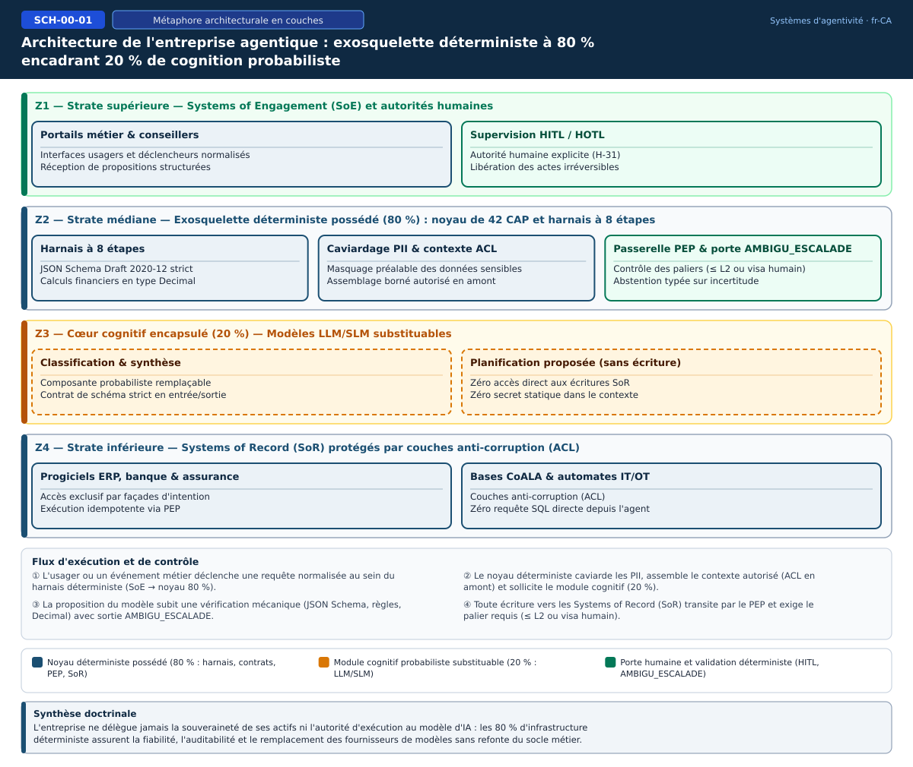
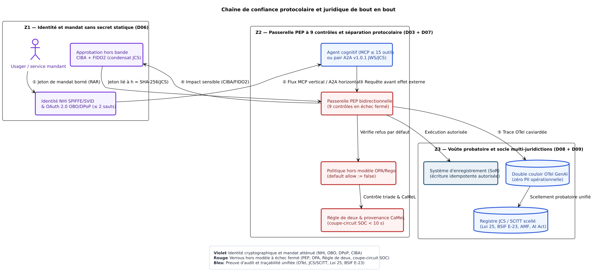
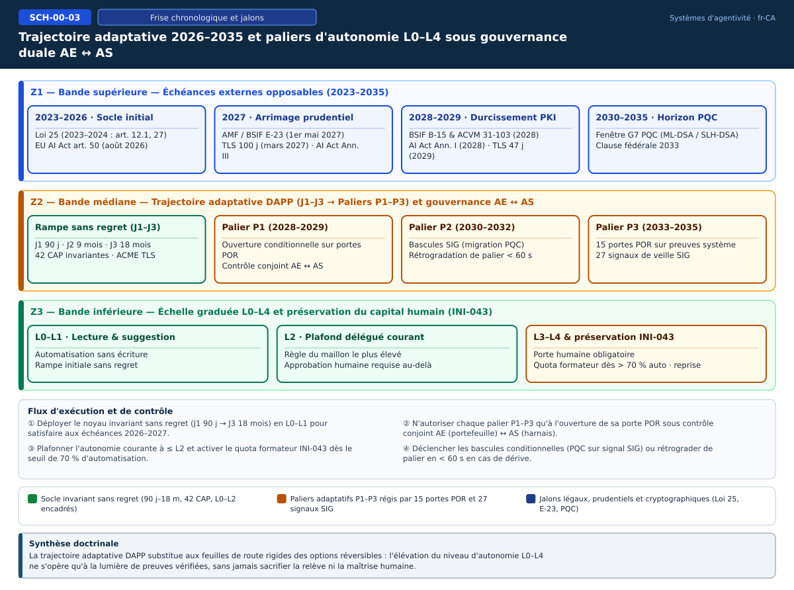
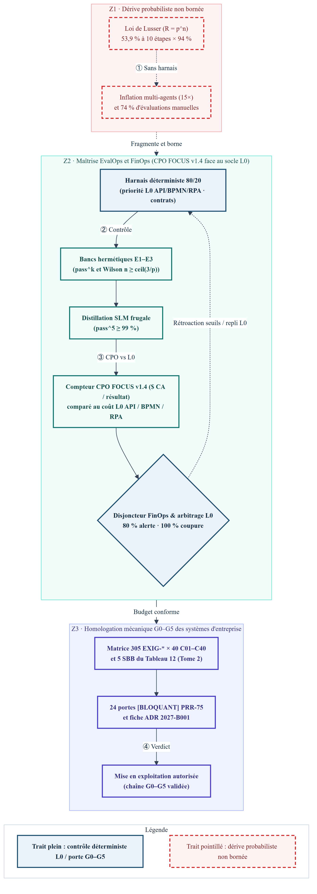

# Liminaire — Sommaire exécutif global, doctrine hybride 80/20, concordance inter-tomes et Panorama visuel directeur

*Question directrice :* Comment une institution soumise à une surveillance prudentielle et juridique exigeante transforme-t-elle des modèles probabilistes faillibles en Systèmes d'agentivité fiables, économiquement soutenables, réversibles et susceptibles d'homologation vérifiable au gel documentaire du 2 décembre 2026 ?

> **Clause non-avis et périmètre probatoire (`AO-05`, `DC-P01`, `DC-P12`)** — Le présent traité, ses schémas vectoriels et les modules logiciels de sa trousse compagnon forment un référentiel architectural et technique figé au **2 décembre 2026** pour une parution en **janvier 2027** [8, 12, 13, 14, 15]. Leur conformité aux barrières internes `G0`–`G5` ne constitue ni un avis juridique, ni une opinion actuarielle, ni une certification réglementaire ou d'audit sur un système d'exploitation réel au sens de la Loi 25 [14], de la ligne directrice E-23 du BSIF [13], des attentes de l'Autorité des marchés financiers (AMF) ou du Règlement européen sur l'intelligence artificielle (`EU AI Act`) [15]. Le texte et les `115` figures relèvent de la licence `CC BY 4.0`, tandis que l'outillage déterministe et la trousse exécutable du Tome 8 relèvent de la licence `MIT`.

Le présent ouvrage consolide en un traité unifié l'ensemble des travaux d'architecture, d'ingénierie logicielle, de sécurité hors modèle, de conformité réglementaire et de prospective stratégique consacrés à l'entreprise agentique. Il s'adresse simultanément aux dirigeants responsables de l'imputabilité institutionnelle, aux architectes d'entreprise (`AE`), aux architectes de solutions (`AS`), aux responsables de la sécurité de l'information (`RSSI`), aux équipes d'exploitation fiable (`SRE`) et aux conseillers juridiques. Pour éviter toute divergence d'interprétation dans les prescriptions normatives, l'ouvrage adopte la force illocutoire définie par le standard RFC 2119 : les verbes `DOIT`, `DOIVENT`, `NE DOIT PAS`, `NE DOIT JAMAIS` et `DEVRAIT` expriment respectivement une obligation stricte, une interdiction absolue ou une recommandation motivée [19].

Toute proposition factuelle, juridique ou chiffrée exposée dans ces pages s'appuie sur un corpus documentaire fermé de sources primaires ouvertes authentifiées par empreinte `SHA-256` et gelées au **2 décembre 2026**. En vertu de la règle de non-contournement (`AO-01`), aucune ressource bloquée par un code `HTTP 401`, `403`, `429` ou `451`, par un pare-feu applicatif ou par un mur payant n'est exploitée directement. Ces références demeurent consignées au statut F hors preuve, et les démonstrations reposent exclusivement sur des documents complets vérifiés, tels le PDF officiel de l'OWASP [8], les archives ouvertes de Statistique Canada [5, 6] ou la loi québécoise sanctionnée [14]. Les échéances postérieures au gel — notamment celles de 2027 à 2035 — sont systématiquement présentées comme des obligations futures à préparer [13, 15, 16].

## 0.1 Problématique industrielle : rupture probabiliste, coûts de Coase et jardins clos

Le passage des copilotes conversationnels aux **Systèmes d'agentivité** modifie profondément la nature du risque opérationnel. Un assistant conversationnel classique formule un texte consultatif que l'humain lit, filtre et transpose manuellement dans ses outils ; un **Système d'agentivité**, à l'inverse, s'insère dans une boucle fermée qui perçoit un état métier, appelle des outils externes, enchaîne des décisions intermédiaires et modifie des données d'entreprise. Les enquêtes canadiennes menées au deuxième et au troisième trimestre de 2026 par Statistique Canada (tableaux `33-10-1167-01` et `33-10-1207-01` : `19,2 %` de recours effectif au Canada et `40,4 %` en finance et assurances au T2, puis `25,2 %` et `35,5 %` prévus au T3) ainsi que l'analyse de la Banque du Canada (`Staff Analytical Paper 2026-22`) attestent d'une diffusion réelle de l'intelligence artificielle dans l'économie canadienne [5, 6, 7]. Toutefois, l'usage opérationnel marqué demeure limité à `8 %` des entreprises sondées contre `70 %` d'usage personnel hebdomadaire chez les répondants, freiné par le manque d'utilité opérationnelle perçue, l'incompatibilité avec les logiciels existants, la pénurie de compétences, les coûts et les obstacles réglementaires [7].

Ce décalage entre l'engouement discursif et l'exploitation maîtrisée s'éclaire à la lecture des données empiriques de terrain. L'étude *Measuring Agents in Production* (`MAP`), conduite auprès de praticiens exploitant des systèmes réels, révèle que `68 %` des déploiements recensés exécutent au plus `10` étapes avant toute intervention humaine et que `80 %` (`16` études de cas sur `20`) reposent sur un flux structuré fixe plutôt que sur une autonomie ouverte [1]. À l'échelle du portefeuille, le rapport `TMT Predictions 2026` de Deloitte met en garde contre un risque d'annulation dépassant `40 %` des initiatives agentiques d'ici 2027 en raison de dépenses imprévues, des défis de passage à l'échelle ou de risques inopinés — reprenant une estimation de Gartner dont le communiqué primaire demeure consigné en statut F [4]. La prudence des systèmes qui tiennent en production ne relève pas d'un retard technologique passager ; elle traduit une contrainte mathématique et organisationnelle incontournable.

Sur le plan mathématique, toute chaîne séquentielle d'étapes probabilistes dépourvue de vérification déterministe subit l'attrition décrite par le modèle des risques concurrents en série, formulé dans le domaine de la fiabilité sous le nom de loi de Lusser : la réussite composée décroît de façon multiplicative selon le nombre de maillons. L'analyse empirique de `1 642` traces d'exécution multi-agents dans la taxonomie `MAST` (à travers `7` cadriciels et `14` modes de défaillance) documente des taux d'échec s'étalant de `41 %` à `86,7 %` [2]. Pire encore, contrairement à un service logiciel déterministe qui lève une erreur explicite en cas d'anomalie, un agent probabiliste produit fréquemment une réponse syntaxiquement valide contenant une distorsion sémantique silencieuse, un vecteur identifié parmi les dix risques critiques du référentiel *OWASP Top 10 for Agentic Applications 2026* (`ASI01` à `ASI10`) [8].

Sur le plan économique et sécuritaire, deux écueils supplémentaires compromettent les architectures assemblées à la hâte. Premièrement, l'abaissement apparent des coûts de recherche et de coordination de Coase masque une accumulation de dettes structurelles lorsqu'une équipe empile des directives métier dans des invites textuelles et multiplie les connecteurs fragiles. Le recensement empirique d'Obada Kraishan portant sur `21 643` serveurs `MCP` et `72 606` enregistrements de versions met en évidence cette fragilité de la chaîne d'approvisionnement : parmi `8 900` serveurs multi-versions, `51,09 %` subissent des modifications entre versions, `40,58 %` présentent une dérive sémantique silencieuse sans alerte formelle et `4,16 %` (`370` serveurs) redirigent leur point d'accès distant vers un hôte différent [3]. Parmi les `6 699` serveurs multi-versions du corpus scanné, la dérive silencieuse s'associe de manière corrélationnelle — sans lien causal identifié — à une cote près de trois fois plus élevée de détection grave (`OR = 2,96`) [3]. Deuxièmement, le recours exclusif à des agents préintégrés dans des suites infonuagiques fermées expose l'entreprise à un verrouillage propriétaire sur le plan de contrôle, rendant opaques les journaux d'audit et coûteuse toute réversibilité réglementaire.

Ce double constat impose un renversement de perspective : la valeur d'une initiative agentique ne se mesure ni au volume de requêtes en démonstration, ni à l'autonomie théorique affichée par un modèle. Elle se juge à la capacité de l'organisation à prouver, sur des exécutions répétées, que chaque décision respecte les invariants métier, que chaque appel d'outil demeure traçable et révocable, et que la dépendance envers un fournisseur reste bornée dans le temps et les coûts. Les sections suivantes énoncent cette discipline architecturale.

## 0.2 Doctrine architecturale 80/20, échelle d'autonomie L0–L4 et concordance inter-tomes (`DIV-02`, `DISC-01` à `DISC-05`)

Pour surmonter la fragilité probabiliste et la captivité des jardins clos, le traité érige la **partition hybride 80/20** en règle fondatrice. Cette heuristique — motivée par `MAP` [1] et le bulletin BSIF [12] — place environ `80 %` de l'architecture dans un exosquelette déterministe possédé par l'institution (routage, machines à états, autorisations cryptographiques, idempotence, coupe-circuit) et confine l'inférence probabiliste aux `20 %` dédiés à la classification, à la synthèse et à la proposition d'actions. Chaque nœud opère sur l'échelle `L0–L4` (`N0–N4`) sous la **règle du maillon le plus élevé**, imposant à toute chaîne l'union la plus stricte des contrôles avec un plafond courant `≤ N2` sans validation renforcée. Toute invocation cognitive traverse un **harnais déterministe à huit étapes** appliquant `JSON Schema Draft 2020-12` (`additionalProperties: false`), le calcul monétaire `Decimal`, le caviardage préalable et l'abstention typée `AMBIGU_ESCALADE` : le modèle propose, le code vérifie ou rejette, et l'humain habilité libère tout acte irréversible (règle `H-31`).

Cette séparation s'appuie sur le **tissu conjonctif agentique** reliant quatre couches techniques et organisationnelles distinctes : les systèmes d'engagement (`SoE`) tournés vers les usagers, la strate des **Systèmes d'agentivité** (`System of Action`), les systèmes d'enregistrement patrimoniaux (`SoR`) protégés par des couches anti-corruption, et les plans transversaux de contrôle identitaire, probatoire et décisionnel. L'ensemble de l'outillage d'entreprise — qu'il s'agisse d'appels verticaux vers des outils via le protocole `MCP` révision `2026-07-28` [9, 10] ou d'échanges horizontaux pair-à-pair via `A2A v1.0.1` [11] — traverse un point d'application unique hors modèle. Tout outil dont la description ou le schéma varie sans signature vérifiée est rejeté avant l'appel au modèle [3, 9].

Ainsi conçue, **l'agentivité des systèmes** (*system agency*) n'émane jamais des seuls poids d'un modèle de langage, mais du couplage gouverné entre modèle probabiliste, contrôleur déterministe, mémoire persistante, outillage validé, identité non humaine et supervision humaine [1, 12]. Le modèle fournit la délibération bornée ; l'exosquelette logiciel établit, limite et vérifie la capacité effective d'action selon le principe de moindre agence (*Least-Agency*) [8].

Afin que les décisions d'investissement (`Acheter`, `Assembler` ou `Construire`) demeurent cohérentes d'un bout à l'autre du portefeuille, le comité d'architecture arbitre chaque projet selon cinq règles permanentes :

> **Cinq critères permanents d'arbitrage architectural (`C04`)** — Tout choix entre progiciel SaaS, assemblage sur standards ouverts et construction interne DOIT être évalué simultanément selon cinq axes permanents. Le premier vérifie la neutralité du plan de contrôle et l'absence de captivité propriétaire ; le deuxième exige le déterminisme des frontières, des schémas et des invariants métier ; le troisième contrôle la tolérance aux pannes, l'idempotence et la compensation bornée. Les deux derniers mesurent respectivement le coût complet par résultat conforme en unité d'affaires (`CPO`) ainsi que le coût et le délai vérifiables de sortie vers un autre fournisseur.

La consolidation de huit tomes rédigés successivement exige par ailleurs une réconciliation formelle des découpages et des échelles. Sur le plan structurel, l'écart `DIV-02` identifié dans le corpus est résorbé sans perte de traçabilité. Le modèle pivot à `5` couches (`C1` interaction, `C2` agents et orchestration, `C3` contexte et connaissance, `C4` accès et médiation, `C5` modèles et confinement) s'arrime exactement aux `6` vraies couches de `CRE-IA-2026-01 v1.2` (`305` exigences `EXIG-*`), complétées par `3` plans transversaux (`Plan A` identité et sécurité, `Plan B` observabilité et FinOps, `Plan C` gouvernance et registre).

Cette soudure corrige trois erreurs d'alignement antérieures. Premièrement, les modèles et leur bac à sable siègent en Couche 3 d'exécution cognitive et non en Couche 6. Deuxièmement, la connaissance et la sémantique se répartissent sur les Couches 2, 3 et 5. Troisièmement, les systèmes d'enregistrement siègent en Couche 6 sous encapsulation `ACL`. Le bilan capacitaire s'établit à `52` capacités cibles (`CAP`), dont `42` capacités invariantes formant le noyau possédé et `10` capacités conditionnelles, complétées par `24` extensions sectorielles (`PEX`) dont `11` comblent les cinq lacunes normatives (`CAP-025`, `CAP-028`, `CAP-033`, `CAP-046` et `CAP-052`).

De même, cinq discordances terminologiques et techniques (`DISC-01` à `DISC-05`) présentes entre les volumes historiques sont tranchées de façon canonique dans le *Tableau 0.1* et s'imposent à l'ensemble des trente-six chapitres qui suivent.

| Identifiant | Objet de la discordance | Décision canonique retenue pour le traité | Incidence exécutable |
|---|---|---|---|
| `DISC-01` | Échelle `L0–L4` : flux sans IA face à lecture assistée par IA | Distinction nette entre automatisation pure sans modèle et profil `L0–L1` en lecture filtrée ; `L0–L4` gradue les droits de mutation et d'effet externe | Empêche le déploiement d'un LLM là où un script déterministe suffit [1, 12] |
| `DISC-02` | Multiplicité d'échelles (`N0–N4`, `R1–R4`, paliers d'outils `P0–P3`, ainsi que `Classes 1–6`, `Stades 0–4` et `Paliers 1–3`) | Conservation de la table d'équivalence en gouvernance de portefeuille ; le noyau logiciel emploie `BLOQUANT`, `OBLIGATOIRE`, `RECOMMANDE` et `P0–P3` | Supprime toute collision de seuils dans les politiques `OPA/Rego` et les schémas |
| `DISC-03` | Découpages en `4` plans `SI`, `4` plans noyau, `6` couches + `3` plans ou `C1–C5` | Ancrage simultané dans les Plans `A`, `B`, `C` normatifs, les `5` couches `C1–C5` et les `4` paquets techniques de la trousse exécutable | Aligne la théorie architecturale sur les `5` emplacements logiciels `SBB` vérifiés |
| `DISC-04` | Notation d'architecture : `ArchiMate 3.2` face à `ArchiMate 4.0 C260` | Neutralité totale de notation : compatibilité des stéréotypes contrôleur, acteur cognitif et politique sans outil commercial obligatoire | Préserve l'ouverture `MIT` et la reproductibilité des diagrammes `PlantUML` et `SVG` |
| `DISC-05` | Révision `MCP 2025-11-25` face à `MCP 2026-07-28` et cycles `SEP` | Épinglage strict sur `MCP 2026-07-28` (`5f5440bb`) en mode `Streamable HTTP` sans état, rejet du flux `HTTP+SSE` et adaptateur `SEP-3398` | Fige l'implémentation sur les en-têtes `MCP-Protocol-Version`, `Mcp-Method` et `Mcp-Name` jusqu'à la cible du `30 mars 2027` [9, 10] |

*Tableau 0.1 — Résolution canonique des cinq discordances inter-tomes (`DISC-01` à `DISC-05`) et fermeture `DIV-02`.*

Le panorama architectural de cette doctrine 80/20, opposant la strate des usagers (`Z1`), l'exosquelette déterministe possédé (`Z2`), le cœur cognitif substituable (`Z3`) et les livres patrimoniaux protégés (`Z4`), est synthétisé à la *Figure 1*.

*Figure 1 — SCH-00-01 : Stratification hybride 80/20 séparant l'exosquelette déterministe possédé (`42` capacités invariantes et harnais à huit étapes) de l'inférence probabiliste encapsulée et des systèmes d'enregistrement.*

## 0.3 Architecture systémique des douze domaines, 616 interrelations et chaîne de confiance

Une erreur fréquente des initiatives pilotes consiste à traiter chaque préoccupation — protocoles d'outils, mémoire, sécurité des invites, identité, coûts ou conformité — comme un chantier isolé. La cartographie transversale démontre que l'entreprise agentique forme un graphe dense : ses `12` domaines orthogonaux (`D01` à `D12`), déclinés en `36` chapitres (`CH-01` à `CH-36`), `71` familles et `260` thèmes canoniques, sont unis par `616` interrelations typées. Ces liens regroupent `132` relations d'opérationnalisation, `93` dépendances techniques, `82` encadrements normatifs, `81` atténuations de risque, `63` amplifications de synergie, `62` tensions d'arbitrage, `52` projections temporelles et `51` concordances inter-tomes.

Dix carrefours relationnels structurent l'équilibre du graphe et dictent l'ordre de priorité des chantiers d'ingénierie. En tête figurent l'arrimage prudentiel autour de la ligne directrice `BSIF E-23` [13] (`30` degrés relationnels), l'épinglage sans état du protocole `MCP 2026-07-28` [9, 10] (`25` degrés), le pilotage économique `FinOps FOCUS v1.4` [17] (`24` degrés), la passerelle bidirectionnelle `PEP` à neuf contrôles ordonnés (`24` degrés) et la porte d'homologation unifiée croisant `305` exigences `CRE-IA` et `75` points `PRR` (`23` degrés). Viennent ensuite la délégation d'identité au deuxième saut (`21` degrés), la transition cryptographique post-quantique `ML-DSA` et `SLH-DSA` [16] (`21` degrés), la supervision humaine anti-complaisance (`20` degrés), la prévention du verrouillage SaaS (`20` degrés) et la défense contre les menaces `OWASP ASI01–ASI10` [8] (`19` degrés).

L'architecture globale qui en découle suit une progression logique en douze parties. La **Partie I (`D01`, chapitres 01–03)** établit les fondements épistémiques, la loi de Lusser et l'économie cognitive de Coase. La **Partie II (`D02`, chapitres 04–06)** traduit ce constat en partition `80/20`, harnais à huit étapes, échelle `L0–L4` et noyau possédé de `42` capacités. Les **Parties III et IV (`D03`–`D04`, chapitres 07–12)** bâtissent le **tissu conjonctif agentique** protocolaire (`MCP`, `A2A`, passerelle `PEP`), sémantique (ontologies, contrats de données), mémoriel (`CoALA` à quatre compartiments avec filtrage `ACL` préalable) et patrimonial (encapsulation anti-corruption sans écrire en base). La **Partie V (`D05`, chapitres 13–15)** impose la sobriété d'orchestration (`OO1`–`OO4`), le maillage événementiel borné et l'exécution durable par sagas compensables.

Les **Parties VI, VII et VIII (`D06`–`D08`, chapitres 16–24)** verrouillent respectivement les identités non humaines (`NHI`), la délégation atténuée et l'agilité cryptographique post-quantique ; les politiques hors modèle `OPA/Rego` en mode fermé (`default allow := false`), la Règle de deux et le confinement matériel éphémère ; puis l'observabilité probatoire à double couloir, les bancs `EvalOps` hermétiques et la comptabilité `FinOps` au coût par résultat conforme. Enfin, les **Parties IX à XII (`D09`–`D12`, chapitres 25–36)** ancrent l'ensemble dans le droit québécois, canadien et européen, le déploient dans cinq profils financiers réglementés et trois blueprints (`C01`–`C40`), décrivent la trajectoire adaptative `2026–2035` et livrent la trousse exécutable d'homologation vérifiable `G0`–`G5`, complétée par cinq annexes déterministes (`Annexes A` à `E`).

Sur le plan opérationnel, aucune action agentique mutative n'atteint un système métier sans franchir une chaîne de confiance continue, illustrée par la *Figure 2*. Celle-ci couple l'identité cryptographique éphémère et la délégation bornée (`D06`), l'inspection verticale `MCP` [9, 10] et horizontale `A2A v1.0.1` [11] au sein d'une passerelle `PEP` appliquant le refus par défaut hors modèle (`D03` + `D07`), l'approbation humaine hors bande pour les actes critiques, et la consignation immuable exigée par les régulateurs (`D08` + `D09`) [12, 13, 14, 15].

*Figure 2 — SCH-00-02 : Parcours séquentiel de bout en bout reliant identité `NHI` / délégation `OBO`, passerelle `PEP` à neuf contrôles sous `OPA` fermé par défaut, approbation hors bande et double couloir probatoire.*

## 0.4 Gouvernance duale `AE ↔ AS`, rôles cibles et tableau directeur `KPI` / `SLO`

L'architecture technique s'incarne dans un contrat doctrinal permanent entre l'**Architecte d'entreprise (`AE`)** et l'**Architecte de solutions (`AS`)**, structuré autour de **dix thèses (`T1–T10`)** et de **six décisions conjointes `AE ↔ AS`**. L'`AE` gouverne le portefeuille, l'arbitrage `Acheter` / `Assembler` / `Construire`, le noyau de `42` capacités invariantes, la conformité et les portes d'homologation ; l'`AS` conçoit les harnais `80/20`, les contrats `MCP 2026-07-28` [9, 10] et `A2A v1.0.1` [11], les règles `OPA/Rego`, les sagas durables et les bancs `EvalOps`.

Ce binôme s'inscrit dans une matrice `RACI` en étoile à trois lignes attribuant un unique responsable imputable parmi six rôles cibles (`AE`, `AS`, `RSSI`, `SRE`, `Juridique`, `Direction`). En usine logicielle, une muraille de séparation des devoirs interdit à tout agent bâtisseur de modifier les spécifications ou tests vérificateurs (`PRR F-11`). Les critères quantitatifs de mise en service s'articulent autour des huit `KPI` / `SLO` du *Tableau 0.2*, synthétisés en boucle `FinOps`/`EvalOps`/`G0`–`G5` à la *Figure 4*.

| Indicateur ou `SLO` directeur | Cible ou seuil normatif vérifiable | Ancrage doctrinal et normatif |
|---|---|---|
| Constance `pass^k` et borne de Wilson | Constance `pass^k` avec \(k \ge 5\) sur les invariants critiques (`pass^5` `≥ 99 %` avant distillation `SLM`) ; borne unilatérale de Wilson à `95 %` imposant \(n \ge \lceil 3/p \rceil\) essais indépendants sans échec (`n = 300` → `0,8938 % < 1 %`) | `EXIG-EVA-02`, `EXIG-EVA-03`, `PRR O-05`, `PRR F-15`, `G0-EX-CH04-01` |
| Pilotage `CPO` sous `FOCUS v1.4` | Normalisation (`BilledCost`, `EffectiveCost` sous `FOCUS v1.4` [17]) et suivi interne en `$ CA` par résultat conforme ; alerte `FinOps` à `80 %` et coupure atomique à `100 %` (`maxTotalCostCad`) | `EXIG-FIN-01..10`, `PRR O-09`, `PRR O-12`, `PRR O-13`, `C39–C40` |
| Politiques hors modèle et Règle de deux | Évaluation `default allow := false` sur `100 %` des appels mutatifs (`45/45` cas `OPA` à `100,0 %` de couverture) ; retrait déterministe de la triade par session et séparation `CaMeL` | `EXIG-SEC-06`, `EXIG-SEC-07`, `PRR S-08`, `PRR S-09` |
| Portes bloquantes `PRR-75` | Validation des `24` contrôles `[BLOQUANT]` sur `75` (`S:8`, `R:5`, `O:2`, `G:7`, `F:2`), des `305` exigences `EXIG-*` et des `40` critères `C01–C40` avant mise en service | `EXIG-GOV-17`, matrice `CRE-IA × PRR-75` |
| Réactivité du coupe-circuit et repli | Révocation centralisée `SOC` en `< 10 s` ; rétrogradation de palier `DAPP` en `< 60 s` ; retour arrière automatisé `N-1` en `< 2 min` | `PRR S-14`, `POR-015`, `PRR O-08` |
| Cycle de vie `PKI` (`100 j → 47 j`) | Automatisation `ACME` intégrale pour la limite à `100 jours` (`15 mars 2027`) puis à `47 jours` avec réutilisation de validation à `10 jours` (`15 mars 2029`) | `CA/B Forum v2.3.1`, `CAP-040` |
| Transition post-quantique (`PQC` et `HTTP 431`) | Préparation `FIPS 203/204/205` (`ML-DSA-65` à `3 309` octets, `ML-DSA-87` à `4 627` octets [16]) conforme à `NIST IR 8547` (`G7 2030–2035`) ; prévention `HTTP 431` par `kid` et jetons `O(1)` | `POR-007`, `EXIG-SEC-27`, `C27` |
| Vivier humain et reprise manuelle | Quota de dossiers formateurs dès `> 70 %` d'automatisation (`INI-043`) et exercices annuels attestés de reprise sans agent ; parade contre le biais `ASI09` [8] | `INI-043`, `POR-009`, `POR-014`, `PRR G-11`, `PRR G-12` |

*Tableau 0.2 — Tableau directeur des huit indicateurs et objectifs de niveau de service (`KPI` / `SLO`).*

## 0.5 Cadre réglementaire 2023–2035, chaîne probatoire `G0`–`G5`, clause `non-avis` et gel documentaire

L'architecture répond à un calendrier réglementaire, prudentiel et cryptographique vérifié au **2 décembre 2026** [13, 14, 15, 16]. Au Québec, la Loi 25 (`LQ 2021, c. 25`) encadre depuis le **22 septembre 2023** les décisions fondées exclusivement sur un traitement automatisé (art. `12.1` : avis contemporain, principaux facteurs sur demande, observations et révision humaine) [14]. Pour une organisation, les manquements exposent à des sanctions administratives pécuniaires atteignant `10 M$ CA` ou `2 %` du chiffre d'affaires mondial (le plus élevé) et à des peines pénales de `15 000 $ CA` à `25 M$ CA` ou `4 %` [14]. Elle impose aussi l'évaluation des facteurs relatifs à la vie privée (`ÉFVP`, art. `17`) avant transfert hors Québec et la portabilité depuis le **22 septembre 2024** (art. `27`) [14].

À l'échelle fédérale, la ligne directrice révisée `E-23` du `BSIF` (`11 septembre 2025`) entrera en vigueur le **1er mai 2027** [13], en convergence avec le bulletin technologique du `13 juillet 2026` sur les garde-fous hors modèle [12]. Au Québec, l'encadrement de l'AMF s'arrime au repère attendu du `1er mai 2027` sous réserve documentaire explicite (corroboration secondaire `AIBanks.ca`, le portail direct de l'AMF demeurant en statut F).

En Europe et à l'international, le Règlement `(UE) 2024/1689` (`EU AI Act`) s'applique par effet extraterritorial [15] : transparence de l'article `50` depuis le **2 août 2026** [15], exigences du chapitre III sur l'Annexe III (contrôle humain art. `14`, système de gestion de la qualité art. `17` [15]) visant au plus tard le **2 décembre 2027** selon le modificatif `(UE) 2026/1744`, puis Annexe I au **2 août 2028**. S'y adjoignent les repères normatifs et sectoriels `EN 18286:2026`, `DORA`, le `Cyber Resilience Act`, `ISO/IEC 42001` (hors texte payant) et le `NIST AI RMF`.

D'autres jalons cadencent `2027–2035` : `ACVM 31-103` (`1er octobre 2028`), divulgation climatique `BSIF B-15` (portée 3, fin `2028`), temporisation des lois financières fédérales (`30 juin 2033`), échéances `PKI` (`100` j au `15 mars 2027`, `47` j au `15 mars 2029`), retrait `MCP SEP-2596` (`28 juillet 2027`) après `SEP-3398` (`30 mars 2027`), et feuille de route post-quantique `G7` (`2030–2035`, `FIPS 204` [16]).

Pour gouverner cet horizon sans paris prématurés, le Compendium applique les trajectoires adaptatives `DAPP` de Haasnoot, Warren et Kwakkel [18] : rampe sans regret en trois jalons (`J1` `90 jours`, `J2` `9 mois`, `J3` `18 mois`), suivie de trois paliers conditionnels (`P1` `2028–2029`, `P2` `2030–2032`, `P3` `2033–2035`) gouvernés par `15` portes sur preuves (`POR`) et `27` signaux externes (`SIG`), comme l'illustre la *Figure 3*.

*Figure 3 — SCH-00-03 : Superposition des jalons réglementaires et cryptographiques `2023–2035`, de la rampe sans regret (`J1`–`J3`), des paliers adaptatifs `P1`–`P3` et du plafonnement d'autonomie `L0–L4` incluant la mesure `INI-043`.*

Enfin, le traité applique à sa propre production une chaîne d'assurance qualité à six barrières (`G0` à `G5`). La barrière `G0` vérifie la trousse compagnon (`83/83` tests `pytest`, `45/45` règles `OPA` à `100,0 %` de couverture, `21/21` validations sur `13` schémas `JSON Schema 2020-12`, `4/4` suites de vecteurs tiers). Suivent la barrière déterministe `G1`, l'audit atomique Wyvern `G2`, la double recollation stratifiée à l'aveugle `G3`, la boucle critique `G4` et l'inspection visuelle `G5`. La *Figure 4* clôt ce panorama en reliant les `KPI` du *Tableau 0.2* (`pass^k`, Wilson, `CPO` `FOCUS v1.4`) à l'homologation `G0`–`G5`.

*Figure 4 — SCH-00-04 : Boucle reliant la loi de Lusser et l'inflation multi-agents (`15×`) au contrôle statistique `pass^k` / Wilson, au disjoncteur budgétaire `CPO` (`80 %` / `100 %`) et aux `24` portes bloquantes d'homologation `G0`–`G5`.*

Cette armature méthodologique et probatoire posée, la **Partie I (`D01`)** engage la démonstration dès le Chapitre 01 en qualifiant la rupture en boucle fermée des Systèmes d'agentivité, puis en formalisant la loi de Lusser (`Chapitre 02`) et l'économie cognitive de Coase (`Chapitre 03`) (→ Partie I, Chapitre 01).
