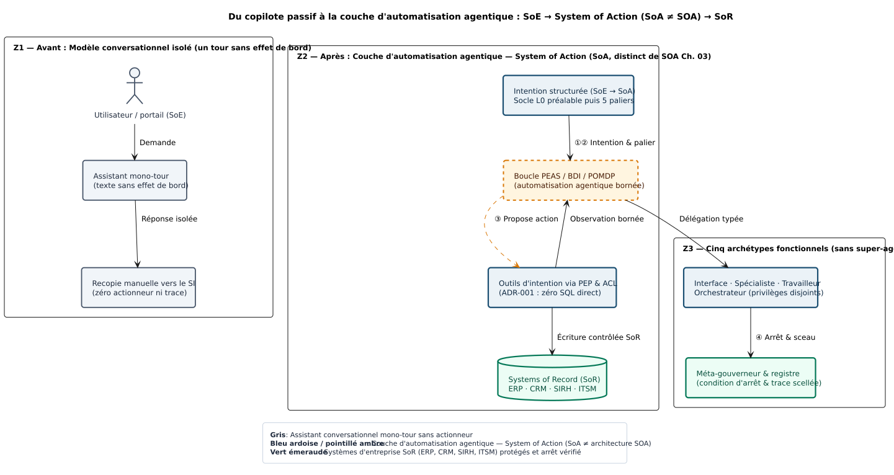
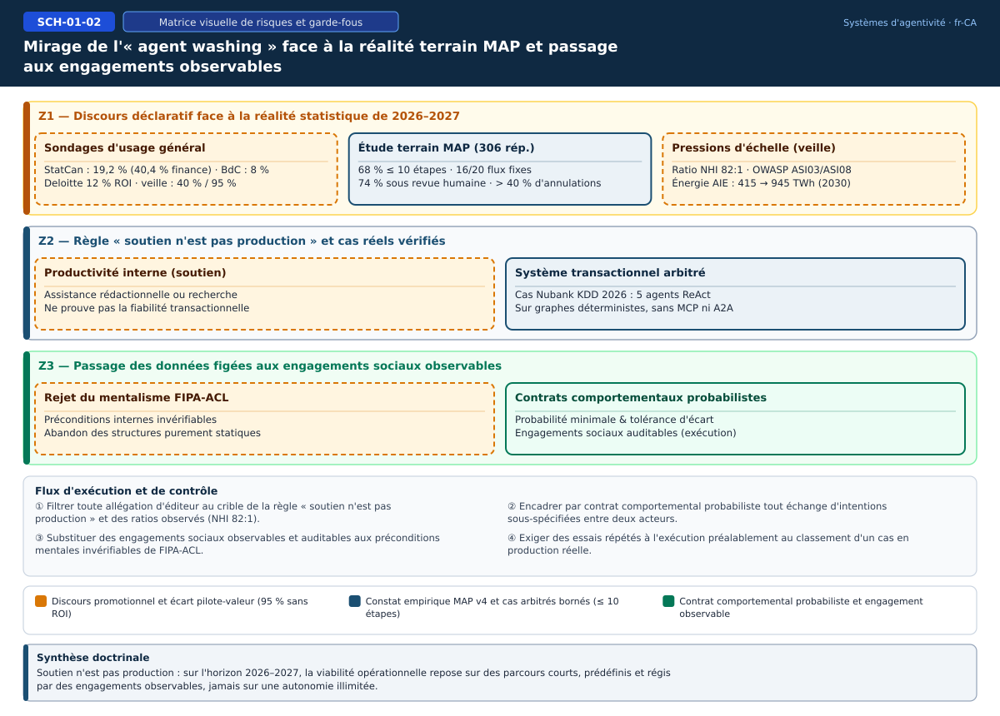
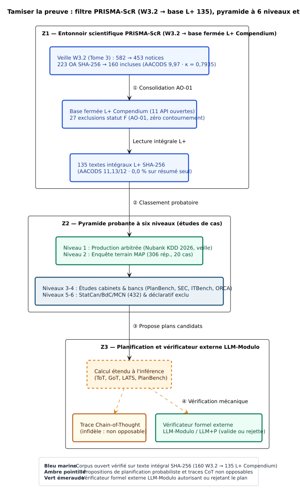

# Chapitre 01 — Rupture épistémique, Systèmes d'agentivité et fondements des acteurs autonomes

*Question directrice :* Quelle rupture épistémique sépare un assistant conversationnel sans effet de bord d'un Système d'agentivité opérant en boucle fermée sur les systèmes d'entreprise, et sur quelle hiérarchie probante convient-il de fonder sa mise en production ?

La transition des interfaces conversationnelles vers des systèmes aptes à percevoir un environnement métier, à sélectionner des outils et à modifier des états applicatifs marque une transformation profonde du génie logiciel en entreprise. Longtemps cantonnée au soutien rédactionnel ou à la recherche documentaire, l'intelligence artificielle générative pénètre désormais la couche d'exécution opérationnelle sous l'impulsion d'une **industrialisation cognitive** rapide. L'étude de Genewein et coll. estime que le stock de calcul effectif disponible croît d'un ordre de grandeur par an — environ `10×` par année, issu de `1,5×` en efficacité matérielle par dollar, `2,5×` en dépenses d'investissement matériel et `3×` en progrès algorithmiques, soit `11,25×` arrondi à `10×` [4]. Cette accélération capacitaire ne se convertit toutefois ni spontanément ni sans risque en fiabilité organisationnelle.

Le présent chapitre pose les fondements conceptuels et probatoires de la Partie I (`D01`). Il précise la démarcation entre modèle conversationnel et **Système d'agentivité** en boucle fermée, classe les réalisations en cinq paliers et cinq archétypes fonctionnels, confronte les promesses commerciales aux enquêtes de terrain et remplace le mentalisme des protocoles classiques par des contrats comportementaux observables. Il établit enfin les limites des planificateurs autorégressifs face à la vérification externe et fonde le traité sur une hiérarchie probante à six niveaux arrimée à `PRISMA-ScR`.

## 1.1 Paradigme des Systèmes d'agentivité : rupture en boucle fermée, constats `MAP 2027` et contrats comportementaux

### 1.1.1 Du modèle conversationnel à la boucle fermée (`PEAS`, `BDI`, `POMDP`) et strate `System of Action`

Un assistant conversationnel classique fonctionne selon un schéma requête-réponse à tour unique : le modèle linguistique reçoit un texte en entrée, génère une séquence de jetons en sortie et rend aussitôt la main à l'opérateur humain, sans état persistant ni actionneur externe. Dès qu'un composant logiciel conserve la maîtrise de la boucle d'itération — en invoquant des outils, en observant les résultats retournés par l'environnement et en ajustant son plan jusqu'à une condition d'arrêt explicite — il franchit une frontière épistémique majeure [2]. Même lorsque l'appel unitaire au modèle demeure probabiliste, l'enchaînement perception-décision-action-observation produit des effets de bord réels, parfois irréversibles, sur les processus de l'organisation.

Pour qualifier rigoureusement cette boucle, la spécification du présent traité mobilise trois formalismes de l'intelligence artificielle et de la théorie de la décision. Le cadre `PEAS` (*Performance*, *Environment*, *Actuators*, *Sensors*) contraint l'architecte à nommer explicitement la mesure de performance, les propriétés d'environnement (partiellement observable, stochastique, dynamique ou multi-acteurs), la liste fermée des actionneurs autorisés et la nature exacte des capteurs. Sur le plan délibératif, le modèle `BDI` (*Beliefs-Desires-Intentions*) distingue les croyances actualisées à chaque observation des intentions engagées [2] ; l'architecture en tire un garde-fou déterministe anti-replanification qui verrouille l'intention engagée lorsque le coût d'un changement de plan excède le gain marginal attendu et interdit toute replanification avant résolution d'une étape à l'issue incertaine (`EXIG-ORC-16`). Enfin, lorsque l'état métier sous-jacent n'est perçu qu'à travers des journaux incomplets ou des réponses partielles, la dynamique est modélisée comme un processus décisionnel markovien partiellement observable (`POMDP`), résolu sous budget borné de calcul, d'étapes et de jetons.

Cette formalisation explique pourquoi la mise en œuvre d'un **Système d'agentivité** exige une discipline d'ingénierie spécifique. Contrairement à une fonction déterministe dont la précondition et la postcondition demeurent invariantes, une boucle pilotée par modèle réinterprète son environnement à chaque itération. Sans critère d'arrêt externe, l'acteur risque d'osciller ou de déclencher des écritures redondantes. Conformément aux plafonds `EXIG-ORC-26` et à la résilience `EXIG-ORC-27`, ce garde-fou couple des bornes strictes de terminaison (tours maximaux — en pratique `≤ 10` étapes dans la majorité des systèmes en production [1] —, appels d'outils, budget de jetons, coût et durée totale), un délai de garde (expiration par dépendance et fenêtre bornée de réessais sur erreurs transitoires) et un repli borné vers un mode dégradé testé ou une file humaine nommée. En production, les équipes limitent délibérément les étapes et la profondeur d'exploration en raison de la complexité, du non-déterminisme de planification, de la latence et des contraintes de vérification [1, 2].

Sur le plan de l'urbanisation du système d'information, cette boucle s'incarne dans la strate des **Systèmes d'agentivité** [1, 2], désignés *System of Action* (`SoA`). Selon `ADR-001`, la strate `SoA` s'interpose entre les *Systems of Engagement* (`SoE` — portails conseillers, canaux clients, messageries) et les *Systems of Record* (`SoR` — progiciels bancaires, systèmes d'assurance, bases comptables), avec interdiction absolue d'écriture SQL directe sur ces derniers. Elle s'astreint à sept critères vérifiables : `action` (lectures et mutations admissibles), `limites` (bornes budgétaires, temporelles et d'impact), `identité` (identité non humaine vérifiable), `imputabilité` (propriétaire humain responsable), `inventaire` (inscription au registre central), `composition` (délégation entre acteurs) et `mesure` (télémétrie continue).

L'isolement de cette strate `System of Action` répond à une exigence d'architecture durable : remplacer progressivement la prolifération fragile de `N×M` connecteurs point-à-point entre canaux et progiciels par `N+M` contrats normalisés derrière un point d'application unique et un catalogue gouverné. Ainsi, une modification dans un système central ou le remplacement d'un modèle linguistique n'entraîne plus la réécriture en cascade des interfaces d'engagement. Les mécanismes protocolaires qui concrétisent cette réduction combinatoire sont développés en détail au Chapitre 09, tandis que la gouvernance sémantique des échanges est traitée au Chapitre 10.

### 1.1.2 Taxonomie des systèmes d'IA composés et cinq archétypes sans super-agent

La confusion sémantique autour du terme « agent » alimente des choix d'architecture inadaptés. Sapkota et coll. soulignent la nécessité conceptuelle de distinguer les agents d'IA unitaires orientés tâches des **Systèmes d'agentivité** multi-acteurs coordonnant des rôles spécialisés en contexte partagé [2]. Pour lever toute ambiguïté de conception, le présent référentiel adopte une taxonomie ordonnée à cinq paliers fondée sur un unique critère discriminateur : l'entité qui décide du prochain pas d'exécution.

Au premier palier, le **modèle augmenté** se limite à un appel unique enrichi par recherche documentaire, mémoire courte ou formatage structuré, le code applicatif conservant l'entier contrôle de l'enchaînement. Au deuxième palier, le **flux de travail agentique** (*agentic workflow*) enchaîne plusieurs appels cognitifs selon un graphe codé de façon déterministe par l'ingénieur, où le modèle exécute des tâches bornées sans modifier la topologie du graphe. Au troisième palier, l'**agent unique** conserve la décision dynamique de l'étape suivante au sein d'une boucle bornée et outillée. Au quatrième palier, le **système multi-agents** coordonne plusieurs boucles spécialisées dotées de mandats et d'espaces de travail distincts. Le cinquième palier englobe tout **système d'IA composé** intégrant modèles, outils, mémoires, vérificateurs déterministes et garde-fous hors modèle à travers les niveaux d'autonomie graduée `L0–L3`.

Sur le plan conceptuel, le référentiel distingue la strate architecturale `SoA` de **l'agentivité des systèmes** (*system agency*), propriété émergente et composite de l'assemblage sociotechnique complet. Comme le rappellent Genewein et coll. en opposant un oracle purement cognitif à un agent agissant sur son milieu [4], la capacité d'inférence ne confère aucune puissance opérationnelle sans boucle outillée, mémoire gouvernée et validation hors modèle [2]. L'organisation calibre ainsi cette puissance systémique selon le principe de moindre agence [9].

En cohérence avec le principe de moindre privilège et avec la défense contre les risques recensés par l'OWASP (`ASI01` à `ASI10`) [9], le traité proscrit formellement le « super-agent universel » cumulant interaction client, logique métier, exécution outillée et contrôle de conformité. Un acteur monolithique doté de tous les droits d'accès transforme la moindre dérive d'invite ou d'outil en compromission transversale. Toute architecture logicielle DOIT scinder les responsabilités entre cinq archétypes fonctionnels à privilèges disjoints, résumés au *Tableau 1.1*.

| Archétype fonctionnel | Mandat principal dans la boucle `SoA` | Privilèges et restrictions obligatoires |
|---|---|---|
| Agent d'interface | Traduction d'intentions usagers depuis `SoE`, formatage structuré | Aucun accès direct aux données sensibles ni aux actionneurs de mutation `SoR` |
| Spécialiste de domaine | Analyse sémantique, qualification réglementaire ou financière bornée | Lecture contextuelle filtrée en amont ; propose sans exécuter directement |
| Travailleur de tâche | Exécution atomique d'une sous-tâche outillée sous contrat strict | Périmètre d'outils minimal ; aucune délégation latérale non autorisée |
| Orchestrateur | Enchaînement d'étapes, gestion de reprise et routage inter-acteurs | Contraint par machine à états déterministe ; aucun droit d'altérer les politiques |
| Méta-gouverneur | Vérification de conformité, seuils d'escalade et audit de trace | Lecture seule sur les journaux et politiques ; pouvoir de suspension immédiate |

*Tableau 1.1 — Répartition des cinq archétypes fonctionnels de la strate `System of Action`.*

Cette séparation en cinq archétypes facilite également le ciblage économique et sécuritaire des modèles : un agent d'interface ou un travailleur de tâche répétitive s'accommode souvent d'un modèle léger à faible latence, tandis qu'un spécialiste de domaine mobilise une capacité sémantique plus riche sous le contrôle indépendant du méta-gouverneur. La *Figure 5* illustre le passage du copilote passif à la boucle `System of Action` ainsi que l'articulation entre les cinq paliers de trajectoire et les cinq archétypes spécialisés.

*Figure 5 — SCH-01-01 : Comparaison entre l'assistant mono-tour sans actionneur (`Z1`), la boucle fermée `PEAS` / `POMDP` isolée des livres comptables (`Z2`) et la séparation en cinq archétypes à privilèges disjoints (`Z3`).*

### 1.1.3 Écart pilote-production, étude `MAP 2027` et règle « soutien n'est pas production »

La littérature de 2025 et 2026 révèle une fracture persistante entre l'usage exploratoire et la maturité réelle en production. Au Canada, les séries ouvertes de Statistique Canada pour le deuxième trimestre de 2026 (`33-10-1167-01`) mesurent un recours effectif à l'IA sur douze mois de `19,2 %` pour l'ensemble des industries, contre `40,4 %` dans la finance et les assurances [6]. Au troisième trimestre (`33-10-1207-01`), les prévisions d'utilisation pour les douze mois suivants s'établissent à `25,2 %` globalement et à `35,5 %` en finance et assurances [7].

Le document analytique `2026-22` de la Banque du Canada (`2 juin 2026`, `314` entreprises) confirme cette asymétrie tout en montrant un déploiement opérationnel restreint [8]. Si `70 %` des dirigeants répondants utilisent personnellement l'IA chaque semaine, seuls `8 %` des établissements déclarent un usage opérationnel important (`21 %` modéré et `29 %` expérimental ou très occasionnel) [8]. Les usages déclarés se concentrent sur le texte, la création visuelle et le traitement de données, freinés par le manque de pertinence opérationnelle perçue, la pénurie de personnel qualifié, l'incompatibilité technique, les difficultés de données et les obstacles réglementaires [8].

Sur les déploiements agentiques en exploitation, les chiffres de terrain restent tout aussi sobres. L'étude *Measuring Agents in Production* (`MAP`, Pan et coll., `2 décembre 2025`) recueille `306` réponses valides dans `26` domaines — dont `86` points de données explicitement en phase pilote ou de production — et conduit `20` études de cas approfondies [1]. Ses constats empiriques montrent que `68 %` des systèmes déployés se limitent à au plus `10` étapes avant reprise humaine et que `80 %` des cas étudiés (`16` cas sur `20`) reposent sur un flux structuré fixe plutôt que sur une planification libre [1]. De plus, `70 %` utilisent des modèles sur étagère pilotés par invites sans réentraînement supervisé des poids, tandis que `74 %` dépendent d'une évaluation humaine directe pour contrôler la qualité des sorties (complétée dans `51,6 %` des cas par un modèle-juge) [1].

Ces ordres de grandeur éclairent l'alerte reprise par le rapport `TMT Predictions 2026` de Deloitte (`18 novembre 2025`). Ce document rapporte que plus de `40 %` des projets d'intelligence artificielle agentique risquent d'être annulés à l'horizon `2027` sous l'effet de coûts sous-estimés, d'une mise à l'échelle complexe ou de risques mal maîtrisés — reprenant une estimation de Gartner dont le communiqué primaire demeure inaccessible et consigné en statut F [5].

Les enquêtes et référentiels vérifiés mettent également en lumière trois pressions structurelles aiguës. Premièrement, l'enquête *Tech Value Survey* de Deloitte auprès de près de `550` dirigeants américains montre que seuls `28 %` jugent leurs capacités matures lorsque des agents s'ajoutent à l'automatisation de base (contre `80 %` pour l'automatisation seule), et que `12 %` seulement en attendent le rendement souhaité sous trois ans (contre `45 %`) [5]. Deuxièmement, la veille sectorielle du corpus (hors base `L+` fermée de ce chapitre) corrobore cet écart pilote-valeur : `40 %` d'adoption déclarée dans les grandes organisations (`McKinsey`) face à `95 %` d'initiatives sans rendement chiffré (`MIT NANDA`). Elle signale aussi deux contraintes d'échelle critiques : un ratio de `82:1` entre identités non humaines et employés humains (`CyberArk`) ainsi qu'une demande électrique des centres de données passant de `415` à `945 TWh` d'ici `2030` (`AIE`). Troisièmement, le référentiel OWASP (`ASI01` à `ASI10`) souligne que le non-respect du principe *Least-Agency* et l'absence d'identités non humaines distinctes creusent un déficit d'attribution (`ASI03`) et favorisent la propagation en cascade des pannes (`ASI08`) [9].

À la lumière de ces faits, le présent traité institue une règle d'hygiène décisionnelle impérative : **soutien n'est pas production**. Un outil d'aide interne utilisé par un analyste humain pour résumer un dossier ne prouve en rien la viabilité d'un système autonome modifiant un système d'enregistrement sans supervision. Les études de cas recensées par `MAP` confirment cette prudence : `85 %` des équipes en production (`17` cas sur `20`) conçoivent des implémentations internes sur mesure par appels directs (à l'image de boucles `ReAct` dédiées) plutôt que de dépendre de cadriciels tiers rigides [1].

Le cas arbitré `Nubank` (`KDD 2026`, repère de niveau 1 de la veille du corpus hors base `L+` directe de ce chapitre) illustre la même sobriété : cinq agents `ReAct` opérant sur des graphes déterministes sans `MCP` ni `A2A`, qui ont néanmoins exigé une réingénierie des invites lors du passage de `GPT-4.1` à `GPT-5`. De même, `MAP` confirme que le changement de modèle peut briser des flux couplés, contraignant certaines équipes à maintenir des modèles hérités en parallèle [1]. Les budgets doivent donc cibler des boucles courtes de dix étapes au plus, adossées à des flux structurés fixes et soumises à des points d'arrêt humains vérifiables [1, 5].

### 1.1.4 De l'échange de données aux contrats comportementaux probabilistes et engagements observables

Dans l'architecture orientée services classique, un contrat syntaxique (`OpenAPI`, schéma JSON statique) suffit entre modules déterministes dont le comportement interne reste prévisible. À l'inverse, lorsque deux acteurs pilotés par modèles linguistiques échangent des intentions sous-spécifiées, le respect syntaxique ne garantit ni la cohérence sémantique de l'interprétation ni la reproductibilité de l'action (approfondies au Chapitre 10).

Pour combler ce vide, le présent référentiel impose des **contrats comportementaux probabilistes** (`EXIG-D01-01.3`, dans la lignée conceptuelle de `Bhardwaj, 2026` synthétisée au Tome 1). Plutôt que d'exiger d'un composant probabiliste un déterminisme qu'il ne possède pas, chaque contrat borne la distribution de ses sorties admissibles selon quatre clauses vérifiables (instrumentées au Chapitre 23). Il fixe d'abord une probabilité minimale de réussite mesurée sur banc isolé en essais répétés (`pass^k`, `k ≥ 3` minimal et `k ≥ 5` en flux critique, détaillée au Chapitre 02) et une tolérance explicite d'écart sémantique. Il exige ensuite des assertions déterministes vérifiant les invariants métier sur l'état final, ainsi qu'un protocole borné d'essais répétés déclenchant le repli ou l'escalade humaine dès franchissement du seuil d'incertitude ou épuisement des tentatives.

Parallèlement, l'architecture récuse l'héritage mentaliste des protocoles multi-agents classiques tels que `FIPA-ACL` (`SC00061G`, `SC00037J`) et `KQML`, qui prétendaient coordonner des agents en inférant leurs croyances ou intentions internes cachées. Entre acteurs probabilistes opaques, seules des traces externes sont auditables : dans la tradition des **engagements sociaux observables** (`Singh, 1998` ; `Yolum & Singh, 2002`, repères fondateurs du Tome 1), l'échange DOIT reposer sur des obligations conditionnelles datées, signées et vérifiables depuis l'extérieur sans jamais présumer de l'état mental d'un modèle. Dans un flux financier ou assurantiel, l'engagement prend la forme d'un état transactionnel vérifiable (promesse émise, pièce reçue, condition satisfaite ou défaut constaté) plutôt que d'une déclaration d'intention linguistique.

Cette transition vers l'observabilité externe transforme la gouvernance des défaillances en exploitation. Lorsqu'un engagement social n'est pas tenu dans le délai imparti, la couche d'orchestration constate objectivement le manquement contractuel à partir des journaux de messages et déclenche la compensation ou l'escalade prévue, sans devoir interpréter les pondérations internes ni les motifs textuels du modèle défaillant. Chaque acteur conserve ainsi une frontière claire d'imputabilité vis-à-vis des équipes d'exploitation et des autorités de contrôle.

La *Figure 6* résume ce double déplacement : dissiper le mirage de l'« *agent washing* » par les données terrain `MAP` et ancrer les échanges sur des engagements observables mesurables.

*Figure 6 — SCH-01-02 : Confrontation entre le discours promotionnel et les constats empiriques `MAP` / Statistique Canada / Deloitte (`Z1`), application de la règle « soutien n'est pas production » (`Z2`) et transition vers les contrats comportementaux et engagements observables (`Z3`).*

> **Trois invariants exécutables — Chapitre 1**
> 1. **Isolement strict `System of Action`** — Tout acteur agentique s'exécute dans la strate `SoA` (`ADR-001`) derrière des interfaces typées, sans jamais émettre de requête SQL directe vers les `Systems of Record` (`SoR`).
> 2. **Répudiation du super-agent et vérificateur externe** — Aucun acteur ne cumule domaine, outillage et gouvernance ; aucun plan issu du calcul à l'inférence n'est appliqué sans validation par un vérificateur déterministe externe (`LLM-Modulo`).
> 3. **Démystification probante et texte intégral** — Toute allégation de valeur distingue l'assistance interne de la production autonome, se classe sur la hiérarchie probante à six niveaux et exclut toute source non vérifiée sur texte intégral.

## 1.2 Généalogie, limites des planificateurs `LLM` et hiérarchie probante `PRISMA-ScR`

### 1.2.1 Calcul à l'inférence et limites structurelles des planificateurs autorégressifs

L'essor récent du calcul étendu à l'inférence (*test-time scaling*) — depuis la chaîne de pensée linéaire (`Chain-of-Thought`) et `ReAct` jusqu'aux recherches arborescentes (`Tree of Thoughts`, `Graph of Thoughts`, `LATS`), aux modèles raisonneurs (`DeepSeek-R1`), à la distinction entre récompense de processus (`PRM`) par rapport au résultat (`ORM`) et à l'alignement délibératif — a entretenu l'hypothèse qu'un modèle suffisamment doté en jetons de réflexion pourrait planifier de manière autonome des séquences complexes [3, 4]. Toutefois, Genewein et coll. soulignent que l'expansion du calcul à l'inférence plafonne rapidement sur de nombreux benchmarks [4], et les travaux empiriques de Kambhampati et coll. (`2 février 2024`) sur le banc `PlanBench` réfutent l'idée d'une planification fiable en autonomie pure [3].

Les auteurs démontrent que les modèles de langage autorégressifs ne savent ni planifier de manière fiable en mode autonome, ni vérifier leurs propres plans par auto-critique [3]. Sur les domaines de la *International Planning Competition*, le meilleur modèle évalué (`GPT-4`) ne génère en moyenne qu'environ `12 %` de plans exécutables sans erreur atteignant le but [3]. Les performances s'effondrent dès que les noms des actions et des objets sont obfusqués dans la variante `Mystery BW`, passant en *zero-shot* de `34,6 %` à `0,16 %` pour `GPT-4`, de `35,5 %` à `0 %` pour `GPT-4o` et de `59,3 %` à `0 %` pour `Claude-3-Opus` [3]. Cet effondrement confirme que les modèles procèdent davantage par récupération approximative de motifs mémorisés que par recherche systématique d'état : un système produisant chaque jeton en temps constant ne réalise pas de raisonnement formel autonome, et ni la chaîne de pensée ni `ReAct` ne comblent cette lacune sans vérificateur externe [3].

Le modèle linguistique demeure en revanche un générateur heuristique précieux d'idées de plans ou de traduction vers des représentations formelles, à condition impérative d'être inséré dans un cadre hybride **`LLM-Modulo`** (contrasté avec une simple traduction unidirectionnelle `LLM+P`) [3]. Dans cette architecture bicéphale, le modèle linguistique propose des plans candidats, des modèles de domaine approximatifs ou des reformulations syntaxiques, tandis qu'une batterie de **vérificateurs et critiques externes déterministes** — fondés sur des validateurs formels tel `VAL`, des solveurs ou des règles métier codées — contrôle la correction, détecte les contradictions et renvoie des contre-exemples structurés [3]. L'itération ne s'achève que lorsque tous les critiques stricts certifient l'admissibilité du plan ou déclenchent un repli vers une autorité humaine. Cette interaction bidirectionnelle confère à l'ensemble la souplesse linguistique du modèle et la garantie formelle du vérificateur.

Cette limite fondamentale se double d'une vulnérabilité critique concernant la transparence : l'infidélité et la fragilité de monitorabilité de la trace de raisonnement (signalées également dans la veille du Tome 1 via `arXiv:2507.11473`, hors base `L+` directe de ce chapitre). D'une part, un modèle incapable de vérifier formellement ses propres solutions peut rejeter une réponse juste ou produire une justification spécieuse [3] ; d'autre part, le référentiel OWASP documente comment une injection indirecte de consignes (`ASI01`) ou une défaillance en cascade (`ASI08`) peut détourner les objectifs d'un acteur tout en produisant des sorties apparemment conformes ou en dissimulant des erreurs à la supervision [9]. Par conséquent, la trace de raisonnement discursif (`Chain-of-Thought`) NE DOIT JAMAIS tenir lieu ni de mécanisme de sécurité, ni de piste d'audit opposable devant un régulateur. Seuls font foi les journaux déterministes des entrées, des schémas validés, des appels d'outils autorisés et des vérifications externes.

### 1.2.2 Hiérarchie probante à six niveaux et revue multivocale `PRISMA-ScR` (`MLR`)

Pour immuniser les décisions d'architecture contre les biais de publication et l'effet de mode, le présent traité subordonne l'admissibilité de toute affirmation empirique à une **hiérarchie des preuves à six niveaux**, synthétisée au *Tableau 1.2*. Ce classement hiérarchise les retours d'expérience depuis la production réelle évaluée par les pairs jusqu'au simple discours promotionnel, tout en consignant avec transparence les zones encore dépourvues de preuve robuste.

| Niveau probant | Catégorie de preuve et critères d'admission | Exemples repères vérifiés et portée au gel du `2 décembre 2026` |
|---|---|---|
| Niveau 1 | Étude de production réelle évaluée par les pairs | Cas `Nubank` (`KDD 2026`, veille corpus : `5` agents `ReAct` sans `MCP`/`A2A`) ; aucune étude de ce rang dans la base fermée ne documentant encore `MCP` ou `A2A` à grande échelle en finance [1, 5] |
| Niveau 2 | Enquête de terrain systématique sur systèmes déployés | Étude `MAP` (`306` répondants dans `26` domaines, `86` points pilotes ou en production, `20` études de cas : `68 %` à `≤ 10` étapes, `80 %` en flux fixe) [1] |
| Niveau 3 | Étude de cas ou enquête publiée par un éditeur ou cabinet | Enquête *Tech Value Survey* citée dans `TMT Predictions 2026` de Deloitte (`28 %` de maturité et `12 %` de ROI sous trois ans) [5] et études éditeurs (`ServiceNow`, veille corpus) : sous réserve d'asymétrie |
| Niveau 4 | Banc d'essai contrôlé reproductible | `PlanBench` (`~12 %` `GPT-4` sur IPC, `0 %`–`0,16 %` `Mystery BW`) et `TravelPlanner` (`6×` sous `LLM-Modulo`) [3] ; repères veille : `10 000` dépôts `SEC` (`0,758`), `ITBench` (`10–25 %`), `ORCA-bench` |
| Niveau 5 | Enquête statistique générale ou registre déclaratif sans audit technique | Statistique Canada (`19,2 %` global, `40,4 %` finance au T2 [6] ; `25,2 %` / `35,5 %` T3 [7]), Banque du Canada (`70 %` personnel par rapport à `8 %` opérationnel [8]) ; repères veille : `Eurostat 2025` et registre `MCN` (`432` initiatives) |
| Niveau 6 | Discours promotionnel ou avis non audité | Communiqués commerciaux, billet de blogue sans métrologie reproductible ou source bloquée en statut F : exclu de toute justification architecturale |

*Tableau 1.2 — Hiérarchie probante à six niveaux régissant l'admissibilité des preuves empiriques.*

Cette grille met en évidence un fait majeur que tout architecte DOIT consigner au gel du `2 décembre 2026` : malgré l'engouement pour les nouveaux standards d'interopérabilité [5], aucune étude de niveau 1 évaluée par les pairs dans la base fermée ne documentait encore l'exploitation à grande échelle de `MCP` ou d'`A2A` en production bancaire ou assurantielle critique (aspect approfondi au Chapitre 08). Ce constat ne disqualifie pas ces protocoles — indispensables pour remplacer les `N×M` connecteurs fragiles par `N+M` contrats gouvernés (Chapitre 09) — mais interdit de présenter leur adoption comme un acquis opérationnel trivial. L'écart entre un taux moyen d'environ `12 %` de plans exécutables sans erreur sur `PlanBench` (tombant entre `0 %` et `0,16 %` en *zero-shot* sous obfuscation `Mystery BW` [3]) et les exigences d'homologation bancaire impose d'exiger des mesures internes avant toute généralisation.

De même, les enquêtes statistiques et inventaires déclaratifs de niveau 5 — Statistique Canada [6, 7], Banque du Canada (`70 %` d'usage personnel hebdomadaire contre `8 %` d'intégration opérationnelle importante [8]) et registre québécois du `MCN` (`432` initiatives sans isolation des agents, repère de veille) — attestent d'une diffusion rapide des outils consultatifs. Ils ne renseignent toutefois ni sur la résilience ni sur l'isolation des agents en exploitation continue. Seule l'articulation des cinq paliers supérieurs — complétée par le rejet du sixième niveau déclaratif — permet aux comités d'investissement d'arbitrer sans céder à l'enthousiasme de démonstration.

En complément de cette hiérarchie, la veille documentaire relie deux étages reproductibles conformes à `PRISMA-ScR` et aux règles `AO-01` / `AO-02`. En amont, la revue multivocale exploratoire `W3.2` du Tome 3 (`MLR-PRISMA-SCR-AGENTIQUE-2026-W3.2`) avait rassemblé `582` notices initiales (`453` dédupliquées, `AACODS` moyen `9,97/12`, `223` textes intégraux `SHA-256`) pour retenir `160` études lues intégralement (`κ = 0,7935`).

Lors de la consolidation finale du Compendium sous `MLR-PRISMA-SCR-COMPENDIUM-2027-V1.0`, la collecte ouverte sur onze interfaces (`arXiv`, `Crossref`, `HAL`, `DOAJ`, `Europe PMC`, `IETF`, `NIST`, `GitHub`, `EUR-Lex`, `BSIF`, `Statistique Canada`) a été strictement resserrée en base fermée `L+`. Toute ressource bloquée ou payante demeure en statut F sans contournement (`27` exclusions à l'échelle du traité, dont `3` ici : Gartner, Statistique Canada HTML `11-621-m` et `genai.owasp.org`). La collecte réunit ainsi `135` textes intégraux `L+` archivés sous empreinte `SHA-256` (`AACODS` de `9,0/12` à `12,0/12`, moyenne `11,13/12`, `0,0 %` `METADATA_ONLY`), dont `9` sources primaires pour ce chapitre (`AACODS` `9,5/12` à `11,5/12`).

Cette rigueur méthodologique alimente directement les douze domaines d'investigation du traité (`D01` à `D12`). En proscrivant l'inclusion d'articles jugés uniquement sur leur résumé, l'institution élimine la reprise de chiffres spectaculaires hors de leurs conditions expérimentales et rattache chaque affirmation retenue à un texte intégral horodaté et vérifiable. La *Figure 7* (`SCH-01-03`) illustre ce tamisage probatoire articulant l'entonnoir documentaire (`W3.2` vers la base fermée `L+` de `135` textes), la pyramide empirique à six niveaux et le filtre formel `LLM-Modulo` interdisant l'exécution directe d'une trace `Chain-of-Thought` non vérifiée.

*Figure 7 — SCH-01-03 : Chaîne de filtrage probatoire articulant la collecte ouverte `PRISMA-ScR` (`Z1`), la pyramide empirique à six niveaux (`Z2`) et la boucle de vérification formelle externe `LLM-Modulo` (`Z3`).*

## 1.3 Synthèse opératoire, exigences `D01-01` et frontières d'architecture

Cinq exigences normatives (`EXIG-D01-01.1` à `EXIG-D01-01.5`, *Tableau 1.3*) traduisent ces principes épistémiques et probatoires en artefacts contrôlables avant toute mise en production, afin de fonder la gouvernance sur des pièces vérifiables.

| Exigence | Intitulé normatif | Artefact de preuve exigé avant mise en production |
|---|---|---|
| `EXIG-D01-01.1` | Cadrage `SoA` / `SoR` (`ADR-001`) | Fiche d'architecture attestant zéro requête SQL directe vers `SoR` et conformité aux `7` critères (`action`, `limites`, `identité`, `imputabilité`, `inventaire`, `composition`, `mesure`) |
| `EXIG-D01-01.2` | Répudiation du super-agent | Matrice d'attribution de chaque acteur à l'un des `5` archétypes fonctionnels à privilèges disjoints et classement dans la taxonomie à `5` paliers |
| `EXIG-D01-01.3` | Contrats comportementaux et engagements | Spécification des seuils `pass^k` (`k ≥ 3` / `k ≥ 5` critique), tolérance sémantique, assertions sur état final, repli borné et engagements sociaux observables hors `FIPA-ACL` |
| `EXIG-D01-01.4` | Vérification externe des planificateurs | Harnais `LLM-Modulo` / `LLM+P` validé sur cas limites (`PlanBench`) et exclusion explicite de la trace `Chain-of-Thought` comme barrière de sécurité [3, 9] |
| `EXIG-D01-01.5` | Traçabilité `MLR` et règle « soutien ≠ production » | Tableau de bord dissociant assistance interne (`≤ 10` étapes) et flux de production, indexé sur la hiérarchie à `6` niveaux et textes intégraux `SHA-256` (`0,0 %` sur résumé) |

*Tableau 1.3 — Matrice des cinq exigences opératoires `EXIG-D01-01.1` à `EXIG-D01-01.5` et leurs preuves associées.*

Dans la partition stricte des concepts du Compendium, ce chapitre évite toute redondance normative avec le reste du traité. En aval (`→`), il fournit le diagnostic de rareté probante pour `MCP` et `A2A` au Chapitre 08, l'objectif `N×M` vers `N+M` contrats au Chapitre 09, l'écart sémantique des échanges d'intentions au Chapitre 10, l'ancrage d'exécution durable (`Temporal`) au Chapitre 15, le socle des contrats comportementaux pour la vérification statistique du Chapitre 23 et la projection des horizons capacitaires au Chapitre 31. En retour (`←`), il s'appuie sans en dupliquer les mécanismes sur l'économie coasienne et la généalogie `EAI`/`SOA` du Chapitre 03, la règle de libération humaine `H-31` du Chapitre 05, les couches anti-corruption (`ACL`) et topologies bornées des Chapitres 12 et 13, ainsi que les cadres prudentiels, l'usine logicielle et la gouvernance des Chapitres 25, 30, 32 et 36. Chacune de ces composantes hérite de la qualification initiale de la boucle `System of Action` sans modifier la séparation stricte posée par `ADR-001`.

Sur le plan opérationnel, cinq livrables concrétisent ce chapitre au sein de l'organisation avant tout passage en exploitation réelle. L'équipe d'architecture produit d'abord une fiche `SoA` approuvée par le comité d'architecture selon `ADR-001` et accompagnée de la matrice des cinq archétypes fonctionnels. Elle rédige ensuite une spécification formelle `PEAS` / `BDI` / `POMDP` fixant les plafonds `EXIG-ORC-26`, le délai de garde et le repli borné (`EXIG-ORC-27`) pour chaque boucle candidate. Elle déploie un banc de vérification externe `LLM-Modulo` éprouvé contre les échecs combinatoires, puis constitue un dossier probatoire indexé selon les six niveaux et conforme au registre `PRISMA-ScR`. Elle livre enfin un tableau de bord séparant les assistants de soutien des systèmes autonomes en production. Dès qu'une chaîne d'étapes probabilistes s'allonge, elle se heurte toutefois aux lois de dégradation en série et aux erreurs silencieuses, objet du Chapitre 02.
