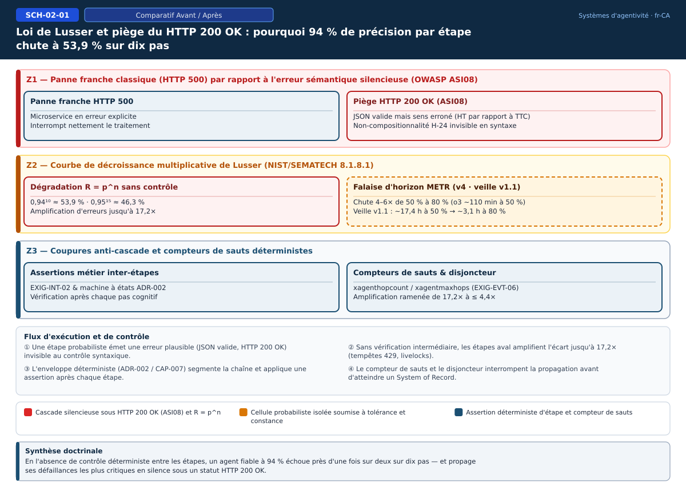
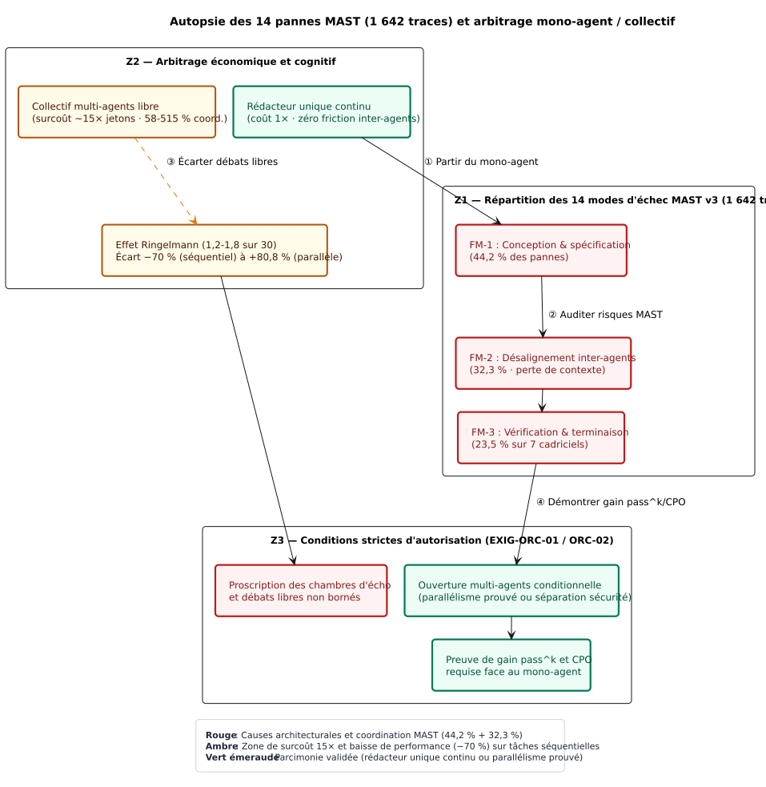
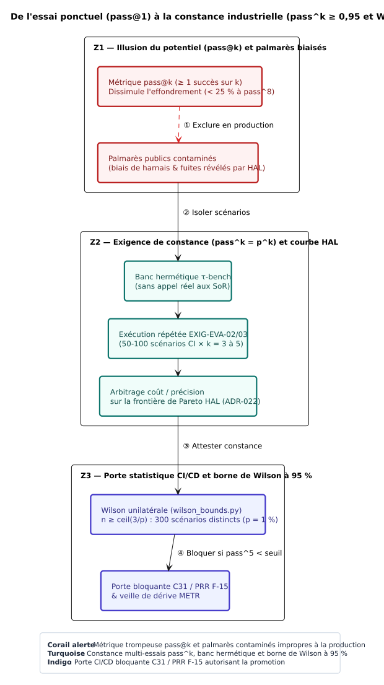
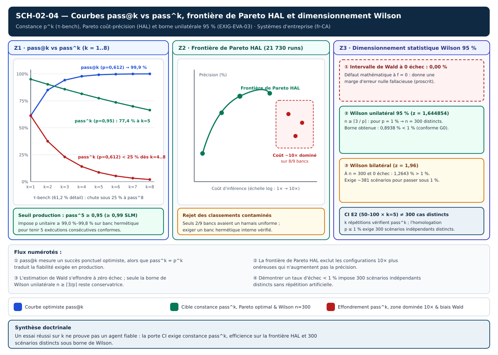

# Chapitre 02 — Fiabilité de l'automatisation agentique face au déterminisme : loi de Lusser, cascades inter-systèmes et constance pass^k

*Question directrice :* Pourquoi une chaîne d'automatisation agentique syntaxiquement valide (HTTP 200 OK) s'effondre-t-elle selon la loi de Lusser lorsqu'elle traverse plusieurs systèmes d'entreprise — là où un flux déterministe BPMN ou iPaaS compose de manière fiable — et comment qualifier statistiquement sa constance par pass^k et borne de Wilson ?

L'erreur d'appréciation la plus répandue lors du passage d'un prototype agentique vers la production consiste à transposer les réflexes de l'automatisation déterministe d'entreprise. Dans un pipeline classique (`iPaaS`, `ESB`, `BPMN 2.0` ou transaction `ACID`), une anomalie de type ou d'état lève franchement une exception, un délai dépassé ou un code `HTTP 500`, interrompant l'écriture fautive. À l'inverse, un maillon d'automatisation agentique échoue fréquemment en silence sémantique : il livre un document JSON bien formé sous statut `HTTP 200 OK` dont le sens métier est corrompu à travers `CRM`, `ERP`, `SCM` et `SoR` [9]. Dès que plusieurs étapes probabilistes s'enchaînent sans coupure déterministe intermédiaire, cette fragilité obéit aux lois de la fiabilité en série et transforme une précision unitaire flatteuse en défaillance systémique.

Le présent chapitre expose les lois mathématiques et les constats empiriques qui interdisent les chaînes agentiques libres entre systèmes d'entreprise. Il décrit d'abord la non-compositionnalité de sûreté et les cascades d'erreurs sémantiques silencieuses inter-systèmes (`OWASP ASI08`), contraste l'effondrement géométrique de la **loi de Lusser** avec les régimes déterministes (`BPMN`/`iPaaS` et `RPA`), puis examine l'autopsie des défaillances multi-agents (`MAST`) face à l'agent unique continu. Il proscrit ensuite l'indicateur `pass@k` au profit de la constance multi-essais `pass^k`, calibrée par la borne de Wilson et immunisée contre les biais des palmarès publics.

## 2.1 Loi de Lusser, cascades inter-systèmes (`OWASP ASI08`) et arbitrage face aux flux déterministes

### 2.1.1 Rupture entre validité syntaxique et erreurs sémantiques silencieuses (`OWASP ASI08`)

Une chaîne d'agents est **non compositionnelle** [9] : deux maillons validés isolément sur le plan syntaxique et local peuvent former un chemin composé dangereux une fois raccordés bout à bout entre plusieurs progiciels [9]. Contrairement à une fonction déterministe, un agent basé sur un modèle linguistique ne garantit pas un résultat identique d'une exécution à l'autre — même à température `0,0` dans `τ-bench` [6] — et demeure sensible aux variations de harnais, de latence ou de quantification côté fournisseur [7].

Cette non-compositionnalité éclate dans le piège inter-systèmes du statut `HTTP 200 OK`. Lorsqu'un agent amont lit un bon de commande `EDI` ou `CRM`, extrait un montant hors taxes d'une facture et l'écrit dans un champ JSON `montant_total` conforme au schéma attendu vers l'`ERP` puis vers l'allocation de stock `SCM` ou la billetterie `ITSM`, chaque frontière traversée sans contrat sémantique ni clé d'idempotence multiplie la corruption silencieuse des `SoR`. Ce mécanisme incarne la défaillance en cascade `ASI08` d'*OWASP Top 10 for Agentic Applications 2026* (source complète archivée en statut vérifié, `genai.owasp.org` demeurant en statut F pour blocage `HTTP 403`) [9], en convergence avec `OWASP LLM06` (agence excessive) et le profil `NIST AI 600-1` (repères de veille du corpus, dont une simulation d'écart d'intention montre un plafond de détection à `27,9 %`).

L'étude empirique de Rory Milsom (`1er décembre 2025`, `arXiv:2512.02230`) sur la gestion de patrimoine révèle la gravité financière de cette fragilité bout en bout [3]. Sur `12` tâches financières initiales de `TheAgentCompany`, `GPT-4o` sous `OpenHands` n'en résout aucune (`0/12`, `14,8 %` des points de contrôle) et, sur le banc patrimonial à autonomie élevée, ne résout que `2/12` tâches (`49,0 %` des `49` points de contrôle), bloqué par des défauts d'accès, de chemins et de formats [3]. Des spécifications strictes de schémas et de chemins doublent la résolution (`4/12`, `69,4 %` ou `34/49` points) à coût légèrement moindre (`0,1237 $` contre `0,1373 $`) [3]. De même, les mesures multi-agents de Kim et coll. (Chapitre 13) montrent que les collectifs sans vérificateur central amplifient les erreurs de trace jusqu'à `17,2×`, contre `4,4×` sous coordination centralisée.

S'y ajoutent les pathologies de boucle (`ASI02`/`ASI08`, `MAST`) : tempêtes d'appels `HTTP 429`, boucles de rétroaction entre agents renforçant une erreur initiale [9], répétition stérile d'étapes (`13,2 %` des défaillances dans `MAST`) [4] et défauts de vérification ou d'arrêt (`23,5 %`) sans oracle externe [4]. Toute architecture conforme DOIT donc imposer des assertions sémantiques déterministes (`EXIG-INT-02`), des disjoncteurs et des compteurs de sauts (`xagenthopcount`, `xagentmaxhops` sous `EXIG-EVT-06` et `EXIG-ORC-04`) pour vérifier devises, hors taxes / TTC, bornes et droits avant de bloquer ou d'escalader toute dérive.

### 2.1.2 Loi de Lusser, taxonomie `MAST` (`1 642` traces) et saturation d'horizon `METR`

La baisse rapide de fiabilité d'une chaîne agentique découle directement d'une loi mathématique élémentaire établie dans le manuel statistique du NIST et de SEMATECH (§ `8.1.8.1`, modèle des risques concurrents en série) [1]. Lorsque \(n\) étapes ou mécanismes de défaillance indépendants s'enchaînent en série sans mécanisme de correction déterministe, la probabilité de succès global \(R\) de la séquence obéit au produit des probabilités individuelles \(p_i\) de chaque maillon (se réduisant à \(p^n\) lorsque toutes les étapes partagent une même fiabilité \(p_i = p\)), formalisé dans l'ingénierie des systèmes sous le nom de **loi de Lusser** :

\[R = \prod_{i=1}^{n} p_i = p^n\]

Ce modèle multiplicatif éclaire le contraste fondamental entre trois régimes d'automatisation d'entreprise. Dans un flux déterministe par contrat d'API (`L0` : moteur `BPMN 2.0`, bus `iPaaS` ou saga compilée), chaque transition vérifiée présente \(p \ge 0{,}9999\) hors panne réseau — soit \(R_{50} \approx 99{,}5\ \%\) sur cinquante étapes avec levée d'exception immédiate en cas d'écart. Dans une automatisation `RPA` par sélecteurs d'écran (`L0`), l'exécution reste localement reproductible tant que l'interface est figée, puis tombe brutalement à `0 %` dès qu'une mise à jour d'`ERP` ou de portail altère le `DOM`. Dans une boucle agentique non bornée (`L1–L4`), la fiabilité unitaire plafonne couramment autour de `90 %` à `95 %` [1] : à `94 %` par étape (`p = 0,94`), la réussite sans erreur sur `10` étapes chute à `0,94^10 ≈ 53,9 %` (`53,86 %`), et à `95 %` sur `15` étapes elle descend à `0,95^15 ≈ 46,3 %` (`29,0 %` sur `20` étapes à `94 %`) [1]. Cet échec près d'une fois sur deux explique le constat terrain de `MAP` (Chapitre 01 : `68 %` à `≤ 10` étapes) et impose d'absorber `80 %` des transitions dans un harnais déterministe (Chapitre 04).

Les données empiriques recueillies sur des systèmes multi-agents réels confirment la sévérité de cette dégradation. La taxonomie `MAST` (*Multi-Agent System Failure Taxonomy*, Cemri et coll., `26 octobre 2025`, `arXiv:2503.13657v3`) a analysé `1 642` traces d'exécution issues de `7` cadriciels multi-agents ouverts, révélant des taux d'échec compris entre `41 %` et `86,7 %` répartis sur `14` modes de défaillance [4]. Fait capital pour les architectes, `44,2 %` des pannes recensées proviennent de défauts de spécification et de conception du système — rôles ambigus, contraintes oubliées ou critères d'arrêt mal définis [4]. Ensuite, `32,3 %` résultent du désalignement et de la perte de contexte entre agents, lorsque les messages transmis résument ou déforment l'intention initiale [4]. Enfin, `23,5 %` relèvent de l'échec de vérification ou de terminaison prématurée [4]. La défaillance n'est donc pas un simple aléa de modèle ; elle est majoritairement inscrite dans l'absence de machine à états déterministe (`ADR-002`, `CAP-007`) hors du modèle.

La dimension temporelle accentue encore cette contrainte. L'étude de Kwa et coll. (`METR`, `arXiv:2503.14499v4`, version 4 du `10 juillet 2026`) mesure l'horizon temporel des tâches logicielles qu'un modèle frontière parvient à accomplir en fonction du seuil de fiabilité exigé [5]. Bien que l'horizon à `50 %` de réussite ait doublé approximativement tous les sept mois (`207` jours sur `2019–2025`) [5], la portée s'effondre d'un facteur `4×` à `6×` (environ `5×`) dès que l'exigence passe à un seuil de fiabilité de `80 %` [5]. Ainsi, alors que `o3` atteint environ `110` minutes à `50 %` sur la suite `v4` [5] — tendance prolongée dans la veille `METR Time Horizon v1.1` du corpus (`~17,4 h` à `50 %` chutant à `~3,1 h` à `80 %`, hors source primaire `L+` de ce chapitre) —, la durée maîtrisée à `80 %` se contracte drastiquement [5].

Un système qui réussit un travail de longue haleine une fois sur deux reste inutilisable sans supervision constante ; dès que la norme opérationnelle impose au moins quatre réussites sur cinq, la durée maximale délégable en autonomie se contracte sévèrement. La fiabilité exigée dans l'exploitation des systèmes d'entreprise critiques — chaîne logistique `SCM`, facturation `ERP`, maintenance industrielle ou opérations financières réglementées — impose donc de segmenter tout processus long par des points de contrôle déterministes.

La *Figure 10* met en regard le piège syntaxique du statut `HTTP 200 OK`, la courbe multiplicative de la loi de Lusser et les coupures déterministes qui contiennent l'amplification des erreurs.

*Figure 10 — SCH-02-01 : Comparaison entre panne franche `HTTP 500` et cascade silencieuse `HTTP 200 OK` (`Z1`), courbe multiplicative \(R = p^n\) (`Z2`) et interposition de machines à états et compteurs de sauts (`Z3`).*

### 2.1.3 Arbitrage entre collectif multi-agents (~`15×` jetons) et rédacteur unique continu

Face aux défaillances d'un agent isolé, la tentation architecturale fréquente consiste à multiplier les agents spécialisés chargés de débattre, de critiquer et de corriger mutuellement leurs sorties. Les résultats empiriques de la taxonomie `MAST` [4] et les retours d'exploitation imposent au contraire une discipline stricte d'économie de moyens. Lorsqu'un travail est fragmenté entre plusieurs agents communicant en prose naturelle, chaque transmission de relais dissipe les hypothèses implicites du contexte initial — alimentant les `32,3 %` d'échecs de désalignement `MAST` [4] — et expose les débats libres à l'effet chambre d'écho, où un consensus plausible entérine une erreur commune.

Ce phénomène reproduit en informatique l'effet Ringelmann documenté par Bertalanič et Fortuna (analysé au Chapitre 13) : à mesure que le nombre d'agents participant à un débat augmente jusqu'à `30` agents nominaux, la taille effective utile de contribution sature autour de `1,2` à `1,8` équivalent unitaire, et l'apport marginal par agent chute d'environ `15×` entre `N = 2` et `N = 30`. Parallèlement, les expériences de Kim et coll. (également examinées au Chapitre 13) montrent que le surcoût de communication entre agents s'envole de `58 %` à `515 %` selon les topologies évaluées par rapport au mono-agent, tandis que les retours d'ingénierie d'Anthropic (veille du corpus) rapportent environ `15×` la consommation de jetons pour un gain pouvant approcher `+90 %` sur des recherches parallélisables.

À l'opposé, la doctrine du rédacteur unique à contexte continu — résumée par la mise en garde de Cognition (« *Don't Build Multi-Agents* ») — préserve l'intégralité du fil décisionnel au sein d'une mémoire de travail unifiée. Les mêmes mesures comparatives montrent d'ailleurs que l'ajout de collectifs multi-agents sur des tâches intrinsèquement séquentielles peut dégrader la performance jusqu'à `−70,0 %`, alors que les gains atteignant `+80,8 %` se limitent aux problèmes décomposables en recherches parallèles.

Plusieurs cadriciels et protocoles multi-agents — tels `AutoGen` (`AG2`), `MetaGPT`, `ChatDev`, `Magentic-One` [4], ainsi que les patrons `CAMEL` et `Contract Net` — orchestrent des rôles spécialisés par échange de messages. Sans bornage déterministe ni critique indépendant ancré sur des vérificateurs externes, ces conversations multi-acteurs reproduisent les trois catégories de pannes `MAST` : défauts de conception et de spécification (`44,2 %`), désalignement ou perte de contexte (`32,3 %`) et vérification ou terminaison défaillante (`23,5 %`) [4]. L'architecture d'entreprise privilégie donc la sobriété : confier d'abord la séquence à un agent unique doté d'un contexte continu et d'outils bien typés, et n'ouvrir le multi-agents que lorsque la parallélisation stricte ou le cloisonnement de sécurité le justifie.

En conséquence, les exigences `EXIG-ORC-01` et `EXIG-ORC-02` interdisent d'adopter une topologie multi-agents par défaut et imposent un appel d'outil typé ou un workflow déterministe inter-systèmes (`OO3` / `BPMN`) plutôt qu'un dialogue libre entre agents. Avant d'instancier un collectif pour coordonner `CRM`, `ERP` et `ITSM`, l'architecte DOIT vérifier si une orchestration déterministe encadrant un agent unique continu suffit, puis démontrer sur banc interne un gain net en constance et en coût complet par résultat conforme (jetons, latence d'exécution, reprises et couverture des quatorze modes `MAST` [4]).

La *Figure 11* synthétise la répartition des `14` modes d'échec `MAST` et l'arbre d'arbitrage opposant l'agent unique continu au collectif à `15×` le coût.

*Figure 11 — SCH-02-02 : Ventilation des `14` défaillances `MAST` sur `1 642` traces (`Z1`), arbitrage face au surcoût `15×` et à l'effet Ringelmann (`Z2`), et critères `EXIG-ORC-01` / `EXIG-ORC-02` (`Z3`).*

> **Trois invariants exécutables — Chapitre 2**
> 1. **Rupture déterministe inter-étapes** — Chaque transition entre étapes probabilistes aux frontières d'interopérabilité entre systèmes d'entreprise (`ERP`, `CRM`, `SCM`, `ITSM`, `SoR`) traverse une assertion métier typée et un compteur `xagenthopcount` / `xagentmaxhops` afin de stopper les cascades `ASI08` sous `HTTP 200 OK`.
> 2. **Encapsulation contre la loi de Lusser** — Toute séquence dépassant une étape isolée s'ancre dans une machine à états déterministe (`ADR-002`, `CAP-007`) qui borne la dégradation \(R = p^n\) et prévient les `14` modes `MAST`.
> 3. **Primauté de l'agent unique et qualification `pass^k`** — Aucune topologie multi-agents n'est autorisée sans gain mesuré face au mono-agent, et aucune mise en production n'est prononcée sur `pass@k` plutôt que sur `pass^k` validé sous borne de Wilson à `95 %`.

## 2.2 Constance multi-essais `pass^k`, borne statistique de Wilson et rejet des palmarès contaminés

### 2.2.1 Primauté de `pass^k` sur `pass@k` et biais des bancs publics (`τ-bench`, `HAL`)

Dans l'évaluation des modèles de génération de code, la métrique `pass@k` mesure la probabilité qu'au moins une tentative parmi `k` essais réussisse. Si cet indicateur reflète le potentiel exploratoire d'un assistant supervisé par un développeur humain qui retient le bon résultat, il devient trompeur et dangereux pour l'homologation d'un flux d'automatisation agentique (ou **Système d'agentivité**) en production d'entreprise. Qu'il s'agisse d'ordonnancement logistique `SCM`, de rapprochement comptable `ERP`, de qualification `SIRH` ou `ITSM`, de gestion de sinistres ou d'octroi de crédit, réussir une fois sur cinq essais équivaut à quatre incidents opérationnels potentiels.

Le banc d'essai `τ-bench` introduit par Yao et coll. (`17 juin 2024`, `arXiv:2406.12045`) formalise l'indicateur pertinent pour l'entreprise : la **constance `pass^k`**, définie comme la probabilité qu'un agent réussisse l'ensemble de `k` exécutions répétées et indépendantes d'une même tâche [6]. Lorsque la fiabilité sur un essai vaut \(p\), la constance sur \(k\) répétitions indépendantes vaut \(p^k\). Sur deux secteurs non financiers — **commerce de détail** et **aviation commerciale** —, Yao et coll. montrent que des agents frontières plafonnant sous `50 %` en moyenne globale (`48,2 %` pour `gpt-4o`, soit `61,2 %` en commerce de détail et `35,2 %` dans le transport aérien) voient leur constance `pass^8` chuter sous `25 %` dans le commerce de détail [6], attestant que l'inconstance frappe tous les workflows d'entreprise mêlant règles métier, outils et usagers.

L'évaluation comparative *Holistic Agent Leaderboard* (`HAL`, Kapoor et coll., `13 octobre 2025`, `arXiv:2510.11977`) met en lumière deux autres biais majeurs des évaluations publiques sur `21 730` exécutions couvrant `9` bancs et `9` modèles [7]. Premièrement, la précision brute publiée sans le coût d'inférence associé dissimule des écarts de consommation rendant certaines configurations économiquement non viables ; le pilotage DOIT arbitrer le compromis coût-précision sur une frontière de Pareto reproductible [7]. Dans huit bancs sur neuf, le modèle le plus onéreux — coûtant environ un ordre de grandeur (`~10×`) de plus au jeton que les options intermédiaires — ne figure même pas sur la frontière de Pareto, et un effort de raisonnement accru réduit ou laisse inchangée la précision dans la majorité des combinaisons évaluées [7].

Deuxièmement, les scores dépendent fortement du harnais d'évaluation, de la gestion des réessais et de la reproductibilité des environnements de test : parmi les `9` bancs étudiés dans `HAL`, seuls `2` avaient été évalués antérieurement avec un même harnais sur `4` modèles ou plus [7]. L'inspection automatisée des journaux révèle en outre des fuites de données invalidant un harnais (`TAU-bench Few Shot`), des agents consultant les réponses publiées sur `HuggingFace` au lieu de résoudre la tâche, et des changements silencieux de poids ou de quantification derrière un même point d'accès API [7]. L'institution DOIT donc rejeter les classements publics comme preuve suffisante et bâtir son propre banc hermétique interne, isolé des systèmes de production et muni d'oracles métier vérifiés.

### 2.2.2 Dimensionnement statistique par borne de Wilson à `95 %` et enjeu macroéconomique

Pour transformer la constance `pass^k` en porte bloquante d'intégration continue (`EXIG-EVA-02`, `EXIG-EVA-03`), le référentiel s'appuie sur l'estimation rigoureuse des proportions d'événements rares. Le manuel statistique du NIST et de SEMATECH (§ `7.2.4.1`) [2] ainsi que l'analyse comparative de McGrath et Burke (`15 janvier 2024`, `arXiv:2109.02516`) [8] démontrent que l'intervalle asymptotique de Wald s'effondre lorsque le nombre d'échecs observés est nul ou proche de zéro, produisant une marge d'erreur nulle fallacieuse. L'intervalle de **Wilson** (ou son extension d'Agresti-Coull) offre au contraire une couverture statistique robuste même lorsque zéro défaillance survient sur l'échantillon [2, 8].

En application de cette propriété, la règle `EXIG-EVA-03` impose conjointement que la borne supérieure unilatérale de Wilson à `95 %` reste strictement inférieure au taux d'erreur toléré \(p\) et le plancher conservateur de la règle des trois \(n \ge \lceil 3/p \rceil\) scénarios indépendants distincts sans défaillance [2, 8]. Attester un taux maximal inférieur à `1 %` (`p = 0,01`) requiert ainsi au minimum `n = 300` scénarios indépendants distincts sans échec, ce qui donne une borne unilatérale à `95 %` de `0,8938 % < 1 %`, là où l'intervalle bilatéral à `z = 1,96` donne `1,26 %` pour `300` essais et impose `381` essais [2, 8].

Il convient d'arbitrer clairement l'articulation entre ce plancher statistique et le banc d'intégration continue (`EXIG-EVA-02`, étage `E2`). En intégration continue courante, chaque agent exécute un jeu versionné d'au moins `50` scénarios (`≥ 100` scénarios sous la porte `PRR O-04`), répétés chacun \(k \ge 3\) fois et \(k = 5\) fois pour les flux critiques (`pass^5` `≥ 0,95` en qualification générale sous `ADR-022`, et `≥ 0,99` avant distillation `SLM` sous `PRR F-15`). Ces `250` à `500` trajectoires mesurent la **constance intra-scénario** `pass^k` [6], mais les `k` répétitions d'un même cas ne sont pas statistiquement indépendantes et ne peuvent donc pas simuler `300` essais indépendants. Le banc CI de `50`–`100` scénarios sous `k = 5` bloque ainsi rapidement les régressions et l'instabilité stochastique (suffisant en couverture inter-scénarios pour une tolérance `p = 5 %` requérant `60` cas distincts), tandis que la démonstration d'homologation `p ≤ 1 %` (`EXIG-EVA-03`) exige d'élargir le jeu à `n ≥ 300` scénarios indépendants distincts à zéro échec (détaillé avec `E1–E3` aux Chapitres 23 et 35).

Trois vérifications complètent ce socle statistique. Premièrement, les scénarios internes couvrent les cas limites de domaine — confusions hors taxes / toutes taxes comprises, conversions de devises, exclusions contractuelles et rejets d'autorisation — pour dépister les erreurs sémantiques silencieuses [3, 9]. Deuxièmement, l'injection de fautes (`HTTP 429`, délais d'attente, troncatures) éprouve les disjoncteurs et la reprise sans double écriture. Troisièmement, toute dérive de `pass^k` au fil des mises à jour de modèle déclenche le gel des promotions ou le repli au palier inférieur.

Ces exigences s'imposent face aux ordres de grandeur financiers de `2026`. Sur les `9` premiers mois calendaires de `2026`, les dépôts SEC d'Alphabet (`132,0 G$ US`), Amazon (`175,7 G$ US`), Meta (`83,1 G$ US`) et Microsoft (`106,0 G$ US`) totalisent `496,7 G$ US` de CapEx en trésorerie. L'annualisation atteint ainsi `683,7` à `693,7 G$ US` hors baux Microsoft ou `703` à `713 G$ US` baux inclus (`~220 G$ US` chez Amazon, `135` à `145 G$ US` chez Meta ; dépôts SEC détaillés aux références `9` à `14` du Chapitre 03). En regard, les synthèses ouvertes du Chapitre 03 situent le marché de l'IA agentique entre `5,3` et `9,9 G$ US` en `2026`, `7,8` et `14,1 G$ US` en `2027` et `24,5` et `40,6` (ou `45,0`) `G$ US` en `2030`. Cet écart entre investissement d'infrastructure et marché applicatif confirme que seule une ingénierie de fiabilité mesurable protège du gaspillage de capital ; sans contrôle statistique `pass^k` et sans bornage `METR`, les déploiements consomment des jetons sans atteindre la fiabilité de production [5, 6, 7].

La *Figure 12* illustre ce basculement vers `pass^k` et la porte statistique de Wilson à `95 %`.

*Figure 12 — SCH-02-03 : Rejet des métriques `pass@k` et des bancs contaminés (`Z1`), exigence `pass^k` arbitrée sur la courbe coût-précision `HAL` (`Z2`), et validation CI/CD par borne unilatérale de Wilson à `95 %` (`Z3`).*

La *Figure 13* trace cette divergence mathématique et les bornes statistiques associées.

*Figure 13 — SCH-02-04 : Courbes `pass@k` contre `pass^k`, frontière coût-précision `HAL` et dimensionnement de Wilson (`n = 300` contre `381`).*

## 2.3 Synthèse opératoire, exigences `D01-02` et frontières d'architecture

Le *Tableau 2.1* récapitule la dégradation selon la loi de Lusser pour guider le dimensionnement.

| Longueur de chaîne \(n\) | Fiabilité unitaire \(p\) | Taux de succès composé \(R = p^n\) | Interprétation architecturale pour la production |
|---|---|---|---|
| `1` étape | `94,0 %` | `94,0 %` | Acceptable sous supervision ou réessai borné (`1` seul appel modèle) |
| `5` étapes | `94,0 %` | `73,4 %` | Insuffisant sans assertions sémantiques inter-étapes (`EXIG-INT-02`) |
| `10` étapes | `94,0 %` | `53,9 %` | Près d'un échec sur deux (`NIST/SEMATECH 8.1.8.1`) [1] ; segmentation obligatoire |
| `15` étapes | `95,0 %` | `46,3 %` | Effondrement critique face à un flux `BPMN`/`iPaaS` déterministe (\(R_{50} \approx 99{,}5\ \%\)) ; machine à états `ADR-002` impérative |

*Tableau 2.1 — Dégradation multiplicative selon la loi de Lusser pour des chaînes probabilistes nues face à l'orchestration déterministe.*

Les cinq exigences normatives de synthèse propres au chapitre (`EXIG-D01-02.1` à `EXIG-D01-02.5`, *Tableau 2.2*, distinctes des `305` règles `CRE-IA-2026-01 v1.2` sous `16` préfixes) traduisent ces lois en verrous d'architecture.

| Exigence | Prescription exécutable | Contrôles techniques associés |
|---|---|---|
| `EXIG-D01-02.1` | Interposer des assertions sémantiques et plafonds anti-boucle sur les appels d'outils `MCP` et flux inter-applicatifs | `EXIG-INT-02`, `EXIG-EVT-06`, `EXIG-ORC-04`, compteurs `xagenthopcount` / `xagentmaxhops`, pare-feu anti-`ASI08` [9] |
| `EXIG-D01-02.2` | Encapsuler toute séquence de plus d'une étape inter-systèmes dans une machine à états déterministe | `ADR-002`, `CAP-007`, prévention des `14` modes d'échec `MAST` [4] |
| `EXIG-D01-02.3` | Qualifier par `pass^k` (`50–100` scénarios × \(k = 5\) critique) et Wilson `95 %` | `EXIG-EVA-02`, `EXIG-EVA-03`, `ADR-022` (`≥ 95 %`), `PRR O-04`/`O-05`, `PRR F-15` (`≥ 99 %` pré-`SLM`), `C31`, règle des trois \(n \ge \lceil 3/p \rceil\) (`300` scénarios distincts à `p = 1 %`) |
| `EXIG-D01-02.4` | Prouver le gain net du multi-agents face à l'agent unique continu | `EXIG-ORC-01`, `EXIG-ORC-02`, bilan comparatif `pass^k` et coût complet face au facteur `15×` |
| `EXIG-D01-02.5` | Dimensionner la délégation longue sur la portée `METR` à `≥ 80 %` | Veille `METR` (chute `4×` à `6×` entre `50 %` et `80 %` : `o3 ~110` min [5] ; veille `v1.1` `~17,4 h` → `~3,1 h`), rejet des palmarès non audités [7] |

*Tableau 2.2 — Synthèse des cinq exigences normatives `EXIG-D01-02.1` à `EXIG-D01-02.5`.*

Quatre livrables concrétisent ce dispositif : la suite CI `pass^k` / Wilson `95 %` (`C31` / `ADR-022` ; `PRR F-15` avant distillation `SLM`), le jeu versionné de `50`–`100` scénarios courants (étendu à `n ≥ 300` scénarios indépendants pour homologation `p ≤ 1 %`), le dossier comparatif mono-agent par rapport au multi-agents (jetons, latence observée, couverture `MAST` [4]) et la matrice des points d'arrêt anti-`ASI08` [9]. Le *Tableau 2.3* résume l'écart entre régime permissif et régime conforme.

| Dimension d'ingénierie | Régime expérimental permissif | Régime industriel conforme (`D01-02`) |
|---|---|---|
| Métrique de qualification | Réussite ponctuelle `pass@1` ou `pass@k` | Constance `pass^k` (\(k \ge 3\), \(k = 5\) critique) sous borne Wilson `95 %` [2, 6, 8] |
| Base de scénarios d'essai | Palmarès publics (fuites et biais de harnais) [7] | Banc CI interne (`50–100` × `k = 5`) et `n ≥ 300` scénarios distincts (`p = 1 %`) [2, 7] |
| Contrôle inter-étapes | Confiance syntaxique sur `HTTP 200 OK` | Assertions métier déterministes et compteurs de sauts anti-`ASI08` [3, 9] |
| Topologie d'exécution | Collectif multi-agents par défaut (`~15×` jetons) | Rédacteur unique continu par défaut ; multi-agents sous preuve mesurée [4] |
| Horizon de délégation | Tâches longues sans point d'arrêt | Segmentation bornée selon la portée `METR` à `≥ 80 %` (facteur `4–6×` inférieur) [5] |

*Tableau 2.3 — Comparaison entre le régime expérimental permissif et le régime industriel conforme `D01-02`.*

Dans l'exploitation des systèmes d'entreprise critiques et réglementés, la fiabilité ne se présume jamais à partir d'un taux moyen ponctuel : elle se prouve statistiquement avant la mise en service et se maintient par des coupures déterministes à chaque frontière inter-applicative.

Sur le plan des frontières entre domaines (`→` / `←`), le Chapitre 02 fonde le choix mono-agent contre multi-agents (Chapitre 04), les schémas sémantiques typés (Chapitre 10), les plafonds d'orchestration (Chapitres 13 et 14), le compromis économique `pass^5` / coût conforme (Chapitre 24) et la projection `METR` (Chapitre 31). Symétriquement, il reçoit l'enveloppe `80/20` (Chapitre 04), la supervision anti-complaisance (Chapitre 05), le routage frugal (Chapitre 09), les couches `ACL` (Chapitre 12), les sagas idempotentes (Chapitre 15), la délégation bornée (Chapitre 17), le confinement `CaMeL` et les coupe-circuits (Chapitres 19 et 21), ainsi que le banc hermétique `E1–E3` (Chapitre 23) sans en dupliquer l'implémentation. Reste à traiter au Chapitre 03 le coût économique de la non-interopérabilité et l'arbitrage d'assemblage des systèmes d'entreprise.
