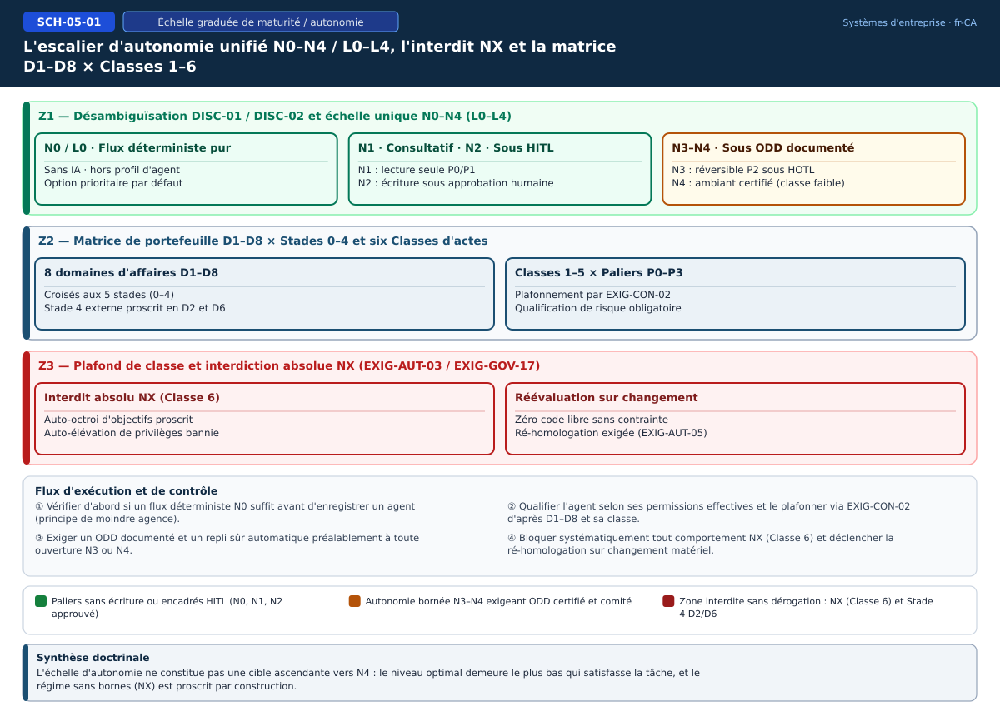
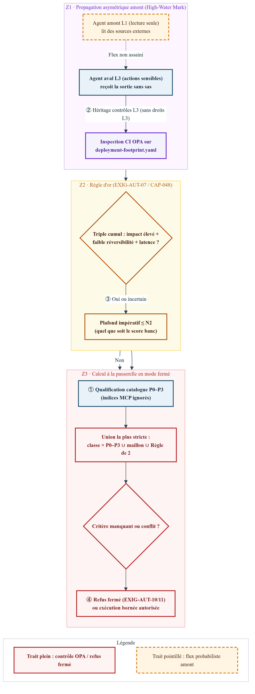
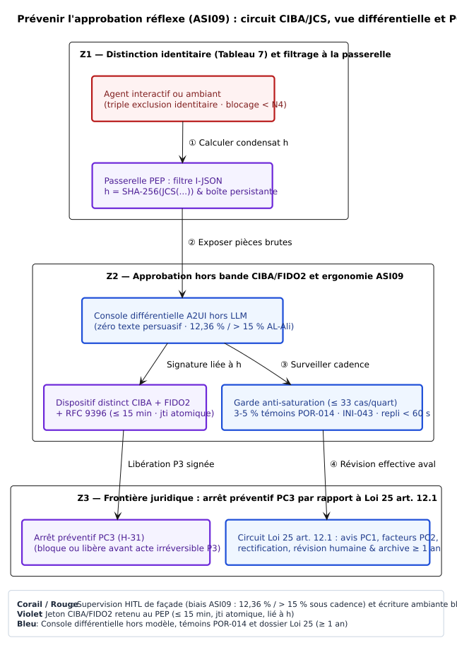

# Chapitre 05 — Échelle d'autonomie unifiée N0–N4/L0–L4, règle du maillon et supervision anti-complaisance

*Question directrice :* Comment unifier les échelles d'autonomie et de criticité, propager les exigences sécuritaires au maillon le plus élevé dans les chaînes multi-agents et prémunir la supervision humaine contre la validation réflexe ?

## 5.1 L'autonomie comme décision d'architecture par configuration

Dans la pratique industrielle, le terme d'autonomie entretient une confusion persistante entre la capacité cognitive brute d'un modèle et l'étendue des pouvoirs opérationnels que l'organisation lui concède. Un modèle performant sur bancs d'essai n'acquiert aucun droit automatique à exécuter des transactions financières ni à modifier des dossiers réglementés sans contrôle. La doctrine d'**Autonomie bornée** pose en principe que le degré d'autonomie résulte d'un choix explicite d'architecture et de configuration hors du modèle [2], contraignant périmètre d'action, écritures autorisées et budgets au sein de l'exosquelette du chapitre précédent conformément à `BSIF E-23` [1] et au bulletin technologique du BSIF de juillet 2026 sur le *harnessing* [2].

Autrement dit, **l'agentivité des systèmes** (*system agency*) ne se résume jamais à la compétence intrinsèque d'un grand modèle : elle est configurée, bornée et vérifiée par le harnais externe, les permissions et la supervision humaine [2].

Le présent chapitre (domaine `D02`) établit l'armature normative permettant de gouverner cette autonomie sur un portefeuille entier. Il réconcilie d'abord `DISC-01` et `DISC-02` afin de fournir une grille matricielle sans collision entre flux déterministes (`N0`), paliers (`N1`–`N4` / `L0`–`L4`), domaines (`D1`–`D8`), `Stades 0–4`, `Classes 1–6` et paliers d'outils (`P0`–`P3`). Il prévient ensuite le contournement latéral par la **règle du maillon le plus élevé** (*High-Water Mark*), l'union la plus stricte en mode fermé à la passerelle et la règle d'or `≤ N2` (`§ 5.2.1`). Il dissocie enfin agents interactifs et ambiants sous triple exclusion identitaire et structure une supervision résistante au biais d'automatisation (`OWASP ASI09` [10]), en séparant nettement l'arrêt préventif `PC3` de l'article `12.1` de la Loi 25 (`§ 5.2.2`) [5].

> **Trois invariants exécutables — Chapitre 5**
>
> 1. **Plafond inscrit et interdiction `NX` (`EXIG-AUT-01..05`, `EXIG-GOV-17`)** : tout agent déclaré au registre reçoit le niveau minimal suffisant entre `N1` et `N4` (`N0` restant réservé aux flux sans choix de modèle), sous un domaine de conception opérationnel (`ODD`) pour `N3`–`N4`, tandis que l'autonomie non bornée `NX` (`Classe 6`) demeure interdite sans dérogation.
> 2. **Règle du maillon le plus élevé et règle d'or `≤ N2` (`EXIG-AUT-07..11`, `CAP-048`)** : toute chaîne multi-agents hérite des contrôles du maillon aval le plus critique sans étendre les droits d'écriture en amont, plafonne à `N2` tout cumul d'impact élevé, d'irréversibilité et de détection lente, et applique à la passerelle l'union la plus stricte en échec fermé.
> 3. **Hors bande `CIBA`/`JCS` et vue différentielle (`EXIG-AUT-12..23`)** : nulle action de palier `P3` ne s'exécute sans jeton cryptographique hors bande (`CIBA` [8], `FIDO2`, `RFC 9396` [9]) lié au condensat `SHA-256` (`JCS`), présenté sur un écran différentiel hors modèle à cadence plafonnée (`≤ 33` dossiers par quart) et strictement distinct de la révision prévue à l'article `12.1` [5].

## 5.2 Gradation d'autonomie, propagation stricte et supervision anti-complaisance

### 5.2.1 Échelle unifiée N0–N4/L0–L4 et règle du maillon le plus élevé

La coexistence de plusieurs référentiels au fil des volumes antérieurs impose une désambiguïsation rigoureuse avant toute transcription en règles exécutables. Sous la concordance `DISC-01`, le niveau `N0` (aligné sur `L0` dans sa définition architecturale canonique) désigne exclusivement un traitement déterministe où le code fixe chaque étape d'exécution. Même lorsqu'un modèle linguistique effectue une extraction ou une classification ponctuelle dans un nœud borné, le choix de la transition suivante demeure entièrement codé hors du modèle. Ce n'est qu'à partir de `N1` (`L1`) que l'entité reçoit le statut d'agent au registre parce que le modèle sélectionne ses propres appels d'outils au fil de la boucle.

L'échelle progresse ensuite selon une gradation stricte des droits d'écriture et de déclenchement. Le palier `N2` (`L2`) correspond à un régime d'écriture encadrée où chaque mutation significative exige une approbation humaine préalable (`HITL`). Le palier `N3` (`L3`) autorise une autonomie surveillée (`HOTL`) uniquement pour des actions réversibles de palier `P2` soumises à des seuils quantitatifs explicites et à un domaine de conception opérationnel (`ODD`) documenté. Quant au sommet autorisé `N4` (`L4`), il regroupe les agents ambiants déclenchés sur événement ou horaire ; il demeure réservé aux seules classes de risque faible, sous `ODD` certifié, mécanisme de repli sûr éprouvé et décision explicite du comité compétent (`EXIG-AUT-04`, `EXIG-CON-02`).

Au-delà de ces quatre marches opérationnelles, le niveau `NX` (`Classe 6` — hors mandat) désigne tout comportement où un agent modifierait ses propres objectifs, élargirait ses privilèges d'accès, engendrerait du code libre non confiné ou exécuterait des opérations critiques hors contrôle. Les exigences `EXIG-AUT-03` et `EXIG-GOV-17` proscrivent le régime `NX` sans aucune possibilité de dérogation. De même, conformément à `EXIG-AUT-05`, toute modification matérielle touchant la classe de risque, les outils rattachés, l'environnement d'exécution ou les paramètres de sécurité déclenche une réévaluation d'homologation avant remise en service. Cette réévaluation s'accorde avec les attentes de gestion du risque de modélisation de `BSIF E-23` (prise d'effet le `1er mai 2027`, incluant la mise à jour de l'inventaire lors des modifications importantes) [1] et avec la proportionnalité du contrôle humain tout au long du cycle de vie prévue à l'article `14` du Règlement `(UE) 2024/1689` (`EU AI Act`) [3].

Sous la concordance `DISC-02`, l'ouvrage relie cette échelle individuelle `N0–N4` à la gouvernance matricielle du portefeuille financier. Celle-ci répartit les activités entre huit domaines d'affaires propres au traité : `D1` pour la distribution et la relation client ; `D2` pour le conseil, la vente et l'évaluation de convenance ; `D3` pour la souscription et la tarification du risque (incluant l'octroi de crédit) ; et `D4` pour la gestion des contrats et les opérations de compte. S'y ajoutent `D5` pour le règlement, l'indemnisation et le traitement des sinistres ; `D6` pour la conformité, la lutte contre le blanchiment et la gestion des risques ; `D7` pour la trésorerie, l'investissement et la réassurance ; et `D8` pour les opérations technologiques et la cyberrésilience. Elle croise ces huit domaines avec cinq stades de déploiement (`Stades 0–4`), six classes d'actes (`Classes 1–6`) et quatre paliers d'outils (`P0` lecture publique, `P1` lecture interne filtrée, `P2` écriture réversible bornée, `P3` écriture irréversible ou sortie externe).

Cette matrice s'arrime aux repères méthodologiques consolidés dans les tomes du traité : la pratique recommandée `SAE J3016` (par analogie pour l'`ODD` et le repli), le cadre `IMDA v1.5` de Singapour, la taxonomie de Feng et coll., la norme `ISO/IEC 42105` (supervision humaine de l'IA), l'échelle `LCIM` et le modèle `ISO 11354 FEI`. Elle impose en outre deux verrous sectoriels non négociables : le `Stade 4` inter-organisations demeure proscrit dans les domaines du conseil (`D2`, plafonné aux `Stades 2–3`) et de la conformité ou lutte antiblanchiment (`D6`, plafonné au `Stade 3` interne selon le modèle de portefeuille) en raison de l'imputabilité réglementaire directe. Par ailleurs, pour éviter toute collision d'échelles dans les moteurs de politiques `OPA`/`Rego` (`CH-20`), la couche technique ramène ces multiples taxonomies à trois niveaux de criticité exécutables (`BLOQUANT`, `OBLIGATOIRE`, `RECOMMANDE`) croisés aux paliers `P0–P3`.

La correspondance entre stades organisationnels et niveaux individuels empêche également toute promotion prématurée. Un flux `Stade 0` repose exclusivement sur du code déterministe `N0` sans choix de modèle, tandis qu'un pilote `Stade 1` reste confiné aux paliers `N0–N1` durant une fenêtre transitoire maximale de `90` jours. Un déploiement encadré `Stade 2` constitue le seuil minimal de production réglementée, alors que le `Stade 3` couvre l'orchestration interne maîtrisée suffisante pour la majorité des processus. Enfin, le `Stade 4` demeure réservé aux seuls échanges inter-entreprises dûment fédérés hors `D2` et `D6`.

| Classe d'actes | Échelle `N0–N4` / `L0–L4` | Paliers d'outils permis | Régime de contrôle et d'approbation minimal |
|---|---|---|---|
| Hors classe (flux fixe) | `N0` / `L0` déterministe | Code fixe hors agent | Tests logiciels et revue de code (`OO1`/`OO2`) |
| `Classe 1` : Lecture et analyse | `N1` / `L1` consultatif | `P0`–`P1` uniquement | Filtrage `ACL` préalable et télémétrie caviardée |
| `Classe 2` : Action réversible bornée | `N3` sous `ODD` (`faible`/`modérée`) ou `N2` (`élevée`) | `P0`–`P2` sous seuils | Clé d'idempotence, saga compensable, revue échantillonnée (`5 %` / `1 %`) |
| `Classe 3` : Effet matériel coûteux | `N2` par défaut (`N3` sous seuil strict) | `P2` plafonné | Approbation signée `JCS` `SHA-256` au-delà du seuil |
| `Classe 4` : Acte irréversible critique | `P3` jamais exécuté seul (même en `N4`) | `P3` sous verrou | Approbation hors bande `CIBA`/`FIDO2` liée à `h` (`≤ 15` min), `2` signataires en élevée |
| `Classe 5` : Décision visant personne | Plafond `N2` (`Classe élevée` `EXIG-CON-02`) | `P1`–`P2` sous cadre | Avis Loi 25 art. `12.1`, facteurs, révision humaine, dossier `≥ 1` an [5] |
| `Classe 6` : Hors mandat (`NX`) | `NX` interdit sans dérogation | Aucun (`EXIG-GOV-17`) | Blocage déterministe hors modèle et coupe-circuit immédiat |

*Tableau 5.1 — Matrice unifiée des classes d'actes, des niveaux d'autonomie `N0–N4`/`L0–L4` et des paliers d'outils `P0–P3`.*

*Figure 17 — SCH-05-01 : L'escalier d'autonomie unifié `N0–N4` / `L0–L4`, l'interdit `NX` et la matrice `D1–D8` × `Classes 1–6`.*

Dans une architecture distribuée, gouverner chaque agent isolément ne suffit pas. Un contournement classique consiste à placer un agent faiblement habilité (`L1` en lecture documentaire) en amont d'un agent critique (`L3` en décision opérationnelle), dans l'espoir de soustraire le premier aux exigences rigoureuses de conformité. Si l'agent `L1` ingère une donnée altérée ou mal résumée puis la transmet en texte libre à l'agent `L3`, la défaillance se propage directement à la décision finale sans avoir subi de contrôle proportionné à l'enjeu aval.

Pour fermer cette brèche, l'architecture impose trois mécanismes cumulatifs de durcissement. Premièrement, la **règle du maillon le plus élevé** (*High-Water Mark*), vérifiée statiquement en intégration continue par `OPA` sur le manifeste `deployment-footprint.yaml`, gouverne toute chaîne dépourvue de sas déterministe d'assainissement. Tout agent amont alimentant un maillon aval critique hérite intégralement du périmètre sécuritaire et réglementaire de ce maillon aval afin de satisfaire aux attentes de gouvernance de bout en bout (`BSIF E-23` [1], `EU AI Act` [3]) et de contrer le détournement d'objectif en chaîne (`OWASP ASI01` [10]). Ce durcissement demeure strictement asymétrique : l'agent amont reçoit les exigences de traçabilité, de revue et de confidentialité du maillon supérieur sans jamais acquérir ses droits de mutation ou d'écriture.

Cette architecture distingue l'agentivité locale d'un composant de **l'agentivité des systèmes** effective : la règle du maillon le plus élevé propage les obligations de traçabilité sans élargir les droits de mutation, tandis que la proscription des états `NX` bloque toute agence excessive [10].

À titre d'illustration concrète, un agent extracteur `L1` qui résume des déclarations de sinistres pour alimenter un agent de règlement `L3` sans passer par un validateur de schéma ni par un filtre d'assainissement se voit imposer les mêmes contrôles de provenance, de journalisation et de détection d'injection que l'agent `L3`. S'il souhaite conserver un régime allégé, l'équipe doit insérer entre les deux nœuds une barrière déterministe de validation qui réinitialise la confiance structurelle des données transmises.

Deuxièmement, la **règle d'or** (`EXIG-AUT-07`, `CAP-048`) verrouille l'autonomie à un plafond maximal de `N2` dès qu'une tâche cumule trois facteurs de fragilité : un impact métier élevé, une faible réversibilité opérationnelle et une détection lente des dérives, ou lorsqu'un critère critique d'étalonnage demeure incertain. Aucun score élevé obtenu sur un banc d'essai synthétique ne permet de lever ce verrou. Ce mécanisme prévient l'escalade silencieuse d'agents opérant sur des engagements de crédit à long terme ou des décisions d'indemnisation dont les erreurs ne se révèlent que plusieurs trimestres après exécution.

Troisièmement, à l'exécution, la passerelle applique l'**union la plus stricte en mode fermé** (`EXIG-AUT-10`, `EXIG-AUT-11`). Pour chaque appel d'outil, elle calcule l'exigence maximale résultant de la matrice classe × palier `P0–P3` inscrite au catalogue interne (`EXIG-AUT-08`), du maillon le plus restrictif dans la chaîne de délégation, des seuils financiers applicables et de la règle de deux (`EXIG-SEC-04`, `CH-20`). Un point d'intégrité demeure essentiel : la passerelle ignore délibérément les métadonnées déclaratives auto-annoncées par un serveur externe (telles que l'indicateur `readOnlyHint` d'un descripteur `MCP`), seule la qualification auditée au catalogue interne faisant autorité. Dès qu'une pièce justificative manque ou qu'un paramètre demeure indéfini, l'évaluation échoue en mode fermé par un refus immédiat.

*Figure 18 — SCH-05-02 : Règle du maillon le plus élevé (« High-Water Mark ») et règle d'or `≤ N2` dans un graphe multi-agents.*

### 5.2.2 Distinction des régimes d'agent et supervision anti-complaisance

La maîtrise de l'autonomie exige ensuite une frontière nette entre flux déterministe, agent interactif et agent ambiant, telle que codifiée par le Tableau 7 du cadre normatif (Tome 2, `§ 3.1–3.4`). Un flux déterministe (`N0`) arrête chaque étape d'exécution par du code vérifiable ; un agent sélectionne ses actions au moyen d'un modèle en boucle ; un agent interactif agit à l'intérieur d'une session initiée et parrainée par un mandant humain ; enfin, un agent ambiant se déclenche de manière asynchrone sur un événement système ou une échéance horaire sans sollicitation humaine contemporaine.

Pour empêcher qu'un agent interactif de niveau `N2` ou `N3` ne contourne la supervision en se greffant sur un courtier d'événements, l'orchestrateur ou le bus événementiel appose un attribut cryptographique d'origine non falsifiable. En présence d'une origine ambiante, la passerelle bloque par construction toute opération d'écriture non approuvée pour tout agent dont le niveau homologué est inférieur à `N4`. Cette classification s'accompagne d'une **triple exclusion identitaire** impérative (`EXIG-IAM-03` à `EXIG-IAM-05`, reprise au chapitre 16) : un agent ne doit jamais emprunter le compte d'un utilisateur humain, ne doit jamais s'authentifier au moyen d'un secret ou d'un principal technique partagé entre plusieurs charges de travail, et ne constitue jamais une personne juridiquement responsable de ses actes. Chaque instance opère sous une identité non humaine distincte rattachée à un parrain humain imputable au registre central.

Toutefois, même avec des plafonds stricts et des identités propres, la supervision humaine échoue dans la pratique si elle ignore les limites cognitives des opérateurs. Le référentiel `OWASP Top 10 for Agentic Applications 2026` (`ASI09`, exploitation de la confiance humaine) documente la fragilité du contrôle humain face à des interfaces conversationnelles fluides [10]. L'enquête qualitative sur la supervision pratique des systèmes agentiques (`arXiv:2606.05391`, menée auprès de `17` développeurs expérimentés) confirme que le suivi en temps réel demeure rare et que les valideurs recourent à des raccourcis — survol des résumés ou confiance dans des tests de surface — face à des sorties longues et coûteuses à inspecter [6].

Plus encore, l'étude publiée dans *Nature Scientific Reports* en août 2026 (`AL-Ali` et coll., retenue en `L+` après exclusion en `statut F` de la notice `PMC3240751` bloquée par un défi `CAPTCHA`) modélise la collaboration humain-IA dans un simulateur de maintenance prédictive sous pression de production [7]. Ses essais montrent qu'une IA non calibrée échoue dans `12,36 %` des cas contre `0,8 %` sous fusion adaptative calibrée par mise à l'échelle de température, tandis que la sous-estimation du risque par l'opérateur sous forte pression de cadence fait franchir `15 %` d'échecs et constitue le mode de défaillance dominant [7]. Soumettre des flux massifs à une relecture manuelle rapide expose donc les équipes à une validation de façade dépourvue d'examen critique.

Pour neutraliser cette complaisance cognitive, toute action irréversible de palier `P3` (`Classe 4`) ou toute opération `P2` dépassant un seuil critique applique la règle de libération humaine `H-31` : l'agent prépare la proposition et s'arrête, tandis que l'autorisation finale transite par une **approbation hors bande** (`EXIG-AUT-09`, `EXIG-AUT-12` à `EXIG-AUT-16`). Techniquement, la passerelle intercepte l'appel, canonise les paramètres exacts en format `I-JSON` selon `RFC 8785` et calcule le condensat `h = SHA-256(JCS(...))`. Elle dépose ensuite la demande dans une boîte d'attente persistante (`EXIG-AUT-16` à `EXIG-AUT-18`), mise en œuvre par les primitifs `Signals` et `Awakeables` des moteurs d'exécution durable tels que `Temporal` ou `Restate` (`CH-15`), ce qui permet de suspendre un dossier durant plusieurs heures sans immobiliser de mémoire vive ni perdre le fil d'exécution.

Suivant le profil du traité (`EXIG-AUT-14` et `EXIG-AUT-15`), la sollicitation parvient au valideur habilité sur un canal indépendant via le protocole `OpenID Connect CIBA Core 1.0` (`auth_req_id`) [8], protégé par authentification forte `FIDO2` et enrichi par le paramètre `authorization_details` issu de `RFC 9396` (`Rich Authorization Requests`) [9]. Le jeton d'approbation retourné comporte un identifiant unique `jti` à usage atomique, une durée de vie maximale de `15` minutes et une liaison cryptographique stricte au condensat `h` couvrant une seule opération (y compris ses réessais idempotents). La passerelle conserve ce jeton localement et rejette toute réexécution dont un seul paramètre aurait varié depuis la signature, tout en proscrivant catégoriquement les confirmations textuelles saisies dans le fil conversationnel de l'agent.

En classe critique élevée, une double signature indépendante sur `h` s'impose (`EXIG-AUT-12`), garantissant la séparation des tâches. Si le délai de `15` minutes expire sans réponse ou si l'approbateur refuse (« Ignorer » valant refus), l'action n'est pas exécutée ; la passerelle vérifie au besoin l'état cible par clé d'idempotence si l'issue est inconnue et exige une nouvelle approbation ou bascule vers une file d'escalade manuelle nommée (`EXIG-AUT-12`, `EXIG-AUT-16`). Au réveil du flux durable après approbation, le système revalide l'état métier courant — solde disponible, validité de la police ou statut du mandat — avant d'émettre la mutation finale avec la même clé d'idempotence.

Sur le plan ergonomique, l'interface d'approbation (`A2UI`, `CH-08`) applique un dispositif anti-complaisance en quatre volets (`EXIG-AUT-19` à `EXIG-AUT-21`) contre la menace `ASI09` [10], en privilégiant le forçage cognitif mesuré :

- **Écran différentiel hors modèle** : montants, bénéficiaires, cibles et écarts par rapport aux valeurs historiques sont extraits directement de la charge `I-JSON` par du code déterministe, en masquant les argumentaires persuasifs rédigés par le modèle ;
- **Limitation de charge et filtrage sélectif** : le filtrage déterministe en `Classe 2` automatise les cas conformes sous seuils pour ne remonter que les exceptions ciblées, avec une charge plafonnée à `33` dossiers complexes par quart (`360` minutes effectives à `65 %` de maintien de vigilance et `7` minutes minimales par examen) ;
- **Dossiers témoins canaris et audit périodique** : de `3 %` à `5 %` de témoins comportant un défaut connu sont injectés à l'aveugle (`POR-014`) avec suivi mensuel du temps médian d'examen et du taux d'approbation sans retouche, ainsi qu'une revue a posteriori en `N3–N4` (`5 %` d'échantillon en classe modérée et `1 %` en classe faible selon `EXIG-AUT-21`) ;
- **Préservation manuelle et repli rapide** : au-delà de `70 %` d'automatisation sur un processus, l'organisation déclenche le quota de dossiers traités manuellement de bout en bout (`INI-043`, `CH-33`) et maintient une rétrogradation vers `N2` en moins de `60` secondes (`POR-015`).

L'articulation de ces règles évite autant le goulot d'une validation humaine systématique sur des opérations bénignes que la reddition cognitive face à des écrans saturés. En réservant la porte humaine aux exceptions hors seuils en `Classe 2` et à `100 %` des actes `P3` (`Classe 4`), le valideur consacre son jugement aux décisions à fort enjeu tout en disposant d'un bouton d'arrêt conforme à l'article `14` du Règlement `(UE) 2024/1689` [3].

*Figure 19 — SCH-05-03 : Prévenir la validation réflexe (`ASI09`) : circuit `CIBA`/`JCS`, vue différentielle et distinction `PC3` / Loi 25.*

Enfin, l'architecture trace une séparation juridique et opérationnelle infranchissable entre l'arrêt préventif `PC3` (`HITL` ou `CIBA` avant effet `P3`) et le régime des décisions fondées exclusivement sur un traitement automatisé visé à l'article `12.1` de la Loi 25 du Québec [5] (en vigueur depuis le `22 septembre 2023`). Cette distinction rejoint la gouvernance humaine de l'article `14` du Règlement `(UE) 2024/1689` [3], dont le modificatif `(UE) 2026/1744` reporte au plus tard au `2 décembre 2027` l'échéance de l'Annexe III [4]. Selon `EXIG-CON-08`, insérer une validation superficielle à haut débit pour contourner l'article `12.1` échoue à prévenir les erreurs tout en exposant l'institution à une requalification réglementaire.

Dès qu'une décision affecte une personne sans réexamen substantiel, le dispositif active obligatoirement la filière `EXIG-AUT-22`–`23` et `EXIG-CON-07`–`09`. Celle-ci assure un avis contemporain (`PC1`), l'explication sur demande des raisons et principaux facteurs (`PC2`), le droit de rectification et l'accès à un membre du personnel habilité à infirmer la décision, avec conservation du dossier chiffré au moins `1` an (`7` ans en valeurs mobilières).

| Dimension de contrôle | Arrêt préventif `PC3` (`HITL` / `CIBA`) | Révision humaine Loi 25 art. `12.1` [5] |
|---|---|---|
| Moment d'intervention | Avant exécution irréversible (`P3` ou `P2 >` seuil) | Au moment et à la suite d'une décision visant une personne |
| Mécanisme technique | Jeton `CIBA`/`FIDO2` [8] + `RFC 9396` [9] lié à `h` (`≤ 15` min) | Avis `PC1`, explication `PC2`, rectification et recours humain |
| Autorité humaine | Valideur opérationnel habilité hors bande | Membre du personnel en mesure d'infirmer la décision |
| Rétention probatoire | Trace immuable `JCS` + `jti` consommé à la passerelle | Dossier d'instance complet conservé `≥ 1` an (`EXIG-CON-09`) |

*Tableau 5.2 — Séparation normative entre le point d'arrêt préventif `PC3` et la révision humaine au titre de la Loi 25.*

## 5.3 Exigences vérifiables, interfaces systémiques et livrables d'acceptation

La mise en œuvre du régime d'autonomie graduée se résume dans cinq exigences vérifiables (`EXIG-D02-02.1` à `EXIG-D02-02.5`), strictement encadrées par la clause `non-avis` (`AO-05`) au gel du `2 décembre 2026` ([1] à [10]) sans constituer une opinion juridique. À cet égard, quatre ressources externes inaccessibles lors de la collecte — l'article `PMC3240751` bloqué par défi `CAPTCHA`, le portail `lautorite.qc.ca` (`HTTP 403`), la page `genai.owasp.org` (`HTTP 403`, compensée intégralement par le document officiel `CC BY-SA 4.0` archivé en texte intégral [10]) et le portail `legisquebec` (`HTTP 403`, compensé par la loi sanctionnée en texte intégral [5]) — restent exclues en `statut F`.

| Exigence | Objet normatif | Contrôle exécutable et seuil | Ancrage et portée |
|---|---|---|---|
| `EXIG-D02-02.1` | Plafond inscrit, `ODD` et interdit `NX` | Niveau `N1`–`N4` minimal, zéro `NX`, zéro `Stade 4` en `D2`/`D6` | `EXIG-AUT-01..05`, `EXIG-GOV-17` |
| `EXIG-D02-02.2` | Triple exclusion et garde ambiante | Blocage d'écriture sans approbation pour agent ambiant `< N4` | `Tableau 7`, `EXIG-IAM-03..05`, `CH-16` |
| `EXIG-D02-02.3` | Union stricte, règle d'or et *High-Water Mark* | `OPA` sur `deployment-footprint.yaml`, `≤ N2` sur cumul, mode fermé | `EXIG-AUT-07..11`, `CAP-048`, `CH-20` |
| `EXIG-D02-02.4` | Approbation hors bande `CIBA`/`JCS` | `h = SHA-256(JCS(...))`, `≤ 15` min, `jti` unique, zéro oui textuel | `EXIG-AUT-09`, `EXIG-AUT-12..16`, `CH-17` |
| `EXIG-D02-02.5` | Anti-complaisance `ASI09` et art. `12.1` | Écran différentiel `I-JSON`, `≤ 33`/quart, `3 %`–`5 %` canaris, revue `5 %`/`1 %`, archive `≥ 1` an | `EXIG-AUT-19..23`, `POR-014`/`015`, `INI-043` |

*Tableau 5.3 — Exigences du chapitre (`EXIG-D02-02.1` à `EXIG-D02-02.5`), contrôles exécutables et renvois.*

Par ses interfaces systémiques, le chapitre borne le rayon d'impact en boucle (`CH-01`), prévient la reddition cognitive (`CH-02`) et éclaire le critère de flux déterministe `N0` (`CH-04`). Vers l'aval, il arbitre la tension entre latence opérationnelle et approbation humaine sur les budgets `QoS` (`CH-06`), écarte l'illusion d'une validation de façade (`CH-09`), fonde les identités non humaines (`CH-16`) et le circuit exécutable `CIBA`/`JCS` (`CH-17`, portant l'extrait `G0-EX-CH02-02`).

Ces contrôles alimentent aussi les règles `OPA` de *High-Water Mark* et la règle de deux (`CH-20`), scellent les preuves au double couloir (`CH-22`) et s'arriment aux cadres du Québec, du Canada (`E-23`) et de l'Union européenne (`CH-25`, `CH-26`). Ils calibrent les cinq profils financiers (`CH-28`) et le fil rouge Boréal (`CH-29`), orientent la révision face aux limites `METR` (`CH-31`) et ancrent la préservation manuelle dès `70 %` d'automatisation (`CH-33`). En retour, `CH-13` et `CH-15` fournissent `Signals`/`Awakeables` et `CH-36` consolide `DISC-01` et `DISC-02`.

Les livrables aux portes `G1` à `G5` réunissent la fiche d'agent au registre central (`N1–N4`, `Classe 1–5`, `D1–D8`, `ODD`, `P0–P3`, parrain nommé), le manifeste `deployment-footprint.yaml` validé par `OPA` et les essais de passerelle en mode fermé sur `JCS` et `jti`. S'y ajoutent les rapports mensuels de la console différentielle (temps médian d'examen, approbation sans retouche, témoins canaris et revue `5 %` modérée / `1 %` faible en `N3–N4`) ainsi que le dossier juridique dissociant `PC3` de l'article `12.1`.
