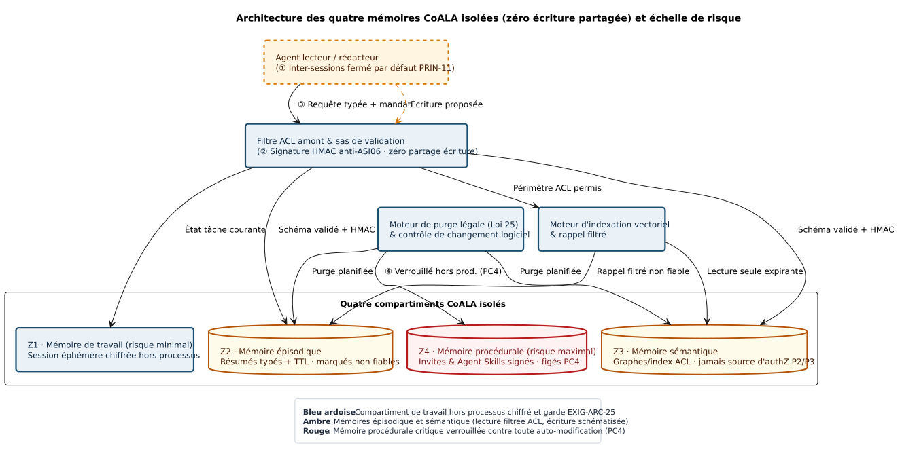
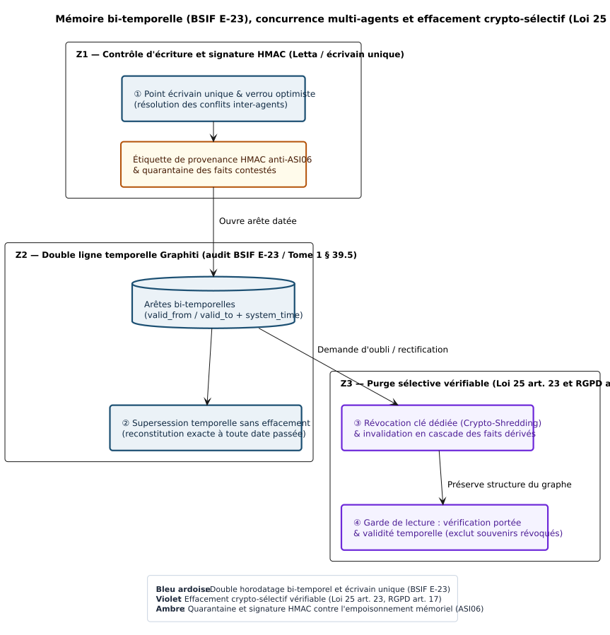
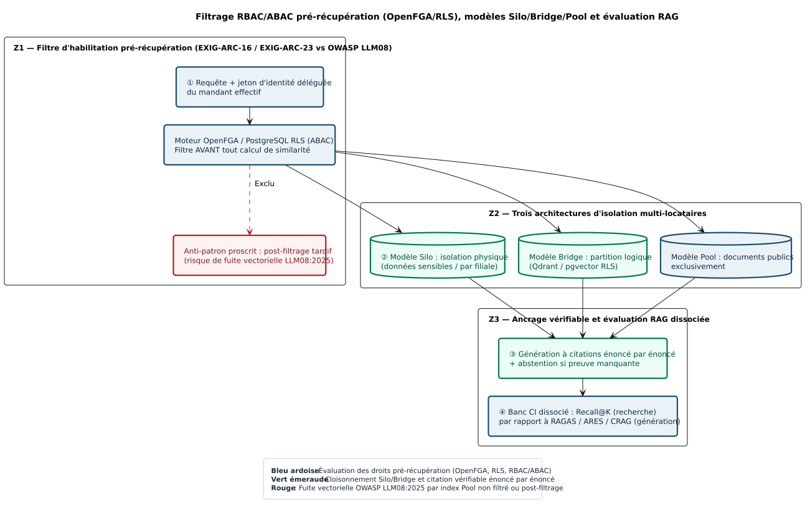

# Chapitre 11 — Mémoire CoALA à quatre compartiments isolés, bi-temporalité auditable et filtrage ACL pré-récupération

*Question directrice :* Comment gouverner la mémoire persistante des Systèmes d'agentivité pour prévenir la contamination croisée et l'exfiltration vectorielle tout en conciliant l'auditabilité historique BSIF E-23 et l'effacement sélectif exigé par la Loi 25 ?

## 11.1 Gouvernance de la mémoire longue et refus du stockage indifférencié

Dans les prototypes conversationnels, la mémoire persistante est souvent traitée comme un simple cache technique destiné à personnaliser les échanges ultérieurs. En environnement d'entreprise réglementé, cette assimilation constitue une faille architecturale et juridique majeure. Dès qu'un Système d'agentivité conserve des informations d'une session à l'autre, ce magasin d'état devient une base de données soumise aux régimes de protection des renseignements personnels, de gouvernance des modèles et de sécurité des accès. Le principe directeur `PRIN-11` et la décision d'architecture `DEC-004` posent en conséquence une règle de sobriété stricte : la mémoire longue inter-sessions DOIT demeurer désactivée par défaut en l'absence d'un besoin opérationnel démontré, approuvé et borné dans le registre d'agents.

> **Clause non-avis (`AO-05`)** — Conformément à la clause `non-avis` (`AO-05`) arrêtée au gel du 2 décembre 2026, l'examen des obligations issues du droit québécois [3, 4] et de la réglementation prudentielle fédérale canadienne [5] relève de l'ingénierie technique (← Chapitre 10). Cette analyse ne constitue ni un avis juridique ni une certification réglementaire.

L'ouverture non gouvernée d'une mémoire partagée expose l'organisation à deux familles de menaces critiques recensées par le référentiel *OWASP Top 10 for Agentic Applications 2026* [2]. La première menace, classée sous `ASI06` (*Memory & Context Poisoning*), survient lorsqu'une donnée externe piégée — issue d'un document, d'un courriel ou d'un appel d'outil — est résumée et persistée en mémoire longue pour altérer durablement le comportement d'un agent ou contaminer ses pairs [2]. La seconde menace s'appuie sur le vecteur associé `OWASP LLM08:2025` (*Vector and Embedding Weaknesses*) [2], illustré par la fuite vectorielle inter-locataires (*Cross-tenant vector bleed*) : un magasin sémantique mutualisé restitue des fragments confidentiels à un usager dépourvu d'habilitation, soit par absence de cloisonnement, soit par filtrage tardif après le calcul de similarité.

Sur le plan juridique, les exigences convergent vers une discipline rigoureuse de traçabilité et de maîtrise des cycles de vie. Au Québec, l'article `12.1` de la Loi 25 [3] édicte une obligation explicite de transparence et d'explicabilité : « Toute personne qui exploite une entreprise et qui utilise des renseignements personnels afin que soit rendue une décision fondée exclusivement sur un traitement automatisé de ceux-ci doit en informer la personne concernée » [3]. Dans son rapport quinquennal publié en mai 2026, la Commission d'accès à l'information (`CAI`) formule la Recommandation 45 afin de « Prévoir que l’EFVP s’accompagne d’une analyse d’impact algorithmique lorsqu’elle concerne un système d’IA visant la prise de décision automatisée concernant les personnes » [4].

Parallèlement, le droit québécois du secteur privé impose, à l'article `23` de la loi modifiée par la Loi 25 [3], de détruire les renseignements personnels ou de les anonymiser pour les utiliser à des fins sérieuses et légitimes dès que les fins pour lesquelles ils ont été recueillis ou utilisés sont accomplies, sous réserve d'un délai de conservation prévu par une loi. À l'échelle fédérale, la ligne directrice `E-23` du BSIF entrera en vigueur le `1er mai 2027` [5]. Elle demande aux institutions d'évaluer le risque de modélisation à l'aide de facteurs qualitatifs incluant « l’usage ou les objectifs opérationnels, la complexité ou le degré d’autonomie du modèle, la fiabilité des données d’entrée » [5], et de réexaminer cette cote lors de modifications du modèle, de dérives ou défaillances importantes ou de changements significatifs dans les données [5].

Pour satisfaire simultanément ces contraintes d'isolation, de sécurité et d'auditabilité, le Compendium adapte la taxonomie cognitive `CoALA` (*Cognitive Architectures for Language Agents*) formalisée par Sumers et ses collègues (`arXiv:2309.02427`) [1]. Là où le cadre académique `CoALA` distingue conceptuellement une mémoire de travail et trois mémoires à long terme — épisodique, sémantique et procédurale — articulées au cycle observation-planification-action [1], l'architecture d'entreprise transpose cette taxonomie en quatre compartiments techniques étanches. Chaque compartiment possède ses propres contrôles d'accès, son schéma de validation, sa politique de rétention et son niveau de verrouillage en production.

## 11.2 Compartimentation CoALA, bi-temporalité et filtrage ACL pré-récupération

### 11.2.1 Architecture mémorielle CoALA à quatre compartiments, concurrence et bi-temporalité

Le modèle normatif (`CAP-019`, `EXIG-ARC-05`, `EXIG-ARC-06`, `EXIG-ARC-22` à `EXIG-ARC-25`) proscrit toute mémoire indifférenciée et impose un cloisonnement étanche entre quatre compartiments soumis à des contrôles d'écriture gradués selon le risque. L'ingénierie mémorielle y encadre quatre opérations distinctes : écrire, sélectionner, compacter et isoler. Sur le plan physique, les trois mémoires à long terme résident impérativement hors du modèle et de son contexte éphémère, tandis que la mémoire de travail combine la fenêtre active et des points de contrôle persistés hors processus dans le moteur d'exécution durable.

Le passage d'une information depuis la fenêtre active vers un compartiment persistant ne s'effectue jamais par copie brute. L'opération d'écriture exige une extraction structurée conforme à un schéma fermé, l'exclusion des blocs textuels non fiables et l'attribution d'une portée explicite (locataire, mandant, outil source). L'opération de sélection privilégie ensuite la pertinence sous contrainte d'habilitation et de fraîcheur temporelle plutôt que la simple proximité sémantique. Enfin, la compaction synthétise les traces en résumés auditables tandis que l'isolation empêche toute fuite entre contextes concurrents.

À l'échelle croissante de risque, la **mémoire de travail** (`CAD26 C2`) supporte uniquement l'état de la tâche courante, les sous-objectifs intermédiaires et les points de reprise persistés hors processus et chiffrés (`EXIG-ARC-05`, `EXIG-ORC-11`). Elle n'héberge ni secrets statiques ni jetons d'authentification (`EXIG-IAM-06`) et expire dès l'achèvement du flux. Le deuxième compartiment, la **mémoire épisodique** (`CAD26 C5`), consigne des résumés d'événements typés, validés par schéma strict et horodatés, assortis d'une durée de vie maximale (`TTL`) et isolés par locataire, mandant et serveur `MCP`. Le stockage de transcriptions brutes provenant de sources externes non fiables y est formellement proscrit afin de bloquer la persistance d'injections latentes.

Le troisième compartiment, la **mémoire sémantique** (`CAD26 C5`), héberge les faits métier structurés, graphes de connaissances et index documentaires filtrés par habilitations en lecture ; ses entrées expirent conjointement avec leur document source et ne peuvent jamais autoriser seules une action sensible de palier `P2` ou `P3` (`EXIG-ARC-16`). Le quatrième compartiment, la **mémoire procédurale** (`CAD26 C3`), concentre le risque maximal car elle dicte les règles de conduite du Système d'agentivité : invites système, gabarits d'outils et `Agent Skills` signés. En production, ce compartiment (`PC4`) relève exclusivement du processus de changement logiciel (`EXIG-ARC-24`) et demeure hermétiquement verrouillé contre toute auto-modification par le modèle en cours d'exécution.

| Compartiment `CoALA` [1] | Contenu autorisé | Risque en écriture | Contrôle obligatoire et rétention |
|---|---|---|---|
| `1. Travail` (`CAD26 C2`) | État de session, sous-objectifs, points de reprise hors processus | Minimal | Chiffrement au repos, zéro jeton persisté, purge à la clôture (`EXIG-ARC-05`) |
| `2. Épisodique` (`CAD26 C5`) | Résumés typés et horodatés sans texte brut externe | Modéré à élevé | Validation de schéma, sceau `HMAC`, `TTL` strict, étiquette non fiable (`EXIG-ARC-23`) |
| `3. Sémantique` (`CAD26 C5`) | Graphes métier et index vectoriels filtrés par `ACL` | Élevé | Expiration liée à la source, jamais source d'autorisation `P2`/`P3` (`EXIG-ARC-16`) |
| `4. Procédurale` (`CAD26 C3`) | Invites système, politiques, `Agent Skills` signés `SHA-256` | Maximal (`PC4`) | Figée par pipeline logiciel `CI`/`CD` ; zéro auto-modification en production (`EXIG-ARC-24`) |

*Tableau 11.1 — Régime de gouvernance, d'isolation et de risque des quatre compartiments mémoriels CoALA.*

Cette compartimentation fonctionne à la manière d'un coffre d'archives doté de quatre tiroirs munis de serrures indépendantes, comme le représente la Figure 46 (`SCH-11-01`). Seule l'équipe d'ingénierie détient la clé de mise à jour du tiroir procédural via l'intégration continue. Lorsqu'un agent interroge ses souvenirs épisodiques ou sémantiques, tout élément restitué conserve une étiquette explicite de contenu non fiable : il éclaire le raisonnement de l'étape courante sans jamais pouvoir contourner une interdiction de politique hors modèle ni déclencher une écriture critique.

*Figure 46 — SCH-11-01 : Architecture des quatre mémoires CoALA isolées (zéro écriture partagée) et échelle de risque.*

Lorsque plusieurs instances d'agents concourent au traitement d'un même dossier client ou d'un même processus, l'architecture interdit absolument tout partage en écriture entre agents ou entre serveurs `MCP` sur un même registre mémoriel (`EXIG-ARC-25`, `ADR-010`). Si deux agents écrivaient directement dans la même base, des conditions de concurrence silencieuses produiraient des contradictions sémantiques, des pertes de mises à jour et des vecteurs de contamination croisée. Par exemple, si un agent de tarification met à jour la catégorie de risque d'un assuré pendant qu'un agent de gestion des sinistres réécrit le même profil à partir d'un résumé antérieur, l'absence de contrôle de version efface la mise à jour la plus récente sans lever d'exception. Toute mutation en mémoire épisodique ou sémantique transite donc par un point **écrivain unique** appliquant un verrouillage optimiste par numéro de version ainsi qu'une vérification de portée à chaque lecture.

Plutôt que d'écraser physiquement un fait contredit par une nouvelle observation, l'écrivain unique opère par **supersession temporelle** : l'ancien énoncé voit sa fenêtre de validité close tandis qu'une nouvelle arête datée est ouverte. Sur le plan de l'interopérabilité industrielle, il convient de relever une lacune nette à fin 2026 : aucun standard ouvert d'exportation et de portabilité des mémoires agentiques entre cadriciels concurrents n'est encore établi. L'organisation doit par conséquent encapsuler ses schémas de persistance derrière des adaptateurs neutres afin de préserver la transférabilité de son patrimoine mémoriel.

Contre l'empoisonnement mémoriel différé (`OWASP ASI06` [2], `EXIG-SEC-03`, `EXIG-SEC-04`), chaque écriture soumise au point écrivain unique reçoit une étiquette de provenance et un code d'authentification de message (`HMAC`) calculé hors modèle, accompagnés d'une mise en quarantaine préalable pour les faits contestés ou issus de canaux externes. À la lecture, le vérificateur déterministe contrôle l'authenticité du sceau `HMAC` avant d'injecter le souvenir dans la fenêtre contextuelle, rejetant toute entrée altérée ou dépourvue de chaîne de provenance valide. Cette hygiène cryptographique s'articule avec la séparation structurelle entre flot de contrôle fiable et flot de données non fiables établie par Debenedetti et ses collègues dans l'architecture `CaMeL` (`arXiv:2503.18813v2`) [6]. Dans `CaMeL`, les flots de contrôle et de données sont explicitement extraits de l'instruction fiable avant l'exposition aux données non fiables, résolvant `77 %` des tâches du banc `AgentDojo` avec garantie structurelle contre `84 %` pour un système sans défense [6].

Dans le périmètre exécutable `G0` de la trousse du Tome 8, cette discipline d'isolation par locataire et de propagation de contamination (`C15`, `C16`, `PRR R-14`) est implémentée par le module `policy_saga/taint_camel.py` et la politique `policies_opa/camel_taint.rego`. La structure `SessionTaintTracker` isole chaque session par identifiant `tenant_id`, trace les sources externes (`TaintLevel.UNTRUSTED_EXTERNAL`, `TaintLevel.PII_RESTRICTED`) via `record_tool_output` et propage obligatoirement l'indicateur `consumed_untrusted` et la liste `provenance_hops` à tout agent aval via `delegate_taint_envelope`. Côté moteur de politiques, `camel_taint.rego` applique la sémantique Datalog d'Open Policy Agent (`OPA v1.22.4`) [7] avec `default allow := false` en tête de paquet afin de garantir un échec en mode fermé, et atteint une couverture de `100,0 %` via `opa test --coverage` [8]. Bien que les moteurs d'autorisation fine sur graphes et bases vectorielles (`OpenFGA`, `PostgreSQL RLS`) s'exécutent hors du banc `G0`, leur coordination avec `taint_camel.py` et `camel_taint.rego` verrouille la propagation déterministe de la contamination mémorielle.

Au-delà de la sécurité d'écriture, l'exploitation en secteur financier soulève la tension documentée au corpus source `Tome 1` (`§ 39.5`, reprise au Chapitre 16) entre l'agent apprenant et son passeport d'homologation daté. Lorsqu'un Système d'agentivité accumule des souvenirs qui infléchissent ses décisions ultérieures, son comportement effectif s'écarte progressivement de la version figée évaluée lors de sa certification initiale — constituant une quatrième dérive en sus des dérives de données, de modèle et d'API. Même lorsque les poids du modèle et le texte de l'invite système restent inchangés, l'accumulation de préférences implicites ou d'heuristiques tirées d'épisodes passés modifie la distribution des sorties en production. Combinée aux attentes d'auditabilité historique de la ligne directrice `E-23` du BSIF [5], cette réalité impose une architecture **bi-temporelle** (`PRR G-10`, `EXIG-CON-10`, `ADR-010`), représentée dans l'écosystème technique par le couplage entre blocs hiérarchiques gérés hors processus (`Letta`, issu de `MemGPT`) et graphe de connaissances bi-temporel (`Graphiti`, écosystème `Zep` — repères d'écosystème hors socle `L+`, à confirmer à la source primaire).

*Figure 47 — SCH-11-02 : Mémoire bi-temporelle (BSIF E-23), concurrence multi-agents et effacement crypto-sélectif (Loi 25 art. 23).*

Comme l'illustre la Figure 47 (`SCH-11-02`), la bi-temporalité fonctionne à la manière d'un grand livre comptable à deux colonnes de dates. Chaque arête mémorisée enregistre d'une part son intervalle de validité métier (`valid_from` et `valid_to`), qui précise quand le fait était exact dans le monde réel, et d'autre part son horodatage système (`system_time` ou date d'ingestion), qui consigne quand le Système d'agentivité en a pris connaissance. Lors d'un audit `BSIF E-23` [5] ou d'un recours fondé sur l'article `12.1` de la Loi 25 [3], l'inspecteur peut reconstituer à l'instant exact de la décision contestée l'état des connaissances disponibles.

Les bancs d'évaluation académiques sur la mémoire longue (`LongMemEval` et `LoCoMo`, recensés à titre de repères d'état de l'art au corpus source `Tome 1 § 5.2.2`, hors corpus probatoire primaire du chapitre) soulignent la nécessité d'une modélisation temporelle explicite : sur des séquences comportant des mises à jour chronologiques ou des faits contradictoires, la consolidation plate échoue à arbitrer les révisions, là où l'indexation bi-temporelle résout les contradictions par supersession explicite. Cependant, l'immuabilité d'un graphe bi-temporel entre directement en conflit avec l'obligation de destruction ou d'anonymisation prévue au titre de l'article `23` de la loi modifiée par la Loi 25 [3], qui fait écho aux exigences européennes du `RGPD` (`UE 2016/679`) évoquées dans le bilan de la `CAI` [4] et instruites au Chapitre 26.

Pour résoudre cette tension sans déchirer l'historique structurel du graphe ni corrompre les index vectoriels adjacents, l'architecture met en œuvre l'**effacement crypto-sélectif** (*Crypto-Shredding*). Chaque dossier client ou mandant reçoit une clé de chiffrement symétrique dédiée qui protège au repos ses charges épisodiques, les *payloads* documentaires, les métadonnées d'arêtes dérivées et les partitions `Silo` ou clichés de sauvegarde. Lorsqu'une demande légitime d'oubli survient ou que la durée de conservation expire, le module de purge révoque définitivement la clé dédiée du mandant et invalide en cascade les arêtes dérivées. Les renseignements textuels deviennent immédiatement illisibles, tandis que les vecteurs résiduels sont exclus sur-le-champ par le filtre d'autorisation pré-récupération puis purgés physiquement de l'index `HNSW`/`IVFFlat` (suppression de partition ou réindexation asynchrone) afin d'éliminer tout risque d'inversion de plongement sans altérer les nœuds adjacents. À chaque lecture ultérieure, une garde déterministe vérifie la portée et la validité temporelle afin d'exclure immédiatement les entrées dont la clé a été révoquée ou dont la fenêtre a expiré.

### 11.2.2 Filtrage ACL pré-récupération, isolation multi-locataires et gouvernance RAG

La sécurisation de l'écriture et de l'horodatage reste insuffisante si le moteur de récupération laisse filtrer des fragments non autorisés au moment de l'interrogation sémantique. L'anti-patron `AP-11` (*Mémoire partagée non assainie*), qui sanctionne l'omission du contrôle de provenance à l'écriture comme du filtrage d'habilitation en lecture, se manifeste en récupération vectorielle par le post-filtrage tardif : exécuter une recherche par plus proches voisins sur un index vectoriel mutualisé puis filtrer après coup les passages retournés selon les permissions de l'usager. Ce post-filtrage tardif expose directement l'organisation aux faiblesses vectorielles recensées sous `OWASP LLM08:2025` (sur lesquelles s'appuie `ASI06`, dont le débordement inter-locataires *Cross-tenant vector bleed*) [2] : même si un bloc final est masqué après classement, les scores relatifs, les synthèses intermédiaires en mémoire de travail ou le nombre de candidats retenus trahissent la présence et la teneur d'informations protégées. L'usage d'un post-filtrage équivaut à autoriser un lecteur à parcourir tous les rayons d'une salle d'archives confidentielles avant de masquer quelques lignes à la sortie.

L'architecture impose donc un **filtrage `RBAC`/`ABAC` pré-récupération** exécuté impérativement avant tout calcul de similarité vectorielle (`EXIG-ARC-16`, `EXIG-ARC-23`, `PRR R-14`). Au moment où la requête quitte le compilateur de contexte, le jeton d'identité déléguée du mandant effectif est évalué par un moteur de graphe d'autorisations tel qu'`OpenFGA` (modèle relationnel `ReBAC`) ou par des politiques au niveau ligne (`PostgreSQL RLS`). Ce contrôle préalable transmet au moteur vectoriel (`Qdrant` ou `pgvector` partitionné) la liste fermée des fragments ou partitions éligibles, garantissant qu'aucun vecteur hors périmètre n'entre dans le calcul de proximité de l'index `HNSW` ou `IVFFlat`.

Il convient de rappeler que ces moteurs externes d'autorisation fine (`OpenFGA` et `PostgreSQL RLS`) relèvent de l'architecture d'intégration en environnement d'entreprise et ne sont pas exécutés au sein du banc hors ligne `G0`. Leur logique de séparation et de non-divulgation est néanmoins relayée dans la trousse exécutable par le suivi d'isolation par locataire (`tenant_id`) de `policy_saga/taint_camel.py` et par les règles Datalog fermées de `policies_opa/camel_taint.rego` [7, 8].

Le choix de la topologie d'indexation vectorielle s'ajuste à la sensibilité réglementaire des données et au degré de séparation exigé entre entités juridiques, filiales ou locataires. En particulier, le modèle `Silo` élimine tout risque de collision logique entre filiales régulées mais accroît l'empreinte d'administration par collection, tandis que le modèle `Bridge` offre un compromis gouvernable grâce à l'application stricte du cloisonnement logique vérifié en intégration continue par des jeux d'essai d'accès croisés. Le Tableau 11.2 compare les trois modèles retenus par l'architecture : `Silo`, `Bridge` et `Pool`.

| Modèle d'isolation | Mécanisme technique | Niveau de risque résiduel | Cas d'emploi autorisé |
|---|---|---|---|
| `Silo` | Base ou collection vectorielle physiquement dédiée par filiale ou locataire | Minimal (aucune contiguïté logique) | Renseignements personnels sensibles `Loi 25` [3], dossiers médicaux, secrets de crédit |
| `Bridge` | Partitionnement logique avec filtrage `RLS` / `OpenFGA` pré-récupération | Faible sous réserve de tests `CI` actifs | Documents d'entreprise segmentés par entité juridique ou unité d'affaires |
| `Pool` | Index unique partagé sans cloisonnement physique | Élevé en cas de donnée mixte (`LLM08:2025` [2]) | Exclusivement réservé à la documentation publique non confidentielle |

*Tableau 11.2 — Topologies d'isolation multi-locataires pour la mémoire et l'indexation RAG.*

En aval de la récupération filtrée par fragment, la gouvernance `RAG` impose deux garde-fous de fidélité documentaire destinés à soutenir l'explicabilité requise par l'article `12.1` de la Loi 25 [3] et la traçabilité `BSIF E-23` [5]. Premièrement, la synthèse générée DOIT comporter une **citation énoncé par énoncé** rattachant chaque affirmation factuelle à l'identifiant du fragment source autorisé et à sa fenêtre de validité bi-temporelle. Ce chaînage granulaire permet à un réviseur humain ou à un contrôleur de vérifier immédiatement le fondement documentaire de chaque assertion sans relire l'ensemble du corpus.

Deuxièmement, lorsque le filtre `ACL` amont exclut les pièces requises ou que le rappel demeure insuffisant pour étayer une conclusion fiable, le Système d'agentivité DOIT appliquer une **règle d'abstention explicite**. Il retourne un statut structuré signalant l'insuffisance de preuve ou l'escalade nécessaire, avec interdiction formelle de combler la lacune documentaire à partir des connaissances paramétriques latentes du modèle de langage.

Enfin, la chaîne d'intégration continue dissocie rigoureusement deux familles de métriques lors de l'évaluation du sous-système mémoriel et `RAG`, afin d'empêcher qu'un générateur éloquent ne dissimule un récupérateur défaillant. La qualité de la recherche sous contrainte `ACL` est mesurée par le rappel aux `K` premiers rangs (`Recall@K`), qui vérifie si les bons fragments autorisés atteignent effectivement la fenêtre contextuelle. La fidélité générative — ancrage factuel dans les extraits fournis, absence d'hallucination et pertinence de la réponse — est mesurée séparément à l'aide de bancs tels que `RAGAS`, `ARES` et les protocoles `CRAG`.

En pratique d'ingénierie, cette dissociation impose d'exécuter en amont des jeux d'essai vérifiant explicitement les frontières d'habilitation : une même requête soumise sous deux profils d'identité distincts doit produire deux ensembles de fragments rigoureusement disjoints pour les données protégées. Si un fragment restreint apparaît dans le jeu retourné avant l'étape de génération, le test échoue en intégration continue et bloque la promotion du pipeline. La Figure 48 (`SCH-11-03`) rassemble cette séquence complète, de l'identité déléguée jusqu'au banc d'évaluation dissocié.

*Figure 48 — SCH-11-03 : Filtrage RBAC/ABAC pré-récupération (OpenFGA/RLS), modèles Silo/Bridge/Pool et évaluation RAG.*

## 11.3 Contrat d'exigences, frontières inter-chapitres et invariants exécutables

La gouvernance mémorielle définie dans ce chapitre établit le pont entre l'ingénierie sémantique du Chapitre 10 et les mécanismes de défense et de conformité des Parties VII et IX. Elle applique de bout en bout les prescriptions `PRIN-11`, `PRI-008`, `DEC-004`, `ADR-010`, `CAP-019`, `EXIG-ARC-05`, `EXIG-ARC-06`, `EXIG-ARC-16`, `EXIG-ARC-22` à `EXIG-ARC-25`, `EXIG-CON-10`, `EXIG-SEC-03` et `EXIG-SEC-04`, ainsi que les critères de réception `C15`, `C16` et les portes `PRR G-10`, `PRR S-12` et `PRR R-14`. Dans la répartition des rôles, l'architecte d'entreprise (`AE`) impose la fermeture par défaut de la mémoire inter-sessions et valide les garanties de bi-temporalité et de purge avant toute ouverture, tandis que l'architecte de solutions (`AS`) déploie l'isolation `CoALA`, le point écrivain unique `HMAC` et le filtrage `ACL` pré-récupération.

Pour toute demande d'ouverture d'un compartiment épisodique ou sémantique en production, le dossier d'homologation doit démontrer quatre préalables vérifiables. Il doit justifier d'un besoin métier inter-sessions impossible à satisfaire par un flux sans état et définir des schémas stricts excluant le texte brut non fiable. Il doit aussi fournir la preuve d'exécution effective du déchiquetage cryptographique sur un jeu de test et valider la règle d'abstention face aux lacunes provoquées par le filtrage `ACL`. En l'absence de l'un de ces quatre éléments, le compartiment demeure fermé conformément à `PRIN-11`.

Une attention particulière demeure requise sur les interactions transversales avec la boucle d'amélioration continue examinée au Chapitre 23 : la réinjection de traces opérationnelles ou de résumés épisodiques pour l'affinage ou la distillation de modèles (`LoRA`) crée un risque direct de mémorisation de renseignements personnels et de rémanence d'attaques `ASI06`, imposant un sas d'assainissement et la priorité absolue aux exigences d'effacement. Le Tableau 11.3 consigne les frontières strictes de non-redite envers les chapitres connexes.

| Périmètre propre à `CH-11` | Normes et portes associées | Délégation sortante (`→`) | Apport entrant (`←`) |
|---|---|---|---|
| Compartiments `CoALA` et verrou `PC4` | `PRIN-11`, `DEC-004`, `CAP-019`, `EXIG-ARC-22`–`25`, `PRR S-12` | `→ CH-04` (boucles d'exécution mono-agent) ; `→ CH-16` (tension passeport, corpus source `Tome 1 § 39.5`) | `← CH-10` (pile d'indexation hybride partagée avec le `RAG`) |
| Concurrence, bi-temporalité et purge | `ADR-010`, `EXIG-CON-10`, `EXIG-SEC-03`–`04`, `PRR G-10`, `C15` | `→ CH-19` (harnais *Red Team* contre `ASI06`) ; `→ CH-25` (exégèse `Loi 25` [3]) | `← CH-23` (risques de réinjection des traces en distillation `LoRA`) |
| Filtrage `ACL` amont et gouvernance `RAG` | `EXIG-ARC-16`, `LLM08:2025` [2], `AP-11`, `C16`, `PRR R-14` | `→ CH-10` (alimentation du compilateur de contexte) | `← CH-19` (suivi de teinte `HMAC` anti-empoisonnement) |

*Tableau 11.3 — Matrice des exigences et frontières inter-chapitres du Chapitre 11.*

Sur le plan opérationnel, la frontière entre architecture cible et vérification exécutable reste explicite : `OpenFGA` et `PostgreSQL RLS` relèvent de l'intégration système hors du banc `G0`, tandis que les invariants de contamination et d'isolation par locataire sont vérifiés mécaniquement par `policy_saga/taint_camel.py` et `policies_opa/camel_taint.rego` sous `OPA v1.22.4` [7, 8]. Trois invariants exécutables résument ces engagements avant de traiter l'encapsulation patrimoniale des systèmes centraux et les six substrats d'état (→ Chapitre 12).

> **Trois invariants exécutables — Chapitre 11**
> 1. **Désactivation par défaut et zéro écriture partagée (`PRIN-11`, `DEC-004`, `EXIG-ARC-24`, `EXIG-ARC-25`)** : La mémoire longue inter-sessions DOIT rester désactivée par défaut ; lorsqu'elle est activée, les quatre compartiments `CoALA` demeurent isolés sans écriture partagée entre agents, la mémoire procédurale (`PC4`) reste figée par le contrôle de changement logiciel et toute écriture épisodique ou sémantique passe par un écrivain unique apposant une étiquette non fiable et un sceau `HMAC`.
> 2. **Bi-temporalité auditable et effacement crypto-sélectif (`ADR-010`, `EXIG-CON-10`, `PRR G-10`)** : Toute mémoire persistante à valeur probante DOIT dissocier la validité métier (`valid_from`/`valid_to`) de l'horodatage système aux fins d'audit prudentiel `BSIF E-23` [5]. L'effacement ou l'anonymisation prévus à l'article `23` de la Loi 25 [3] s'opèrent par révocation de clé dédiée sur les *payloads* et métadonnées (*Crypto-Shredding*), couplée à une exclusion immédiate et une purge asynchrone des vecteurs dans l'index `HNSW`/`IVFFlat`.
> 3. **Filtrage `ACL` pré-récupération et propagation de teinte (`EXIG-ARC-16`, `C15`, `C16`, `PRR R-14`)** : Les habilitations `RBAC`/`ABAC` par fragment DOIVENT être évaluées avant tout calcul de similarité vectorielle (modèles `Silo` ou `Bridge`, proscrivant le post-filtrage tardif `AP-11`), toute réponse DOIT citer ses sources énoncé par énoncé avec abstention sur lacune, et la contamination `UNTRUSTED_EXTERNAL` ou `PII_RESTRICTED` DOIT se propager de manière déterministe en mode fermé (`default allow := false`) via `SessionTaintTracker` et `camel_taint.rego`.
