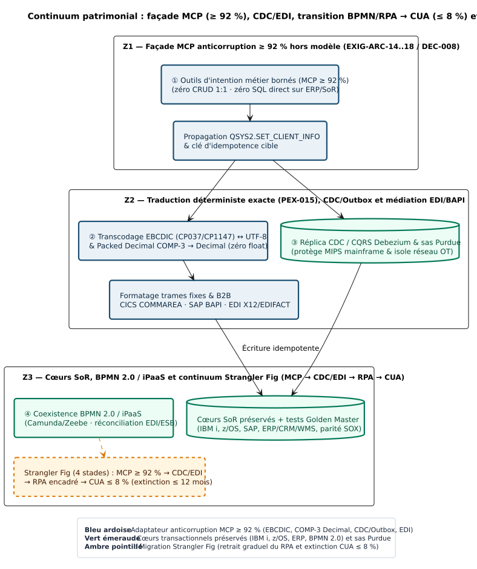
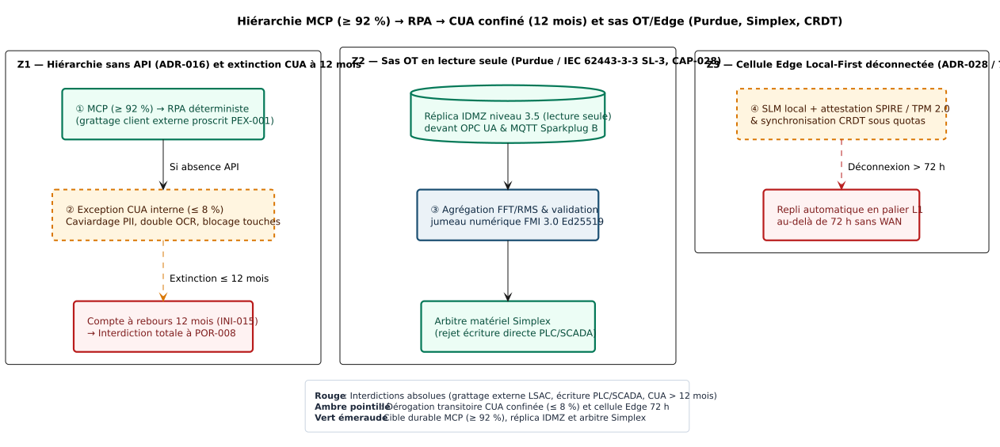
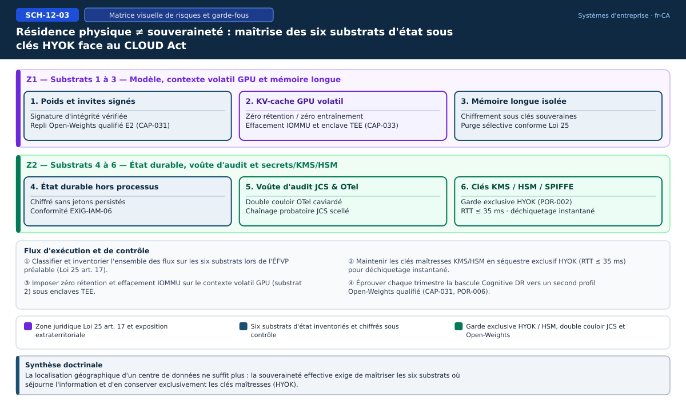

# Chapitre 12 — Encapsulation patrimoniale (ERP, mainframes, EDI), transition RPA/BPM vers MCP, confinement CUA, sas IT/OT et six substrats d'état

*Question directrice :* Comment raccorder les cœurs transactionnels (`ERP`, mainframes `IBM i` et `z/OS`, `CRM`, `SCM`), orchestrer la coexistence avec `BPMN 2.0`, `iPaaS`, `EDI` et `RPA` jusqu'à l'extinction des `CUA` (`≤ 8 %`, bail `12` mois), sécuriser la frontière industrielle `IT/OT` (`Purdue`, `Simplex`) et garder la souveraineté `HYOK` sur les six substrats d'état ?

## 12.1 Préservation des cœurs d'entreprise, continuum patrimonial et encapsulation déterministe

Dans la majorité des grandes organisations industrielles, logistiques, commerciales, publiques et financières, les registres d'autorité — grands livres et progiciels `ERP` (`SAP`, `Oracle`), systèmes centraux `IBM i` et `z/OS` (`CICS`), plateformes `CRM`, `SIRH`, `WMS`/`TMS` (`SCM`), `PLM`, `ITSM`, moteurs assurantiels (`Guidewire`, `Majesco`) et systèmes d'exécution manufacturière (`MES`/`SCADA`) — reposent sur des décennies de règles éprouvées. Réécrire ces cœurs transactionnels avant d'y greffer une automatisation agentique introduit un risque opérationnel disproportionné ; à l'inverse, autoriser un modèle probabiliste à émettre du `SQL` direct ou à manipuler des montants en arithmétique flottante compromet immédiatement l'intégrité des comptes et des stocks (`PRR R-01`, `AP-06`).

> **Clause non-avis (`AO-05`)** — Conformément à la clause `non-avis` (`AO-05`) arrêtée au gel documentaire du 2 décembre 2026, l'examen des exigences législatives et prudentielles — notamment les lois bancaires canadiennes [1, 2], le droit québécois [3] et les lignes directrices du BSIF [4, 5] — relève d'une référence technique d'architecture (← Chapitre 11). Cette analyse ne constitue ni un avis juridique ni une certification réglementaire.

La doctrine retenue par le Compendium repose sur l'interposition d'une **couche anti-corruption** (`ACL`, `CAP-024`, `DEC-008`, `EXIG-ARC-14` à `EXIG-ARC-18`). Exécutée intégralement en code déterministe hors du modèle, cette couche agit tel un traducteur-comptable assermenté posté devant un coffre mainframe ou un `ERP`. Elle s'expose côté agent sous forme de façades `MCP` orientées vers la tâche métier (`EXIG-MCP-06`), proscrivant tout miroir `CRUD` un-à-un des tables internes. Elle absorbe ainsi la complexité binaire, encodée et transactionnelle des systèmes d'enregistrement (`SoR`), garantit le maintien de leur autorité unique et protège leur capacité de traitement contre les rafales exploratoires d'agents.

Cette approche sans duplication s'applique avec la même rigueur aux progiciels métiers modernes (`CRM`, `SIRH`, `WMS`, `PLM`, ou cœurs bancaires et assurantiels `Guidewire` et `Majesco`). Plutôt que de répliquer le calcul des coûts de revient, des stocks allouables, des paies ou des réserves actuarielles dans des invites ou des scripts externes, la façade expose des intentions bornées — consulter un ordre ou une police, vérifier l'éligibilité d'un dossier, soumettre un avenant préparé — en laissant au moteur central la validation finale. Lorsque l'interface native fonctionne par lots nocturnes, l'adaptateur lisse les écarts temporels sans exposer le `SoR` aux réessais aveugles du modèle.

Sur le plan de l'automatisation d'entreprise, cette encapsulation gouverne une trajectoire ordonnée : les moteurs `BPMN 2.0`, bus `iPaaS`/`ESB` et traducteurs `EDI` conservent la chorégraphie déterministe maîtresse (`L0`), tandis que les façades `MCP` (`≥ 92 %` cible) remplacent graduellement les ponts `RPA` cassants et encadrent le reliquat sans API sous le double régime de **Sas déterministe IT/OT et confinement CUA** (`≤ 8 %`, bail `12` mois). En évitant un second référentiel de vérité en marge du `SoR`, l'architecture prévient toute divergence de solde ou d'inventaire et maintient la référence de corrélation jusqu'au grand livre.

Cette même logique de frontière régit la frontière cyber-physique des technologies opérationnelles (`IT/OT`) au cœur de l'industrie, de l'énergie et de la logistique, ainsi que la souveraineté juridictionnelle des données en nuage (`Loi 25` art. `17` [3]). En haute régulation bancaire fédérale, au titre de l'article `239(1)` [1], une banque canadienne conserve ses livres au Canada ; lorsque certaines filiales étrangères relèvent de l'exception de l'article `239(3.1)`, l'article `245(1.1)a)` habilite le surintendant à ordonner des copies au Canada faute d'« accès immédiat, direct, complet et continu » [1]. Parallèlement, la ligne directrice `B-10` du BSIF [5] formalise un étalon de maîtrise des sous-traitants, d'inventaire des dépendances critiques, de continuité et de réversibilité applicable à chacun des six substrats d'état.

## 12.2 Couche anti-corruption, transition RPA/BPM vers MCP, sas IT/OT et six substrats

### 12.2.1 Couche anti-corruption (ACL), médiation ESB/iPaaS/EDI, coexistence BPMN 2.0 et confinement CUA

L'adaptation déterministe devant les plateformes `IBM z/OS`, `IBM i` et `SAP BAPI` doit résoudre trois invariants critiques hors du modèle (`EXIG-ARC-14`, `EXIG-ARC-17`, `PEX-015`). Le premier invariant concerne le transcodage exact entre les pages de codes `EBCDIC` — notamment `CP037` en Amérique du Nord et `CP1147` pour les environnements francophones comportant des signes diacritiques — et l'encodage `UTF-8`. Ce transcodage doit s'opérer sans perte silencieuse ni substitution de caractères dans les noms de titulaires, les adresses ou les libellés d'écritures comptables. Une table de correspondance mal appariée altère silencieusement les caractères accentués ou les codes de contrôle, ce qui rompt le rapprochement des clés nominatives et des écritures réglementaires.

Le deuxième invariant porte sur l'arithmétique monétaire. Dans les enregistrements `COBOL` et `RPG`, les montants financiers utilisent le format `Packed Decimal` (`COMP-3`), où chaque octet stocke deux chiffres décimaux codés en binaire, sauf le dernier octet qui combine le dernier chiffre dans son quartet de poids fort et le quartet de signe dans son quartet de poids faible (`C` positif, `D` négatif, `F` non signé). Ces zones binaires DOIVENT être décodées vers un type décimal exact (`Decimal` ou entier d'unités mineures en centimes), avec interdiction absolue de transiter par des nombres à virgule flottante `IEEE 754` (`PEX-015`). En virgule flottante binaire, des fractions décimales élémentaires comme un dixième ou un centième ne possèdent pas de représentation exacte en base deux. Les dérives d'arrondi cumulatives qui en résultent sont incompatibles avec la comptabilité bancaire, les rapprochements de grands livres ou les déclarations de frais selon la Norme canadienne `NI 31-103`.

Au sein de la trousse exécutable du Tome 8, le module `policy_saga/decimal_money.py` formalise ce garde-fou de manière bloquante. La classe immuable `MoneyAmount` encode les montants en centimes entiers (`cents`), avec une devise strictement bornée à l'ensemble `ALLOWED_CURRENCIES` (`CAD`, `USD`, `EUR`). La fonction `from_decimal_str` lève explicitement une erreur `TypeError` si l'appelant soumet un `float` ou un `bool`, lève une erreur `ValueError` sur toute devise hors périmètre, valeur non finie ou syntaxe invalide (`InvalidOperation` interceptée et convertie), et quantifie la valeur décimale exacte selon l'arrondi bancaire `ROUND_HALF_EVEN`. L'exécution hors modèle de ce parseur garantit qu'aucun montant proposé ou relu par un agent ne subit de troncature binaire.

Le troisième invariant protège la disponibilité transactionnelle et l'imputabilité des systèmes centraux. Les lectures analytiques ou requêtes exploratoires répétitives sont déviées vers des réplicas `CQRS` alimentés par capture de données modifiées (`CDC`, par exemple via `Debezium`) afin de préserver les quotas `MIPS` et d'éviter la saturation des files `CICS` ou des journaux `DB2 for i`. Côté écritures, les façades `MCP` propagent l'identité applicative et de session jusqu'au gestionnaire central — par exemple via la procédure `QSYS2.SET_CLIENT_INFO` sur `IBM i` —, formatent les trames fixes (`CICS COMMAREA`, *copybooks* `COBOL`/`RPG`, `SAP BAPI`, définitions `PCML`) et associent une clé d'idempotence vérifiée en cible ainsi qu'une référence de trace (`EXIG-ARC-18`). Chaque adaptateur patrimonial est soumis par exigence d'homologation du chapitre à des suites de tests de parité `SOX` et *Golden Master* comparant les sorties de la façade `MCP` aux traces historiques sur `100,0 %` des transactions encapsulées (validation d'ingénierie distincte des tests exécutables `G0` de la trousse, qui portent sur `decimal_money.py` et `prr_validators.py`).

Dans les environnements `CICS` à tampons positionnels fixes, le moindre décalage d'un octet dans la `COMMAREA` corrompt les zones adjacentes sans provoquer systématiquement d'erreur réseau. La façade déterministe vérifie donc l'alignement exact des longueurs de champs, la complétion par zéros ou espaces selon le type `COBOL` attendu et le code retour applicatif hôte avant d'acquitter l'appel. En cas d'anomalie de longueur ou de format, le harnais bloque l'envoi vers le mainframe et retourne une erreur typée actionnable vers le niveau d'orchestration durable.

Dans les architectures intégrant des partenaires externes ou des flux applicatifs composites, la façade `MCP` anticorruption couronne et réutilise les bus `ESB`, les plateformes `iPaaS`, les médiateurs `ACE`/`CP4I` et les moteurs déterministes `BPMN 2.0` (`Camunda 8` / `Zeebe`), au lieu d'ouvrir des canaux parallèles directs vers les bases `ERP` ou mainframes. Sur les échanges `B2B` structurés sous `EDIFACT` ou `ASC X12` via `AS2`/`AS4` (la norme propriétaire `ASC X12` demeurant classée hors preuve ouverte en `statut F` selon `AO-01`), les traducteurs historiques (*Message Translators*) introduisent fréquemment des pertes sémantiques lorsqu'ils projettent un modèle canonique riche vers une trame plus pauvre. Ces pertes — écrasement d'un qualificatif de devise, d'un motif de litige ou d'un fuseau horaire — sont documentées et réconciliées en code déterministe plutôt que masquées par des valeurs par défaut.

De façon symétrique, les investissements `BPMN 2.0` existants conservent l'orchestration déterministe de bout en bout (`L0`) en cantonnant les interventions agentiques à des sous-processus ad hoc bornés (`C07`, `C08`), tandis que les couches `iPaaS` et de gestion d'API s'élèvent en plans d'accès gouvernés. Les automates `RPA` fragiles (`AP-05`), vulnérables aux modifications d'écran, sont progressivement retirés au profit de façades `MCP` selon la trajectoire *Strangler Fig* en quatre stades résumée au Tableau 12.1. Chaque franchissement de stade reste conditionné par des critères objectifs de parité, de latence et d'absence de régression `SOX`, assorti d'un interrupteur de repli immédiat vers la voie déterministe antérieure.

| Stade ou mécanisme | Rôle technique dans la modernisation | Contrôle déterministe associé | Risque maîtrisé |
|---|---|---|---|
| `Stade 1 — Ombre` | L'adaptateur `MCP` et le modèle exécutent en parallèle en lecture seule sans effet sur le `SoR` | Comparaison *Golden Master* et parité `Decimal` exact (`PEX-015`) | Zéro impact de production avant validation empirique |
| `Stade 2 — Recommandation` | L'agent prépare des propositions typées ; l'humain ou le flux `BPMN 2.0` valide l'écriture | Schéma strict `JSON Schema 2020-12` [6] et audit `SOX` | Prévention des doubles écritures et erreurs de trame |
| `Stade 3 — Action bornée` | Délégation des cas simples sous façade `MCP` avec réplica `CDC`/`CQRS` | Clé d'idempotence cible, `QSYS2.SET_CLIENT_INFO`, lissage `MIPS` | Protection des verrous `CICS` et quotas mainframe |
| `Stade 4 — Autonomie` | Extinction des anciens ponts `RPA` fragiles (`AP-05`) et routage intégral par façades `MCP` | Couverture de parité à `100,0 %` et retrait du bail `CUA` | Élimination de la dette d'intégration et de surface fragile |

*Tableau 12.1 — Conversions patrimoniales déterministes et trajectoire Strangler Fig en quatre stades.*

La Figure 49 (`SCH-12-01`) réunit ces deux volets en montrant comment la façade `MCP` anticorruption sépare nettement le dialogue orienté vers l'intention côté agent, le moteur de traduction exacte (`EBCDIC`, `COMP-3` en `Decimal`, `CDC`/`CQRS`) et la trajectoire graduelle de coexistence `BPMN 2.0` / `iPaaS` sous *Strangler Fig*.

*Figure 49 — SCH-12-01 : Couche anticorruption MCP (EBCDIC/COMP-3 Decimal exact), médiation B2B/EDI et Strangler Fig en quatre stades.*

Pour le patrimoine applicatif dépourvu d'interface programmable, la décision d'architecture interne `ADR-016` (`CAP-025`, `PRR R-12`) fixe une hiérarchie cible des modes de raccordement sans appui empirique externe. Au moins `92 %` des intégrations DOIVENT emprunter des adaptateurs `MCP` (directs ou sur base répliquée), tandis que le reliquat structuré recourt au `RPA` déterministe orchestré. Le recours aux agents d'interface visuelle (*Computer-Use Agents*, `CUA`) demeure ainsi plafonné à une exception interne transitoire d'au plus `8 %` des flux (`Citrix HDX`, terminaux `3270`/`5250`). Cette répartition cible concentre l'effort d'ingénierie sur l'extraction d'API durables plutôt que sur le maintien d'automates fragiles sensibles au moindre décalage graphique.

Sur le front externe, l'architecture proscrit catégoriquement tout grattage d'écran (*screen scraping*) côté client (`PEX-001`, `SIG-103`). Au Canada, l'encadrement fédéral des services bancaires axés sur les consommateurs (`LSAC`, sanctionné le `26 mars 2026` sous la cote `L.C. 2026, ch. 3`, art. `224`) [2] comporte un article `171` consacré au grattage d'écran. Cet article interdit à « toute personne physique ou entité, en vue de fournir des produits ou services à un consommateur au Canada, d’utiliser une interface ou une application et l’authentifiant de celui-ci afin d’avoir un accès direct à ses données » [2]. Cette interdiction demeure assujettie aux exceptions réglementaires et n'est pas encore en vigueur au gel du `2 décembre 2026`, son application relevant d'un décret prévu à l'article `181` [2] (`SIG-103`). L'architecture l'anticipe néanmoins dès la conception afin que tout raccordement aux données financières d'un consommateur repose sur des interfaces normalisées et accréditées.

À l'interne, les rares cellules `CUA` maintenues par dérogation sur des progiciels anciens sans éditeur actif s'exécutent isolées en `microVM` éphémère sous un bail d'extinction maximal de `12` mois (`INI-015`, `EXIG-ARC-17`), aboutissant à zéro `CUA` résiduel à la porte `POR-008` (`POR-004`, `EXIG-GOV-15`, `EXIG-GOV-16`). Ce harnais de confinement pallie cinq modes de défaillance propres aux interfaces graphiques et terminaux : la désynchronisation modale due à une alerte tardive, l'hallucination géométrique sur décalage de pixels, l'injection visuelle dissimulée dans un libellé client (`ASI01`), la fuite de renseignements personnels vers un modèle vision externe (`art. 13` et `17` de la `Loi 25` [3]) et l'omission d'un code d'erreur hôte en ligne `24` sur écran `5250`.

Concrètement, le modèle vision ne reçoit jamais l'accès direct au pilote clavier ou souris : il soumet un geste atomique typé à un contrôleur local déterministe. Avant toute inférence, le harnais caviarde les zones de renseignements personnels (`piiRedactionZones`) afin qu'aucun numéro d'assurance sociale ou numéro de compte ne quitte l'enceinte de contrôle. Il vérifie ensuite de manière synchrone l'identifiant d'écran (`screenCodeRegion`), bloque les zones de clic dangereuses (`forbiddenClickZones`) ainsi que les caractères de contrôle susceptibles de déclencher une validation prématurée (`\r`, `\n`, `\t` ou *Field Exit*). Après l'exécution du geste, un extracteur indépendant relit la valeur saisie et la ligne de statut, puis scelle les trames avant et après l'acte dans un journal `WORM` avant d'autoriser la touche finale `COMMIT`.

### 12.2.2 Sas déterministe IT/OT (Purdue, OPC UA/AAS, Simplex), cellule Edge CRDT et maîtrise des six substrats d'état

Dans l'industrie manufacturière, l'énergie, l'extraction minière, le transport, les entrepôts automatisés (`WMS`/`WCS`) et les infrastructures physiques critiques, le couplage `IT/OT` (`ERP ↔ MES ↔ SCADA/PLC`) constitue un pilier de plein droit des systèmes d'entreprise. Conformément à la rigueur méthodologique de l'ouvrage — dont les preuves sectorielles ouvertes `L+` couvrent principalement les systèmes d'information et l'étalon prudentiel financier —, l'actionnement autonome de systèmes instrumentés de sûreté (`SIS` de niveau `SIL 2` à `SIL 4`, `≥ SIL 2`) demeure formellement exclu. Tout raccordement d'automatisation agentique à l'espace `OT` (`CAP-028`, `ADR-017`, `INI-029`) obéit donc à trois verrous non négociables (`EXIG-AUT-09`, `EXIG-AUT-11`, `EXIG-ORC-27`, `SIG-109`).

Premièrement, le raccordement respecte la segmentation du modèle `Purdue` avec séparation physique en zone démilitarisée industrielle (`IDMZ` de niveau `3.5`) : les agents consultent exclusivement un réplica en lecture seule exposé devant des protocoles industriels tels qu'`OPC UA`, `AAS` ou `MQTT Sparkplug B`, sans jamais disposer de voie d'écriture directe ni de boucle de réessai vers un automate programmable (`PLC`) ou un système `SCADA`. Les textes intégraux des normes industrielles payantes (`IEC 62443-3-3`, `IEC 62541`, `IEC 61511`, `ISO 10218-1`) ainsi que le projet de norme en cours `IEEE P3945.1` restent classés hors du socle probatoire ouvert (`AO-01`). L'ingénierie de contrôle s'appuie donc sur la méthodologie systémique ouverte `STAMP/STPA` appliquée aux agents autonomes par Barrett et ses collègues (« STAMP/STPA Informed Characterization of Factors Leading to Loss of Control in AI Systems » [7]). Cette approche recense les actions de contrôle dangereuses et les défauts de rétroaction entre capteurs, actionneurs, processus contrôlé, contrôleurs et superviseurs humains sur un archétype simple de boucle en exploitation (les systèmes multi-agents complexes étant signalés hors portée dans [7]).

Deuxièmement, les signaux capteurs à haute fréquence subissent une agrégation locale déterministe (`FFT`/`RMS`) en périphérie afin de ne pas saturer le contexte cognitif avec des séries temporelles brutes. Troisièmement, toute consigne d'ajustement proposée doit traverser un jumeau numérique déterministe (`FMI 3.0`, *Functional Mock-up Interface*, distincte de `FMI 2026/004` au Chapitre 08, dont les artefacts et mises à jour sont signés `Ed25519`), obtenir une approbation humaine hors bande et franchir un arbitre matériel déterministe `Simplex` qui conserve en dernier ressort l'autorité de basculer vers une commande de repli sûre sans jamais certifier un contrôleur neuronal. La séparation entre le contrôleur avancé consultatif et le contrôleur matériel de sûreté garantit qu'une dérive du modèle ne franchit jamais les limites physiques admissibles de l'équipement.

Lorsque des agents de terrain doivent opérer sur des sites industriels éloignés, chantiers énergétiques, entrepôts ou succursales sinistrées privés de connectivité étendue (`ADR-028`, `PRR F-08`), l'architecture prévoit une cellule `Edge Local-First` déconnectée. Cette cellule fixe comme cible de conception analytique une autonomie de `72` heures sans lien `WAN` — cible d'ingénierie sans appui empirique de production à grande échelle — au-delà de laquelle elle rétrograde automatiquement en palier consultatif `N1/L1`. Elle embarque un petit modèle local (`SLM`), une attestation matérielle locale (`SPIRE` adossée à un module `TPM 2.0`), des politiques locales embarquées en `Cedar` et une gestion de quotas en séquestre empêchant la sur-allocation hors ligne (par exemple l'engagement simultané d'un même stock critique ou plafond d'indemnisation sur deux terminaux isolés). Au rétablissement du lien réseau, les états locaux sont réconciliés par types de données répliqués sans conflit (`CRDT`) selon une file de resynchronisation priorisée par criticité métier.

*Figure 50 — SCH-12-02 : Hiérarchie MCP (≥ 92 %) → RPA → CUA confiné (bail 12 mois) et sas OT/Edge (Purdue, Simplex, CRDT).*

La Figure 50 (`SCH-12-02`) rassemble l'arbitrage sans API (`MCP → RPA → CUA` éteint à `12` mois), le sas industriel `IT/OT` en lecture seule sous arbitre `Simplex` et la cellule `Edge CRDT`. Cependant, même lorsque les cœurs transactionnels demeurent sur site et les cellules périphériques isolées, le recours à l'inférence et au stockage infonuagiques pose un défi fondamental : la **souveraineté juridictionnelle**. Dans le cadrage doctrinal du traité, la résidence physique d'un centre de données à Montréal ou à Toronto n'offre pas d'immunité juridictionnelle si l'opérateur relève d'une loi étrangère à portée extraterritoriale (telle que le *CLOUD Act* américain). De plus, aucun schéma européen unifié `EUCS` n'était adopté mi-`2026` hors des qualifications nationales telles que *SecNumCloud* (repères hors socle `L+` à confirmer à la source primaire). Ces textes étrangers et référentiels nationaux n'étant pas archivés en `L+` dans le socle fermé du chapitre, le contrôle juridique s'appuie sur l'exigence d'évaluer le régime de l'État destinataire prévue à l'article `17` de la `Loi 25` [3].

Pour protéger les secrets industriels (`PLM`, R&D), les données cliniques ou `SIRH` et satisfaire à l'article `17` de la Loi 25 [3] (`ÉFVP` préalable aux transferts hors Québec), il importe de qualifier juridiquement chaque lieu de transit et de traitement. Ce contrôle transversal s'articule en haute régulation avec les exigences de conservation au Canada et de copies sur ordonnance des articles `239` et `245(1.1)` de la législation bancaire canadienne [1], ainsi qu'avec les obligations de maîtrise des tiers, d'inventaire des sous-traitants et de réversibilité de la ligne directrice `B-10` du BSIF [5]. L'organisation doit par conséquent inventorier, cloisonner et chiffrer sous contrôle exclusif l'ensemble des **six substrats d'état** (`PRI-011`, `CAP-032`, `ADR-027`, `POR-002`, `EXIG-CON-05`, `EXIG-APP-11`, `PRR F-04`), synthétisés au Tableau 12.2.

| Substrat d'état (`ADR-027`) | Actifs et données portés | Exposition dominante | Contrôle souverain exigé (`POR-002`) |
|---|---|---|---|
| `1. Modèle et configuration` | Poids, adaptateurs `LoRA`, invites système, catalogue | Fuite de propriété intellectuelle ou altération | Artefacts signés en registre interne ; repli qualifié à poids ouverts (`CAP-031`) |
| `2. Contexte volatil GPU` | Fenêtre active, `KV-cache`, résultats d'outils en mémoire vidéo | Exposition sur accélérateurs mutualisés ; rétention fournisseur | Clause zéro rétention / zéro entraînement (`EXIG-APP-10`), effacement `IOMMU` et enclaves `TEE` sélectives (`CAP-033`) |
| `3. Mémoire longue isolée` | Épisodes `CoALA`, index vectoriels, graphes bi-temporels | Profilage et entrave au droit à l'effacement | Isolation par entité (`EXIG-ARC-23`), clés souveraines et purge `Loi 25` [3] |
| `4. État durable` | Points de reprise d'exécution, journaux `Saga`, attentes | Sérialisation de paramètres sensibles ou de jetons | Magasin externe chiffré au repos ; zéro jeton persisté (`EXIG-IAM-06`) |
| `5. Traces et voûte d'audit` | Télémétrie `OTel` caviardée, journal probatoire canonisé `JCS` | Injonction étrangère ou altération interne | Double couloir `PII`, canonisation `JCS` et ancrage externe vérifiable |
| `6. Secrets, KMS, HSM, SPIFFE` | Clés maîtresses, autorités de certification `SPIFFE` | Perte immédiate de souveraineté sur compromission | Séquestre exclusif par l'institution (`HYOK`/`HSM`, `RTT ≤ 35 ms` recommandé) |

*Tableau 12.2 — Maîtrise juridictionnelle et chiffrement HYOK des six substrats d'état.*

Chaque substrat présente des contraintes opérationnelles distinctes qui interdisent de réduire la souveraineté au seul stockage en base de données. Sur le premier substrat, les poids et invites signés garantissent l'intégrité du modèle de repli. Sur le deuxième substrat, les tenseurs actifs du `KV-cache` résident en mémoire vidéo GPU mutualisée et imposent à la fois des clauses contractuelles de zéro rétention et une remise à zéro matérielle `IOMMU`. Sur les troisième et quatrième substrats, les mémoires `CoALA` et les points de reprise durables exigent un chiffrement au repos sous clés maîtrisées et l'exclusion absolue de jetons d'accès persistés. Sur les cinquième et sixième substrats, la voûte d'audit canonisée et les clés racines forment la pierre angulaire de l'indépendance probatoire.

Cette cartographie exhaustive des six substrats s'impose également lors de la sélection contractuelle et de la revue annuelle des prestataires infonuagiques au titre de la ligne directrice `B-10` du BSIF [5]. En identifiant précisément où transitent le contexte d'inférence volatil, les points de contrôle durables et les journaux techniques, l'institution vérifie qu'aucun sous-traitant de quatrième rang n'héberge de renseignements non chiffrés hors des périmètres approuvés. Elle valide simultanément la capacité réelle de réversibilité et d'extraction complète des données en cas de résiliation ou d'incident majeur du fournisseur.

Ainsi que le met en relief la Figure 51 (`SCH-12-03`), la garde exclusive des clés maîtresses par l'institution (*Hold Your Own Key*, `HYOK`) constitue le verrou ultime de déchiquetage cryptographique instantané à la porte `POR-002`. Sous `HYOK`, la latence aller-retour recommandée entre l'enclave ou le magasin et le séquestre de clés demeure bornée (`RTT ≤ 35 ms`), tout en rappelant que les données chiffrées ne sont pas nativement portables sans procédure de déchiffrement et de réexportation maîtrisée. Sur les flux critiques, cette souveraineté des clés s'accompagne d'une capacité de continuité cognitive (*Cognitive DR*, couverte conjointement avec les six substrats d'état sous `ADR-027`) : basculer d'un fournisseur d'inférence à un autre prend quelques secondes sur le plan réseau, mais réaligner les invites, les appels d'outils et les seuils exige des semaines à froid. Chaque flux critique pré-qualifie donc en environnement `E2` et éprouve chaque trimestre un second profil indépendant à poids ouverts (`ADR-027`, `CAP-031`, `POR-006`). Le dimensionnement matériel des enclaves `TEE` CPU/GPU (`CAP-033`) et leurs limites matérielles face aux attaques physiques sur bus mémoire sont approfondis au Chapitre 21.

*Figure 51 — SCH-12-03 : Résidence physique ≠ souveraineté : maîtrise des six substrats d'état sous clés HYOK face au CLOUD Act.*

## 12.3 Contrat d'exigences, validation PRR et invariants exécutables

L'intégration patrimoniale et souveraine définie dans ce chapitre gouverne l'interface entre la couche d'accès aux systèmes d'enregistrement (`C4`) et les plans transversaux de sécurité, d'exécution durable et de conformité. Sur le plan exécutable, la trousse du Tome 8 relie directement ces règles à deux modules déterministes validés en `G0`. D'une part, `policy_saga/decimal_money.py` interdit tout type `float` par `TypeError` et impose l'arrondi `ROUND_HALF_EVEN` sur les montants hérités des zones `COMP-3`.

D'autre part, `evalops_prr/prr_validators.py` contrôle mécaniquement la réception des `24` portes bloquantes listées dans `BLOCKING_PRR_IDS`. La fonction `validate_prr_24_blocking` vérifie la conformité structurelle du dossier d'évidence contre son schéma `JSON Schema Draft 2020-12` [6], détecte les doublons de `prr_id`, les identifiants manquants (`missing_ids`) ou les statuts distincts de `PASS` (`failed_ids`), et retourne un `PrrReport` couvrant notamment les preuves déclarées pour `R-01` (absence d'écriture `SQL` directe sur les systèmes d'enregistrement) et `F-04` (résidence juridictionnelle vérifiée des six substrats). Lorsque `validate_prr_24_blocking` relève une erreur de schéma, une porte manquante ou un statut différent de `PASS`, `passed` vaut `False` et la mise en production reste bloquée mécaniquement.

Dans le partage des responsabilités de gouvernance, l'architecte d'entreprise (`AE`) fixe les cibles de la hiérarchie sans API, impose le bail d'extinction des `CUA` à `12` mois et valide la cartographie souveraine des six substrats lors des revues `ÉFVP`. Symétriquement, l'architecte de solutions (`AS`) déploie les convertisseurs déterministes `EBCDIC`/`COMP-3`, le réplica `IDMZ` devant `OPC UA`, les tests de parité *Golden Master* et le séquestre de clés `HYOK`. Les contrôles prudentiels issus de la ligne directrice `E-23` du BSIF — qui entrera en vigueur le `1er mai 2027` [4] sur la gestion du risque de modélisation (incluant la fiabilité des données d'entrée, les modèles autonomes et la mise hors service) — sont étendus par doctrine d'architecture à la surveillance continue des cellules `CUA` résiduelles. Le Tableau 12.3 récapitule ces exigences et les frontières inter-chapitres.

| Axe propre à `CH-12` | Exigences, décisions et portes | Délégation sortante (`→`) | Apport entrant (`←`) |
|---|---|---|---|
| Couche anti-corruption `EBCDIC`/`COMP-3` et médiation | `CAP-024`, `DEC-008`, `EXIG-ARC-14`–`18`, `EXIG-MCP-06`, `PEX-015`, `INI-011`, `C07`–`08`, `C12`, `PRR R-01`, `R-13` | `→ CH-07` (façades `MCP`) ; `→ CH-15` (reprise `Temporal` / idempotence) | `← CH-04` / `← CH-30` (feuille de modernisation `360` j et *Golden Master*) |
| Confinement et extinction `CUA`, sas `OT` et `Edge CRDT` | `ADR-016`, `ADR-017`, `ADR-028`, `CAP-025`, `CAP-028`, `PEX-001`, `INI-015`, `INI-029`, `POR-004`, `POR-008`, `PRR R-12`, `F-08` | `→ CH-16` (`SPIFFE`/`TPM 2.0` en périphérie) ; `→ CH-28` (exclusion `SIS` `SIL 2–4` / `≥ SIL 2`) | `← CH-25` (contrôles `BSIF E-23` [4] et `Loi 25` [3] sur captures `CUA`) |
| Souveraineté des six substrats d'état | `PRI-011`, `ADR-027`, `CAP-032`, `CAP-033`, `EXIG-CON-05`, `EXIG-APP-11`, `INI-006`, `POR-002`, `PRR F-04` | `→ CH-21` (enclaves matérielles `TEE` et séquestre `HYOK`) | `← CH-25` (`ÉFVP` art. 17 `Loi 25` [3], `Loi sur les banques` art. 239 et 245(1.1) [1]) |

*Tableau 12.3 — Matrice des exigences, portes et frontières inter-chapitres du Chapitre 12.*

Une fois les `SoR` (`ERP`, mainframes, `CRM`, `SCM`), les médiateurs `EDI`/`iPaaS`, les workflows `BPMN 2.0`, le reliquat `RPA`/`CUA` et le sas `IT/OT` encapsulés derrière des façades déterministes, la Partie IV (`D04`) passe le relais à la **Partie V (`D05`)** pour gouverner l'automatisation agentique composite sobre (`OO1–OO4`), le maillage événementiel (`Event Mesh`) et les sagas compensables durables (→ Partie V, Chapitre 13) ; trois invariants exécutables opposables à toute homologation clôturent ce socle.

> **Trois invariants exécutables — Chapitre 12**
> 1. **Exactitude décimale et protection `SoR` (`CAP-024`, `DEC-008`, `PEX-015`, `PRR R-01`)** : Aucun agent NE DOIT exécuter de `SQL` direct ni manipuler de montants financiers en virgule flottante `IEEE 754`. Toute façade `MCP` anticorruption devant `IBM i`, `z/OS`, `CICS` ou `SAP` DOIT exécuter hors modèle le transcodage `EBCDIC`, la conversion `COMP-3` vers `Decimal` exact (`from_decimal_str` rejetant `float` et `bool` par `TypeError`), le lissage `MIPS` via `CQRS`/`CDC` et la parité *Golden Master* à `100,0 %`.
> 2. **Extinction `CUA` à 12 mois et sas industriel `IT/OT` (`ADR-016`, `PEX-001`, `INI-015`, `POR-008`, `CAP-028`)** : Le grattage d'écran client externe est formellement proscrit, anticipant dès la conception l'article `171` de la `LSAC` [2] (non encore en vigueur par décret art. `181`). Les dérogations `CUA` internes (`≤ 8 %`, seuil cible `ADR-016` en `microVM`) DOIVENT caviarder les renseignements personnels avant capture et s'éteindre en `≤ 12` mois vers `MCP` (`POR-008`). Toute intégration industrielle `IT/OT` DOIT rester cantonnée en lecture seule en `IDMZ` (`Purdue 3.5`, zéro actionnement `SIS ≥ SIL 2`) derrière jumeau `FMI 3.0` et arbitre matériel `Simplex`.
> 3. **Maîtrise des six substrats sous clés `HYOK` (`PRI-011`, `CAP-032`, `POR-002`, `PRR F-04`)** : La résidence physique ne suffisant jamais face aux lois extraterritoriales, l'organisation DOIT inventorier et chiffrer chacun des six substrats d'état sous clés maîtresses conservées exclusivement (`HYOK`/`HSM`, sans jeton persisté en état durable), prouvé structurellement via `validate_prr_24_blocking` (`F-04`, `R-01`) et assorti d'un repli trimestriel vers un second modèle à poids ouverts (`CAP-031`).
