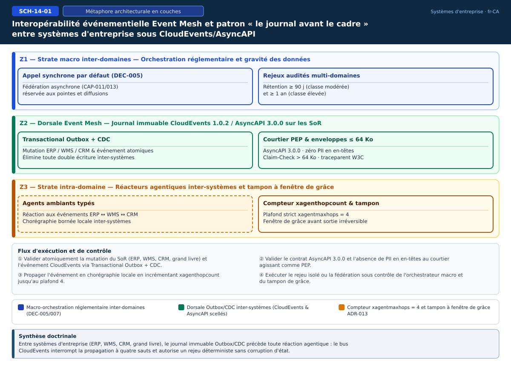
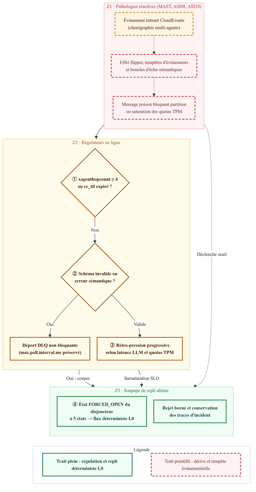
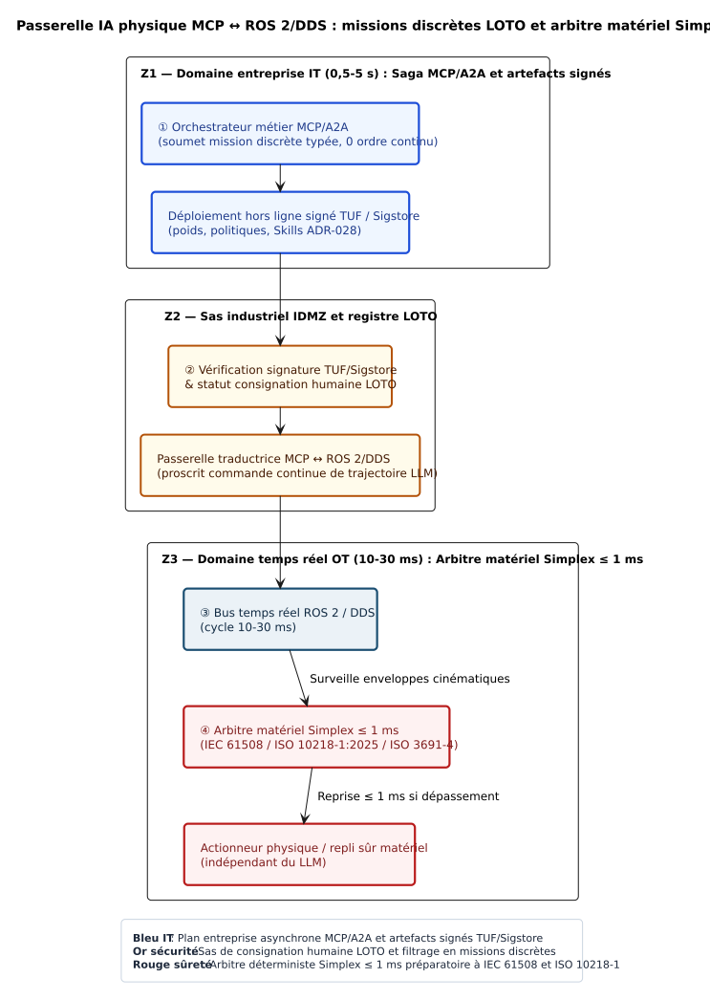

# Chapitre 14 — Interopérabilité événementielle (Event Mesh CloudEvents/AsyncAPI), régulation anti-tempête et passerelle cyber-physique IT/OT

*Question directrice :* Comment raccorder de façon asynchrone les systèmes d'entreprise et les agents réactifs sur une dorsale Event Mesh (CloudEvents/AsyncAPI) sans tempêtes d'événements ni messages poisons, tout en découplant l'automatisation TI des boucles industrielles temps réel via LOTO et Simplex ?

## 14.1 Résumé

Lorsque l'intégration entre systèmes d'entreprise (`ERP`, `CRM`, `WMS`, `ITSM`, `MES`) et agents spécialisés vise l'absorption de pointes, la diffusion un-vers-N ou le rejeu auditable sans couplage synchrone, la chorégraphie sur dorsale `Event Mesh` complète l'automatisation dirigée sans céder le contrôle transactionnel (`DEC-005`, `CAP-011`, `EXIG-EVT-01`). Ce chapitre établit les règles transformant un courtier d'entreprise (exemples indexés au cadre : `Apache Kafka`, `Solace PubSub+`, `NATS JetStream` ou — repère indicatif des Tomes à confirmer aux notes éditeur — `IBM MQ 9.4 LTS` avec `TLS 1.3` post-quantique `ML-KEM` sur `AMQP 1.0`) en organe de gouvernance déterministe où le journal immuable précède toute inférence probabiliste.

> **Clause non-avis (`AO-05`)** — Arrêté au gel du `2 décembre 2026`, l'exposé des normes sectorielles et industrielles relève de l'ingénierie d'architecture et ne vaut ni avis juridique ni certification réglementaire (Annexe D, § 2).

Chaque événement publié ou consommé par un agent doit se conformer à l'enveloppe `CloudEvents v1.0.2` (plafond d'acheminement `64 KByte` selon `SRC-035` [1], repris en borne `64 Ko` sous `EXIG-EVT-02`) et à un contrat `AsyncAPI 3.x` inscrit au catalogue d'entreprise (`EXIG-EVT-03`). Les attributs imposés par `EXIG-EVT-04` à `EXIG-EVT-07` proscrivent tout renseignement personnel direct sur les en-têtes répliqués et ancrent la traçabilité sur `traceparent` `W3C` ainsi que sur les spans `OpenTelemetry GenAI` ([7]). En parallèle, le courtier agit comme point d'application de politique (`PEP` sous `OPA`/`Rego`, `default allow := false` et couverture à `100 %` exigée en barrière `G0` [5, 6]) et coupe mécaniquement les boucles via `xagenthopcount` plafonné à `xagentmaxhops = 4`.

Dans la perspective systémique `STAMP/STPA` ([4]) et face aux pathologies réactives documentées au chapitre 13 (`MAST`) ainsi que dans le référentiel `OWASP ASI08`/`ASI10` ([2, 3]), l'architecture couple `Transactional Outbox` et capture `CDC` à la déduplication sur `(source, id)` ([1], `EXIG-EVT-08`). Ce socle isole les messages poisons en file de lettres mortes (`DLQ`) non bloquante, applique une rétro-pression sur quotas de jetons par minute (`TPM`) et replie en mode `FORCED_OPEN` vers le flux déterministe `L0`. Enfin, au contact de l'atelier automatisé et de la robotique mobile (`ADR-028`), une passerelle sémantique cible `MCP ↔ ROS 2/DDS` isole les sagas d'entreprise (`0,5–5 s`) des boucles d'asservissement (`10–30 ms`) au moyen de missions discrètes vérifiées contre le registre de consignation humaine `LOTO`, d'un arbitre matériel cible `Simplex` (`≤ 1 ms`) et de lots signés hors ligne par `TUF` et `Sigstore`.

## 14.2 Interopérabilité Event Mesh d'entreprise et automatisation cyber-physique IT/OT

### 14.2.1 Dorsale Event Mesh (CloudEvents v1.0.2 / AsyncAPI 3.0.0) et neutralisation des pathologies réactives

Dans un parc applicatif réel, la majorité des événements d'un courtier émanent de systèmes métiers déterministes (`ERP`, `WMS`, `ITSM`, `SCADA`) auxquels des agents abonnés réagissent sans scrutation périodique (*polling*) des bases de production ni couplages `iPaaS` point-à-point fragiles. Les appels synchrones `MCP` et `A2A` n'offrant ni diffusion un-vers-N ni rejeu natif, `DEC-005` réserve la dorsale événementielle à trois besoins démontrés (`EXIG-EVT-01`) : découplage temporel, réaction de plusieurs domaines abonnés au même fait métier sans modifier le producteur, et rejeu ordonné pour l'audit ou la qualification d'agents (`CAP-011`). L'architecture cible adopte un **patron hybride** associant macro-automatisation déterministe inter-domaines et chorégraphie réactive intra-domaine sous contrats stricts.

Cette distinction dissipe l'homonymie autour du terme *Agent Mesh*, qui recouvre trois réalités : la dorsale `Event Mesh` inter-régions (`Kafka`, `Solace PubSub+`, `NATS JetStream`, ou `IBM MQ 9.4 LTS` sur `AMQP 1.0` `ISO/IEC 19464`, norme payante hors corpus et repère des Tomes à confirmer chez l'éditeur), le maillage protocolaire (`MCP`/`A2A`) et le plan de contrôle `PEP`. Dans la première acception, le courtier réalise le principe « le journal avant le cadre » : il externalise la chronologie hors de la mémoire volatile sans constituer à lui seul un encadrement normatif. Dès que des mutations touchent plusieurs systèmes d'enregistrement, `EXIG-ORC-08` impose un propriétaire inscrit au registre et un coordinateur de saga compensatoire doté d'un tampon à fenêtre de grâce avant tout acte irréversible (`ADR-013`).

Sur le plan syntaxique et contractuel, `EXIG-EVT-02` impose l'enveloppe `CloudEvents v1.0.2` (spécification `CNCF` [1]) et prescrit sur `Kafka` le mode binaire défini par [1] (liaison par en-têtes `ce_*` selon le profil de protocole) afin que les intermédiaires inspectent les métadonnées sans désérialiser la charge utile. Aux quatre attributs requis par [1] (`id`, `source`, `specversion` valant `"1.0"` et `type` recommandé en domaine inversé), `EXIG-EVT-02` ajoute obligatoirement la version dans `type` (tel `ca.ent.logistique.alerte.rupture.v1`), `time`, ainsi que `datacontenttype` et `dataschema` dès qu'une charge utile est présente ([1]). La taille globale acheminée reste bornée à `64 Ko` (`64 KByte` / `64KB` littéralement dans `SRC-035` [1], sans trancher entre `64 000` et `65 536` octets) ; tout document volumineux ou sensible demeure dans un magasin protégé, l'événement ne transportant qu'une référence `dataref` soumise aux mêmes contrôles d'accès ([1]). Chaque sujet est régi au catalogue par un contrat `AsyncAPI 3.0.0` (ou `3.1.0` rétrocompatible) précisant schéma, clé de partition, classification, propriétaire et listes fermées d'acteurs (`EXIG-EVT-03`, `CAP-012`).

Le Tableau 14.1 synthétise les extensions de gouvernance obligatoires d'`EXIG-EVT-04` et `EXIG-EVT-05` (incluant des extensions documentées ultérieures à `1.0.2` figées au catalogue du cadre). Les attributs `CloudEvents` étant lus en clair par chaque relais et recopiés dans la télémétrie [1], aucun renseignement personnel direct (nom, adresse courriel, numéro de compte) ni justificatif d'authentification ne doit y figurer (`EXIG-EVT-05`) : seule une référence pseudonyme opaque dont la table de correspondance reste isolée hors du bus est admise. En outre, l'extension du catalogue `Auth Context` (`authtype`, `authid`) revêt un caractère purement informatif : conformément à `EXIG-EVT-07`, le courtier et l'intercepteur de publication agissent comme point d'application de politique (`PEP`), vérifient l'identité cryptographique réelle du producteur auprès du moteur hors modèle `OPA`/`Rego` (`default allow := false` [5], couverture `opa test --coverage` à `100 %` exigée en barrière `G0` [6]) et posent eux-mêmes les attributs d'origine et de sauts.

Ce point d'application au courtier garantit que l'autorisation de publier ou de consommer ne repose jamais sur les attributs déclaratifs d'un message, mais sur les listes de contrôle d'accès tirées du catalogue et l'intersection stricte des droits. L'intercepteur rejette à la publication tout événement dont le champ `dataschema` ne correspond pas aux schémas épinglés pour le sujet et applique les restrictions de `dataclassification`. Pour la traçabilité distribuée, `EXIG-EVT-04` impose d'injecter `traceparent` `W3C` à la création du message et d'associer les spans d'émission et de réception par un lien causal explicite afin d'éviter l'imbrication parent-enfant en diffusion parallèle, en corrélation avec les spans `OpenTelemetry GenAI` (`create_agent`, `invoke_agent`, `execute_tool`, en statut `Development` [7]). Lorsqu'un consommateur déclenche une action `P2` ou `P3` en aval, l'appel traverse obligatoirement la passerelle sous délégation `RFC 8693` échangée ou mandat inscrit au catalogue, ce saut événementiel s'imputant dans le plafond de profondeur de délégation d'`EXIG-ORC-04`.

| Attribut ou extension | Origine | Rôle opérationnel | Règle d'application (`EXIG-EVT-*`) |
|---|---|---|---|
| `id`, `source`, `type`, `time`, `dataschema` | `CloudEvents v1.0.2` [1] + cadre | Contrat du fait métier inter-systèmes | `type` en domaine inversé versionné ; taille `≤ 64 Ko` (`EXIG-EVT-02`) |
| `traceparent` (`tracestate`) | `Distributed Tracing` (`W3C`) | Chaînage causal des traces (`OTel GenAI` [7] ; `EXIG-EVT-04`) | Obligatoire et immuable au relais ; lien de span à la réaction |
| `authtype`, `authid` | `Auth Context` | Contexte informatif du mandant initial | Pseudonyme obligatoire ; jamais utilisé pour autoriser (`EXIG-EVT-05`, `07`) |
| `dataclassification` (`dataregulation`) | `Data Classification` | Étiquette de sensibilité (`confidential`, etc.) | Rejet immédiat par tout consommateur non habilité (`EXIG-EVT-04`) |
| `xagentorigin` | Cadre d'entreprise | Identifiant et version de l'agent initiateur | Posé par l'intercepteur de publication hors modèle (`EXIG-EVT-06`) |
| `xagenthopcount`, `xagentmaxhops` | Cadre d'entreprise | Compteur et plafond de sauts (`4` par défaut) | Incrément `+1` à chaque réaction ; mise en `DLQ` si `hop ≥ max` (`EXIG-EVT-06`) |
| `partitionkey`, `dataref`, `xcostcenter` | Extensions + cadre | Ordre par entité, pointeur externe, imputation | Clé native égale à `partitionkey` ; zéro donnée brute sensible (`EXIG-EVT-09`) |

*Tableau 14.1 — Attributs obligatoires CloudEvents v1.0.2 et règles de gouvernance EXIG-EVT-02..09.*

*Figure 55 — SCH-14-01 : Articulation du patron hybride sur la dorsale Event Mesh (CloudEvents v1.0.2 / AsyncAPI 3.0.0) raccordant SoR (Transactional Outbox/CDC) et agents sous fédération par gravité.*

La fédération inter-domaines et inter-filiales suit la gravité des données (`CAP-013`, `DEC-007`, généralisant `ADR-015`) : seules les métadonnées autorisées et enveloppes conformes franchissent une juridiction après filtrage au courtier `PEP` (Figure 55). Côté livraison, `Apache Kafka` illustre l'écart entre transport et effet métier : le mode par défaut demeure « au moins une fois » et `read_committed` ne couvre que le cycle interne entre sujets (les repères `Tome 2 § 6.7` — `4.0` sans `ZooKeeper`, `4.2.0` files coopératives, `4.4.0` `DLQ` associées — restant à confirmer aux notes éditeur hors sources primaires). `EXIG-EVT-08` impose donc deux verrous solidaires : côté producteur (`ERP`, `CRM`, `WMS`), la mutation locale et l'événement s'inscrivent dans la même transaction via `Transactional Outbox` + `CDC` ; côté consommateur, toute action externe déduplique sur `(source, id)` ([1]) et transmet une clé d'idempotence déterministe au système cible.

Lorsque l'ordonnancement strict des événements d'une même entité (commande `ERP`, billet `ITSM`, dossier sinistre ou lot de fabrication) est requis, `EXIG-EVT-09` exige que la clé native du courtier égale `partitionkey` (identifiant technique pseudonyme sans donnée personnelle directe), sur un sujet à nombre de partitions figé traité séquentiellement par clé. Les files coopératives restent proscrites sur ces flux ordonnés car elles ne garantissent la séquence qu'à l'intérieur d'un lot. En matière de traçabilité et d'audit (`EXIG-EVT-10`), les sujets alimentant des agents de classe de risque modérée conservent les événements au moins `90` jours, et au moins `1` an pour les agents de classe élevée, avec effacement cryptographique des renseignements personnels par destruction de clé dédiée. Tout rejeu d'audit ou d'évaluation s'effectue dans un environnement isolé muni de doublures des systèmes d'enregistrement : rejouer les entrées ne reproduit jamais les décisions d'un modèle probabiliste à l'identique et ne doit jamais réexécuter d'effets en production.

En l'absence de régulation déterministe, une chorégraphie d'agents réactifs dégénère rapidement selon quatre pathologies systémiques éclairées par l'analyse `STAMP/STPA` des boucles de contrôle sociotechniques [4], les modes d'échec `MAST` (chapitre 13) et le référentiel `OWASP ASI08` / `ASI10` [2, 3]. Sous l'angle `STPA`, la perte de contrôle survient lorsqu'une action de contrôle inadéquate ou intempestive rencontre un modèle de processus désynchronisé ou une rétroaction manquante, erronée ou retardée face à l'asymétrie de vitesse d'exécution [4].

Premièrement, l'**effet flipper** et les **tempêtes d'événements** (`ASI08`, boucles d'oscillation et ramification rapide en aval [2]) éclatent lorsque deux agents réagissent indéfiniment l'un à l'autre ou que `k` abonnés republient en éventail, générant jusqu'à `1 + k + k² + k³` événements traités sur quatre niveaux (sauts `0` à `3` avec `xagenthopcount = 0` à l'origine) avant coupure et mise en `DLQ` au quatrième saut (`xagenthopcount ≥ xagentmaxhops = 4`). Deuxièmement, les **boucles d'écho sémantiques** masquent une dérive récursive (`ASI10` [2]). Troisièmement, les **messages poisons** bloquent la partition si le consommateur réessaie au-delà du délai d'expiration (par exemple `max.poll.interval.ms` sous `Kafka`). Quatrièmement, les pointes événementielles saturent les quotas `TPM` (*tokens per minute*), déclenchant des cascades `HTTP 429`.

| Pathologie réactive | Origine systémique (`STPA` / `ASI08` / `ASI10`) | Régulateur déterministe en ligne | Action de repli et confinement |
|---|---|---|---|
| Effet flipper et tempête multiplicative | Réaction circulaire et ramification non bornée | `xagenthopcount` posé par intercepteur (`xagentmaxhops = 4`) + plafond par `traceparent` | Rejet immédiat à `hop ≥ max` vers `DLQ` et alerte corrélée |
| Boucle d'écho sémantique | Reformulation récurrente entre réacteurs | Durée de vie `ce_ttl` / `expirytime` + suivi `ce_correlationid` | Expiration déterministe et rupture de chaîne au courtier |
| Message poison bloquant | Charge mal typée ou injection persistante | Validation `AsyncAPI` préalable + compteur de tentatives borné | Déport vers `DLQ` non bloquante avant dépassement (ex. `max.poll.interval.ms`) |
| Saturation des quotas `TPM` LLM | Avalanche asynchrone dépassant la capacité | Rétro-pression adaptative (*backpressure*) sur les consommateurs | Ouverture du disjoncteur `FORCED_OPEN` vers flux déterministe `L0` |

*Tableau 14.2 — Pathologies réactives des bus agentiques et mécanismes de régulation déterministes.*

*Figure 56 — SCH-14-02 : Quatre régulateurs déterministes (compteur de sauts, ce_ttl, DLQ non bloquante, rétro-pression TPM) et bascule FORCED_OPEN vers L0.*

Le Tableau 14.2 et la Figure 56 détaillent la réponse en quatre soupapes. Dès que l'intercepteur de publication incrémente `xagenthopcount` à une valeur égale ou supérieure à `xagentmaxhops = 4` (le plafond le plus bas de la chaîne prévalant toujours, à l'exception contrôlée des événements de compensation identifiés sous `EXIG-ORC-28` ; la Figure 56 en illustre le franchissement bloquant), le consommateur s'abstient de traiter le message et le dirige vers la `DLQ` héritant des listes de contrôle d'accès du sujet (`EXIG-EVT-06`). Simultanément, le courtier applique un plafond de largeur par identifiant de trace et par fenêtre temporelle afin de bloquer les éventails ramifiés. Chaque message défaillant ou expiré (`ce_ttl`) est évacué sans bloquer la partition vers une `DLQ` instrumentée, tandis que la consommation ralentit par rétro-pression adaptative dès l'approche des quotas `TPM`, basculant le disjoncteur interne à cinq états en mode `FORCED_OPEN` vers le flux déterministe `L0` afin d'assurer la continuité métier sous menace `SLO`.

En découplant producteurs métiers et abonnés cognitifs, la dorsale `Event Mesh` couple les systèmes d'entreprise et l'agentivité des systèmes dans le temps asynchrone. Selon l'analyse systémique `STAMP/STPA` [4], ces rétroactions asynchrones dégénèrent en tempêtes d'événements et en dérives `ASI08`/`ASI10` [2] sans le plafond exécutable `xagenthopcount < xagentmaxhops = 4` imposé au courtier.

### 14.2.2 Passerelle IA physique MCP ↔ ROS 2/DDS, consignation LOTO et arbitre matériel Simplex

L'extension de l'automatisation événementielle — depuis un ordre `ERP`, `WMS` ou `MES` — vers les équipements industriels, les robots mobiles autonomes (`AMR`) et les cellules articulées révèle une incompatibilité d'horloge fondamentale. Dans l'architecture cible `ADR-028` (`Tome 3 § 46.15`, hors corpus probatoire primaire), une saga d'entreprise coordonnée via `MCP` ou `A2A` opère à l'échelle indicative de `0,5` à `5` secondes par transition avec gigue réseau et risque d'hallucination spatiale. À l'opposé, une boucle d'asservissement robotique sous `ROS 2` (ciblant à titre indicatif des Tomes les distributions `Jazzy` ou `Kilted`, à confirmer aux notes de publication `ROS 2`) et `DDS` vise des cycles déterministes de `10` à `30` millisecondes. En vertu d'`ADR-028`, aucun modèle de langage ni aucun agent distant ne doit jamais publier de consignes motrices continues (vitesses linéaires `cmd_vel`, couples ou angles articulaires) sur le bus temps réel `DDS` ou `Eclipse Zenoh`.

Pour combler cet écart sans compromettre la sûreté des opérateurs humains, `ADR-028` interpose une passerelle sémantique `MCP ↔ ROS 2/DDS` dans la zone démilitarisée industrielle (`IDMZ`, modèle Purdue de référence `IEC 62443`), n'exposant aux agents que des missions discrètes typées telles que `NavigateToNamedWaypoint` ou `DockAtStation`. Côté `DDS`, la sécurité n'étant pas activée par défaut dans la conception historique de `ROS 2` (`Tome 3 § 46.6`), `ADR-028` exige d'activer `ROS_SECURITY_ENABLE` et de fixer `ROS_SECURITY_STRATEGY` à `Enforce`. Chaque adaptateur reçoit ainsi sa propre enclave cryptographique dotée de certificats `X.509`, d'un chiffrement authentifié `AES-GCM` et de fichiers `XML` signés de gouvernance et de permissions confinant ses publications aux seuls objectifs autorisés et à la lecture de télémétrie.

Avant de traduire une intention `MCP` en `ROS 2 Action` (cycle `Goal → Feedback → Result` sous profil cible `QoS RELIABLE`, `DEADLINE = 50 ms`), un garde-fou déterministe d'`ADR-028` (`Tome 3 § 46.15`) vérifie de manière synchrone quatre préconditions d'exécution. Il contrôle l'existence du point de passage dans la carte topologique homologuée du site et vérifie que l'état de charge de la batterie demeure supérieur au seuil minimal de retour vers la station. Il exige également la fraîcheur du battement de cœur matériel (cible indicative `≤ 5 ms`) et, de façon critique, l'absence de verrou de consignation humaine `LOTO` (*Lockout/Tagout*) actif dans le registre de politiques (tel `Cedar` en exemple du traité) pour la zone visée.

| Couche cyber-physique | Protocole et cadence | Nature du composant | Fonction de sûreté et bornage |
|---|---|---|---|
| Automatisation d'entreprise (`IT`) | `A2A` / `MCP` (`0,5–5 s`) | `ERP`/`WMS`/`MES`, moteur durable et `SLM` | Émission d'objectifs métier typés ; aucune commande continue |
| Sas industriel (`IDMZ` / `LOTO`) | `MCP ↔ ROS 2 Actions` (`20–50 ms`) | Traducteur déterministe | Contrôle carte homologuée, `LOTO`, `DDS-Security Enforce` |
| Planification locale (`OT`) | Bus robot interne (`10–30 ms`) | `Nav2` / politique apprise (`VLA`) | Calcul de trajectoire locale borné (non certifié `SIL`) |
| Arbitre matériel `Simplex` | Bus terrain `PROFIsafe` / `FSoE` (`≤ 1 ms`) | Microcontrôleur certifié isolé | Repli instantané sous seuil `d_LiDAR(t) < d_sécurité(t)` (ou `d_LiDAR(t) ≤ d_sécurité(t)`) |

*Tableau 14.3 — Couches de découplage cyber-physique MCP ↔ ROS 2/DDS et barrières de sûreté.*

*Figure 57 — SCH-14-03 : Séparation IT/OT par missions discrètes vérifiées LOTO et coupure matérielle de l'arbitre Simplex sous la milliseconde.*

La défense ultime repose dans le profil `ADR-028` sur la transposition de l'architecture **Simplex** (Tableau 14.3 et Figure 57, `Tome 3 § 46.7, § 46.15`), formulée selon le principe de Sha pour séparer un contrôleur complexe de haute performance (planificateur `Nav2` ou politique neuronale Vision-Langage-Action) d'un contrôleur de repli simple à haute assurance logé sur un microcontrôleur matériel physiquement isolé (`MCU Safety PLC`). Cette séparation physique vise les trois propriétés de l'architecture : protection contre les fautes du composant complexe, ponctualité sous contrainte temps réel et tolérance aux pannes. À chaque cycle cible d'une milliseconde (`≤ 1 ms`), l'arbitre matériel compare la portée mesurée par scrutateur laser `d_LiDAR(t)` à l'enveloppe cinématique d'arrêt définie dans `ADR-028` à partir de la vitesse courante `v(t)`, de la vitesse humaine maximale `v_h`, de la latence de coupure `t_r` et de la décélération garantie `a_min(m)` ajustée à la charge `m` :

> `d_LiDAR(t) ≥ d_sécurité(t) = d_marge + t_r · (v(t) + v_h) + v(t)² / (2 · a_min(m))`

Dès que la distance mesurée `d_LiDAR(t)` approche `d_sécurité(t)` ou qu'une commande viole les butées mécaniques, l'arbitre cible bascule matériellement le multiplexeur vers le contrôleur de repli vérifié en moins d'une milliseconde jusqu'à l'arrêt sûr (où `d_marge` borne le déplacement humain `v_h · t_frein = v_h · v(t) / a_min(m)` durant le freinage, terme omis de la formule littérale d'`ADR-028` au `Tome 3 § 46.15` et à vérifier sous `ISO 10218-1:2025`). Sur le plan normatif, le dispositif vise un découplage préparatoire aux démarches sous `IEC 61508`, `ISO 10218-1:2025` et `ISO 3691-4` (normes payantes consignées hors corpus probatoire ouvert, sans vérification de leurs exigences logicielles ici) ; `Simplex` constitue un patron d'architecture `ADR-028` et non une voie de certification automatique, toute qualification `SIL 3` ou `PL e` relevant d'une homologation instrumentée externe.

Couplée à la passerelle `MCP ↔ ROS 2/DDS`, cette propriété s'étend à l'espace physique, où l'agentivité des systèmes demeure contenue matériellement par la consignation humaine `LOTO` et par l'arbitre cible `Simplex` visant une coupure en `≤ 1 ms`.

Enfin, pour prévenir la compromission de la chaîne logistique sur sites industriels déconnectés (`OWASP ASI04` [2]), le profil `ADR-028` (`Tome 3 § 46.8, § 46.16`) assemble poids quantifiés, politiques `Cedar`, cartes topologiques et paquets `Skills` en lots atomiques `OCI` signés via `The Update Framework` (`TUF`, rôles `root`, `targets`, `snapshot` hors ligne et `timestamp` en ligne contrant les attaques par gel et retour arrière) et `Sigstore` (`cosign`) à double rôle. Vérifiés contre les clés racines scellées dans le module `TPM 2.0` de la passerelle, ces lots s'installent sur partition passive avec bascule `A/B` et retour arrière automatique sous sonde cible de trente secondes.

Sur les sites isolés subissant une rupture prolongée du lien réseau étendu (`WAN`), `ADR-028` prévoit une atténuation graduelle de l'autonomie selon la durée de coupure. Pendant la première fenêtre indicative (`0` à `24` heures), l'autonomie nominale locale `L3` s'exerce dans les limites des quotas locaux et des structures répliquées sans conflit (`CRDT`). Au-delà (`24` à `72` heures en cible indicative), les engagements externes différés sont gelés au profit du maintien en condition et de la sûreté, avant une rétrogradation ordonnée vers le mode consultatif `L1` exigeant une cosignature humaine. La valeur de `72` heures demeure une cible de conception sans source externe devant être calculée par site (expiration la plus courte parmi jetons, certificats, journaux et quotas) et vérifiée câble débranché.

## 14.3 Synthèse des schémas, livrables, exigences probatoires et trois invariants exécutables

Les trois figures du chapitre structurent la maîtrise des flux asynchrones. La Figure 55 (`SCH-14-01`) ancre le patron hybride et la dorsale `CloudEvents`/`AsyncAPI` en section `14.2.1`, tandis que la Figure 56 (`SCH-14-02`) matérialise la boucle de contrôle contre l'effet flipper, les boucles d'écho, les messages poisons et la saturation `TPM`. Enfin, la Figure 57 (`SCH-14-03`) décrit le découplage `MCP ↔ ROS 2/DDS`, la vérification `LOTO` et l'arbitre matériel `Simplex` (`≤ 1 ms`) en section `14.2.2`.

La mise en production s'appuie sur quatre livrables obligatoires et les portes d'homologation `PRR R-04` (contrats `CloudEvents`/`AsyncAPI`, cloisonnement `DEC-007`/`ADR-015` et coupe-boucle `EXIG-EVT-06`) et `PRR R-05` (`Outbox` + `CDC`, `DLQ`, déduplication et rejeu `EXIG-EVT-08..10`) :
1. Les contrats `AsyncAPI 3.x` et schémas `CloudEvents v1.0.2` [1] inscrits au catalogue, validés en intégration continue (`OPA`/`JSON Schema` en barrière `G0` [5, 6]) pour garantir l'absence de renseignements personnels directs sur les attributs (`EXIG-EVT-01..05`, `PRR R-04`).
2. La preuve d'essai d'injection de boucle confirmant l'arrêt net à `xagenthopcount ≥ xagentmaxhops = 4` (`EXIG-EVT-06`, matérialisant `PRR R-04` sur bus événementiel par compteur croissant `xagenthopcount`/`xagentmaxhops` plutôt que décrémental `maxRemainingHops`) et le routage des messages poisons vers une `DLQ` non bloquante.
3. La configuration validée `Transactional Outbox` + `CDC` assurant le rejeu isolé sans effet externe et la continuité `traceparent` `W3C` entre courtiers (`DEC-007`, `ADR-015`, `PRR R-05`).
4. Le dossier d'ingénierie industrielle préparatoire à l'homologation externe sous `IEC 61508` et `ISO 10218-1` (normes payantes hors corpus probatoire ouvert) attestant le verrou `LOTO`, le mode `DDS-Security Enforce` et la coupure cible `Simplex` (`≤ 1 ms`).

Aux frontières inter-chapitres, le chapitre 14 reçoit le modèle de cascades d'erreurs (← Chapitre 02), le coût de non-interopérabilité (← Chapitre 03), l'inspection `PEP` (← Chapitre 09) et la sobriété d'automatisation (← Chapitre 13), ainsi que l'exécution durable (→ Chapitre 15), le coupe-circuit `SOC`/`SOAR` (→ Chapitre 21), la corrélation `OpenTelemetry` (→ Chapitre 22) et la veille `METR` (→ Chapitre 31). En retour, il alimente l'atténuation des cascades au chapitre 2, le patron hybride macro-automatisation / chorégraphie au chapitre 13 et les déclencheurs asynchrones des sagas au chapitre 15.

La preuve documentaire arrêtée au `2 décembre 2026` repose sur les sept sources primaires vérifiées [1] à [7] et sur la barrière exécutable `G0` (exclusions `statut F` en Annexe A ; couverture `OPA` à `100,0 %` sur `45/45` tests et clause `non-avis` en Annexe D). Les portails restreints ou payants (`genai.owasp.org` et `iso.org`, consignés en exclusion `statut F`) restent hors preuve directe, la couverture `OWASP ASI01–ASI10` étant assurée par les archives ouvertes [2, 3].

> **Trois invariants exécutables — Chapitre 14**
>
> 1. **Enveloppe `CloudEvents`/`AsyncAPI` sans PII et autorisation au courtier (`EXIG-EVT-02..07`)** : tout événement métier ou agentique (`≤ 64 Ko` [1]) échangé sur l'`Event Mesh` d'entreprise porte un contrat `AsyncAPI 3.x`, un `type` versionné, un `traceparent` `W3C` et zéro renseignement personnel direct en attribut ; le courtier `PEP` authentifie l'identité réelle du producteur via `OPA`/`Rego` (`default allow := false` [5, 6]) sans jamais accorder de droit sur la foi d'`authtype` ou `authid`.
> 2. **Coupure de boucle à `4` sauts, `Outbox` + `CDC` et `DLQ` non bloquante (`EXIG-EVT-06..10`)** : l'intercepteur de publication incrémente `xagenthopcount` et stoppe toute chaîne atteignant `xagentmaxhops = 4` vers une `DLQ` non bloquante ; les écritures hors du bus reposent sur `Transactional Outbox` + `CDC`, la déduplication sur `(source, id)` ([1]) et le repli `FORCED_OPEN` vers `L0` sous saturation `TPM`.
> 3. **Passerelle discrète `MCP ↔ ROS 2/DDS`, verrou `LOTO` et arbitre cible `Simplex` (`ADR-028`)** : aucun modèle probabiliste n'émet de commande cinématique continue sur `DDS` ; seules des missions discrètes validées contre le registre `LOTO` sous `DDS-Security Enforce` et signées `TUF`/`Sigstore` atteignent les actionneurs, sous surveillance d'un arbitre matériel isolé `Simplex` visant une coupure en `≤ 1 ms` (← Chapitre 13 ; → Chapitre 15).
