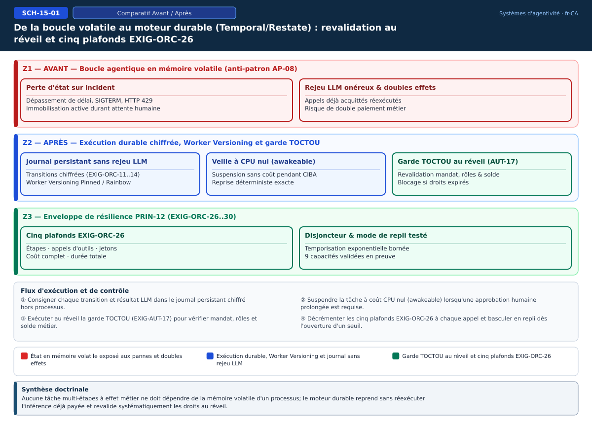
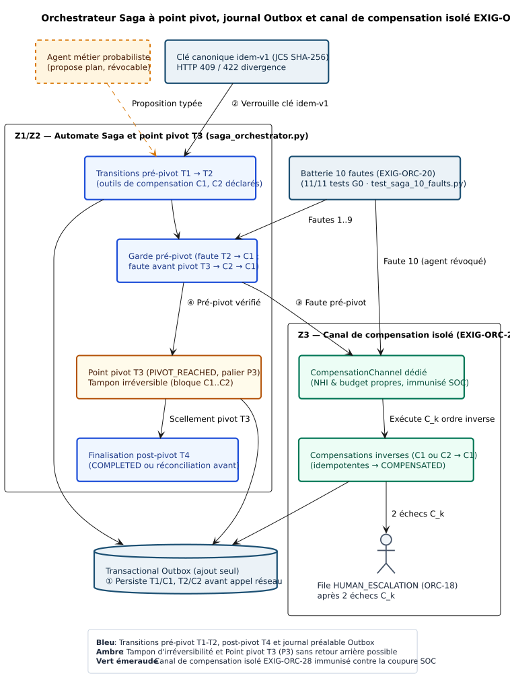
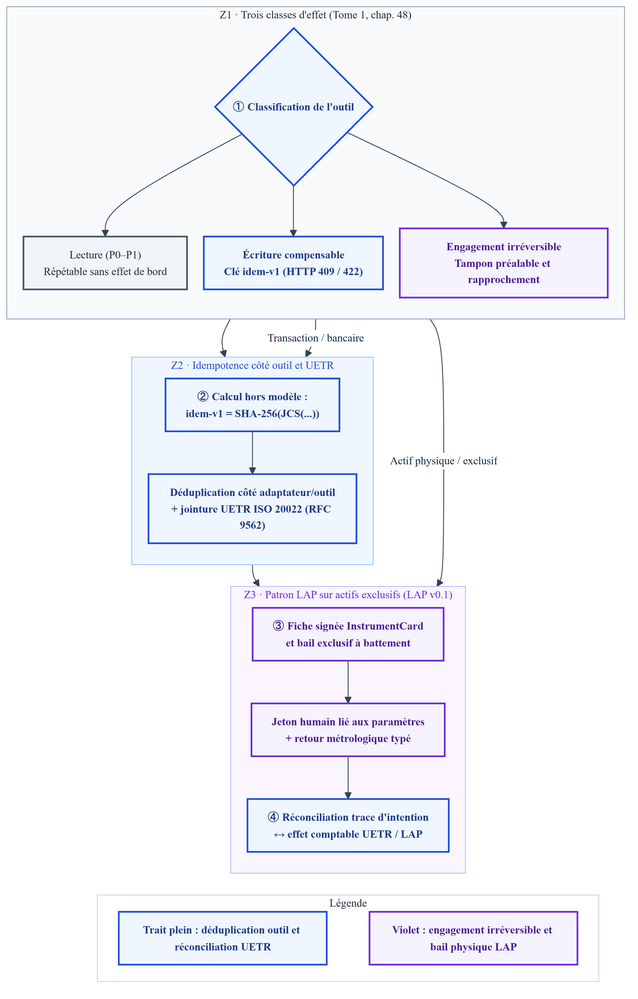

# Chapitre 15 — Exécution durable hors processus, idempotence JCS, sémantique d'effet et sagas à canal isolé

*Question directrice :* Comment garantir la reprise exacte des tâches longues sans réexécuter les appels d'inférence, prévenir les doubles écritures par idempotence canonisée JCS et préserver la compensation Saga pré-pivot même en cas de révocation de l'agent métier ?

## 15.1 Résumé

Dans tout système distribué soumis aux théorèmes d'impossibilité `CAP` et `FLP` ainsi qu'au problème des deux généraux (rappelés au `Tome 1 § 1.5.2, § 1.6.2.2`), la fiabilité d'une chaîne d'actions agentiques ne peut reposer ni sur les verrous bloquants du protocole de validation en deux phases (`2PC`), ni sur la mémoire vive volatile d'un processus applicatif (`AP-08`). Le présent chapitre formalise les mécanismes qui assurent simultanément la survivance du flot de contrôle et l'unicité vérifiable des effets métier externes. Tout flux comportant une écriture de palier `P2` ou `P3`, une attente humaine multi-jours ou une durée excédant le seuil déclaré doit s'appuyer sur un moteur d'**exécution durable** hors processus (`Temporal`, `Restate`, `Dapr Workflow`, `AWS Step Functions` ou persistance `PostgresSaver` encadrée), en isolant chaque appel de modèle ou d'outil comme activité journalisée dont le résultat acquitté est relu sans réexécution à la reprise (`EXIG-ARC-05`, `EXIG-ARC-06`, `EXIG-ORC-11..14`, `CAP-008`, `DEC-005`).

> **Clause non-avis (`AO-05`)** — Arrêté au gel du `2 décembre 2026`, l'exposé des contraintes comptables et prudentielles relève de l'ingénierie transactionnelle et ne vaut ni avis juridique ni certification réglementaire (Annexe D, § 2).

Parce qu'un moteur durable garantit uniquement la reprise du programme et jamais l'unicité de l'effet chez un système tiers, l'architecture impose trois verrous complémentaires. Premièrement, toute tâche suspendue en veille (`awakeable`) exécute à son réveil une garde cryptographique contre les failles de type *Time-of-Check to Time-of-Use* (`TOCTOU`, `PRR R-08`, `ADR-012`, complétant la persistance pré-approbation d'`EXIG-AUT-17`), accompagnée des cinq plafonds déclaratifs et des mécanismes de repli testés exigés par `PRIN-12` (`EXIG-ORC-26..30`). Cet encadrement s'étend aux actifs physiques non partageables grâce au bail exclusif du patron conceptuel `LAP v0.1` (sans mise en œuvre de référence).

Deuxièmement, toute écriture touchant au moins deux systèmes d'enregistrement dépourvus de transaction commune suit obligatoirement une **Saga compensable** — ou **saga à point pivot** — munie d'un journal `Transactional Outbox` en ajout seul écrit avant l'action. Ce dispositif associe un tampon d'irréversibilité précédant le **Point pivot** (`P3`), une escalade humaine après deux échecs (`EXIG-ORC-18`) et un **Canal de compensation isolé** (`EXIG-ORC-28`) immunisé contre la révocation et le coupe-circuit, tel que validé octet pour octet en barrière `G0` par l'extrait `G0-EX-CH03-03` (identifiant de scellage `CA-G0-SYNC` issu de la numérotation interne du Tome 8, répertorié à l'Annexe D) et les dix scénarios de fautes d'`EXIG-ORC-20`. Troisièmement, la taxonomie tripartite des effets (Lecture, Écriture compensable, Engagement irréversible) confie à l'outil cible la vérification d'une **clé d'idempotence transactionnelle** `idem-v1` canonisée `RFC 8785` (`JCS` `SHA-256`) [5] et assure la réconciliation financière par corrélation de bout en bout type `UETR` `ISO 20022` appuyée sur les identifiants `UUID` de `RFC 9562` [6].

## 15.2 Exécution durable, idempotence JCS et sagas compensatoires

### 15.2.1 Exécution durable hors processus, résilience PRIN-12 et patron LAP

Un processus d'agent exécuté en mémoire vive (`AP-08`) perd son contexte d'avancement au moindre dépassement de délai `HTTP 429`, redémarrage de conteneur ou signal `SIGTERM`, obligeant soit à abandonner la transaction en cours, soit à réexécuter à l'aveugle des inférences coûteuses et des écritures déjà engagées. Conformément à `EXIG-ORC-11` et `EXIG-ARC-05`, toute orchestration comportant au moins une opération `P2` ou `P3`, une attente humaine asynchrone ou une durée supérieure au seuil inscrit au registre doit persister son état après chaque transition dans un magasin externe chiffré au repos (`EXIG-ORC-13`), en bannissant tout magasin en mémoire vive (`InMemorySaver`) des environnements de production ou manipulant des données réelles.

Le mécanisme fondamental repose sur le **rejeu déterministe** (*Deterministic Replay*) tel qu'implémenté par `Temporal` [2] et les moteurs de flux codés (*workflow-as-code*). À la suite d'une panne, le travailleur reconstruit l'état exact atteint avant l'interruption en relisant l'historique d'événements persisté, sans réinterroger les modèles de langage ni réexécuter les activités déjà acquittées (`EXIG-ORC-12`, `PRR R-02`). Le code d'orchestration lui-même doit rester strictement déterministe — exempt d'appels réseau directs, de lecture d'horloge non déterministe ou d'aléa non consigné — afin de ne jamais lever d'erreur de non-déterminisme au rejeu [2]. Parce que l'historique d'un flux `Temporal` demeure borné (`51 200` événements ou `50 Mo`, limite documentée au `Tome 2 § 7.4` hors extrait `SDK` [2]), les exécutions de longue durée invoquent la compaction périodique `Continue-As-New` et transmettent les charges utiles volumineuses par référence `URI` (`EXIG-ORC-24`).

D'autres moteurs répandus répondent à des contraintes différentes tout en imposant une vigilance identique sur l'idempotence des activités. `Restate` (objets virtuels à écrivain unique par clé), `Dapr Workflow` et `DBOS` (persistance légère sur `PostgreSQL`) ciblent la micro-orchestration à haute cadence, tandis que `AWS Step Functions` distingue les flux `Standard` (durée maximale d'un an et sémantique d'exécution exactement-une-fois hors réessais déclarés) des flux `Express` asynchrones exécutés au moins une fois. Dans `LangGraph`, la reprise après interruption réexécute le nœud complet depuis son entrée, imposant d'isoler chaque appel d'outil ou de modèle mutatif dans un nœud atomique distinct sous `PostgresSaver` (`EXIG-ORC-12`).

| Bloc architectural (`ABB`) | Reprise et gestion d'état (`SBB`) | Exigences critiques d'exploitation |
|---|---|---|
| Moteur durable à cycles longs | `Temporal` (historique rejoué [2]) | Borner `maximumAttempts` (illimité par défaut [2]) ; compacter via `Continue-As-New` ; tester `patched()` |
| Micro-orchestration durable | `Restate`, `Dapr Workflow`, `Step Functions` | Vérifier la sémantique Standard (`≤ 1` an) contre Express asynchrone (au moins une fois) |
| Graphe cognitif intra-activité | `LangGraph` (`PostgresSaver`), `Microsoft Agent Framework`, `Google ADK` | Encapsuler un appel à effet par nœud ; traiter les points de contrôle comme frontière de confiance |
| Stockage de points de contrôle | `SQLite WAL` / `PostgreSQL` chiffré | Chiffrement par dossier pour purge `Loi 25` ; aucun jeton d'accès persisté (`EXIG-ORC-13`) |

*Tableau 15.1 — Comparatif des moteurs d'exécution durable et points de vigilance d'ingénierie.*

Deux exigences de gouvernance complètent cette persistance (Tableau 15.1). D'abord, le magasin de points de contrôle constitue une frontière de confiance critique (`EXIG-ORC-13`) : il contient les traces d'état et d'échanges pouvant renfermer des renseignements personnels, interdit le chargement de données d'origine non authentifiée ou contenant des jetons d'accès, impose une liste d'autorisation stricte à la désérialisation et exige une nouvelle signature d'audit lors de toute bifurcation manuelle. De plus, lorsqu'un mécanisme de « voyage dans le temps » (*time-travel*) relance un flux depuis un point de contrôle antérieur après correction d'état, les nœuds en aval réinterrogent les modèles et les interfaces externes, pouvant produire des décisions différentes : le rejeu sert à l'analyse et à la réparation, jamais à reproduire à l'identique une décision probabiliste, et toute bifurcation ouvre obligatoirement un nouvel espace de clés d'idempotence (`EXIG-ORC-21`).

Ensuite, le déploiement continu de nouvelles définitions d'agents ne doit jamais briser les instances en vol (`EXIG-ORC-14`). L'exploitation applique le mécanisme `Worker Versioning` (mode `Pinned`, primitive `patched()` ou déploiement arc-en-ciel *Rainbow* laissant chaque tâche achever son parcours sur la définition initiale), tandis que toute migration d'état est validée comme une évolution de schéma et qu'un retrait d'urgence pour motif de sécurité suspend explicitement les instances vulnérables.

Lorsque la tâche requiert une validation humaine prolongée ou la réunion de pièces justificatives étalée sur plusieurs jours (scénario illustratif d'octroi hypothécaire ou de règlement de sinistre sous `BSIF E-23`, prise d'effet au `1er mai 2027`, `Tome 3 § 18.12`), les primitives de suspension asynchrone telles que les signaux `Temporal` [2] ou les `awakeables` de `Restate` libèrent intégralement le calcul pendant l'attente à coût `CPU` nul. Toutefois, l'intervalle écoulé entre la vérification initiale des droits et le retour du signal humain crée une exposition classique de type `TOCTOU` (*Time-of-Check to Time-of-Use*) : le mandat `OBO` du demandeur peut avoir été révoqué, les seuils prudentiels modifiés ou le compte gelé pour fraude. `PRR R-08` et `ADR-012` — prolongeant la persistance pré-approbation d'`EXIG-AUT-17` — imposent dès lors qu'au réveil, avant toute action mutative ou décaissement, un validateur déterministe hors du modèle revalide cryptographiquement la chaîne de délégation active et relise l'état courant du système d'enregistrement maître, tandis que des minuteries durables parallèles surveillent la péremption individuelle des pièces justificatives.



*Figure 58 — SCH-15-01 : Passage de la boucle en mémoire volatile (AP-08) à l'exécution durable hors processus munie de la garde TOCTOU et des plafonds PRIN-12.*

Afin d'éviter l'emballement financier ou infini d'une boucle encadrée, `PRIN-12` et `EXIG-ORC-26` exigent que toute exécution porte cinq plafonds explicites déclarés à sa fiche : nombre maximal d'étapes ou d'itérations, nombre d'appels d'outils, volume de jetons, coût financier maximal et durée totale (Figure 58). Toute atteinte d'un plafond — réessais inclus — interrompt la progression vers l'avant en état sûr avec escalade explicite sans jamais être comptabilisée comme un succès, tandis que les compensations éventuelles puisent dans une réserve budgétaire isolée. En complément, `EXIG-ORC-27` impose pour chaque dépendance (modèle, outil, agent pair) un délai d'expiration propre, une politique unique de réessais à temporisation exponentielle avec gigue bornée aux seules erreurs transitoires (`maximumAttempts` explicite), un disjoncteur et un mode de repli homologué (modèle alternatif ou file humaine sous droits du mandant) testé avant la production. Aucune pile d'orchestration n'entre au catalogue sans avoir démontré en preuve de concept les neuf capacités vérifiables d'`EXIG-ORC-30` (reprise sur panne, pause humaine sans perte d'état, émission `OpenTelemetry GenAI`, `MCP`/`A2A`, export documenté des flux, idempotence `EXIG-ORC-21`, tests Saga `EXIG-ORC-20`, cinq plafonds et arrêt ciblé/global `EXIG-ORC-28`).

Enfin, lorsque l'orchestration durable pilote une ressource physique ou un actif exclusif dont l'usage consomme des matières, présente un danger ou interdit le partage concurrent, le patron **LAP** (*Lab Agent Protocol v0.1*, spécification de conception sans mise en œuvre de référence ni évaluation empirique indexée au `Tome 3 § 7.4`, hors corpus probatoire primaire du chapitre) complète le moteur de flux par quatre primitives transférables. Une fiche `InstrumentCard` signée décrit les limites physiques, la classe de sécurité et la réversibilité, tandis qu'un bail d'accès exclusif renouvelé par battement empêche deux agents de commander le même appareil. Un jeton d'approbation humaine à usage unique se lie à l'empreinte des paramètres exacts et de l'instrument, et tout retour métrologique (`MeasurementResult`) porte ses unités, son étalonnage, son incertitude et sa provenance signée, en encapsulant les protocoles matériels sous-jacents (`OPC UA`, `SiLA 2`) sans les remplacer.

La conception `LAP` restreint en outre le langage naturel au point d'entrée `intent.resolve`, qui retourne une proposition structurée exigeant une soumission explicite, tout en rappelant deux vigilances opérationnelles : une fiche signée peut sous-déclarer une classe de sécurité et la fréquence des validations expose l'opérateur à l'approbation réflexe.

### 15.2.2 Idempotence JCS, sémantique d'effet UETR et sagas à canal de compensation isolé

Dès qu'une tâche agentique doit écrire dans au moins deux systèmes d'enregistrement ne partageant aucune transaction `ACID` commune, le verrouillage distribué `2PC` entraîne des blocages incompatibles avec l'autonomie opérationnelle et les pannes réseau. En 1987 déjà, Garcia-Molina et Salem [1] ont formalisé le patron **Saga** pour traiter les transactions de longue durée en les découpant en sous-transactions locales atomiques munies de compensations sémantiques, ouvrant la voie à une reprise vers l'arrière ou vers l'avant par points de sauvegarde sans verrous prolongés. Transposant ces principes aux planificateurs génératifs, `SagaLLM` (Chang et Geng [3], prépublication en gabarit `PVLDB` à validation qualitative sur quatre scénarios `REALM`, hors norme industrielle) identifie quatre faiblesses critiques des agents autonomes — incapacité d'auto-contrôle fiable, érosion de la mémoire contextuelle, défaut de verrous transactionnels et coordination inter-agents insuffisante — et y répond par des points de contrôle persistants couplés à des validateurs indépendants de contraintes.

Dans le prolongement de ces travaux, `EXIG-ORC-15` (`ADR-012`, `PRR R-06`, `PRI-009` — Réversibilité par conception et compensation saga —, `CAP-009`) impose de modéliser toute écriture multisystème comme une **Saga compensable** — ou **saga à point pivot** — structurée en trois catégories de transitions :

1. **Les transitions pré-pivot compensables (`P2`)** : chaque action locale `T_1`, …, `T_{k-1}` précède le **Point pivot** et dispose d'une opération inverse métier `C_i` déclarée par le propriétaire de l'outil au catalogue (jamais improvisée par un modèle de langage, `EXIG-ORC-17`). Avant toute exécution réseau de `T_i`, l'orchestrateur inscrit l'entrée correspondante (référence d'arguments chiffrés, clé d'idempotence et outil `C_i`) dans un journal durable en ajout seul (`Transactional Outbox` sur `SQLite WAL` ou `PostgreSQL`, `EXIG-ORC-16`), sans y stocker de jeton d'accès.
2. **Le tampon d'irréversibilité et le Point pivot (`P3`)** : en vertu de `PRIN-05` et `ADR-013`, toute action irréversible (`P3`, telle la capture d'un paiement ou l'envoi d'un ordre `pacs.008`) est retardée jusqu'au Point pivot unique ou en aval de celui-ci (`PRR R-07`), après réussite de toutes les validations critiques, approbation hors bande liée aux paramètres et éventuel tampon à fenêtre de grâce. Une préautorisation annulable (`P2`) précède ainsi le pivot, tandis que la capture définitive (`P3`) matérialise le point de non-retour.
3. **Les transitions post-pivot réessayables** : une fois le Point pivot scellé (`pivot_reached = True`), toute annulation rétroactive des étapes antérieures devient formellement interdite ; les étapes suivantes doivent être idempotentes et réessayables jusqu'à complétion, ou routées vers une file humaine de réconciliation vers l'avant en cas d'échec définitif.

Le déroulement d'une compensation obéit à des règles strictes (`EXIG-ORC-16..19`). Avant de compenser une étape dont l'issue demeure inconnue après expiration de délai, l'orchestrateur doit impérativement résoudre cet état incertain : soit il clôture l'opération chez le système cible par annulation ou révocation de la clé d'idempotence afin que toute arrivée tardive soit rejetée, soit il interroge l'état de cette clé jusqu'à une réponse définitive (un code `HTTP 409` signifiant que l'opération reste en cours et non en échec [4]). À défaut de l'une de ces deux voies, l'étape passe en réconciliation humaine différée sans compensation ni replanification à l'aveugle, évitant qu'une annulation prématurée ne réussisse à vide avant que l'original tardif ne s'applique. Les compensations restent conditionnelles, idempotentes et exprimées en termes métier (note de crédit, avis rectificatif, libération de réservation), et s'exécutent en ordre inverse après épuisement des réessais bornés. Si une compensation échoue deux fois consécutivement (`EXIG-ORC-18`), l'orchestrateur cesse ses relances, poursuit les compensations indépendantes et bascule l'état complet vers une file humaine prioritaire.

De plus, une Saga n'offrant pas l'isolation d'une transaction `ACID` expose les dossiers partagés à trois anomalies de concurrence : les mises à jour perdues, les lectures sales d'états intermédiaires et les lectures non répétables. `EXIG-ORC-19` exige de documenter ces risques et d'appliquer des contre-mesures adaptées, telles que le verrou sémantique borné par durée de vie (`ttl_s`), les mises à jour commutatives, les jetons de version, la relecture avant écriture ou le report des mutations critiques vers les étapes post-pivot réessayables. Ainsi, lorsque deux agents réservent simultanément un même stock, chacun pose d'abord un verrou sémantique explicite (« réservation en attente ») doté d'un propriétaire et d'une procédure de libération, plutôt que de décrémenter directement la quantité disponible.

En exploitation, l'arrêt d'urgence déclenché par un coupe-circuit `SOC` ou une révocation d'identité `NHI` crée une contradiction apparente : interrompre brutalement toutes les permissions de l'agent métier empêcherait l'exécution des compensations pré-pivot, laissant les systèmes d'enregistrement dans un état comptable corrompu. Le couplage entre `EXIG-ORC-17` et `EXIG-ORC-28` résout cette tension par construction : l'arrêt agit exclusivement **vers l'avant** pour bloquer toute nouvelle action métier de l'agent, tandis que les retours arrière empruntent un **Canal de compensation isolé** doté de sa propre identité `SPIFFE` distincte de celle de l'agent révoqué et d'une réserve budgétaire propre hors plafond de l'agent. Ce canal demeure opérationnel lorsque l'agent métier est révoqué ou que le disjoncteur de passerelle bascule, tout en restant restreint aux seuls outils compensatoires inscrits au journal préalable et soumis à un exercice trimestriel obligatoire.



*Figure 59 — SCH-15-02 : Enchaînement pré-pivot sous Outbox durable, franchissement du Point pivot T3 (palier P3), bascule sur le canal isolé EXIG-ORC-28 et couverture des dix fautes EXIG-ORC-20.*

La Figure 59 synthétise l'automate durable implémenté dans la trousse exécutable de référence (`Tome 8`). L'extrait normatif suivant, synchronisé octet pour octet avec le module vérifié en barrière `G0` (Annexe D), montre la dérivation déterministe de la clé `idem-v1` via `RFC 8785` (`JCS`), l'encapsulation immuable de `CompensationChannel` (`EXIG-ORC-28`) et l'initialisation transactionnelle de `SagaOrchestrator` sur `SQLite WAL` :

<!-- CA-G0-SYNC id="G0-EX-CH03-03" path="Tomes/Tome 8 - Ingénierie exécutable et homologation vérifiable/trousse/policy_saga/saga_orchestrator.py" lines="107-140" sha256="a2aac944f6ae06fe63c2f6482618bae3356d6270f3c5f6a3756c8592ebd1a536" -->
```python
def compute_idempotency_key(task_id: str, step_id: str) -> str:
    """Retourne jcs_sha256_hex(['idem-v1', task_id, step_id])."""
    return jcs_sha256_hex(["idem-v1", task_id, step_id])

@dataclass(frozen=True, slots=True)
class CompensationChannel:
    """Canal isole EXIG-ORC-28 immunise (revocation/coupe-circuit)."""
    spiffe_id: str = "spiffe://ent.ca/saga-compensator"
    isolated_budget_cad: Decimal = Decimal("100.00")
    immune_to_agent_revocation: bool = True
    immune_to_gateway_circuit_breaker: bool = True
    def execute_compensation(
        self, step_id: str, comp_fn: Callable[[dict[str, Any], str], dict],
        payload: dict[str, Any], idempotency_key: str, *,
        agent_revoked: bool = False, gateway_open: bool = False,
    ) -> dict[str, Any]:
        if (agent_revoked and not self.immune_to_agent_revocation) or (
            gateway_open and not self.immune_to_gateway_circuit_breaker
        ):
            raise RuntimeError(f"Canal compensation bloque ({step_id})")
        return comp_fn(payload, idempotency_key)

class SagaOrchestrator:
    """Orchestrateur durable avec Outbox, pivot et file humaine."""
    def __init__(
        self, db_path: Path | None = None,
        compensation_channel: CompensationChannel | None = None,
        escalation_queue: str = "file-humaine-prioritaire",
    ) -> None:
        self.db_path, self.escalation_queue = db_path, escalation_queue
        self.compensation_channel = (
            compensation_channel or CompensationChannel())
        self._lock = threading.RLock()
        self._conn = _init_sqlite_conn(db_path)
```

Cet extrait exécutable établit trois garanties structurelles vérifiables. Premièrement, `CompensationChannel` étant défini comme classe figée (`@dataclass(frozen=True, slots=True)`), son identité `spiffe://ent.ca/saga-compensator` (valeur par défaut de test en `G0` à instancier par domaine de confiance isolé `prod` / `hors-prod` selon le Chapitre 16), sa réserve budgétaire en décimal exact (`Decimal("100.00")`) et ses deux drapeaux d'immunité demeurent inaltérables en cours d'exécution tout en permettant le test négatif lorsque l'immunité est désactivée en banc d'essai. Deuxièmement, la boucle de compensation `_run_compensation` applique exactement le plafond `EXIG-ORC-18` à deux tentatives avant de basculer l'étape en `"ESCALATED"` et la saga en statut `HUMAN_ESCALATION` (la poursuite de branches indépendantes relevant du graphe complet en production). Troisièmement, le verrou réentrant `threading.RLock` et la connexion `SQLite` (`busy_timeout = 15000`, mode `WAL` activé sur fichier `db_path`) sérialisent sans corruption les reprises concurrentes.

Parce que les chemins de compensation demeurent rarement sollicités en régime nominal, `EXIG-ORC-20` subordonne toute mise en production à la réussite de dix scénarios déterministes d'injection de fautes contre des doublures hermétiques des systèmes d'enregistrement, complétés par un test de contrat d'idempotence réel en environnement d'essai. Dans la trousse vérifiée en `G0` (`tests/test_saga_10_faults.py`), l'ensemble des dix scénarios et le test agrégateur réussissent à `11/11` cas sans assertion relâchée ni test ignoré, validant chaque instantané de sortie contre `saga_state.schema.json` (Tableau 15.2).

| Scénario `EXIG-ORC-20` | Faute injectée | Mécanisme vérifié (`saga_orchestrator.py`) | Issue terminale attestée |
|---|---|---|---|
| `1` — Échec pré-pivot (`T2`) | Erreur d'exécution à `T2` | Repli inverse `C1` avec clé `idem-v1` ; `T3` ignoré | `COMPENSATED` |
| `2` — Crash post-`Outbox` | Plantage juste après persistance `T2` | Reprise `resume_saga` sans réexécuter `T1` | `COMPLETED` |
| `3` — Réponse perdue | Coupure réseau après effet aval | Déduplication `idem-v1` dans `idempotency_store` | Résultat unique mémorisé |
| `4` — Réponse tardive | Arrivée `T2` après compensation `T1` | Rejet par `receive_late_step_response` | `COMPENSATED` préservé |
| `5` — Concurrence ressource | Deux sagas sur même dossier | Verrou sémantique borné (`ttl_s`) ; rejet `False` et conflit `409` | Sérialisation stricte |
| `6` — Échec post-pivot | Échec `T4` après pivot `T3` scellé | Blocage formel de `C1..C2` ; escalade avant | `PIVOT_REACHED` |
| `7` — Double compensation | Relance forcée après `COMPENSATED` | État terminal idempotent (`C1` appelé `1` fois) | `COMPENSATED` |
| `8` — Double échec de `C1` | Deux pannes consécutives de compensation | Plafond `2` tentatives `EXIG-ORC-18` | `HUMAN_ESCALATION` |
| `9` — Crash mi-compensation | Plantage après `C2`, avant `C1` | Reprise depuis `COMPENSATING` sur `C1` seul | `COMPENSATED` |
| `10` — Agent révoqué + coupure | Révocation et disjoncteur ouverts | Canal isolé `CompensationChannel` `EXIG-ORC-28` | `COMPENSATED` |

*Tableau 15.2 — Matrice vérifiée en barrière G0 des dix scénarios déterministes d'injection de fautes Saga (`EXIG-ORC-20`).*

L'ancrage durable et les sagas ne résolvent toutefois la cohérence de bout en bout que s'ils s'appuient sur une sémantique d'effet rigoureuse au grain de chaque appel d'outil (Tableau 15.3 et Figure 60). Sous pannes arbitraires et délais d'attente réseau, la livraison exactement-une-fois au niveau du transport est mathématiquement impossible ; seule la combinaison d'une livraison au-moins-une-fois (telle que celle des notifications `A2A`, des files `Kafka` ou des flux `Step Functions` asynchrones) et d'un récepteur strictement idempotent garantit un traitement exactement-une-fois. Selon la taxonomie tripartite de travail du `Tome 1 (§ 48.1)`, toute capacité se classe selon ce que produit sa reprise : la **Lecture** (sans effet de bord, bornée par coût et fraîcheur), l'**Écriture compensable** (qui dupliquerait l'état sans déduplication cible) et l'**Engagement irréversible** (qu'aucun réessai ni retour arrière local ne peut annuler).

Ni `MCP 2026-07-28` (dont les indicateurs `idempotentHint` et `destructiveHint` restent purement déclaratifs et non opposables face à un serveur tiers, et où chaque reprise réseau reçoit un nouvel identifiant `JSON-RPC`) ni `A2A v1.0.1` ne prescrivent l'idempotence d'appel au niveau du protocole. De surcroît, le projet de normalisation HTTP `draft-ietf-httpapi-idempotency-key-header` [4] — expiré en version `-07` en avril 2026 puis réactivé en révision `-09` le `21 novembre 2026` — demeure un *Internet-Draft* de l'IETF et non une norme `RFC` ratifiée. Conformément à `EXIG-ORC-21` et `EXIG-ORC-22` (`PRR R-03`), l'idempotence se déplace donc obligatoirement vers l'outil cible ou son adaptateur durable.

La **clé d'idempotence transactionnelle** `idem-v1` est dérivée hors du modèle de langage — jamais par concaténation de chaînes ni génération stochastique — en appliquant la canonisation déterministe `JCS` (*JSON Canonicalization Scheme*) de la spécification informative `RFC 8785` (`Independent Submission`) [5]. Cette spécification fixe la conformité `I-JSON`, un ordre lexicographique `UTF-16` strict des clés d'objets, la suppression de tout espace superflu et le formatage numérique selon `ECMAScript` (rejetant `NaN` et `Infinity`), garantissant un condensat `SHA-256` hexadécimal de `64` caractères identique sur toute architecture pour le tableau `["idem-v1", task_id, step_id]`. Ici, `task_id` provient d'un identifiant racine aléatoire (`UUIDv4` ou `UUIDv7` `RFC 9562` [6]) tandis que `step_id` encode le chemin d'étape et l'indice d'itération (ou un nouvel espace de clés en cas de bifurcation manuelle).

Transmise via l'en-tête `Idempotency-Key` ou un champ contractuel dédié, cette clé est vérifiée atomiquement dans la même transaction que l'effet métier (Tableau 15.3). Elle renvoie le résultat mémorisé en cas de réessai identique, lève `HTTP 409 Conflict` si l'opération est encore en cours (`IN_PROGRESS`), et rejette par `HTTP 422 Unprocessable Content` toute réutilisation avec une charge canonisée divergente [4]. Tout outil `P2` ou `P3` inscrit au catalogue doit déclarer s'il assure cette déduplication nativement dans le système d'enregistrement ou par l'entremise d'un adaptateur durable mettant à jour son registre dans la même transaction que l'effet ; à défaut, il bascule automatiquement au palier `P3` sans réessai automatique.

Les clés d'idempotence demeurent strictement cloisonnées par client appelant et le service cible doit permettre d'en interroger l'état, idéalement d'en révoquer une en cours de résolution d'incident. Surtout, leur durée de rétention déclarée au catalogue doit impérativement dépasser l'horizon maximal d'exécution fixé selon `EXIG-ORC-26`, majoré de la fenêtre de reprise et du délai de réconciliation (`EXIG-ORC-22`). En corollaire, `EXIG-ARC-06` proscrit toute reprise d'un flux durable depuis un point de contrôle plus ancien que la fenêtre de rétention de ses clés d'idempotence, faute de quoi un réessai risquerait de déclencher une seconde exécution financière. Enfin, les annotations optionnelles `idempotentHint` et `destructiveHint` du protocole `MCP` constituent de simples indications de conception et ne doivent jamais fonder une décision de reprise automatique lorsque le serveur cible se situe hors du périmètre de confiance interne.

Enfin, parce que les compteurs de télémétrie comptabilisent les appels directs sans relier l'intention à l'inscription comptable finale (`Tome 1 § 48.5`), l'architecture exige l'emport obligatoire d'un identifiant de corrélation financière de bout en bout dans la charge utile (patron inspiré de l'`UETR` `ISO 20022`). Appuyé sur les identifiants normalisés `UUIDv4` ou `UUIDv7` (ordonnés chronologiquement) définis par `RFC 9562` [6] et propagé depuis l'appel d'outil jusqu'au message de règlement `ISO 20022`, ce marqueur immuable permet de rapprocher sans angle mort l'intention émise par l'agent et l'écriture effective au grand livre.

| Classe d'effet | Conséquence d'une reprise réseau | Mécanisme protecteur exigé (`EXIG-ORC-21..22`) | Jointure et réconciliation |
|---|---|---|---|
| **Lecture** | Aucune mutation d'état ; coût et fraîcheur | Plafonds de budget et cache conditionnel de version | Trace `OpenTelemetry` et `traceparent` |
| **Écriture compensable (`P2`)** | Risque de doublon destructeur sans déduplication | Clé `idem-v1` `JCS` `SHA-256` vérifiée côté cible (`409` / `422`) | Journal `Outbox` et compensation `C_i` inverse |
| **Engagement irréversible (`P3`)** | Second engagement impossible à défaire | Tampon préalable au Point pivot ; zéro réessai si non idempotent | Corrélation type `UETR` `ISO 20022` (`UUID` `RFC 9562` [6]) et file humaine |

*Tableau 15.3 — Sémantique d'effet tripartite, déduplication côté outil et mécanismes de réconciliation.*



*Figure 60 — SCH-15-03 : Classification des effets en trois classes face aux reprises, déduplication idem-v1 côté outil avec jointure UETR et bail exclusif LAP.*

## 15.3 Synthèse des schémas, livrables, exigences probatoires et trois invariants exécutables

Les trois figures du chapitre structurent la chaîne de fiabilité transactionnelle : la Figure 58 (`SCH-15-01`) oppose la boucle volatile à l'exécution durable munie de la garde `TOCTOU` et des plafonds `PRIN-12` en section `15.2.1`. La Figure 59 (`SCH-15-02`) illustre la Saga à Point pivot `T3`, le journal `Outbox` préalable et le canal isolé `EXIG-ORC-28` face aux dix fautes en section `15.2.2`, tandis que la Figure 60 (`SCH-15-03`) relie les trois classes d'effet à la clé `idem-v1`, à la jointure `UETR` et au bail exclusif `LAP`.

L'homologation de cette couche s'appuie sur quatre livrables vérifiables :
1. Les flux durables `Temporal` ou `Restate` dotés de `Worker Versioning` (`Pinned`/`Rainbow`), de la garde `TOCTOU` au réveil (`PRR R-08`, `ADR-012`, `EXIG-AUT-17`) et de tests automatisés de reprise sans doublon (`EXIG-ORC-11..14`).
2. La suite exécutable `tests/test_saga_10_faults.py` validée à `11/11` cas en barrière `G0` couvrant les dix scénarios d'`EXIG-ORC-20` et le canal isolé `EXIG-ORC-28`.
3. La fiche de preuve de concept démontrant les neuf capacités d'`EXIG-ORC-30` et les cinq plafonds déclaratifs d'`EXIG-ORC-26` avant l'inscription de tout moteur au catalogue.
4. L'adaptateur d'idempotence `idem-v1` (`RFC 8785` `JCS` `SHA-256`, rejets `409`/`422`) et la corrélation `UETR` `ISO 20022` vérifiés en intégration continue sur toute écriture `P2` ou `P3`.

Au sein du Compendium, le chapitre 15 reçoit l'impulsion `System of Action` depuis le chapitre 1, l'encapsulation patrimoniale depuis le chapitre 12, les enveloppes `CloudEvents` (← Chapitre 14), la revalidation des mandats et identités `NHI` depuis les chapitres 16 et 17, la corrélation d'audit depuis le chapitre 22, les livraisons `GitOps` depuis le chapitre 30 et les bancs de la trousse depuis le chapitre 35. En retour, il alimente l'atténuation des cascades d'erreurs du chapitre 2, les suspensions `HOTL` du chapitre 5, la façade d'idempotence du chapitre 12, la maîtrise des pannes frontalières du chapitre 13 et les coordinateurs de chorégraphie du chapitre 14. Il soutient également le scellage `CIBA` du chapitre 17, les coupe-circuits du chapitre 21, l'enveloppe `FinOps` du chapitre 24 et les tampons `RTR` `ISO 20022` du chapitre 28, ouvrant ainsi la **Partie VI (`D06`)** consacrée aux identités non humaines (→ Partie VI, Chapitre 16).

La base probatoire arrêtée au `2 décembre 2026` s'appuie sur les six sources primaires intégrales vérifiées [1] à [6] et sur la barrière exécutable `G0` (`exit 0`, vecteurs `RFC 8785` validés à `20/20` fichiers, exclusions `statut F` en Annexe A et clause `non-avis` en Annexe D). La référence académique bloquée par mur payant (`dl.acm.org`, consignée en exclusion `statut F`) est écartée de la preuve directe.

> **Trois invariants exécutables — Chapitre 15**
>
> 1. **Exécution durable, garde `TOCTOU` au réveil et cinq plafonds (`EXIG-ORC-11..14`, `EXIG-ORC-26`, `PRR R-08`, `EXIG-AUT-17`)** : aucune tâche `P2`/`P3` ou à attente humaine prolongée ne s'exécute en mémoire volatile ; chaque appel de modèle ou d'outil est isolé en activité journalisée jamais rejouée, le réveil revalide cryptographiquement droits et état maître avant mutation, et cinq plafonds bornent l'exécution vers l'avant.
> 2. **Clé `idem-v1` canonisée `JCS` côté outil et jointure `UETR` (`EXIG-ORC-21..22`, `RFC 8785`, `RFC 9562`)** : la clé `hex(SHA-256(JCS(["idem-v1", task_id, step_id])))` est calculée hors modèle, transmise au système cible qui la déduplique atomiquement (`HTTP 409`/`422`), et jointe à un identifiant `UETR` `ISO 20022` assurant la réconciliation comptable de tout engagement irréversible.
> 3. **Saga à Point pivot, `Outbox` préalable et canal isolé (`EXIG-ORC-15..20`, `EXIG-ORC-28`)** : toute compensation est consignée en ajout seul avant l'étape couverte et s'exécute en ordre inverse sur `CompensationChannel` (`spiffe://ent.ca/saga-compensator` en domaine de test `G0` à cloisonner par environnement selon le Chapitre 16, budget `Decimal` propre) même sous révocation d'agent ou coupe-circuit ouvert. Elle escalade à l'humain après deux échecs (`EXIG-ORC-18`) et prouve les dix scénarios de fautes en `G0` avant toute mise en production.
