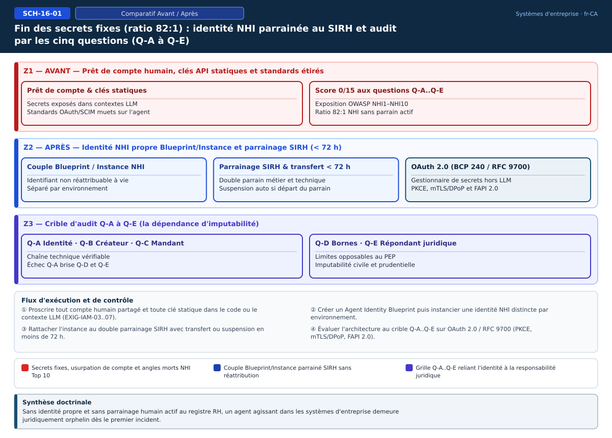
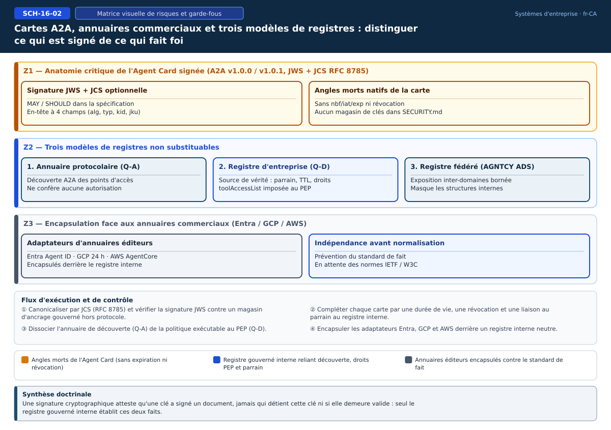
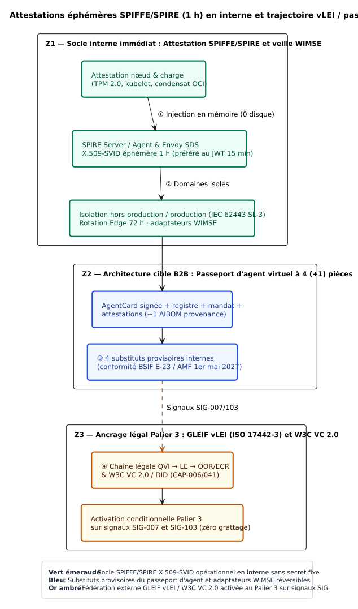

# Chapitre 16 — Identités non humaines parrainées, attestations SPIFFE/SPIRE et fondations d'identité décentralisée

*Question directrice : Comment attribuer à chaque agent autonome une identité non humaine cryptographiquement attestée, rattachée à un parrain humain actif et préparée à la fédération inter-organisations sans dépendre de brouillons instables ni de secrets statiques ?*

Le passage des assistants conversationnels passifs aux Systèmes d'agentivité capables d'appeler des outils, d'écrire dans des systèmes d'enregistrement et de coordonner des sous-tâches rompt l'hypothèse fondatrice de la gestion des identités et des accès (IAM) classique. Jusqu'aux années 2020, les protocoles d'authentification et d'autorisation reposaient sur la présence directe d'un opérateur humain devant un navigateur ou sur des comptes de service techniques statiques aux privilèges durables. Dans un parc où les identités machines dépassent désormais les effectifs humains — un ratio illustratif de 82 identités non humaines par employé étant rapporté au Tome 1 (§ 12.2) d'après des enquêtes fournisseurs —, la réutilisation d'un compte utilisateur humain ou d'une clé API partagée détruit toute traçabilité d'imputabilité juridique et prudentielle [9, 10].

Ce chapitre établit la première assise du domaine D06 en instituant l'**Identité non humaine** (NHI) propre, parrainée et cryptographiquement attestée comme prérequis absolu avant toute délégation multi-sauts (→ Chapitre 17) ou migration cryptographique (→ Chapitre 18). L'exigence découle de la distinction normative posée en amont (← Chapitre 05) : un agent logiciel n'est ni un utilisateur humain, ni un principal technique partagé, ni un répondant juridique, les standards éprouvés étant distingués des spécifications en cours au gel du 2 décembre 2026 [9].

> **Clause non-avis (`AO-05`)** : Ce chapitre demeure strictement technique et pédagogique ; il ne constitue ni un avis juridique ni une certification réglementaire [9].

L'enjeu dépasse la simple hygiène de cybersécurité. Lorsqu'une organisation déploie des centaines d'agents spécialisés en lecture, en analyse documentaire et en exécution transactionnelle, chaque invocation d'outil produit des traces qui engagent sa responsabilité civile, contractuelle et prudentielle. Sans séparation nette entre l'identité du mandant humain, l'identité propre de l'agent mandataire et l'identité de l'infrastructure qui l'exécute, les journaux d'audit deviennent inexploitables lors d'une enquête post-incident ou d'une inspection réglementaire [3, 9].

## 16.1 Résumé exécutif : l'impératif d'une identité machine parrainée et attestée

Quatre constats empiriques et normatifs gouvernent l'architecture d'identité des Systèmes d'agentivité. Premièrement, OAuth 2.0 (RFC 6749, section 4.1) présuppose un flux interactif via un agent utilisateur humain [3, 6], tandis que SCIM (RFC 7643, section 4, Tome 1 § 12.1) ne définit que des schémas d'utilisateurs et de groupes ; aucune ressource normative ratifiée de SCIM ne définit encore un objet « agent autonome » au 2 décembre 2026. Deuxièmement, l'OWASP Top 10 for Agentic Applications 2026 classe l'abus d'identité et de privilège (`ASI03`) parmi les risques critiques majeurs : sans identité distincte gouvernée, l'application du moindre privilège devient mécaniquement impossible [9, 10].

Troisièmement, selon la grille analytique interne du traité (Tome 1, ch. 14), aucun des trois mécanismes isolés instruits en 2026 ne répond pleinement aux cinq questions séquentielles d'imputabilité (`Q-A` à `Q-E`), affichant zéro verdict plein sur les quinze cellules de la matrice `3 × 5` (`0/15`, distinct de quinze produits indépendants). Quatrièmement, l'attestation éphémère SPIFFE [1], mise en œuvre par SPIRE (Tome 6 § 10.2), fournit dès maintenant un socle intra-organisationnel opérationnel éliminant le secret statique initial. À l'inverse, les passeports fédérés appuyés sur W3C Verifiable Credentials (Tome 1 § 13.1) et GLEIF vLEI (ISO 17442-3 [5]) relèvent d'une trajectoire conditionnelle de Palier 3 (`CAP-006`, `CAP-041`) activée uniquement sur signaux de marché objectifs.

Ainsi, l'architecture d'identité dissocie la strate des **Systèmes d'agentivité** de l'agentivité des systèmes qui en émerge à l'exécution : celle-ci s'exerçant sans personnalité juridique propre, son imputabilité dépend de l'enchaînement vérifiable `Q-A` à `Q-E` [3, 9].

## 16.2 Architecture d'identité NHI, socle IAM fédéré et fédération décentralisée

### 16.2.1 Identités NHI, OAuth 2.0 (BCP 240) et registres

La gestion des identités non humaines (NHI) rompt avec le modèle statique hérité des comptes de service traditionnels. Dans une architecture conventionnelle, un secret long vit dans un fichier de configuration, une variable d'environnement ou un coffre interrogé au démarrage avec une clé maître durable. Lorsqu'un agent manipule des contextes externes non fiables, toute fuite d'invite ou d'environnement expose ce secret statique à une exfiltration immédiate, ouvrant la voie aux dix vecteurs de vulnérabilité recensés par l'OWASP NHI Top 10 (`NHI1` à `NHI10`) et à l'usurpation de mandataire (`ASI03`) [9, 10].

Dans son référentiel publié en décembre 2025, le projet OWASP formule directement cette exigence structurelle : « Without a distinct, governed identity of its own, an agent operates in an attribution gap that makes enforcing true least privilege impossible. » [9] Ce constat fonde la séparation stricte entre l'identité de l'utilisateur humain, celle du service d'infrastructure et celle de chaque agent déployé.

Pour satisfaire aux exigences normatives `EXIG-IAM-01` à `EXIG-IAM-07`, `EXIG-IAM-09`, `EXIG-IAM-16`, `ADR-018`, `CAP-035`, `PRI-004`, `PRIN-03`, au modèle *Zero Trust* (`NIST SP 800-207`) et à la porte bloquante `PRR S-01`, l'organisation DOIT bannir tout compte humain prêté à un automate ainsi que toute clé API statique inscrite dans le code source, les invites système ou les variables d'environnement en clair. Chaque agent possède un identifiant propre, distinct par environnement — séparation stricte entre bac à sable, intégration, préproduction et production — et découplé entre sa définition logique et ses instances exécutables [1, 2, 3].

Cette séparation structurelle oppose le gabarit d'identité (*Agent Identity Blueprint*, profil retenu au Tome 2 § 9.2), qui décrit la classe fonctionnelle, les capacités approuvées et le niveau de risque inhérent, aux instances NHI éphémères déployées par environnement. Conformément au brouillon `IETF WIMSE AIMS` (`draft-ietf-wimse-aims-01`), l'identifiant attribué demeure non réattribuable à perpétuité après le retrait de l'agent afin de préserver la lisibilité des journaux d'audit (→ Chapitre 22) [3]. Tout justificatif requis pour joindre un tiers hors infrastructure SPIFFE est injecté hors modèle via `SBB-SECRETS-VAULT`, sans jamais entrer dans la fenêtre contextuelle du modèle de langage (`EXIG-IAM-06`) [2, 3, 9].

Le cycle de vie complet — Naissance, Vie et Mort — obéit à une règle interne du traité (`EXIG-IAM-03`, `EXIG-IAM-07`, `EXIG-IAM-16`, `EXIG-GOV-13`, → Chapitre 32) imposant un double parrainage humain nominatif (métier et technique) couplé au système d'information des ressources humaines (SIRH). Lorsqu'une mutation ou un départ survient dans le SIRH, un flux automatisé impose le transfert du parrainage ou la suspension de l'instance agentique en moins de 72 heures (`Tome 3`, cible opérationnelle). Aucun agent orphelin sans parrain actif ne peut conserver de privilège d'exécution en production, en appui aux attentes d'inventaire (← Chapitre 25) documentées pour `BSIF E-23` et l'AMF (source secondaire `AIBanks.ca`, portail AMF en statut `F`) [12].

Reliée à la grille `Q-A` à `Q-E`, cette discipline de parrainage `SIRH` rattache concrètement l'agentivité des systèmes à une identité non humaine (`NHI`) cryptographiquement distincte (`WIMSE`/`SPIFFE` [1, 3]) et imputable à un humain, comblant le déficit d'attribution `ASI03` [9].

Afin d'éviter toute appréciation subjective lors des revues d'architecture ou des acquisitions technologiques, l'évaluation de tout mécanisme d'identité s'appuie sur la grille falsifiable des cinq questions (`Q-A` à `Q-E`). Cet instrument teste cinq maillons séquentiels :
- **`Q-A` (*Qui es-tu ?*)** : vérifie si l'agent détient un identifiant stable, cryptographiquement vérifiable, résistant à l'usurpation et effectivement révocable [3, 9].
- **`Q-B` (*Qui t'a créé ?*)** : recherche la chaîne de provenance technique jusqu'à une autorité d'émission dotée d'un ancrage de confiance identifié [1, 11].
- **`Q-C` (*Pour qui agis-tu ?*)** : exige une chaîne de mandat interrogeable à l'instant précis de l'exécution, et non uniquement au moment de l'admission initiale [3, 6].
- **`Q-D` (*Que peux-tu faire ?*)** : contrôle l'existence de bornes de privilège explicites et matériellement opposables au point d'application (`PEP`) [9, 10].
- **`Q-E` (*Qui en répond ?*)** : trace l'imputabilité juridique jusqu'à une personne physique ou morale répondante devant les régulateurs [9].

L'articulation entre ces cinq questions obéit à une dépendance logique stricte. Si un mécanisme échoue sur `Q-A` — par exemple parce qu'un jeton porteur n'est ni lié cryptographiquement à son détenteur ni révocable —, les questions `Q-D` et `Q-E` deviennent matériellement inapplicables : il reste impossible d'opposer des bornes ou d'imputer une faute lorsque le porteur de l'identifiant demeure indistinguable [6, 9]. Le croisement de cette grille avec l'échelonnement de maturité démontre que l'augmentation du niveau d'autonomie ne crée pas la faille, mais en démultiplie le coût opérationnel et juridique dès qu'un agent franchit les seuils `L1` à `L4` (← Chapitre 05).

La discipline d'évaluation de cette grille (construction analytique du Tome 1, ch. 14) impose trois règles méthodologiques strictes : elle s'applique mécanisme par mécanisme plutôt que par produit global ; elle n'admet que trois verdicts (*répond*, *répond partiellement* avec précision de l'écart, *ne répond pas*), toute case vide déclarant une absence documentaire ; enfin, elle demeure réfutable si un protocole futur répond simultanément aux cinq critères. Appliquée au Tome 1 (§ 14.2, Tableau 14.2) aux trois mécanismes instruits — carte `A2A` signée [11], annuaire commercial et registre gouverné —, la grille `3 × 5` n'obtient aucune réponse pleine sur quinze cases (`0/15`, soit sept partielles, une négative et sept non documentées au degré 3, parfois résumé en quinze cellules auditées et distinct de quinze produits), constat prolongé par WIMSE [2, 3]. Ce résultat interdit de traiter un mécanisme unique comme une solution complète d'imputabilité et justifie le couplage aux contrôles d'exécution aval (→ Chapitre 17, → Chapitre 20).

*Figure 52 — SCH-16-01 : Comparatif avant/après illustrant l'éradication des secrets statiques au profit du couple Blueprint/Instance parrainé au SIRH (< 72 h) sur socle OAuth 2.0 (BCP 240 / RFC 9700) et son évaluation selon la grille séquentielle Q-A à Q-E.*

Avant d'envisager la fédération inter-agents, l'entreprise DOIT assainir son socle IAM existant autour de protocoles éprouvés qui déplacent la confiance du périmètre réseau vers chaque message signé (`AAA` : authentification, autorisation, imputabilité). Dans cette pile, SAML 2.0 demeure cantonné à la fédération d'authentification d'usagers par assertions signées et ne doit pas être détourné en véhicule d'autorisation fine entre agents logiciels. OpenID Connect (OIDC) fournit la couche d'identité fédérée sur OAuth 2.0, tandis que les pratiques d'autorisation déléguée s'alignent impérativement sur la norme IETF BCP 240 / RFC 9700 publiée en janvier 2025 [6].

La RFC 9700 proscrit absolument l'octroi par mot de passe propriétaire (`MUST NOT`) et déconseille fortement l'octroi implicite (`SHOULD NOT`, banni en `G0` par `a2a_card.py`). Elle impose `PKCE` (RFC 7636) avec défi `S256` aux clients publics et aux serveurs d'autorisation, tout en recommandant la liaison à l'expéditeur (`mTLS` RFC 8705 ou `DPoP` RFC 9449, élevée à `DOIT` par `EXIG-IAM-14`) [6], tandis que `FAPI 2.0` complète les profils à haute assurance [3]. Comme `OAuth 2.1` reste un brouillon en cours d'élaboration au gel (`ANC-022`, Tome 5 § 7.6) [6], la conformité s'ancre sur la RFC 9700 (BCP 240), sans compter sur `SCIM` (`RFC 7643`, Tome 1 § 12.6) pour la révocation instantanée en raison de sa latence non bornée [2, 3, 6].

Quant aux tentatives d'étendre SCIM aux agents (`draft-abbey-scim-agent-extension-00`, expiré le 19 avril 2026, et `draft-wzdk-scim-agent-resource-00`, soumission individuelle sans adoption SCIM, Tome 1 § 12.5), elles demeurent pré-normatives. Aucune architecture de production ne doit fonder ses contrôles d'accès ou sa conformité prudentielle sur ces ébauches non ratifiées [3].

L'OWASP recense déjà l'intégration d'agents dans les plateformes IAM commerciales telles que Microsoft Entra et AWS Bedrock [9]. Le suivi daté du Tome 1 (§ 12.1, § 15.2, entrée `S-082`) précise trois jalons : AWS Bedrock AgentCore Identity (disponibilité générale d'octobre 2025), Microsoft Entra Agent ID (avril 2026, autour du type `agentIdentityBlueprint`) et Google Cloud Agent Identity (22 avril 2026, certificats SPIFFE de 24 heures et gestionnaire d'authentification en préversion). Ce suivi révèle un écart de couverture chez Microsoft Entra : l'isolement entre deux plans d'identité empêche certaines politiques d'accès conditionnel visant les utilisateurs de couvrir automatiquement les identités d'agents.

De même, la disponibilité générale d'une plateforme commerciale ne signifie pas que toutes ses fonctions avancées de gouvernance quittent simultanément le statut d'aperçu (*Preview*, Tome 1 § 15.2.1). L'adoption brute de schémas propriétaires expose l'entreprise à la cristallisation d'un standard de fait avant la maturation des travaux WIMSE et W3C, et à l'enfermement technique (*vendor lock-in*) du plan de contrôle identitaire (→ Chapitre 09). En vertu de la capacité `CAP-035` et du suivi `S-082`, l'architecture prescrit d'encapsuler tout annuaire commercial derrière un registre interne neutre et des adaptateurs abstraits, exploitant les fonctions stables sans dépendance aux API d'un éditeur unique [2, 3].

Parallèlement aux annuaires d'éditeurs, trois modèles de registres distincts coexistent sans être substituables :
1. **L'annuaire protocolaire** (`Q-A` partiel), tel que le mécanisme de découverte d'A2A v1.0.1, qui publie les coordonnées réseau et les schémas de sécurité d'un agent tout en déclinant explicitement toute interface normative de registre gouverné [11].
2. **Le registre d'entreprise** (`Q-D` déclaratif), illustré par le brouillon CSA du 27 mars 2026 (Tome 1 § 15.3.1) définissant `toolAccessList` et `permissionBoundaries`, mais dont la portée reste déclarative tant qu'un point d'application (`PEP`) ne l'impose pas à chaque requête [3, 9].
3. **Le registre de fédération**, illustré par `AGNTCY ADS` (`draft-mp-agntcy-ads-02`, soumission individuelle, Tome 1 § 15.3.2), qui indexe des descripteurs distribués entre domaines tout en masquant la topologie interne (← Chapitre 08).

| Modèle de registre | Question adressée (`Q-A`..`Q-E`) | Portée et statut au 2 déc. 2026 | Limite structurelle critique | Parade architecturale obligatoire |
|---|---|---|---|---|
| Annuaire protocolaire (A2A v1.0.1) | `Q-A` partiel (découverte de point d'accès) | Spécification fondation Linux AAIF (`v1.0.1`) [11] | Aucune interface de registre ni contrôle d'autorisation | Relier l'entrée découverte à un registre interne et un magasin d'ancrage [11] |
| Registre d'entreprise (brouillon CSA) | `Q-A` et `Q-D` déclaratifs (`toolAccessList`) | Brouillon communautaire pré-normatif (Tome 1 § 15.3.1) | Déclaration sans opposabilité ; invalidation si extension dynamique | Exiger l'application au `PEP` (OPA/Cedar) et valider chaque schéma outil [9, 10] |
| Registre fédéré (AGNTCY ADS) | Découverte inter-domaines bornée | Soumission individuelle IETF (`-02`, Tome 1 § 15.3.2) | Masque la structure interne ; aucun mécanisme de révocation cascade | Encapsuler pour le Palier 3 et vérifier l'identité légale par `vLEI` [5] |

*Tableau 16.1 — Comparaison des trois modèles non substituables de registres d'agents et parades d'exécution requises.*

Cet état des lieux s'étend à la signature cryptographique des cartes de présentation `AgentCard` dans la spécification A2A v1.0.0 / v1.0.1 [11]. Sur le plan du format, la spécification impose (`MUST`) avant signature une canonicalisation déterministe selon le schéma JSON Canonicalization Scheme (JCS, RFC 8785) — tri lexicographique UTF-16 des clés et sérialisation numérique exacte — en excluant le champ `signatures` pour éviter toute référence circulaire, puis applique une enveloppe JSON Web Signature (JWS, RFC 7515) dont le vérificateur reconstruit la charge utile avant de contrôler l'empreinte [7, 8, 11]. Dans la trousse exécutable du Tome 8, le module de validation d'intégrité `a2a_card.py` contrôle ainsi la signature `ES256` sur charge canonicalisée `JCS` et l'épinglage strict des champs `jku` et `kid`, tout en vérifiant les vecteurs de conformité hors ligne (→ Chapitre 08, → Chapitre 22).

Toutefois, l'audit normatif de cette signature révèle quatre angles morts majeurs. Premièrement, l'apposition d'une signature sur une `AgentCard` reste facultative (`MAY`) et sa vérification recommandée (`SHOULD`), autorisant des déploiements conformes non signés [11]. Deuxièmement, l'en-tête protégé normatif se limite à quatre paramètres (`alg`, `typ`, `kid`, `jku`) sans aucun horodatage (`nbf`, `iat`, `exp`) [11], et les quatorze champs Protobuf du message de carte (`a2a.proto`, Tome 1 § 15.1.3) ne portent ni date d'expiration ni indicateur de révocation. Troisièmement, la spécification interdit les clés expirées ou révoquées (`MUST NOT`) sans fournir de point de terminaison de statut ni d'étape de fraîcheur dans sa procédure en six étapes [11]. Quatrièmement, le magasin de confiance reste facultatif (`MAY maintain`) hors du protocole [11], et les documents `SECURITY.md` et de gouvernance inspectés au Tome 1 (§ 15.1.2) n'attribuent aucune gestion des clés. Une signature JWS valide prouve donc uniquement qu'une clé donnée a scellé des octets canonisés, jamais quelle entité juridique la détient ni si elle demeure autorisée [7, 8, 11].

Pour combler cette absence d'horloge interne dans `a2a_card.py` — qui évalue uniquement la structure, les flux OAuth autorisés, l'épinglage `jku`/`kid` et la signature `ES256` sur `JCS` en retournant un `card_etag` déterministe sans état temporel —, la politique de fraîcheur (`TTL`) s'exerce à l'extérieur du protocole sur le magasin d'ancrage et la passerelle `PEP` (`EXIG-A2A-03`, `EXIG-A2A-04`, Tome 2 § 6.6). Le serveur de carte publie un `ETag` fort et un en-tête `Cache-Control` (`max-age`), imposant au catalogue et aux clients une revalidation conditionnelle et le rejet de toute régression de version `SemVer`. Sous `EXIG-IAM-18` (Tome 2 § 9.4), toute rupture du point de statut, du cache `JWKS` ou de l'horloge externe, comme l'expiration d'une carte non revalidée, déclenche un **échec en mode fermé** (*fail-closed*) : la passerelle refuse immédiatement tout appel dépendant de cette carte et journalise l'état dégradé (une politique distribuée échue limitant au plus les appels à `P0`, tandis qu'un statut dynamique illisible bloque l'appel concerné).

*Figure 53 — SCH-16-02 : Matrice des risques et garde-fous distinguant les angles morts natifs de l'AgentCard signée JWS/JCS, les trois modèles de registres et l'encapsulation des annuaires commerciaux.*

### 16.2.2 Attestation SPIFFE/SPIRE, DID/VC et vLEI

Pour éliminer définitivement le problème du secret zéro en intra-organisationnel, l'architecture s'appuie sur le standard diplômé CNCF SPIFFE [1] et son implémentation de référence SPIRE (Tome 6 § 10.2) (`EXIG-IAM-04`, `EXIG-IAM-14`, `EXIG-IAM-15`, `S-01`, `S-02`). Plutôt que d'injecter un secret statique au démarrage, l'infrastructure vérifie les attributs de la plateforme hôte et du processus ou conteneur (attestation de nœud par `TPM 2.0` ou enclave et attestation de charge au niveau processus/noyau via `kubelet`, cgroup Linux et condensat `SHA-256` OCI selon l'architecture SPIRE, Tome 6 § 10.2) [1, 2, 3]. Ce schéma matérialise les rôles conceptuels `Attester`, `Verifier` et `Relying Party` formalisés par l'architecture IETF RATS (RFC 9334, publiée à titre informationnel en janvier 2023) sans dépendre d'un format propriétaire unique [4].

L'attestation en deux étages de SPIRE (Tome 6 § 10.2) s'exécute selon une séquence déterministe avant la moindre inférence du modèle. Au démarrage du nœud physique ou virtuel, l'agent SPIRE prouve son intégrité au serveur SPIRE central pour obtenir une identité de nœud validée. Ensuite, lorsqu'un conteneur d'agent interroge la prise locale (`Workload API`), la plateforme inspecte les sélecteurs du processus et du noyau afin d'assigner l'identifiant uniforme `SPIFFE ID` (`spiffe://<domaine>/<chemin>`) [1], structuré par gabarit `ClusterSPIFFEID` (Tome 3).

Une fois l'identité attestée, l'autorité délivre au processus agent un justificatif cryptographique SPIFFE Verifiable Identity Document (SVID) à travers l'API locale `Workload API` [1], injecté en mémoire via le service de découverte de secrets `Envoy SDS` (Tome 6 § 10.2) sans jamais toucher le disque persistant [2]. Conformément à la recommandation SPIFFE et WIMSE de préférer les justificatifs liés à une clé privée aux jetons porteurs rejouables, le profil interne (`EXIG-IAM-15`, Tome 3) fixe une durée de vie maximale d'une heure (`TTL = 1 h`) pour les certificats `X.509-SVID` en liaison `mTLS`, contre au plus `15` minutes (`TTL ≤ 15 min`) pour les jetons `JWT-SVID` (→ Chapitre 17) [1, 2].

La gouvernance des domaines de confiance (*Trust Domains*) SPIFFE impose un cloisonnement hermétique entre les environnements hors production (`spiffe://hors-prod.entreprise.ca/...`) et la production (`spiffe://prod.entreprise.ca/...`), interdisant toute fédération croisée des racines d'attestation [1]. Aux frontières industrielles ou opérationnelles (← Chapitre 12), les flux traversant une zone démilitarisée industrielle (`IDMZ`) conforme à `IEC 62443-3-3 SL-3` (Tome 3 § 28.6) s'authentifient via des identités SPIFFE adossées à des diodes logiques et des courtiers miroirs. En mode périphérique déconnecté (*Edge*), une cellule autonome vise une continuité locale de rotation cryptographique (cible interne de `72 heures` sous `CAP-028`, Tome 4, sans seuil prescrit par [1, 4]) grâce à la puce `TPM 2.0` embarquée [3, 4].

Ces pratiques d'entreprise convergent avec les travaux du groupe IETF WIMSE (*Workload Identity in Multi-System Environments*), dont les deux documents archivés au gel sont `draft-ietf-wimse-workload-identity-practices-08` (30 octobre 2026) et `draft-ietf-wimse-aims-01` (2 novembre 2026) [2, 3]. Le premier codifie l'atténuation de portée et l'isolation des métadonnées d'instance (`IMDS` `169.254.169.254` contre `SSRF`), tandis que le second propose une architecture d'authentification et d'autorisation pour agents sur OAuth 2.0 et WIMSE [2, 3]. Aucun document WIMSE n'ayant atteint le stade RFC au 2 décembre 2026 (`SIG-003`), leur intégration passe exclusivement par des adaptateurs réversibles encadrant le socle SPIFFE/OAuth éprouvé [2, 3].

| Brique d'identité | Mécanisme cryptographique | Durée de vie (`TTL`) et stockage | Statut normatif (2 déc. 2026) | Usage prescrit en entreprise |
|---|---|---|---|---|
| `X.509-SVID` (SPIFFE/SPIRE) | Certificat TLS lié à la clé privée de charge | Cible `1 h` (`Envoy SDS`), en mémoire uniquement [1, 2] | Standard CNCF *Graduated* [1] | Canal interne `mTLS`, `IDMZ`, appel STS sans secret |
| `JWT-SVID` (SPIFFE/SPIRE) | Jeton signé par l'autorité du domaine de confiance | Cible `≤ 15 min` (`EXIG-IAM-15`), en mémoire [1, 2] | Standard CNCF *Graduated* [1] | Assertion `client_assertion` bornée par audience |
| `IETF WIMSE` (`workload-identity-practices-08` / `aims-01`) | Enveloppe de charge et jeton de contexte multi-systèmes | Variable selon profil (`0` RFC au gel) [2, 3] | *Internet-Drafts* WG (`30 oct.` / `2 nov. 2026`) [2, 3] | Veille active (`SIG-003`) et adaptateurs découplés (`SPEC-DRAFT-WIMSE-*`) |
| `W3C VC 2.0` / `DID` / `did:wba` | Justificatif vérifiable et résolution web/DID | Selon émetteur (Tome 1 § 13.1) | W3C `VC 2.0` Rec. ; `DID v1.1` en cours | Préparation Palier 3 B2B ; posture « attendre » en prod |
| `GLEIF vLEI` (ISO 17442-3) | Chaîne `QVI → LE → OOR/ECR` sur KERI/ACDC | Rôle organisationnel vérifiable [5] | Norme ouverte ISO 17442-3 (`2024` ; doc. `oct. 2026`) [5] | Accréditation légale B2B Palier 3 (`CAP-006`, `CAP-041`) |

*Tableau 16.2 — Matrice d'adoption des attestations de charge internes et des fondations d'identité décentralisée.*

Lorsque l'agent franchit les frontières de l'organisation pour dialoguer avec des partenaires externes, l'identité de charge SPIFFE ne suffit plus : deux entreprises distinctes ne partagent pas d'office un même domaine de confiance ni d'autorité d'attestation [1, 5]. Pour combler cet écart inter-organisationnel, la somme formalise (Tome 1, ch. 16) un objet conceptuel de synthèse baptisé **passeport virtuel d'agent à quatre pièces** — complété d'une cinquième pièce candidate dédiée à la provenance logicielle et modèle (`AIBOM` CycloneDX / `SLSA`, → Chapitre 22) [9] :
1. **La carte de présentation signée** (`AgentCard` A2A, JWS/JCS), garantissant l'intégrité syntaxique de la déclaration de capacités [7, 8, 11].
2. **L'inscription à un registre gouverné**, liant l'identifiant technique au gabarit *Blueprint*, à son état de cycle de vie et à son parrain actif [3, 9].
3. **La chaîne de mandat délégué**, matérialisant l'autorisation en cascade depuis le mandant d'origine (→ Chapitre 17).
4. **Les attestations de conformité et d'environnement**, documentant la conformité réglementaire attendue (inventaire des modèles sous `BSIF E-23`) et les preuves matérielles `SPIFFE`/`RATS` [1, 4].

Soumis à la grille `Q-A`..`Q-E`, ce passeport virtuel n'obtient qu'une réponse pleine pour quatre partielles (`1/4`, Tome 1 ch. 16 ; travaux exploratoires sur passeports/DID repérés dans `arXiv:2509.01063`) : aucun émetteur ratifié ne le délivre fin 2026 et aucune institution canadienne de l'index secondaire `AIBanks.ca` ni du Tome 1 (§ 13.5, degré 3) ne documente de `W3C DID/VC` inter-firmes en production [5, 12]. Pour soutenir dès avant le 1er mai 2027 les attentes `BSIF E-23` — ainsi que l'échéance AMF rapportée sous réserve par la source secondaire `AIBanks.ca` (portail AMF en statut `F`) [12] —, l'architecture déploie quatre substituts provisoires internes (Tome 1 § 16.1.1).

Ces quatre substituts provisoires comprennent : une `AgentCard` vérifiée contre un magasin d'ancrage interne gouverné ; un registre d'entreprise tenu par l'exploitant du maillage ; l'échange de jetons OAuth intra-domaine à portée bornée (→ Chapitre 17) ; enfin, l'inventaire documentaire des modèles et agents exigé par la gouvernance des risques de modèle [11]. Chacun assure l'auditabilité interne sans résoudre l'admission inter-organisationnelle ouverte, traitée par le protocole `KYA` (→ Chapitre 17) et le Palier 3.

À l'horizon du Palier 3 (`CAP-006`, `CAP-041`, porte `POR-013`), la préparation de la fédération B2B repose sur la chaîne d'identité organisationnelle vérifiable **GLEIF vLEI** (`ISO 17442-3` de 2024, écosystème ouvert `KERI`/`ACDC` de WebOfTrust archivé au 15 octobre 2026) [5] et sur le modèle W3C `Verifiable Credentials 2.0` (Tome 1 § 13.1). Ce dispositif relie cryptographiquement un émetteur qualifié (`QVI`) à l'entité juridique (`LE`) puis aux justificatifs de rôle officiel (`OOR`) ou d'engagement (`ECR`) délivrés à des personnes physiques mandatées [5], sur lesquels `CAP-041` arrime l'agent délégué. Il autorise les passerelles A2A et les connecteurs `EDC`/`ODRL` (← Chapitre 08) à vérifier l'identité légale d'un mandataire externe sans recourir au grattage d'écran (*screen scraping*) prohibé [5, 11].

Le passage effectif au Palier 3 demeure toutefois conditionnel et gouverné par des signaux d'observation objectifs (`SIG-007` sur l'adoption des justificatifs organisationnels dans les paiements et `SIG-103` sur l'ouverture des décrets d'accès en écriture pour les services bancaires axés sur les consommateurs, → Chapitre 31). Avant le basculement confirmé de ces signaux, les organisations maintiennent une posture pragmatique « attendre » sur les identifiants décentralisés inter-firmes `DID`/`did:wba`, tout en isolant l'ensemble des primitives externes derrière des interfaces d'adaptation neutres [5].

*Figure 54 — SCH-16-03 : Architecture en trois couches séparant le socle SPIFFE/SPIRE opérationnel en interne (TTL 1 h), les quatre substituts provisoires du passeport d'agent à l'horizon du 1er mai 2027 et l'activation conditionnelle GLEIF vLEI / W3C VC 2.0 au Palier 3.*

Les restrictions d'accès web (portails OWASP, `gleif.org` et AMF en statut `F`, détaillées en Annexe A) sont compensées par les publications libres officielles OWASP [9, 10] et GLEIF/WebOfTrust [5], tandis que le jalon AMF du 1er mai 2027 n'est cité qu'à titre indicatif via la source secondaire `AIBanks.ca` [12].

## 16.3 Synthèse architecturale, livrables et portes de contrôle

La mise en œuvre du socle d'identité non humaine s'articule avec les chapitres voisins selon des frontières étanches. En entrée, le chapitre consomme la distinction agent/humain établie en gouvernance d'autonomie (← Chapitre 05), les besoins d'autorisation des outils MCP (← Chapitre 07), les canaux `SLIM`/`AGNTCY` et `EDC`/`ODRL` (← Chapitre 08), les contrats de découverte (← Chapitre 09), les exigences `IDMZ` et périphériques `TPM 2.0` (← Chapitre 12), les contraintes d'attente durable (← Chapitre 15) ainsi que les attentes prudentielles canadiennes et québécoises (← Chapitre 25).

En sortie, il fournit les identités d'acteurs et assertions `SVID` indispensables à la délégation OBO à deux sauts et à la vérification `KYA` (→ Chapitre 17), sans empiéter sur l'échange de jetons `RFC 8693` ni sur l'approbation hors bande `CIBA`. Il alimente également les procédures de réponse pour la révocation chirurgicale par `ClusterSPIFFEID` au centre de sécurité `SOC` (→ Chapitre 21), exige la canonicalisation `JCS` (RFC 8785) et la corrélation de trace `OTel` (→ Chapitre 22), oriente l'horizon de normalisation `2027–2030` (→ Chapitre 31) et prépare la migration post-quantique des autorités `SVID` (→ Chapitre 18) [1, 8].

| Livrable d'ingénierie | Exigences et capacités couvertes | Critère de vérification exécutable (`G0`–`G1`) |
|---|---|---|
| Registre IAM d'entreprise `Blueprint` / `Instance` + lien SIRH | `EXIG-IAM-01..07`, `EXIG-IAM-09/16`, `ADR-018`, `CAP-035`, `NIST SP 800-207`, `PRR S-01` | `100,0 %` des instances liées à un double parrain actif ; gel automatique `< 72 h` sur départ SIRH (repère `BSIF E-23` / `AMF` via source secondaire `AIBanks.ca` [9, 12]) |
| Plan d'attestation SPIFFE/SPIRE et `SBB-SECRETS-VAULT` | `EXIG-IAM-04/14/15`, `PRI-004`, `PRIN-03`, `ANC-022`, `SIG-003`, `S-01`, `S-02` | Zéro secret statique en CI/CD ; rotation `X.509-SVID` `1 h` en mémoire via `Envoy SDS` ; domaines prod/hors-prod isolés [1, 2] |
| Magasin d'ancrage hors protocole `AgentCard` + matrice `Q-A`..`Q-E` | `EXIG-A2A-03/04/09`, `EXIG-IAM-18`, `EXIG-INT-21`, `RFC 7515`, `RFC 8785` | Validation `JWS ES256` sur `JCS` avec `jku`/`kid` épinglés (`a2a_card.py` en `G0`), revalidation `ETag`/`Cache-Control`, échec fermé sur rupture d'horloge/statut et écarts `0/15` documentés [7, 8, 11] |
| Dossier d'activation conditionnelle Palier 3 `GLEIF vLEI` / `VC 2.0` | `CAP-006`, `CAP-041`, `DEC-012`, `SIG-007`, `SIG-103` | Adaptateurs découplés pour annuaires commerciaux (`Entra`/`GCP`/`AWS`) et bascule B2B sous `ISO 17442-3` sans grattage [5] |

*Tableau 16.3 — Livrables d'architecture, exigences normatives et critères de vérification du Chapitre 16.*

Ce chapitre s'appuie sur le validateur exécutable `a2a_card.py` présenté au Chapitre 08 et prépare les bancs de délégation et d'approbation du chapitre suivant (→ Chapitre 17).

> **Trois invariants exécutables — Chapitre 16**
>
> 1. **Zéro secret statique et double parrainage SIRH (`EXIG-IAM-01..07`, `PRR S-01`)** : Tout agent reçoit une identité non humaine (`NHI`) propre par environnement, non réattribuable à perpétuité, rattachée à un double parrain humain dans le SIRH avec suspension automatique en moins de `72` heures lors d'un départ ; tout secret externe est injecté hors modèle via `SBB-SECRETS-VAULT`.
> 2. **Attestation éphémère en mémoire et isolation de domaines (`EXIG-IAM-14/15`, `RFC 9334`)** : Les charges internes s'authentifient par certificats `X.509-SVID` (`TTL ≤ 1 h`) injectés en mémoire vive par `SPIRE` et `Envoy SDS` dans des domaines de confiance isolés entre production et hors production, sans jamais se fier aux identifiants non ratifiés comme norme unique.
> 3. **Ancrage hors protocole de l'`AgentCard` et crible `Q-A`..`Q-E` (`RFC 7515`, `RFC 8785`, `EXIG-A2A-03/04`, `EXIG-IAM-18`)** : Une signature `JWS` sur `JCS` atteste uniquement l'intégrité par rapport à une clé ; l'admission impose un magasin d'ancrage gouverné, une revalidation `ETag`/`Cache-Control`, un refus en mode fermé sur rupture de statut ou d'horloge externe, l'encapsulation des annuaires et l'audit `Q-A`..`Q-E`.
