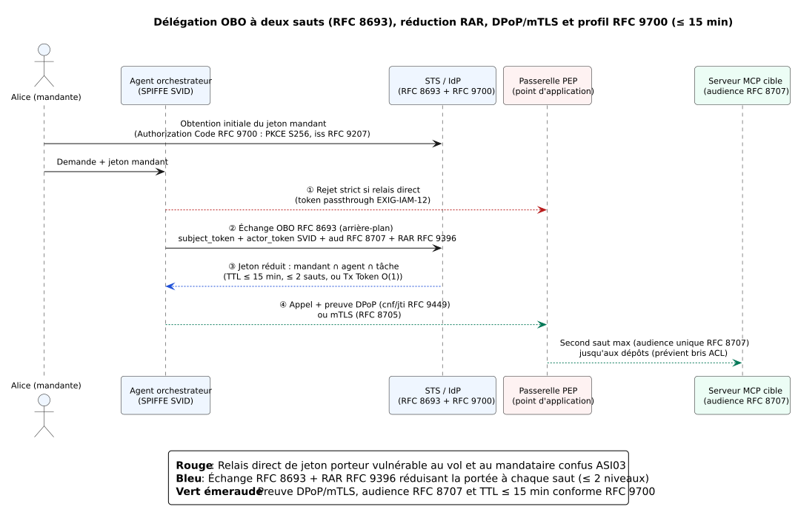
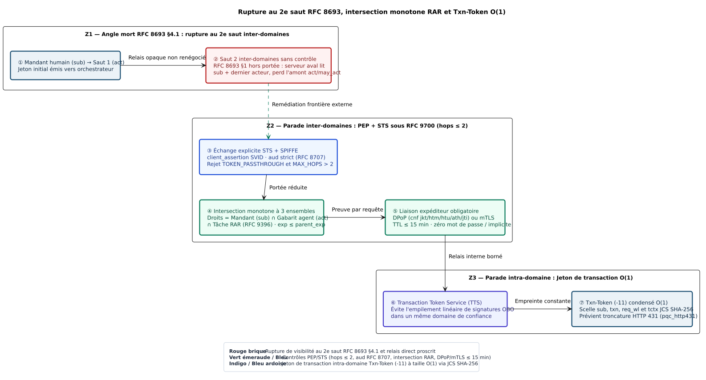
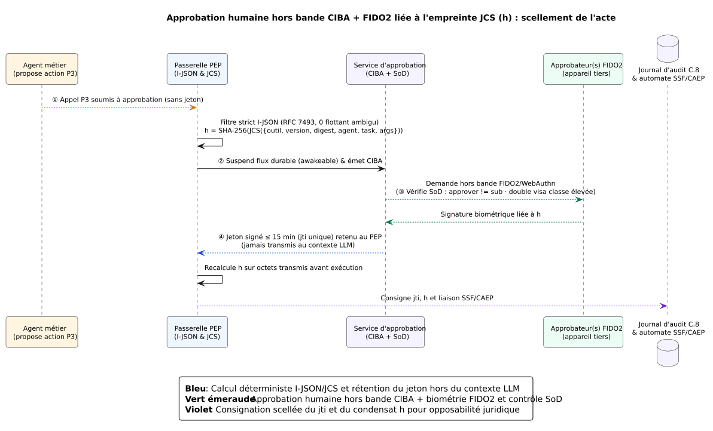
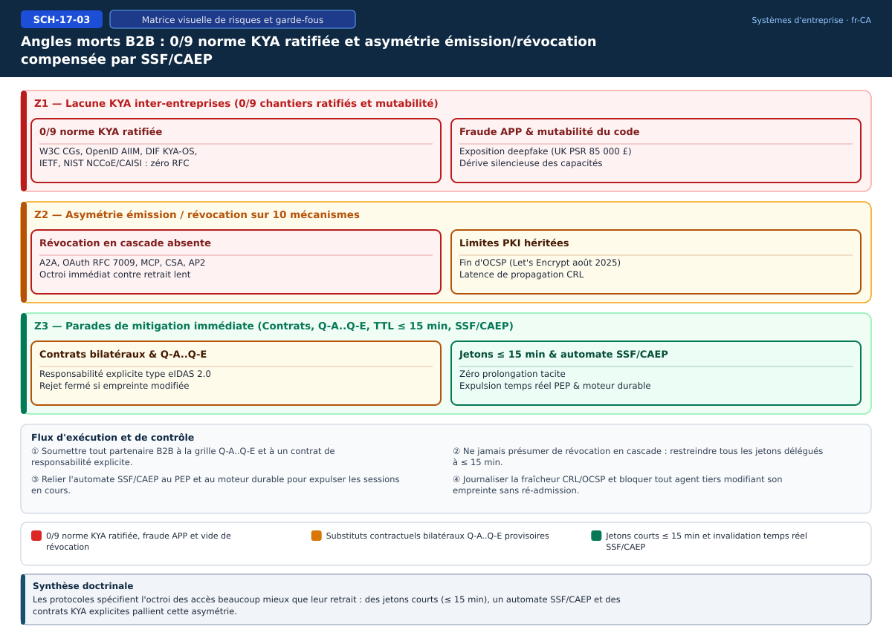

# Chapitre 17 — Chaîne de mandat OBO à deux sauts, approbation cryptographique CIBA, KYA tiers et asymétrie de révocation

*Question directrice :* Comment préserver l'imputabilité du mandant humain et le principe du moindre privilège à travers une chaîne multi-sauts d'agents, sceller cryptographiquement les approbations humaines critiques et pallier l'absence de révocation en cascade entre organisations ?

Doter chaque agent d'une identité non humaine attestée (← Chapitre 16) résout la question de l'authentification de la charge logicielle (`Q-A`), mais laisse entière celle du mandat (`Q-C`) : pour quel usager ou quelle autorité agit cet agent à l'instant précis de son appel d'outil, et sous quelles bornes vérifiables ? Dès qu'un orchestrateur délègue une sous-tâche à un agent spécialisé qui interroge à son tour un serveur d'outils `MCP` ou un entrepôt de données, la transmission naïve du jeton d'accès initial de l'utilisateur — anti-patron nommé **Passage de jeton** (*token passthrough*) — détruit la traçabilité, viole l'isolation d'audience et expose l'organisation au détournement par mandataire confus (`OWASP ASI03`) [1, 2, 13].

Ce chapitre établit l'architecture normative de la délégation bornée, de l'approbation humaine hors bande et du retrait d'accès dans le domaine D06. Au gel du 2 décembre 2026, il confronte les spécifications IETF et OpenID ratifiées aux lacunes empiriques des chantiers inter-entreprises *Know Your Agent* (KYA) et de la révocation en cascade, en articulant l'ensemble sur les validateurs exécutables `obo_dpop.py`, `ciba_approval.py` et `revocation_fsm.py` vérifiés à la barrière `G0`.

Sans mécanisme explicite pour transporter, restreindre et révoquer la délégation au fil des appels d'outils, la couche d'orchestration reproduit la faille classique du maillon faible : tout sous-agent compromis par une injection indirecte hérite de l'intégralité des droits de l'utilisateur appelant. La chaîne de confiance exige donc un contrôle cryptographique à chaque frontière entre processus ainsi qu'une rupture nette entre la délibération probabiliste du modèle et l'approbation déterministe des actes critiques [1, 5, 13].

## 17.1 Résumé exécutif : endiguer l'escalade de privilèges et le consentement factice

> **Clause non-avis (`AO-05`)** — Ce chapitre demeure strictement technique et pédagogique ; il ne constitue ni un avis juridique ni une certification réglementaire au sens des lois applicables (telle la Loi 25 du Québec en vigueur depuis le 22 septembre 2023 ; Annexe D, § 2).

Cinq verrous cryptographiques et architecturaux forment l'ossature de la chaîne de mandat. Premièrement, tout relais brut de jeton entrant est prohibé sans dérogation (`EXIG-IAM-12`, `EXIG-MCP-11`) au profit d'une **délégation au nom du mandant** (`On-Behalf-Of`, sigle OBO) conforme à la RFC 8693, strictement bornée à deux sauts d'acteurs (`act`) et assortie d'une réduction monotone des droits (`mandant ∩ agent ∩ tâche`) [1, 2, 3]. Deuxièmement, l'encodage structuré des permissions par requêtes d'autorisation riches RAR (RFC 9396) et l'adoption intra-domaine du **Jeton de transaction** (`Txn-Token`, profilé à taille constante O(1) dans la trousse `G0`) préviennent l'amplification de privilèges et le gonflement linéaire des en-têtes [3, 7].

Troisièmement, la liaison cryptographique obligatoire des jetons à la clé du détenteur via `DPoP` (RFC 9449) ou `mTLS` (RFC 8705), sous un profil durci inspiré de `RFC 9700` et plafonné par l'architecture à `TTL ≤ 15 min` en paliers critiques (`EXIG-IAM-15`), neutralise le rejeu de jetons porteurs volés [4, 11, 13]. Quatrièmement, tout acte irréversible de portée `P3` (ou `P2` hors seuil en classe élevée) requiert une approbation humaine hors bande OpenID Connect CIBA (`auth_req_id`) [5], couplée par l'architecture à `FIDO2` et scellée sur la **Preuve d'action C.6** `h = SHA-256(JCS(...))` après filtrage `I-JSON` strict (RFC 7493 et contrat `ciba_approval.py`) [6] ; le jeton signé demeure retenu à la passerelle `PEP` hors de portée du modèle [5]. Cinquièmement, face à zéro norme KYA ratifiée sur neuf chantiers recensés (`0/9`, relevé analytique du traité) et à l'absence de révocation en cascade dans les protocoles agentiques, la sécurité repose sur des contrats bilatéraux provisoires, des durées de validité courtes et un automate temps réel `SSF`/`CAEP` [8, 9, 10].

## 17.2 Chaîne de mandat OBO, scellement CIBA et asymétrie de révocation

### 17.2.1 Délégation OBO (RFC 8693), DPoP et RAR

L'analyse normative de la RFC 8693 (*OAuth 2.0 Token Exchange*, janvier 2020) met au jour un angle mort majeur désigné sous le nom de **rupture au deuxième saut** [1]. La section 4.1 de la RFC 8693 définit la revendication imbriquée `act` pour indiquer qu'une délégation a eu lieu et identifier l'acteur intermédiaire, tandis que la section 1 place explicitement hors de son périmètre la syntaxe interne, la sémantique applicative et les propriétés de sécurité des jetons échangés [1]. En pratique, un serveur de ressources recevant un jeton au deuxième saut évalue principalement l'identité du sujet (`sub`) et le dernier acteur déclaré, sans mécanisme normatif universel permettant d'interroger la validité de l'ensemble de la chaîne amont ni d'imposer mécaniquement une réduction de portée entre domaines de confiance distincts [1, 2].

La RFC 8693 prévoit certes `may_act` (section 4.4) mais son interprétation reste circonscrite à un même domaine sans cascade inter-domaines opposable au-delà de deux relais [1]. Dès que la délégation traverse une passerelle `PEP` puis un second orchestrateur externe, la visibilité sur le mandat se dégrade sans renégociation explicite auprès du service d'autorisation [1, 2].

Pour éliminer ce défaut structurel tout en respectant les exigences `EXIG-IAM-08` à `EXIG-IAM-14`, `EXIG-MCP-11`, `EXIG-ORC-04`, `ADR-005`, `ADR-018`, `CAP-036` et les portes `PRR S-03`, `PRR S-04` et `PRR S-05`, la passerelle d'application (`PEP`) et le service d'émission de jetons (`STS`) appliquent quatre invariants cumulatifs :

- **Prohibition absolue du passage de jeton** : aucun serveur `MCP` ou agent aval ne DOIT accepter un jeton dont la revendication d'audience (`aud`) ne le désigne pas explicitement conformément à la RFC 8707 (*Resource Indicators*) [2]. Chaque franchissement de frontière impose un échange RFC 8693 explicite où l'agent appelant s'authentifie sans secret fixe via son justificatif SPIFFE (`client_assertion` `JWT-SVID` ou `X.509-SVID` en `mTLS`, ← Chapitre 16) [1, 2].
- **Plafonnement à deux sauts maximum et non-prolongation temporelle** : la profondeur d'imbrication de la chaîne `act` ne DOIT jamais dépasser deux niveaux (`hops ≤ 2`), et l'horodatage d'expiration `exp` du jeton délégué NE DOIT JAMAIS excéder celui du jeton parent (`exp ≤ parent_exp`) [1].
- **Intersection monotone à trois termes** : les droits effectifs accordés au saut k résultent strictement de l'intersection entre les privilèges du mandant humain (`sub`), l'enveloppe statutaire du gabarit de l'agent appelant et le périmètre minimal requis par la tâche en cours [1, 3].
- **Propagation nominative jusqu'aux dépôts** : afin d'éviter les cinq points de rupture d'héritage des listes de contrôle d'accès (`ACL`) documentés dans les architectures documentaires (← Chapitre 10), la délégation nominative demeure propagée jusqu'à la couche d'accès aux données pour appliquer un filtrage effectif au niveau des lignes et des colonnes, proscrivant tout compte de service technique sur-privilégié [2, 3].

Les limites d'autorisation granulaires sont exprimées au moyen des requêtes d'autorisation riches `RAR` (RFC 9396, mai 2023) [3]. Plutôt que de s'en remettre à des chaînes `scope` grossières telles que `finance:write`, le champ structuré `authorization_details` précise le type d'action métier, les emplacements cibles, les identifiants d'outils et les plafonds chiffrés applicables à la transaction [3]. Par exemple, un agent d'analyse des dépenses reçoit uniquement l'autorisation `lecture_depenses` pour un trimestre donné et un centre de coûts précis, empêchant toute lecture latérale dans un autre service [3].

Dans l'architecture à l'intérieur d'un même domaine de confiance, l'empilement linéaire de signatures OBO à chaque saut interne cède la place au **Jeton de transaction** (`Txn-Token`, `draft-ietf-oauth-transaction-tokens-11` du 30 juillet 2026, actualisant la révision `-09`) [7]. Émis par un service dédié (*Transaction Token Service*, `TTS`), ce jeton court scelle de façon immuable le sujet d'origine (`sub`), l'identifiant de transaction (`txn`), la charge appelante (`req_wl`) et l'objet contextuel `tctx` [7]. Dans le profil exécutable `pqc_http431.py` (`G0`), `tctx` est condensé par `JCS SHA-256` afin d'assurer une taille constante O(1) indépendante des sauts, ce qui prévient la troncature des revendications et prépare la maîtrise de l'encombrement post-quantique (→ Chapitre 18) [7].

En parallèle, le recours à un jeton porteur non lié à son détenteur constitue une vulnérabilité critique illustrée par les vols de jetons OAuth (telle la campagne `UNC6395` d'août 2025 sur `Salesloft Drift` et `Salesforce`, relevée au repérage interne du traité). La norme `RFC 9700` (BCP 240, janvier 2025) proscrit l'octroi par mot de passe (`MUST NOT`), déconseille l'octroi implicite (`SHOULD NOT`, interdit sans exception par `EXIG-IAM-13`), prescrit `PKCE` aux clients publics (`RECOMMENDED` aux clients confidentiels, généralisé en `PKCE S256` par le cadre) et recommande des jetons liés à l'expéditeur (*sender-constrained tokens*) [13]. Elle s'articule avec la RFC 9207 sur l'identification de l'émetteur (`iss`) — qui prévient les attaques par confusion d'émetteur — et avec la RFC 9728 sur les métadonnées de ressources protégées adoptée pour la découverte d'autorisation `MCP` [12, 13, 14].

Pour toute opération classée en palier `P2`, `P3`, `P1` sensible ou en classe de risque élevée (`EXIG-IAM-13` à `EXIG-IAM-15`), l'architecture exige soit une liaison par certificat mutuel `mTLS` (RFC 8705, revendication `cnf["x5t#S256"]`), soit une preuve de possession par requête `DPoP` (RFC 9449) [4, 11, 13]. L'en-tête `dpop+jwt` lie alors l'empreinte de clé `cnf["jkt"]`, la méthode HTTP `htm`, l'URI cible `htu`, le condensat du jeton d'accès `ath` et un identifiant unique `jti` anti-rejeu [4]. Dans le sillage de la brièveté recommandée par `RFC 9700` [13], le profil normatif du cadre (`EXIG-IAM-15`, `PRR S-05`) plafonne la durée de vie des jetons ainsi liés à `15` minutes au maximum (`TTL ≤ 15 min`) sans jeton de rafraîchissement silencieux pour les délégations autonomes.

En marge de ce socle ratifié, le repérage de veille du traité (Tome 1 § 17.6.2) suit sept pistes de délégation atténuée : les jetons à atténuation hors ligne `Macaroons` et `Biscuit`, le protocole `GNAP` (`RFC 9635`), les assertions JWT client (`RFC 7523`), ainsi que les travaux émergents IETF `agentproto`, `dawn` et `ID-JAG`. Aucune ne remplace en production la combinaison `RFC 8693` + `DPoP`/`mTLS` au gel du 2 décembre 2026 [1, 4, 13].



*Figure 64 — SCH-17-01 : Séquence normative de délégation OBO à deux sauts maximum prohibant le passage de jeton, calculant l'intersection monotone via RAR et vérifiant la preuve cryptographique DPoP/mTLS sous profil RFC 9700 (TTL ≤ 15 min).*

La conformité de cette barrière OBO et DPoP ne relève pas d'une simple intention documentaire : elle est implémentée et vérifiée de façon déterministe à la porte `G0` par le module `obo_dpop.py` de la trousse compagnon (couvert par `test_authz_pqc_audit.py` au sein des `23` tests du paquet `authz_pqc_audit` et des `83/83` tests `pytest` de la trousse au rapport de scellage). L'extrait synchronisé `G0-EX-CH02-01` (identifiant de scellage `CA-G0-SYNC` issu de la numérotation interne du Tome 8, Annexe D) ci-dessous présente la fonction `validate_obo_delegation` exécutée par la passerelle `PEP` pour rejeter tout relais de jeton (`TOKEN_PASSTHROUGH_AUD_MISMATCH`), toute absence d'identité `NHI` (`MISSING_NHI_ACTOR`), tout dépassement de la borne de deux sauts (`MAX_HOPS_EXCEEDED`), toute prolongation temporelle illicite (`EXP_EXTENSION_FORBIDDEN`) ainsi que toute anomalie ou rejeu de preuve `DPoP` [1, 2, 4].

<!-- CA-G0-SYNC id="G0-EX-CH02-01" path="Tomes/Tome 8 - Ingénierie exécutable et homologation vérifiable/trousse/authz_pqc_audit/obo_dpop.py" lines="85-114" sha256="d3c2d0ce031a283ba8b3e85fc230c51f6fa036a46942a573dfd77351922d2991" -->
```python
def validate_obo_delegation(
    token_claims: dict[str, Any], expected_audience: str,
    parent_exp: int | None, dpop_proof: dict[str, Any] | None,
    http_method: str, http_uri: str, now_ts: int, max_hops: int = 2,
    access_token: str | None = None, used_dpop_jtis: set[str] | None = None,
) -> OboValidationResult:
    """Valide OBO <= max_hops, aud, parent_exp et liaison DPoP + cnf."""
    raw = token_claims.get("sub") if isinstance(token_claims, dict) else ""
    sub = raw if isinstance(raw, str) else ""
    chain = extract_act_chain(token_claims)
    hops, exp = len(chain), token_claims.get("exp") if sub else None
    if not sub or hops == 0:
        err = "MISSING_NHI_ACTOR"
    elif token_claims.get("aud") != expected_audience:
        err = "TOKEN_PASSTHROUGH_AUD_MISMATCH"
    elif hops > max_hops:
        err = "MAX_HOPS_EXCEEDED"
    elif isinstance(exp, bool) or not isinstance(exp, int) or exp <= now_ts:
        err = "TOKEN_EXPIRED"
    elif parent_exp is not None and exp > parent_exp:
        err = "EXP_EXTENSION_FORBIDDEN"
    else:
        err = _check_dpop_binding(
            token_claims, dpop_proof, http_method, http_uri, access_token,
            used_dpop_jtis)
    if err is not None:
        return OboValidationResult(False, sub, chain, hops, err)
    if used_dpop_jtis is not None and dpop_proof is not None:
        used_dpop_jtis.add(str(dpop_proof["jti"]))
    return OboValidationResult(True, sub, chain, hops, None)
```

À ce contrôle s'ajoutent les vérifications de `_check_dpop_binding`, qui refusent toute requête sans clé de confirmation (`MISSING_CNF_BINDING`) ou sans preuve (`MISSING_DPOP_PROOF`), tout type différent de `dpop+jwt` (`INVALID_DPOP_TYP`), toute discordance `htm` (`DPOP_HTM_MISMATCH`), `htu` (`DPOP_HTU_MISMATCH`), de clé (`DPOP_CNF_MISMATCH`) ou d'empreinte (`DPOP_ATH_MISMATCH`), et tout `jti` manquant (`MISSING_DPOP_JTI`) ou rejoué (`DPOP_JTI_REPLAY`), couverts par `test_authz_pqc_audit.py` [4, 13].

Une frontière stricte sépare toutefois ce socle vérifié en `G0` de la prescription normative `EXIG-IAM-15` (`Tome 2 § 9.3`) et `EXIG-IAM-10`. D'une part, `validate_obo_delegation` contrôle que `exp > now_ts` et `exp ≤ parent_exp`, mais n'impose pas à elle seule le plafond `TTL ≤ 15 min` (`exp - iat ≤ 900 s`). D'autre part, `delegated_token_claims.schema.json` exige la présence d'un tableau `authorization_details` (`RAR`), mais l'intersection sémantique monotone (`mandant ∩ agent ∩ tâche`) relève du `STS` à l'émission et du `PDP` à l'exécution, hors périmètre de `obo_dpop.py`.

| Standard IETF / OpenID | Rôle précis dans la chaîne de mandat | Invariant technique imposé au `PEP` / `STS` | Rejet déterministe en cas de violation |
|---|---|---|---|
| `RFC 8693` (Token Exchange) | Échange explicite `OBO` par saut (`sub`, `act`) | `hops ≤ 2`, `exp ≤ parent_exp`, `client_assertion` `SVID` [1] | `MAX_HOPS_EXCEEDED` ou `EXP_EXTENSION_FORBIDDEN` |
| `RFC 8707` (Resource Indicators) | Ciblage strict d'une audience unique (`aud`) | Rejet du relais direct (`EXIG-MCP-11` / `EXIG-IAM-12`) [2] | `TOKEN_PASSTHROUGH_AUD_MISMATCH` |
| `RFC 9396` (RAR) & `Txn-Token -11` | Détails fins (`authorization_details`) et trace `tctx` [3, 7] | Intersection `mandant ∩ agent ∩ tâche` ; profil O(1) `G0` [3, 7] | Refus de portée excédentaire au contrôle `PEP` |
| `RFC 9449` (`DPoP`) & `RFC 8705` (`mTLS`) | Preuve de possession de clé par requête/canal | Correspondance `cnf`, `htm`, `htu`, `ath`, `jti` unique [4, 11] | `DPOP_CNF_MISMATCH` ou `DPOP_JTI_REPLAY` |
| `RFC 9700`, `9207`, `9728` | Profil de sécurité `BCP 240` et découverte | `MUST NOT` mot de passe, `SHOULD NOT` implicite (`EXIG-IAM-13`), `PKCE S256`, `iss`, `TTL ≤ 15 min` (`EXIG-IAM-15`) [12, 13, 14] | Rejet d'émission au `STS` et d'admission au `PEP` |

*Tableau 17.1 — Articulation normative des standards OAuth 2.0 (BCP 240 / RFC 9700, préparant OAuth 2.1) dans la délégation OBO à deux sauts.*

La *Figure 65* illustre la rupture au deuxième saut et la complémentarité entre `OBO`/`RAR` et `Txn-Token`.



*Figure 65 — SCH-17-04 : Angle mort au deuxième saut `RFC 8693` (`Z1`), réduction `RAR` à `hops ≤ 2` (`Z2`) et `Txn-Token` `O(1)` (`Z3`).*

### 17.2.2 Approbation CIBA, KYA et révocation SSF/CAEP

Même rigoureusement bornée par RFC 8693 et DPoP, la délégation autonome s'arrête devant le seuil des actes irréversibles ou à matérialité financière élevée (`EXIG-AUT-09` à `EXIG-AUT-16`, `ADR-012`, `ADR-015`, `CAP-002`, `PRR S-10`, `PRR S-14`, `PRR S-15`, `SBB-SIGNED-HUMAN-APPROVAL`) [5]. Dans ce périmètre — couvrant toute action `P3` (dont les paiements agentiques `AP2`, `ACP` ou `UCP`, ← Chapitre 08) et les opérations `P2` hors seuil en classe élevée —, une confirmation conversationnelle (« Oui, exécute ») n'offre aucune valeur probante. Une injection indirecte peut altérer les paramètres entre l'affichage et l'appel réel, tandis que le clic local favorise la fatigue d'approbation (← Chapitre 05).

Pour sceller cryptographiquement l'acte exact soumis à validation humaine, la passerelle `PEP` met en œuvre le protocole asynchrone hors bande OpenID Connect **CIBA** (*Client-Initiated Backchannel Authentication*, Core 1.0) [5], lequel dissocie le dispositif de consommation du dispositif d'authentification sans redirection par navigateur ; l'architecture (`EXIG-AUT-09`, `EXIG-AUT-14`) lui associe une authentification biométrique `FIDO2`/`WebAuthn` sur un appareil personnel distinct du canal d'exécution de l'agent. Au moment où l'agent sollicite l'action sensible, la passerelle intercepte l'appel, suspend le flux durable d'orchestration à coût nul via une primitive d'attente (`awakeable` sous `Temporal`, ← Chapitre 15) et passe en état d'attente d'autorisation (`TASK_STATE_AUTH_REQUIRED`).

La sécurité de ce scellement repose sur la **Preuve d'action C.6** (`h = SHA-256(JCS(...))`). Avant tout calcul d'empreinte, la passerelle applique un filtrage `I-JSON` strict adossé à la RFC 7493 (mars 2015 : encodage UTF-8 sans paires de substitution isolées, interdiction des clés dupliquées et précision exacte des entiers dans l'intervalle `[-(2^53 - 1), +(2^53 - 1)]`) [6] ; le profil `C.6` (`validate_ijson_strict` dans `ciba_approval.py`) durcit cette exigence en rejetant tout flottant (`float`), `NaN` et `Infinity` au profit d'entiers exacts (tels des montants en cents entiers). L'objet normalisé rassemble six champs immuables : le nom de l'outil, sa version exacte, l'empreinte de définition de son schéma (`definition_digest`, ← Chapitre 07), l'identifiant `NHI` de l'agent, l'identifiant de tâche et le dictionnaire des arguments validés. Une fois cet objet canonicalisé selon JCS (RFC 8785, → Chapitre 22), le condensat `SHA-256` résultant `h` est affiché de façon lisible à l'approbateur sur son dispositif `FIDO2` hors bande [5, 6].

L'extrait synchronisé `G0-EX-CH02-02` (identifiant de scellage `CA-G0-SYNC` du Tome 8, Annexe D) issu du module exécutable `ciba_approval.py` de la trousse Tome 8 (`SBB-SIGNED-HUMAN-APPROVAL`) réalise ce verrouillage déterministe préalable à l'émission de la requête `CIBA` [5, 6] :

<!-- CA-G0-SYNC id="G0-EX-CH02-02" path="Tomes/Tome 8 - Ingénierie exécutable et homologation vérifiable/trousse/authz_pqc_audit/ciba_approval.py" lines="106-117" sha256="423ebd61ce4996bf314c2fcecab18e48129d46e379a70eaf57780b5e1e395307" -->
```python
def compute_action_hash_h(
    outil: str, version: str, definition_digest: str,
    agent_id: str, task_id: str, arguments: dict[str, Any],
) -> str:
    """Valide I-JSON puis calcule h = SHA-256(JCS(action)) selon C.6."""
    obj = {
        "outil": outil, "version": version,
        "definition_digest": definition_digest,
        "agent_id": agent_id, "task_id": task_id, "arguments": arguments,
    }
    validate_ijson_strict(obj)
    return jcs_sha256_hex(obj)
```

À l'issue de la signature biométrique hors bande, le serveur d'approbation émet un jeton spécifique conforme au contrat interne `SBB-SIGNED-HUMAN-APPROVAL` (`ciba_approval.py`), de type `approbation+jwt` (interdisant toute confusion avec un jeton d'accès ordinaire `at+jwt`), valide au plus `15` minutes et muni d'un identifiant `jti` à usage strictement unique. Ce jeton est remis exclusivement à la passerelle `PEP` — qui le retient hors du contexte du modèle de langage — et jamais à l'agent appelant [5]. L'agent rejoue simplement son appel avec sa clé d'idempotence et la référence non secrète `auth_req_id` normalisée par `CIBA` [5]. Avant de relâcher l'appel vers le système cible, `verify_ciba_approval_tokens` vérifie la séparation des tâches (`approver != sub` du mandant initial, et double approbateur distinct en classe de risque élevée `P3`), contrôle que `jti` n'a jamais été consommé, recalcule l'empreinte `h` sur les octets effectivement transmis et scelle l'ensemble dans le journal d'audit `C.8` (→ Chapitre 22) [5, 6].



*Figure 66 — SCH-17-02 : Séquence d'approbation hors bande OpenID Connect CIBA + FIDO2 imposant le filtre I-JSON (RFC 7493), le calcul du condensat h = SHA-256(JCS(...)), le contrôle de séparation des tâches et la rétention du jeton au PEP hors du modèle.*

Si la chaîne OBO et le scellement CIBA sécurisent les exécutions internes, l'admission d'agents tiers inter-entreprises (*Know Your Agent*, **KYA**) révèle un déficit normatif critique. Neuf chantiers ont été recensés dans six organismes internationaux (relevé du traité, Tome 1 § 18.1) :

- Au **W3C**, deux groupes communautaires (*Agent Identity Registry Protocol* et *AI Agent Protocol*) restent hors voie des normes sans Recommandation.
- À l'**OpenID Foundation**, le groupe communautaire `AIIM` exclut de sa charte la production de protocoles mondiaux au profit d'un futur groupe de travail.
- À la **Decentralized Identity Foundation** (`DIF`), la spécification communautaire `KYA-OS` demeure en relecture sans ratification.
- À l'**IETF**, deux soumissions individuelles (`draft-sharif-openid-agent-identity` et `draft-drake-agent-identity-registry`) restent non adoptées et le groupe de travail `WIMSE` porte le brouillon `draft-ietf-wimse-aims-01` (`2 novembre 2026`, demeurant un *Internet-Draft*, ← Chapitre 16).
- Au **NIST** (`NCCoE`/`CAISI`), des documents de concept demeurent non normatifs.
- Chez **Akamai**, une proposition commerciale propriétaire complète ce paysage sans statut de standard.

Sur ces neuf chantiers (`2 + 1 + 1 + 3 + 1 + 1`), aucune norme KYA n'est ratifiée au gel du 2 décembre 2026 (`0/9`), plaçant tout le fardeau de diligence sur l'organisation réceptrice. Deux facteurs amplifient ce risque selon les repères du Tome 1 (§ 18.4, hors sources primaires `L+` du chapitre et à confirmer aux textes primaires) : d'une part, la mutabilité continue d'un agent dont poids, invites ou outils changent entre admission et invocation (`arXiv:2605.30169`) ; d'autre part, les fraudes par paiement autorisé (*APP*) assistées par hypertrucage. Au Royaume-Uni, ce dernier risque est illustré par le plafond de remboursement obligatoire de `85 000 £` du *Payment Systems Regulator* (PSR, en vigueur depuis le 7 octobre 2024).

En attendant des fédérations accréditées inspirées de `eIDAS 2.0` (audits tous les 24 mois et listes de confiance, → Chapitre 26) ou de `FIDO MDS`, l'admission B2B repose exclusivement sur des contrats bilatéraux provisoires adossés à `Q-A`..`Q-E` (← Chapitre 16) et aux substituts d'inventaire avant le 1er mai 2027 sous `BSIF E-23` et, à titre indicatif via la source secondaire `AIBanks.ca` (portail AMF en statut `F`), sous le repère AMF [15].

À ce vide normatif KYA s'ajoute une seconde fragilité structurelle : **l'asymétrie profonde entre l'émission et la révocation**. Alors que les spécifications détaillent abondamment la création et la signature des jetons, l'inventaire comparatif de dix mécanismes dressé dans les travaux préparatoires du traité (Tome 1, § 20.4) met en évidence trois pathologies récurrentes :

1. **Le silence normatif**, observé sur les quatorze champs du contrat `AgentCard` d'`A2A` (`v1.0.0`/`v1.0.1`, dépourvus de `nbf`, `iat`, `exp` et d'état, ← Chapitre 08) comme sur la page d'autorisation `MCP` de révision `2025-11-25` qui ne citait pas la révocation OAuth (← Chapitre 07), l'architecture comblant cet angle mort par les garde-fous `RFC 9700` [13].
2. **L'interdiction sans moyen de vérification**, telle l'obligation `MUST NOT` d'A2A prohibant l'usage de clés révoquées tout en omettant tout point de terminaison de statut, ou les bornes de `RFC 7009` (`SHOULD` facultatif) et de `RFC 8693` (sécurité des jetons hors périmètre) [1] face à `RFC 7662` (introspection côté vérificateur, relevée au Tome 1 § 20.4 et rarement référencée dans les piles agentiques).
3. **L'état déclaré sans budget de fraîcheur**, relevé dans les brouillons de registres (`CSA`, `AGNTCY ADS`) ou dans les mandats `AP2` (← Chapitre 08), sans garantie de délai de propagation.

Le précédent des infrastructures à clés publiques (`PKI`) rapporté au repérage du traité (Tome 1, § 20.5) confirme la difficulté inhérente à la révocation en temps réel. Les listes de révocation `CRL` (RFC 5280) bornent la fraîcheur à leur période de publication (jusqu'à une heure, un jour ou une semaine), et les répondeurs `OCSP` (RFC 6960) n'attestent que l'absence d'inscription au moment de la réponse. Selon un repère du Tome 1 (§ 20.5, hors sources `L+` du chapitre et à confirmer à l'avis officiel *Let's Encrypt*), cette contrainte opérationnelle et de confidentialité aurait conduit *Let's Encrypt* à abandonner ses répondeurs `OCSP` le 6 août 2025 pour revenir aux listes et aux certificats courts.

De plus, à la date du gel, aucun standard agentique ratifié n'offre de **révocation en cascade** automatique le long d'une chaîne multi-sauts : lorsque le mandat initial d'un mandant est retiré, les jetons dérivés en aval ne tombent pas d'office [1, 8]. Le brouillon individuel IETF `draft-chen-oauth-agent-revocation-01` (30 octobre 2026) propose certes une révocation explicite, en lot et en cascade pour les agents OAuth 2.0, mais il demeure non adopté par un groupe de travail au 2 décembre 2026 [8].



*Figure 67 — SCH-17-03 : Matrice des angles morts B2B (zéro norme KYA ratifiée sur neuf chantiers, asymétrie sur dix mécanismes de révocation) et parades immédiates par contrats Q-A..Q-E, TTL ≤ 15 min et automate SSF/CAEP.*

L'architecture compense cette asymétrie par la combinaison de deux mécanismes éprouvés. D'une part, la contrainte stricte de durée courte (`TTL ≤ 15 min` en `P2`/`P3`, `EXIG-IAM-15`) limite la fenêtre d'exposition résiduelle en cohérence avec les cycles `TLS` raccourcis (`100` jours au 15 mars 2027 puis `47` jours au 15 mars 2029) et avec la fenêtre de transition post-quantique `2030–2035` traités au chapitre suivant (→ Chapitre 18). D'autre part, un automate déterministe se branche sur les standards finalisés le 29 août 2025 **OpenID Shared Signals Framework (SSF 1.0)** et **Continuous Access Evaluation Profile (CAEP 1.0)** pour diffuser en temps réel des événements de sécurité (`SET`) vers chaque passerelle [9, 10].

Les deux spécifications forment un canal événementiel complémentaire à la validation statique des jetons. Tandis que `SSF 1.0` normalise l'inscription des récepteurs, la vérification des flux et le transport des jetons d'événements de sécurité (`SET`) entre un émetteur d'identité et une passerelle d'application [9], le profil `CAEP 1.0` définit la sémantique précise des changements d'état de session, d'assurance d'authentification et de révocation d'identifiants en cours d'exécution [10]. Dès qu'un incident de sécurité, un départ RH ou une dérive comportementale survient, le contrôleur central émet un signal `CAEP` sans attendre l'expiration naturelle des jetons actifs.

| Mécanisme / Couloir | Émission vs Révocation | Latence / Limite observée | Parade architecturale obligatoire |
|---|---|---|---|
| Carte `A2A` & Clé (`RFC 7515`) | Signature spécifiée ; zéro statut ni fraîcheur | Interdiction `MUST NOT` sans répondeur ni horloge | Magasin d'ancrage gouverné et ré-interrogation bornée (← Ch. 08, Ch. 16) |
| Échange `OBO` (`RFC 8693`) & `OAuth` (`7009`/`7662`) | Échange détaillé ; `7009` en `SHOULD`, cascade absente [1] | Révocation multi-sauts absente (`-01` non adopté) [8] | `TTL ≤ 15 min` (`EXIG-IAM-15`), `DPoP`/`mTLS` et `Txn-Token` [4, 7, 13] |
| Révocation `PKI` (`CRL` / `OCSP`) | Listes datées ou état ponctuel | Latence `CRL` ; fin d'`OCSP` Let's Encrypt (`6 août 2025`) | Journalisation de fraîcheur `CRL`/`OCSP` et cycles courts (→ Ch. 18) |
| Événements `SSF 1.0` / `CAEP 1.0` | Diffusion asynchrone d'événements `SET` [9, 10] | Nécessite récepteur relié au `PEP` et moteur durable | Automate `ACTIVE ↔ SUSPENDED → REVOKED` terminal (`< 10 s` cible `PEP` `POR-003`, `≤ 15 min` global, → Ch. 21) |

*Tableau 17.2 — Synthèse de l'asymétrie émission/révocation et parades d'architecture déployées.*

Implémenté dans `revocation_fsm.py` (`G0`), cet automate gère les transitions déterministes `ACTIVE ↔ SUSPENDED → REVOKED` (état terminal irréversible) sur événements `SSF`/`CAEP` ou `SOC`/`SOAR` [9, 10] : `assert_active` exige un sujet `ACTIVE` et un `jti` non révoqué (tout en ignorant `now_ts` et sans surveiller de battement réseau en `G0`). Cette brique exécutable se distingue de la prescription normative d'`EXIG-IAM-15`, `EXIG-IAM-18` et `EXIG-IAM-20` (`Tome 2 § 9.3–9.4`) : si le fournisseur impose `TTL > 15 min`, l'écart est compensé par la liaison `DPoP`/`mTLS` et la révocation temps réel ; sans `SSF`/`CAEP`, le `TTL` ne dépasse pas la cible du coupe-circuit ou reste confiné derrière la passerelle. Enfin, toute perte du canal `SSF`/`CAEP` ou état illisible déclenche un **échec en mode fermé** au `PEP`, avec expulsion `awakeable` `Temporal` et journalisation `CRL`/`OCSP`.

Enfin, raccourcir un justificatif `SPIFFE` à `24` heures — tel *Google Cloud Agent Identity* (avril 2026, repère secondaire du Tome 1 § 20.5 hors sources primaires `L+` du chapitre) — borne la fenêtre d'exploitation d'un secret volé sans remplacer la révocation immédiate ni l'inventaire gouverné (← Chapitre 16). Seule la combinaison `TTL ≤ 15` minutes (`EXIG-IAM-15`), `DPoP`/`mTLS` et `SSF`/`CAEP` au `PEP` maîtrise le retrait d'accès.

## 17.3 Synthèse des schémas, livrables, exigences probatoires et trois invariants exécutables

Les trois figures du chapitre structurent la chaîne de délégation et de retrait : la Figure 64 (`SCH-17-01`) trace l'échange `OBO` à deux sauts et la liaison `DPoP`/`mTLS` en section `17.2.1`, la Figure 66 (`SCH-17-02`) détaille le scellement `CIBA` + `FIDO2` sur `h = SHA-256(JCS(...))` au `PEP`, et la Figure 67 (`SCH-17-03`) relie les angles morts `KYA` (`0/9`) et l'asymétrie de révocation à l'automate `SSF`/`CAEP` en section `17.2.2`.

Le dispositif de délégation et d'approbation consomme directement les attestations `SPIFFE`/`SVID` et la grille `Q-A`..`Q-E` (← Chapitre 16), l'ergonomie anti-complaisance et la règle du maillon le plus élevé (← Chapitre 05), les mandats de paiement `AP2`/`A2A` (← Chapitre 08), les contrôles de la passerelle `PEP` (← Chapitre 09), l'héritage `ACL` des contrats `ODCS` (← Chapitre 10), la mise en veille `awakeable` durable (← Chapitre 15) et le précédent institutionnel `eIDAS 2.0` (→ Chapitre 26).

À son tour, ce dispositif alimente l'atténuation du rayon d'impact face aux injections indirectes (→ Chapitre 19), la corrélation d'audit `JCS`/`SCITT` et `W3C Trace Context` (→ Chapitre 22), le rejet des anti-patrons de comptes sur-privilégiés (→ Chapitre 30), les registres d'homologation `PRR` (→ Chapitre 34) et la contrainte de taille des en-têtes sous cryptographie post-quantique (→ Chapitre 18) [4, 7, 10]. Conformément aux frontières de non-redite du domaine D06, le chapitre exclut la construction du passeport `NHI` (← Chapitre 16) ainsi que le dimensionnement en octets des signatures `ML-DSA` (→ Chapitre 18).

| Livrable d'ingénierie | Exigences et contrats couverts | Vérification exécutable (`G0`–`G1`) |
|---|---|---|
| Courtier `OBO` `RFC 8693`/`8707`/`9396`/`9700` + `DPoP`/`mTLS` | `EXIG-IAM-08..15`, `EXIG-MCP-11`, `EXIG-ORC-04`, `ADR-005`, `ADR-018`, `CAP-036`, `PRR S-03`, `PRR S-04`, `PRR S-05` | Validation `obo_dpop.py` (`G0-EX-CH02-01`) : `aud`, `hops ≤ 2`, `exp ≤ parent_exp`, anti-rejeu `jti` `DPoP` ; intersection `RAR` et `TTL ≤ 15 min` appliqués au `STS`/`PEP` (`EXIG-IAM-10/15`) |
| Service d'approbation hors bande `CIBA` + `FIDO2` (`C.6`) | `EXIG-AUT-09..16`, `ADR-012`, `ADR-015`, `CAP-002`, `PRR S-10/S-14/S-15`, `SBB-SIGNED-HUMAN-APPROVAL` | Validation `ciba_approval.py` (`G0-EX-CH02-02`) : filtrage `I-JSON`, `h = SHA-256(JCS(...))`, `approver != sub`, rétention `PEP` |
| Automate de révocation temps réel `SSF 1.0` / `CAEP 1.0` | `EXIG-IAM-15/18/20`, `EXIG-SEC-25`, `RFC 7009`/`7662`, `OpenID SSF/CAEP` | Validation `revocation_fsm.py` (`G0`) : `REVOKED` terminal ; norme `EXIG-IAM-15/18` imposant échec fermé sur perte `SSF`/`CAEP`, expulsion `Temporal` et `TTL ≤ 15 min` |
| Protocole contractuel `KYA` provisoire B2B | `Q-A`..`Q-E`, substituts internes (`1er mai 2027` `BSIF E-23` / repère `AMF` via source secondaire `AIBanks.ca`, portail AMF `statut F` [15]) | Clôture bilatérale de responsabilité avant admission B2B et refus fermé sur mutation non ré-admise |

*Tableau 17.3 — Livrables d'ingénierie, exigences normatives et preuves exécutables du Chapitre 17.*

Les trois modules `obo_dpop.py`, `ciba_approval.py` et `revocation_fsm.py` valident l'absence de secret statique, la liaison au détenteur et le scellement des actes `P3`, préparant l'automatisation `TLS` à `47` jours et les signatures `ML-DSA` du chapitre suivant (→ Chapitre 18).

> **Trois invariants exécutables — Chapitre 17**
>
> 1. **Échange `OBO` atténué à deux sauts et zéro relais brut (`EXIG-IAM-08..14`, `EXIG-MCP-11`)** : Tout passage de frontière impose un échange `RFC 8693` ciblé par audience unique (`RFC 8707`), borné à `≤ 2` niveaux `act`, sous intersection monotone `mandant ∩ agent ∩ tâche` (`RAR RFC 9396`), liaison `DPoP`/`mTLS` (`RFC 9700`) et `TTL ≤ 15 min` (`EXIG-IAM-15`) sans prolongation d'expiration.
> 2. **Scellement `CIBA` + `FIDO2` sur `h = SHA-256(JCS(...))` retenu au `PEP` (`EXIG-AUT-09/12..15`)** : Toute opération `P3` ou critique rejette les flottants hors profil `C.6` (`I-JSON RFC 7493`), lie la biométrie hors bande au condensat canonique `h`, impose `approver != sub` et retient le jeton `approbation+jwt` à `jti` unique exclusivement à la passerelle hors de portée du modèle.
> 3. **Compensation de l'asymétrie `KYA` et de révocation (`SSF 1.0`/`CAEP 1.0`)** : En l'absence de norme `KYA` ratifiée (`0/9`) et de révocation en cascade automatique, tout mandat délégué expire en `≤ 15` minutes (`EXIG-IAM-15`) et tout événement `SSF`/`CAEP` bascule irréversiblement l'automate en état `REVOKED` terminal avec expulsion des tâches en veille.
