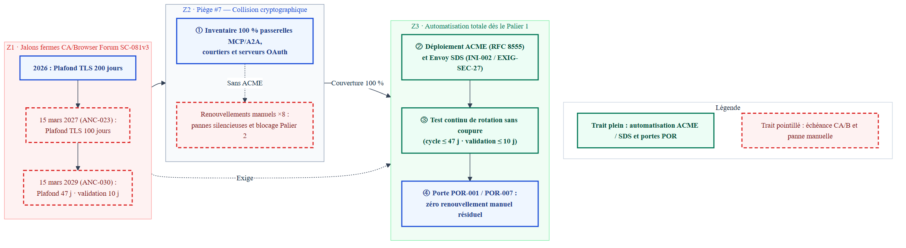
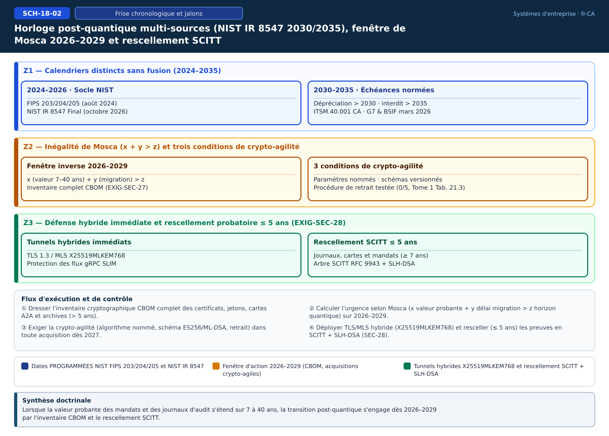
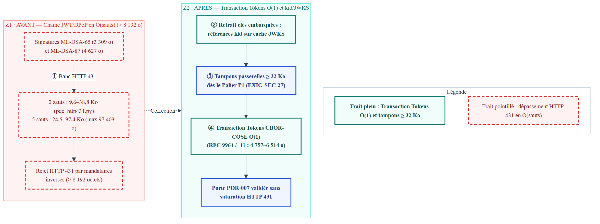

# Chapitre 18 — Agilité cryptographique, cycles TLS à 47 jours et transition post-quantique ML-DSA/SLH-DSA

*Question directrice :* Comment automatiser l'infrastructure à clés publiques face au raccourcissement des certificats TLS à 47 jours tout en orchestrant la transition post-quantique sans provoquer de saturation HTTP 431 ni perdre la force probante des archives et mandats à long terme ?

Les identités non humaines parrainées (← Chapitre 16) et les chaînes de délégation `OBO`/`CIBA` (← Chapitre 17) reposent entièrement sur la solidité opérationnelle et mathématique de la couche cryptographique sous-jacente. Or deux horloges irréversibles convergent simultanément sur cette fondation entre 2026 et 2035. D'une part, le resserrement réglementaire de l'écosystème web public réduit de façon drastique la durée maximale de validité des certificats `TLS` jusqu'à `47` jours, rendant toute gestion manuelle par billets d'exploitation caduque [6, 10]. D'autre part, la finalisation des normes post-quantiques du NIST et la publication finale de `NIST IR 8547` en octobre 2026 transforment la migration hors des algorithmes asymétriques classiques (`RSA`, `ECDSA`, `EdDSA`) en échéance programmée à l'horizon `2030–2035` [1, 2, 3, 4].

Ce chapitre clôt le domaine D06 en traduisant ces deux contraintes en exigences exécutables (`EXIG-SEC-27`, `EXIG-SEC-28`, `DEC-012`, `PRI-012` — Certificats courts automatisés et transition post-quantique sans couture —, `POR-001`, `POR-007`, `POR-011`). Au gel du 2 décembre 2026, il démontre sur le banc `pqc_http431.py` comment les signatures post-quantiques provoquent dès deux sauts le dépassement `HTTP 431` et imposent `kid`/`JWKS` ainsi que des `Transaction Tokens CBOR-COSE` de taille constante O(1) [7, 8].

## 18.1 Résumé exécutif : automatisation ACME à 47 jours et maîtrise du choc PQC

> **Clause non-avis (`AO-05`)** — Les analyses calendaires et prudentielles de ce chapitre demeurent techniques et pédagogiques ; elles ne constituent ni un avis juridique ni une certification réglementaire (Annexe D, § 2).

Quatre principes gouvernent la résilience cryptographique de l'entreprise agentique. Premièrement, le scrutin `Ballot SC-081v3` du *CA/Browser Forum* (exigences de base mises à jour le 4 octobre 2026) impose un plafond de validité des certificats `TLS` publics de `100` jours au `15 mars 2027` (`ANC-023`) puis de `47` jours au `15 mars 2029` (`ANC-030`), avec réutilisation des validations de domaine réduite à `10` jours [6]. L'automatisation intégrale par protocole `ACME` (RFC 8555) et `SPIFFE`/`Envoy SDS` devient une condition bloquante dès le Palier 1 (`POR-001`) [6, 10].

Deuxièmement, face à la menace rétroactive dite « récolter maintenant, déchiffrer ou falsifier plus tard », le théorème de Mosca (`X + Y > Z`) compare la durée de protection requise (`X`) et le délai de migration (`Y`) à l'horizon quantique (`Z`) [4]. Toute archive, carte `A2A` ou trace de mandat à conservation longue (`≥ 7` ans sous `EXIG-SEC-28`) appelle une décision anticipée dans la fenêtre d'action inverse `2026–2029`, appuyée sur un inventaire `CBOM` et trois conditions de **crypto-agilité post-quantique** [4, 5]. Troisièmement, les calendriers officiels (`NIST IR 8547`, feuille de route `G7`, directives américaines `EO 14412` et `OMB M-26-15`, repères canadiens et échéances prudentielles d'octobre 2028, fin 2028 et juin 2033) doivent être distingués selon leur portée juridique sans jamais être fusionnés [4, 5].

Quatrièmement, l'algorithme `ML-DSA-65` produit des signatures de `3 309` octets, tandis que `ML-DSA-87` atteint `4 627` octets [2, 7]. Ces tailles excèdent cinquante à soixante-douze fois celle d'une signature `Ed25519` (`64` octets) [9], franchissant le seuil `HTTP 431` (`8 192` octets) des mandataires inverses sans bascule vers `CBOR-COSE O(1)`, `kid`/`JWKS`, tunnels `MLS` (`RFC 9420`) / `TLS 1.3` à échange hybride `X25519MLKEM768` (profil PQC distinct de `RFC 9420`, spécification IETF exacte à confirmer) et rescellement périodique `SCITT` (`RFC 9943`) + `SLH-DSA` (`FIPS 205`) [1, 3, 7, 8, 11].

## 18.2 Automatisation PKI 47 jours et migration post-quantique maîtrisée

### 18.2.1 Certificats TLS 100 j / 47 j et ACME

L'architecture des Systèmes d'agentivité repose sur une multiplication des points d'extrémité cryptographiques : chaque passerelle `PEP`, serveur `MCP`, façade `A2A`, courtier de jetons `STS`, service d'approbation `CIBA` et connecteur `IDMZ` expose et vérifie des certificats `TLS` mutuels ou publics. Jusqu'en 2026, le plafond historique de validité des certificats `TLS` publics s'établissait à environ un an (`398` jours puis `200` jours). Le scrutin `Ballot SC-081v3` adopté par le *CA/Browser Forum* introduit un raccourcissement sévère en deux marches fermes (`EXIG-SEC-27`, `PRI-012`) [6].

Au **15 mars 2027** (`ANC-023`), la validité maximale autorisée pour chaque certificat `TLS` public d'abonné et la réutilisation d'une validation de domaine ou d'adresse IP descendent à `100` jours [6]. Au **15 mars 2029** (`ANC-030`), ce plafond tombe à `47` jours maximum, tandis que la réutilisation de validation de domaine se voit restreinte à `10` jours [6]. Ces deux jalons s'appliquent mécaniquement à toute infrastructure exposant des certificats reconnus par les clients standards.

À une cadence de `47` jours — impliquant un renouvellement effectif tous les `25` à `30` jours pour conserver une marge de sécurité opérationnelle —, la fréquence des rotations est multipliée par environ huit par rapport à un cycle annuel. Continuer d'administrer ces certificats par billets manuels, courriels de relance ou interventions humaines déclenche mécaniquement le piège opérationnel de la **collision cryptographique** : les expirations s'accumulent plus vite que les fenêtres de maintenance humaines, provoquant des pannes silencieuses en cascade sur l'ensemble des liaisons entre agents et outils [6, 10].

Une telle collision compromet la disponibilité des flux durables (`Temporal`) et des décisions (`OPA`/`Cedar`) tout en saturant les équipes `SRE`. L'abaissement simultané de la réutilisation de validation à `10` jours interdit toute preuve manuelle trimestrielle et impose l'exécution autonome du défi cryptographique à chaque cycle [6, 10].

En conséquence, les exigences `EXIG-SEC-27` et `EXIG-IAM-15` ainsi que l'initiative sans regret `INI-002` imposent l'automatisation à `100,0 %` de l'émission, du renouvellement et du déploiement sans redémarrage dès le Palier 1 (`POR-001`) [6, 10]. Pour les certificats publics exposés en bordure, les passerelles intègrent des clients conformes au protocole `ACME` (*Automatic Certificate Management Environment*, RFC 8555, mars 2019), utilisant des défis automatisés (`http-01` ou `dns-01`, complétés le cas échéant par `TLS-ALPN-01`) avec rotation automatisée des clés et validation continue en intégration continue [10].

La mise en œuvre opérationnelle exige d'abord un inventaire complet de `100,0 %` des points de terminaison exposant des certificats `TLS` (passerelles `MCP`, façades `A2A`, courtiers `OBO`, serveurs d'approbation `CIBA`). À l'intérieur du domaine de confiance, les identités de charge `SPIFFE`/`SPIRE` relayées par `Envoy SDS` maintiennent déjà une validité horaire (`1 h`, ← Chapitre 16). L'ouverture de tout flux externe ou inter-organisations au Palier 2 (`POR-007`) demeure strictement bloquée tant qu'un test périodique automatisé ne prouve pas l'absence de tout renouvellement manuel résiduel sous un cycle cible inférieur ou égal à `47` jours et un renouvellement d'urgence vérifié sans coupure de session [6, 10].



*Figure 58 — SCH-18-01 : Frise du raccourcissement CA/Browser Forum SC-081v3 (200 j → 100 j le 15 mars 2027 → 47 j le 15 mars 2029) illustrant le piège de collision sur billets manuels et l'automatisation ACME (RFC 8555) / Envoy SDS dès le Palier 1.*

### 18.2.2 Transition post-quantique ML-DSA / SLH-DSA

Parallèlement à l'accélération des rotations `TLS`, le calcul quantique menace les fondations mathématiques de toute signature et de tout échange de clés reposant sur la factorisation d'entiers (`RSA`) ou le logarithme discret sur courbes elliptiques (`ECDSA`, `Ed25519`) via l'algorithme de Shor. Le 13 août 2024, le *National Institute of Standards and Technology* (NIST) a publié ses trois premières normes fédérales post-quantiques finales : `FIPS 203` pour l'encapsulation de clés `ML-KEM` (*Module-Lattice-Based Key-Encapsulation Mechanism*), `FIPS 204` pour la signature numérique sur réseaux euclidiens `ML-DSA` (*Module-Lattice-Based Digital Signature Standard*), et `FIPS 205` pour la signature sans état par arbres de hachage `SLH-DSA` (*Stateless Hash-Based Digital Signature Standard*) [1, 2, 3].

Le 21 octobre 2026 (date enregistrée dans le manifeste primaire [4], faisant foi sur un repère antérieur du 27 octobre 2026), la publication finale de `NIST IR 8547` (*Transition to Post-Quantum Cryptography Standards*) a fait basculer les jalons de transition du statut prospectif au statut **programmé** : dépréciation des algorithmes classiques après `2030`, puis interdiction après `2035` [4]. Dans le secteur financier, le *G7 Cyber Expert Group* a publié le 14 janvier 2026 une feuille de route coordonnant la migration sur `2030–2035` (jalons `ANC-040` fin `2032` et `ANC-043` `2035`) [5].

Une erreur fréquente de gouvernance consiste toutefois à amalgamer des échéances issues de juridictions et de régimes juridiques hétérogènes. Une planification rigoureuse distingue sans les fusionner quatre familles de repères officiels :

- **Référentiels techniques internationaux** : `NIST IR 8547` (en continuité avec `SP 800-131A Rev. 3` [4]) fixe la dépréciation après `2030` et l'interdiction après `2035`, tandis que la feuille de route `G7` coordonne la transition financière sur `2030–2035` (`ANC-040` fin `2032`, `ANC-043` `2035` ; veille `Europol/QSFF` au repérage du traité) [4, 5].
- **Mandats gouvernementaux américains** : dans le sillage de `Public Law 117-260`, le décret `EO 14412` (`22 juin 2026`) et le mémorandum `OMB M-26-15` (`24 juin 2026`) imposent aux seules agences fédérales américaines `TLS 1.3` au `2 janvier 2030`, l'établissement de clés PQC au `31 décembre 2030` et les signatures au `31 décembre 2031`, sans lier les banques canadiennes [4]. Les dates exactes de publication de ces actes restent à confirmer aux textes officiels américains en complément de [4].
- **Orientations canadiennes** : selon le repérage historique (`Tome 1 § 21.8`, hors sources primaires `L+` du chapitre), la feuille de route `ITSM.40.001` du Centre canadien pour la cybersécurité (`23 juin 2025`, date et jalons à confirmer à la publication officielle du CCCS) vise les systèmes fédéraux (`fin 2031` prioritaires, `fin 2035` autres) sans obliger le secteur privé, complétée par un bulletin BSIF de mars 2026 sans date contraignante (→ Chapitre 25).
- **Horizons probatoires au Canada et au Québec** : la conservation longue des preuves agentiques croise la Loi 25 du Québec (`22 septembre 2023`, art. 12.1), l'interdiction des rétrofacturations de commissions sous `NC 31-103` (`1er octobre 2028`), les divulgations de portée 3 `BSIF B-15` (`fin 2028`) et la révision statutaire fédérale de la Loi sur les banques (`30 juin 2033`, numéro d'article `art. 21` à confirmer au texte statutaire, → Chapitre 25).

Appliquée aux Systèmes d'agentivité, la menace classique dite « récolter maintenant, déchiffrer plus tard » (`harvest now, decrypt later`) [4, 5] s'élargit en architecture au risque de **contrefaçon et répudiation rétroactive** (« récolter maintenant, falsifier plus tard »). Si un mandat ou un journal d'audit signé aujourd'hui en `ECDSA` ou `Ed25519` doit demeurer opposable pendant `7` ans ou plusieurs décennies (archives fiscales, contrats d'assurance-vie, décisions de crédit), un adversaire disposant d'un ordinateur quantique cryptographiquement pertinent (`CRQC`) à l'horizon `2030–2035` pourrait forger de fausses signatures indiscernables [4, 5]. L'absence native d'horloge d'expiration sur l'`AgentCard` A2A (← Chapitre 16) accentue ce risque pour les artefacts durables.

Le théorème de Mosca formalise cette urgence décisionnelle : lorsque la somme du nombre d'années de protection requise (`X`) et du délai estimé de migration (`Y`) excède le délai avant un calculateur quantique pertinent (`Z`, soit `X + Y > Z`), la transition doit s'engager sans délai [4]. Par construction à rebours depuis `2030` (`Tome 1 § 21.9`), l'architecture retient une fenêtre d'action inverse `2026–2029` : inventaire `CBOM` dès 2026–2027 [4, 5], validation des patrons en 2027–2028, puis bascule hybride avant fermeture de la fenêtre.

Cet inventaire `CBOM` recense quatre dimensions par actif : algorithmes et longueurs de clés, contraintes de rotation et révocation, durée de conservation probatoire ou de confidentialité, et régime réglementaire. Un `CBOM` à jour cible prioritairement les actifs exposés au-delà de `2030` et évite les migrations d'urgence.

Pour qu'un composant satisfasse à la **crypto-agilité post-quantique** (`EXIG-SEC-27`, `EXIG-SEC-28`), il DOIT remplir trois conditions cumulatives. Premièrement, tout contrat ou en-tête protégé DOIT porter un paramètre d'algorithme explicitement nommé (`alg` tel `ES256`, `ML-DSA-65` ou `ML-DSA-87`) [2, 7]. Deuxièmement, les schémas d'interface doivent être versionnés et vérifiables, comme le démontre le schéma JSON Draft 2020-12 de l'Annexe C du Tome 2 et de la trousse du Tome 8 préparant la transition `ES256` → `ML-DSA` sans rupture de format (→ Chapitre 35) [7]. Troisièmement, l'organisation DOIT disposer d'une procédure documentée et testée de transition et de retrait de l'ancien jeu cryptographique : l'inventaire comparatif antérieur du traité (`Tome 1 § 21.5`, Tableau 21.3) révèle en effet que zéro artefact sur cinq mécanismes examinés documentait le retrait effectif des clés et algorithmes obsolètes, créant un risque d'empilement perpétuel et de repli vulnérable par attaque par rétrogradation (*downgrade attack*) [4, 5].

Quatre patrons techniques encadrent cette migration sans rompre la chaîne de confiance : la coexistence temporaire de signatures multiples sur un même artefact durant la fenêtre de transition, l'externalisation des clés publiques par référence `kid` vers un magasin `JWKS` gouverné, le passage à des enveloppes compactes `CBOR-COSE` pour les jetons multi-sauts, et le rescellement périodique des archives longues [2, 7, 8]. Cette crypto-agilité s'opère concrètement sur deux plans (`EXIG-SEC-28`). Sur le plan du transport, les canaux `TLS 1.3` et les liaisons gRPC chiffrées par `MLS` (*Messaging Layer Security*, `RFC 9420`, juillet 2023) [11] au sein de la pile `SLIM`/`AGNTCY` (← Chapitre 08) activent dès le Palier 1 l'échange de clés hybride `X25519MLKEM768`. Publiée avant `FIPS 203` [1], la `RFC 9420` ne normalise pas elle-même les suites post-quantiques : `X25519MLKEM768` associe `X25519` et `ML-KEM-768` [1] par profil distinct (spécification IETF à confirmer) selon l'approche transitoire de `NIST IR 8547` [4].

Sur le plan de l'archivage probatoire, les journaux `C.8`, les cartes `AgentCard` et les jetons d'approbation `CIBA` dont la conservation dépasse cinq ans sont ancrés dans un journal transparent à arbre de Merkle conforme à l'architecture **SCITT** (`RFC 9943`, juin 2026) [8]. Ces preuves reçoivent un rescellement périodique à intervalle inférieur ou égal à `5` ans au moyen de signatures sans état `SLH-DSA` (`FIPS 205`, variantes `SHA2-128s` à `7 856` octets et `SHA2-128f` à `17 088` octets, clé publique `32` octets), dont la sûreté repose uniquement sur des fonctions de hachage et résiste au-delà de `2035` (→ Chapitre 22) [3, 8]. En barrière `G0` (Corpus/Tome 8), `slh_dsa_fips205.py` livre une implémentation Python pur sous licence `MIT` (`hashlib`/`hmac` seuls, écartant le paquet PyPI `LGPL-3.0-or-later` proscrit par `execute_g0.py`), vérifiée sur les vecteurs officiels `NIST FIPS 205 ACVP` (`keyGen`, `sigGen`, `sigVer`). Dans `audit_scitt_focus.py`, `seal_merkle_root` retient exclusivement la variante compacte `SLH-DSA-SHA2-128s` (`7 856` octets) pour sceller périodiquement les racines Merkle `SCITT`, sans jamais l'embarquer dans les en-têtes HTTP par requête.



*Figure 59 — SCH-18-02 : Frise distinguant les calendriers officiels 2024–2035 (NIST FIPS 203/204/205, NIST IR 8547, ITSM.40.001, G7), la fenêtre d'action inverse de Mosca (2026–2029) et les trois conditions de crypto-agilité jusqu'au rescellement SCITT + SLH-DSA.*

Toutefois, le passage des signatures classiques aux signatures post-quantiques `ML-DSA` (`FIPS 204`, sérialisées pour JOSE et COSE par la RFC 9964 de mai 2026) déclenche un goulet d'étranglement physique majeur dans les chaînes de délégation multi-sauts : le **choc d'en-têtes HTTP 431** (*Request Header Fields Too Large*) [2, 7]. Alors qu'une signature `Ed25519` conforme à la RFC 8032 occupe exactement `64` octets et une signature `ECDSA P-256` (`ES256`) également `64` octets, les signatures `ML-DSA` affichent des tailles fixes de `2 420` octets pour `ML-DSA-44`, `3 309` octets pour `ML-DSA-65` (~52× `Ed25519`) et `4 627` octets pour `ML-DSA-87` (~72× `Ed25519`), auxquelles s'ajoutent des clés publiques atteignant `1 952` octets (`ML-DSA-65`) et `2 592` octets (`ML-DSA-87`) [2, 7, 9].

Lorsqu'une passerelle `PEP` ou un mandataire inverse tel que *Nginx* ou *Envoy* applique un plafond courant de `8 192` octets (`8` Kio) pour les en-têtes HTTP, l'empilement linéaire en O(sauts) des jetons `OBO` et des preuves `DPoP` encodés en Base64URL fait immédiatement exploser la limite autorisée [7]. L'extrait synchronisé `G0-EX-CH02-03` (identifiant de scellage `CA-G0-SYNC` du Tome 8, Annexe D) issu du module `pqc_http431.py` (banc vérifié à la barrière `G0` pour pallier l'absence sur disque du dépôt historique `Borealis-Bench`) reproduit et mesure au bit près cette saturation réseau [2, 7] :

<!-- CA-G0-SYNC id="G0-EX-CH02-03" path="Tomes/Tome 8 - Ingénierie exécutable et homologation vérifiable/trousse/authz_pqc_audit/pqc_http431.py" lines="149-177" sha256="c5c72e27a3932180e70ba9ebd63c109c5cc146c3af50d1327aed293f0e614855" -->
```python
def build_signed_delegation_frame(
    alg: Literal["ML-DSA-65", "ML-DSA-87"], profile: PqcProfile, hops: int,
    claims: dict[str, Any], keypair: tuple[bytes, bytes] | None = None,
) -> bytes:
    """Construit et signe la trame JWT (RFC 9964) ou CBOR-COSE."""
    prof = PqcProfile(profile)
    if (alg not in ML_DSA_SPECS or type(hops) is not int or hops < 1
            or not isinstance(claims, dict)):
        raise ValueError(f"Parametres PQC invalides : {alg}, hops={hops}")
    pk, sk = keypair if keypair is not None else _default_keypair(alg)
    return _build_frame_bytes(alg, prof, hops, claims, pk, sk)

def evaluate_http_431(
    alg: Literal["ML-DSA-65", "ML-DSA-87"], profile: PqcProfile,
    hops: int, header_limit_bytes: int = 8192,
) -> Http431Measurement:
    """Mesure Authorization / Txn-Token et detecte HTTP 431."""
    prof = PqcProfile(profile)
    frame = build_signed_delegation_frame(
        alg, prof, hops, {"sub": "alice", "scope": "finance:read"}
    )
    wire = _b64u(frame).encode("ascii") if prof in _CBOR_PROFILES else frame
    pfx = _TX_PFX if "TRANSACTION_TOKEN" in prof.value else _AUTH_PFX
    total = len(pfx) + len(wire)
    exceeds = total > header_limit_bytes
    return Http431Measurement(
        alg, prof, hops, total, header_limit_bytes,
        exceeds, 431 if exceeds else 200,
    )
```

Les mesures déterministes délivrées par `evaluate_http_431` confirment l'ampleur du blocage : dès le premier saut, un jeton `JWT` embarquant la clé publique (`jwk` ou chaîne `x5c`) atteint `8 298` à `19 380` octets (`HTTP 431`). Même en substituant la clé embarquée par un simple identifiant `kid`, l'empilement sur deux sauts franchit la barre des `8 192` octets (`9 624` octets sous `ML-DSA-65` et `13 140` octets sous `ML-DSA-87`), grimpant à `24 468`–`33 258` octets sur cinq sauts (et jusqu'à `71 198`–`97 403` octets avec chaînes `x5c` embarquées sur cinq sauts) [2, 7].

| Profil de transport (`pqc_http431.py`) | `1` saut (`ML-DSA-65` / `87`) | `2` sauts (`ML-DSA-65` / `87`) | `5` sauts (`ML-DSA-65` / `87`) | Statut face à `8 192` o |
|---|---|---|---|---|
| `JWT_EMBEDDED_JWK` (`O(sauts)`) | `8 298` / `11 193` o | `16 634` / `22 424` o | `41 993` / `56 468` o | Rejet `HTTP 431` dès `1` saut |
| `JWT_X5C_CHAIN` (`O(sauts)`) | `14 139` / `19 380` o | `28 316` / `38 798` o | `71 198` / `97 403` o | Rejet `HTTP 431` dès `1` saut |
| `JWT_KID_REF` (`O(sauts)`) | `4 793` / `6 551` o | `9 624` / `13 140` o | `24 468` / `33 258` o | Rejet `HTTP 431` dès `2` sauts |
| `CBOR_COSE_CWT` (`O(sauts)`) | `4 692` / `6 449` o | `9 413` / `12 928` o | `23 880` / `32 666` o | Rejet `HTTP 431` dès `2` sauts |
| `TRANSACTION_TOKEN_JWT` (`O(1)`) | `4 778` / `6 536` o | `4 778` / `6 536` o | `4 778` / `6 536` o | `200 OK` constant (`1..5` sauts) |
| `TRANSACTION_TOKEN_CBOR` (`O(1)`) | `4 757` / `6 514` o | `4 757` / `6 514` o | `4 757` / `6 514` o | `200 OK` constant (`1..5` sauts) |

*Tableau 18.1 — Mesures exactes de taille d'en-tête HTTP sous ML-DSA-65 (3 309 o) et ML-DSA-87 (4 627 o) exécutées par `pqc_http431.py`.*

La parade architecturale s'articule en trois mesures impératives (`EXIG-SEC-27`, `POR-007`). Premièrement, toute clé publique ou chaîne de certificats embarquée dans les jetons est bannie au profit de références `kid` résolues sur un cache `JWKS` gouverné. Deuxièmement, la propagation intra-domaine bascule vers des `Transaction Tokens` (← Chapitre 17, `transaction-tokens-11` actualisant `-09`) encodés en `CBOR-COSE` `ML-DSA` selon `RFC 9964` [7] et `FIPS 204` [2] ; le banc `pqc_http431.py` (`G0`) mesure un en-tête unique constant en O(1) à `4 757` octets (`ML-DSA-65`) et `6 514` octets (`ML-DSA-87`).

Troisièmement, cette mesure unitaire d'en-tête (`Authorization` ou `Txn-Token` seul) révèle un enjeu de cumul critique : hors maillage interne `mTLS` (`X.509-SVID`, `EXIG-IAM-14`), toute requête porte aussi une preuve `DPoP` (`dpop+jwt`, ← Chapitre 17) signée en `ML-DSA-65` (`3 309` octets) ou `ML-DSA-87` (`4 627` octets). Le cumul `Authorization`/`Txn-Token` + `DPoP` franchit alors `8 192` octets dès le premier saut, imposant des tampons HTTP `≥ 32` Kio (`32 768` octets) dès `P1` et la préférence pour `mTLS` en interne.



*Figure 60 — SCH-18-03 : Comparatif avant/après démontrant l'explosion linéaire des en-têtes HTTP sous ML-DSA-65/87 (rejet HTTP 431 > 8 192 o) et sa neutralisation en taille constante O(1) (4 757–6 514 o) par Transaction Tokens CBOR-COSE, références kid/JWKS et tampons ≥ 32 Kio.*

Les normes ISO payantes (portail `iso.org` en statut `F`, Annexe A) restent exclues : les transitions reposent sur les normes ouvertes NIST, IETF, *CA/Browser Forum* et les vecteurs `G0` [1, 2, 3, 4, 6, 7].

## 18.3 Synthèse des schémas, livrables, exigences probatoires et trois invariants exécutables

Les trois figures du chapitre matérialisent la trajectoire cryptographique complète : la Figure 58 (`SCH-18-01`) trace le raccourcissement `TLS` à `47` jours sous `ACME` en section `18.2.1`, la Figure 59 (`SCH-18-02`) distingue les calendriers post-quantiques et la fenêtre de Mosca jusqu'au rescellement `SCITT` + `SLH-DSA`, et la Figure 60 (`SCH-18-03`) oppose le choc `HTTP 431` à la neutralisation `O(1)` en section `18.2.2`.

Sur le plan transversal, le présent chapitre reçoit les tunnels `SLIM`/`MLS` issus du tissu horizontal (← Chapitre 08), le séquencement `DAPP` `P1`–`P3` (→ Chapitre 31), les schémas JSON versionnés (→ Chapitre 35) et les règles d'actualisation à 30 jours du corpus source (`Annexe N` du corpus, → Chapitre 36). En retour, il projette les exigences de tampons et de latence sur `AI Gateway` (← Chapitre 09), impose le renouvellement post-quantique des autorités `SVID` et `AgentCard` (← Chapitre 16) et gouverne la bascule vers les `Transaction Tokens O(1)` (← Chapitre 17). Il prescrit également le rescellement des journaux sans reconstruire le double couloir (→ Chapitre 22), prépare les liaisons `IDMZ` et B2B (→ Chapitre 25) et alimente `DEC-012` ainsi que les signaux `SIG-009`, `SIG-010`, `SIG-011` et `SIG-012` (→ Chapitre 31).

| Livrable et jalon | Exigences et portes associées | Critère d'acceptation exécutable (`G0`–`G1`) |
|---|---|---|
| Chaîne `ACME` (`RFC 8555`) & `Envoy SDS` `TLS ≤ 47 j` | `EXIG-SEC-27`, `ANC-023`, `ANC-030`, `PRI-012`, `POR-001`, `POR-007`, `INI-002` | `100,0 %` de rotation automatisée sans coupure ni billet manuel ; validation domaine `≤ 10 j` prête avant le `15 mars 2029` [6, 10] |
| Inventaire `CBOM` & acquisitions crypto-agiles (`3` conditions) | `EXIG-SEC-27`, `EXIG-SEC-28`, `ADR-006`, `DEC-012`, `CAP-040`, `SIG-010`, `SIG-011` | Paramètre `alg` nommé, schéma versionné (`Annexe C` du Tome 2 / Tome 8), procédure de retrait testée (`0/5` au `Tome 1 § 21.5`) et fenêtre Mosca `2026–2029` [4, 5] |
| Banc `pqc_http431.py` & migration `CBOR-COSE O(1)` + `kid`/JWKS | `EXIG-SEC-27`, `RFC 9964`, `POR-007` (`G0-EX-CH02-03`) | Tampons passerelle `≥ 32` Kio dès `P1` ; en-têtes `O(1)` à `4 757` o (`ML-DSA-65`) et `6 514` o (`ML-DSA-87`) validés à `HTTP 200` [2, 7] |
| Rescellement `SCITT` (`RFC 9943`) + `SLH-DSA` & `X25519MLKEM768` | `EXIG-SEC-28`, `ANC-040`, `ANC-043`, `FIPS 203`/`205`, `RFC 9420`, `POR-007`/`011` | Tunnels `MLS` (`RFC 9420`)/`TLS 1.3` à extension hybride `X25519MLKEM768` (profil IETF distinct à confirmer) sur `SLIM` ; rescellement `≤ 5` ans vérifié sur `slh_dsa_fips205.py` et `NIST ACVP` [1, 3, 8, 11] |

*Tableau 18.2 — Livrables, jalons d'architecture et critères de validation du Chapitre 18.*

Le tableau récapitulatif ci-dessous consolide l'échelonnement progressif sur les trois paliers `P1` à `P3` (en continuité avec la rampe `2026–2027` du Chapitre 31) afin de guider les arbitrages budgétaires et contractuels sans rupture de service :

| Palier `DAPP` | Horizon et porte | Mesures cryptographiques déployées | Condition de passage |
|---|---|---|---|
| Palier `P1` (Socle consolidé) | `2028–2029` (`INI-002`, `POR-001`, après rampe `2026–2027`) | `ACME` `100 %` (`100 j` au `15 mars 2027` puis `≤ 47 j` au `15 mars 2029`), tampons `≥ 32` Kio, `CBOM`, `X25519MLKEM768` sur `SLIM`, clauses crypto-agiles | Zéro billet manuel `TLS` ; `CBOM` complet et tests de retrait validés [6, 10, 11] |
| Palier `P2` (Hybride `PQC`) | `2030–2032` (`INI-019`, `POR-007`, `ANC-040`) | Signatures hybrides `ML-DSA`, `Transaction Tokens CBOR-COSE O(1)` + `kid`/JWKS, rescellement `SCITT + SLH-DSA ≤ 5` ans | `0` rejet `HTTP 431` ; preuves longues rescellées face à la fenêtre G7 `2030–2032` [3, 5, 7, 8] |
| Palier `P3` (Natif `PQC`) | `2033–2035` (`INI-041`, `POR-011`, `ANC-043`) | Retrait complet des primitives asymétriques classiques vulnérables (`NIST IR 8547 > 2035`) et ré-horodatage continu `SLH-DSA` | Achèvement vérifié de la chaîne de ré-horodatage et conformité `2035` [3, 4] |

*Tableau 18.3 — Trajectoire échelonnée P1–P3 de l'agilité cryptographique et de la transition post-quantique.*

Avec `TLS` automatisé à `47` jours, `Transaction Tokens O(1)` et `SCITT` + `SLH-DSA`, le domaine D06 livre le socle d'identités et de preuves sur lequel la Partie VII érige la défense hors modèle et le confinement déterministe (→ Chapitre 19).

> **Trois invariants exécutables — Chapitre 18**
>
> 1. **Automatisation `ACME`/`SPIFFE` `100,0 %` avant le `15 mars 2027` et le `15 mars 2029` (`EXIG-SEC-27`, `POR-001`)** : Aucun certificat `TLS` de passerelle, de serveur `MCP`/`A2A` ou de courtier `STS` ne doit dépendre d'un renouvellement manuel ; la rotation automatisée `RFC 8555` soutient des cycles `≤ 47` jours et des validations `≤ 10` jours sans coupure dès le Palier 1.
> 2. **Maîtrise du choc `HTTP 431` sous `ML-DSA-65/87` (`G0-EX-CH02-03`, `RFC 9964`)** : Compte tenu des signatures de `3 309` octets (`ML-DSA-65`) et `4 627` octets (`ML-DSA-87`), toute chaîne bascule vers `kid`/`JWKS` et `Transaction Tokens CBOR-COSE O(1)` (`4 757`–`6 514` octets pour l'en-tête seul), tandis que le cumul `Authorization`/`Txn-Token` + preuve `DPoP` (`dpop+jwt`) hors `mTLS` dépasse `8 192` octets dès le premier saut et impose des tampons passerelle `≥ 32` Kio dès `P1`.
> 3. **Crypto-agilité en trois conditions et rescellement `SCITT` + `SLH-DSA` (`EXIG-SEC-28`, `NIST IR 8547`)** : Toute primitive longue durée spécifie son algorithme nommé, versionne ses schémas, teste sa procédure de retrait, active `X25519MLKEM768` sur les canaux `TLS`/`MLS` et rescelle les preuves `≥ 5` ans au plus tous les `5` ans sous `RFC 9943` et `FIPS 205`.
