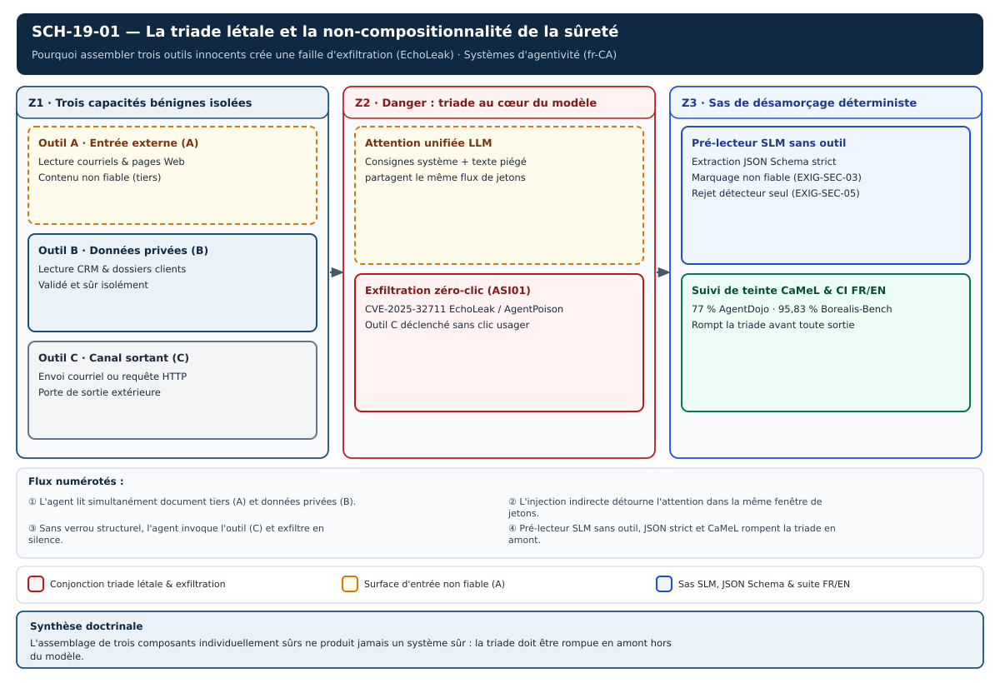
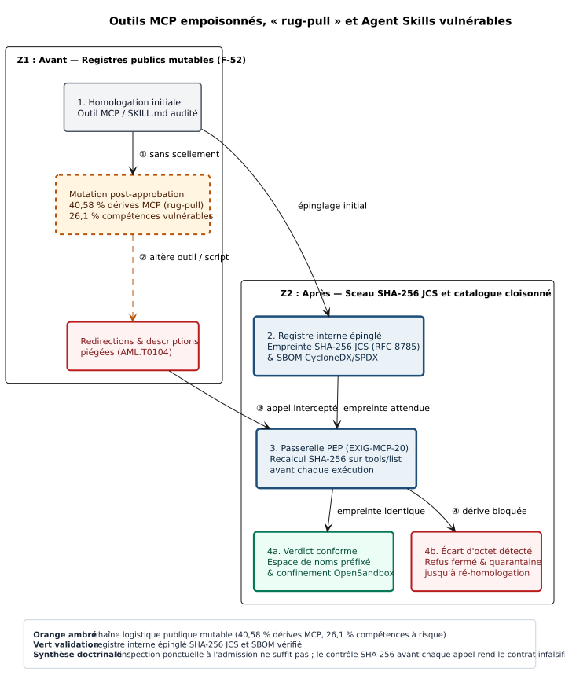
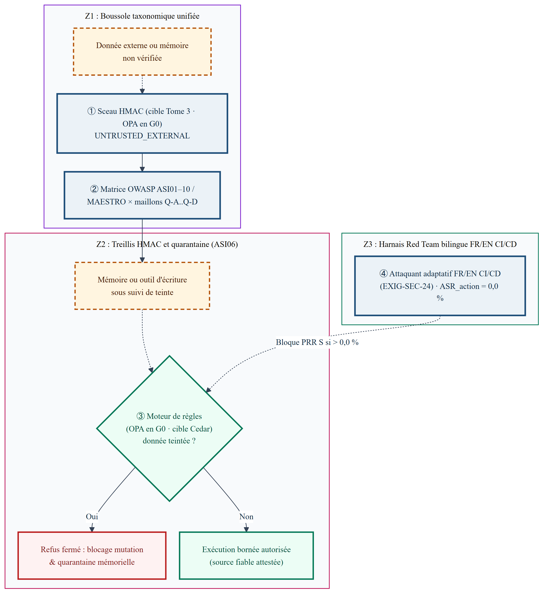

# Chapitre 19 — Surface d'attaque protocolaire, menaces OWASP ASI01–10 et chaîne logistique d'outils

*Question directrice : Comment caractériser les surfaces d'attaque non composables des Systèmes d'agentivité — de l'injection indirecte de consignes aux mutations silencieuses d'outils et de mémoire — et établir des contrôles préventifs vérifiables avant la mise en production ?*

La sécurité logicielle classique repose sur une séparation matérielle entre instructions exécutables et données. Au sein des Systèmes d'agentivité propulsés par des grands modèles de langage (`LLM`), cette frontière disparaît : consignes système, requêtes usager, courriels, pages Web, descriptions d'outils `MCP` et souvenirs convergent dans un même flux de jetons [3, 5]. Chaque donnée externe devient ainsi un vecteur potentiel de commande sans aucune faille logicielle traditionnelle.

À cette perméabilité s'ajoute la non-compositionnalité de la sûreté. Selon le modèle de la triade létale retenu par le cadre (`Tome 2 § 9.6`, `Tome 3 § 31.1`), trois composants audités isolément — lecteur de dossiers internes, connecteur de messagerie et outil d'envoi sortant — forment, dès qu'ils sont reliés au même agent, une combinaison critique capable d'exfiltrer des données sensibles sans clic humain (`ASI01`) [1, 5]. Parallèlement, les serveurs `MCP` et les paquets de compétences restent exposés à des altérations silencieuses après homologation [4, 6].

Ce chapitre ouvre la Partie VII (domaine D07) au gel documentaire du 2 décembre 2026. Il formalise la modélisation de la surface d'attaque et les exigences de scellement (`EXIG-SEC-01` à `EXIG-SEC-05`, `EXIG-SEC-18` à `EXIG-SEC-22`, `EXIG-SEC-24`, `EXIG-MCP-20`, `PRIN-07`, `CAP-038`, `ADR-019`, avec appui sur `ADR-008` et `ADR-010` posés ← Chapitres 10 et 11). L'encodage `OPA/Rego` et la Règle de deux relèvent du chapitre suivant (→ Chapitre 20), et le confinement en microVM avec réponse `SOC/SOAR` du terme de la partie (→ Chapitre 21). L'ensemble s'appuie sur des sources `L+` sous clause `non-avis` (`AO-05`), `genai.owasp.org` (refus `HTTP 403`) demeurant exclu en statut `F` au profit de l'archive ouverte `CC BY-SA 4.0` et du crosswalk `OWASP` [1, 2].

## 19.1 Résumé exécutif : trois surfaces non composables et quatre verrous préventifs

L'exposition d'un Système d'agentivité dépasse la somme des failles isolées de ses modules. Les incidents recensés jusqu'en décembre 2026 montrent que la menace touche trois surfaces couplées : le flux d'invites et de contexte (`OWASP ASI01`), la chaîne logistique `MCP` et des compétences (`OWASP ASI04`), et la mémoire persistante ou partagée (`OWASP ASI06`) [1, 4, 5]. Lorsqu'une donnée contaminée passe d'un agent amont à un agent aval en prose non qualifiée, le système subit un **blanchiment de frontière** transformant une entrée douteuse en consigne fiable [1, 5].

Quatre constats condamnent les défenses probabilistes. D'abord, `EchoLeak` [1] — répertoriée sous `CVE-2025-32711` au relevé interne `Tome 1 (§ 11.1.3)`, hors archive `L+` — prouve qu'une **injection indirecte de consignes** dans un courriel tiers détourne un agent vers l'exfiltration dès que les trois capacités critiques coexistent [1, 3]. Ensuite, Kraishan (`arXiv:2609.14119`, sept. 2026) relève sur `21 643` serveurs `MCP` (`72 606` versions, `8 900` multi-versions) `51,09 %` de changements inter-versions, `40,58 %` de dérive sémantique silencieuse (`OR = 2,96` sur `6 699` scannés) et `4,16 %` de redirections d'hôte [4].

De plus, un relevé interne du `Tome 3 (§ 13.3)`, hors `L+` (analyse statique sans confirmation d'exploitation), signale `26,1 %` de motifs vulnérables parmi `31 132` compétences `Agent Skills` (taux environ doublé avec scripts). Enfin, les filtres probabilistes cèdent devant les attaquants adaptatifs [3, 5] et sont proscrits comme barrière unique (`EXIG-SEC-05`, `Tome 2 § 9.6`).

Pour verrouiller ces vecteurs en amont, toute donnée externe ou réponse d'outil porte l'étiquette `UNTRUSTED_EXTERNAL` (`EXIG-SEC-03`, `taint_camel.py` en `G0`) et passe par un pré-lecteur `SLM` sans outil ou une isolation `CaMeL` (`CAP-038`). Sur `AgentDojo`, `CaMeL` (`arXiv:2503.18813v2`, `L+` au → Chapitre 20) résout `77 %` des tâches contre `84 %` sans défense ; en complément, `Borealis-Bench` Campagne 2 (`Tome 3 § 31.4`, hors `L+` et hors `G0`) relève `95,83 %` de rappel. Parallèlement, chaque outil `MCP` et manifeste `SKILL.md` est scellé par `SHA-256` `JCS` (RFC 8785) à `tools/list` et pré-appel (`EXIG-MCP-20`, `EXIG-SEC-18`, `mcp_pinning.py` en `G0`, ← Chapitre 07) [4, 6]. Chaque menace se classe selon `Q-A`–`Q-D` sur une matrice unifiant `OWASP ASI01`–`ASI10` [1, 2], `NIST AI 100-2e2025` [3], `MCP Top 10` (bêta) et `CSA MAESTRO` (`EXIG-SEC-01`, `ADR-019`). Enfin, la teinte anti-`ASI06` (enveloppe `OPA/Rego` scellée en `G0`, cible `HMAC`/`Cedar` du `Tome 3` hors `G0`) est éprouvée par harnais `Red Team` `FR`/`EN` bloquant (`EXIG-SEC-24`, `ASR_action = 0,0 %` sous `ADR-019`) [1, 3].

## 19.2 Surface d'attaque protocolaire et modélisation multicouche

### 19.2.1 Injection indirecte, non-compositionnalité et chaîne logistique MCP / Agent Skills

L'analyse distingue deux régimes de compromission. Dans l'injection directe, l'utilisateur tente lui-même de contourner les garde-fous du modèle. Dans l'**injection indirecte de consignes**, l'usager reste légitime et agit sous ses droits habituels, mais l'agent ingère un document, courriel ou retour d'outil contenant des directives adverses [1, 3, 5]. Le mécanisme d'attention ne disposant d'aucun privilège matériel entre ordre système et donnée passive, les jetons adverses orientent l'exécution [3, 5].

La publication `NIST AI 100-2e2025` classe ces manipulations parmi les attaques par évasion en inférence (`NISTAML.015`) ou par empoisonnement de contextes persistants [3]. Le référentiel `OWASP Top 10 for Agentic Applications 2026` les codifie sous `ASI01` (*Agent Goal Hijack*) [1, 2]. Les boutons d'assistance préremplis (« résumer avec l'IA », relevés au `Tome 3 § 14.5` hors `L+` sur `50` invites de `31` entreprises), les scénarios d'assistant de messagerie [5] et `EchoLeak` (`ASI01` [1] ; `CVE-2025-32711` au `Tome 1 § 11.1.3`) illustrent cette exfiltration où la lecture d'un courriel déclenche l'envoi silencieux de secrets [1, 5].

Cette vulnérabilité s'aggrave par la **non-compositionnalité de la sûreté**. En ingénierie logicielle déterministe, l'assemblage de deux modules vérifiés conserve généralement leurs invariants lorsque leurs interfaces typées sont respectées. Dans un écosystème agentique, un agent et trois outils pris isolément peuvent satisfaire aux tests unitaires tout en créant une faille critique dès leur raccordement sur une même session [1, 5]. Dès qu'un agent réunit l'exposition à une source externe non fiable (`A`), l'accès à des données sensibles (`B`) et un canal de sortie ou de mutation (`C`), la triade létale est reconstituée (`Tome 2 § 9.6`, `Tome 3 § 31.1`) [1, 5].

Cette non-compositionnalité éclaire **l'agentivité des systèmes** : elle émane non des poids isolés du modèle, mais de l'assemblage des outils, de la mémoire et des délégations, activant *Excessive Agency* (`ASI01`–`ASI03`) dès que la triade se referme [1, 5].

La non-compositionnalité frappe autant l'agent unique que les architectures distribuées. Lors d'une délégation inter-agents ou d'un chaînage `MCP`, une réponse contaminée réinterprétée sur confiance implicite — mécanisme illustré dans la note de veille sur le détournement de session (*agent session smuggling*) citée au `Tome 1 (§ 19.6)` hors `L+` — permet à un tiers d'orienter l'orchestrateur en aval [1, 5]. De même, un message altéré déclenche un détournement de refus multi-agents (`F-25`, `Tome 3 § 31.1`) le long d'une chaîne de sous-agents [1, 5]. La surface d'attaque réelle correspond donc au graphe complet des capacités accessibles sur trois plans : outils, invites et mémoire persistante ou `RAG` [1, 3].

*Figure 61 — SCH-19-01 : Reconstitution de la triade létale au cœur de la fenêtre d'attention d'un modèle à partir de trois capacités bénignes isolées (lecture externe, données privées, canal sortant) et désamorçage en amont par pré-lecteur SLM sans outil (`EXIG-SEC-03`/`05`) et suivi CaMeL.*

Face à cette indistinction des jetons, de nombreux déploiements s'appuient sur des parades probabilistes : délimitation lexicale (*Spotlighting*) [3], injonctions répétées en invite système [3], ou classifieur auxiliaire (tel *Prompt Shields*, cité à titre illustratif au `Tome 2 § 9.6`) [3, 5]. Or l'analyse théorique (notamment l'équivalence entre détection adversariale et classification robuste rappelée dans [3]) et les tests adverses montrent que ces filtres cèdent devant les formulations obliques, l'encodage `Base64` ou les attaques adaptatives [3, 5]. L'exigence `EXIG-SEC-05` (`Tome 2 § 9.6`) proscrit donc ces détecteurs comme barrière unique [3, 5].

Conformément à la taxonomie des six patrons architecturaux démontrés par Beurer-Kellner et ses coauteurs (*action-selector*, *plan-then-execute*, *map-reduce LLM*, *dual-LLM*, *code-then-execute*, *context-minimization*) [5], la défense contre l'injection indirecte DOIT résider dans le graphe de contrôle déterministe situé hors du modèle. Chacun de ces patrons restreint la capacité d'une donnée non fiable à influencer le choix des appels suivants.

Le patron *action-selector* limite le modèle à choisir une action dans un catalogue fermé sans lui montrer les données brutes [5]. Le patron *plan-then-execute* fige la séquence d'outils avant l'ingestion externe, tandis que *dual-LLM* sépare le modèle privilégié d'un modèle lecteur privé d'outils [5]. Les approches *map-reduce LLM* et *context-minimization* cloisonnent les résumés unitaires ou purgent le contexte intermédiaire, alors que *code-then-execute* compile un programme typé exécuté hors du modèle [5].

Dans les systèmes en classe de risque élevée (`CAP-038`, `ADR-019`), tout texte marqué `UNTRUSTED_EXTERNAL` (`EXIG-SEC-03`) transite par un petit modèle spécialisé (`SLM`) sans outil extrayant des champs typés conformes à un `JSON Schema` fermé. Ce sas alimente la séparation contrôle/données `CaMeL` (→ Chapitre 20). Dans l'étude `CaMeL` (`arXiv:2503.18813v2`, `SRC-007` au → Chapitre 20), cette garantie résout `77 %` des tâches sur `AgentDojo` contre `84 %` sans défense. À titre interne complémentaire (`Borealis-Bench` Campagne 2, `Tome 3 § 31.4`, hors `L+` et hors `G0`), le filtre sur `240` charges bilingues atteint `95,83 %` de rappel (`115/120`) et `0,00 %` de faux positifs tout en manquant `5` cas d'exfiltration sur `15`, confirmant l'insuffisance d'un filtre seul.

La seconde surface concerne la chaîne logistique des outils (`OWASP ASI04`, complétée par `MCP03` et `MCP04` d'`OWASP MCP Top 10` en statut bêta selon `Tome 2` et `Tome 3 § 31.3`) [1]. Le protocole `MCP` normalise l'échange `JSON-RPC` entre hôte et serveur, mais pas la confiance [6]. Metere (`arXiv:2605.24248`, juin 2026) souligne que l'hôte lit la liste auto-déclarée sans garantie cryptographique sur sa légitimité [6], tandis que Kraishan constate que le registre public ne versionne pas les définitions d'outils [4]. Au `Tome 1 (§ 39.2.1)` (← Chapitre 07), l'absence de version, d'empreinte ou de signature sur les huit champs du type `Tool` en `MCP 2025-11-25` forme le défaut structurel `F-52` [4, 6].

Ce déficit de confiance alimente trois classes d'attaques :
- **Empoisonnement d'outil (*tool poisoning*, `MITRE ATLAS AML.T0104` au relevé interne `Tome 1 § 19.1`, hors `L+`)** : directives cachées dans la description d'un outil légitime pour détourner le modèle vers la lecture de secrets locaux [1, 4].
- **Ombrage d'outil (*tool shadowing*)** : un serveur secondaire déclare un outil dont la description altère l'usage d'un outil légitime sur un autre serveur [4, 6].
- **Mutation silencieuse (*rug-pull*)** : un serveur modifie discrètement ses descriptions, paramètres ou cibles après homologation, ou entre notifications `list_changed` [4, 6].

Le recensement de Kraishan (`arXiv:2609.14119`, sept. 2026) sur `21 643` serveurs `MCP` (`72 606` versions, `14 353` codes sources issus de `13 051` dépôts et `8 900` serveurs multi-versions) établit l'ampleur du phénomène [4]. Parmi les serveurs multi-versions, `51,09 %` (`4 547` serveurs, IC `[50,05 ; 52,13]`) changent entre versions et `40,58 %` (IC `[39,57 ; 41,61]`) subissent une dérive sémantique silencieuse, multipliant presque par trois la cote d'une faille grave sur les `6 699` multi-versions scannés (`OR = 2,96`, IC `[2,56 ; 3,42]`), tandis que `4,16 %` (`370`) redirigent vers un autre hôte [4].

Dans la littérature citée par Kraishan [4], Li et Gao recensent `833` serveurs vulnérables sur `67 057` entrées dans six registres. Les relevés internes du `Corpus` (hors socle `L+` de ce chapitre) y ajoutent `304` redirections et `212` comptes GitHub réenregistrables sur quatre registres (`Tome 3 § 8.8`), `102` fiches `NVD` (`Tome 3 § 49.7`, 1er juil.–27 oct. 2026, sous réserve mot-clé, ← Chapitre 07) et les jalons `CVE-2025-6514`, `CVE-2025-49596` (`Tome 1 § 11.1.3`) ainsi que `CVE-2025-54136` (`Tome 3 § 31.9`).

Le même risque frappe les paquets `Agent Skills` (`SKILL.md`). Malgré la divulgation progressive en trois paliers (← Chapitre 10), le relevé interne du `Tome 3 (§ 13.3)`, hors `L+` et établi par analyse statique et classification par modèle sans confirmation d'exploitation, rapporte `26,1 %` de motifs vulnérables sur `31 132` compétences publiques, un taux environ doublé avec scripts exécutables. Sous `OWASP ASI04`, le chargement dynamique non vérifié depuis des places publiques reste prohibé [1].

*Figure 62 — SCH-19-02 : Contraste entre la chaîne logistique publique mutable (40,58 % de dérives silencieuses MCP et 26,1 % de motifs vulnérables sur Skills selon le relevé Tome 3 sous le défaut F-52) et le registre interne verrouillé par empreinte SHA-256 JCS vérifiée à la passerelle PEP avant chaque appel.*

Pour éradiquer les mutations silencieuses et les substitutions de code, les exigences du cadre (`EXIG-MCP-20`, `EXIG-SEC-18` à `EXIG-SEC-22`, `Tome 2 § 6.5` et `§ 9.8`) édictent cinq obligations bloquantes :

1. **Scellement `SHA-256 JCS` continu** : la passerelle recalcule le condensat `SHA-256` après canonisation `JCS` (RFC 8785) de chaque outil `MCP` lors de `tools/list` et avant chaque appel (`EXIG-MCP-20`, ← Chapitre 07), ainsi que sur les paquets de compétences (`EXIG-SEC-18`, complétant la veille `SEP-2640` du `Tome 3 § 5.2`).
2. **Révocation immédiate sur `list_changed` non homologué** : toute dérive d'un seul octet, notification `list_changed` ou redirection d'hôte déclenche un refus fermé et la mise en quarantaine jusqu'à ré-homologation différentielle (`EXIG-SEC-18`) [4].
3. **Isolation des espaces de noms** : chaque serveur `MCP` est préfixé par son domaine de confiance (`EXIG-SEC-19`, `EXIG-SEC-21`), tandis que `sampling` et `elicitation` hors cadre sont désactivés par défaut sans approbation explicite (`EXIG-MCP-21`, ← Chapitre 07).
4. **Registre interne et nomenclature `AIBOM`** : tout chargement direct depuis Internet est banni au profit d'un registre interne audité [1] et d'une nomenclature `CycloneDX`/`SPDX` couvrant modèles, invites, serveurs `MCP` et compétences (`EXIG-SEC-20`, → Chapitre 22) [1].
5. **Admission attestée et contingence tiers** : suivant Metere [6], l'admission vérifie l'attestation cryptographique du serveur (`/.well-known/mcp-attestation`), son niveau de sensibilité admissible et une liste blanche fermée d'outils, complétés par une évaluation des tiers et un plan de contingence (`EXIG-SEC-22`, `Tome 2 § 9.8`).

Dans le modèle d'admission attestée proposé par Metere (`arXiv:2605.24248`) [6], l'hôte ne se fie jamais à une liste d'outils simplement publiée par le serveur. Il vérifie hors bande une assertion signée `Ed25519` contre une racine de confiance verrouillée, n'admet que les outils d'une liste blanche locale fermée et journalise chaque verdict [6]. Comme le souligne Metere (§ 9) [6], cette attestation au point d'admission se compose avec le contrôle continu de dérive en passerelle (← Chapitre 07).

La troisième surface réside dans l'état persistant et les bases de connaissances (`OWASP ASI06`) [1]. Contrairement à l'injection indirecte ponctuelle limitée à la session courante, l'empoisonnement de mémoire ou de magasin vectoriel (`RAG`) s'inscrit dans la durée [1]. Les attaques de type `AgentPoison` (NeurIPS 2024, citée sous `ASI06` [1] et analysée au `Tome 3 § 14.5`), `MINJA` (`Tome 3 § 14.5`, hors `L+`) ou `PoisonedRAG` et `Phantom` [3] insèrent des déclencheurs discrets dans les bases ou la mémoire partagée. Ces fragments demeurent dormants à l'indexation puis biaisent durablement le raisonnement à chaque requête proche [1, 3], ce qui impose le cloisonnement `CoALA` et le filtrage `ACL` pré-récupération (← Chapitre 11).

L'effet cumulatif de ces trois surfaces explique la fragilité des chaînes à horizon long. Lorsqu'une dégradation ou un fragment `ASI06` franchit les contrôles syntaxiques initiaux, la boucle de rétroaction s'érode progressivement et amplifie l'écart de trajectoire à chaque étape (`← Chapitre 13`) [1, 7]. L'architecture exige donc de qualifier simultanément le flux d'entrée, la provenance des outils et l'intégrité des écritures mémorielles.

| Surface d'attaque | Vecteur représentatif et cas réel | Faille ou prévalence mesurée (`L+` et relevés qualifiés) | Exigence et verrou préventif principal |
|---|---|---|---|
| Flux d'invites et contexte (`ASI01`) | Injection indirecte zéro-clic, `EchoLeak` [1] (`CVE-2025-32711`, `Tome 1`), assistants messagerie [5] | Triade létale (`A` + `B` + `C`) non composable ; échec des filtres LLM isolés [1, 3, 5] | `UNTRUSTED_EXTERNAL` (`EXIG-SEC-03`), rejet filtre unique (`EXIG-SEC-05`), `SLM` + `CaMeL` (`CAP-038`) |
| Chaîne logistique `MCP` et `Skills` (`ASI04`) | *Tool poisoning* (`AML.T0104`, `Tome 1`), *rug-pull* (`F-52`), `CVE-2025-6514`, scripts `SKILL.md` | `40,58 %` dérives silencieuses `MCP` (`OR = 2,96`) [4] ; `26,1 %` motifs `Skills` (relevé `Tome 3`, hors `L+`) | Empreinte `SHA-256 JCS` (`EXIG-MCP-20`), admission attestée [6], blocage `list_changed` (`EXIG-SEC-18..22`) [4, 6] |
| Mémoire et contexte persistant (`ASI06`) | `AgentPoison` [1], `PoisonedRAG`/`Phantom` [3], `MINJA` (`Tome 3`), instructions dormantes | Persistance inter-sessions et blanchiment entre agents amont et aval [1, 3] | Quarantaine mémoire (`← Ch. 11`), suivi de teinte (`OPA`/`Cedar`, `HMAC`), `Red Team` (`EXIG-SEC-24`) |

*Tableau 19.1 — Synthèse des trois surfaces d'attaque non composables, constats empiriques et verrous préventifs du Chapitre 19.*

### 19.2.2 Taxonomies OWASP ASI, ATLAS, MAESTRO et suivi de teinte HMAC

Pour transformer l'inventaire des menaces en programme d'ingénierie vérifiable, le domaine D07 rejette les listes génériques non reliées aux composants logiciels. La modélisation exigée avant mise en production (`EXIG-SEC-01`, `EXIG-SEC-02`) adopte un double axe : un classement causal fondé sur le **mandataire confus** (*Confused Deputy*, Norm Hardy 1988, cité dans [4, 6]) et une matrice croisant `OWASP ASI01`–`ASI10` [1, 2] et `NIST AI 100-2e2025` [3] avec les référentiels retenus au `Tome 2` (`Tableau 37`) et au `Tome 3` (`§ 31.3`, `§ 31.8`) : `MCP Top 10` (bêta), `MITRE ATLAS` et les sept couches `CSA MAESTRO`.

Formulé par Norm Hardy en 1988 [4, 6], le problème du mandataire confus survient lorsqu'un programme possédant une autorité légitime est trompé par un appelant moins privilégié pour exercer cette autorité à son profit. Les Systèmes d'agentivité généralisent cette pathologie : l'agent devient un mandataire doté de jetons et de permissions déléguées (`ASI03`) piloté par du texte contaminé [1]. En inversant la grille à cinq questions du domaine D06 (← Chapitre 16 ; `Tome 1 § 19.4`), chaque scénario se rattache au maillon précis (`Q-A` à `Q-D`) dont la défaillance permet la compromission :

1. **Maillon `Q-A` — Qui agit ? (Identité et authentification)** : la faille découle de secrets statiques, de jetons porteurs non liés ou d'un serveur non attesté. Dans le relevé interne `Tome 1 (§ 19.1, F-21)`, hors `L+`, la campagne `UNC6395` d'août 2025 (jetons OAuth compromis de *Salesloft Drift* sur *Salesforce*, sans qualifier l'application d'agent dans l'avis primaire) illustre cette vulnérabilité du jeton porteur, que prévient le couple `SPIFFE`/`DPoP`/`mTLS` (← Chapitres 16 et 17).
2. **Maillon `Q-B` — Sur quelles sources s'appuie-t-il ? (Intégrité des entrées, outils et mémoire)** : l'agent consomme une ressource ou définition d'outil altérée. Relèvent de ce maillon le *tool poisoning* (`AML.T0104`, relevé `Tome 1` hors `L+`), le défaut `F-52` et les mutations silencieuses (`40,58 %` [4]), l'empoisonnement `AgentPoison` (`ASI06`) [1] et le détournement de mandats piégés.
3. **Maillon `Q-C` — Au nom de qui et dans quelles limites ? (Délégation et privilèges)** : l'agent hérite de droits excessifs via un compte partagé ou un relais brut de jeton (*token passthrough*, mesuré dans [4]), permettant un mouvement latéral (`OWASP ASI03` [1, 2], prolongeant `OWASP API1–API3` au `Tome 2`). Toute usurpation sans chaîne `OBO` vérifiable est proscrite (← Chapitre 17).
4. **Maillon `Q-D` — Qui valide et assume l'irréversible ? (Supervision humaine)** : l'agent exploite la confiance anthropomorphique (`OWASP ASI09`) [1, 2] ou contourne les bornes de privilèges et l'approbation hors bande (`AML.T0053`/`AML.M0027`, relevé `Tome 1 § 19.1` hors `L+`), déclenchant une transaction irréversible sans vérification cryptographique des paramètres.

Cette grille causale s'articule avec le modèle systémique `STAMP`/`STPA` appliqué aux systèmes d'IA par Barrett et ses coauteurs (`arXiv:2512.17600v2`, fév. 2026) [7]. L'analyse `STPA` montre que les pertes de contrôle proviennent d'actions de contrôle dangereuses (*unsafe control actions*) émises lorsque le contrôleur entretient un modèle de processus erroné ou subit une dégradation graduelle de ses boucles sociotechniques [7]. Bien que l'étude modélise un archétype fondamental à contrôleur unique en exploitation et signale l'extension multi-agents comme champ ouvert [7], sa leçon s'applique directement aux chaînes d'agents.

Barrett et ses coauteurs identifient l'agentivité (*agency*), la conscience de situation et les buts instrumentaux comme facteurs systémiques de perte de contrôle [7]. Lorsque des données externes détournent les outils légitimes du mandataire confus (`ASI01`–`ASI03`), **l'agentivité des systèmes** révèle un risque de couplage critique [1, 5, 7].

Au sein de ces boucles, le **blanchiment de frontière** constitue un vecteur critique d'érosion : un agent amont résume une source externe contaminée en prose naturelle vers un agent aval, effaçant la provenance et conduisant le récepteur à la traiter comme une consigne fiable [1, 5, 7]. Sans marquage persistant géré hors du modèle, l'organisation ne peut plus distinguer une intention du mandant légitime d'une directive injectée.

De même, `NIST AI 100-2e2025` rappelle que les défenses centrées sur les entrées nominales restent insuffisantes face aux attaques adaptatives et aux interactions outillées multi-étapes [3]. En reliant chaque maillon `Q-A`..`Q-D` aux actions de contrôle dangereuses `STPA` [7], l'architecte raccorde la modélisation des menaces aux journaux d'audit et aux disjoncteurs d'exploitation.

L'architecture impose une matrice normative couvrant les quatre déplacements propres aux Systèmes d'agentivité (`Tome 3 § 31.1`) : de l'invite statique au but autonome, de la fonction locale à la chaîne distribuée, de l'état éphémère à la mémoire persistante et de l'assistance à l'action sur les systèmes d'enregistrement. Cette matrice croise `OWASP ASI01`–`ASI10` [1, 2], `MCP Top 10` (bêta), les sept couches `CSA MAESTRO` et le repère `AIUC-1` (retenus au `Tome 2` et au `Tome 3 § 31.8`). Sous `ADR-019` et la grille `PRR` (`Grille S`, → Chapitre 34), chaque catégorie `ASI` DOIT être raccordée à un signal `OpenTelemetry`/`SIEM` et à un contrôle déterministe.

| Catégorie `OWASP ASI` [1, 2] | Maillon `Q` et couche `MAESTRO` (`Tome 3`) | Correspondance `MCP` / `ATLAS` / `NIST` [3] | Contrôle déterministe et signal `OTel`/`SIEM` (`ADR-019`) |
|---|---|---|---|
| `ASI01` — Détournement d'objectif (*Goal Hijack*) | `Q-B` / Cadriciels & Données | Injection indirecte (`EchoLeak` [1]), `NISTAML.015` [3] | Étiquette `UNTRUSTED_EXTERNAL`, pré-lecteur `SLM`, `CaMeL` (`→ Ch. 20`), alerte `ASR_plan` |
| `ASI02` — Mésusage et exploitation d'outils | `Q-C` / Cadriciels & Écosystème | `MCP02` (bêta), paramètres destructeurs [1] | Façades d'intention `ACI` (`← Ch. 07`), Règle de deux et schémas `JSON` fermés (`→ Ch. 20`) |
| `ASI03` — Abus d'identité et de privilèges | `Q-A`, `Q-C` / Sécurité & Infra | `UNC6395` (`Tome 1`), relais brut de jeton [4] | `SPIFFE` + `OBO ≤ 2` sauts + `DPoP`/`mTLS` (`← Ch. 16–17`), trace rejet `aud` |
| `ASI04` — Chaîne logistique agentique | `Q-B` / Écosystème & Données | `MCP03`/`MCP04` (bêta), `AML.T0104`, `F-52` (`40,58 %` [4]) | Empreinte `SHA-256 JCS` (`EXIG-MCP-20`), admission attestée [6], `AIBOM` (`→ Ch. 22`) |
| `ASI05` — Exécution de code inattendue | `Q-B`, `Q-C` / Infrastructure | Scripts `SKILL.md` (`26,1 %` relevé `Tome 3`), code non confiné [1] | Porte statique anti-`eval`, microVM `Firecracker`/`WASI` sans réseau (`→ Ch. 21`) |
| `ASI06` — Empoisonnement mémoire et contexte | `Q-B` / Opérations de données | `AgentPoison` [1], `MINJA` (`Tome 3`), empoisonnement `RAG` [3] | Quarantaine `CoALA` (`← Ch. 11`), teinte (`OPA`/`Cedar`, `HMAC`), blocage écriture |
| `ASI07` — Communications inter-agents non sûres | `Q-A`, `Q-C` / Écosystème | Usurpation `A2A`, dégradation protocolaire [1], blanchiment | `AgentCard JWS` (`← Ch. 08`), `mTLS`, propagation teinte `camel_taint.rego` (`→ Ch. 20`) |
| `ASI08` — Défaillances en cascade | `Q-B`, `Q-C` / Observabilité & Infra | `STPA` boucles d'érosion [7], `MAST`, propagation aval [1] | Plafonds de sauts, coupe-circuit `POR-003 < 10 s` (`15 min` `Tome 2`) et `Saga` (`→ Ch. 21`) |
| `ASI09` — Exploitation de confiance humaine | `Q-D` / Écosystème & Conformité | Approbation réflexe [1], `AML.T0053`/`M0027` (`Tome 1`) | Vue différentielle, visa hors bande `CIBA` + `FIDO2` sur `h = SHA-256(JCS)` (`← Ch. 17`) |
| `ASI10` — Agents déviants (*Rogue Agents*) | `Q-A`..`Q-D` / Sécurité & Observabilité | Dérive persistante post-`ASI01`/`ASI06`, exécution hors mandat [1] | Audit continu `AISPM`/`AIDR`, automate `SSF`/`CAEP` état `REVOKED` terminal (`→ Ch. 21`) |

*Tableau 19.2 — Matrice normative croisant OWASP ASI01–ASI10, maillons identitaires Q-A..Q-D, référentiels externes et contrôles déterministes.*

*Figure 63 — SCH-19-03 : Enchaînement défensif unifiant le classement par maillons identitaires Q-A..Q-D sur la matrice OWASP ASI01–10 / MAESTRO, l'apposition d'un sceau de teinte UNTRUSTED_EXTERNAL contre l'empoisonnement ASI06 (OPA en G0, cible HMAC/Cedar Tome 3) et le harnais Red Team bilingue FR/EN en intégration continue.*

L'opérationnalisation contre l'empoisonnement différé (`ASI06`) et le blanchiment de frontière distingue nettement le socle scellé en `G0` de l'architecture cible du `Tome 3`. En `G0`, la défense repose sur `policy_saga/taint_camel.py` (`SessionTaintTracker` isolé par `tenant_id`, copie fonctionnelle via `record_tool_output` et `delegate_taint_envelope`) et sur `policies_opa/camel_taint.rego` (`default allow := false`, `control_flow_source == "TRUSTED_PLAN"`), sans signature `HMAC` ni moteur `Cedar` (exclu de `G0` pour sobriété portable) [1, 5]. Dans la cible de production hors `G0` du `Tome 3` (§ 31.9, § 31.11, § 32.7), la passerelle `PEP` (`agentgateway`) scelle l'étiquette `taint = UNTRUSTED_EXTERNAL` par `HMAC` avec un secret détenu hors du modèle (à l'instar du secret passerelle vérifié côté `PEP`, ou de `hmac_key` pour le caviardage `G0`). Ce sceau est vérifié avant de transmettre `context.sessionTaint` à une clause `Cedar` inconditionnelle `forbid` bloquant les écritures mémorielles ou outils sensibles et plaçant l'entrée en quarantaine (← Chapitre 11) [1, 5].

Ensuite, un **harnais `Red Team` adaptatif intégré au pipeline `CI/CD`** (`EXIG-SEC-24`, `ADR-019`, `PRR S-08` et `S-12`) éprouve ces barrières avant chaque promotion en distinguant deux métriques (`Tome 3 § 31.13`) :
- **Taux de compromission du plan (`ASR_plan`)** : fréquence à laquelle le modèle génère une intention d'appel déviante après injection ou fragment `ASI06`.
- **Taux de passage à l'acte effectif (`ASR_action`)** : fréquence à laquelle cette intention franchit effectivement les verrous déterministes vers un outil sensible.

Sous `EXIG-SEC-24` (`Tome 2 § 9.9`, seuil gouverné selon `EXIG-EVA-03`) et `ADR-019` (`Tome 3 § 31.13`), un taux `ASR_plan` non nul reste attendu sur des modèles probabilistes, mais la porte `CI/CD` vise strictement **`ASR_action = 0,0 %`** sur les suites bilingues `FR`/`EN` [1, 3]. En barrière `G0` (`aq/rapports-g0.json`), la suite `owasp_src055` (`13` fichiers à `100,0 %` via `test_owasp_src055_asi01_asi10_full_coverage`) vérifie la couverture `ASI01`–`ASI10` et l'invariance `FR`/`EN` sous `OPA/Rego` et `metamorphic.py`. Tout échec bloque le déploiement et invalide `PRR S-08` et `PRR S-12`.

## 19.3 Synthèse architecturale, livrables et portes de contrôle

Les fondations établies ici s'inscrivent au carrefour de l'architecture d'entreprise agentique. En amont, ce chapitre consomme la rupture de cascade (← Chapitre 02), l'épinglage `MCP` et les façades `ACI` (← Chapitre 07), les cartes `AgentCard` signées `JWS` (← Chapitre 08), la passerelle `PEP` (← Chapitre 09) et les contrats `ODCS` et `SKILL.md` (← Chapitre 10). Il reçoit aussi la mémoire `CoALA` (← Chapitre 11), le confinement `CUA` (← Chapitre 12), les modes `MAST` (← Chapitre 13), les identités `SPIFFE`/`OBO` (← Chapitres 16 et 17) et le socle cryptographique de la Partie VI (← Chapitre 18).

En aval, ces qualifications alimentent les politiques `OPA/Rego`, la Règle de deux et `CaMeL` (→ Chapitre 20), le confinement en microVM (→ Chapitre 21), les nomenclatures `AIBOM` (→ Chapitre 22), la détection `EvalOps` (→ Chapitre 23), les cadres `NIST AI 100-2` et `IMDA` (→ Chapitre 26), la grille `PRR` `S` (→ Chapitre 34) et la concordance inter-tomes (→ Chapitre 36). Aucun bloc `CA-G0-SYNC` n'est inséré ici : la vérification d'`owasp_src055` (`13` fichiers) et de `mcp_pinning.py` (`G0-EX-CH01-03`) s'effectue en `G0` avec les chapitres `07` et `20`.

| Livrable d'ingénierie | Exigences et contrats couverts | Vérification et porte d'acceptation (`G0`–`G1`) |
|---|---|---|
| Matrice `OWASP ASI01–10 × MCP01–10 × MAESTRO × Q-A..Q-D` | `EXIG-SEC-01`, `EXIG-SEC-02`, `ADR-019`, `PRR S-06` | Couverture intégrale des `10` catégories `ASI` reliées aux signaux `OTel`/`SIEM` et aux vecteurs `owasp_src055` (`G0`, `13/13`) [1, 2] |
| Registre interne signé `MCP` & `Agent Skills` (`AIBOM`) | `EXIG-MCP-20`, `EXIG-SEC-18..22`, `F-52` | Recalcul `SHA-256 JCS` sur `tools/list` et pré-appel (`mcp_pinning.py`), admission attestée [6], rejet `list_changed` non approuvé [4, 6] |
| Pipeline de pré-ingestion `SLM` + suivi de teinte | `EXIG-SEC-03`, `EXIG-SEC-05`, `CAP-038`, `ADR-008`, `ADR-010` | `UNTRUSTED_EXTERNAL` (`taint_camel.py` + `OPA` en `G0`), schéma `JSON` strict, quarantaine `ASI06` et cible `HMAC`/`Cedar` `Tome 3` hors `G0` [3, 5] |
| Harnais `Red Team` adaptatif bilingue `FR`/`EN` en `CI/CD` | `EXIG-SEC-24`, `PRR S-08`, `PRR S-12` | Mesure conjointe `ASR_plan` et `ASR_action` (`ADR-019`) avec blocage si `ASR_action > 0,0 %` ; invariance `FR`/`EN` en `G0` [1, 3] |

*Tableau 19.3 — Livrables d'ingénierie, exigences normatives et critères de vérification du Chapitre 19.*

> **Trois invariants exécutables — Chapitre 19**
>
> 1. **Proscription du filtre probabiliste unique et sas `SLM` typé (`EXIG-SEC-03/05`, `CAP-038`)** : Toute donnée externe ou réponse d'outil porte l'étiquette `UNTRUSTED_EXTERNAL` et transite par un pré-lecteur `SLM` sans outil produisant un `JSON Schema` fermé ou par séparation contrôle/données avant toute délibération d'action.
> 2. **Scellement `SHA-256 JCS` continu des outils `MCP` et `Agent Skills` (`EXIG-MCP-20`, `EXIG-SEC-18..22`)** : Face aux `40,58 %` de dérives silencieuses `MCP` (`F-52`, [4]) et aux `26,1 %` de motifs vulnérables sur `Skills` (relevé `Tome 3 § 13.3` hors `L+`), la passerelle recalcule l'empreinte `SHA-256` canonisée RFC 8785 lors de `tools/list` et avant chaque appel, révoquant en mode fermé toute mutation `list_changed` ou redirection non homologuée.
> 3. **Teinte anti-`ASI06` et porte `Red Team` `ASR_action = 0,0 %` (`EXIG-SEC-24`, `ADR-019`, `PRR S-08/S-12`)** : Tout fragment externe mis en mémoire conserve son étiquette de contamination (vérifiée par `OPA/Rego` en `G0`, étendue en cible `Tome 3` hors `G0` par enveloppe `HMAC` et clause `Cedar` `forbid`) bloquant écritures sensibles et blanchiment de frontière, tandis que la suite bilingue `FR`/`EN` bloque toute promotion si `ASR_action > 0,0 %`.
