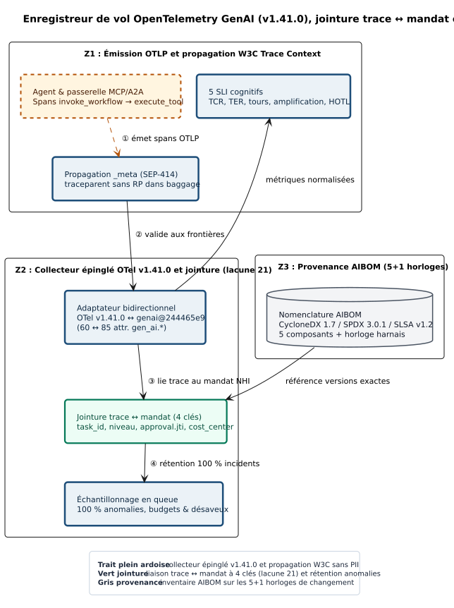
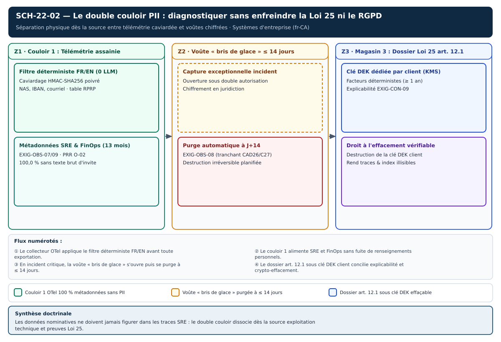
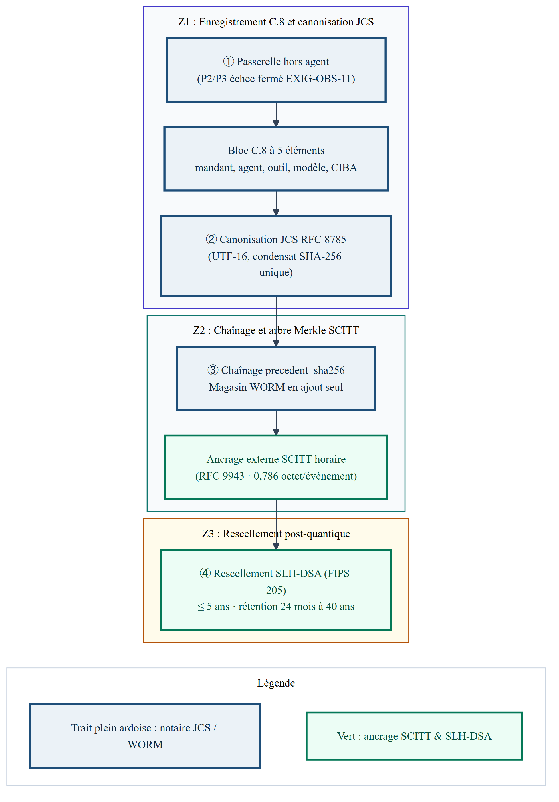

# Chapitre 22 — Interopérabilité télémétrique OpenTelemetry GenAI, double couloir PII et scellage probatoire JCS/SCITT + SLH-DSA

*Question directrice : Comment raccorder de bout en bout l'automatisation agentique aux chaînes APM, SIEM et d'audit d'entreprise malgré l'instabilité des conventions OpenTelemetry GenAI, tout en conciliant le caviardage opérationnel bilingue (Loi 25) et le scellage probatoire décennal JCS/SCITT résistant au post-quantique ?*

En ingénierie logicielle traditionnelle, une sonde de supervision signale un état sain dès lors qu'un service répond dans ses délais avec un code de succès HTTP. Dans un processus d'entreprise automatisé par agents, cette apparence de normalité masque des défaillances silencieuses coûteuses : un agent peut boucler pendant plusieurs minutes, exécuter un appel d'outil `MCP` sur des arguments déviants vers un `ERP` ou un `CRM`, ou fonder une décision affectant un usager sur un contexte obsolète tout en émettant des réponses techniquement valides. Inversement, déverser l'intégralité des invites, des réponses de modèles et des retours d'outils dans les collecteurs `APM` et `SIEM` partagés expose directement l'organisation à une fuite massive de renseignements personnels (`RP`) et à des sanctions sévères [7].

Ce chapitre ouvre le domaine D08 en fixant l'architecture normative d'interopérabilité télémétrique, de provenance logicielle et de journalisation probatoire au gel documentaire du 2 décembre 2026. Il s'appuie sur la propagation de contexte issue des passerelles `MCP` (← Chapitre 07), de l'interopérabilité événementielle `CloudEvents` (← Chapitre 14), des identités de charge `SPIFFE` et des `Agent Cards` (← Chapitre 16), ainsi que sur les chaînes de délégation `OBO` et d'approbation `CIBA` (← Chapitre 17). L'ensemble des mécanismes exposés — y compris l'extrait exécutable `G0-EX-CH02-04` issu du module `otel_pii_mapper.py` vérifié à la barrière `G0` — relève d'une référence technique et pédagogique et ne constitue ni un avis juridique ni une certification réglementaire au sens des lois applicables (clause `non-avis`) [7, 8].

## 22.1 Résumé exécutif : instrumentation stabilisée et séparation physique des preuves

Quatre verrous structurent l'observabilité probatoire des systèmes d'entreprise automatisés (`EXIG-OBS-01` à `EXIG-OBS-13`, `PRI-013` — Corrélation `OTel` sans `RP` et voûte scellée, principe du double couloir probatoire —, `PRIN-06`, `CAP-042`, `CAP-049`, `ADR-021` — décision sous veille `SIG-006` sur l'observabilité `OTel GenAI`). Premièrement, aucune clé `gen_ai.*` d'`OpenTelemetry GenAI` n'ayant atteint le statut `Stable` et ces conventions omettant nativement les champs de mandat (`lacune 21` et lacune flotte `F-96` du référentiel) [1, 2, 3], chaque composant émet en `OTLP` vers un collecteur `OpenTelemetry v1.41.0` épinglé derrière un adaptateur bidirectionnel (`EXIG-OBS-01`, `otel_pii_mapper.py`). Cet adaptateur impose quatre clés de jointure trace ↔ mandat et alimente sans fuite de `RP` les plateformes `APM`, `SIEM`, `ITSM` et `ITFM`/`ERP` existantes. Selon le cadre (`EXIG-OBS-02`, `EXIG-OBS-05`, `EXIG-OBS-10`), la propagation `W3C Trace Context` emprunte `_meta` sur `MCP`, les en-têtes `A2A` et les extensions `CloudEvents`, sans renseignement personnel dans `baggage`, avec échantillonnage en queue retenant `100,0 %` des anomalies.

Deuxièmement, selon le modèle de provenance logicielle (`AIBOM`) construit dans le traité (`Tome 1 § 47.1–47.2`), chaque agent se décompose en cinq constituants livrés — poids de modèle, serveurs d'outils, bibliothèques d'exécution, invites ou compétences, et politiques d'autorisation — augmentés d'une sixième horloge propre au harnais d'exécution afin de garantir l'explicabilité des décisions automatisées. Cet inventaire s'appuie sur cinq référentiels externes (`CycloneDX 1.7`, `SPDX 3.0.1`, `in-toto`, `SLSA v1.2` et `NIST SP 800-218A`, dont les quatre premiers sont cités à titre indicatif dans [5]). Troisièmement, la **télémétrie à double couloir** — ou **Double couloir probatoire** — sépare physiquement trois magasins (`EXIG-OBS-07..09`, `EXIG-CON-09`) : un couloir opérationnel `100,0 %` métadonnées caviardées en français et en anglais (avec voûte forensique « bris de glace » purgée au plus tard à `J+14`), un grand livre d'audit et un dossier individuel chiffré par clé `DEK` client sous `KMS` d'entreprise pour répondre à la Loi 25 [7].

Quatrièmement, le grand livre d'audit `C.8` prescrit par le cadre (`EXIG-OBS-11`, `EXIG-OBS-12`) consigne cinq éléments obligatoires avant tout relais `P2` ou `P3` en échec fermé, canonisés selon `JCS` (`RFC 8785`) [4] et chaînés par `precedent_sha256`. Ces enregistrements sont ancrés au moins chaque heure hors domaine sur un arbre de Merkle suivant le profil de transparence `SCITT` (`RFC 9943`, fondé sur des structures vérifiables en ajout seul et des reçus `COSE`) [5], puis rescellés tous les cinq ans au plus en `SLH-DSA` (`NIST FIPS 205`) [6] sur `24` mois à `40` ans (`EXIG-OBS-13`, `EXIG-SEC-28`).

## 22.2 Interopérabilité télémétrique (OTel → APM/SIEM/ITFM), provenance AIBOM et scellage SCITT

### 22.2.1 Observabilité OpenTelemetry GenAI épinglée et provenance AIBOM à 5+1 horloges

L'adoption du protocole `OTLP` et des conventions sémantiques `OpenTelemetry` offre un socle commun aux journaux de trace, mais l'examen direct des dépôts officiels au gel du `2 décembre 2026` révèle une forte volatilité des schémas `gen_ai.*` [1, 2, 3]. La version épinglée `v1.41.0` du dépôt central `open-telemetry/semantic-conventions` (publiée le `28 avril 2026`, dont le correctif `v1.41.1` relevé au `Tome 2 § 10.1` ne modifie aucun fichier `gen_ai.*`) recense exactement `60` attributs dans `gen-ai.md` : `50` y figurent au statut `Development`, `10` au statut `Deprecated`, et aucun au statut `Stable` [2]. Six mois plus tard, la révision `244465e9` archivée le `31 octobre 2026` dans le dépôt `semantic-conventions-genai` expose `85` attributs, tous classés au statut `Development` [3]. Ce dépôt y renomme l'écriture en cache (substituant `gen_ai.usage.cache_write.input_tokens` à l'ancien `cache_creation`) ainsi que le discriminant de modalité (`gen_ai.token.modality` remplaçant `gen_ai.token.type`), tout en retirant notamment trois clés déjà dépréciées (`gen_ai.system`, `gen_ai.usage.prompt_tokens`, `gen_ai.usage.completion_tokens`) [2, 3]. Parallèlement, les fiches de spans publiées le `5 novembre 2026` formalisent `create_agent`, `invoke_agent`, `invoke_workflow` et `execute_tool` toujours sous statut `Development` [1].

Sans couche d'abstraction, une simple mise à jour de bibliothèque d'instrumentation ou de collecteur brise silencieusement les requêtes de surveillance, fausse les alertes et interrompt les calculs analytiques de coûts. Face à cette instabilité [1, 2, 3] et pour satisfaire `EXIG-OBS-01`, `PRI-013`, `CAP-042`, `ADR-021` et la porte `PRR O-01`, chaque composant exploité (canal, orchestrateur, passerelles `PEP` et `AI Gateway`, courtier d'événements, agent et serveur `MCP`) DOIT émettre en `OTLP` vers le collecteur central tout en consignant au catalogue sa version émise et le réglage de `OTEL_SEMCONV_STABILITY_OPT_IN`. Le collecteur central reste épinglé sur la référence `v1.41.0` [2] derrière un adaptateur bidirectionnel versionné qui traduit les six renommages clés (`OTEL_V141_TO_GENAI_DEV_MAP`, couvrant les attributs de [2, 3] et la métrique `gen_ai.client.token.usage` relevée au `Tome 2 § 10.1`) vers le schéma interne normalisé et bloque tout déploiement dont les attributs requis feraient défaut après traduction.

La continuité causale à travers les frontières d'agents et de protocoles s'appuie sur la recommandation externe `W3C Trace Context` reprise par le cadre (`EXIG-OBS-02`, `EXIG-OBS-03`, `EXIG-OBS-10`, `Tome 2 § 10.1`). Sur HTTP, les en-têtes `traceparent` (longueur fixe de `55` caractères en version `00`, rejet des identifiants nuls et de la version `ff`) et `tracestate` (au plus `32` membres) se propagent d'un composant interne authentifié à l'autre. Sur `MCP` (`2026-07-28`), conformément au profil `SEP-414` indexé au traité (`Tome 2 § 10.1`), l'appelant injecte `traceparent`, `tracestate` et `baggage` dans le dictionnaire `params._meta` de chaque message JSON-RPC sans préfixe DNS, tandis qu'`A2A` et `CloudEvents` véhiculent ces mêmes clés sur leurs en-têtes ou extensions dédiées (← Chapitre 07, ← Chapitre 14). Aux frontières externes avec un partenaire tiers ou un rappel non authentifié par identité `SPIFFE`, la passerelle valide la syntaxe entrante, refuse toute confiance aveugle dans un `traceparent` forgé et ouvre une nouvelle trace interne rattachée au contexte externe par un lien de span (*span link*).

Deux règles strictes protègent simultanément la sémantique et la confidentialité de cette propagation inter-systèmes. D'une part, `traceparent` relie dans une même trace distribuée l'appel initial du portail métier, le raisonnement de l'agent, l'arbitrage `PEP`, le connecteur `MCP` et la requête `REST` ou `SQL` sur l'`ERP`, le `CRM` ou l'`ITSM`, mais identifie une trace technique et jamais une requête métier : chaque span DOIT donc porter `ca.entreprise.task_id` et, en délégation horizontale, `ca.entreprise.a2a.task_id` et `ca.entreprise.a2a.context_id`, sans jamais servir de clé d'idempotence (← Chapitre 15). D'autre part, `baggage` et `tracestate` NE DOIVENT JAMAIS transporter de renseignements personnels ni de jetons secrets, leur emploi étant réservé à des étiquettes techniques inscrites au catalogue tel le centre de coûts.

La hiérarchie des spans produite à la sortie du collecteur applique un gabarit uniforme défini par le cadre (`EXIG-OBS-04`, `EXIG-OBS-05`, `Tome 2 § 10.1`) en s'appuyant sur les conventions `OpenTelemetry GenAI` [1, 2, 3] :

- `invoke_workflow {gen_ai.workflow.name}` (`INTERNAL`) encadre l'orchestration multi-agents globale (adaptant l'opération `invoke_workflow` de [1]) ;
- `invoke_agent {gen_ai.agent.name}` (`CLIENT` pour un pair distant `A2A`, `INTERNAL` en local) [1] qualifie chaque agent avec un nom à faible cardinalité et les clés `gen_ai.agent.id` et `gen_ai.agent.version` [2, 3] afin d'éviter l'explosion des bases de séries temporelles ;
- `{gen_ai.operation.name} {gen_ai.request.model}` trace chaque inférence unitaire en consignant le modèle demandé et le modèle réellement servi (`gen_ai.response.model`), les compteurs de jetons (entrée, sortie, lecture et écriture en cache, raisonnement) et la raison d'arrêt (`gen_ai.response.finish_reasons`) [1, 2, 3] ;
- `execute_tool {gen_ai.tool.name}` (`INTERNAL`) [1] et `{mcp.method.name} {cible}` (`CLIENT`, `Tome 2 § 10.1`) tracent les invocations d'outils et les refus ou compensations ;
- toute attente d'approbation humaine hors bande (`CIBA`, ← Chapitre 17) est matérialisée par un événement d'ouverture et un événement de fermeture plutôt que par un span maintenu ouvert durant l'attente, la reprise créant un nouveau span relié par lien de span.

Toutefois, même avec cette hiérarchie complète, le registre `OpenTelemetry GenAI` souffre d'un manque structurel désigné dans la collection comme la **lacune 21** (critère `C30`) : aucune de ses conventions natives ne relie une trace d'exécution à l'autorité juridique et financière qui a mandaté l'action [1, 2, 3]. Pour combler cette lacune sans entrer en collision avec les attributs réservés du standard (`EXIG-OBS-06` proscrit les préfixes `enterprise.` et `otel.`), le cadre impose quatre clés obligatoires sous préfixe DNS inversé d'entreprise (`REQUIRED_MANDATE_JOIN_ATTRS`) : `ca.entreprise.task_id`, `ca.entreprise.autonomy_level` (aligné sur l'échelle graduée `L0–L4`, ← Chapitre 05), `ca.entreprise.approval.jti` (pointant vers la preuve `C.6` sans divulguer l'identité de l'approbateur) et `ca.entreprise.cost_center`. Ce flux `OTLP` caviardé s'intègre directement aux collecteurs `APM` (`Datadog`, `Dynatrace`, `Grafana Tempo`, `Elastic`, exemples d'outillage hors `L+`), aux corrélateurs `SIEM` (`Sentinel`, `Splunk`, hors `L+`), à l'ouverture de billets d'incident `ITSM` et aux outils `ITFM`/`ERP` via `ca.entreprise.cost_center` (→ Chapitre 24).

Sur ces traces normalisées et enrichies, la plateforme calcule en continu cinq indicateurs de niveau de service (`SLI`) cognitifs du cadre — taux d'achèvement de tâche (`TCR`), taux d'exécution d'outils conformes (`TER`), nombre de tours par tâche, facteur d'amplification des appels et taux de désaveu humain en supervision (`HOTL`) — doublés d'un détecteur de blocage dynamique (*livelock*) sur répétition d'appels identiques. L'échantillonnage est obligatoirement opéré en queue (*tail sampling*) : plutôt qu'un tirage aveugle à l'entrée qui perdrait les défaillances rares, le collecteur tamponne les spans jusqu'à clôture de la trace grâce à un équilibrage de charge conscient du `trace_id`, garantissant la rétention à `100,0 %` de toute trace marquée d'une erreur, d'une relance, d'un plafond atteint ou d'un refus d'approbation (`EXIG-OBS-05`). Les conventions `OpenTelemetry GenAI` placent les champs de messages et de requêtes en statut `Opt-In` en recommandant de ne pas les capturer par défaut [1, 2, 3], ce que le cadre renforce par le réglage `OTEL_INSTRUMENTATION_GENAI_CAPTURE_CONTENT` fixé à `NO_CONTENT` (`Tome 2 § 10.2`) afin d'empêcher toute capture accidentelle de texte dans les bibliothèques clientes.



*Figure 81 — SCH-22-01 : Architecture de l'enregistreur de vol OpenTelemetry GenAI combinant la propagation `_meta` sans renseignement personnel (Z1), le collecteur épinglé v1.41.0 à jointure trace ↔ mandat à quatre clés (Z2) et la nomenclature AIBOM à 5+1 horloges (Z3).*

Tracer une exécution sans savoir quelle version exacte d'invite, d'outil ou de politique a gouverné l'agent à cet instant rend toutefois l'analyse post-incident incomplète. Contrairement à un micro-service classique dont la version se résume à une empreinte de binaire, un agent d'entreprise assemble cinq constituants soumis à des cadences d'évolution indépendantes — souvent gouvernées par des acteurs externes distincts — auxquels s'ajoute l'horloge propre du harnais d'exécution (`5+1` horloges) :

1. les poids de modèle (mis à jour ou retirés par le fournisseur d'inférence) ;
2. les serveurs d'outils `MCP` (exposés à des révisions de descriptions ou de schémas après approbation, ← Chapitre 19) ;
3. les bibliothèques applicatives et l'hôte d'exécution ;
4. les invites système et fichiers d'instructions ou compétences déclaratives (`Agent Skills`) éditables sans recompilation ;
5. les politiques d'autorisation `OPA`/`Rego` ou `Cedar` (seul constituant historiquement maîtrisé en propre par l'exploitant) ;
6. le harnais d'exécution lui-même (seuils de compaction du contexte, modes de reprise, ordre de vérification).

| Dimension télémétrique | `OTel v1.41.0` (`60` entrées) [2] | `semantic-conventions-genai@244465e9` (`85` attr.) [3] | Contrat d'adaptateur et d'entreprise (`G0` / `EXIG-OBS-*`) |
|---|---|---|---|
| Maturité des attributs `gen_ai.*` | `50` `Development`, `10` `Deprecated`, `0` `Stable` | `85` `Development`, `0` `Deprecated`, `0` `Stable` | Épinglage `v1.41.0` au collecteur via `OtelGenAiMapper` (`ADR-021`) |
| Cache d'entrée et modalité | `cache_creation.input_tokens`, `gen_ai.token.type` | `cache_write.input_tokens`, `gen_ai.token.modality` | Traduction bidirectionnelle transparente (`v1.41.0` ↔ `genai_dev`) |
| Fournisseur et jetons | `gen_ai.system` (`Deprecated`), `prompt_tokens`/`completion_tokens` | `gen_ai.provider.name`, `input_tokens`/`output_tokens` | Mapping vers les noms canoniques actifs ; rejet hors liste fermée |
| Métrique d'usage client (`Tome 2 § 10.1`) | `gen_ai.client.token.usage` | `gen_ai.client.inference.usage.input_tokens` | Alias de métrique inclus dans `DEFAULT_ALLOWED_ATTRS` (`G0`) |
| Jointure trace ↔ mandat (`lacune 21`) | Absente nativement | Absente nativement | `4` clés obligatoires `ca.entreprise.*` (`task_id`, `autonomy_level`, `approval.jti`, `cost_center` → `FOCUS v1.4` / `ITFM` / `ERP`) |

*Tableau 22.1 — Réconciliation des conventions OpenTelemetry GenAI (`v1.41.0` ↔ `genai_dev`) et comblement de la lacune 21.*

Pour dresser un inventaire cryptographique opposable de ces composants (`AIBOM`), le traité (`Tome 1 § 47.2`, hors base `L+` fermée de ce chapitre) examine cinq référentiels ouverts : `CycloneDX 1.7` (`ECMA-424`, deuxième édition d'octobre 2025), `SPDX 3.0.1` (profils `AIPackage` et `DatasetPackage`), le cadre d'attestation `in-toto`, la spécification `SLSA v1.2` (pistes *Build* et *Source*) et le profil communautaire `NIST SP 800-218A`, les quatre premiers étant mentionnés à titre d'exemples de formats dans [5]. L'inspection de ces schémas rapportée au `Tome 1 § 47.2` montre un écart de maturité notable : si `CycloneDX 1.7` (`component.type = machine-learning-model` et `data`) et `SPDX 3.0.1` (`AIPackage` à quinze propriétés propres et `DatasetPackage` à treize propriétés) décrivent les modèles et jeux de données, ni l'un ni l'autre ne prévoient nativement de champs normatifs dédiés aux invites système, aux politiques d'autorisation ou aux extensions déclaratives éditées sans compilation. La nomenclature d'entreprise étend donc le manifeste `AIBOM` par des champs d'attestation signés couvrant les empreintes `SHA-256` des invites, des compétences et des règles `Rego`/`Cedar`, assurant la corrélation directe avec l'enregistrement d'audit `C.8` et alimentant la détection des dérives d'outils (← Chapitre 19).

### 22.2.2 Double couloir PII, caviardage FR/EN et scellage probatoire JCS/SCITT + SLH-DSA

Dès qu'un agent traite des dossiers clients, la télémétrie brute se heurte à deux exigences juridiques symétriques au Canada, au Québec et en Europe (→ Chapitre 25, → Chapitre 26) : l'obligation de minimiser et de détruire ou anonymiser les renseignements personnels dès que leur finalité est atteinte, et l'obligation de produire une preuve explicative et vérifiable sur demande ou en cas d'incident. En droit québécois, conformément au principe de preuve documentaire directe (`AO-01`), l'analyse s'appuie exclusivement sur le texte sanctionné en accès ouvert de la loi modificatrice `LQ 2021, c. 25` dite Loi 25 [7]. Le portail consolidé `legisquebec.gouv.qc.ca` demeure consigné en `statut F` après refus `HTTP 403` sans contournement, tout comme le portail web `genai.owasp.org` (compensé par le document intégral `v1.0` archivé en statut ouvert [8]).

En vigueur depuis le `22 septembre 2023`, l'article `12.1` issu de la Loi 25 régit toute décision prise exclusivement par un traitement automatisé [7]. Il oblige l'organisation à aviser la personne visée au plus tard lors de la notification de la décision, puis à lui divulguer sur demande les renseignements utilisés, les raisons et facteurs principaux du résultat et son droit de rectification, tout en lui offrant un recours en révision humaine [7]. Tout manquement expose les personnes morales (articles `90.12` et `91`) à des sanctions administratives pécuniaires pouvant atteindre `10 M$ CA` ou `2 %` du chiffre d'affaires mondial précédent (le montant le plus élevé prévalant), et à des amendes pénales de `15 000 $ CA` jusqu'au maximum de `25 M$ CA` ou `4 %` de ce chiffre d'affaires [7].

Un bus de journaux unique ne peut satisfaire simultanément ces impératifs : s'il transporte les invites brutes vers les consoles `APM`/`SRE`, il dissémine des `RP` ; s'il efface tout contexte, il empêche de répondre à une demande de révision d'une décision automatisée au titre de l'article `12.1`. En réponse à ces exigences [7], le cadre prescrit dès le collecteur et la passerelle une séparation physique et administrative des droits entre exploitants `SRE`/`APM`/`SIEM` et auditeurs habilités en **trois magasins distincts** (`EXIG-OBS-07` à `EXIG-OBS-13`, `EXIG-CON-09`, `PRR O-02`) :

1. **Magasin 1 — Couloir opérationnel et voûte forensique « bris de glace »** : la télémétrie courante n'admet que des métadonnées structurées à liste fermée, sans aucun texte brut d'invite, de réponse, d'argument d'outil, de résultat mémoire ou de trace d'exception (`EXIG-OBS-07`), avec pseudonymisation `HMAC-SHA256` et rétention indicative de `13` mois (`Tome 5 § 8.1`). Sur incident grave motivé, une capture peut être acheminée vers une voûte chiffrée sous double accord (responsable technique et responsable de la protection des renseignements personnels, `RPRP`), référencée par `ca.entreprise.content_ref` et **purgée irréversiblement au plus tard à `14` jours** hors gel légal (`EXIG-OBS-08`, tranchant `14–30` jours de `C27` au profit du plafond `CAD26` de `14` jours).
2. **Magasin 2 — Grand livre d'audit probatoire `C.8`** : registre en ajout seul (`WORM`) totalement indépendant des traces d'exploitation, écrit en échec fermé avant tout relais `P2`/`P3` sans aucun échantillonnage (`EXIG-OBS-11`).
3. **Magasin 3 — Dossier de décision individuelle (`Loi 25 art. 12.1`)** : coffre chiffré distinct, géré sous l'autorité du `RPRP`, conservant pendant au moins `1` an les renseignements d'entrée, les résultats d'outils, les versions exactes des composants et les facteurs déterministes retenus (`EXIG-CON-09`) [7]. Chaque dossier est chiffré par une clé `DEK` propre au client sous gestionnaire de clés (`KMS`), permettant de restituer les explications requises et d'exécuter un effacement vérifiable par destruction cryptographique de la clé (`crypto-shredding`).



*Figure 82 — SCH-22-02 : Séparation physique en couloir 1 opérationnel caviardé FR/EN (Z1), voûte forensique « bris de glace » à purge automatique à J+14 (Z2) et dossier de décision Loi 25 art. 12.1 sous clé DEK client effaçable (Z3).*

Au sein du couloir 1, le filtrage ne repose jamais sur un modèle de langage auxiliaire — trop lent et faillible face aux variations linguistiques — mais sur une double barrière déterministe (`EXIG-OBS-09`). D'une part, la fonction `map_span_attributes` applique une liste fermée d'attributs autorisés (`DEFAULT_ALLOWED_ATTRS`), rejette tout préfixe interdit (`enterprise.`, `otel.`), exige les quatre clés de jointure trace ↔ mandat (`lacune 21`) et supprime toute clé contenant `approver` ou `approbateur` afin de ne pas exposer l'identité des valideurs humains aux consoles `SRE`. Sous les constantes par défaut de `G0`, le filtre `_RAW_BAN` porte sur la clé canonique `ck` sans revalidation explicite sur `mk` ni contrôle de valeur sur `target_dialect`, contrairement à `_map_with_table`. Elle purge de plus neuf attributs porteurs de charges textuelles brutes : les messages d'entrée (`gen_ai.input.messages`) et réponses générées (`gen_ai.output.messages`), les directives système (`gen_ai.system_instructions`), les arguments (`gen_ai.tool.call.arguments`) et résultats d'outils (`gen_ai.tool.call.result`), les requêtes et enregistrements mémoire (`gen_ai.memory.query.text`, `gen_ai.memory.records`), ainsi que les requêtes et documents de recherche (`gen_ai.retrieval.query.text`, `gen_ai.retrieval.documents`).

D'autre part, `redact_pii_bilingual` applique sept expressions régulières ordonnées en français et en anglais (`BEARER_JWT`, `IBAN`, `PAYMENT_CARD`, `EMAIL`, `RAMQ`, `PHONE`, `NAS_SIN`) pour remplacer toute occurrence résiduelle par un jeton déterministe `[CATEGORIE:hex12]` dérivé par `HMAC-SHA256` poivré sous clé secrète de domaine. Placer les cartes de paiement, numéros `RAMQ` et numéros de téléphone (`+1-514-...` ou `01 42 ...`) avant le motif `NAS_SIN` à neuf chiffres évite toute troncature erronée, tandis que le recours à `HMAC-SHA256` protège les identifiants à faible entropie contre l'inversion par table arc-en-ciel.

L'extrait synchronisé `G0-EX-CH02-04`, copié octet pour octet depuis le module `authz_pqc_audit/otel_pii_mapper.py` vérifié en `G0`, illustre cette double défense déterministe :

<!-- CA-G0-SYNC id="G0-EX-CH02-04" path="Tomes/Tome 8 - Ingénierie exécutable et homologation vérifiable/trousse/authz_pqc_audit/otel_pii_mapper.py" lines="235-265" sha256="60bd160c1a507c6df31fd1dfc3811c866a6f17e8b623e961b2511c00c7e41889" -->
```python
def map_span_attributes(
    raw_attrs: Mapping[str, Any],
    target_dialect: Literal["v1.41.0", "genai_dev"] = "genai_dev",
    allowlist: frozenset[str] = DEFAULT_ALLOWED_ATTRS,
) -> dict[str, Any]:
    """Applique liste fermee, purge brut (OBS-07) et jointure mandat."""
    if any(k.startswith(("enterprise.", "otel.")) for k in raw_attrs):
        raise ValueError("Prefixe interdit EXIG-OBS-06")
    if any(not str(raw_attrs.get(r) or "").strip() for r in _JOIN_KEYS):
        raise ValueError("Cles de jointure trace <-> mandat manquantes")
    out, fwd, rev = {}, OTEL_V141_TO_GENAI_DEV_MAP, _GENAI_DEV_TO_V141_MAP
    for k, val in raw_attrs.items():
        if k in _RAW_BAN or any(t in k.lower() for t in _APPROVER_KEYS):
            continue
        ck = fwd.get(k, k)
        mk = ck if target_dialect == "genai_dev" else rev.get(k, k)
        if (mk in allowlist or ck in allowlist) and ck not in _RAW_BAN:
            out[mk] = val
    return out

def redact_pii_bilingual(text: str, hmac_key: bytes) -> tuple[str, list[str]]:
    """Caviarde PII FR/EN par jeton HMAC-SHA256 tronque."""
    redacted, cats = text, []
    for cat, pattern in _PII_PATTERNS:
        def _repl(m: re.Match[str], c: str = cat) -> str:
            if c not in cats:
                cats.append(c)
            dig = hmac.new(hmac_key, m.group(0).encode(), hashlib.sha256)
            return f"[{c}:{dig.hexdigest()[:12]}]"
        redacted = pattern.sub(_repl, redacted)
    return redacted, cats
```

Ce code garantit la non-fuite des `RP` dans les traces tout en admettant que des noms propres non structurés en texte libre pourraient échapper à des expressions régulières ; c'est précisément pourquoi l'exclusion stricte des champs de messages et de requêtes brutes demeure la première barrière non négociable (`EXIG-OBS-07`).

| Magasin réglementé | Rôle et politique d'écriture | Protection et contenu admis | Durée de rétention et purge |
|---|---|---|---|
| **1. Télémétrie `OTel` + voûte** | Couloir `1` continu ; voûte sur incident motivé (`EXIG-OBS-07/08`) | `100,0 %` métadonnées caviardées `FR`/`EN` (`HMAC`) ; `0` texte brut ; voûte sous double accord | `13` mois (métadonnées) ; **purge `≤ 14` jours** (voûte) |
| **2. Grand livre d'audit `C.8`** | Exhaustif, échec fermé avant tout relais `P2`/`P3` (`EXIG-OBS-11..13`, `EXIG-GOV-17`) | `5` éléments obligatoires canonisés `JCS`, chaînés `precedent_sha256`, `SCITT` + `SLH-DSA` | `≥ 24` mois (`6–7` ans fiscal `ERP`, `5–7` ans `OCRI`, `10–30` ans clinique/industriel, `20–40` ans vie/rentes) ; anonymisation via table `RPRP` |
| **3. Dossier de décision `art. 12.1`** | Restitution explicative et révision humaine (`EXIG-CON-09`, Loi 25 [7]) | Entrées `RP`, résultats d'outils, versions exactes et facteurs déterministes sous clé `DEK` client | `≥ 1` an après la décision ; effacement sélectif par destruction de `DEK` (`KMS`) |

*Tableau 22.2 — Architecture des trois magasins réglementés du double couloir probatoire.*

Dans le magasin 2, une règle cardinale distingue la télémétrie d'exploitation de la preuve réglementaire opposable (analogue aux exigences de conservation inaltérable de type `SEC Rule 17a-4` et aux cadres sectoriels `FINOS AI Governance v2.0` et `watsonx.governance` évoqués aux Tomes 1, 3 et 6, hors base `L+` de ce chapitre) : **l'auto-journalisation par l'agent est strictement proscrite**. Un agent sollicité par une injection indirecte (`OWASP ASI01` [8]) pourrait omettre de consigner un appel ou falsifier sa justification ; seule la passerelle `PEP` hors du modèle rédige l'enregistrement d'audit `C.8` avant de relayer toute action `P2` ou `P3` (et enregistre également tout refus, toute consultation `P1` de données classifiées et tout déclenchement de coupe-circuit). Si le service d'audit est indisponible, les appels `P2`/`P3` sont immédiatement bloqués en échec fermé (`EXIG-OBS-11`).

Chaque enregistrement `C.8` réunit cinq éléments obligatoires (`EXIG-OBS-12`). Il consigne (1) le **mandant** sous pseudonyme géré dans une table séparée du `RPRP`, (2) l'**agent** (`id`, URI `spiffe://...`, version de gabarit et empreinte `SHA-256` d'invite système) et (3) l'**action** (nom d'outil, version, empreinte de définition `definition_sha256`, empreinte `HMAC` ou `SHA-256` salée des arguments, palier et issue). Il inclut également (4) le **modèle** réellement servi (`gen_ai.response.model`) et (5) l'**autorité** (jetons d'approbation `C.6` ou règle de politique `OPA`/`Cedar`, classe de risque et niveau d'autonomie). S'y ajoutent `sequence`, `flux`, `horodatage`, `precedent_sha256` (ancré à la genèse sur `"sha256:"` suivi de `64` zéros) et le bloc de corrélation bouclant `trace_id`, `span_id`, identifiant d'effet `UETR` (← Chapitre 15) et clé d'idempotence.

Pour que la moindre altération d'un champ ou d'un nombre soit détectable et reproductible entre langages hétérogènes, l'enregistrement `C.8` est soumis avant hachage et signature à la **canonisation déterministe JCS** spécifiée par la `RFC 8785` (*JSON Canonicalization Scheme*, juin 2020, porte `PRR R-07`) [4]. La `RFC 8785` élimine toute ambiguïté d'encodage en imposant le tri lexicographique des clés selon leurs unités de code `UTF-16`, la suppression de tout espace superflu, l'échappement normalisé des chaînes et la sérialisation ECMAScript déterministe des nombres (rejetant `NaN` et `Infinity` conformément à `I-JSON`) [4]. Cette même canonisation `JCS` [4] gouverne l'épinglage des définitions d'outils `MCP` (← Chapitre 07), le calcul des clés d'idempotence `Saga` (← Chapitre 15) et la `Preuve d'action C.6` liant l'approbation `CIBA` (← Chapitre 17). Elle soutient aussi l'exigence normative `MUST` d'`A2A` (← Chapitre 08, ← Chapitre 16) imposant de canoniser toute `Agent Card` (hors membre `signatures`) avant d'apposer sa signature `JWS` (`RFC 7515`) afin que tout vérificateur reconstruise exactement les mêmes octets.

Le chaînage linéaire par `precedent_sha256` détecte toute réécriture locale — le vérificateur `verify_chain` d'`AuditChainLedger` identifie le numéro exact `broken_sequence` dès qu'un champ métier ou un maillon précédent diverge — mais ne suffit pas seul face à trois risques. Il n'empêche pas un détenteur de clé compromis de réécrire l'historique complet, ni de présenter deux journaux divergents à deux auditeurs, et oblige à relire la chaîne depuis l'origine pour valider un maillon.

L'architecture complète donc le grand livre `SBB-IMMUTABLE-AUDIT-LEDGER` par une couche de transparence conforme au cadre **SCITT** (*Supply Chain Integrity, Transparency, and Trust*) de la norme `RFC 9943` (*Standards Track*, juin 2026), intitulée « An Architecture for Trustworthy and Transparent Digital Supply Chains » [5]. Cette spécification prescrit une structure de données vérifiable (`VDS`) en ajout seul et des reçus `COSE` (`RFC 9942`) [5]. Suivant le profil d'implémentation du cadre (`EXIG-OBS-12`, `audit_scitt_focus.py`), les condensats des enregistrements `C.8` sont versés au moins toutes les heures dans un arbre binaire de Merkle publié hors du domaine d'administration de l'audit, avec séparation stricte des préfixes (`0x00` pour les feuilles, `0x01` pour les nœuds internes afin d'écarter les attaques de seconde préimage).

Chaque reçu d'inclusion `COSE` [5] permet une preuve logarithmique en \(O(\log N)\). Sur le plan arithmétique, amortir une signature `SLH-DSA-SHA2-128s` de `7 856` octets [6] sur un lot de `10 000` événements représente `0,7856` octet par événement (`≈ 0,786` o/év.), ce qui rejoint l'ordre de grandeur rapporté au `Tome 3 § 49.5` pour le banc externe `Borealis-Bench` (absent du disque en `G0`). En fin de durée légale de rétention, l'anonymisation s'opère par destruction des lignes correspondantes de la table des pseudonymes du `RPRP` sans jamais réécrire ni briser la chaîne Merkle (`EXIG-OBS-13`, Loi 25 [7]).

Enfin, selon les calendriers sectoriels indexés au traité (`Tome 2 § 10.3`, `Tome 5 § 8.2`), les journaux probatoires exigent au moins `24` mois de rétention (`EXIG-OBS-13`), portés à `6` ou `7` ans pour les pièces fiscales d'`ERP` au Canada et `5` à `7` ans en courtage ou banque (Organisme canadien de réglementation des investissements, `OCRI`, art. `3803`). Cette durée atteint `10` à `25` ans pour les dossiers cliniques et lots pharmaceutiques, `10` à `30` ans en traçabilité industrielle ou aéronautique, et `20` à `40` ans en assurance de personnes ou rentes. Cet horizon croise l'échéance climatique de `fin 2028`, le raccourcissement des cycles `TLS` (`15 mars 2027` puis `15 mars 2029`) et la feuille de route post-quantique `G7` `2030–2035` (← Chapitre 18, → Chapitre 24). En application d'`EXIG-SEC-28` et de la porte `PRR G-15`, la racine de l'arbre Merkle `SCITT` est rescellée au moins tous les `5` ans au moyen de signatures sans état **SLH-DSA** (`NIST FIPS 205`, `13 août 2024`), dont la sûreté repose uniquement sur des fonctions de hachage (`SHA-256` / `SHAKE`) et non sur les réseaux euclidiens [6].

Le service retient la variante compacte `SLH-DSA-SHA2-128s`, produisant des signatures de `7 856` octets sous clé publique de `32` octets (contre `17 088` octets pour la variante `SLH-DSA-SHA2-128f`, plus rapide mais nettement plus volumineuse pour l'archivage pluriannuel) [6]. Cette primitive est implémentée en Python pur sous licence `MIT` dans `slh_dsa_fips205.py` — évitant toute dépendance copyleft `LGPL` — et validée en `G0` sur l'intégralité des `20` vecteurs `rfc8785` et `12` vecteurs `NIST FIPS 205 ACVP` [4, 6].



*Figure 83 — SCH-22-03 : Chaîne notariale à cinq éléments combinant enregistrement C.8 hors agent et canonisation JCS RFC 8785 (Z1), chaînage WORM et ancrage Merkle SCITT horaire (Z2), et rescellement post-quantique SLH-DSA FIPS 205 tous les ≤ 5 ans (Z3).*

## 22.3 Synthèse architecturale, livrables et portes de contrôle

Ce chapitre consolide en amont la propagation de contexte distribuée issue des passerelles `MCP` (← Chapitre 07) et des courtiers `CloudEvents` (← Chapitre 14), corrèle chaque acte d'audit à l'identifiant d'effet `UETR` des sagas (← Chapitre 15), scelle l'identité `SPIFFE` et la canonisation `JCS` des `Agent Cards` (← Chapitre 16), ancre l'empreinte d'approbation `C.6` de `CIBA` (← Chapitre 17) et applique le rescellement post-quantique `SLH-DSA` prescrit pour les preuves pluriannuelles (← Chapitre 18).

En aval, les traces caviardées déversées vers les `APM`/`SIEM` et les nomenclatures `AIBOM` nourrissent l'analyse des dérives d'outils et d'attaques `OWASP ASI01–10` (← Chapitre 19) tout en alimentant les suites de non-régression et le volant de distillation sans `PII` (→ Chapitre 23). Ils fournissent également les compteurs de jetons et centres de coûts aux systèmes `ITFM`/`ERP` pour le calcul du `CPO` (→ Chapitre 24) et livrent les preuves horodatées requises par les comités d'audit d'entreprise, l'article `12.1` de la Loi 25, le `BSIF` et le règlement européen sur l'IA (→ Chapitre 25, → Chapitre 26, → Chapitre 34, → Chapitre 35). Conformément aux frontières du domaine D08, ni les bancs statistiques `E1–E3` (→ Chapitre 23) ni les disjoncteurs budgétaires `FOCUS` (→ Chapitre 24) ne sont dupliqués ici.

| Livrable d'ingénierie | Exigences et capacités couvertes | Critère de vérification exécutable (`G0`–`G1`) |
|---|---|---|
| Collecteur `OTel v1.41.0` + adaptateur `otel_pii_mapper.py` | `EXIG-OBS-01..07`, `EXIG-OBS-09..10`, `PRI-013`, `PRIN-06`, `CAP-042`, `ADR-021`, `F-96`, `PRR O-01/O-02` | `G0-EX-CH02-04` : mappage `60` ↔ `85` attr., `4` clés `lacune 21`, purge `9` champs bruts, caviardage `HMAC FR`/`EN` [1, 2, 3] |
| Grand livre `SBB-IMMUTABLE-AUDIT-LEDGER` (`C.8` + `SCITT` + `SLH-DSA`) | `EXIG-OBS-11..13`, `EXIG-SEC-28`, `EXIG-GOV-17`, `CAP-040`, `CAP-049`, `PRR G-15`, `PRR R-07` | Validation `audit_scitt_focus.py` + `slh_dsa_fips205.py` sur `20` vecteurs `rfc8785` et `12` vecteurs `nist_acvp` (amortissement théorique `0,786` o/év. sur `10 000` év.) [4, 5, 6] |
| Inventaire `AIBOM` `5+1` horloges & voûte / dossier `art. 12.1` | `EXIG-OBS-08`, `EXIG-CON-09`, `CycloneDX 1.7`, `SPDX 3.0.1`, `SLSA v1.2` | Purge automatique voûte à `≤ 14` jours ; chiffrement `DEK` client par dossier (`≥ 1` an) et effacement par clé [7] |

*Tableau 22.3 — Livrables d'ingénierie, exigences normatives et preuves exécutables du Chapitre 22.*

> **Trois invariants exécutables — Chapitre 22**
>
> 1. **Télémétrie `OTel v1.41.0` épinglée et jointure à quatre clés (`EXIG-OBS-01..06`, `G0-EX-CH02-04`)** : Tout span `OTLP` traverse un adaptateur vers le schéma interne stable, valide `W3C Trace Context` aux frontières sans `RP` dans `baggage`, retient `100,0 %` des anomalies en queue et exige les quatre clés `ca.entreprise.*` (`task_id`, `autonomy_level`, `approval.jti`, `cost_center`).
> 2. **Double couloir `PII` à trois magasins et purge à `≤ 14` jours (`EXIG-OBS-07..09`, `EXIG-CON-09`)** : Le couloir opérationnel caviarde en `FR`/`EN` par `HMAC-SHA256` et rejette les `9` champs bruts ainsi que toute clé d'approbateur ; toute capture de débogage expire en `≤ 14` jours dans une voûte isolée, tandis que le dossier `Loi 25 art. 12.1` reste isolé sous clé `DEK` client effaçable.
> 3. **Grand livre `C.8` canonisé `JCS`, ancré `SCITT` et rescellé `SLH-DSA` (`EXIG-OBS-11..13`, `EXIG-SEC-28`)** : Avant tout relais `P2`/`P3` en échec fermé, la passerelle hors agent écrit l'enregistrement à `5` éléments canonisé `RFC 8785`, chaîné par `precedent_sha256`, ancré chaque heure sur arbre Merkle `RFC 9943` et rescellé tous les `≤ 5` ans par `SLH-DSA` (`FIPS 205`) sur `24` mois à `40` ans.
