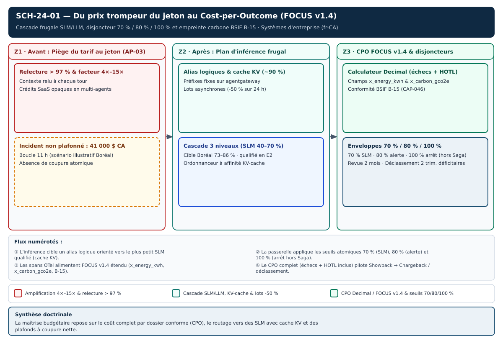
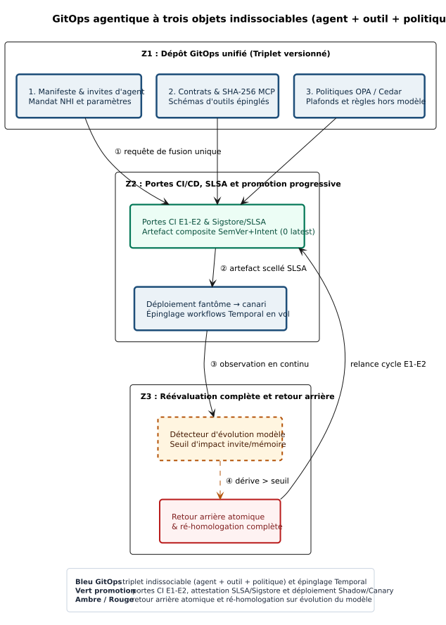
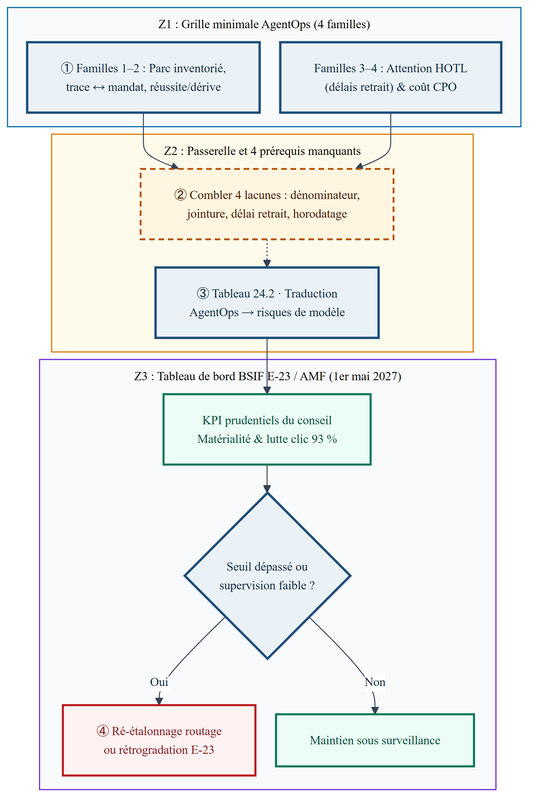
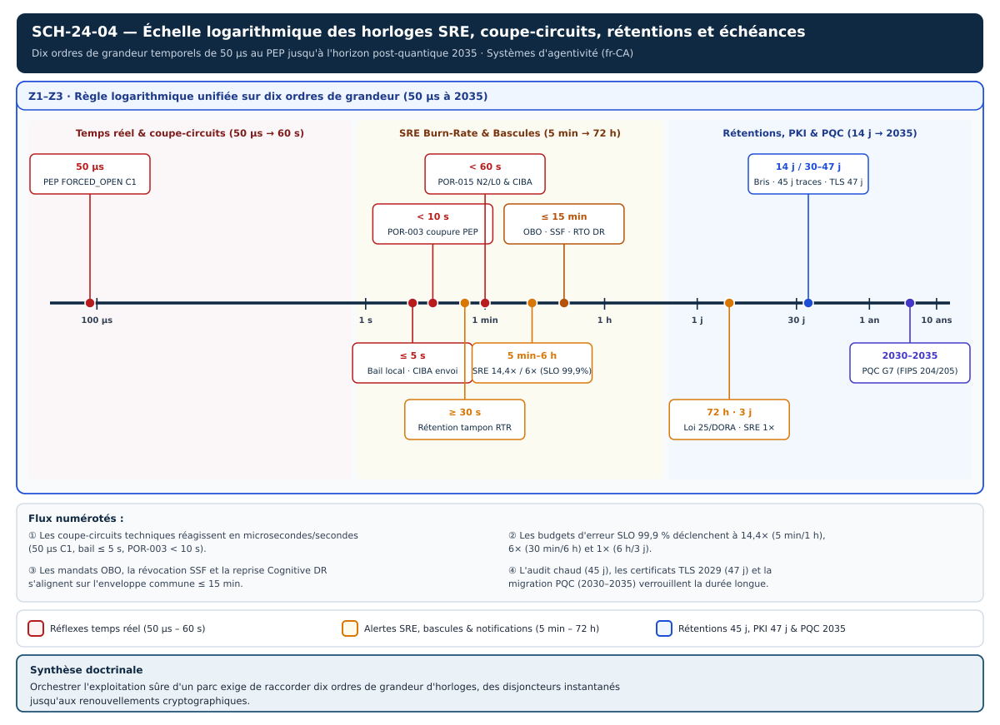

# Chapitre 24 — Pilotage FinOps FOCUS v1.4 (Cost-per-Outcome vs automatisation L0), routage frugal SLM, SRE GitOps et comptabilité carbone

*Question directrice : Comment raccorder la télémétrie d'automatisation agentique aux systèmes ITFM et ERP via FOCUS v1.4 pour arbitrer par résultat conforme (CPO) face à l'automatisation déterministe L0 et au traitement manuel, router frugalement vers des SLM, gouverner les déploiements en GitOps et tracer l'empreinte carbone ?*

Un système agentique peut afficher des sondes de disponibilité irréprochables et réussir ses bancs fonctionnels tout en détruisant sa rentabilité économique en quelques heures d'exploitation. Dans une boucle multi-tours non bornée, l'accumulation répétitive du contexte système, des schémas d'outils `MCP` et des échanges intermédiaires entraîne une explosion volumétrique : sur un banc externe d'extraction documentaire du repérage antérieur (hors socle `L+`), plus de `97 %` des jetons facturés proviennent de la relecture du préambule et de l'historique. Des mesures internes d'éditeur du même repérage chiffrent la consommation à `~4×` pour un agent unique et `~15×` en multi-agents face à une conversation simple. Illustrée par le scénario synthétique de boucle nocturne ayant consommé `41 000 $ CA` en `11` heures faute de plafond atomique (fil rouge hors preuve empirique), cette vulnérabilité exige d'ériger le contrôle budgétaire en invariant d'architecture de premier ordre.

Ce chapitre clôt le domaine D08 au gel documentaire du `2 décembre 2026` en prolongeant la télémétrie `OpenTelemetry GenAI` (← Chapitre 22) et la qualification `EvalOps` (← Chapitre 23). Il raccorde `FinOps FOCUS v1.4` [1] aux plateformes `ITFM` et à la comptabilité analytique `ERP` pour calculer en `Decimal` exact le **Coût par résultat conforme** (`CPO`) face à l'automatisation déterministe `L0` et au traitement manuel. Il formalise aussi les enveloppes à coupure nette, le routage frugal, la comptabilité carbone portée 3 (`ESG` d'entreprise et `BSIF B-15` [4]), le `GitOps` à trois objets relié à l'`ITSM` et la traduction des indicateurs `AgentOps` vers la gouvernance des risques d'entreprise (et `BSIF E-23`, `B-10` [6], `AMF`). Sous `AO-01`, `gartner.com` et `iso.org` (`HTTP 403`) restent en `statut F` hors preuve primaire, et toute analyse réglementaire relève du statut `non-avis` (`AO-05`).

## 24.1 Résumé exécutif : gouverner par le coût complet, la frugalité et l'opposabilité

Quatre mécanismes soudent la gouvernance économique et l'ingénierie de fiabilité (`SRE` agentique) (`EXIG-FIN-01` à `EXIG-FIN-10`, `EXIG-ARC-08`, `EXIG-ARC-09`, `PRI-014`, `CAP-029`, `CAP-034`, `CAP-045`, `CAP-046`, `DEC-006`, `DEC-011`, `ADR-014`, `ADR-015`, `ADR-023`, `PRR O-09`, `PRR O-12`, `PRR O-13`). Premièrement, le prix facial au million de jetons (`AP-03`) est banni au profit du **coût complet par résultat conforme** (`CPO` en dollars canadiens, calculé en arithmétique `Decimal` exacte sans flottant `IEEE-754`). Cette formule (`EXIG-FIN-01`, `EXIG-FIN-02`) agrège réessais, échecs, évaluation, confinement et supervision `HOTL` sur factures `FOCUS v1.4` [1], et compare chaque flux aux coûts unitaires de sa variante déterministe `L0` (`API`/`iPaaS`/`BPMN`/`RPA`) et du traitement manuel.

Deuxièmement, tout appel d'inférence transite par une passerelle d'alias logiques à trois paliers qualifiée en `E2`. D'après Belcak et collaborateurs [5], des petits modèles spécialisés (`SLM`) absorbent `40 %` à `70 %` des requêtes sur leurs trois cas d'étude, avec un gain estimé de `10×` à `30×` (`7B` contre `70–175B`), les taux de `73 %` à `86 %` restant des cibles illustratives Boréal hors preuve empirique. La passerelle assure aussi l'affinité `KV-cache` (jusqu'à `~90 %` d'abattement selon les grilles du repérage antérieur), les lots asynchrones (`-50 %` sur `24` h selon ce repérage) et les seuils `70 %` (repli `SLM` `ADR-023`), `80 %` (alerte) et `100 %` (arrêt propre `EXIG-FIN-04`/`05` hors compensations `Saga`).

Troisièmement, l'imputation unifie `gen_ai.usage.*` [2, 3], `ca.entreprise.cost_center` et `FOCUS v1.4` [1] étendu via `x_` (`x_energy_kwh`, `x_carbon_gco2e`, `CAP-046`) vers les outils `ITFM` et l'`ERP` analytique. Elle pilote le passage `Showback` (`POR-004`) → `Chargeback` (`POR-009`), la revue à deux mois (`EXIG-FIN-10`), le repli en `L0` ou déclassement à deux trimestres (`POR-016`), ainsi que les bilans `ESG` et la portée 3 `BSIF B-15` (`fin 2028`) [4]. Quatrièmement, l'exploitation repose sur un dépôt `GitOps` à trois objets relié à l'`ITSM`/`CMDB` et une grille `AgentOps` à quatre familles traduite vers les comités des risques d'entreprise et les attentes du `1er mai 2027` (`BSIF E-23` et `AMF`).

## 24.2 Interopérabilité FinOps FOCUS (ITFM/ERP), arbitrage d'automatisation, routage frugal et SRE GitOps

### 24.2.1 Pilotage au Cost-per-Outcome (FOCUS v1.4), routage frugal et comptabilité carbone

Le prix public du million de jetons constitue un indicateur trompeur pour piloter une architecture agentique (`AP-03`). Dans une boucle multi-tours `ReAct` de `T` étapes sans compaction ni cache, chaque itération ré-expédie le préambule initial `P` augmenté des sorties et retours d'outils précédents. Avec un ajout moyen \(\Delta\) par tour, la consommation cumulée croît de manière quadratique en \(T \times P + \Delta \times T(T - 1) / 2\), si bien que plus de `97 %` des jetons d'une extraction séquentielle relèvent de la relecture du contexte sur le banc de dépôts réglementaires du repérage antérieur (hors socle `L+`). À cette dérive en \(O(T^2)\) s'ajoutent, d'après les repères fournisseurs hors socle `L+`, une asymétrie entrée/sortie jusqu'à `5×`, un écart atteignant `35 %` entre segmenteurs d'un même fournisseur et une consommation de `~4×` pour un agent unique et `~15×` en multi-agents face au clavardage.

De plus, un modèle à bas coût unitaire qui échoue souvent ou multiplie les réparations de schémas double ou triple le coût réel d'une transaction aboutie. Les crédits propriétaires des suites `SaaS` (`CRM`, `ITSM`, `ERP`, facturés à l'action, avec dérive illustrative de `41 000 $ CA` à `97 400 $ CA/mois` dans le scénario Boréal hors `L+`) masquent aussi ce prix réel. Ils DOIVENT donc être convertis en dollars canadiens et plafonnés (`EXIG-FIN-03`, avec alerte avant les seuils de coupure tel `125 %` de capacité prépayée relevé hors `L+`). L'architecture leur substitue le **Coût par résultat conforme** (`CPO`, `PRI-014`, `CAP-045`, `DEC-011`, `EXIG-FIN-01`, `EXIG-FIN-02`) :

\[\text{CPO} = \frac{C_{\text{inférence}} + C_{\text{reprises/échecs}} + C_{\text{évaluation}} + C_{\text{sécurité/audit}} + C_{\text{supervision HOTL}}}{N_{\text{résultats conformes non rouverts}}}\]

Le numérateur agrège le coût total de possession (`TCO`) à cinq postes : inférence nominale, réessais, campagnes `E1–E3`, confinement microVM et ancrage `SCITT` incluant les plans de sortie (`BSIF B-10` [6]), et revue `HOTL`, divisés par les seuls dossiers conformes non rouverts (`compliant_outcomes ≥ 1`). Ce `CPO` est systématiquement comparé à deux lignes de base : le **coût unitaire d'une automatisation déterministe `L0`** (`API`/`iPaaS`, `DMN`/`BPMN` ou `RPA` amorti incluant sa maintenance) et le **coût complet du traitement manuel** (ETP chargé × taux de reprise). Tout flux dont le `CPO` excède durablement sa variante `L0` à conformité égale relève d'un repli en `L0` (`POR-016`), sauf abaissement prouvé par routage vers un `SLM` [5].

Le retour sur investissement ajusté du risque (méthode `EF-13`) rapporte ensuite les gains métier nets à ce `TCO` majoré du coût espéré des incidents résiduels. Tout calcul financier et d'imputation est exécuté exclusivement en arithmétique `Decimal` exacte, rejetant par `TypeError` tout flottant binaire `IEEE-754`, comme le vérifie en `G0` la fonction `compute_cpo_and_focus` dans `authz_pqc_audit/audit_scitt_focus.py` sur les champs `EffectiveCost` et `BilledCost` des enregistrements `FOCUS` [1]. Les grilles tarifaires des fournisseurs et les taux de change vers le dollar canadien sont versionnés et révisés au minimum chaque trimestre afin de préserver la comparabilité historique des séries.

Pour empêcher toute dérive nocturne ou attaque par épuisement de portefeuille (*Denial of Wallet*), la passerelle de modèles détient seule, côté serveur, l'état atomique des enveloppes budgétaires indexées par identifiant de tâche (`EXIG-FIN-04`) et des plafonds mensuels par agent (`EXIG-FIN-05`). À la différence des simples compteurs de débit approximatifs, chaque appel réserve atomiquement son coût maximal avant exécution puis ajuste la décrémentation au coût réel, sans jamais réinitialiser l'enveloppe lors d'une délégation à un sous-agent. Trois seuils gradués propres au cadre gouvernent cette barrière (`EXIG-FIN-04`, `EXIG-FIN-05`, `ADR-023`) :

1. **À `70 %` de l'enveloppe** : la passerelle bascule automatiquement le routage vers le palier `SLM` de repli qualifié pour achever la tâche à moindre coût.
2. **À `80 %` d'un plafond de tâche ou mensuel** : une alerte est émise vers le responsable technique et le parrain métier.
3. **À `100 %`** : la passerelle stoppe proprement toute progression vers l'avant par un refus typé « budget épuisé », tout en préservant l'achèvement des compensations `Saga` en cours sur leur canal isolé doté d'une réserve dédiée (← Chapitre 15).

Sur les `20 %` de charge cognitive restants après déport déterministe (`80/20`, ← Chapitre 04), le plan d'inférence derrière alias logiques (`CAP-029`, `DEC-006`, `EXIG-ARC-08`, `EXIG-ARC-09`, `EXIG-FIN-06` à `EXIG-FIN-08`) empile quatre leviers de sobriété vérifiés :

- **Routage frugal à trois paliers qualifié en `E2`** : chaque étape est adressée via un alias logique (jamais un identifiant de modèle codé en dur) vers le plus petit modèle homologué atteignant les seuils de constance `pass^k` (`EXIG-FIN-06`). Comme l'argumentent Belcak et collaborateurs (`arXiv:2506.02153`, juin 2025), des petits modèles spécialisés (`SLM`) suffisent pour la majorité des sous-tâches agentiques répétitives et bornées [5]. Leurs trois études de cas estiment `40 %` à `70 %` de requêtes transférables (`40 %` sur *Open Operator*, `60 %` sur *MetaGPT*, `70 %` sur *Cradle*), avec une économie de calcul, de latence et d'énergie de `10×` à `30×` pour `7` milliards de paramètres face à `70–175` milliards [5]. Les taux de `73 %` à `86 %` du cas synthétique Boréal (Figure 87) restent des cibles illustratives hors preuve empirique, réservant les modèles frontières aux arbitrages complexes. Sur déclenchement des signaux d'échelle (`SIG-015`, `SIG-016`), la distillation `Multi-LoRA` sous porte `pass^5` (← Chapitre 23) renforce cette part locale (`CAP-034`).
- **Ordonnancement par affinité `KV-cache` et préfixe fixe** : les invites sont assemblées du plus stable au plus variable (outils `MCP` triés, instructions système, documents récurrents, requête) pour maximiser le réemploi clé-valeur (jusqu'à `~90 %` d'abattement selon les grilles fournisseurs du repérage antérieur, soit `1/10` à `1/40` du tarif d'entrée, mesuré par `gen_ai.usage.cache_read.input_tokens` [2, 3]). L'ordonnanceur dirige les requêtes partageant un préfixe vers la réplique chaude correspondante (`TTFT` réduit), et toute baisse de plus de `20` points en cache sur `7` jours ouvre une analyse (`EXIG-FIN-07`).
- **Cache sémantique vectoriel borné** : pour les requêtes consultatives homogènes, une recherche par similarité cosinus sous contrôle d'accès `ACL` et durée de vie courte évite l'appel au modèle lors de répétitions exactes ou quasi exactes (sans taux d'économie préjugé sans mesure locale).
- **Traitement par lots asynchrones et arbitrage capacité** : les charges différables jusqu'à `24` heures basculent vers les lots asynchrones (`-50 %` selon les grilles fournisseurs du repérage antérieur, `EXIG-FIN-08`). Pour les charges `24/7`, un socle en unités de débit provisionnées (`PTU`) garantit la latence nominale tout en débordant (*spillover*) vers le paiement à l'usage (`PAYG`) lors des pointes.

Le suivi comptable et environnemental appaire `OpenTelemetry GenAI` et **FinOps Open Cost and Usage Specification (FOCUS) v1.4** (`4 juin 2026`, *FinOps Foundation* [1], sous veille `FOCUS v1.5`). L'adaptateur joint les compteurs de jetons (`cache_creation` en `v1.41.0` [2], `cache_write` dans `semantic-conventions-genai` [3]), les crédits `SaaS` convertis (`EXIG-FIN-03`) et `ca.entreprise.cost_center` (`EXIG-FIN-09`) au format `FOCUS v1.4` [1], déversé vers les outils `ITFM` (`Apptio`, `CloudHealth` hors `L+`) et la comptabilité analytique `ERP` (`SAP CO`, `Oracle Financials` hors `L+`). Ce schéma normalise dix colonnes (`BillingAccountId`, `PricingCurrency`, `ChargePeriodStart`, `ChargePeriodEnd`, `ServiceName`, `ResourceId`, `EffectiveCost`, `BilledCost`, `ConsumedQuantity`, `ConsumedUnit`), `ServiceProviderName`/`HostProviderName` remplaçant `ProviderName` retirée en `v1.3` [1] (maintenue comme champ hérité dans `focus_carbon_record.schema.json` en `G0`).

Deux exigences transversales scellent ce modèle. Face à la hausse électrique des centres de données (`700` à `1 700 TWh` projetés en `2035` par l'AIE sous `SIG-016` hors `L+`), les bilans `ESG` / `Scope 3` d'entreprise (`GHG Protocol`, `IFRS S2` hors `L+`) convergent avec **BSIF B-15** (*Climate Risk Management*, `7 mars 2025` [4], `ANC-106`), exigeant la divulgation brute de portée 3 dès l'exercice `2028` (`fin 2028`). Chaque ligne `FOCUS v1.4` exploite l'extension `x_` [1] pour imposer `x_energy_kwh` et `x_carbon_gco2e` par entité juridique (`CAP-046`, validés par `focus_carbon_record.schema.json` en `G0`) [1, 4], pondérant la consommation estimée par l'intensité carbone régionale (hydroélectricité québécoise vs thermique) sous réserve d'opacité résiduelle des facteurs d'inférence (`SIG-016`).

Ensuite, la gouvernance déploie dans l'`ITFM` et l'`ERP` deux paliers : *Showback* informatif (`POR-004`), puis *Chargeback* réel (`POR-009`) après stabilisation des règles `FOCUS`. Tout dépassement du `CPO` cible face au `L0` ou au manuel sur deux mois civils ouvre une revue (`EXIG-FIN-10`), et deux trimestres déficitaires entraînent le repli en `L0` ou le déclassement (`POR-016`). Ce suivi s'articule avec les inventaires et plans de sortie `BSIF B-10` [6], la `Loi 25 art. 12.1` (`22 septembre 2023`) et les jalons `15 mars 2027`, `15 mars 2029` et `2030–2035`.

*Figure 87 — SCH-24-01 : Comparatif opposant l'inflation volumétrique du tarif facial au jeton (Z1, scénario illustratif Boréal à `41 000 $ CA`) à l'architecture frugale par alias logiques, cache KV et cascade SLM 40–70 % (cible Boréal 73–86 %, Z2), pilotée en Decimal exact sur FOCUS v1.4 carbone vers ITFM/ERP avec disjoncteurs 70 % / 80 % / 100 % hors Saga et rétrogradation L0 ou déclassement après deux trimestres déficitaires (Z3).*

| Levier FinOps / Carbone | Mécanisme et contrat technique | Gain ou seuil vérifié | Règle d'arbitrage et exigence |
|---|---|---|---|
| **Calculateur `CPO` `Decimal`** (`FOCUS v1.4`) | Somme exacte des coûts `EffectiveCost` agrégeant les `5` postes sur `compliant_outcomes ≥ 1` (`compute_cpo_and_focus` en `G0`) [1] | Rejet `float` `IEEE-754` ; `10` col. `FOCUS` (+ `ProviderName` `G0`) + `x_energy_kwh` / `x_carbon_gco2e` [1, 4] | `EXIG-FIN-01..03`, `CAP-045/046`, `ESG` & `BSIF B-15` fin `2028` [4] |
| **Enveloppes atomiques passerelle** | Réservation avant appel ; compteur central par `task_id` et mois | Repli `SLM` `70 %` (`ADR-023`), alerte `80 %`, arrêt propre `100 %` | `EXIG-FIN-04/05` ; réserve `Saga` isolée préservée |
| **Cascade `SLM` + cache `KV` + lots** | Alias logiques (`CAP-029`), préfixe stable (`OTel` [2, 3]), lots `24` h, `PTU` + `PAYG` | `SLM` `40–70 %` (`10×–30×` `7B` vs `70–175B` [5] ; cible Boréal `73–86 %`), cache `~90 %` et lots `-50 %` (repérage hors `L+`) | `EXIG-FIN-06..08` ; alerte cache `> 20` pts / `7` j |
| **Imputation `ITFM`/`ERP` et arbitrage** | Jointure `OTel` (`cost_center`) ↔ `FOCUS` [1, 2] vers `ITFM` / `ERP` (`Showback` → `Chargeback`) | Conversion crédits `SaaS` ; `CPO` vs `L0` / manuel ; revue `2` mois, repli `L0` / retrait `2` trimestres | `EXIG-FIN-09/10`, `POR-004/009/016`, `BSIF B-10` [6] |

*Tableau 24.1 — Architecture FinOps FOCUS v1.4 au Cost-per-Outcome, disjoncteurs et comptabilité carbone CAP-046.*

### 24.2.2 SRE agentique : GitOps à trois objets et traduction de la grille AgentOps vers la gouvernance des risques d'entreprise (et BSIF E-23 / AMF)

La fiabilité d'exploitation (`SRE` agentique) complète le pilotage économique en rattachant la performance technique aux budgets d'erreur et au cycle de vie déclaratif du parc. Aux métriques d'infrastructure — latence au premier jeton (`TTFT`), temps par jeton de sortie (`TPOT`), taux d'erreurs `429`/`5xx` et durée globale — s'ajoutent les `SLI` comportementaux mesurant la conformité `JSON Schema` au premier essai, la validité des appels d'outils et l'absence de violation de garde-fou.

Sur un objectif de niveau de service (`SLO`) mensuel fixé à `99,9 %` — soit un budget d'erreur résiduel de `0,1 %` — les équipes configurent des alertes multi-fenêtres sur vitesse de consommation (*burn rate*) selon le modèle du *Google SRE Workbook* (repris au Tome 6 § 11.3.2, hors socle `L+`) afin d'éviter la fatigue d'alerte. Une accélération critique de `14,4×` observée simultanément sur une fenêtre courte de `5` minutes et une fenêtre longue de `1` heure (épuisant `2 %` du budget mensuel) déclenche une pagination immédiate ; un rythme de `6×` sur `30` minutes et `6` heures (`5 %` du budget) alerte également l'équipe de garde, tandis qu'une dérive modérée de `1×` sur `6` heures et `3` jours (`10 %`) génère un billet d'analyse asynchrone.

Lorsqu'un incident survient, le diagnostic sépare strictement deux patrons de référence du Tome 6 (§ 11.3.4, hors socle `L+`) : le rejeu déterministe à coût nul sur historique d'orchestration (`Temporal Replayer`, validant l'absence de non-déterminisme de code sans rappeler les modèles) et la bifurcation cognitive (`LangGraph Time Travel`), laquelle ré-exécute les nœuds en aval et DOIT impérativement rester confinée dans le banc hermétique `MockMcpServer` (← Chapitre 23). Sans cette frontière stricte, une séance de débogage interactive pourrait déclencher une seconde vague d'appels `P2`/`P3` vers les systèmes d'enregistrement réels ou fausser les journaux d'audit probatoire.

Pour que toute anomalie permette un retour en arrière rapide et opposable, l'exploitation interdit le déploiement indépendant d'invites, d'outils ou de politiques. Chaque agent en production est gouverné par un modèle **GitOps à trois objets indissociables** (patron synthétisé des Tomes 3 et 6, hors socle `L+` hors `BSIF B-10` [6]) versionnés atomiquement dans un même dépôt déclaratif sous étiquette immuable `SemVer+Intent` (zéro `latest`) :

1. le manifeste d'agent, son mandat `NHI` et ses invites ou signatures compilées ;
2. les contrats et empreintes `SHA-256` canonisées des schémas d'outils `MCP` ;
3. les règles de contrôle et plafonds hors modèle (`OPA`/`Rego` ou `Cedar`).

Toute modification soumise par requête de fusion traverse obligatoirement les portes CI `E1–E2` tenant lieu de contrôle automatisé de changement `CAB` en lien avec l'`ITSM` (← Chapitre 23), reçoit une attestation cryptographique de chaîne logicielle (`SLSA`/`Sigstore`), puis progresse d'un déploiement fantôme vers un déploiement canari en épinglant la version antérieure pour les tâches durables `Temporal` déjà en cours d'exécution (← Chapitre 15). Surtout, le processus définit un seuil de bascule critique : dès qu'une adaptation du contexte, des compétences déclaratives ou des poids/mémoires modifie la distribution décisionnelle au-delà des tolérances fixées, le changement cesse d'être un simple correctif d'exploitation et déclenche un retour arrière atomique doublé d'une ré-homologation complète. En cas de dérive sur une dépendance critique de fournisseur `SaaS` ou de modèle externe, le manuel d'exploitation active la procédure de réversibilité et de bascule documentée selon l'étalon `BSIF B-10` [6], sans improvisation manuelle sur les environnements de production.

*Figure 88 — SCH-24-02 : Chaîne GitOps agentique réunissant le triplet indissociable agent + outil + politique (Z1), les portes CI E1–E2 et la promotion fantôme → canari avec épinglage Temporal (Z2), et le retour arrière atomique sur seuil de réévaluation (Z3).*

Reste à relier les capteurs techniques quotidiens d'exploitation à la gouvernance des dirigeants, comités d'audit et des risques de toute entreprise critique ainsi qu'à l'étalon prudentiel canadien et québécois (`BSIF E-23` prenant effet le `1er mai 2027` et repère attendu côté `AMF` sous réserve documentaire `statut F`, → Chapitre 25). Pour combler le fossé entre métriques de bas niveau et maîtrise des risques opérationnels et de modèle, l'architecture instaure une **grille minimale AgentOps à quatre familles d'indicateurs** (construction d'auteur du Tome 1 § 40.2). Celle-ci inclut explicitement deux grandeurs d'attention humaine `HOTL` — le temps effectif d'examen avant approbation et le taux d'approbation sans modification — pour détecter l'acquiescement mécanique (taux de `~93 %` rapporté par un éditeur sur son agent de programmation hors socle `L+`, → Chapitre 33).

Par transparence méthodologique, le cadre identifie toutefois **quatre prérequis instrumentaux souvent absents** des outils génériques du marché et devant impérativement être construits dans le noyau possédé de l'entreprise avant le passage aux indicateurs du conseil :

1. **Dénominateur exact du parc** : les conventions `OpenTelemetry GenAI` actuelles [2, 3] instrumentent des opérations unitaires (avec un nom lisible `gen_ai.agent.name` sans énumération globale de parc) ; seul le registre central d'agents (`CAP-047`) réconcilié avec la `CMDB`/`ITAM` d'entreprise (`ServiceNow` hors `L+`) fournit le dénominateur exact des agents actifs identifiables.
2. **Clé de jointure trace ↔ mandat** : absente nativement d'`OTel` [2, 3], elle est fournie exclusivement par les quatre attributs obligatoires `ca.entreprise.*` (`lacune 21`, ← Chapitre 22).
3. **Délai mesuré de propagation de révocation** : aucune spécification protocolaire `A2A` ou `MCP` ne borne seule le délai de retrait ; l'automate `SSF`/`CAEP` branché au `PEP` (← Chapitre 17, ← Chapitre 21) instrumente la durée entre l'ordre de retrait et le dernier refus effectif.
4. **Horodatage d'évaluation exportable** : les plateformes d'évaluation tierces ne partageant pas d'identifiant unifié avec `OTel`, l'événement de convention `OpenTelemetry GenAI` `gen_ai.evaluation.result` (statut `Development`, `EXIG-EVA-04`) horodate l'âge de la dernière qualification `E2`/`E3` de chaque version déployée.

Une fois ces quatre manques instrumentés en propre, les capteurs `AgentOps` alimentent le tableau de bord de la direction générale et du comité des risques d'entreprise — ainsi que la mise en conformité prudentielle vers le `1er mai 2027` — selon trois mouvements coordonnés. L'organisation commence par inventorier dans sa `CMDB` et son registre central l'ensemble du parc et de ses dépendances tiers (`BSIF B-10` [6], `E-23`), cote ensuite la matérialité opérationnelle de chaque flux et l'encadre par des bornes et budgets stricts, puis surveille en continu les écarts de performance, d'attention humaine et de coût complet face au `L0` pour déclencher un ré-étalonnage ou une rétrogradation d'autonomie. Chaque écart durable entre l'intention déclarée, la supervision humaine effective et la rentabilité mesurée devient ainsi un événement gouvernable, assorti d'un propriétaire nommé et d'un délai de remédiation vérifiable.

*Figure 89 — SCH-24-03 : Arbre de traduction reliant la grille minimale AgentOps à quatre familles (Z1) aux quatre lacunes d'instrumentation comblées par le noyau possédé (Z2, Tableau 24.2) pour alimenter les indicateurs de risque opérationnel d'entreprise et les KPI prudentiels BSIF E-23 et AMF (Z3).*

| Famille `AgentOps` | Grandeurs techniques mesurées | Manque comblé par le noyau possédé | Traduction gouvernance des risques d'entreprise & prudentielle (`BSIF E-23` / `B-10` / `AMF`, `1er mai 2027`) |
|---|---|---|---|
| **1. Disponibilité et inventaire du parc** | Agents identifiables, versions `SemVer+Intent` et triplet `GitOps` | Dénominateur fourni par le registre central / `CMDB` (`CAP-047`, `OTel` unitaire [2, 3]) | Couverture d'inventaire à l'échelle de l'entreprise et cote de criticité / risque inhérent |
| **2. Traçabilité et constance** | Couverture `trace ↔ mandat`, `TCR`, `TER`, `pass^k`, dérives `3+1` | Jointure à `4` clés `ca.entreprise.*` (`lacune 21`, ← Chapitre 22) | Surveillance continue des décisions automatisées, de la dérive et des dépendances |
| **3. Attention humaine et retrait (`HOTL`)** | Latence d'approbation `CIBA`, taux d'approbation sans modification, délai d'arrêt | Mesure bout-en-bout du retrait `SSF`/`CAEP` et de l'horodatage `E2`/`E3` | Effectivité de la supervision humaine (`anti-clic réflexe`) et temps d'endiguement |
| **4. Économie unitaire et carbone** | `CPO` `Decimal` (`FOCUS v1.4`), cache `KV`, `x_energy_kwh`, `x_carbon_gco2e` [1, 4] | Rapprochement `gen_ai.usage.*` [2, 3] + `cost_center` ↔ `FOCUS` [1] vers `ITFM` / `ERP` | Arbitrage `CPO` vs `L0` (`EXIG-FIN-10`), réversibilité tiers (`B-10` [6]), bilan `ESG` et portée 3 `B-15` [4] |

*Tableau 24.2 — Correspondance entre la grille minimale AgentOps à quatre familles et les indicateurs de risque opérationnel d'entreprise (incluant BSIF E-23 / B-10 / AMF).*

La *Figure 90* rassemble sur une règle logarithmique ces dix ordres de grandeur temporels.

*Figure 90 — SCH-24-04 : Échelle logarithmique des horloges opérationnelles de `50 µs` (`PEP`) à `2035` (`PQC`).*

## 24.3 Synthèse architecturale, livrables et portes de contrôle

En clôturant le domaine D08, ce chapitre transforme les garanties architecturales des chapitres précédents en pilotage mesurable et soutenable à l'échelle du système d'information. Il reçoit la sobriété topologique `OO1–OO4` et la maîtrise du multi-agent (← Chapitre 13), la partition `80/20` (← Chapitre 04), le routage et les passerelles centralisées (← Chapitre 09), ainsi que le compilateur de contexte à préfixe `KV-cache` fixe (← Chapitre 10). Il s'articule également avec la réserve de compensation `Saga` et les cinq plafonds `EXIG-ORC-26` (← Chapitre 15), la défense par maillage `PEP`/`PDP` et les coupe-circuits `< 10 s` (`POR-003`, ← Chapitre 20, ← Chapitre 21), les spans `OpenTelemetry` normalisés (← Chapitre 22) et les modèles `SLM` distillés et qualifiés en `E2` (← Chapitre 23). En aval, il prépare les dossiers de conformité multi-juridictions de la **Partie IX (`D09`)**, les bilans `ESG` et l'échéance `BSIF B-15` fin `2028` ainsi que les exercices de réversibilité contractuelle (→ Partie IX, Chapitre 25, → Chapitre 26, → Chapitre 27), alimente l'industrialisation `GitOps` (→ Chapitre 30) et fonde l'imputabilité budgétaire `ITFM`/`ERP` et les revues de valeur du modèle opérationnel en étoile à trois lignes (→ Chapitre 32).

| Livrable d'ingénierie | Exigences et capacités couvertes | Critère de vérification exécutable (`G0`–`G1`) |
|---|---|---|
| Calculateur `CPO` `Decimal` & schéma `FOCUS v1.4` carbone (`ITFM`/`ERP`) | `EXIG-FIN-01..03`, `EXIG-FIN-09/10`, `PRI-014`, `CAP-045/046`, `DEC-011`, `ADR-023` | `compute_cpo_and_focus` (`audit_scitt_focus.py`, `G0`) + `focus_carbon_record.schema.json` (`x_energy_kwh`, `x_carbon_gco2e`) [1, 4] ; arbitrage vs `L0` |
| Passerelle à alias logiques, cache `KV` et disjoncteurs | `EXIG-FIN-04..08`, `EXIG-ARC-08/09`, `CAP-029`, `CAP-034`, `DEC-006`, `ADR-014/015` | Cascade `3` paliers qualifiée `E2` (`SLM` `40–70 %` [5] ; cible Boréal `73–86 %`), préfixe stable (`OTel` cache [2, 3]), enveloppes `70 %` / `80 %` / `100 %` hors `Saga` |
| Dépôt `GitOps` (`ITSM`) à `3` objets et matrice `AgentOps` | `EXIG-EVA-06`, `CAP-047`, `POR-004`, `POR-009`, `POR-016`, risques d'entreprise & `BSIF E-23`/`B-10`/`B-15` | Triplet versionné `SemVer+Intent`, épinglage `Temporal`, `CMDB`, traduction des `4` familles `AgentOps` et revue/repli `L0` après `2` périodes [4, 6] |

*Tableau 24.3 — Livrables d'ingénierie, exigences normatives et preuves exécutables du Chapitre 24.*

> **Trois invariants exécutables — Chapitre 24**
>
> 1. **Pilotage exact au `CPO` sur `FOCUS v1.4` carbone vers `ITFM`/`ERP` (`EXIG-FIN-01..03`, `CAP-045/046`)** : Tout arbitrage compare en `Decimal` exact le coût complet par résultat conforme en dollars canadiens (échecs, évaluation et `HOTL` sur factures `FOCUS v1.4` [1] déversées vers l'`ITFM`/`ERP`) aux variantes déterministe `L0` et manuelle. Chaque ligne joint les traces `OTel` [2, 3] (`ca.entreprise.cost_center`) et les colonnes `x_` [1] (`x_energy_kwh`, `x_carbon_gco2e` en `G0`) pour le bilan carbone d'entreprise et `BSIF B-15` fin `2028` [4].
> 2. **Enveloppes atomiques passerelle et plan d'inférence frugal (`EXIG-FIN-04..08`, `CAP-029`)** : La passerelle d'alias logiques impose le plus petit modèle qualifié en `E2` (`40 %` à `70 %` de requêtes transférables et gain `10×` à `30×` pour `7B` vs `70–175B` [5]) et préserve les préfixes `KV-cache` [2, 3]. Elle exploite les lots asynchrones (`-50 %` selon repérage fournisseur) et exécute les seuils du cadre `70 %` (repli `SLM`), `80 %` (alerte) et `100 %` (arrêt propre hors compensations `Saga`).
> 3. **Triplet `GitOps`, grille `AgentOps` d'entreprise et rétrogradation économique (`EXIG-FIN-10`, `POR-016`)** : Manifeste d'agent, schémas `MCP` et politiques `OPA`/`Cedar` évoluent atomiquement sous `SemVer+Intent` en lien avec l'`ITSM`. Les `4` familles `AgentOps` (`CMDB` `CAP-047`, `HOTL`) alimentent la gouvernance des risques d'entreprise et `BSIF E-23` / `AMF` (`BSIF B-10` [6]), tandis que deux mois hors `CPO` ouvrent une revue et deux trimestres déficitaires déclenchent le repli en `L0` ou le déclassement.
