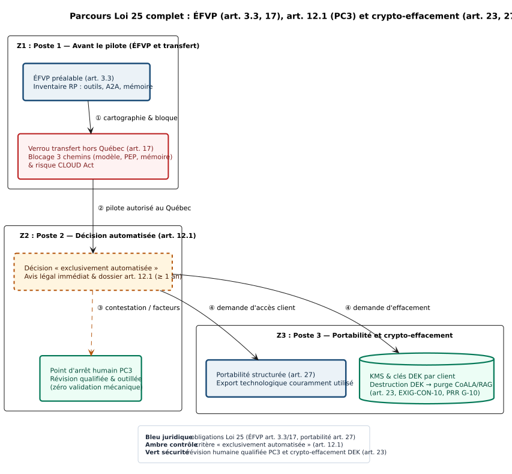
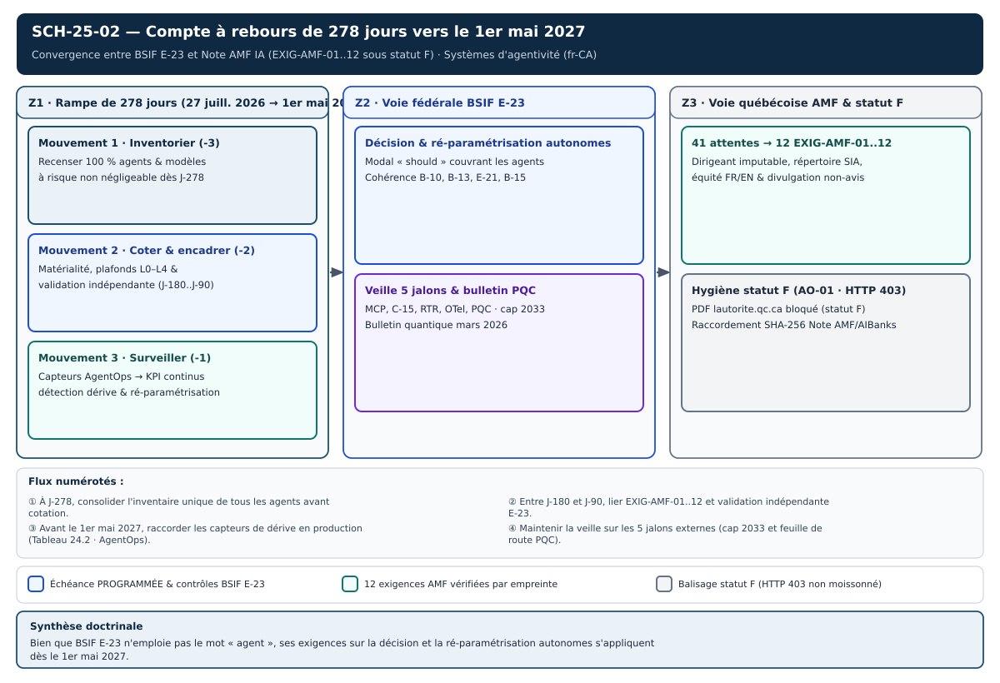
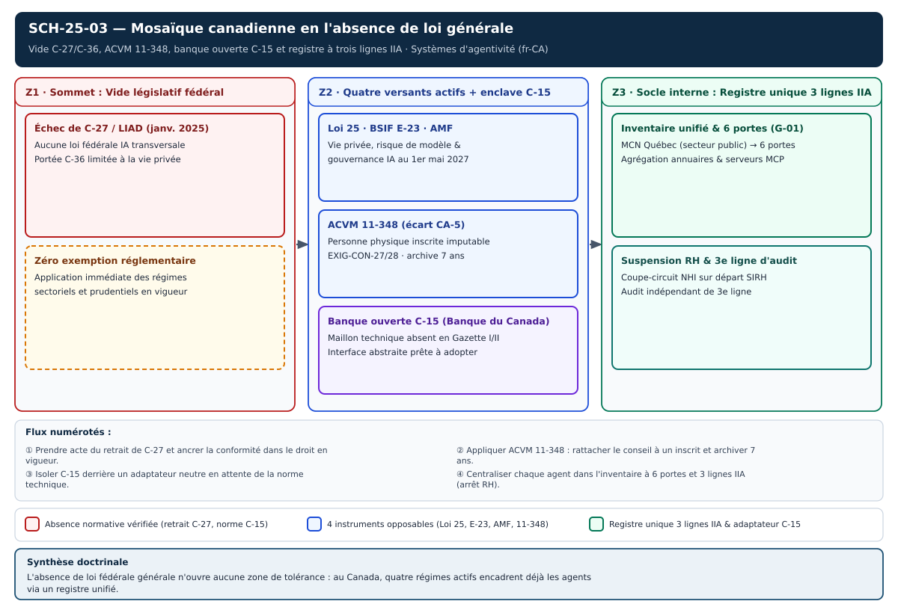

# Chapitre 25 — Droit québécois des décisions automatisées, portabilité des données et étalon prudentiel canadien

*Question directrice : Comment traduire dans les systèmes d'entreprise les obligations transversales de la Loi 25 sur les décisions automatisées et la portabilité des données, les cadres publics canadiens et les attentes prudentielles convergentes du BSIF et de l'AMF au 1er mai 2027 en contrôles d'interopérabilité et d'automatisation vérifiables ?*

L'observabilité probatoire, les bancs d'évaluation hermétiques et le pilotage FinOps de la Partie VIII (← Chapitres 22 à 24) forment la matière première exigée par les régimes juridiques et prudentiels encadrant l'interopérabilité et l'automatisation agentique des systèmes d'entreprise au Québec et au Canada. L'extinction du projet de loi fédéral C-27 [2] ne crée aucune zone de tolérance pour les agents autonomes. Trois cercles structurent l'assujettissement : le socle transversal de la Loi 25 visant toute entreprise privée au Québec (`ERP`, `CRM`, `SIRH`, plateformes commerciales et industrielles) [1], puis les directives propres aux organismes publics et au réseau sociosanitaire [2]. Le troisième cercle forme l'étalon prudentiel de haute régulation (*high-water mark*) : Ligne directrice E-23 du BSIF [3], encadrement AMF (corroboré sous réserve par la source secondaire `AIBanks.ca`, portail AMF en `statut F` [7]), valeurs mobilières (Avis 11-348 et Norme canadienne 31-103 [8]) et ouverture bancaire [9].

Ce chapitre ouvre le domaine D09 au gel documentaire du 2 décembre 2026. Sous la clause impérative `non-avis` (`AO-05`), l'exposé décrit des exigences d'architecture à titre technique et pédagogique sans constituer un avis juridique ni une certification réglementaire. Conformément à `AO-01`, les sources accessibles au statut L+ [1, 2, 3, 4, 5, 6, 7, 8, 9] (dont l'agrégateur secondaire `AIBanks.ca` [7]) fondent chaque énoncé, tandis que les portails bloqués en HTTP 403 (`lautorite.qc.ca`, `legisquebec.gouv.qc.ca`, `ciro.ca`, `securities-administrators.ca`) demeurent consignés en statut F hors preuve directe.

## 25.1 Résumé exécutif : socle transversal de la Loi 25, cadres publics et étalon du 1er mai 2027

Quatre constats directeurs structurent la conformité canadienne et québécoise de l'interopérabilité et de l'automatisation agentique des systèmes d'entreprise. Premièrement, au Québec, la Loi 25 (`LQ 2021, c. 25`) régit transversalement toute entreprise privée exploitant des renseignements personnels (RP), quel que soit son secteur d'activité, et son article 12.1 s'applique depuis le 22 septembre 2023 [1]. Toute **décision fondée exclusivement sur un traitement automatisé** impliquant des RP impose d'aviser la personne concernée dès la notification (`EXIG-CON-07`, `PRR G-06`) [1], de communiquer sur demande les RP, les motifs et paramètres déterminants ainsi que le droit de rectification, et d'offrir une révision humaine habilitée (`EXIG-CON-08`) [1]. Par exigence non dérogeable (`EXIG-GOV-17`), le cadre étend ces garanties aux décisions partiellement automatisées (`EXIG-CON-21`) et soumet tout contenu juridique externe à une vérification humaine `P3` (`EXIG-CON-22`).

À ces obligations décisionnelles s'ajoutent l'ÉFVP préalable (articles 3.3 et 17), l'effacement ou l'anonymisation vérifiable en mémoire et index vectoriels (article 23, `EXIG-CON-10`, `PRR G-10`) et le droit à la portabilité structurée en vigueur depuis le 22 septembre 2024 (article 27, `ANC-115`), qui impose des connecteurs d'exportation interopérables sur les systèmes d'enregistrement (`SoR`) et compartiments `CoALA` [1, 2]. Tout manquement expose l'entreprise à des pénalités administratives plafonnées à `10 M$ CA` (`2 %` du revenu mondial) et à des sanctions pénales culminant à `25 M$ CA` (`4 %`) (contrôle documentaire `DC-C37` du corpus, distinct des critères `C01–C40`, et `CAP-003`) [1, 2].

Deuxièmement, le 1er mai 2027 forme l'étalon prudentiel convergent de haute régulation au Canada. Parue le 11 septembre 2025, la version révisée de la Ligne directrice E-23 publiée par le Bureau du surintendant des institutions financières (BSIF) prend effet le 1er mai 2027 pour les institutions financières fédérales [3]. Sans nommer « agent » ni « agentique », sa définition de « modèle » englobe l'IA, la décision autonome et le reparamétrage autonome [3], convergence renforcée par le bulletin agentique du BSIF relié aux lignes directrices B-10 [5] et B-13 [4]. Le même jour, au Québec, l'encadrement IA de l'Autorité des marchés financiers (AMF) prend effet selon le repère corroboré sous réserve via la source secondaire `AIBanks.ca` (portail `lautorite.qc.ca` en `statut F`) [7], traduit dans le profil interne `CRE-IA-2026-01-QC` en douze exigences `EXIG-AMF-01` à `EXIG-AMF-12`, suivant une feuille de route interne de `278` jours (27 juillet 2026 au 1er mai 2027).

Troisièmement, la prorogation parlementaire du 6 janvier 2025 a éteint le projet de loi C-27 (qui englobait la *Loi sur l'intelligence artificielle et les données*, LIAD) [2], et le projet de loi C-36 (15 juin 2026) réforme la vie privée fédérale (`LPRPDE`) sans créer de loi autonome sur l'IA. Ce vide déplace l'encadrement vers les régimes sectoriels : en valeurs mobilières, la Norme canadienne 31-103 et l'Organisme canadien de réglementation des investissements (OCRI) [8] complètent l'Avis 11-348 (`statut F` sur `securities-administrators.ca`, `EXIG-CON-27` et `EXIG-CON-28`). En ouverture bancaire, la *Loi sur les services bancaires axés sur les consommateurs* (projet C-15, `L.C. 2026, ch. 3`) place le registre sous la Banque du Canada [9], et l'absence de standard désigné à l'article 125 [9] impose une façade d'interopérabilité évolutive (`CAP-026`, `EXIG-INT-06` et `EXIG-INT-07`).

Quatrièmement, l'exploitation simultanée de ces régimes repose sur un registre unifié des automatisations agentiques articulé au modèle à trois lignes de défense de l'IIA (`PRR G-01`), suspendant automatiquement les identités non humaines (`NHI`) lors d'un départ au `SIRH` et traçant six portes de cycle de vie. Il maintient en outre une démarcation stricte entre le droit positif des entreprises privées, le régime sociosanitaire (`LQ 2023, c. 5`, `ANC-119`) et les cadres administratifs gouvernant les systèmes d'entreprise du secteur public québécois (ministère de la Cybersécurité et du Numérique, MCN, `ANC-117` et `ANC-118`) ou fédéral (Secrétariat du Conseil du Trésor, SCT).

## 25.2 Socle transversal québécois, cadres publics et étalon prudentiel canadien

### 25.2.1 Droit transversal québécois : Loi 25 (décisions automatisées, ÉFVP, portabilité), frontière santé et AMF

La Loi 25 (`LQ 2021, c. 25`), sanctionnée le 22 septembre 2021, refond l'encadrement des renseignements personnels détenus par toute entreprise privée exploitant des systèmes d'information au Québec (`RLRQ, c. P-39.1`), qu'elle soit industrielle, commerciale, numérique ou financière. Le portail consolidé `legisquebec.gouv.qc.ca` demeurant exclu en statut F, l'analyse s'appuie en statut L+ sur la loi modificative sanctionnée [1] et sur le rapport quinquennal 2026 de la CAI [2]. Ses dispositions se sont déployées en trois vagues : dès le 22 septembre 2022 pour la fonction de responsable interne (RPRP, art. 3.1) et la notification des incidents (art. 3.5 à 3.8) [1], puis au 22 septembre 2023 pour l'étude préalable d'impact sur la vie privée (ÉFVP, dispositions 3.3 et 17), les décisions automatisées (art. 12.1) et la destruction ou l'anonymisation (art. 23). Enfin, le droit à la portabilité des données informatisées recueillies auprès de la personne s'applique depuis le 22 septembre 2024 (art. 27, `ANC-115`) [1, 2].

Un principe d'imputabilité commande toute l'architecture d'entreprise : l'organisation demeure légalement responsable des RP qu'elle détient même lorsqu'elle en confie le traitement ou la garde à un fournisseur de modèle, une suite `SaaS`, un orchestrateur ou un serveur MCP tiers [1]. Sans admettre de responsabilité partagée reportant la faute sur l'éditeur, la loi exige un mandat ou contrat écrit (article 18.3) encadrant la confidentialité, la limitation à la finalité du mandat, la non-conservation après échéance et l'avis sans délai de toute violation [1] (→ Chapitre 27).

En amont, les articles 3.3 et 17 imposent l'achèvement d'une ÉFVP avant tout projet visant à acquérir, développer ou refondre un système traitant des RP, ainsi qu'avant toute communication hors Québec [1]. L'exigence `EXIG-CON-04` (`PRR G-05`) interdit tout pilote agentique avant l'approbation de cette ÉFVP, avec consultation du RPRP dès l'amorce. Comme un agent disperse la donnée entre connecteurs métiers, l'ÉFVP recense les RP outil par outil, délégation par délégation et mémoire par mémoire. Dans son rapport quinquennal de mai 2026, la Commission d'accès à l'information du Québec (CAI, Recommandation 45) préconise d'adjoindre à toute ÉFVP visant une décision automatisée une analyse d'impact algorithmique sur les biais et les droits [2], intégrée dès `EXIG-CON-04` et l'évaluation unifiée (→ Chapitre 26).

La portée territoriale de l'article 17 crée un verrou d'interopérabilité strict. Toute communication hors Québec — même vers l'Ontario — exige une ÉFVP préalable évaluant sensibilité, finalité, garanties contractuelles et droit de l'État de destination afin de confirmer une protection adéquate avant entente écrite [1]. Or un agent interroge des modèles distants, synchronise des index vectoriels et exporte des traces. Sous `EXIG-CON-05` (`PRR G-05`) et `EXIG-APP-11`, la passerelle de modèles, la passerelle `PEP` (← Chapitre 09) et le plan mémoire bloquent par routage déclaré toute sortie hors Québec sans ÉFVP approuvée.

Dans l'analyse de risque interne (dossier source `Tome 2 § 12.2`, hors corpus `L+`), cette contrainte vise directement l'exposition extraterritoriale au *Clarifying Lawful Overseas Use of Data Act* (`CLOUD Act`, `18 U.S.C. § 2713`). Cette loi fédérale américaine oblige tout prestataire soumis au droit des États-Unis à livrer sur injonction les données placées sous sa garde ou son contrôle, peu importe leur lieu physique d'hébergement. Le simple hébergement dans une région infonuagique canadienne ne neutralise donc pas ce risque juridictionnel, qui doit être pondéré dans l'ÉFVP et atténué par une détention souveraine des clés (`HYOK`) ou une enclave matérielle attestée (→ Chapitre 26).

La réutilisation des interactions et la portabilité posent deux garde-fous complémentaires (`EXIG-CON-06`, `EXIG-CON-09`). Aux termes des articles 12 et 14, les RP ne servent qu'aux fins de leur collecte, sauf consentement manifeste, libre, éclairé et spécifique par fin distincte (la prospection commerciale ou philanthropique n'étant jamais compatible) [1]. L'inférence d'exécution relève de la fin principale, alors que réentraîner un modèle sur les journaux ou mémoires constitue une fin secondaire exigeant un consentement distinct et une étiquette de finalité vérifiée, assortie de l'avis de profilage (art. 8.1) et de la confidentialité par défaut (art. 9.1) [1].

En aval, l'article 27 (`ANC-115`) oblige tout système d'entreprise (`CRM`, `ERP`, `SIRH`, portail client et mémoire `CoALA`) à exposer un connecteur d'extraction déterministe restituant dans un format technologique structuré et couramment utilisé les RP informatisés recueillis auprès de la personne, hors inférences créées par l'entreprise, sous le délai de 30 jours fixé par l'article 32 [1, 2].

Le cœur de la rencontre entre automatisation agentique et droit positif québécois réside toutefois dans l'article 12.1 [1]. En vigueur depuis le 22 septembre 2023, ce texte vise toute entreprise qui utilise des RP pour rendre une décision entièrement issue d'un traitement automatisé, sans mentionner ni les modèles de langage ni les agents : le déclencheur porte exclusivement sur la place effective de l'humain dans l'acte décisionnel. Le droit québécois saisit ainsi l'orchestration et l'automatisation agentique greffées aux systèmes d'entreprise par leurs effets décisionnels sans nommer l'« agent », maintenant l'imputabilité intégrale de l'organisation sur l'assemblage sociotechnique [1].

Concrètement, cette règle couvre aussi bien le tri de candidatures dans un `SIRH`, la tarification dynamique ou la résiliation dans un `CRM` commercial que l'octroi de crédit ou l'indemnisation assurantielle [1]. L'article 12.1 impose d'abord d'aviser la personne au plus tard lors de la notification (`EXIG-CON-07`), puis de lui transmettre sur demande les RP mobilisés, les raisons déterminantes et « les principaux facteurs et paramètres » ayant conduit à cet acte ainsi que son droit de rectification [1]. Il garantit enfin la faculté de soumettre des observations devant un employé habilité à réviser cet acte, avec conservation des RP au moins un an (art. 11, `EXIG-CON-09`) et réponse sous 30 jours (art. 32) [1].

| Disposition (`RLRQ, c. P-39.1`, mod. par `LQ 2021, c. 25`) | Régime et délai légal | Traduction d'interopérabilité et d'automatisation (`EXIG-*` / `PRR`) |
|---|---|---|
| Art. 3.3 et art. 17 (`ÉFVP`) | Préalable à tout système ou transfert hors Québec (y compris interprovincial) [1] | Blocage technique sur trois chemins (modèles, passerelle `PEP`, mémoire) avant pilote (`EXIG-CON-04`, `EXIG-CON-05`, `G-05`) |
| Art. 12 et art. 14 (`Finalités`) | Consentement distinct par finalité ; prospection exclue [1] | Étiquetage de finalité inter-systèmes et blocage d'extraction vers l'entraînement sans base légale (`EXIG-CON-06`) |
| Art. 12.1 et art. 11 (`Décision`) | Information d'office ; facteurs, RP et rectification sur demande ; révision humaine ; conservation `≥ 1` an [1] | Facteurs déterministes versionnés hors modèle, grand livre `C.8` (`EXIG-OBS-11`), arrêt `PC3`, extension partielle et contrôle juridique `P3` (`EXIG-CON-07..09`, `EXIG-CON-21..22`, `G-06`) |
| Art. 23 et art. 28 (`Effacement`) | Destruction ou anonymisation réglementaire une fois les fins accomplies [1] | Rétention bornée par `SoR`/magasin, crypto-effacement par destruction de clé `DEK` dans `CoALA` et index `RAG` (`EXIG-CON-10`, `G-10`) |
| Art. 27 et art. 32 (`Portabilité` et délai de réponse) | Export structuré et couramment utilisé depuis le 22 sept. 2024 ; réponse `≤ 30` jours [1] | Connecteurs d'export déterministes (`JSON`/`CSV` normalisés) sur `SoR` et `CoALA` hors inférences dérivées (`EXIG-CON-09`, `ANC-115`) |
| Art. 90.12 et art. 91 (`Sanctions`) | Sanctions administratives `≤ 10 M$ CA` (`2 %`) ; amendes pénales `≤ 25 M$ CA` (`4 %`), doublées si récidive [1] | Non-dérogeabilité absolue des points légaux (`EXIG-GOV-17`, contrôle documentaire `DC-C37`, `CAP-003`) |

*Tableau 25.1 — Cartographie exécutive des obligations transversales de la Loi 25 (`RLRQ, c. P-39.1`, mod. par `LQ 2021, c. 25`) et de leurs contrôles techniques sur les systèmes d'entreprise.*

Tout l'enjeu opérationnel tient à l'adverbe « exclusivement » : une approbation machinale sur un écran `ERP`, `CRM` ou métier ne soustrait pas l'entreprise à l'article 12.1 (`EXIG-AUT-22`, `EXIG-AUT-23`, ↔ Chapitre 05 et → Chapitre 33). L'exigence `EXIG-CON-08` n'admet une intervention humaine réelle que si quatre conditions cumulatives sont démontrées et suivies en continu (`EXIG-AUT-21`) :

1. l'autorité effective de modifier ou d'annuler la décision ;
2. la compétence métier requise pour l'examiner ;
3. l'accès direct aux données complètes du système d'enregistrement plutôt qu'à la seule synthèse de l'agent ;
4. le temps nécessaire à un examen effectif.

Faute de ces quatre conditions, la décision est réputée exclusivement automatisée. De plus, `EXIG-CON-07` impose de tirer les « principaux facteurs et paramètres » d'une règle déterministe versionnée consignée au dossier (`EXIG-OBS-11`, ← Chapitre 22), jamais d'une rationalisation postérieure du modèle. Ces règles s'articulent au droit de rectification (article 28) et au crypto-effacement vérifiable (`EXIG-CON-10`, `PRR G-10`) : un plongement vectoriel issu d'un RP restant réidentifiable, sa purge repose sur une rétention bornée dans `CoALA` (↔ Chapitre 11) et la destruction de la clé `DEK` client sous `KMS`.

Deux exigences non dérogeables du cadre (`EXIG-GOV-17`, dossier source `Tome 2 § 12.7`) renforcent ce socle au-delà du strict texte de l'article 12.1 :

- **Extension aux décisions partiellement automatisées (`EXIG-CON-21`, `DOIT`)** : chaque notification d'une décision assistée par un agent (qu'elle soit intégralement ou partiellement automatisée) DOIT mentionner les coordonnées et les modalités du canal de révision humaine. Le cadre étend l'explication intelligible en langage clair des principaux facteurs et paramètres ainsi que le délai de `30` jours aux décisions partiellement automatisées — sans divulguer l'algorithme ni les poids, le raisonnement affiché par le modèle n'en tenant jamais lieu — afin d'anticiper `C-36` et de couvrir l'article `86` du RIA (→ Chapitre 26).
- **Vérification humaine `P3` de tout contenu juridique externe (`EXIG-CON-22`, `DOIT`)** : tout document juridique généré par un agent pour un destinataire externe (avis, acte de procédure, communication à un régulateur ou clause contractuelle nouvelle ou modifiée, hors gabarit approuvé) DOIT franchir un contrôle préalable avant envoi (`EXIG-AUT-09`, outil d'envoi classé `P3`). Une personne compétente nommée à la fiche valide son exactitude ainsi que l'existence et la portée de chaque référence citée. Ce verrou répond au risque jurisprudentiel illustré au repérage doctrinal (dossier source `Tome 2 § 12.7`, hors `L+`) par *Specter Aviation c. Laprade* (`2025 QCCS 3521`, sanction de `5 000 $ CA` sous l'art. `342` C.p.c. pour références fabriquées par l'IA).

Enfin, le droit sectoriel québécois trace deux démarcations nettes autour de la Loi 25. D'une part, dans le secteur sociosanitaire, la *Loi sur les renseignements de santé et de services sociaux* (`LQ 2023, c. 5`, sanctionnée le 4 avril 2023 et codifiée `RLRQ, c. R-22.1`, `ANC-119`) soumet les dossiers cliniques des organismes de santé et cliniques liées à un régime propre d'accès et de gouvernance, tandis que les employeurs et assureurs privés demeurent régis par `RLRQ, c. P-39.1` [1, 2]. D'autre part, les institutions financières à charte québécoise relèvent de l'AMF : selon le rapport quinquennal de la CAI [2] et le registre (`ANC-120`), ce périmètre couvre assurances (`RLRQ, c. A-32.1`), coopératives de services financiers (`c. C-67.3`), fiducies (`c. S-29.02`) et institutions de dépôts (`c. I-13.2.2`), réformées par `LQ 2018, c. 23` (sanctionnée le 13 juin 2018).

Le portail `lautorite.qc.ca` retournant `HTTP 403` (`AO-01`), la Ligne directrice IA de l'AMF demeure en **statut F** hors preuve primaire directe ; la source secondaire `AIBanks.ca` (édition T4 au 1er novembre 2026 [7]) corrobore sous réserve explicite sa publication de mars–avril 2026 et sa prise d'effet attendue le 1er mai 2027, raccordée par condensat `SHA-256` au profil `CRE-IA-2026-01-QC`. Sur le plan interne (dossier source `Tome 2 § 12.10`, `ANC-112`/`ANC-113`, sous réserve du `statut F`), `CRE-IA-2026-01-QC` traduit 41 attentes (`AMF-G`, `AMF-R`, `AMF-C`, `AMF-V`, `AMF-P`) en douze exigences `EXIG-AMF-01` à `EXIG-AMF-12` (→ Chapitre 34). Celles-ci couvrent dirigeant imputable, bilan semestriel, compétences sur six populations, éthique et répertoire (`01`–`05`), cote non récursive en un passage et exposition résiduelle (`06`–`08`), puis neuf familles de risque et mémoire au 30 septembre 2027 (`09`–`10`, `ANC-113`) ainsi qu'équité FR/EN et mention `non-avis` au 1er mai 2027 (`11`–`12`, `ANC-112`).

*Figure 91 — SCH-25-01 : Corridor réglementaire transversal de la Loi 25 illustrant les trois postes séquentiels sur les systèmes d'entreprise (ÉFVP et blocage hors Québec sur trois chemins, déclenchement de l'article 12.1 et révision au point d'arrêt PC3, puis portabilité structurée et crypto-effacement DEK dans CoALA et RAG).*

### 25.2.2 Étalon prudentiel financier (BSIF E-23, ACVM, LSAC) et régimes des systèmes publics (MCN, SCT)

Au palier fédéral, la supervision des institutions financières fédérales (IFF) fournit l'**étalon prudentiel de haute régulation (*high-water mark*)** du traité, dominé par l'entrée en vigueur de la Ligne directrice E-23 du BSIF (*Gestion du risque de modélisation*, édition 2027) le **1er mai 2027** [3]. Publiée le 11 septembre 2025, E-23 adopte une approche fondée sur les principes : la version française officielle en `L+` ne comporte aucune mention de « agent », « agentique » ou « orchestration » [3], et l'inspection interne de la version anglaise (dossier source `Tome 1 § 25.4`) y relève le modal conditionnel (« should ») sans impératif « must ». Par rigueur rédactionnelle, il convient donc d'écrire « attendu par E-23 » plutôt que « exigé par E-23 ».

Néanmoins, E-23 retient une définition fonctionnelle large du « modèle » englobant les méthodes d'IA et d'apprentissage automatique, avec huit occurrences du radical « autonom* » visant la prise de décision autonome et le reparamétrage autonome [3]. L'inférence analytique d'une couverture implicite des systèmes agentiques (dossier source `Tome 1 § 25.3`) est directement renforcée par le bulletin technologique du BSIF du 13 juillet 2026, qui renvoie expressément à E-23 pour l'IA générative et agentique et préconise des garde-fous techniques hors modèle (*AI harnessing*) et une gouvernance de bout en bout [4]. La supervision prudentielle saisit pareillement l'automatisation agentique des processus critiques par ses effets opérationnels : `E-23` encadre la décision autonome [3], tandis que le bulletin de juillet 2026 en situe la maîtrise dans les garde-fous hors modèle (*AI harnessing*) et la gouvernance du cycle de vie [4].

Les attentes structurantes d'E-23 portent sur cinq piliers (`EXIG-CON-11`, `EXIG-CON-12`, `PRR G-04`) : cycle de vie en cinq composantes non strictement séquentielles, inventaire d'entreprise des modèles à risque inhérent non négligeable (y compris de tiers), cotation proportionnée au degré d'autonomie (`L0` à `L4`), documentation rigoureuse et surveillance continue de la dérive [3]. Quatre lignes directrices connexes forment un gabarit de contrôle réutilisable bien au-delà de la finance : **B-10** (`30 avril 2023`) encadre les dépendances tierces par l'inventaire des sous-traitants, la continuité et les plans de sortie [5], tandis que **B-13** (en vigueur depuis le 1er janvier 2024 selon le dossier source `Tome 2 § 12.5`) est reliée par le bulletin de juillet 2026 à l'attribution d'identités non humaines distinctes à moindre privilège [4].

La Ligne directrice **E-21** sur la résilience opérationnelle et l'avis du BSIF sur le signalement des incidents technologiques complètent cet étalon [4] (le délai de 24 heures relevant de l'index interne du dossier source `Tome 2 § 12.5`), avec la Ligne directrice **B-15** sur les émissions brutes de portée 3 dès l'exercice financier 2028 (`ANC-106`, ← Chapitre 24). À long terme, la *Loi sur les banques* (`L.C. 1991, ch. 46`) prescrit la conservation au Canada des livres et registres (articles 238, 239 et suivants) et fixe au **30 juin 2033** la temporisation statutaire (article 21) [6]. En matière post-quantique, la sensibilisation du BSIF (mars 2026, `ADR-024`, ↔ Chapitre 18) reste sans échéance contraignante propre, et les mandats gouvernementaux (`EO 14412`, `OMB M-26-15`, `AMOPS`, `ITSM.40.001`) s'appliquent aux administrations publiques sans lier les entreprises privées (→ Chapitre 36).

*Figure 92 — SCH-25-02 : Frise opérationnelle de 278 jours (27 juillet 2026 → 1er mai 2027) montrant la convergence de l'étalon prudentiel BSIF E-23 et AMF (EXIG-AMF-01..12), avec balisage explicite en statut F du portail lautorite.qc.ca.*

Pour converger vers l'échéance du 1er mai 2027 fixée par BSIF E-23 [3] et attendue pour l'AMF (source secondaire `AIBanks.ca`, portail AMF en `statut F` [7]), le cadre découpe la préparation en une feuille de route interne de **278 jours** (27 juillet 2026 au 1er mai 2027, dossier source `Tome 1 § 25.1`). Aux jours `0` à `90` (*Inventorier*), l'organisation recense agents, modèles et API tierces avec parrain imputable [3, 4]. Aux jours `90` à `180` (*Coter et encadrer*), la deuxième ligne fixe la cote de risque inhérent incluant l'autonomie [3], associe `EXIG-AMF` le cas échéant et bloque toute promotion sans validation indépendante [3]. Jusqu'au 1er mai 2027 puis au jalon interne du `30 septembre 2027` (`ANC-113`), les équipes raccordent `AgentOps` aux seuils de dérive tout en suivant cinq jalons externes (`MCP 2026-07-28`, `C-15`, Rail en temps réel `RTR`, `OTel GenAI` et transition post-quantique `2030–2035`).

En parallèle du volet prudentiel, deux régimes encadrent les marchés de capitaux et l'interopérabilité bancaire ouverte. Sur les marchés de capitaux, l'Avis 11-348 publié par le personnel des Autorités canadiennes en valeurs mobilières (ACVM, 5 décembre 2024, consultation close le 31 mars 2025, `ANC-121`) rappelle que les lois sur les valeurs mobilières, la Norme canadienne `31-103` et les règles de l'OCRI s'appliquent aux systèmes d'IA. Les portails `securities-administrators.ca` et `ciro.ca` restant en statut F (`HTTP 403`), la preuve `L+` directe sur `31-103` et l'OCRI repose sur l'avis modificatif de la CVMO/OSC publié sur `osc.ca` [8].

Dans la lecture interne de l'Avis 11-348 (dossier source `Tome 1 § 28.2`, signalant un écart de traduction avec la version française codé `CA-5`), la version anglaise vise des systèmes présentant des degrés variables d'autonomie et d'adaptativité après déploiement. En traduction architecturale (dossier source `Tome 2 § 12.10`), `EXIG-CON-27` interdit qu'un agent remplace un représentant inscrit : toute recommandation reste liée cryptographiquement à une personne physique inscrite et archivée `≥ 7` ans, tandis que `EXIG-CON-28` prohibe l'*AI washing* non étayé par les bancs d'évaluation. Sur `NC 31-103`, l'avis `L+` [8] arrête au `1er octobre 2028` l'interdiction des rétrofacturations de commissions (*chargebacks*, art. 11.11, hors titres antérieurs), complétant `ANC-101`, `ANC-102` et `ANC-107` (`1er janvier 2026`, `2027` et `2029`).

Pour le partage de données financières, la « Loi sur les services bancaires axés sur les consommateurs » (`LSAC`, projet C-15), sanctionnée le `26 mars 2026` à l'article 224 du chapitre `L.C. 2026, ch. 3` (entrée en vigueur majoritaire par décret, art. 181), confie à la Banque du Canada l'accréditation, la supervision et le registre public [9]. Son article 171 prohibe à terme le grattage d'écran par identifiant client [9]. Un projet de règlement a été prépublié le `27 juin 2026` dans la *Gazette du Canada*, Partie I, sans règle finale ni date d'ouverture du partage au gel (suivi secondaire `AIBanks.ca` [7], hors *Gazette* en `L+`), les paramètres prépubliés (`26 août 2026`, disponibilité `99,5 %`, conservation `5` ans) relevant de `ANC-104` (dossier source `Tome 4 § 3.3`).

Or le texte officiel établit qu'aucun standard technique ni organisme de normalisation n'est encore désigné dans la loi (l'art. 125 renvoyant à un arrêté ministériel dans la *Gazette du Canada*) [9], sans date de mise en œuvre arrêtée (suivi secondaire `AIBanks.ca` [7]). Cette indétermination érige un patron d'interopérabilité sous incertitude réglementaire : encapsuler les `SoR` derrière une **façade d'abstraction protocolaire évolutive (`CAP-026`, `EXIG-INT-06` et `EXIG-INT-07`)** absorbant le futur standard sans refonte applicative (→ Chapitres 28 et 29).

Enfin, l'architecture distingue projets fédéraux et régimes du secteur public. Le projet `C-27` est mort au feuilleton en `2025` selon la CAI [2] (prorogation du `6 janvier 2025` et `LIAD` consignés au dossier source `Tome 2 § 12.5`, hors `L+`). Le projet C-36 (15 juin 2026, deuxième lecture au gel selon `Tome 2 § 12.5`, hors `L+`) réforme la vie privée avec transparence algorithmique (art. 62 et 63 ; sanctions projetées jusqu'à `10 M$ CA` ou `3 %` visant l'art. 62(1) et non l'art. 63) sans loi générale sur l'IA.

Dans les administrations publiques, des cadres dédiés régissent directement les systèmes gouvernementaux : au Québec, le registre algorithmique du MCN cité par la CAI [2], l'Arrêté `2025-02` du `3 décembre 2025` (`ANC-117`) et le *Guide sur l'utilisation responsable de l'intelligence artificielle agentique* (`septembre 2026`, `ANC-118`, proportionnalité d'autonomie) encadrent les organismes publics. Au fédéral, la Directive sur la prise de décisions automatisée et l'`EIA` du SCT (dossier source `Tome 2 § 12.5`) gouvernent les ministères. Conformément à la rectification `EF-06` (`ANC-117`, `ANC-118`, → Chapitre 36), ces directives publiques offrent des gabarits méthodologiques utiles **sans lier les entreprises privées (industrielles, commerciales, numériques ou financières)**.

| Instrument juridique ou prudentiel | Juridiction et statut au 2 déc. 2026 | Date opposable / horizon | Effet déterminant sur l'interopérabilité et l'automatisation des systèmes d'entreprise |
|---|---|---|---|
| Loi 25 (`LQ 2021, c. 25`, art. 12.1, 17, 23, 27) | Québec (toute entreprise privée) — **En vigueur** [1] | 22 sept. 2023 (art. 12.1, 17, 23) ; 22 sept. 2024 (art. 27) | ÉFVP préalable, blocage hors Québec, explication/révision `PC3`, `EXIG-CON-21..22`, portabilité `SoR` et crypto-effacement `DEK` [1, 2] |
| BSIF E-23 (`2027`) + B-10 / B-13 / B-15 | Canada fédéral (étalon IFF) — **En vigueur (`B-10`, `B-13`) / Programmé (`E-23`, `B-15`)** [3, 5] | 1er mai 2027 (`E-23`) ; fin 2028 (`B-15`, ← Chapitre 24) ; 30 juin 2033 (`L.C. 1991, ch. 46` [6]) | Inventaire d'entreprise, cotation d'autonomie, validation indépendante, surveillance dérive et tiers [3, 4, 5, 6] |
| Ligne directrice IA de l'AMF (`CRE-IA-2026-01-QC`) | Québec financier — **Statut F** (source secondaire `AIBanks.ca` [7] ; profil interne) | 1er mai 2027 (source secondaire [7]) ; jalon interne `30 sept. 2027` (`ANC-113`) | Dirigeant imputable, répertoire SIA, passage unique non récursif, équité FR/EN |
| Avis ACVM `11-348` (`ANC-121`, `statut F`) & `NC 31-103` | Canada valeurs mobilières — **En vigueur** [8] | 5 déc. 2024 (`11-348`) ; 1er janv. 2026 / 2027 (`ANC-101`, `102`) ; 1er oct. 2028 [8] | Personne physique inscrite imputable (`EXIG-CON-27`), archive `7` ans, interdiction *AI washing* |
| LSAC (`L.C. 2026, ch. 3`, projet C-15) | Canada fédéral — **Sanctionné** [9] (calendrier secondaire `AIBanks.ca` [7]) | Sanction 26 mars 2026 [9] ; règlement proposé 27 juin 2026 (source secondaire [7]) ; standard à désigner [9] | Accréditation Banque du Canada, fin du grattage d'écran et façade évolutive `CAP-026` (`EXIG-INT-06..07`) [9] |
| Cadres publics MCN / SCT, santé `LQ 2023, c. 5` ; C-27 / C-36 | Québec / Canada — **Public & santé actifs / Éteint (C-27) [2] / Projet (C-36)** | 4 avr. 2023 (`R-22.1`) ; 6 janv. 2025 (`C-27`) ; 3 déc. 2025 & sept. 2026 (`MCN`) | Opposable aux organismes publics et santé ; sans lier les entreprises privées (`ANC-117`, `ANC-118`) [2] |

*Tableau 25.2 — Synthèse de la mosaïque réglementaire québécoise et canadienne et de son opposabilité par catégorie d'organisation.*

Pour empêcher la fragmentation des contrôles entre consoles propriétaires (`Entra Agent ID`, `Agent 365`, `Workday`, `Salesforce`, `ServiceNow`, annuaires `MCP`), ces régimes convergent vers un **inventaire de gouvernance unique** (`PRR G-01`, `EXIG-GOV-01`) opéré selon les trois lignes de défense de l'Institute of Internal Auditors (IIA). La première ligne soumet chaque automatisation agentique aux six portes (qualification, pilote, production, exploitation, changement, retrait) avec suspension instantanée des `NHI` sur départ au `SIRH`. La deuxième ligne fixe la classe de risque, valide les ÉFVP et vérifie les plafonds d'autonomie. La troisième ligne (audit interne) rapproche l'inventaire des journaux de passerelle pour détecter tout agent fantôme et prévenir les approbations réflexes.

*Figure 93 — SCH-25-03 : Architecture de conformité canadienne face au vide législatif C-27/C-36, combinant le socle transversal de la Loi 25, l'étalon prudentiel (BSIF E-23, AMF et ACVM 11-348), la façade évolutive C-15 (`CAP-026`) et le registre unifié à six portes et trois lignes de l'IIA.*

## 25.3 Synthèse architecturale, livrables et portes de contrôle

Sur le plan des frontières d'architecture du Compendium, ce chapitre fixe les prescriptions légales et prudentielles québécoises et canadiennes sans réécrire les mécanismes techniques détaillés ailleurs. Il délègue le harnais contractuel au Chapitre 04, l'ergonomie `PC3` au Chapitre 05, le blocage réseau hors Québec au Chapitre 09 et la purge `CoALA` au Chapitre 11, ainsi que le double couloir probatoire (Chapitre 22), les tests métamorphiques FR/EN (Chapitre 23) et la matrice sectorielle à `24` propositions `PEX` (Chapitre 28). En retour, il fonde les ententes écrites des articles 17 et 18.3 (Chapitre 27) et prépare l'articulation européenne et internationale (Chapitre 26).

La mise en conformité s'opérationnalise au moyen de quatre livrables auditables reliés aux critères d'acceptation (`G0–G1`) et aux portes `PRR` :

| Livrable réglementaire et technique | Exigences et portes associées | Critère d'acceptation exécutable |
|---|---|---|
| Dossier d'ÉFVP préalable & tests de blocage hors Québec | `EXIG-CON-04`, `EXIG-CON-05`, `EXIG-APP-11`, `PRR G-05`, `SIG-107` | Zéro pilote sans ÉFVP approuvée ; tests CI bloquant `100,0 %` des routes hors Québec non autorisées sur modèles, passerelle et mémoire [1] |
| Démonstrateur Loi 25 art. 12.1, 23, 27 & contrôles `GOV-17` | `EXIG-AUT-22..23`, `EXIG-CON-07..10`, `EXIG-CON-21..22`, `PRR G-06`, `G-10`, `SIG-106` | Avis d'information et canal de révision (décisions entièrement ou partiellement automatisées), facteurs journalisés `≥ 1` an, validation `P3` juridique, export art. 27 `≤ 30` j, destruction `DEK` prouvée [1] |
| Registre unifié à 3 lignes IIA & matrice `278` j (`1er mai 2027`) | `EXIG-CON-11`, `EXIG-CON-12`, `EXIG-AMF-01..12`, `PRR G-01`, `G-04`, `SIG-101..109` | `100,0 %` des agents inventoriés avec parrain, suspension `SIRH` automatique, cote non récursive et preuve `EXIG-AMF-11` bilingue (`E-23` [3, 4], jalon AMF par source secondaire `AIBanks.ca`, `statut F` [7]) |
| Dossier valeurs mobilières, façade `LSAC` et journal `statut F` | `EXIG-CON-27`, `EXIG-CON-28`, `EXIG-INT-06..07`, `CAP-026`, `ADR-024`, `AO-01`, `DC-C37`, `CAP-003` | Lien cryptographique au représentant inscrit (`7` ans, `EXIG-CON-27`) et `NC 31-103` [8], façade abstraite `C-15` [9] (calendrier secondaire `AIBanks.ca` [7]) et séparation droit privé / guides publics (`ANC-117`, `ANC-118`) |

*Tableau 25.3 — Livrables de conformité, exigences liées et critères d'acceptation du Chapitre 25.*

Dans un groupe d'entreprise multisectoriel tel que Groupe Boréal — réunissant équipements industriels et logistique (`BEL`), services financiers et assurances (`BCA`) et services numériques `B2B` (`BSN`) —, la coexistence du socle transversal de la Loi 25 avec l'étalon prudentiel `BSIF E-23`, l'encadrement AMF et l'Avis ACVM 11-348 impose de retenir la règle commune la plus exigeante sur l'infrastructure partagée tout en respectant les déclencheurs propres à chaque division. Cette discipline prépare le passage vers les exigences extraterritoriales européennes et les référentiels internationaux (→ Chapitre 26).

> **Trois invariants exécutables — Chapitre 25**
>
> 1. **Verrouillage transversal Loi 25 et contrôles `GOV-17` (`EXIG-CON-04..10`, `EXIG-CON-21..22`, `PRR G-05`, `G-06`, `G-10`)** : Dans toute entreprise privée au Québec, aucun agent traitant des RP ne démarre sans ÉFVP ni blocage hors Québec sur les trois plans. Toute décision automatisée (entière ou partielle sous `EXIG-CON-21`) produit facteurs déterministes, révision humaine qualifiée (`EXIG-CON-08`), vérification `P3` juridique (`EXIG-CON-22`), export de portabilité (art. 27) et crypto-effacement `DEK` dans `CoALA`/`RAG` [1].
> 2. **Étalon prudentiel convergent du 1er mai 2027 (`BSIF E-23`, `EXIG-AMF-01..12`, `PRR G-04`)** : Sans employer le mot « agent », `BSIF E-23` saisit les automatisations autonomes par sa définition de modèle et attend dès le 1er mai 2027 inventaire exhaustif, cotation et surveillance continue [3, 4]. Cette échéance converge avec le repère AMF du 1er mai 2027 corroboré sous réserve par la source secondaire `AIBanks.ca` (portail AMF en `statut F`) [7], traduit dans `CRE-IA-2026-01-QC`.
> 3. **Façade d'interopérabilité `LSAC` et démarcation public/privé (`ACVM 11-348`, `C-15`, `CAP-026`, `PRR G-01`)** : L'absence de loi fédérale générale sur l'IA n'emporte aucune exemption ; `NC 31-103` encadre les conflits d'intérêts [8] et `EXIG-CON-27` lie toute recommandation à un représentant inscrit archivé `7` ans, tandis que les cadres publics `MCN`/`SCT` (`ANC-117`, `ANC-118`) s'appliquent aux organismes publics sans lier les entreprises privées. Le partage bancaire ouvert `C-15` s'encapsule derrière une façade évolutive `CAP-026` faute de standard désigné [9] (suivi secondaire `AIBanks.ca` [7]), et le registre `IIA` révoque tout mandat orphelin lors d'un départ au `SIRH`.
