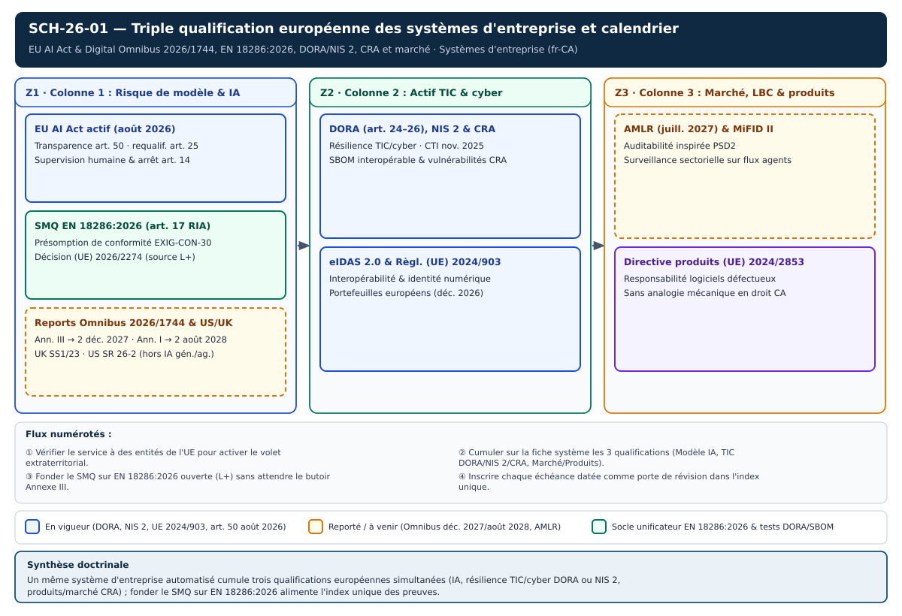
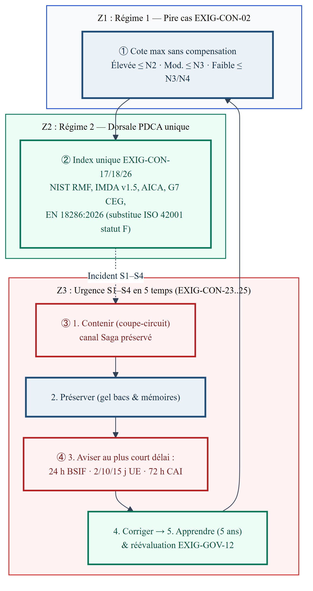
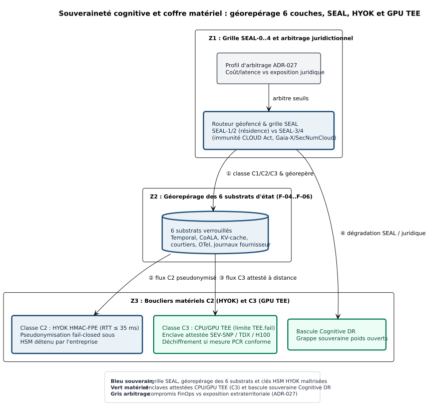

# Chapitre 26 — Réglementation européenne (AI Act, DORA, CRA, NIS 2), référentiels internationaux et souveraineté des systèmes d'entreprise

*Question directrice : Comment unifier sous un index probatoire unique, des interfaces interopérables et une souveraineté matérielle des six substrats d'état les obligations extraterritoriales européennes (EU AI Act, DORA, CRA, NIS 2, Data Act) et les référentiels internationaux applicables à l'automatisation agentique des systèmes d'entreprise ?*

Si le droit québécois et l'étalon prudentiel canadien posent le premier cercle de contraintes autour de l'automatisation agentique des systèmes d'entreprise (← Chapitre 25), aucune organisation industrielle, commerciale, numérique ou financière opérant à l'international ne peut cantonner son architecture de conformité aux frontières domestiques. Dès lors que les sorties d'un agent développé ou hébergé à Montréal sont utilisées dans l'Union européenne, ou qu'un système d'entreprise s'exécute sur une infrastructure infonuagique soumise à une loi extraterritoriale tierce, plusieurs régimes juridiques et techniques se déclenchent simultanément [1, 7]. L'enjeu consiste à absorber la convergence de règlements européens contraignants et de cadres internationaux au sein d'un dispositif unique d'interopérabilité, de gouvernance et de preuve.

Ce chapitre couvre la deuxième section du domaine D09 à l'état du gel documentaire du 2 décembre 2026. Sous la clause impérative `non-avis` (`AO-05`), l'analyse revêt une portée strictement technique et pédagogique sans constituer un conseil juridique ni une attestation réglementaire, et interdit toute transposition mécanique entre le droit de l'Union européenne et le droit canadien ou québécois (↔ Chapitre 25). En vertu du protocole `AO-01`, les preuves accessibles reposent exclusivement sur les sources ouvertes au statut L+ [1, 2, 3, 4, 5, 6, 7]. Les portails payants ou protégés (`iso.org` pour `ISO/IEC 42001:2023` en `HTTP 403`, `standards.cencenelec.eu` en `HTTP 500` et le miroir HTML `eur-lex.europa.eu` sous défi `AWS WAF`) demeurent consignés en statut F et substitués par les textes officiels EUR-Lex Cellar et la norme harmonisée ouverte `EN 18286:2026` [4, 5].

## 26.1 Résumé exécutif : portée extraterritoriale, qualification transversale et coffre souverain

Quatre piliers organisent l'architecture réglementaire européenne et internationale des systèmes d'entreprise automatisés. Premièrement, le Règlement `(UE) 2024/1689` (*EU AI Act* ou RIA) saisit tout fournisseur ou déployeur établi dans un pays tiers dès que les sorties produites par le système sont utilisées dans l'Union européenne (`article 2(1)`) [1]. Les interdictions de l'article 5 s'appliquent depuis le 2 février 2025, et les règles visant les modèles à usage général (`GPAI`) depuis le 2 août 2025 (avec échéance au 2 août 2027 pour les modèles préexistants) [1].

De plus, les exigences de transparence de l'article 50 s'appliquent depuis le **2 août 2026**, avec transition au 2 décembre 2026 pour le marquage des systèmes préexistants (`article 50 § 2`) et de nouvelles interdictions ciblées (`article 5`, points `b bis` et `b ter`) [1, 2]. Le Règlement `(UE) 2026/1744` du 8 juillet 2026 (*Digital Omnibus*, publié le 24 juillet 2026, en vigueur le 27 juillet 2026) reporte l'Annexe III (emploi/`SIRH`, infrastructures critiques, services publics, crédit, assurance vie et santé) au **2 décembre 2027** (`PRR G-08`) et l'Annexe I (machines industrielles, dispositifs médicaux) au **2 août 2028** [1, 2]. Ces échéances cadencent `EXIG-CON-13` à `EXIG-CON-16`, `PRR G-03` et `PRR G-07` (`article 50`) [2].

Deuxièmement, tout système d'entreprise critique déployé vers l'Union subit une **triple qualification simultanée** [1, 3]. Côté modèle décisionnel, il croise le RIA [1] avec `US SR 26-2` d'avril 2026 (excluant l'IA générative et agentique) et `UK SS1/23` (repérage `dossier source Tome 1`, hors `L+` fermé de ce chapitre). Côté résilience TIC, cyber et interopérabilité, il relève de `NIS 2` (`ANC-006`, repérage `Tome 1` pour l'industrie, l'énergie, la santé, le transport et le numérique) ou de l'étalon financier `DORA` (depuis le 17 janvier 2025) [3], ainsi que du `CRA` (`(UE) 2024/2847`, cité en [2], applicable le 11 décembre 2027, `ANC-008`).

Côté produits, chaînes logistiques et marchés, il cumule la Directive `(UE) 2024/2853` sur la responsabilité sans faute des produits logiciels (après le 9 décembre 2026, `ANC-002`, repérage `dossier source Tome 1`/`3`), la propagation systémique dans les chaînes d'approvisionnement numériques éclairée par Bostan [7] et, en finance, `MiFID II` et le futur corpus `AMLR` de juillet 2027 (sous réserve documentaire au `dossier source Tome 1`). Pour le système de management de la qualité (`SMQ`, article 17), `EN 18286:2026` — publiée par Décision `(UE) 2026/2274` du 12 octobre 2026 — confère présomption de conformité sous l'article 40 (`EXIG-CON-30`) et remplace `ISO/IEC 42001:2023` (statut F) [4, 5].

Troisièmement, face aux référentiels volontaires du repérage `dossier source Tome 2`/`3`/`4` (`NIST AI RMF 1.0`, `NIST AI 600-1`, `ISO/IEC 42005:2025`, `IMDA Agentic AI v1.5` de juin 2026, `AICA`/`IAIS`, hors `L+` ici) et à la feuille de route PQC du `G7 CEG` du 14 janvier 2026 [6], le Compendium impose trois contrôles internes. La classification par critère maximal unique désigne `EXIG-CON-02` comme source exclusive des plafonds (`Élevée ≤ N2`, `Modérée ≤ N3`, `Faible ≤ N3` ou `N4` sur comité). L'index unique (`EXIG-CON-18`) et l'évaluation d'impact unifiée (`EXIG-CON-26`) accompagnent une riposte `S1`–`S4` en cinq temps cumulant les délais légaux (`24 h` BSIF via `← Chapitre 25`, `72 h` RGPD prise comme cible opérationnelle pour la CAI et la `LPRPDE` via `dossier source Tome 2`, et `2`/`10`/`15` jours RIA art. 73) (`EXIG-CON-23`..`25`) [1].

Quatrièmement, l'hébergement géographique ne neutralise pas les lois extraterritoriales tel le `CLOUD Act` (repérage `dossier source Tome 3`). L'architecture cible (`ADR-027`, grille `SEAL-0..4` du repérage `dossier source Tome 3`, `F-04`..`F-06`) étend par choix interne le géorepérage aux six couches d'état des systèmes d'entreprise, combinant `HMAC-FPE` sous `HSM` souverain (`HYOK`) en `classe de souveraineté C2` et enclaves `CPU`/`GPU TEE` (`AMD SEV-SNP`, `Intel TDX`, `NVIDIA H100`) en `classe de souveraineté C3`.

## 26.2 Droit européen et référentiels internationaux

### 26.2.1 Droit de l'Union européenne : EU AI Act, NIS 2 / DORA, CRA, interopérabilité et EN 18286:2026

L'application extraterritoriale du Règlement `(UE) 2024/1689` (*EU AI Act* ou RIA) constitue souvent un angle mort nord-américain. Selon l'article 2(1), il s'applique aux fournisseurs et déployeurs de l'Union, mais aussi à ceux établis dans un pays tiers dès que les sorties du système sont utilisées dans l'Union [1]. L'article 3(1) vise tout système automatisé conçu pour divers degrés d'autonomie, pouvant s'adapter après déploiement et déduisant des entrées comment générer des sorties influençant des environnements physiques ou virtuels [1]. Toute automatisation agentique y entre directement. Aussi, `EXIG-CON-13` impose d'inscrire à la fiche si ses sorties atteignent l'Union ; dans un domaine de l'Annexe III, le système passe d'office en classe **Élevée** (`EXIG-CON-01`), par choix interne écartant l'article 6(3) [1].

Le calendrier modifié par le Règlement `(UE) 2026/1744` du 8 juillet 2026 (*Digital Omnibus*, publié le 24 juillet 2026 et en vigueur depuis le 27 juillet 2026) réorganise les échéances sans créer de moratoire [2]. Les pratiques interdites de l'article 5 sont exécutoires depuis le 2 février 2025, complétées au `2 décembre 2026` par des interdictions additionnelles (points `b bis` et `b ter` sur les hypertrucages sexuels non consentis et le matériel d'abus), justifiant le blocage absolu d'`EXIG-CON-14` quelle que soit la juridiction d'exploitation [2]. Les obligations visant les modèles `GPAI` s'appliquent depuis le 2 août 2025, avec date limite au `2 août 2027` pour les modèles antérieurs selon l'article 111 § 3 [1].

Depuis le **2 août 2026**, l'article 50 impose la divulgation claire de toute interaction avec une IA (art. 50 § 1) et la signalisation des systèmes de reconnaissance des émotions ou de catégorisation biométrique (art. 50 § 3) [1]. Le marquage lisible par machine des contenus synthétiques (art. 50 § 2) bénéficie jusqu'au `2 décembre 2026` d'une transition pour les systèmes préexistants (`ANC-001`) [1, 2]. `EXIG-CON-19` étend cette transparence à toute interaction écrite ou vocale, et `EXIG-CON-20` impose l'identification de tout contenu externe malgré relecture humaine (articulées avec `EXIG-CON-21` et `EXIG-CON-22`, ← Chapitre 25) [1].

Pour les systèmes à haut risque, le *Digital Omnibus* ajuste les articles 111 et 113 : l'application du chapitre III aux cas d'usage de l'Annexe III est reportée au plus tard au **2 décembre 2027** (`ANC-007`), tandis que les systèmes intégrés à des produits réglementés de l'Annexe I (machines industrielles, jouets, ascenseurs, équipements radio et dispositifs médicaux) s'appliquent dès le **2 août 2028** (`ANC-010`) [1, 2]. Chaque État membre doit disposer d'un bac à sable réglementaire opérationnel au 2 août 2027, et la Commission européenne remet ses orientations de surveillance post-commercialisation au `2 septembre 2027` (`art. 72 § 3`) [2].

Les systèmes à haut risque préexistants destinés aux autorités publiques disposent jusqu'au `2 août 2030` (`art. 111 § 2`) et ceux de l'Annexe X jusqu'à fin 2030 (`art. 111 § 1`), avec des réexamens quadriennaux prévus dès le `2 août 2028` (Annexe III et art. 50) et le `2 août 2029` (évaluation générale), s'échelonnant de `2028` à `2033` (`art. 112 §§ 2–3`) [1, 2]. L'Annexe III couvre un spectre multisectoriel large des systèmes d'entreprise : gestion d'infrastructures critiques d'énergie, d'eau et de numérique (`point 2`), recrutement, tri de candidatures et évaluation des travailleurs dans les `SIRH` (`point 4`), services publics essentiels (`point 5(a)`), évaluation de solvabilité et notation de crédit des particuliers (`point 5(b)`, hors détection de la fraude financière) et tarification en assurance-vie et maladie (`point 5(c)`, hors assurance de dommages) [1].

L'intégration d'agents dans le parc applicatif pose un risque critique en vertu de l'article 25 du RIA [1]. Une direction informatique qui appose sa marque sur un système à haut risque, en modifie substantiellement le comportement ou réaffecte un agent ou un modèle `GPAI` sur un `ERP`, un `SIRH` ou un `MES` vers une finalité de l'Annexe III est **requalifiée fournisseur** (`article 25(1)`). Elle assume alors tous les devoirs du fournisseur : documentation technique (article 11), obligations générales (article 16), système de gestion de la qualité (article 17), évaluation de conformité (article 43), marquage CE (articles 47 à 49), surveillance après commercialisation (article 72) et signalement des incidents graves (article 73) [1]. En conséquence, `EXIG-CON-15` impose une revue de requalification avant homologation ainsi que l'accord écrit de l'article 25(4) avec tout tiers fournisseur de composants intégrés (→ Chapitre 27) [1, 2].

Lorsque l'entreprise conserve son rôle de déployeur, `EXIG-CON-16` applique l'article 26 du RIA [1, 2]. Elle confie la supervision humaine à des personnes compétentes, conscientes du biais d'automatisation et dotées d'un dispositif d'interruption vers un état sûr (`article 14`), veille à la pertinence des entrées, conserve les journaux au moins six mois (`article 26(6)`, étendus à `24` mois par `EXIG-OBS-13`) et informe les travailleurs. Elle réalise également l'analyse d'impact sur les droits fondamentaux (`AIDF`, `article 27`, reliée à l'AIPD `art. 35` du RGPD sous `(UE) 2026/1744`) complétée par le droit à explication de l'article 86 pour les systèmes de l'Annexe III (hors point 2) [1, 2].

| Cadre européen | Acte juridique (`L+` ou repérage) | Échéances clés (`2025–2028`) | Exigences et impact sur les systèmes d'entreprise |
|---|---|---|---|
| **EU AI Act (`RIA`)** | Règlement `(UE) 2024/1689` [1] & `(UE) 2026/1744` [2] | `2 fév. 2025` (art. 5) ; `2 août 2026` (art. 50) ; `2 déc. 2027` (Ann. III) ; `2 août 2028` (Ann. I) [1, 2] | Portée par sorties (`art. 2`), requalification `art. 25` (`EXIG-CON-15`), arrêt `art. 14`, journaux `≥ 6` mois (`EXIG-CON-13..16`) [1, 2] |
| **Norme `EN 18286:2026`** | Décision `(UE) 2026/2274` [4] & DG CNECT [5] | `12 oct. 2026` (pub.) ; `21 oct. 2026` (portée) ; cible `J2a` `1er nov. 2027` | Première norme harmonisée publiée au JOUE ; présomption de conformité `QMS art. 17` (`EXIG-CON-30`, statut L+) [4, 5] |
| **DORA & NIS 2** | `(UE) 2022/2554` [3] & Dir. `(UE) 2022/2555` (`ANC-006`, repérage `Tome 1`) | `17 janv. 2025` (`DORA`) ; `17 oct. 2027` (réexamen `NIS 2`) ; `17 janv. 2028` (réexamen `DORA` art. 58) [3] | Registre des tiers TIC, tests `TLPT` (`art. 24–26`) et sortie sous `DORA` [3] (`19` `CTI` `nov. 2025`, repérage `Tome 1`) ; cyberrésilience multisectorielle sous `NIS 2` |
| **CRA & Responsabilité** | `(UE) 2024/2847` (cité [2], `ANC-008`) & Dir. `(UE) 2024/2853` (`ANC-002`, repérage `Tome 1`/`3`) | `9 déc. 2026` (Dir. `2024/2853`) ; `11 déc. 2027` (CRA art. 71 § 2) ; réexamens `2030` | Nomenclature `SBOM` interopérable, gestion des vulnérabilités (`CRA`), responsabilité sans faute des logiciels commerciaux |
| **Interopérabilité & Données** | `(UE) 2024/903`, `eIDAS 2.0`, `PSD2`, `Data Act` (repérage `Tome 1`/`3` & `ANC-003`) | `12 janv. 2025` (`2024/903`) ; `24 déc. 2026` (`eIDAS`) ; `12 janv. 2027` (`Data Act` art. 29) | Interopérabilité publique (`EIF`), portefeuilles d'identité (`eIDAS`), sortie infonuagique sans frais (→ Chapitre 27) |

*Tableau 26.1 — Corpus réglementaire européen applicable aux systèmes d'entreprise automatisés et échéancier vérifié.*

La maîtrise qualité sous l'article 17 du RIA a franchi un cap en octobre 2026 : par la Décision d'exécution `(UE) 2026/2274` du **12 octobre 2026**, la Commission européenne a publié au JOUE la référence de la norme harmonisée `EN 18286:2026`, déclenchant la présomption de conformité de l'article 40 [4], tandis qu'un communiqué de la DG CNECT du **21 octobre 2026** précise son articulation avec les systèmes qualité sectoriels existants [5]. Sous `EXIG-CON-30`, toute organisation fournisseur ou requalifiée aligne son dossier sur `EN 18286:2026` avant l'Annexe III (cible interne `J2a` au `1er novembre 2027`), en traçant versions de modèles et d'invites, étages `E1`–`E3` et surveillance post-commercialisation (`dossier source Tome 2 § 12.10`) [4, 5].

Le repérage `dossier source Tome 1` et les ancres y soudent un **socle européen d'interopérabilité**. Celui-ci associe la nomenclature `SBOM` du *Cyber Resilience Act* (`(UE) 2024/2847`, cité en [2], `11 décembre 2027`, `ANC-008`), l'*Interoperable Europe Act* (`(UE) 2024/903`, `12 janvier 2025`, articulé au cadre `EIF` ← Chapitre 09) et les portefeuilles `eIDAS 2.0` (`(UE) 2024/1183`, `24 décembre 2026`, ← Chapitre 17), complétés par l'auditabilité `PSD2` (← Chapitre 22) et les espaces de données `EDC`/`ODRL` couplés au `Data Act` (← Chapitre 08 et → Chapitre 27).

À l'échelle internationale, un système d'entreprise critique déclenche ainsi simultanément une **triple qualification réglementaire** [1, 3]. Sur le premier axe (*Risque de modèle et IA*), outre le RIA [1], le repérage comparatif `dossier source Tome 1 § 30.2` (hors corpus `L+` de ce chapitre) relève qu'en finance `PRA SS1/23` au Royaume-Uni (mai 2024, cinq principes) et `BSIF E-23` au Canada (← Chapitre 25) couvrent l'IA. À l'inverse, `US SR 26-2` / `OCC 2026-13` du 17 avril 2026 exclut l'IA générative et agentique du risque de modèle tout en maintenant le crédit équitable.

Sur le deuxième axe (*Actif TIC et cyberrésilience*), la directive `NIS 2` (`(UE) 2022/2555`, réexamen au `17 octobre 2027`, `ANC-006`, repérage `Tome 1`) régit les entités essentielles et importantes de l'industrie, de l'énergie, de la santé, du transport et du numérique. En finance, **DORA** (`(UE) 2022/2554`, applicable depuis le **17 janvier 2025**) qualifie tout fournisseur externe de modèle, passerelle ou outil de prestataire tiers TIC au registre opposable, avec plans de sortie et tests de pénétration fondés sur la menace (`TLPT`, `articles 24 à 26`) [3]. Selon le repérage `dossier source Tome 1 § 30.2.2` (hors `L+` ici), la désignation en novembre 2025 de dix-neuf prestataires critiques propage cette dépendance aux agents hébergés chez eux — propagation systémique transfrontalière dans les chaînes logistiques numériques démontrée par Bostan [7].

Sur le troisième axe (*Produits logiciels et conduite de marché*), selon `ANC-002` et `dossier source Tome 3 § 36` (hors `L+` ici), la Directive `(UE) 2024/2853` (`9 décembre 2026`) soumet les logiciels et systèmes d'IA commerciaux à une responsabilité sans faute où l'absence de journaux documentés fait présumer la défectuosité. En finance, `MiFID II` et le futur `AMLR` de juillet 2027 sous l'`AMLA` (cité sous réserve au `dossier source Tome 1`) encadrent en outre les recommandations et la lutte antiblanchiment.

*Figure 94 — SCH-26-01 : Matrice de triple qualification européenne d'un système d'entreprise automatisé (Modèle IA et SMQ ouvert EN 18286:2026 en Z1, Actif TIC critique DORA ou NIS 2, CRA et eIDAS 2.0 en Z2, Marché et responsabilité produits en Z3) croisée avec le Digital Omnibus (UE) 2026/1744.*

### 26.2.2 Référentiels internationaux : NIST, ISO/IEC 42001, IMDA, G7 et souveraineté des substrats d'état

Au-delà des actes contraignants, l'architecture d'entreprise fédère plusieurs cadres internationaux structurant la maîtrise du risque sur le cycle de vie. Issus du repérage `dossier source Tome 2 § 12.5` (hors textes `L+` ici), le **NIST AI RMF 1.0** (`NIST AI 100-1`, janvier 2023, `72` sous-catégories en quatre fonctions *Gouverner*, *Cartographier*, *Mesurer*, *Gérer*, réexamen au plus tard en 2028) et son profil génératif (`NIST AI 600-1`, juillet 2024) cadrent la confabulation et les tiers (`GOVERN 6.1–6.2`). Ils balisent aussi la supervision humaine (`MAP 3.5`), la mesure continue (`MEASURE 2.4, 2.7, 3.1`) et le déclassement (`MANAGE 2.4`, `GOVERN 1.7`), complétés en veille par `CAISI` (février 2026) et les projets *COSIS* (`SP 800-53`).

À l'international, la famille **ISO/IEC JTC 1/SC 42** associe au repérage `dossier source Tome 2 § 12.5` / `Tome 3 § 35` la norme `ISO/IEC 42001:2023` (`38` mesures en annexe A) à `ISO/IEC 42005:2025` (évaluation d'impact), `ISO/IEC 22989:2022`, `ISO/IEC 23894:2023` et aux projets `FDIS 24970` / `DIS 42102–42105`. Sous `AO-01`, les normes payantes d'`iso.org` (dont `ISO/IEC 42001:2023` en `HTTP 403`) demeurent toutefois en **statut F** hors preuve `L+`, basculant l'ancrage probatoire ouvert sur `EN 18286:2026` [4, 5].

Trois repères complètent cette dorsale : le *Model AI Governance Framework for Agentic AI v1.5* de l'autorité singapourienne **IMDA** (juin 2026, repérage `dossier source Tome 3 § 35.3` hors `L+` ici), qui indexe le risque sur la portée, la réversibilité et l'autonomie tout en alertant contre l'approbation réflexe, ainsi que les principes de l'`AICA`/`IAIS` en assurance (repérage `dossier source Tome 4`). S'y ajoute la feuille de route publiée le **14 janvier 2026** par le **G7 Cyber Expert Group** (`G7 CEG`), coordonnant la transition post-quantique sur `2030–2035` avec priorité `2030`–`2032` pour les actifs critiques [6] (↔ Chapitre 18).

Pour éviter les doublons d'audit, le Compendium impose quatre mécanismes internes unifiés. Premièrement, chaque automatisation reçoit avant inscription une **classe de risque** (`Faible`, `Modérée`, `Élevée`) selon le **critère maximal unique sans moyenne compensatoire** (`EXIG-CON-01`, `EXIG-CON-02`, `PRR G-03`) : un agent en lecture seule accédant à des dossiers de santé ou relevant de l'Annexe III demeure en classe Élevée. **`EXIG-CON-02`** constitue la **source unique des plafonds d'autonomie** (`Élevée ≤ N2`, `Modérée ≤ N3`, `Faible ≤ N3` ou `N4` sur comité, `NX` proscrit), avec réévaluation immédiate sur dérive (`EXIG-GOV-12`, `EXIG-CON-03`).

| Classe de risque (`EXIG-CON-01..02`) | Déclencheurs (un seul suffit) | Plafond d'autonomie | Contrôles et revue obligatoires |
|---|---|---|---|
| **Élevée** | Effet important sur personne (`SIRH`/emploi, infra critique, crédit, assurance vie/santé Ann. III [1, 2]), décision Loi 25 art. 12.1, action `P3` hors seuil, RP sensibles | **`≤ N2`** (strict) | Évaluation d'impact unifiée (`EXIG-CON-26`), équipe rouge pré-production, homologation comité, double approbation `CIBA` hors bande sur `P3` ; revue **semestrielle** |
| **Modérée** | RP non sensibles ou données d'entreprise confidentielles, actions `P2` compensables sur `SoR`, interactions partenaires ou public | **`≤ N3`** (seuils bornés) | ÉFVP si RP, volet impact algorithmique (`EXIG-CON-26`), revue sécurité, équipe rouge annuelle, évaluation continue ; revue **annuelle** |
| **Faible** | Jeux publics ou données internes non sensibles ; absence de RP et de tiers ; lecture ou écriture interne réversible bornée | **`≤ N3`** (`N4` sur comité) | Autoévaluation documentée, évaluation continue, inscription au registre unifié ; revue **annuelle** |

*Tableau 26.2 — Classification normative des risques, critère maximal unique et plafonds d'autonomie (`EXIG-CON-02`).*

Deuxièmement, la direction approuve chaque année une déclaration écrite de tolérance au risque (`EXIG-CON-17`), tandis qu'une **évaluation d'impact unifiée** (`EXIG-CON-26`) fusionne en un dossier modulaire l'ÉFVP (Loi 25, ← Chapitre 25), l'AIDF (RIA article 27 / AIPD RGPD article 35 [1, 2]), l'impact algorithmique et la méthode `ISO/IEC 42005` (`dossier source Tome 2 § 12.9`). Troisièmement, un **index unique des preuves** (`EXIG-CON-18`) relie sans duplication chaque artefact aux exigences `EXIG-*`, au `NIST AI RMF` (`dossier source Tome 2 § 12.5`), à `EN 18286:2026`, à la Loi 25, à `BSIF E-23` (← Chapitre 25) et à `DORA` [1, 3, 4].

Quatrièmement, les incidents agentiques `S1`–`S4` suivent une **riposte en cinq temps** (`EXIG-CON-23`..`25`) :

1. **Contenir** : déclencher le coupe-circuit (`EXIG-IAM-20`, ← Chapitre 21) sans approbation préalable, en gardant ouverts le canal de compensation et les bacs intacts.
2. **Préserver** : geler traces, mémoires, contextes, tâches `A2A`, invites et modèles (`art. 73(6)` RIA [1]).
3. **Évaluer et aviser** : appliquer le cumul strict du délai le plus exigeant (`24 h` BSIF via `← Chapitre 25`, `2`/`10`/`15 j` RIA art. 73 [1], `72 h` RGPD art. 33–34 comme cible opérationnelle CAI et `LPRPDE`, la Loi 25 exigeant « avec diligence » sous cible contractuelle interne `≤ 24 h` via `dossier source Tome 2 § 12.8`), avec veille sur le projet de loi fédéral `C-8` et registre conservé `5` ans.
4. **Corriger et compenser** : exécuter les sagas compensables et la réparation métier sur les `SoR`.
5. **Apprendre** : capitaliser sans blâme sur les bancs `E1`–`E3`.

*Figure 95 — SCH-26-02 : Couplage du régime nominal (plafonds EXIG-CON-02, dorsale PDCA unifiée sous EN 18286:2026 et index EXIG-CON-18) avec la boucle d'urgence en cinq temps pour incidents S1–S4 et les horloges légales cumulatives (24 h BSIF, 2/10/15 j RIA, 72 h cible RGPD/CAI).*

Toutefois, l'index probatoire ne suffit pas si les données d'entreprise quittent la juridiction de contrôle par un angle mort d'infrastructure. Selon le repérage `dossier source Tome 3 § 37.1` (hors corpus `L+` fermé de ce chapitre) relatif au `U.S. CLOUD Act` (`18 U.S.C. § 2713`), une région localisée au Canada ou en Europe règle la **résidence** sans résoudre le **contrôle juridictionnel** tant que l'exploitant étranger peut techniquement déchiffrer la mémoire vive ; à l'inverse, l'article 32 du *Data Act* européen (`Règlement (UE) 2023/2854`, applicable depuis septembre 2025) oblige les fournisseurs à bloquer tout transfert gouvernemental pays tiers non fondé sur un accord international. Pour objectiver cette exposition, `dossier source Tome 3 § 37.1–37.2` documente la grille **SEAL-0 à SEAL-4** (*Cloud Sovereignty Framework*), les labels **Gaia-X** (niveau 3 encore auto-déclaratif en attente d'accréditation), la qualification **SecNumCloud 3.2** (arrêté du 12 août 2026 rapporté par commentaires secondaires, schéma `EUCS` bloqué) et la proposition non adoptée *Cloud and AI Development Act* (`COM(2026) 502` du 3 juin 2026).

Dans l'architecture cible (`ADR-027`, statut « acceptée sous réserve », `PRR F-04` à `F-06`, `dossier source Tome 3 § 46.9–46.13`), la souveraineté matérielle couvre par choix interne les **six substrats d'état** reliant l'automatisation aux systèmes d'entreprise (`ERP`, `CRM`, `SIRH`, `MES`, `SoR`). Les trois premiers regroupent le journal durable (`Temporal` / `Restate`) chiffré côté client par *Payload Codec* `AES-256-GCM`, les mémoires `CoALA` / `Graphiti` vectorisées par modèles ouverts internes et le `KV-cache` `GPU`/`NVMe` cloisonné par `(tenant_id, jurisdiction_zone)` et effacé en fin de session. Les trois suivants couvrent les files `Kafka`/`Solace` et tampons `A2A`, la télémétrie `OpenTelemetry` expurgée à la source et les journaux fournisseur verrouillés sous contrat *Zero-Data-Retention* (`ZDR`).

Deux boucliers gradués protègent ces substrats. En **`Classe-S2`** (`C2` sur `SCH-26-03`), la passerelle applique une pseudonymisation réversible (`HMAC-FPE` / `FF1`) dont la clé maîtresse réside dans un `HSM` souverain détenu par l'entreprise (**`HYOK`**). En **`Classe-S3`** (`C3` sur `SCH-26-03`), l'exécution s'opère sur grappe interne à poids ouverts ou en enclaves **`CPU`/`GPU TEE`** (`AMD SEV-SNP`, `Intel TDX`, `NVIDIA Hopper H100` / `Blackwell B200`) à canal `PCIe` chiffré (`SPDM`/`CMA`), libérant les clés `HSM` après attestation distante des registres `PCR` (*Platform Configuration Registers*). Comme le précise `ADR-027`, le calcul confidentiel élève fortement le coût d'interception sans conférer d'invulnérabilité absolue ni valoir réponse juridique, et vise en continuité les cibles internes `RTO < 15 min` et `RPO = 0`.

Sous `ADR-027` (repérage `dossier source Tome 3 § 46.2–46.3, § 46.10` et `Tome 5 § 9.2`, hors socle `L+`), l'arbitrage **FinOps et latence** réserve la `Classe-S2 (HYOK)` aux données pseudonymisables (Loi 25, contrats commerciaux) sous contrat `ZDR` et cible réseau conseillée **`RTT ≤ 35 ms`** (repérage `AWS XKS`) : si le `HSM` devient injoignable ou excède `> 35 ms`, le déchiffrement échoue en mode fermé (*fail-closed*) avant bascule vers `Classe-S3`. L'architecture bascule vers la `Classe-S3` (`CAP-033`, signal `SIG-016`) dès que les données ne sont pas pseudonymisables (secrets industriels, dossiers cliniques, `BSIF E-23` élevé) ou dépassent durablement `RTT > 35 ms`, arbitrant le surcoût GPU et la limite physique `DDR5` (`TEE.fail`, `< 1 000 $ US` selon ses auteurs, ← Chapitre 21) contre l'exposition extraterritoriale. L'attestation distante des `PCR` (microcode, noyau, `vLLM`/`SGLang`, poids) s'éprouve sur cible matérielle homologuée sans simulation `GPU TEE` locale en barrière `G0` (`dossier source Tome 8`).

*Figure 96 — SCH-26-03 : Architecture de souveraineté cognitive articulant la grille SEAL-0..4, le géorepérage des six substrats d'état et les boucliers matériels Classe-S2 (C2 sur le schéma, HYOK HMAC-FPE, RTT ≤ 35 ms) et Classe-S3 (C3 sur le schéma, enclaves CPU/GPU TEE avec attestation distante et limite TEE.fail).*

## 26.3 Synthèse architecturale, livrables et portes de contrôle

Sur le plan des interfaces du Compendium, ce chapitre reçoit le confinement et le coupe-circuit du Chapitre 21 (`EXIG-IAM-20`) et la journalisation du Chapitre 22, tout en s'articulant au Chapitre 05 (`HOTL` art. 14 RIA), au Chapitre 08 (connecteurs `EDC`/`ODRL`) et au Chapitre 09 (clauses de portabilité et `EIF`). Il prolonge également le Chapitre 17 (`eIDAS 2.0`), le Chapitre 23 (`PDCA` en `CI/CD`), le Chapitre 24 (arbitrage FinOps `TEE`) et le Chapitre 25 (`HYOK`/`TEE` face au `CLOUD Act` et rupture `EXIG-AMF-07`).

En aval, il fonde les accords écrits et la réversibilité contractuelle du Chapitre 27 (`article 25(4)` du RIA et `Data Act`), contraint la qualification Annexe I/III des profils sectoriels du Chapitre 28, cadence les jalons `DAPP` du Chapitre 31 (`SIG-001`, `SIG-002`, `SIG-008`) et alimente les 305 exigences du Chapitre 34. En synchronisation `G0`, la trousse du `dossier source Tome 8` valide mécaniquement le confinement par politiques, la conservation horodatée et les portes réglementaires (`sandbox_confinement.rego`, `audit_scitt_focus.py`, `prr_validators.py` dont `G-03`, `G-07` et `F-04`), tout en documentant l'absence de simulation matérielle `GPU TEE` réelle dans les tests locaux.

| Livrable réglementaire et architectural | Exigences et portes associées | Critère d'acceptation exécutable |
|---|---|---|
| Matrice multirégimes & index unique des preuves | `EXIG-CON-13..18`, `EXIG-CON-26`, `EXIG-CON-30`, `PRR G-07`, `G-08` | `100,0 %` des preuves liées sans duplication à `EN 18286:2026` (`statut L+`), `RIA` [1], `DORA` [3], `NIST` (`dossier source Tome 2`) et `Loi 25` (`← Chapitre 25`) ; exclusion `ISO 42001` (`statut F`) tracée [4, 5] |
| Règles `OPA`/`Cedar` de plafonnement par pire cas | `EXIG-CON-01..03`, `EXIG-GOV-12`, `PRR G-03` | Rejet bloquant en `CI/CD` de tout agent excédant `≤ N2` (`Élevée`), `≤ N3` (`Modérée`), `N4` sans comité (`Faible`) ou `NX` (choix `dossier source Tome 2` prolongeant `art. 14` [1]) |
| Playbook `SOAR` de riposte `S1`–`S4` en `5` temps | `EXIG-CON-23..25`, `EXIG-IAM-20`, `SIG-001`, `SIG-002` | Exercice à sec confirmant contention sans approbation préalable, gel des bacs à sable/contextes, canal de compensation ouvert et alertes `24 h` (`← Chapitre 25`) / `2/10/15 j` [1] / `72 h` cible RGPD/CAI (`dossier source Tome 2`) |
| Audit souveraineté `SEAL` sur `6` substrats (`ADR-027`) | `ADR-027`, `F-04..F-06`, `SIG-008`, `G7 CEG` [6] | Géorepérage cible vérifié des `6` couches d'état (`dossier source Tome 3`), clés `HSM HYOK` (`HMAC-FPE`, `Classe-S2`), attestation `TEE` (`Classe-S3`) et contrat `ZDR` vérifié |

*Tableau 26.3 — Livrables d'architecture, exigences liées et critères d'acceptation du Chapitre 26.*

La cartographie européenne et internationale établit ainsi les règles de fond applicables aux systèmes d'entreprise opérant au-delà des frontières canadiennes. Pour que ces obligations — depuis l'accord écrit de l'article 25(4) du RIA jusqu'à la résidence sous `HYOK` et la sortie sans frais du *Data Act* — deviennent opposables aux éditeurs de suites `SaaS`, aux fournisseurs infonuagiques et aux partenaires `B2B`, elles doivent être converties en clauses contractuelles impératives et en bancs d'essai éliminatoires dès l'approvisionnement (→ Chapitre 27).

> **Trois invariants exécutables — Chapitre 26**
>
> 1. **Qualification cumulative des systèmes d'entreprise et preuve ouverte `EN 18286:2026` (`EXIG-CON-13..18`, `EXIG-CON-30`, `PRR G-03`, `G-07`, `G-08`)** : Tout système d'entreprise automatisé dont les sorties servent dans l'Union porte ses trois qualifications (Modèle IA, TIC/cyber `DORA` ou `NIS 2` et `CRA` [2, 3], Produits et marché selon `dossier source Tome 1`/`3`). Son système qualité s'ancre sur `EN 18286:2026` (L+) sans transposition mécanique canadienne ni dépendance à `ISO/IEC 42001` (statut F) [1, 2, 3, 4, 5].
> 2. **Plafonds par pire cas et riposte `S1`–`S4` sans destruction forensique (`EXIG-CON-02`, `EXIG-CON-23..25`, `PRR G-03`)** : Aucune moyenne ne tempère la classe de risque (`Élevée ≤ N2`, `Modérée ≤ N3`, `Faible ≤ N3` ou `N4` sur comité). Tout incident `S1`–`S4` déclenche contention autonome, gel des bacs, canal de compensation maintenu et cumul des délais (`24 h` BSIF `← Chapitre 25`, `2/10/15 j` RIA art. 73 [1], `72 h` cible RGPD/CAI `dossier source Tome 2`).
> 3. **Souveraineté matérielle sur six substrats d'état (`ADR-027`, `SEAL-0..4`, `F-04..F-06`)** : La résidence ne neutralisant pas le `CLOUD Act` (repérage `dossier source Tome 3`), l'architecture cible impose par choix interne `HMAC-FPE` sous `HSM HYOK` en `Classe-S2` et enclave `CPU`/`GPU TEE` attestée en `Classe-S3`, avec chiffrement des six couches d'état, contrat `ZDR` et bascule cible `RTO < 15 min` / `RPO = 0`.
