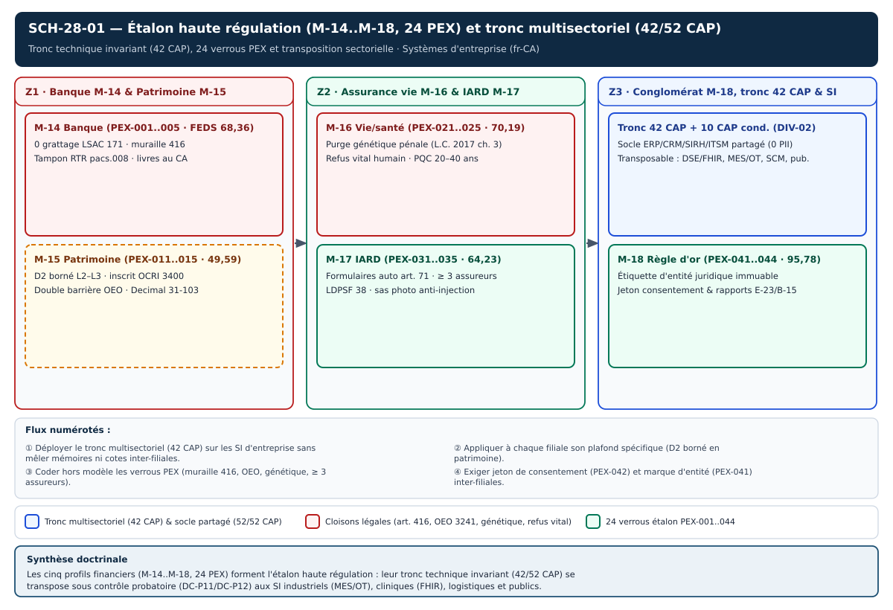
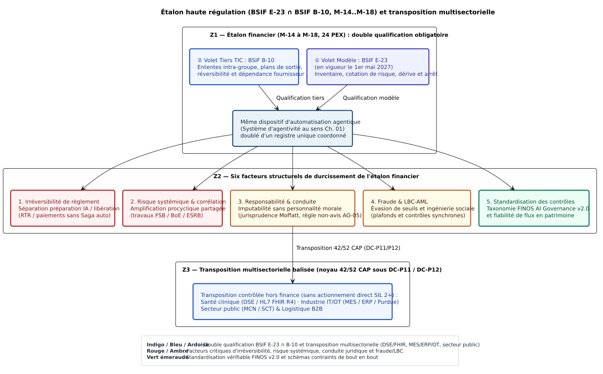
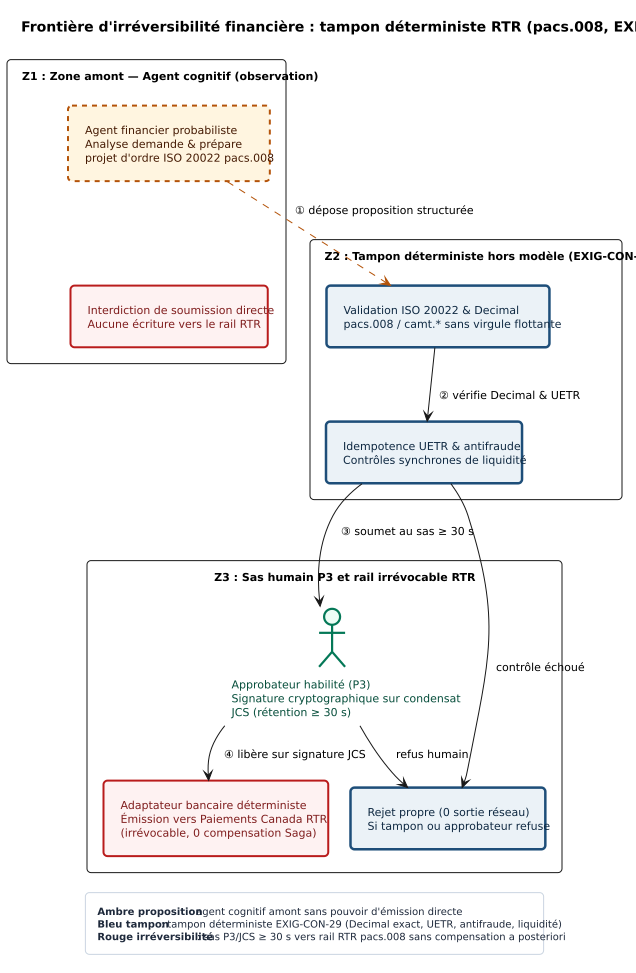
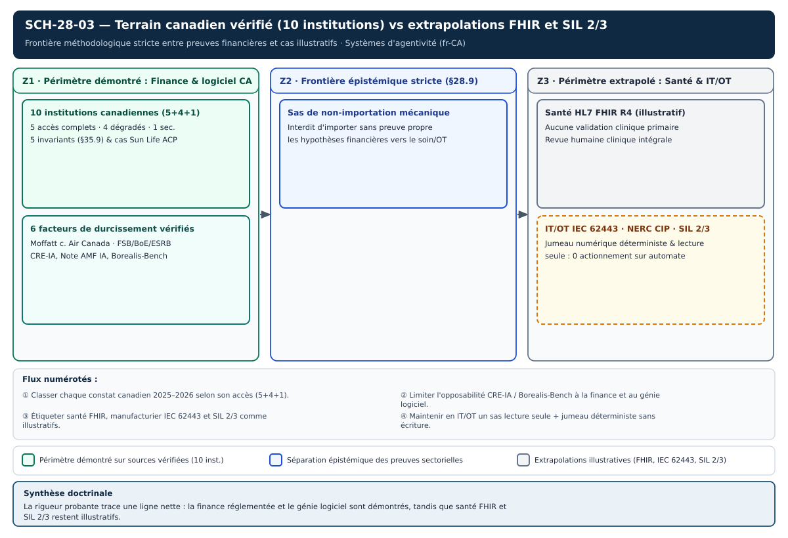

# Chapitre 28 — Matrice sectorielle des systèmes d'entreprise : étalon financier (M-14 à M-18, 24 PEX), sas d'irréversibilité et transposition multisectorielle

*Question directrice :* Comment décliner un noyau d'interopérabilité et d'automatisation invariant (42/52 capacités) sur les cinq profils financiers de haute régulation (M-14 à M-18, 24 PEX) tout en fournissant un cadre rigoureux de transposition aux systèmes d'entreprise industriels, cliniques, logistiques, publics et numériques sans excéder les preuves L+ disponibles ?

La dixième partie (`D10`) éprouve l'assemblage des huit domaines techniques et du socle juridique (`D09`, ← Chapitres 25 à 27) face à l'hétérogénéité réelle des systèmes d'entreprise. Plutôt que de juxtaposer des architectures ad hoc par industrie, le traité structure l'espace d'application en une **matrice à six verticaux d'entreprise** coiffée par un **étalon de haute régulation (*high-water mark*)** démontré sur pièces `L+` : les services financiers et assurantiels (`M-14` à `M-18`). Une banque, un courtier, un assureur, une usine manufacturière, un établissement clinique ou une administration partagent le même noyau technique d'interopérabilité et de contrôle tout en obéissant à des plafonds légaux ou physiques irréductibles à un modèle uniforme. Sous la clause `non-avis` (`AO-05`), les analyses qui suivent traduisent des textes primaires vérifiés en exigences d'ingénierie logicielle sans constituer une opinion juridique.

Le parcours suit trois étapes. La première section positionne la matrice à six verticaux autour du tronc invariant (`42/52 CAP`), puis décline les cinq profils financiers réglementés (`M-14` à `M-18`) et les vingt-quatre propositions d'exigence sectorielles (`PEX-001` à `PEX-044`) clôturant `DIV-02`. La deuxième section analyse les six facteurs de durcissement de l'étalon financier, formalise le **patron du sas déterministe pré-engagement** devant tout acte irréversible à partir du rail `RTR ISO 20022` (`EXIG-CON-29`, transposable aux ordres `ERP`/`EDI` et interfaces `OT`) et dresse le bilan empirique de dix institutions canadiennes (`2025–2026`). La troisième section définit enfin les règles de transposition vers les cinq autres verticaux d'entreprise sous le garde-fou épistémique strict `DC-P11`/`DC-P12`.

## 28.1 Matrice à six verticaux d'entreprise, étalon financier (M-14 à M-18) et 24 propositions PEX (DIV-02)

### 28.1.1 Étalon haute régulation sans re-dérivation (42/52 CAP), six verticaux et clôture de DIV-02

L'erreur la plus coûteuse en architecture d'entreprise consiste soit à bâtir une pile d'automatisation distincte par secteur ou ligne d'affaires, soit à plaquer sans discernement un agent générique sur des systèmes critiques. En vertu de la règle du maillon le plus élevé (← Chapitres 05 et 26, `EXIG-CON-02`), le Compendium étalonne son socle cible de `52` capacités (`CAP-001` à `CAP-052`, dont **`42` capacités invariantes du noyau possédé** et `10` capacités conditionnelles) sur le vertical cumulant la plus forte densité prudentielle, transactionnelle et fiduciaire vérifiable en `L+`, avant d'en dériver par paramétrage descendant et substitution d'interfaces les cinq autres grands verticaux de systèmes d'entreprise :

1. **Services financiers et assurances (étalon `L+` démontré, `M-14` à `M-18`)** : `Core Banking`, grands livres, gestion d'ordres `OMS` et systèmes sinistres vie/IARD, raccordés via `ISO 20022` (`Lynx`/`RTR`), `FIBO`, `ACORD`, `MISMO`, `CDM` et la façade `LSAC` (`CAP-026` [7]).
2. **Industrie manufacturière, énergie et `IT/OT`** : progiciels `ERP` (`SAP S/4HANA`), `MES`, `SCADA`, automates `PLC` et `EAM`, segmentés selon le modèle Purdue (`IEC 62443` en `statut F`) via `OPC UA` et `MQTT` derrière le sas lecture seule `CAP-028` (← Chapitres 12 et 14).
3. **Santé et sciences de la vie** : dossiers santé électroniques (`DSE`/`EHR`) et `LIMS` interopérant en `HL7 FHIR R4`, sous cloisonnement strict entre `LQ 2023, c. 5` (`RLRQ, c. R-22.1`) et `RLRQ, c. P-39.1` [1] et revue clinicienne obligatoire.
4. **Commerce, logistique et achats `B2B`** : chaînes *Source-to-Pay* (`ERP`), `WMS`, `TMS` et flux `EDI`, fédérés via `A2A v1.0.1`, `vLEI` et `ODRL 2.2` sous scission Diplomate/Évaluateur (`CAP-014`) et rapprochement tripartite (`EXIG-INT-22`, → Chapitre 29).
5. **Secteur public et parapublic** : registres administratifs et gestion des prestations encadrés par la proportionnalité d'autonomie (`MCN` `ANC-117`/`ANC-118`, `EIA` du `SCT`, ← Chapitre 25) et l'interopérabilité publique (`EIF`, `(UE) 2024/903`, ← Chapitre 26).
6. **Services numériques, télécoms et TI internes** : suites `CRM`, `ITSM`/`CMDB`, `SIRH` et `CI/CD` gouvernées par gravité des données (`ADR-015`, `≥ 85 %` local) et `SRE` sans `shell` libre (`PRR F-14`, → Chapitres 29 et 30).

À l'intérieur même de l'étalon financier — banque (`M-14`), patrimoine (`M-15`), assurance de personnes (`M-16`), dommages IARD (`M-17`) et conglomérat (`M-18`) — chaque entité réutilise sans re-dérivation les `42` capacités invariantes (passerelle `PEP`, `NHI`, mémoire `CoALA`, audit) et branche uniquement son ontologie métier (Chapitre 10) et ses verrous statutaires. Lors de l'unification documentaire, l'écart `DIV-02` signalait vingt-quatre propositions sectorielles (`PEX-001` à `PEX-044`) non raccordées à `CRE-IA-2026-01`. La clôture sur pièce contre la version `1.2` (`305` exigences, Chapitres 34 et 36) résorbe cet écart en `5` couvertures directes (ajout d'`EXIG-CON-27` à `29` et `EXIG-SEC-27` à `28`), `12` extensions et `7` comblements (remplaçant le bilan `13` / `11` de `v1.1`), couvrant la `LSAC` (`art. 171` [7]), l'article `416` de la *Loi sur les banques* [4], l'`OCRI`, la `NC 31-103` [6], la génétique, la `LDPSF` et le climat.

Sept paramètres gouvernent l'arbitrage d'autonomie sur tout système d'entreprise : données sensibles, réversibilité de l'acte, signataire habilité, délai réglementaire, rétention probatoire, responsabilité du mandataire et étanchéité inter-entités. En parallèle, l'évaluation artificielle `FEDS` (*Framework for Evaluation in Design Science*) du corpus interne (`dossier source Tome 4` et `Tome 5`, banc `Borealis-Bench` absent du disque) — bornée sous plafond documentaire `DC-C07 = 65,0 %` (distinct de `C01–C40`) — calibre la charge relative de contrôle entre `49,59 / 100` et `95,78 / 100`.

### 28.1.2 Banque (M-14, PEX-001–005) et gestion de patrimoine (M-15, PEX-011–015)

Le profil **Banque et coopératives de dépôt (`M-14`)** présente une charge `FEDS` calibrée à `68,36 / 100` (`PEX-001` à `PEX-005` : `1` directe, `2` extensions, `2` comblements en `v1.2`). Promulguée le `26 mars 2026` (`L.C. 2026, ch. 3`, `art. 224`), la `LSAC` prohibe à l'article `171` le grattage d'écran par identifiant client dès son entrée en vigueur par décret [7]. En réponse, `PEX-001` (comblement) bloque toute simulation de session usager et impose l'accréditation au registre de la Banque du Canada (`art. 44` [7]) sous `POR-008`, tandis que le projet de règlement de juin `2026` (`dossier source Tome 4`, hors `L+`) vise `99,5 %` de disponibilité ouverte.

Trois verrous complètent `M-14`. Premièrement, `PEX-002` (`EXIG-CON-06`) lie cryptographiquement chaque consentement exprès à un produit (`art. 627.08` [4]), conserve `7` ans les dossiers de plainte (`art. 627.44` [4]) et vise `5` ans pour les consentements ouverts (`dossier source Tome 4`, hors `L+`). Deuxièmement, `PEX-003` code hors modèle la muraille bancassurance de l'article `416` [4] et de `DORS/92-330` (`dossier source Tome 4`, hors `L+`), bloquant promotion et transfert de données hors des huit produits permis. Troisièmement, `PEX-005` maintient les livres au Canada (`art. 238` et `239` [4]), active les alertes sous `100 $ CA` (`art. 627.13` [4]), proscrit le terme « ombudsman » interne (`art. 627.43(2)` [4]) et applique le délai de `56` jours aux plaintes (`DORS/2021-181`, `dossier source Tome 4`, hors `L+`), tandis que `PEX-004` (`EXIG-CON-29`) verrouille `pacs.008` (§ `28.2.2`).

Le profil **Gestion de patrimoine et valeurs mobilières (`M-15`)** affiche une charge `FEDS` de `49,59 / 100` mais impose le plafond d'autonomie le plus strict sur le conseil (`D2`), confiné en `L1`–`L2` sans fédération externe. L'article `415` de la *Loi sur les banques* réservant le courtage aux inscrits hors exceptions [4], les cinq propositions `PEX-011` à `PEX-015` (`2` directes, `1` extension, `2` comblements) encadrent l'exécution. D'abord, `PEX-011` (`EXIG-CON-27`) rattache la convenance à une personne physique inscrite sous les règles `3400` et `1103(2)` de l'`OCRI` et l'Avis `11-348` (`dossier source Tome 4`, hors `L+`, `ciro.ca` et `securities-administrators.ca` en statut `F`), l'agent préparant la synthèse sans jamais valider seul la recommandation.

Sur les canaux sans conseils (*Order-Execution-Only*, `OEO`), `PEX-012` applique les règles `3240` et `3241` de l'`OCRI` (`dossier source Tome 4`, hors `L+`) en bloquant tout conseil personnalisé et tout ordre émis directement par un agent client externe. `PEX-013` (`EXIG-CON-28`) soumet les allégations IA à un superviseur, proscrit l'*AI washing* et archive `7` ans (`règles 3600` et `3803`, `dossier source Tome 4`). Enfin, `PEX-014` met en œuvre les amendements à la `NC 31-103` du `8 octobre 2026` interdisant les rétrofacturations (*chargebacks*) dès le `1er octobre 2028` (`2028-10-01`) [6], et `PEX-015` calcule en `Decimal` exact les frais quotidiens exigés depuis le `1er janvier 2026` (`dossier source Tome 4`, `ANC-101`, hors `L+`).

| Profil étalon | Charge FEDS (artificielle) | Propositions PEX et bilan DIV-02 (`v1.2`) | Ancrages juridiques et normes clés | Plafonds et verrous déterministes non négociables |
|---|---|---|---|---|
| `M-14` Banque et coopératives | `68,36 / 100` | `PEX-001` à `PEX-005` (`1` dir., `2` ext., `2` combl.) | `LSAC` art. `44`, `171` [7], *Loi sur les banques* art. `239`, `416`, `627.*` [4], `DORS/92-330` (repérage), `EXIG-CON-29`, `SIG-103`, `SIG-104`, `DISC-01`, `DISC-05` | Zéro grattage d'écran, muraille bancassurance hors modèle, cible ouverte `99,5 %` (`POR-008`), sas `RTR` `pacs.008`, livres au Canada, conservation `5` / `7` ans (`56` j) |
| `M-15` Gestion de patrimoine | `49,59 / 100` | `PEX-011` à `PEX-015` (`2` dir., `1` ext., `2` combl.) | `NC 31-103` [6], `OCRI 3400` / `3240` / `3241` / `3600` / `3803` (`statut F`, repérage), `EXIG-CON-27`, `EXIG-CON-28`, `SIG-105` | Conseil `D2` plafonné, convenance liée à un inscrit, double barrière `OEO`, fin des rétrofacturations le `1er octobre 2028` [6], calculs de frais en `Decimal`, archive `7` ans |

*Tableau 28.1 — Synthèse normative et architecturale des profils étalons `M-14` (Banque) et `M-15` (Gestion de patrimoine).*

### 28.1.3 Assurance de personnes (M-16, PEX-021–025) et assurance de dommages (M-17, PEX-031–035)

Le profil **Assurance de personnes (`M-16` : vie, invalidité, maladie, rentes)** atteint `70,19 / 100` en `FEDS` (`PEX-021` à `PEX-025` : `2` directes, `2` extensions, `1` comblement en `v1.2`). `PEX-021` applique hors modèle l'interdiction pénale de la *Loi sur la non-discrimination génétique* (`L.C. 2017, ch. 3`, repérage `dossier source Tome 4`, hors `L+`) en caviardant tout résultat ADN, ARN ou chromosomique avant `CoALA` ou inférence, tandis que `PEX-022` vérifie un consentement exprès distinct et borné avant toute requête au réseau sociosanitaire sous `LQ 2023, c. 5` (`dossier source Tome 4`, hors `L+`).

Côté décisionnel, `PEX-023` (`EXIG-AMF-12` et Loi 25 art. `12.1` [1]) proscrit tout refus d'assurabilité ou arrêt automatisé de prestation vitale sans examen humain qualifié, en convergence avec l'Annexe III point `5(c)` de l'*EU AI Act* [9]. `PEX-024` (`EXIG-AMF-06`) étend inventaire, homologation et preuve aux agents des agences générales (`MGA`), et `PEX-025` (`EXIG-SEC-27`, `EXIG-SEC-28`) chiffre par algorithmes post-quantiques la mémoire bi-temporelle sur `20` à `40` ans (`dossier source Tome 5`).

Le profil **Assurance de dommages IARD (`M-17`)** présente une charge `FEDS` de `64,23 / 100` (`PEX-031` à `PEX-035` : `3` extensions, `2` comblements en `v1.2`). `PEX-031` combine un profil pré-homologué d'élasticité catastrophique (`BSIF B-9` et `E-21`, repérage `dossier source Tome 4`, hors `L+`) lors de l'ouverture des sinistres (`FNOL`) avec l'interdiction de tout refus automatisé d'indemnisation hors d'un expert en sinistres certifié (`EXIG-AMF-12`, `Loi 25` art. `12.1` [1]). `PEX-032` interdit la rédaction libre de clauses automobiles et confine l'agent à l'assemblage déterministe des formulaires approuvés selon l'article `71` de la *Loi sur les assureurs* (`LQ 2018, c. 23`, repérage `dossier source Tome 4`).

En courtage indépendant, `PEX-033` (`EXIG-AMF-11`) journalise la collecte d'au moins `3` soumissions hors groupe financier prescrite par l'article `38` de la `LDPSF` (`dossier source Tome 4`, hors `L+`). `PEX-034` attribue des `NHI` révocables par cabinet partenaire (`BSIF B-10` [3]) et décontamine les photographies de sinistres contre les injections multimodales, tandis que `PEX-035` soumet les modèles externes de catastrophe à validation de deuxième ligne (`BSIF B-9`, `dossier source Tome 4`) et trace les émissions assurées pour l'exercice `2028` (`BSIF B-15` [10], signaux `SIG-109` et `SIG-110`).

### 28.1.4 Groupe diversifié (M-18, PEX-041–044) : mutualiser l'infrastructure, cloisonner les entités

Le cinquième profil, **Groupe financier diversifié (`M-18`)**, culmine à `95,78 / 100` en `FEDS` en mobilisant les `52/52` capacités cibles (`PEX-041` à `PEX-044` : `4` extensions en `v1.2`). Il matérialise le principe `PRI-010` et `CAP-021`, directement transposables à tout holding ou groupe d'entreprise multi-filiales : mutualiser une seule fois l'infrastructure technique — passerelles, moteur durable, `NHI` et observabilité — tout en maintenant des cloisons juridiques et sémantiques hermétiques par personne morale.

Techniquement, `PEX-041` (`EXIG-CON-06`) attache à chaque jeton, vecteur et écriture mémoire une étiquette immuable d'entité juridique appliquant hors modèle les murailles statutaires. Dès qu'un flux inter-filiales transporte des RP, `PEX-042` exige un jeton cryptographique lié à un consentement manifeste, libre, éclairé, spécifique et présenté distinctement selon la Loi 25 (`art. 9` modifiant `art. 53.1` [1]). En parallèle, dans la *Loi sur les banques*, le régime des apparentés (`art. 485.1` à `506`, Partie XI) impose des conditions de concurrence normale, plafonne sauf exception l'exposition envers un apparenté non institutionnel à `5 %` du capital réglementaire (`art. 495.2(1)`) et prohibe tout transfert de clientèle non autorisé [4].

Contractuellement, `PEX-043` soumet le socle mutualisé à des ententes intra-groupe conformes à `BSIF B-10` [3], qui inclut expressément sociétés mères et affiliées et exige un plan de sortie testable par filiale. Enfin, `PEX-044` (`EXIG-CON-25`) désagrège par personne morale les livres comptables (`art. 239` [4]), les inventaires de modèles (`BSIF E-23` [2] et repère `AMF` via la source secondaire `AIBanks.ca`, portail en statut `F` [5]) et les bilans climatiques (`BSIF B-15` [10]), tout en externalisant dans des politiques déclaratives les règles soumises à la révision statutaire du `30 juin 2033` (`2033-06-30`, `art. 21` [4]).

| Profil étalon | Charge FEDS (artificielle) | Propositions PEX et bilan DIV-02 (`v1.2`) | Ancrages juridiques et normes clés | Plafonds et verrous déterministes non négociables |
|---|---|---|---|---|
| `M-16` Assurance de personnes | `70,19 / 100` | `PEX-021` à `PEX-025` (`2` dir., `2` ext., `1` combl.) | `L.C. 2017, ch. 3` et `LQ 2023, c. 5` (repérage), `Loi 25` art. `12.1` [1], `EU AI Act` Ann. III [9], `EXIG-AMF-06`, `EXIG-AMF-12` | Purge génétique pénale pré-mémoire, consentement santé distinct, révision humaine sur refus vital, suivi `MGA`, chiffrement `PQC` `20`–`40` ans |
| `M-17` Assurance de dommages | `64,23 / 100` | `PEX-031` à `PEX-035` (`0` dir., `3` ext., `2` combl.) | *Loi sur les assureurs* art. `71` et `LDPSF` art. `38` (repérage), `BSIF B-9` / `E-21` / `B-10` [3] / `B-15` [10], `EXIG-AMF-11`, `SIG-109`–`110` | Élasticité catastrophique pré-homologuée, refus par expert certifié, formulaires auto déterministes, comparaison `≥ 3` assureurs hors groupe, sas photo |
| `M-18` Groupe diversifié | `95,78 / 100` (`52/52 CAP`) | `PEX-041` à `PEX-044` (`0` dir., `4` ext., `0` combl.) | `PRI-010`, `CAP-021`, `EXIG-CON-06`, `EXIG-CON-25`, `BSIF B-10` [3], *Loi sur les banques* (`art. 495.2`, `2033-06-30`) [4] | Mutualisation du plan technique sans données clients, étiquette d'entité immuable, jeton de consentement inter-filiales, ententes `B-10`, rapports désagrégés |

*Tableau 28.2 — Synthèse normative et architecturale des profils `M-16` (Assurance de personnes), `M-17` (Assurance de dommages) et `M-18` (Groupe diversifié).*

*Figure 100 — SCH-28-01 : Matrice sectorielle articulant l'étalon des cinq profils financiers réglementés (`M-14` à `M-18`, cotes `FEDS` calibrées et `24` verrous `PEX-001` à `PEX-044`, clôture `DIV-02`) autour du tronc technique invariant (`42/52 CAP`) transposable sous contrôle probatoire aux systèmes industriels, cliniques, logistiques et publics.*

> **Trois invariants exécutables — Chapitre 28**
> 1. **Noyau invariant `42/52 CAP` et cloisonnement multi-entités (`PRI-010`, `PEX-041` à `PEX-044`)** — Déployer une seule fois le tronc technique (passerelles, `NHI`, télémétrie) sous ententes intra-groupe `BSIF B-10`, tout en imposant une étiquette immuable d'entité juridique et un jeton de consentement exprès distinct avant tout échange inter-filiales.
> 2. **Sas déterministe pré-engagement devant tout acte irréversible (`EXIG-CON-29`, `PEX-004`)** — Interdire toute soumission directe par agent vers un `SoR` irrévocable dépourvu de compensation Saga ; sur l'étalon `Paiements Canada RTR` (`pacs.008`, transposable aux ordres `ERP`/`EDI` fermes et interfaces `OT`), imposer validation de contrat/`ISO 20022`, arithmétique `Decimal`, clé `UETR`, contrôles synchrones et signature `P3` sur condensat `JCS` avec rétention minimale de `30` secondes.
> 3. **Garde-fou épistémique strict (`DC-P11`/`DC-P12`)** — Attribuer chaque métrique à sa source datée, maintenir les portails bloqués en `statut F` sans contournement, et séparer le périmètre financier et logiciel démontré des patrons de transposition vers la santé (`HL7 FHIR R4` clinique, distinct de `M-16`), l'industrie `IT/OT` (`SIL 2/3` en lecture seule), la logistique et le secteur public.

## 28.2 Durcissement étalon, sas pré-engagement d'irréversibilité et terrain canadien 2025–2026

### 28.2.1 Six facteurs de durcissement de l'étalon financier et double qualification

Six facteurs convergents expliquent pourquoi la finance réglementée constitue la jauge maximale de durcissement architectural. Le premier tient à **l'irréversibilité et à la finalité du règlement** : virement instantané, ordre exécuté en bourse ou prestation versée créent un état définitif imposant de dissocier préparation probabiliste et libération déterministe ou humaine. Le deuxième relève du **risque systémique et de la corrélation** (`dossier source Tome 1 § 31.1`, hors `L+`) : le Conseil de stabilité financière (`FSB`), la Banque d'Angleterre (`BoE`) et le Comité européen du risque systémique (`ESRB`) soulignent que des agents partageant les mêmes modèles risquent d'amplifier la procyclicité et la concentration opérationnelle.

Le troisième facteur touche la **responsabilité juridique et de conduite** : l'affaire *Moffatt c. Air Canada* (`14 février 2024`, `650,88 $ CA` devant le *Civil Resolution Tribunal* de la Colombie-Britannique, repérage `dossier source Tome 1 § 31.1.3` sous régime `[C]` hors `L+`) rappelle qu'un agent sans personnalité juridique engage l'entreprise, imputabilité qui frappe tant la convenance que les portails commerciaux sous clause `non-avis` (`AO-05`). Le quatrième facteur forme le patron-signature du domaine : la **double qualification** simultanée d'un même dispositif d'automatisation agentique comme *modèle* (`BSIF E-23` [2]) et comme *actif tiers technologique* (`BSIF B-10` [3]).

Le cinquième facteur réside dans l'exposition à la **fraude et à la lutte contre le blanchiment (`LBC-AML`)**, où des agents mal bornés deviennent des vecteurs d'évasion de seuils. Le sixième porte sur la **standardisation ouverte des contrôles** illustrée par *FINOS AI Governance Framework v2.0* (`dossier source Tome 1 § 31.3.3`, hors `L+`), tandis que l'étude empirique de Milsom (`arXiv:2512.02230`) montre que les agents LLM en gestion de patrimoine achoppent moins sur le calcul arithmétique que sur la fiabilité de bout en bout des flux et la dérive d'autonomie, justifiant des schémas contraints [8].

*Figure 101 — SCH-28-04 : Patron étalon de double qualification (`BSIF E-23` ∩ `BSIF B-10`, `Z1`), six facteurs structurels de durcissement (`Z2`) et transposition balisée du noyau `42/52 CAP` sous `DC-P11`/`DC-P12` (`Z3`).*

### 28.2.2 Patron du sas déterministe pré-engagement devant acte irréversible : étalon RTR ISO 20022 (EXIG-CON-29) et transposition ERP/EDI/OT

Lorsque l'automatisation agentique approche une frontière physique, inter-entreprises ou monétaire irrévocable, la compensation a posteriori du patron Saga (← Chapitre 15) cesse d'opérer. L'exigence `EXIG-CON-29` (`CRE-IA-2026-01 v1.2`, novembre `2026`) formalise le **patron universel du sas déterministe pré-engagement** à travers son instanciation la plus stricte : le **Rail en temps réel (`RTR`) de Paiements Canada** (cible du `9 novembre 2026` et messages `ISO 20022` `pacs.008` / `camt.*` issus du repérage `dossier source Tome 2` et `Tome 4`, hors `L+`). Une fois un virement `pacs.008` réglé en quelques secondes — tout comme un avis d'expédition ou bon de commande `EDI` ferme émis par un `ERP`, une libération douanière ou une consigne industrielle hors jumeau — aucune transaction compensatoire automatique ne peut l'annuler.

En conséquence, `EXIG-CON-29` (`PEX-004`) interdit à tout agent probabiliste de détenir un droit d'écriture directe vers l'adaptateur `RTR` ou vers un tel système d'enregistrement irréversible. Confiné dans la zone amont d'observation et de préparation (`Z1` de la *Figure 102*), l'agent dépose un projet d'ordre structuré qui traverse un **tampon déterministe hors modèle** exécutant quatre contrôles synchrones bloquants :

1. **Validation contractuelle, sémantique et décimale exacte** : conformité au schéma `ISO 20022` (`EXIG-CON-29`, ou au schéma canonique `EDI`/`BAPI` sur un `ERP`) et conversion en arithmétique décimale exacte (`Decimal`, zéro flottant `IEEE-754`, `policy_saga/decimal_money.py` dans la trousse du Tome 8).
2. **Idempotence racine et corrélation `UETR`** : génération d'une clé d'idempotence liée à la référence unique de bout en bout (`UETR`, généralisée en `UUIDv7` inter-systèmes ← Chapitre 15) bloquant toute double émission sur reprise réseau.
3. **Contrôles synchrones de seuils, d'intégrité et de liquidité** : vérification déterministe des plafonds de contrepartie, listes de sanctions, soldes ou stocks allouables et vélocités horaires.
4. **Sas d'approbation `P3` lié au condensat `JCS`** : en vertu d'`EXIG-INT-22`, tout paiement déclenché par agent relève du palier `P3` (zéro paiement automatisé sans l'utilisateur). Sur `RTR` (`EXIG-CON-29`), au-delà du seuil institutionnel de matérialité ou de risque, l'approbateur signe hors bande le condensat canonique `RFC 8785` (`JCS`) exact du bénéficiaire, du compte et du montant, avec double approbateur en classe Élevée (`EXIG-AUT-15`), vérifié par `authz_pqc_audit/ciba_approval.py` (`CIBA`, unicité `jti`, expiration `≤ 15` minutes sous `EXIG-AUT-12`).

Temporellement, les trois premiers contrôles s'exécutent en quelques millisecondes dans la passerelle (`dossier source Tome 5`, hors latence humaine) avant toute ouverture réseau. En complément du mandat `P3` d'`EXIG-INT-22`, `EXIG-CON-29` impose sur `RTR` (`pacs.008`) — au-delà du seuil institutionnel — une **fenêtre de rétention minimale de `30` secondes** permettant d'avorter l'émission avant irrévocabilité, distincte de la validité de `15` minutes du jeton `CIBA` (`EXIG-AUT-12`). Tout échec, refus ou expiration (`exp ≤ now_ts`) produit un rejet propre à zéro sortie réseau. Par isomorphisme architectural, le même sas hors modèle protège dans les autres secteurs l'émission d'un bon de commande `EDI` ferme depuis un `ERP`, le déclenchement d'une expédition `WMS` irréversible ou la validation d'une recette de lot avant transfert vers un système d'exécution industriel `MES`.

*Figure 102 — SCH-28-02 : Patron du sas déterministe pré-engagement séparant la zone probabiliste amont (`Z1`), le tampon hors modèle `EXIG-CON-29` en arithmétique `Decimal` et `UETR` (`Z2`) et le sas humain `P3` sur condensat `JCS` avec rétention `≥ 30` s devant l'étalon `RTR` (`pacs.008`) et tout `SoR` irréversible (`ERP`/`EDI`/`OT`, `Z3`).*

### 28.2.3 Bilan empirique des dix institutions canadiennes (2025–2026)

Le recensement des communications publiques `2025–2026` de dix grandes institutions financières canadiennes — `TD` (`Layer 6`), `Scotiabank`, `RBC`, `Manuvie`, `Desjardins`, `CIBC`, `Intact`, `BMO`, `Sun Life` et `Banque Nationale` — impose une hygiène probatoire stricte : toutes les grandeurs publiées sont **auto-déclarées** sans audit technique indépendant et ne doivent jamais être sommées lorsque leurs unités diffèrent. Au recensement du `dossier source Tome 1` (Chapitre 35, hors `L+`), elles se répartissent en trois classes d'accès (`5 + 4 + 1`) : cinq en accès primaire direct (`TD`, `RBC`, `Desjardins`, `CIBC`, `Intact`), quatre en accès dégradé (`Scotiabank`, `Manuvie`, `BMO`, `Sun Life`) et une sans source primaire au gel du `Tome 1` (`Banque Nationale`, notée `69 / 100` dans l'index secondaire `AIBanks.ca` du `1er novembre 2026` [5]). Les portails `lautorite.qc.ca`, `ciro.ca` et `securities-administrators.ca` restent maintenus en `statut F` (`HTTP 403` sans contournement), compensés par les textes ouverts (`NC 31-103` via CVMO [6], lois fédérales [4, 7], Loi 25 [1], BSIF [2, 3] et `AIBanks.ca` sous réserve [5]).

| Institution canadienne | Classe d'accès (`5+4+1`, `dossier source Tome 1`) | Faits publics datés et attribués (`2025–2026`, repérage `dossier source Tome 1 § 35`) | Portée réelle et réserves probatoires obligatoires |
|---|---|---|---|
| `TD` (`Layer 6`) | Directe (`1`) | Communiqué du `21 mai 2026` : pré-adjudication hypothécaire et mémos pour souscripteurs (`~15 h` à `< 3 min`, résultat préliminaire) ; prix `DataIQ 2025` ; `5` critères de gouvernance | L'outil prépare et documente la décision pour le souscripteur humain sans architecture d'exécution publiée |
| `Scotiabank` | Dégradée (`2`) | Source de `juillet 2025` (retirée ensuite, corroborée par `MIT Sloan Management Review`) : plateforme de `2018` traitant `~90 %` de `~1 500` courriels/j (`60 000`–`70 000` demandes/mois) ; revue d'impact éthique préalable | Courriels et demandes ne s'additionnent pas ; aucune description d'architecture de mandat |
| `RBC` | Directe (`1`) | Communiqué du `18 février 2026` : groupe IA rattaché au chef de la direction ; `~27 000` et `8 000` utilisateurs déclarés sur `2` plateformes internes ; cible `700 M$`–`1 G$` d'ici `2027` ; `4` axes | Les deux populations (`27 000` et `8 000`) ne s'additionnent pas faute de périmètre disjoint documenté |
| `Manuvie` | Dégradée (`2`) | Communiqué conjoint du `10 mars 2026` (sur miroirs) : environnement d'exécution nommé « en bêta » ; cible `> 1 G$` d'ici `2027` (`~300 M$` fin `2025`) ; `1er` rang vie `Evident AI Index` (`juin 2026`) | Seule institution nommant une brique d'exécution, explicitement déclarée en bêta |
| `Desjardins` | Directe (`1`) | Rapport annuel `2025` audité : orientation stratégique `2026–2029` incluant IA générative et suite bureautique assistée | État d'intention stratégique formalisé (`dossier source Tome 1 § 35.5`) ; aucune métrique agentique de production déclarée |
| `CIBC` | Directe (`1`) | Communiqué du `27 mai 2025` : plateforme générative interne (`> 200 000 h` sur pilote `10` mois, formation requise) ; code volontaire fédéral (`mars 2025`) | **Fait négatif vérifié** : le communiqué décrit une assistance générative et exclut tout terme agentique |
| `Intact` | Directe (`1`) | Rapport annuel `2025` (`26 mars 2026`) : `> 600` experts, `~600` modèles, `> 200 M$` bénéfices annuels, `> 90 %` lignes personnelles tarifées par ML (`60 %` commerciales) | Industrialisation ML majeure sans emploi du vocabulaire agentique dans la lettre du dirigeant |
| `BMO` | Dégradée (`2`) | Communiqué du `17 juin 2025` (`lancement mai 2025`) : assistant d'accès aux politiques internes ; ateliers `Vector Institute` ; rubrique risque IA (`3 décembre 2025`) | Le chiffre `8 000` (employés selon concours distinct) ne figure pas au communiqué et reste à ré-instruire |
| `Sun Life` | Dégradée (`2`) | Communiqué du consortium du `7 juillet 2026` : programme phare de plan de contrôle agentique traitant `> 2` billions de jetons/mois entre membres | **Homonymie levée** : ce programme n'a aucun lien avec l'ancien protocole `ACP` ; aucune imputation individuelle possible |
| `Banque Nationale` | Aucune source primaire (`3`) | Aucune source primaire retenue au gel du `dossier source Tome 1` (notée `69 / 100` dans l'index secondaire tiers `AIBanks.ca` du `1er novembre 2026` [5]) | **Absence documentée** au `dossier source Tome 1`, non preuve d'inactivité ; la discrétion publique ne mesure pas l'état interne |

*Tableau 28.3 — Bilan documentaire des dix institutions financières canadiennes observées en `2025–2026` (classes d'accès `5+4+1`, repérage `dossier source Tome 1 § 35`).*

Deux enseignements structurants s'en dégagent pour tout directeur informatique. Premièrement, « le mot ne mesure pas la chose » : la `CIBC` opère une assistance générative massive sans le terme « agentique » et `Intact` industrialise `~600` modèles prédictifs sans ce lexique, quand d'autres rebaptisent « agents » de simples copilotes documentaires. Deuxièmement, les cinq institutions publiant un cadre de gouvernance (`TD`, `Scotiabank`, `RBC`, `Manuvie`, `CIBC`) convergent sur cinq invariants de façade (`dossier source Tome 1 § 35.9` : modèle, éthique, dirigeant nommé), mais aucune source publique examinée ne documente encore ni la *chaîne de mandat cryptographique* (`OBO`/`CIBA`), ni le *positionnement d'orchestration* (`OO1`–`OO4`) avant le butoir du `1er mai 2027` (`BSIF E-23` [2] et repère `AMF` via `AIBanks.ca` en statut `F` [5]).

## 28.3 Transposition multisectorielle aux systèmes d'entreprise et frontière probante (DC-P11/DC-P12)

Transposer cet étalon aux cinq autres verticaux d'entreprise consiste à conserver intacts les `42` mécanismes invariants du tronc (harnais, `PEP`, `OBO`, `Outbox`, `CoALA`, `SCITT`) tout en adaptant la sémantique et le sas pré-engagement aux lois propres de chaque domaine, sans jamais confondre analogie architecturale et preuve sectorielle (`DC-P11`, `DC-P12`) :

- **Périmètre démontré sur pièces (`BCA` et trousse exécutable)** : l'homologation complète couvre exclusivement la finance réglementée (`BCA`, `CRE-IA-2026-01 v1.2` et profil `AMF IA`) ainsi que le contrôle logiciel déterministe vérifié en barrière `G0` dans la trousse du `dossier source Tome 8` (`policy_saga`, `policies_opa`, `authz_pqc_audit`, `evalops_prr` : `83/83` tests `pytest` et `45/45` tests `OPA` à `100,0 %`). Elle s'appuie en complément sur les campagnes synthétiques `FEDS` des `dossier source Tome 4` et `Tome 5` (`Borealis-Bench`, absent du disque au `Tome 8`).
- **Santé et sciences de la vie (à titre illustratif hors homologation clinique)** : l'interopérabilité des dossiers santé électroniques (`DSE`/`EHR`) et `LIMS` emprunte `HL7 FHIR R4` (distinct du format assurantiel de `M-16`), en séparant strictement le régime hospitalier et clinique de `LQ 2023, c. 5` (`RLRQ, c. R-22.1`) du régime privé `RLRQ, c. P-39.1` [1]. À l'instar du verrou `PEX-023`, aucun résumé clinique ni projet d'ordonnance généré par un agent ne modifie le dossier patient sans revue intégrale et signature d'un clinicien habilité.
- **Industrie manufacturière, énergie et mines `IT/OT` (à titre illustratif hors certification sûreté)** : sur un site industriel tel que l'usine `BEL` de Trois-Rivières segmentée selon le modèle Purdue (`IEC 62443`) ou dans les environnements `NERC CIP` et `IEC 61511 SIL 2/3` (normes payantes en `statut F`), la frontière entre `ERP`/`MES` et réseaux `OT` (`OPC UA`, `MQTT Sparkplug`) demeure verrouillée par un sas unidirectionnel en **lecture seule** (`CAP-028`). Toute optimisation proposée par un agent est d'abord simulée sur un jumeau numérique déterministe et validée par un ingénieur de procédé, proscrivant formellement tout actionnement autonome direct sur automate `PLC`, soupape ou dispositif médical.
- **Commerce/logistique `B2B`, secteur public et services numériques/TI (à titre illustratif)** : dans les chaînes *Source-to-Pay* et `WMS`/`TMS`, le sas pré-engagement gouverne les commandes `EDI` fermes sous scission Diplomate/Évaluateur (`CAP-014`) et rapprochement tripartite (`EXIG-INT-22`, → Chapitre 29). Dans le secteur public, la proportionnalité d'autonomie (`MCN` `ANC-117`/`ANC-118`, `EIA` du `SCT`, ← Chapitre 25) régit l'instruction des dossiers administratifs sans lier les entreprises privées (`EF-06`), tandis que dans les TI internes les suites `CRM`, `ITSM`/`CMDB` et `SIRH` opèrent sous gravité des données (`ADR-015`) et remédiation `SRE` sans `shell` libre (`PRR F-14`).

*Figure 103 — SCH-28-03 : Démarcation probatoire (`DC-P11`/`DC-P12`) entre le bilan vérifié des dix institutions canadiennes (`5+4+1`, `6` facteurs de durcissement, `Z1`), le sas de transposition contrôlée (`Z2`) et les vignettes illustratives des systèmes d'entreprise en santé (`DSE`/`HL7 FHIR R4`, distinctes de `M-16`), en industrie `MES`/`ERP`/`OT` (`SIL 2/3` lecture seule), en logistique `SCM` et dans le secteur public (`Z3`).*

Ce dispositif à double détente — preuves réglementaires fermes au `1er mai 2027` (`BSIF E-23` [2], repère `AMF` sous réserve `statut F` [5]) et au `1er octobre 2028` (`NC 31-103` [6]) sur l'étalon financier, couplées à une méthode de transposition explicite du noyau `42/52 CAP` — évite aux équipes de réinventer l'architecture d'un secteur à l'autre. Le Chapitre 29 assemble désormais ces capacités en trois blueprints d'intégration des systèmes d'entreprise (`C01–C40`), résout la fédération multi-`SaaS` et active symétriquement les trois divisions du Groupe Boréal (`BEL`/`BCA`/`BSN`) sous le filtre probatoire `Borealis-Bench` (→ Chapitre 29).
