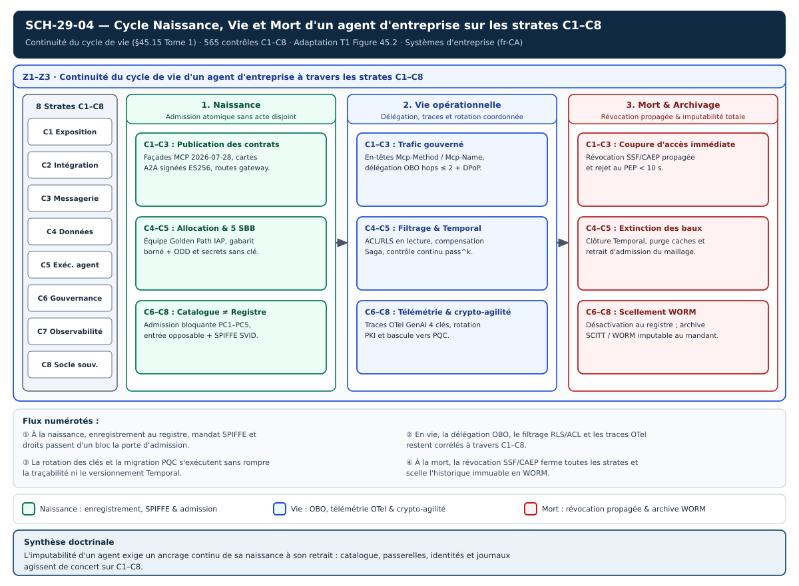
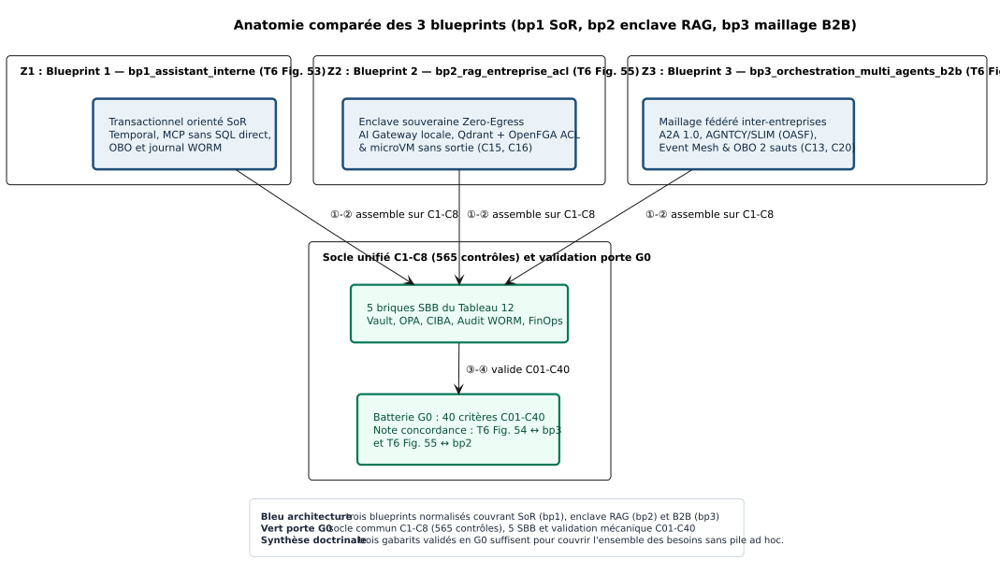
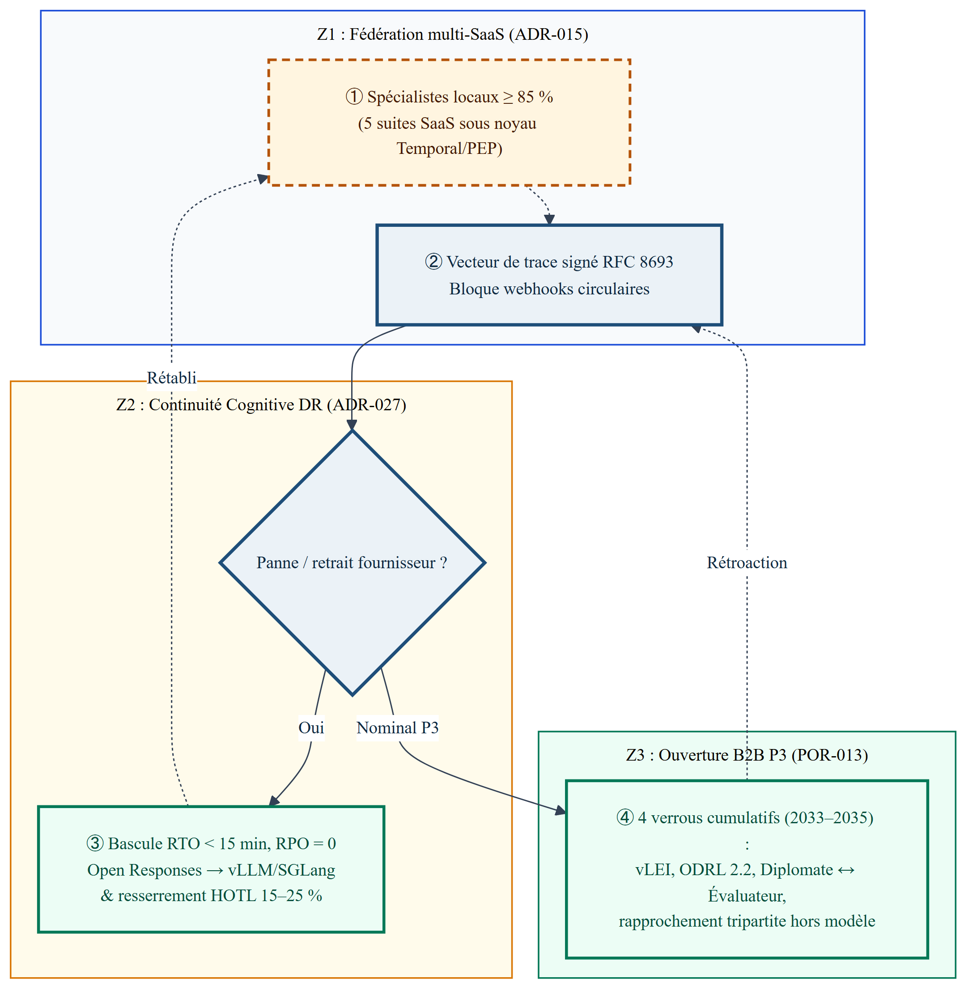
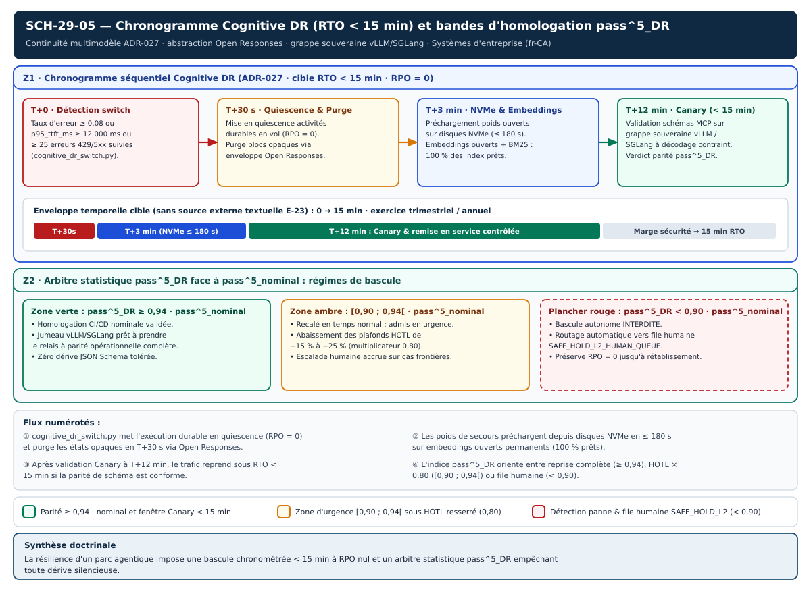
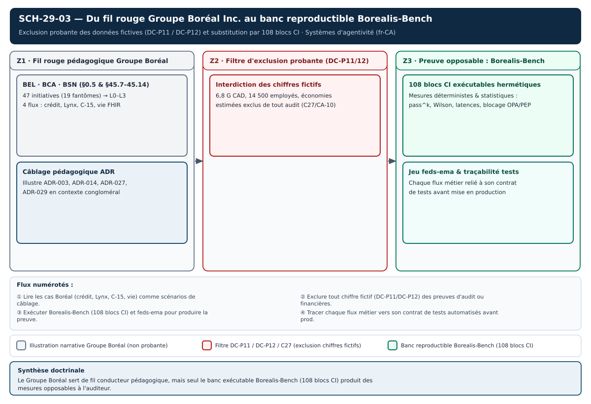

# Chapitre 29 — Trois blueprints d'intégration des systèmes d'entreprise (C01–C40), fédération multi-SaaS et cas multisectoriel Groupe Boréal (BEL/BCA/BSN)

*Question directrice :* Comment assembler le noyau de contrôle possédé en trois blueprints multisectoriels validables mécaniquement sur C01–C40, fédérer cinq suites d'entreprise par gravité des données sous reprise Cognitive DR et illustrer l'ensemble sur le conglomérat industriel, financier et numérique Groupe Boréal sans polluer le socle probatoire ?

La matrice sectorielle du Chapitre 28 demeurerait abstraite si chaque équipe devait réinventer l'assemblage des passerelles, des moteurs d'état durable, des enclaves vectorielles et des journaux d'audit devant ses progiciels. Le présent chapitre concrétise l'architecture de référence en trois **blueprints d'intégration des systèmes d'entreprise** couvrant la quasi-totalité des besoins métiers : l'assistant transactionnel interne sur systèmes d'enregistrement (`bp1_assistant_interne`), l'enclave souveraine à haute confidentialité avec recherche augmentée filtrée par habilitations (`bp2_rag_entreprise_acl`) et le maillage multi-agents fédéré inter-domaines et inter-entreprises (`bp3_orchestration_multi_agents_b2b`).

La démarche s'articule en trois volets. La première section unifie ces trois blueprints sur les huit strates d'outillage `C1–C8` (distinctes des cinq couches pivot `C1–C5` et des critères `C01–C40`, illustrées en `C8` par un portefeuille à `565` exigences), puis présente l'instanciation et la validation mécanique en barrière `G0` des `5` briques `SBB` du `Tableau 12` (*dossier source Tome 2*, Chapitre 35 et Annexe D) et de `C01–C40`. La deuxième section résout la fédération de cinq grandes suites `SaaS` par gravité des données (`ADR-015`), la reprise après sinistre cognitif visant `15` minutes (`ADR-027`) et les quatre verrous des réseaux `B2B` au Palier 3 (`POR-013`).

Enfin, la troisième section déploie symétriquement ces patrons sur les trois divisions du cas fil rouge **Groupe Boréal Inc.** — industrielle et logistique (`BEL`), financière et assurantielle (`BCA`) et numérique `B2B` (`BSN`) — tout en appliquant l'exclusion probante (`DC-P11`, `DC-P12`, règle `DC-C27`) qui substitue aux chiffres fictifs les `108` blocs CI de `Borealis-Bench` (*dossier source Tome 3*) et la trousse exécutable du *dossier source Tome 8*.

## 29.1 Trois blueprints multisectoriels (C01–C40, 5 SBB) et couche C1–C8

### 29.1.1 Socle C1–C8 à 565 contrôles, six principes et correspondance G0 (5 SBB, C01–C40)

Un blueprint d'intégration d'entreprise relie six principes directeurs à une pile déployable sur huit strates d'outillage (`C1` à `C8`, distinctes de `C1–C5` : exposition `API`, intégration applicative `ESB`, messagerie, données, exécution agentique, gouvernance des modèles, observabilité et socle souverain). Cet assemblage couvre l'ensemble du parc (`ERP`, `Core Banking`, `CRM`, `ITSM`, `SIRH`, `MES`) en s'ancrant dans le socle transversal de la `Loi 25` (art. `12.1` [6]) complété par six repères de l'étalon financier canadien (`BSIF E-23` [5], `BSIF B-13`, profil `AMF IA`, `ACVM 11-348`, banque ouverte et rails de paiement). Les six principes (`Tableau 45.1` du *dossier source Tome 1*) imposent l'autonomie encadrée par processus déterministe (`OO3` ou `OO4`), le transit par passerelle de politiques, la republication des contrats existants plutôt que leur réécriture, la résidence canadienne (illustrée en `C8` par un cadre d'éditeur à `565` exigences), la traçabilité hors agents et la gouvernance continue des modèles.

Conformément à la neutralité fournisseur (`dossier source Tome 1 § 45.3`), la référence datée sur `C1–C8` illustre des briques techniques sans recommandation commerciale : `IBM API Connect` (`v10.0.8` en disponibilité générale), `IBM ContextForge` (annoncé sans disponibilité générale établie), `IBM App Connect Enterprise` (`v13.0`) et `IBM MQ 9.4 LTS` (`TLS 1.3` post-quantique `ML-KEM` auto-déclaré, non vérifié). Elle associe ensuite `IBM Data Fabric`, `IBM watsonx Orchestrate` / `IBM Granite 4.0`, `IBM watsonx.governance` (disponibilité générale), `IBM Instana` (observabilité d'agents en préversion publique) et `IBM Sovereign Core` (disponibilité générale du `5 mai 2026`). L'éditeur ne revendique aucune conformité native à `E-23` ou `B-13`, ces `565` exigences n'équivalant pas à `B-13`, et le seul lien documenté porte sur son rôle d'opérateur des rails de paiement canadiens. Tout portefeuille tiers respectant les mêmes contrats d'interface demeure intégralement substituable.

Pour vérifier mécaniquement ces trois architectures avant raccordement aux progiciels centraux, la trousse du *dossier source Tome 8* matérialise les **cinq blocs de construction de solution (`5 SBB`)** laissés sans exemple au `Tableau 12` du *dossier source Tome 2* (Chapitre 35 et Annexe D). Trois opèrent dans le `Plan A` : `secrets_vault` (`authz_pqc_audit/obo_dpop.py` sans secret statique), `guardrails_engine` (`policy_saga/opa_runner.py` avec `policies_opa/rule_of_two.rego`) et `signed_human_approval_service` (`authz_pqc_audit/ciba_approval.py`). Deux opèrent dans le `Plan B` : `immutable_audit_ledger` (`authz_pqc_audit/audit_scitt_focus.py`) et `finops_budget_quota_controller` (`policy_saga/decimal_money.py` et `audit_scitt_focus.py`).

Dans `evalops_prr/prr_validators.py`, `validate_blueprints_and_c40` vérifie via `REQUIRED_BLUEPRINT_IDS` et `REQUIRED_5_SBB_SLOTS` que chaque blueprint renseigne ces cinq `SBB` et couvre `C01–C40`, tandis que les validateurs voisins contrôlent les schémas JSON `Draft 2020-12` (`prr_24_evidence.schema.json`, `adr_2027_b001.schema.json`, `sandbox_manifest.schema.json` dans `policy_saga/sandbox_manifest.py`). Au gel du `2 décembre 2026`, le rapport scellé `G0` atteste `83/83` tests `pytest`, `50/50` vecteurs tiers et `45/45` tests `OPA` couvrant à `100,0 %` les trois politiques `Rego` en mode fermé (`default allow := false` [7]).

Le contrôle de cohérence interne (`dossier source Tome 1 § 45.15`) impose en outre la continuité du cycle de vie complet — naissance, vie et mort — sur `C1–C8` : émission de jetons vérifiables dès l'inscription au catalogue, exécution coordonnée de `RFC 8693`, de l'autorisation par arête, d'`OpenTelemetry` et de la rotation post-quantique, puis propagation immédiate des révocations afin que l'archive conserve une imputabilité intacte.

| Emplacement SBB (`Tableau 12`, Tome 2) | Plan d'appartenance | Module exécutable (`trousse/`) | Propriété mécanique vérifiée à la porte `G0` |
|---|---|---|---|
| `secrets_vault` | `Plan A` | `authz_pqc_audit/obo_dpop.py` | Aucun secret statique ; échange `RFC 8693` lié `DPoP` avec rejet du relais passif de jeton |
| `guardrails_engine` | `Plan A` | `policy_saga/opa_runner.py` + `policies_opa/rule_of_two.rego` | Évaluation déterministe hors modèle en mode fermé (`default allow := false`) [7] |
| `signed_human_approval_service` | `Plan A` | `authz_pqc_audit/ciba_approval.py` | Approbation hors bande `CIBA`/`FIDO2` liée au condensat canonique `JCS` exact |
| `immutable_audit_ledger` | `Plan B` | `authz_pqc_audit/audit_scitt_focus.py` | Journal chaîné scellé `SCITT` et signature post-quantique `SLH-DSA` |
| `finops_budget_quota_controller` | `Plan B` | `policy_saga/decimal_money.py` + `audit_scitt_focus.py` | Comptabilisation décimale exacte et imputation `FOCUS` au résultat conforme |

*Tableau 29.1 — Instanciation exécutable des cinq briques `SBB` du `Tableau 12` (*dossier source Tome 2*) validées mécaniquement à la porte `G0`.*

*Figure 104 — SCH-29-04 : Continuité du cycle Naissance, Vie et Mort sur les strates `C1–C8` (`§ 45.15` du Tome 1).*

### 29.1.2 Blueprint 1 : traitement transactionnel réglementé orienté SoR (bp1_assistant_interne)

Le **Blueprint 1 (`bp1_assistant_interne`)** gouverne les mutations internes réglementées sur les *Systems of Record* (`SoR`) — ordres et réceptions `ERP` (`SAP S/4HANA`), mouvements `SIRH` (`Workday`), changements de production `ITSM` (`ServiceNow`), pré-adjudication de crédit ou règlement de sinistres — soumises à la Loi 25 (art. `12.1` [6]) et, en finance, à `BSIF E-23` [5] (`§ 14.1` du *dossier source Tome 6*). Le processus déterministe y commande à l'agent sur quatre plans découplés :

- **Plan 1 (`SoE` — engagement utilisateur)** : l'interface métier présente la situation courante du dossier, l'aperçu structuré des écritures projetées vers le `SoR`, les motifs déterministes versionnés et les pièces justificatives nécessaires à un examen humain effectif.
- **Plan 2 (`SoA` — automatisation agentique)** : `Temporal` exécute `80 %` du flux en code déterministe (seuils, minuteries, compensations) et isole les `20 %` cognitifs dans des activités bornées sous `JSON Schema` strict.
- **Plan 3 (Données et Outils)** : la passerelle `MCP` unifiée (`agentgateway`) applique `OPA` [7], l'idempotence `idem-v1` et l'échange `OAuth 2.0/2.1 OBO` (`RFC 8693`) devant une couche anti-corruption `CQRS` alimentée par `CDC`.
- **Plan 4 (Confiance et Audit)** : les identités `SPIFFE/SPIRE` s'associent à `OpenTelemetry GenAI` expurgé et à un stockage immuable `WORM`.

En exploitation, aucune écriture `SQL` directe n'atteint le `SoR`, et la projection de lecture `CQRS` alimentée par capture de changements (`CDC`) absorbe les requêtes d'exploration de l'agent sans dégrader les verrous transactionnels de l'`ERP` ou du système bancaire central. Chaque appel respecte `MCP` révisé au `28 juillet 2026` — validation des schémas d'entrée/sortie et caractère non fiable des annotations d'outils [4], complétés en porte `G0` par `Mcp-Method`, `Mcp-Name` et le mode *Stateless Streamable HTTP* (← Chapitre 07, `DISC-05`) — avec atténuation monotone des portées. Lors d'une attente d'approbation `CIBA` ou de pièce multi-jours, `Temporal` met l'instance en veille durable et protège les dossiers en vol via *Worker Versioning* (`Pinned`) ; après l'action pivot, les compensations s'exécutent en ordre inverse sur canal isolé (`EXIG-ORC-28`), avec cible de réplication synchrone `3-AZ` (`RPO = 0`) et bascule multi-régions pour les flux critiques (`dossier source Tome 6 § 14.1.3`). Ce gabarit garantit un `OPEX` prévisible par capacité réservée et laisse les équipes alignées sur les flux métiers livrer leurs façades `MCP` en consommant la plateforme interne comme service.

### 29.1.3 Blueprint 2 : enclave souveraine Zero-Egress et RAG ACL (bp2_rag_entreprise_acl)

Le **Blueprint 2 (`bp2_rag_entreprise_acl`)** répond aux exigences de confidentialité maximale — secrets industriels, plans d'ingénierie, fusions-acquisitions, dossiers cliniques, défense ou RP sensibles en régime `Silo` sous la Loi 25 [6] — où aucun jeton ni fragment documentaire ne doit quitter le périmètre interne vers une `API` publique (*Zero Egress*). **Concordance impérative inter-tomes :** la section `14.3` du *dossier source Tome 6* nommait ce patron « Blueprint 3 », alors que la trousse du *dossier source Tome 8* l'identifie sous `bp2_rag_entreprise_acl`, établissant la correspondance bijective `Tome 6 § 14.3 ↔ bp2` (reprise au Chapitre 36).

Pour parer l'exécution de code arbitraire (`OWASP ASI05` [8]), les fuites vectorielles inter-locataires (`ASI06` [8]) et la mutualisation infonuagique, l'enclave combine trois verrous. D'abord, une `AI Gateway` locale route les requêtes par affinité de préfixes (`Endpoint Picker` sur `llm-d` / `vLLM` ou conteneurs hors ligne `NVIDIA NIM`) au sein d'enclaves `CPU AMD SEV-SNP` / `Intel TDX` et `GPU TEE` sous attestation distante. Ensuite, le pipeline `RAG` résout les permissions avec `OpenFGA` (`ListObjects`) *avant* toute recherche vectorielle dans `Qdrant` partitionné (`is_tenant` / `Silo`) et `PostgreSQL RLS` en refus par défaut (`ACL` `OPA` `C16` et suivi de teinte `C15`, ← Chapitre 20), empêchant qu'un document non autorisé n'entre dans la fenêtre de contexte ou ne révèle son existence.

Enfin, le code analytique généré pour exploiter des tables financières ou télémétriques s'exécute dans des `microVM` éphémères (`Firecracker` ou `Kata Containers` sous `agent-sandbox` à bassins pré-chauffés, *Zero Egress*) visant les seuils `Firecracker` rapportés au cadre (`dossier source Tome 6 § 14.3.4`, hors `L+` : démarrage `≤ 125 ms`, surcoût `< 5 MiB`, `> 95 %` du CPU natif). Sur le plan économique, ce profil remplace la facturation externe variable aux jetons par un `CAPEX` GPU/RAM maîtrisé (`ADR-031`), assorti d'une veille chaude active-passive des magasins d'état (`PostgreSQL`, `Qdrant`, `OpenFGA`, `SPIRE`).

### 29.1.4 Blueprint 3 : maillage inter-départemental et B2B (bp3_orchestration_multi_agents_b2b)

Le **Blueprint 3 (`bp3_orchestration_multi_agents_b2b`)** gouverne les chaînes de valeur transversales et les échanges inter-entreprises — approvisionnement *Source-to-Pay*, litiges fournisseurs, logistique douanière, télématique partenaire ou coopération entre divisions autonomes — sans jamais exposer à l'extérieur un serveur `MCP` ni une mémoire interne. **Par symétrie, la concordance exacte impose la permutation `Tome 6 § 14.2 ↔ bp3`** avec la trousse du *dossier source Tome 8*.

Ce blueprint superpose deux strates complémentaires. Sur la **strate macro-réglementaire fédérée**, un gestionnaire de processus durable orchestre les jalons et engagements contractuels (`SLA`) via `Agent2Agent` (`A2A v1.0.1`, critères `C13`–`C14`) [2], l'annuaire `AGNTCY` (`OASF`, `ADS`, messagerie `SLIM` sur chiffrement de groupe `MLS` par connexions sortantes uniquement) et la délégation `OAuth 2.0/2.1 OBO` bornée à deux sauts (`C24` `CIBA`, `C26` révocation ← Chapitre 17 ; `C27` couvrant `pqc_http431` ← Chapitre 18), sur fiches répliquées adressables par contenu.

Sur la **strate intra-domaine chorégraphiée**, un `Event Mesh` (`Solace DMR` ou `Kafka Cluster Linking`) transporte des enveloppes `CloudEvents` typées sous contrats `AsyncAPI 3.0` avec journal chaîné (`AuditChainLedger`, `C20` ← Chapitre 24), durée de vie `ce_ttl`, files de reprise et `DLQ`. L'architecte y arbitre explicitement entre réplication synchrone (`RPO = 0`) pour les ordres d'achat ou règlements fermes et réplication asynchrone à décalages préservés pour les flux télémétriques à fort débit. À la frontière, toute `AgentCard` ou pièce jointe entrante est traitée comme non fiable, filtrée contre `SSRF` [2] et injections indirectes [8] et interrompue via `CancelTask` [2] sur dépassement de délai ou d'enveloppe `FinOps`, tandis que la passerelle pallie les lacunes de `a2a-tck` (`1.0.0.alpha3`, `CARD-SIGN-001` à `004` `NOT_AUTOMATABLE` sans vecteurs `a2a-jcs-v01` [3]).

En synthèse, l'entreprise ventile ses cas sur `bp1` (mutations `SoR`), `bp2` (corpus souverains *Zero Egress*) et `bp3` (maillage multi-entités `B2B`) au-dessus d'un socle unique (`SPIFFE`, `OpenTelemetry`, `OPA` [7]).

| Blueprint (`dossier source Tome 8`) | Concordance `dossier source Tome 6` | Systèmes d'entreprise cibles et critères clés | Pile technique et protocolaire principale | Garants de sécurité et de résilience |
|---|---|---|---|---|
| `bp1_assistant_interne` | `§ 14.1` (Tome 6) | Mutations réglementées sur `SoR` (`ERP`, `SIRH`, `ITSM`, crédit/sinistres ; `L2`–`L3`, `C01`–`C40`, `DIV-02`) | `Temporal HA` (`80/20`), passerelle `MCP` [4], `OAuth OBO`, `CQRS`/`CDC`, `WORM` | Zéro `SQL` direct, *Worker Versioning Pinned*, réplication `3-AZ` (`RPO = 0`), approbation `CIBA`/`JCS` |
| `bp2_rag_entreprise_acl` | **`§ 14.3` (Tome 6)** | Enclave souveraine haute confidentialité (`GED`/R&D/clinique/RP `Silo` ; `C15` teinte, `C16` ACL `OPA`, `C01`–`C40`, `ADR-031`) | `AI Gateway` locale, `llm-d`/`vLLM`/`NIM CoCo`, `OpenFGA ACL`, `Qdrant`, `PostgreSQL RLS`, `microVM` | *Zero Egress*, attestation `TEE`, filtrage `ACL` pré-prompt, cibles `Firecracker` `≤ 125 ms` (`≤ 5 MiB`) |
| `bp3_orchestration_multi_agents_b2b` | **`§ 14.2` (Tome 6)** | Maillage inter-domaines et `B2B` (`SCM`/*Source-to-Pay*/partenaires ; `C13`–`C14` `A2A`, `C20` audit, `C24`/`C26` `OBO`, `ADR-018`, `C01`–`C40`) | `Process Manager`, `A2A v1.0.1` [2], `AGNTCY` (`OASF`/`SLIM`/`MLS`), `Event Mesh` (`CloudEvents`) | Opacité `MCP`, anti-`SSRF` [2], `CancelTask` [2], plafond `ce_ttl`, `OBO` `2` sauts, contrôle tiers `a2a-tck` [3] |

*Tableau 29.2 — Matrice comparative des trois blueprints d'intégration (`bp1` à `bp3`), concordance `Tome 6 ↔ Tome 8` et propriétés vérifiées.*

*Figure 105 — SCH-29-01 : Comparaison des blueprints `bp1_assistant_interne` (`Z1`, `Tome 6 § 14.1`), `bp2_rag_entreprise_acl` (`Z2`, `Tome 6 § 14.3`) et `bp3_orchestration_multi_agents_b2b` (`Z3`, `Tome 6 § 14.2`) assemblés sur les strates `C1–C8` (socle d'illustration à `565` contrôles), les `5 SBB` du `Tableau 12` (Tome 2) et la validation mécanique `C01–C40` en `G0`.*

> **Trois invariants exécutables — Chapitre 29**
> 1. **Validation mécanique des blueprints et permutation explicite (`C01–C40`, `5 SBB`)** — Aucun gabarit `bp1`, `bp2` ou `bp3` n'est recevable sans renseigner les `5` emplacements `SBB` du `Tableau 12` (Tome 2) et couvrir `C01` à `C40` dans `evalops_prr/prr_validators.py`, en respectant le mappage `Tome 6 § 14.2 ↔ bp3` et `Tome 6 § 14.3 ↔ bp2`.
> 2. **Gravité locale, continuité bimodèle et sas B2B Palier 3 (`ADR-015`, `ADR-027`, `POR-013`)** — Exécuter `≥ 85 %` des invocations `SaaS` près de leur `SoR` avec vecteur signé anti-boucle, maintenir une bascule `Cognitive DR` vers `vLLM`/`SGLang` visant `RTO < 15` minutes (`RPO = 0`, seuils `HOTL` resserrés de `15` à `25 %`) et verrouiller le `B2B` de Palier 3 par `vLEI`, `ODRL 2.2`, scission Diplomate/Évaluateur et rapprochement tripartite.
> 3. **Activation tricéphale et exclusion probante du Groupe Boréal (`DC-P11`, `DC-P12`, `DC-C27`, `CA-10`)** — Illustrer l'intégration multisectorielle sur les trois divisions de `Groupe Boréal Inc.` (`BEL` industrie/logistique, `BCA` finance/assurances, `BSN` services numériques `B2B`) tout en frappant d'exclusion `100 %` de ses grandeurs fictives (`6,8 G$ CAD`, `14 500` employés). Seuls font foi les `108` blocs CI de `Borealis-Bench` (*dossier source Tome 3*, dont `90` exécutés en CI incluant `9` modules Python) et la trousse exécutable du *dossier source Tome 8*.

## 29.2 Fédération multi-SaaS, reprise Cognitive DR et réseau B2B Palier 3

### 29.2.1 Fédération des cinq suites SaaS par gravité des données (ADR-015)

Une grande entreprise cohabite simultanément avec cinq suites applicatives majeures : `Salesforce Agentforce` (`CRM`), `ServiceNow` (`ITSM`/`FSM`), `SAP Joule` sur `S/4HANA` (`ERP` et grand livre), `Microsoft Copilot Studio` (bureautique) et `Workday` (`SIRH`). Laisser ces « jardins clos » s'appeler latéralement engendre un maillage quadratique ingouvernable et la fuite d'invariants fiscaux ou de confidentialité (tels les dossiers salariaux `Workday` sous la Loi 25 [6]).

La décision `ADR-015` impose la **fédération gouvernée par gravité des données** (`Z1` de la *Figure 106*), évaluant l'affinité selon la part d'écritures, d'invariants critiques et d'obligations de résidence portés par chaque `SoR` :

- **Localité intra-domaine (`≥ 85 %` d'appels locaux)** : une tâche cantonnée à un seul `SoR` s'exécute localement dans le spécialiste natif de cette suite, préservant permissions fines et crédits unitaires `SaaS`.
- **Enrichissement ponctuel en lecture** : la lecture d'un statut voisin transite par la passerelle neutre `agentgateway` et un serveur `MCP` en lecture seule, sans transfert d'orchestration.
- **Élévation au plan de contrôle neutre (`< 15 %` de flux trans-plateformes)** : dès qu'un flux mute au moins deux silos, exige une saga compensatoire ou engage un contrôle prudentiel (`BSIF E-23` [5]), la coordination remonte vers le noyau possédé (`Temporal` et `agentgateway`).

Ce plan neutre propage l'identité de bout en bout depuis `Microsoft Entra ID` vers `Salesforce` et `SAP Cloud Identity Services` (`SAP CIS`) via `OAuth 2.0/2.1 OBO` (`RFC 8693`) sans aucun compte technique partagé (`dossier source Tome 3 § 27.8`). Pour parer la tempête de facturation en crédits propriétaires lorsqu'un événement `CRM` déclenche un ticket `ITSM` qui rappelle en retour l'`ERP`, chaque enveloppe embarque un vecteur de trace signé par `HMAC` consignant la liste ordonnée des suites déjà traversées et le compteur de sauts : toute réentrance circulaire vers une suite déjà présente dans le vecteur coupe instantanément le webhook en passerelle.

*Figure 106 — SCH-29-02 : Boucle de stabilité d'un parc fédéré articulant l'ancrage local par gravité des données (`Z1`, `ADR-015`), la bascule souveraine `Cognitive DR` visant un `RTO < 15` minutes (`Z2`, `ADR-027`) et les quatre verrous du sas `B2B` au Palier 3 (`Z3`, `POR-013`).*

### 29.2.2 Reprise après sinistre cognitif (Cognitive DR, ADR-027)

Basculer à chaud vers un modèle à poids ouverts d'une autre famille lors d'une panne, saturation tarifaire ou dépréciation d'un fournisseur frontière altère la verbosité et brise les schémas `JSON` des appels `MCP`. La décision `ADR-027` (`Cognitive DR`, contrôles `F-07` et `R-11`, `dossier source Tome 3 § 46.11–46.13`) institue donc une continuité cognitive testée par exercice trimestriel (ou au moins annuel), autour d'une cible de conception interne sans source externe de `RTO < 15` minutes et `RPO = 0`, soutenue par quatre mécanismes (`Z2` de la *Figure 106*) :

1. **Enveloppe `Open Responses` et purge des états opaques** : aucun code métier n'importe un kit propriétaire ; sur incident, l'adaptateur écarte les blocs de délibération chiffrés du fournisseur défaillant et reconstruit le contexte à partir du journal canonique des événements et réponses d'outils validées.
2. **Double profil précompilé en CI/CD** : chaque agent critique maintient un profil nominal et un profil jumeau sur grappe souveraine (`vLLM` ou `SGLang`, décodage contraint `MCP`). Sous `ADR-027` (`dossier source Tome 3 § 46.11`), l'homologation exige `pass^5_DR ≥ 0,94 · pass^5_nominal` ; la bande `[0,90 · pass^5_nominal ; 0,94 · pass^5_nominal[` est recalée en nominal mais admise en secours (`cognitive_dr_switch.py`) sous plafonds `HOTL` resserrés (`−15 %` à `−25 %`, facteur `0,80`), tandis que `< 0,90 · pass^5_nominal` dévie vers la file humaine (`SAFE_HOLD_L2_HUMAN_QUEUE`).
3. **Embeddings internes ouverts et préchargement `NVMe`** : l'indexation vectorielle utilise dès l'origine un modèle multilingue ouvert interne (couplé à `BM25`) gardant `100 %` des index interrogeables sans réindexation, avec poids de relève préchargés sur `NVMe` sous `180` secondes.
4. **Resserrement prudentiel `HOTL`** : sur la grappe de secours, le moteur de politiques abaisse de `15` à `25 %` les plafonds d'engagement autonome sans perte transactionnelle (`RPO = 0`).

Le chronogramme cible `RTO ≤ 15` min (`dossier source Tome 3 § 46.11`, *Figure 107*) enchaîne : (1) détection (`cognitive_dr_switch.py` : taux d'erreur `≥ 0,08`, `p95_ttft_ms ≥ 12 000` ou `≥ 25` erreurs `429`/`5xx`), quiescence `Temporal` (`RPO = 0`) et purge `Open Responses` (`T + 30 s` en gabarit) ; (2) bascule passerelle et préchargement `NVMe` (`≤ 180` s, `T + 3 min`) ; (3) validation *Canary* distinguant `[0,90 · pass^5_nominal ; 0,94 · pass^5_nominal[` (`HOTL` à `0,80`) et `< 0,90 · pass^5_nominal` (file humaine, `T + 12 min`). Ce budget cible instrumente la résilience opérationnelle et la maîtrise des tiers attendues par `BSIF E-23` [5] (avec `BSIF B-10`), sans que ni les `15` minutes ni la cadence d'exercice ne figurent textuellement dans `E-23` [5].

Dans un parc multisectoriel d'entreprise, cette bascule `Cognitive DR` protège uniformément la continuité des commandes logistiques sur l'`ERP`, le traitement des incidents critiques dans l'`ITSM` et l'instruction des dossiers financiers ou assurantiels. Plutôt que de figer l'activité métier lorsqu'une région d'inférence externe subit une panne prolongée ou révoque un modèle sous préavis court, le plan de contrôle durable conserve chaque transaction en attente exacte et reprend l'exécution sur la grappe interne avec des contrats `MCP` identiques.

*Figure 107 — SCH-29-05 : Chronogramme `Cognitive DR` (`T+30 s`, `T+3 min`, `T+12 min`) et trois bandes `pass^5_DR` (`ADR-027`).*

### 29.2.3 Ouverture conditionnelle aux réseaux B2B fédérés au Palier 3 (POR-013)

L'automatisation inter-organisations entièrement fédérée reste strictement proscrite en conseil, vente et convenance (`D2`, incluant la gestion de patrimoine) et en conformité, lutte antiblanchiment et gestion des risques (`D6`). Ailleurs, son ouverture est différée au **Palier 3 (`horizon 2033–2035`)** sous la porte `POR-013` et les signaux `SIG-007` et `SIG-110` (`Z3` de la *Figure 106*). Conformément à `DEC-012` et `INI-046` à `INI-048`, tout échange `B2B` autonome cumule quatre verrous :

1. **Identité légale vérifiable `GLEIF vLEI` et rôle `OOR` (`CAP-041`)** : preuve cryptographique ouverte d'existence morale et de mandat sous `vLEI` (`ISO 17442-3`, `KERI`/`ACDC`) [1], la sous-page institutionnelle de gouvernance en `HTTP 404` demeurant consignée en `statut F` (`AO-01`) compensé par les spécifications ouvertes [1].
2. **Connecteurs `Dataspace` et contrats `ODRL 2.2` (`CAP-027`)** : exécution déterministe des politiques d'usage, de durée et de finalité en `ODRL 2.2`.
3. **Scission Diplomate externe ↔ Évaluateur interne (`CAP-014`)** : l'agent `Diplomate` exposé en zone isolée négocie sans secret ni prix de réserve et soumet toute offre à un `Évaluateur` interne anti-collusion borné en code déterministe.
4. **Rapprochement tripartite hors modèle (`EXIG-INT-22`, `ADR-026`, `CAP-014`, `CAP-026`)** : aucun règlement inter-entreprises (rails `AP2` ou `x402`) n'est libéré sans concordance déterministe bon de commande, avis de réception et facture hors du modèle linguistique.

Cette quadruple barrière unifie le contrôle des transactions inter-entreprises quel que soit le secteur : réapprovisionnement industriel *Source-to-Pay* entre un `ERP` acheteur et ses équipementiers, partage contractuel de télémétrie de flottes dans un espace de données `ODRL 2.2`, ou règlement automatisé de prestations entre partenaires agréés. Tant que l'écosystème externe n'atteint pas la maturité cryptographique vérifiée à la porte `POR-013`, les échanges `B2B` demeurent confinés à des propositions préparatoires validées par un signataire habilité ou par des flux `EDI` déterministes classiques.

## 29.3 Cas multisectoriel Groupe Boréal (BEL/BCA/BSN), exclusion DC-P11/DC-P12 et Borealis-Bench

Pour illustrer de bout en bout l'assemblage des trois blueprints sans jouets académiques, le traité mobilise le conglomérat hypothétique **Groupe Boréal Inc.**, structuré en trois divisions représentatives du parc d'entreprise : **Boréal Équipements & Logistique (`BEL`)** en fabrication industrielle et chaîne d'approvisionnement, **Boréal Capital & Assurances (`BCA`)** en financement et assurance sous `BSIF E-23` [5] et Loi 25 [6], et **Boréal Services Numériques (`BSN`)** en édition logicielle et télématique industrielle `B2B`. Ce fil rouge rationalise `47` initiatives dispersées — dont `19` agents fantômes révélés par deux incidents de boucle infinie et de compte partagé — via une Fabrique Agentique graduant `L0–L3` sous `ADR-003`, `ADR-014`, `ADR-027` et `ADR-029`.

Sur le plan architectural, les trois divisions activent symétriquement `bp1`, `bp2`, `bp3` et la fédération multi-`SaaS` (`ADR-015`) :

- **Division industrielle et logistique `BEL` (`ERP`/`SCM`/`OT`)** : les réallocations de stocks et ajustements de commandes sur `SAP S/4HANA` et le `WMS` transitent par `bp1_assistant_interne` (façades `MCP` [4], projection `CQRS`/`CDC`, zéro `SQL` direct). Les appels d'offres et litiges fournisseurs *Source-to-Pay* mobilisent `bp3_orchestration_multi_agents_b2b` (`A2A` [2], scission Diplomate/Évaluateur `CAP-014` et rapprochement tripartite `EXIG-INT-22`), tandis que l'assistance de maintenance de l'usine de Trois-Rivières interroge les séries temporelles `MES`/`OPC UA` derrière le sas unidirectionnel lecture seule `CAP-028` sans aucune écriture automate.
- **Division financière et assurantielle `BCA` (quatre flux réglementés `Boréalis`, clôture `DIV-02`)** : le *Flux 1* (décision de crédit assistée sous `bp1`, `OO3`–`OO4`) distingue le point d'arrêt technique de la révision humaine qualifiée exigée par l'article `12.1` de la Loi 25 [6], et le *Flux 2* applique devant le rail de grande valeur `Lynx` la maxime « l'agent observe, le rail exécute ». En complément, le *Flux 3* isole l'accès bancaire ouvert derrière la façade évolutive `CAP-026` faute de standard technique désigné, et le *Flux 4* réutilise la chaîne à quatre étapes entre souscription vie et règlement de sinistres sous `HL7 FHIR` assurantiel avec cloisonnement juridique par entité et revue humaine obligatoire (`dossier source Tome 1 § 45.11–45.14`).
- **Division numérique et télématique `BSN` (`R&D` souveraine et flottes `B2B`)** : la recherche d'ingénierie sur plans industriels, code source et journaux télématiques confidentiels s'exécute en enclave *Zero Egress* sous `bp2_rag_entreprise_acl` (`OpenFGA`, `Qdrant`, enclaves `TEE`, `ADR-031`). En externe, l'échange de diagnostics de flottes partenaires emprunte `bp3` (`vLEI` [1], `ODRL 2.2`, `INI-047`) et fédère le support client entre `Salesforce` et `ServiceNow` sous `ADR-015` (`≥ 85 %` d'appels locaux).

Par hygiène sectorielle et probatoire (`DC-P11`, `DC-P12`, règle documentaire `DC-C27` et `CA-10`), seules la filiale financière `BCA` et la couche logicielle déterministe relèvent du périmètre démontré (`BEL` et `BSN` demeurant des extrapolations illustratives), et **toutes les métriques narratives fictives** du scénario `Groupe Boréal Inc.` (`6,8 G$ CAD` de revenus, `14 500` employés, `41 000 $ CAD` d'incident ou bascule simulée en `11` minutes et `14` secondes) sont frappées d'**exclusion probante absolue**. Seuls font foi en audit les résultats reproductibles d'évaluation artificielle `FEDS` : les `108/108` blocs syntaxiquement valides de **`Borealis-Bench`** consignés au *dossier source Tome 3* (`90` blocs exécutés en CI dont `9` modules Python à assertions comportementales et l'extrait `47.7`, et `18` schémas conceptuels). Ces preuves du corpus s'appuient localement sur les `83/83` tests `pytest`, `50/50` vecteurs tiers et `45/45` tests `OPA` (`100,0 %` sur `default allow := false` [7]) de la trousse du *dossier source Tome 8* (rapport scellé `G0`).

Enfin, cette architecture tricéphale demeure réversible par construction : chaque actif de contrôle (définitions `Temporal`, schémas `MCP`, politiques `Rego` [7], graphes `CoALA` et jeux `EvalOps`) repose sur des formats ouverts couverts par les clauses de sortie réglementaires (`BSIF B-10` et règlement européen sur les données `Data Act`, ← Chapitre 27), et aucune promotion en production n'est permise sans exécution concluante de son contrat de tests automatisés.

| Élément | Rôle pédagogique (`Groupe Boréal`) | Régime d'exclusion (`DC-P11` / `DC-P12`) | Substitut probant opposable (`Borealis-Bench` / `G0`) |
|---|---|---|---|
| Profil tricéphale du conglomérat | Câblage multisectoriel `BEL` (`ERP`/`WMS`/`OT`), `BCA` (finance/assurances) et `BSN` (enclave R&D / télématique `B2B`) | Chiffres fictifs (`6,8 G$ CAD`, `14 500` employés, `41 000 $ CAD` d'incident) **strictement exclus** | Périmètre démontré borné à la finance réglementée (`BCA`) et au contrôle logiciel déterministe |
| Scénario de rationalisation (`47` initiatives, `19` fantômes) | Passage de l'anarchie vers `L0–L3` sous `ADR-003/014/027/029` et fédération `ADR-015` | Aucune économie ou réduction de délai narrative retenue comme fait | `108` blocs CI consignés au *dossier source Tome 3* dans `Borealis-Bench` (`90` exécutés en CI dont `9` modules Python à assertions comportementales, `18` schémas conceptuels) |
| Instanciation `bp1`–`bp3` (`BEL` `SAP`/`Source-to-Pay`, `BCA` `4` flux `Boréalis`, `BSN` `Zero Egress`) | Validation d'architecture des blueprints `bp1`–`bp3` sur les strates `C1–C8` | Exercice fictif de bascule (`11` min `14` s) et vignettes `BEL`/`BSN` non opposables | Campagnes `FEDS` (`Borealis-Bench`) et rapport scellé `G0` du *dossier source Tome 8* (`83/83` `pytest`, `50/50` vecteurs tiers, `45/45` tests `OPA` à `100,0 %`, `default allow := false` [7]) |

*Tableau 29.3 — Frontière d'hygiène probante (`DC-P11` / `DC-P12`) séparant le fil rouge multisectoriel `Groupe Boréal Inc.` (`BEL`/`BCA`/`BSN`) des preuves exécutables de `Borealis-Bench`.*

*Figure 108 — SCH-29-03 : Séparation entre le câblage pédagogique tricéphale `Groupe Boréal Inc.` (`BEL`/`BCA`/`BSN`, `Z1`), le filtre rouge d'exclusion des métriques fictives `DC-P11`/`DC-P12` et de la règle documentaire `DC-C27` (`Z2`) et les `108` blocs CI exécutables de `Borealis-Bench` (`Z3`).*

Ces trois blueprints d'intégration et les contrats `Borealis-Bench` préparent le Chapitre 30, consacré à l'industrialisation `GitOps` de l'automatisation agentique (`IAP`), à la neutralisation de l'asymétrie des suites d'entreprise, aux douze anti-patrons bloquants et à la sortie programmée du `RPA` fragile (→ Chapitre 30).
