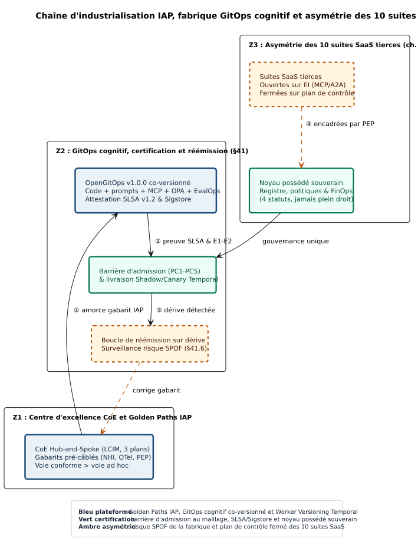
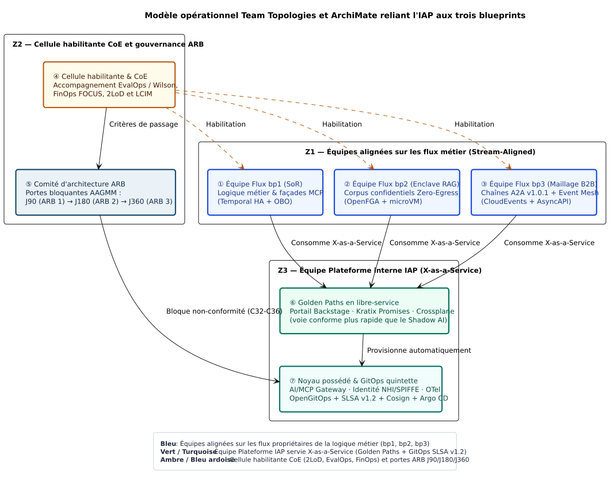
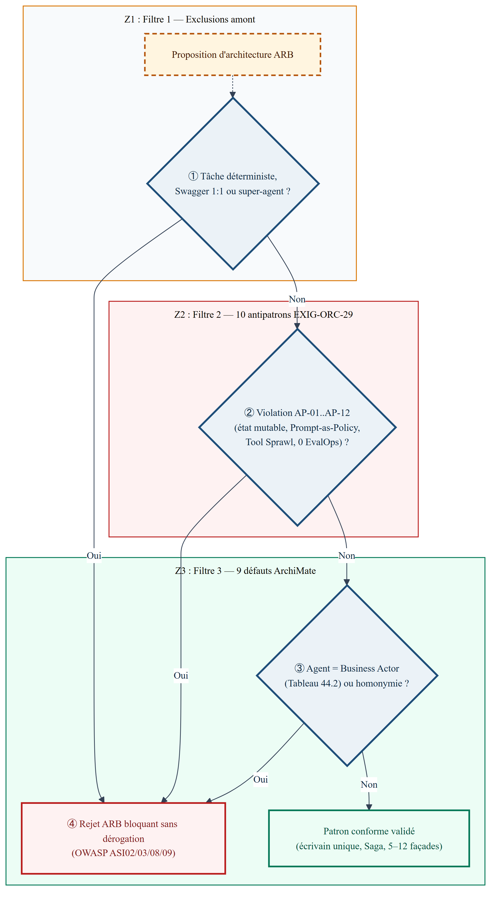
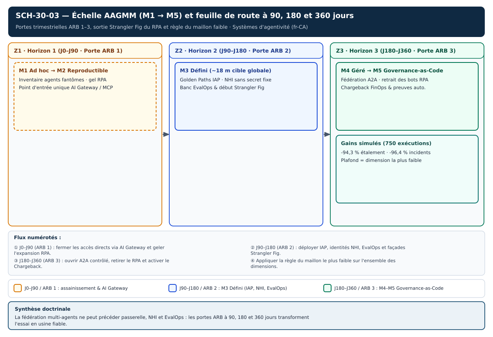

# Chapitre 30 — Industrialisation GitOps de l'automatisation agentique, asymétrie des suites d'entreprise, anti-patrons bloquants et sortie du RPA

*Question directrice :* Quelle usine logicielle interne (`IAP` et `GitOps` cognitif) permet d'industrialiser et de réémettre les automatisations agentiques face à l'asymétrie des dix grandes plateformes d'entreprise, tout en bloquant dès la CI/CD les douze anti-patrons (`AP-01` à `AP-12`) et en pilotant sur 360 jours la sortie du RPA fragile au profit d'enveloppes déterministes (`API`, `iPaaS`, `BPMN`) et `MCP` ?

Disposer de trois blueprints d'intégration valides à l'unité ne suffit pas lorsque l'organisation passe de deux prototypes à plusieurs dizaines ou centaines d'automatisations agentiques réparties entre équipes produit autonomes et grandes suites progicielles (`ERP`, `CRM`, `ITSM`, `SIRH`). Sans usine logicielle standardisée ni barrière de contrôle à l'entrée du maillage, la prolifération de connecteurs bruts, d'identités statiques héritées du `RPA` et de règles de sécurité rédigées en langage naturel dans les invites reconstitue rapidement une dette cognitive ingouvernable. Comme le rappelle Deloitte en citant une estimation du marché (`statut F` sur le communiqué primaire de Gartner), plus de `40 %` des projets agentiques pourraient être abandonnés avant `2028` sous l'effet de coûts imprévus, de la complexité d'échelle ou de risques non anticipés [7].

Ce dernier chapitre de la Partie X complète le passage à l'échelle industrielle selon trois axes. La première section analyse l'asymétrie du plan de contrôle des dix grandes plateformes d'entreprise relevées au traité, formalise la fabrique d'agents (gabarits gouvernés, barrière d'admission et boucle de réémission) puis spécifie l'*Internal Agentic Platform* (`IAP`) et le `GitOps` cognitif (associés aux validations `G0` des blueprints `C32`, `C33`, `C36` et d'`ADR-2027-B001` `C35` à l'Annexe D). La deuxième section érige un verrou d'architecture bloquant par défaut autour des `10` motifs d'orchestration d'`EXIG-ORC-29` et des `12` codes `AP-01` à `AP-12`, des cinq exclusions fondamentales et des neuf défauts de modélisation `ArchiMate` (`Tableau 44.2` du *dossier source Tome 1*). La troisième section cadence enfin la transformation sur `360` jours au moyen du modèle de maturité `AAGMM` (`M1–M5`), de trois portes trimestrielles `ARB 1–3` et de la rampe de sortie du `RPA` fragile (`AP-05`) selon le patron `Strangler Fig`.

## 30.1 Usine logicielle IAP, fabrique d'agents et asymétrie des suites d'entreprise

### 30.1.1 Asymétrie des dix plateformes d'entreprise et quatre statuts d'agents

À la fin de `2026`, la veille documentaire indexée au traité (`dossier source Tome 3`, chapitre 26, hors corpus `L+` fermé) couvre dix grands éditeurs annonçant leur ouverture à `MCP` et `A2A`. Ce panel réunit trois familles fonctionnelles : cinq suites applicatives `SoR`/`SoE` (`Microsoft` `Agent 365` / `Copilot Studio`, `Salesforce` `Agentforce` / `MuleSoft`, `ServiceNow` `AI Control Tower` connu uniquement par presse suite au refus d'accès de son portail, `SAP` `Joule` / `CIS` et `Workday`). S'y ajoutent trois infonuagiques (`AWS` `AgentCore`, `Google` `Agent Registry` / `Agent Gateway`, `IBM` `watsonx Orchestrate`) et deux orchestrateurs historiques de processus métiers (`UiPath` `Maestro` et `Camunda` `BPMN`), où le moteur déterministe conserve la maîtrise du processus. L'examen de ces documentations auto-déclarées révèle une constante structurante : **ces plateformes sont ouvertes sur le fil de communication, mais fermées sur le plan de contrôle**, chaque éditeur cherchant à retenir registre, identité, politiques et facturation.

Trois asymétries concrètes se dégagent de cette évaluation comparative. Premièrement, les versions et statuts divergent : certaines implémentations `A2A` ciblent encore la révision `0.3.0` (telle `SAP`, qui signale par ailleurs l'absence de garantie native de livraison ou d'unicité de traitement) ou restent en préversion sans disponibilité générale, incompatibles avec la spécification `A2A v1.0.1` adoptée ailleurs, tandis que l'inscription est automatique pour les agents natifs mais manuelle pour les agents distants. Deuxièmement, l'observation et la gouvernance demeurent inégales : les rapports complets restent parfois réservés aux agents construits sur la plateforme hôte, l'application de politiques tierces requiert des licences additionnelles (telles qu'`Entra Agent ID`) ou une passerelle propriétaire, et un agent externe se voit confiné au rôle de simple collaborateur.

Troisièmement, sur le plan de la conformité ouverte, la spécification de tests `a2a-tck` (`v1.0.0.alpha3`) signale que les exigences de signature `CARD-SIGN-001` à `CARD-SIGN-004` restent non automatisables (`NOT_AUTOMATABLE`) et ne fournit pas `conformance-vectors/a2a-jcs-v01` à ce tag [2] (la revue du dépôt au traité notant en outre l'absence de liste publique d'implémentations certifiées). En revanche, en évaluation artificielle interne (`FEDS`, Campagne 3 du `dossier source Tome 3` hors corpus externe `L+`), les essais de laboratoire `Borealis-Bench` (`LangGraph`, `AutoGen` et `CrewAI` derrière une passerelle neutre en Go) atteignent `9/9` (`100,0 %`) sur trois scénarios `MCP` et `A2A`. Cette campagne expérimentale montre qu'une interopérabilité neutre est réalisable sous plan de contrôle possédé, alors que les suites commerciales fermées demeurent non testées de manière indépendante. L'entreprise acquéreuse doit donc éprouver trois scénarios minimaux avant signature : appel entrant externe, appel sortant vers un pair externe, puis inscription, restriction et révocation d'un agent tiers depuis le plan de contrôle.

Pour éviter toute captivité contractuelle, la grille d'analyse non normative du traité (`dossier source Tome 3`, chapitre 26) classe tout agent hébergé dans une suite `SaaS` tierce selon quatre statuts gradués : `1` **inventorié** (au registre central), `2` **observé** (traces acheminées vers la télémétrie unifiée), `3` **gouverné** (soumis à une identité et un coupe-circuit hors éditeur) et `4` **de plein droit** (mêmes garanties qu'un agent natif). Sur les documentations consultées jusqu'en novembre `2026`, aucune plateforme commerciale lue ne confère le quatrième statut aux agents tiers : registre de référence, politiques `OPA` [3] et comptabilité doivent demeurer dans le noyau possédé. En outre, les classements d'analystes — tel le quadrant de l'automne `2026` dont la page primaire demeure inaccessible (`statut F`) — ne sauraient fonder une décision d'achat sans vérification directe des réserves techniques de chaque éditeur.

| Famille de plateformes (`10` suites) | Ouverture déclarée (`MCP` / `A2A`) | Asymétrie constatée du plan de contrôle | Statut maximal constaté pour un agent tiers |
|---|---|---|---|
| Bureautique, CRM et iPaaS (`Microsoft`, `Salesforce` / `MuleSoft`) | `MCP` et `A2A` (sens sortant / bêta ou SDK propriétaire) | Gouvernance conditionnelle à une identité et licence éditeur ; délégation `A2A` bornée à `1` saut ; inscription manuelle des pairs | `1` Inventorié à `2` Observé (gouvernance sous licence propriétaire) |
| ITSM, ERP et SIRH (`ServiceNow`, `SAP`, `Workday`) | `AI Agent Fabric`, `A2A 0.3.0`, `API` d'inscription externe | `A2A 0.3.0` incompatible avec `A2A v1.0.1` ; rapports complets réservés aux natifs ; contrat préalable requis (`ServiceNow` via presse) | `1` Inventorié à `3` Gouverné sous passerelle propre (jamais `4`) |
| Nuages et orchestrateurs BPMN/RPA (`AWS`, `Google`, `IBM`, `UiPath`, `Camunda`) | Registres multi-nuages, `A2A v1.0.1` / `0.3.0`, `MCP` `3` sens | Inscription manuelle hors nuage hôte ; agent tiers cantonné au rôle de collaborateur ; `A2A` en préversion ou alpha | `1` Inventorié à `2` Observé ; **jamais de plein droit (`4`)** |

*Tableau 30.1 — Synthèse (d'après la veille documentaire non testée du `dossier source Tome 3`, chapitre 26) de l'asymétrie du plan de contrôle des dix plateformes d'entreprise face à la grille à quatre statuts du traité.*

### 30.1.2 Fabrique d'agents, gabarits gouvernés, barrière d'admission et réémission

Industrialiser l'automatisation agentique sans multiplier les revues manuelles exige de déplacer la conformité vers l'amont grâce à une **fabrique d'agents** (`dossier source Tome 1, § 41`). Pour lever toute ambiguïté conceptuelle, le traité distingue quatre emplois du terme « fabrique » (`Tableau 41.1` du *dossier source Tome 1*) : la **fabrique d'agents** qui produit et réémet le parc via des gabarits gouvernés (objet de la présente section), la **fabrique d'identité** qui émet les identifiants cryptographiques (Chapitre 16), un simple titre de publication éditoriale, et le patron logiciel *factory* de création d'objets en programmation orientée objet.

La fabrique constitue une construction architecturale du traité (`dossier source Tome 1`, `§ 41`, sans étude empirique primaire dans `L+`) reposant sur quatre mécanismes qui séparent gestion de parc et opposabilité juridique. Le **gabarit d'agent gouverné** fixe d'abord pour toute une classe les bornes de finalité, les façades d'outils, l'approbation et les traces, tandis que le **catalogue interne** (agents produits, gabarit, certification) reste distinct du **registre gouverné** (opposable aux tiers). Une **barrière d'admission** vérifie ensuite à l'entrée du maillage (`PC1–PC5`) le respect du contrat — sous la réserve du problème de l'oracle : sans jeu d'essai indépendant, elle atteste un passage formel et non une correction sémantique absolue. Enfin, une **boucle de réémission** corrige le *gabarit source* dès détection d'une dérive en production afin d'assainir toute la classe plutôt qu'une instance isolée.

Cette centralisation porte toutefois un risque de concentration et de point de défaillance unique (`SPOF`, `dossier source Tome 1, § 41.6`). Quatre conditions posées par le traité permettraient de réfuter ou d'invalider la fabrique en exploitation (`Tableau 41.3` du *dossier source Tome 1*, conditions conceptuelles non éprouvées empiriquement à la date de gel). Il s'agit de la propagation d'un défaut de gabarit unique à l'ensemble du parc (monoculture), de l'engorgement de la file de certification incitant au contournement, de l'indisponibilité de l'équipe-fabrique paralysant les livraisons, et de l'écart non mesuré entre agents admis au maillage et agents issus de la fabrique. L'usine logicielle doit donc instrumenter ces quatre indicateurs dès sa mise en service.

### 30.1.3 Passage à l'échelle sur trois plans et plateforme IAP GitOps cognitif

Le passage du pilote au parc industriel s'opère simultanément sur trois plans d'intégration : l'intégration applicative aux `SoR`/`SoE`, la gouvernance des données et la collaboration humain-agent inter-équipes. Pour éviter que l'infrastructure partagée ne devienne un goulot, l'organisation adopte une gouvernance fédérée en étoile (*hub-and-spoke*) animée par un Centre d'excellence (`CoE`) adossé aux niveaux d'interopérabilité conceptuelle (`LCIM`), qui veille notamment à maîtriser la contention des ressources d'inférence GPU lorsque plusieurs domaines sollicitent simultanément les mêmes modèles.

Techniquement, ce modèle organisationnel s'incarne dans une **Internal Agentic Platform (`IAP`)** — déclinaison agentique de la plateforme minimale viable (*Thinnest Viable Platform*) — liée aux contrôles `G0` de validation des blueprints (`C32`, `C33`, `C36`) et d'`ADR-2027-B001` (`C35`) à l'Annexe D. Comme l'illustre la *Figure 109*, l'`IAP` offre aux équipes métiers des `Golden Paths` exécutables en libre-service combinant, selon la pile de référence retenue au traité (`dossier source Tome 6`, section 13.1), un portail développeur (`Backstage`), un orchestrateur déclaratif de capacités (`Kratix Promises`) et un plan de contrôle d'infrastructure (`Crossplane`). Tout agent amorcé sur un `Golden Path` reçoit automatiquement une identité non humaine sans secret statique, une instrumentation `OpenTelemetry`, le routage par l'`AI Gateway` et la passerelle `MCP`, ainsi qu'une suite `EvalOps` initiale. La voie conforme devient ainsi plus rapide que le contournement parallèle (*Shadow AI*).

La chaîne de livraison repose sur le **`GitOps` cognitif**, qui transpose au traité (`dossier source Tome 6`, section 13.3) les principes d'`OpenGitOps v1.0.0` aux systèmes non déterministes. Elle co-versionne dans un dépôt Git unique cinq artefacts indissociables : le code déterministe `80/20`, les invites et hyperparamètres (verrouillés par revue et tests différentiels sur les classes critiques), les contrats `OASF` et `MCP`, les politiques `OPA`/`Rego` [3] et les bancs `EvalOps`. Les descripteurs `server.json` sont validés contre le schéma `server.schema.json` du registre, tandis que les schémas de contrats du harnais sont vérifiés sous `JSON Schema Draft 2020-12` [5] afin d'exiger typage et champs stricts face aux dérives silencieuses. Ce couplage résout le dilemme entre l'édition dynamique d'invites en interface web (utile sur les assistants à faible risque) et la traçabilité réglementaire stricte : en production critique (`R3–R4`), toute modification d'invite ouvre une demande d'intégration validée avant fusion et épingle une révision immuable.

Dans la pile de référence du traité (`dossier source Tome 6`, sections 13.3–13.4), chaque version validée reçoit une attestation de provenance `SLSA v1.2` et une signature sans clé `Sigstore Cosign` vérifiées par le contrôleur d'admission `Argo CD` (avec nomenclature `AIBOM CycloneDX 1.7`) avant déploiement. En production, les livraisons progressives *Shadow*, *Canary* et *Blue-Green* s'appuient sur le *Worker Versioning* (`Temporal`) afin que les dossiers longs déjà engagés sur les `ERP`, `CRM` ou `ITSM` s'achèvent de manière déterministe sur leur version épinglée sans erreur de rejeu. L'équipe plateforme opère cette `IAP` en produit interne minimal viable : elle expose les `Golden Paths` en libre-service, laisse aux équipes domaines la propriété exclusive de la logique métier et soumet toute dérogation hors voie pavée aux mêmes contrats d'identité, de télémétrie et de contrôle d'admission.

*Figure 109 — SCH-30-01 : Articulation entre les `Golden Paths` `IAP` du Centre d'excellence (`Z1`), la chaîne `GitOps` cognitif sous `SLSA v1.2` et boucle de réémission sous surveillance `SPOF` (`Z2`), et l'encadrement des dix suites `SaaS` tierces hors du plein droit (`Z3`).*

> **Trois invariants exécutables — Chapitre 30**
> 1. **Noyau possédé face aux suites d'entreprise et GitOps quintette (`C32`, `C33`, `C35`, `C36`)** — Maintenir le registre, les politiques `OPA` et la facturation dans le noyau possédé (`4` statuts pour les agents tiers, jamais de plein droit), et co-versionner sous `OpenGitOps v1.0.0` et `SLSA v1.2` code, invites, schémas, politiques et banc `EvalOps`.
> 2. **Rejet bloquant ARB par défaut (`EXIG-ORC-29`, `AP-01` à `AP-12`, `Tableau 44.2` du Tome 1)** — Refuser par défaut, sauf dérogation formelle documentée (`EXIG-ORC-29`), toute architecture présentant l'un des `10` motifs d'orchestration d'`EXIG-ORC-29` ou des `12` codes `AP-01` à `AP-12` (marteau agentique sur flux `L0`, surcouche `RPA` fragile `AP-05`, écriture directe `SoR` `AP-06`, *Prompt-as-Policy*, *Tool Sprawl*, absence d'`EvalOps`), le mappage `Swagger-to-MCP 1:1` ou un défaut `ArchiMate` confondant agent et acteur humain.
> 3. **Hiérarchie d'automatisation et sortie du RPA sous trois portes (`J90`, `J180`, `J360`)** — Privilégier le couplage `API`/`Event Mesh`/`iPaaS` (`L0`), puis l'enveloppe déterministe `BPMN 2.0` / `Temporal` encapsulant `MCP`, piloter sur `360` jours le retrait `Strangler Fig` du `RPA` fragile et subordonner l'ouverture `A2A` (`ARB 3`) à la clôture préalable de la passerelle (`ARB 1` à `J90`) et des `NHI`/`EvalOps` (`ARB 2` à `J180`).

*Figure 110 — SCH-30-04 : Organisation *Team Topologies* et `ArchiMate` reliant Plateforme `IAP`, `CoE`/`ARB` et équipes `bp1`–`bp3`.*

## 30.2 Catalogue bloquant des anti-patrons agentiques (EXIG-ORC-29, AP-01–AP-12)

### 30.2.1 Dix anti-patrons d'orchestration, cinq exclusions et écueil Swagger-to-MCP 1:1

L'analyse de `1 642` traces annotées (`MAST`, chapitre 13, `41 %` à `86,7 %` d'échecs sur sept cadriciels) confirme que la majorité des échecs multi-agents proviennent de défauts de conception. Parallèlement, le recensement de Kraishan (`arXiv:2609.14119`) sur `21 643` serveurs `MCP` (`72 606` versions) révèle que parmi `8 900` serveurs multi-versions, `51,09 %` mutent, `40,58 %` dérivent sémantiquement et `4,16 %` redirigent vers un autre hôte (`OR = 2,96`) [6]. Dans ce contexte, `EXIG-ORC-29` (« aucun anti-patron sans dérogation ») érige `10` motifs d'orchestration (`Tableau 26` du *dossier source Tome 2* détaillés au Chapitre 13, dont relèvent notamment les `6` codes `AP-01`, `AP-06`–`AP-09`, `AP-12`) en **motifs de rejet bloquant par défaut** en comité `ARB`. Ces motifs restent distincts des `12` codes `AP-01` à `AP-12` du *dossier source Tome 6* complétés pour le portefeuille, `MCP`/`RPA` et la sécurité (`AP-02`–`AP-05`, `AP-10`, `AP-11`) face à `OWASP ASI01`–`ASI03`, `ASI06`, `ASI08`–`ASI10` [1].

Ces défauts s'accompagnent de cinq exclusions architecturales fermes fondées sur les décisions et règles du traité (`ADR-001`, `ADR-005`, `ADR-011`, `ADR-031`, `dossier source Tome 1 § 43.2` et `§ 31.2.6`). Elles visent l'agentification d'une tâche déterministe connue d'avance (`Tome 1 § 43.2`), le pré-entraînement propriétaire d'un modèle interne (`ADR-031`), l'orchestrateur omnipotent, les essaims cycliques non bornés (`ADR-011`) et `MCP` comme substitut d'une `API` transactionnelle directe entre systèmes déterministes (`ADR-001`, `Tome 1 § 31.2.6`). L'un des pièges les plus fréquents sur un `ERP` ou `CRM` est l'anti-patron `Swagger-to-MCP 1:1` (`AP-04`), consistant à convertir mécaniquement une spécification `OpenAPI` en plus de `50` outils `CRUD` bruts : la fenêtre de contexte sature et le modèle confond des signatures voisines. La remédiation regroupe les opérations en `5` à `12` façades d'intention métier (cible du `dossier source Tome 3`, section 5.11) validées par `JSON Schema Draft 2020-12` (`additionalProperties: false`, champs `required` obligatoires et typage strict) [5].

De même, l'anti-patron `Prompt-as-Policy` (`AP-10`) — inscrire des règles d'autorisation ou de conformité dans l'invite système en espérant que le modèle y obéisse sous attaque d'injection indirecte — entraîne un rejet immédiat. Les règles d'accès et de confinement doivent résider hors modèle dans des politiques déclaratives `Rego` évaluées par `Open Policy Agent` (`OPA v1.22.4`) en mode fermé (`default allow := false` en tête de paquet) [3]. En intégration continue, `opa test --coverage --format=json` exige une couverture de `100,0 %` des règles évaluées [4], mécanisme éprouvé en barrière `G0` sur trois paquets `policies_opa/*.rego` (`45/45` tests positifs et négatifs et `21` validations de schémas sans violation stricte). Enfin, pour assainir un portefeuille existant, le traité propose un algorithme de triage *brownfield* (`dossier source Tome 3`, section 43.10) traduisant la grille de maturité en quatre verdicts automatisés : `DECOMMISSION` (retrait des doublons ou orphelins), `QUARANTINE_L1` (confinement en lecture seule), `REMEDIATE` (correction `API`/`OPA`/`EvalOps`) et `PROMOTE` (admission au parc certifié).

Aucune voie de contournement non bornée n'est tolérée face à `EXIG-ORC-29` : toute exception suit le protocole écrit (`dossier source Tome 2 § 11.6`, `EXIG-GOV-15..17` ; `dossier source Tome 6 § 13.1.3`). Le dossier précise risque résiduel, plan de retour à la conformité et contrôles compensatoires (autonomie abaissée, approbation humaine ou plafond réduit). Instruit par l'`ARB` (avis sécurité, conformité, `RPRP`), l'écart est tranché par le comité pour au plus `6` mois, renouvelable une fois avec alerte à `30` jours (ou délégué `≤ 90` jours en classe Faible hors instructeur), sans jamais déroger aux dix interdits `EXIG-GOV-17`. Sous `GitOps`/`OPA` (`default allow := false` [3], `Argo CD`), la politique versionnée porte l'échéance de révocation : à expiration ou retrait, elle bascule automatiquement vers la suspension administrative sans contournement manuel.

| Code (`AP-01`–`AP-12` / `EXIG-ORC-29`) | Risque `OWASP` / défaut | Symptôme et mécanisme de défaillance | Remédiation obligatoire et verrou `ARB` |
|---|---|---|---|
| `AP-01` Marteau agentique | `EXIG-ORC-01` / `Tome 1 § 43.2` | Remplacement d'un flux déterministe fixe (`API`, `iPaaS`, `BPMN`) par une boucle `LLM` lente et coûteuse | Rejeter ; conserver code déterministe (`N0`/`L0`) ou `RAG` sans boucle |
| `AP-02` Étalement fantôme | `ASI03` [1] | Prolifération d'agents non inventoriés sans propriétaire ni identité attestée | Raccorder scanners au registre central, imposer `Agent Owner` |
| `AP-03` Cécité économique | `EXIG-FIN-01` / `POR-016` | Pilote spectaculaire non rentable à l'échelle sous explosion des jetons | Exiger *baseline* chiffrée `L0` et coût complet par résultat conforme |
| `AP-04` *Tool Sprawl* (`Swagger 1:1`) | `ASI02` [1] / `ADR-009` / `Tome 3 § 5.11` | Exposition de `50+` outils `CRUD` bruts saturant l'attention du modèle | Regrouper en `5`–`12` façades d'intention validées `JSON Schema` [5] |
| `AP-05` Surcouche `RPA` fragile | `ADR-001` | Boucle cognitive pilotant des sélecteurs d'écran instables | Sortir sur `360` j vers `API`/`CDC`/`MCP` ou confiner sous moteur `BPMN` |
| `AP-06` Accès direct `SoR` | `ADR-001` | Saturation des progiciels centraux (`ERP`/`CRM`) et doubles écritures `SQL` | Interposer couche anti-corruption `ACL`, projection `CQRS` et idempotence |
| `AP-07` Essaim prématuré (`Parallel Writers`) | `MAST` / `EXIG-ORC-07` | Sous-agents concurrents produisant des écritures contradictoires et dérives | Privilégier agent unique ou flux fixe ; imposer écrivain unique sérialisé |
| `AP-08` Boucle volatile | `ASI08` [1] / `EXIG-ORC-11` | État en mémoire de processus perdu au redémarrage ; boucle sans plafond | Exécution durable `Temporal`, plafond de tours et coupe-circuit |
| `AP-09` Dilution de contexte | `EXIG-ORC-23` | Accumulation brute d'historique noyant les contraintes et masquant les échecs | Harnais sobre, compaction structurée et externalisation par référence |
| `AP-10` *Prompt-as-Policy* | `ASI01` / `ASI02` / `ASI03` [1] | Sécurité confiée au texte d'invite contournable par injection indirecte | Déporter hors modèle vers `OPA`/`Rego` (`default allow := false`) [3] |
| `AP-11` Mémoire empoisonnée | `ASI06` / `ASI08` [1] | Entrée corrompue en mémoire partagée faussant les sessions ultérieures | Isolation par locataire, filtrage `ACL` pré-requête et provenance |
| `AP-12` Lancement sans `EvalOps` | `ASI09` / `ASI10` [1] | Régressions silencieuses, `HITL` mécanique et absence d'arrêt d'urgence | Seuils `EvalOps` bloquants en CI (`opa test` `100,0 %` [4]) et repli manuel |

*Tableau 30.2 — Matrice bloquante des douze anti-patrons critiques (`AP-01` à `AP-12`, `EXIG-ORC-29`), risques `OWASP ASI` [1] et remédiations `ARB`.*

### 30.2.2 Neuf défauts ArchiMate (Tableau 44.2 du Tome 1) et levée des homonymies

Au-delà de l'exécution logicielle, la modélisation d'architecture d'entreprise accumule neuf défauts récurrents recensés au `Tableau 44.2` du traité (`dossier source Tome 1`, section 44.8, sous `ArchiMate 4` / `C260`, hors corpus `L+` fermé) qui entraînent eux aussi un blocage par défaut en comité `ARB`. Quatre concernent la structure des acteurs et services : modéliser un agent comme une « boîte magique » monocouche au lieu de le décomposer en `Application Component` stéréotypé (jamais `Business Actor` humain), rôle et boucle de raisonnement ; placer un point d'arrêt humain décoratif *hors* de l'étape irréversible ; entretenir un inventaire fantôme déconnecté du parc réel ; et modéliser une interaction ponctuelle entre agents par une relation *Serving* réservée aux services durables. Cinq autres portent sur la discipline du référentiel : inventer de nouveaux éléments de métamodèle pour un serveur d'outils au lieu d'appliquer spécialisation et profils ; réinventer une capacité d'entreprise par outil technique ; figer le modèle sans distinction entre état actuel et état cible ; confondre langage, méthode et atelier logiciel ; et enfin encombrer les vues par de la prose réglementaire ou protocolaire au lieu de porter des attributs traçables.

Parallèlement, le filtrage `ARB` lève trois homonymies sources de confusions contractuelles récurrentes :
1. **`AgentMesh`** désigne selon les sources soit le courtier événementiel de *Solace*, soit la passerelle de maillage de *Solo.io* (`agentgateway`), dont les rôles et couches diffèrent totalement.
2. **`Fabrique`** sépare strictement la fabrique d'agents (`dossier source Tome 1, § 41`, usine logicielle à gabarits) de la fabrique d'identité (`dossier source Tome 1, § 43.1`, autorité d'émission cryptographique) ainsi que du patron logiciel *factory*.
3. **`ACP`** impose de distinguer le défunt protocole *Agent Communication Protocol* (fusionné dans `A2A`) du plan de contrôle agentique d'un consortium d'institutions financières et de télécommunications (dont un acteur canadien) et de l'*Agentic Commerce Protocol*.

Sur le plan documentaire, la veille consigne en statut bloqué les portails `gartner.com`, `mckinsey.com` et `genai.owasp.org` (erreurs `HTTP 403` ou expiration réseau sans contournement). Elle compense le référentiel de sécurité par l'édition complète `CC BY-SA 4.0` archivée en texte intégral [1] et attribue l'estimation d'abandon de `40 %` des projets à sa reprise secondaire vérifiée [7], tandis que les normes payantes `ISO/IEC 330xx` et `ISO/IEC 42001` demeurent en `statut F` hors preuve `L+`. La *Figure 111* formalise cette revue `ARB` comme un entonnoir séquentiel à trois filtres de blocage par défaut (sous réserve des dérogations formelles prévues par `EXIG-ORC-29`).

*Figure 111 — SCH-30-02 : Pipeline de rejet bloquant `ARB` en trois filtres séquentiels couvrant les exclusions amont (`Z1`), les `10` motifs d'orchestration `EXIG-ORC-29` intégrés aux `12` codes `AP-01` à `AP-12` (`Z2`), et les neuf défauts `ArchiMate` du `Tableau 44.2` (Tome 1) ainsi que les homonymies (`Z3`).*

## 30.3 Modèle de maturité AAGMM (M1–M5), hiérarchie d'automatisation et sortie du RPA sur 360 jours

La transformation d'un parc dispersé vers une usine gouvernée s'appuie sur le modèle de maturité `AAGMM` (*Agentic AI Governance Maturity Model*), repris de la littérature secondaire indexée au traité (`dossier source Tome 6`, section 15.4, hors corpus `L+` fermé et distinct des normes `ISO/IEC 330xx` en `statut F`). Il se décline en cinq paliers (`M1` à `M5`) reliés aux cycles *Govern–Map–Measure–Manage* du `NIST AI RMF` et à `ISO/IEC 42001` (consignée en `statut F` hors preuve `L+`).

Dans les `750` simulations rapportées par Acharya et citées au `dossier source Tome 6`, le passage de `M1` à `M4–M5` s'accompagne d'une baisse simulée de `94,3 %` de l'étalement agentique et de `96,4 %` des incidents, ainsi que d'une hausse de `32,6 %` de l'achèvement des tâches. Ces résultats académiques non versés au corpus `L+` servent de repère directionnel et non d'engagement de production. Surtout, l'évaluation suit la **règle du maillon le plus faible** : le niveau global plafonne sur la dimension la moins avancée (gouvernance, architecture, sécurité `NHI`, `EvalOps`/`SRE` ou `FinOps`), avec `M3` (*Défini*) comme cible réaliste soutenue.

| Palier `AAGMM` | Gouvernance (`EA`) | Architecture (`SA`) | Sécurité & `NHI` | `EvalOps` & `SRE` | `FinOps` & patrimoine |
|---|---|---|---|---|---|
| `M1` Ad hoc | Zéro registre ; *Shadow AI* et agents orphelins | Appels directs aux modèles ; bots `RPA` isolés | Clés `API` statiques ; comptes partagés | Tests manuels ponctuels ; zéro trace | Facturation opaque ; zéro référence économique |
| `M2` Réactif (`ARB 1`) | Centre d'excellence (`CoE`), inventaire initial | `AI Gateway` unique ; première façade `MCP` + `ACL` | Identités isolées sur pilotes ; gel du `RPA` | Mode ombre et recommandation | Référence chiffrée (*baseline*) et plafonds |
| `M3` Défini (`ARB 2`) | Registre central obligatoire, `Agent Owner`, paliers `R1–R4` | `Golden Paths` `IAP`, exécution durable, `Strangler Fig` | `NHI` éphémères, `OBO`, politiques `OPA` [3] | `EvalOps` bloquant en CI (`100,0 %` [4]), arrêt d'urgence | Coût par résultat conforme (`CPO`) et *Showback* |
| `M4` Géré | Détection automatisée d'étalement et de dérive | Fédération `A2A` contrôlée ; retrait actif du `RPA` | Confinement `microVM`, `ACL` mémoire | `SLO` actifs, rejeu et exercices `L0` | *Chargeback* comptable et routage `SLM` |
| `M5` Optimisé (`ARB 3`) | *Governance-as-Code* continu (`ISO 42001`, `statut F`) | Maillage `OASF` / `Event Mesh` ; autonomie sous contrat | Révocation fédérée en temps réel (`CAP-039`, `EXIG-IAM-20`) | Bascule multi-fournisseurs périodique | `ROI` ajusté du risque et sortie patrimoine |

*Tableau 30.3 — Matrice de progression du modèle de maturité `AAGMM` (`M1` à `M5`, reprise du `dossier source Tome 6`, section 15.4 ; `ISO/IEC 42001` consignée en `statut F`) sur cinq axes conjoints.*

À chaque jalon d'architecture (`ARB 1` à `ARB 3`, `DEC-001`), le comité applique une **hiérarchie canonique d'automatisation des systèmes d'entreprise**. Il privilégie d'abord le couplage déterministe `API` / `Event Mesh` / `iPaaS` sans modèle (`N0`/`L0`, `0` jeton `LLM`). Lorsque l'ambiguïté documentaire ou décisionnelle justifie l'IA, il confie l'orchestration à une enveloppe déterministe (`BPMN 2.0` ou `Temporal`) invoquant des tâches agentiques bornées (`L1`–`L2`) via façades `MCP` derrière couche `ACL`. Enfin, il proscrit tout empilement d'agents sur grattage d'écran (`AP-05`) et pilote la sortie du `RPA` fragile et des agents d'écran `CUA` sur `360` jours (`dossier source Tome 6`, section 15.4.2) :

- **Horizon 1 (`J0–J90` · Porte `ARB 1` · `M1 → M2`)** : installer le `CoE`, recenser les agents fantômes et les robots `RPA` (`J0`), geler tout nouvel automate d'écran fragile, publier la règle `80/20` et imposer l'`AI Gateway` ainsi qu'une première façade `MCP` sous `ACL` (`J90`). Le jalon `ARB 1` vérifie qu'aucune clé ne contourne la passerelle et que les pilotes tournent en mode ombre.
- **Horizon 2 (`J90–J180` · Porte `ARB 2` · `M2 → M3`)** : livrer les `Golden Paths` `IAP` sous `GitOps` cognitif, remplacer les secrets statiques par des `NHI` sous `OBO` et `OPA`, activer `EvalOps` bloquant en CI et le *Showback* `FinOps`. Cet horizon déploie `Strangler Fig` en quatre stades (observation en ombre, encapsulation `ACL`/`MCP` ou `CDC`, bascule sous `Shadow Mirroring` à `J180`, extinction des scripts d'écran) et exige à `ARB 2` `100,0 %` d'inventaire et un repli `L0` testé.
- **Horizon 3 (`J180–J360` · Porte `ARB 3` · `M3 → M4/M5`)** : ouvrir sous contrôle la délégation `A2A` entre domaines certifiés, automatiser la détection d'étalement et la réémission sur dérive, activer le *Chargeback* vers l'`ITFM`/`ERP` et décommissionner les lots `RPA` hérités (`J360`). Le jalon `ARB 3` valide le retrait patrimonial, la tenue du coût face au `L0` et la revue de troisième ligne.

Cette discipline trimestrielle garantit que les échanges multi-agents n'ouvrent qu'après maîtrise de l'inventaire, des passerelles, des identités non humaines et de l'évaluation continue.

*Figure 112 — SCH-30-03 : Trajectoire d'industrialisation sur trois horizons (`J0–J90` sous `ARB 1` en `Z1`, `J90–J180` sous `ARB 2` au palier `M3` en `Z2`, `J180–J360` sous `ARB 3` vers `M4–M5` avec retrait `Strangler Fig` du `RPA` en `Z3`) et gains issus des `750` simulations rapportées par Acharya.*

Avec la clôture de la Partie X (`D10`, ← Chapitres 28 et 29), l'entreprise dispose d'une matrice sectorielle à six verticaux coiffée par l'étalon prudentiel, de trois blueprints d'intégration validés et d'une usine `IAP` `GitOps` conduisant la sortie du `RPA` fragile. La **Partie XI (`D11`)** inscrit cette capacité dans le temps long `2028–2035` via les trajectoires adaptatives `DAPP`, la gouvernance duale `AE ↔ AS` des systèmes d'entreprise et le maintien du repli humain vers `L0` (→ Partie XI, Chapitre 31).
