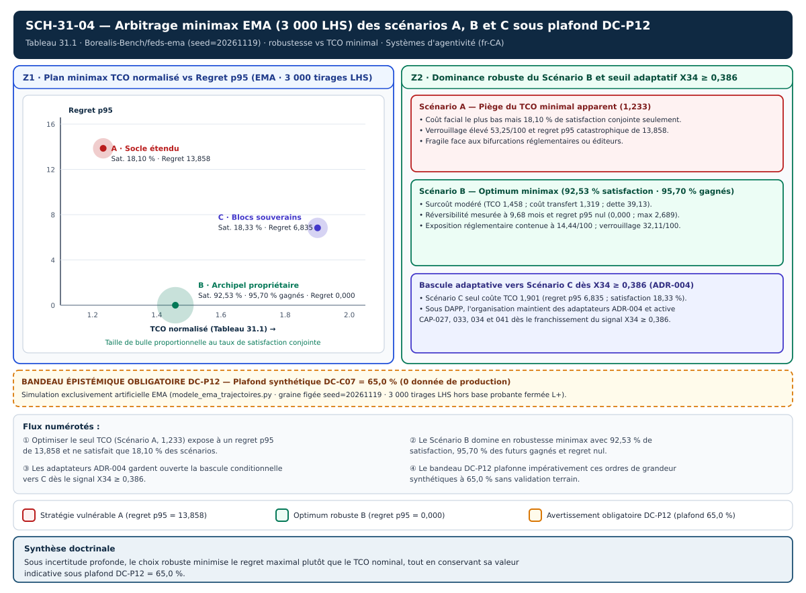
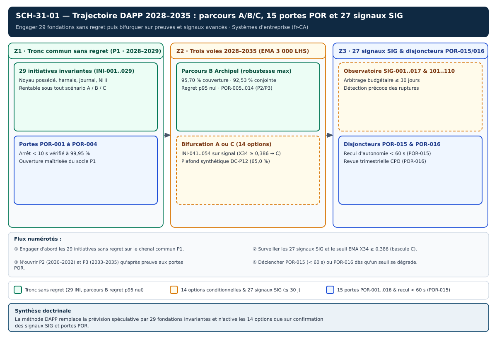
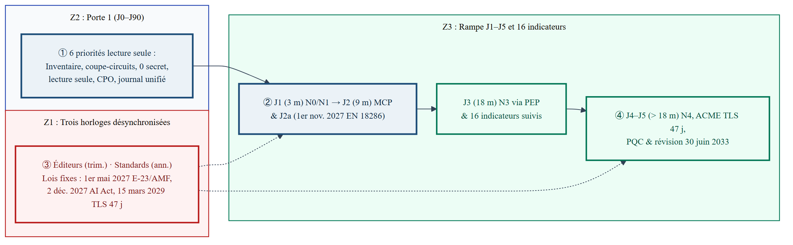
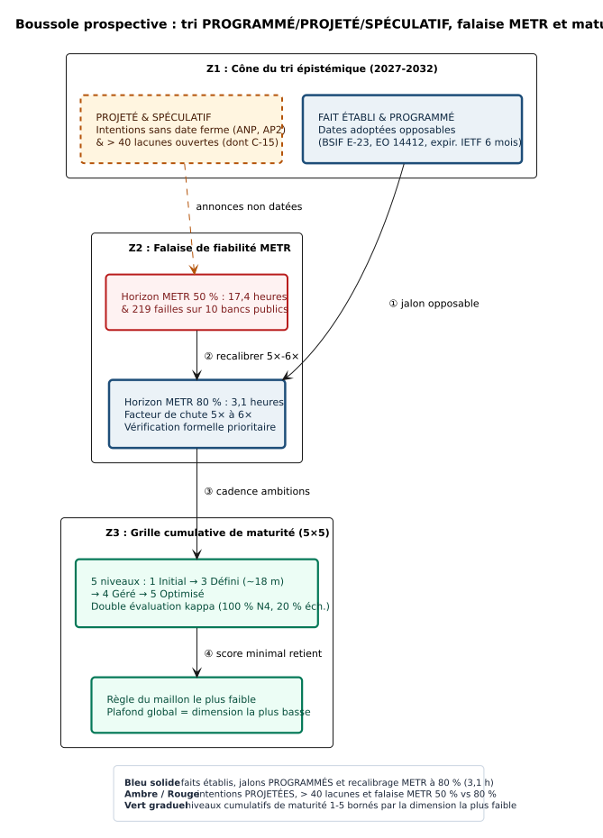

# Chapitre 31 — Trajectoires d'interopérabilité et d'automatisation 2028–2035 : planification adaptative DAPP, scénarios A/B/C et portes d'homologation

*Question directrice :* Comment piloter l'évolution pluriannuelle (`90` jours à `2028–2035`) de l'interopérabilité et de l'automatisation agentique des systèmes d'entreprise sans parier sur l'issue entre standards ouverts et suites propriétaires captives, en subordonnant chaque montée d'autonomie à quinze portes d'homologation `POR` et vingt-sept signaux `SIG` ?

Dans le prolongement de l'usine `IAP` et de la sortie programmée du `RPA` (← Chapitre 30), le pilotage pluriannuel de l'**interopérabilité** et de l'**automatisation agentique des systèmes d'entreprise** échoue dès qu'il repose sur des prévisions figées des modèles, des standards et du droit. Si le calcul effectif mondial croît d'environ `10×` par an (`1,5×` par dollar, `3×` algorithmique et `2,5×` en capital, soit `11,25×` arrondi à `10×`) [9], la fiabilité opérationnelle demeure bornée par la composition d'erreurs et des butoirs réglementaires asymétriques. Ce chapitre institue une **trajectoire adaptative sous seuils** (`DAPP`, *Dynamic Adaptive Policy Pathways*) fondée sur Haasnoot, Warren et Kwakkel [1] et couplée à l'analyse `STPA`.

Au titre de la clause de non-avis juridique et réglementaire (`AO-05`), les analyses qui suivent constituent une référence technique arrêtée au gel du `2 décembre 2026` et non un avis opposable. Les textes primaires accessibles sont archivés sous empreinte `SHA-256` (`L+`), tandis que `eur-lex.europa.eu` (compensé par `publications.europa.eu` [6, 7]) et le portail de l'Autorité des marchés financiers (`lautorite.qc.ca`, `HTTP 403`) sont consignés en Statut F sans contournement (exclusions tracées aux fiches bibliographiques et en Annexe A). Le chapitre articule la méthode `DAPP` aux trois horloges, déploie les `43` initiatives, `15` portes et `27` signaux, puis calibre la maturité face à la falaise `METR`.

## 31.1 Planification adaptative sous incertitude profonde et collision des trois horloges

### 31.1.1 Limites des feuilles de route statiques et méthode `DAPP`

Une planification quinquennale classique suppose qu'un comité puisse probabiliser l'issue de la rivalité entre protocoles d'interopérabilité ouverts et suites applicatives fermées, le coût marginal futur d'inférence ou l'horizon d'émergence d'un calculateur quantique dit `CRQC` (*Cryptographically Relevant Quantum Computer*, capable de briser les clés asymétriques classiques) [3, 4]. Or, sous incertitude profonde, aucun consensus probabiliste n'existe ni sur les distributions futures ni sur un modèle causal unique [1]. Optimiser le système d'information pour un unique scénario central engendre des actifs échoués et des coûts de sortie prohibitifs dès que l'environnement bifurque.

Formalisée par Haasnoot, Warren et Kwakkel, la **trajectoire adaptative sous seuils** (`DAPP`) substitue la robustesse dynamique à la prévision ponctuelle [1]. Chaque choix d'architecture possède un point de bascule d'adaptation (*adaptation tipping point*, `ATP`) au-delà duquel la solution en place cesse de remplir ses objectifs [1]. La méthode combine quatre leviers complémentaires : des fondations initiales sans regret rentables dans tous les futurs plausibles, des mesures préparatoires préservant les options de bifurcation, des engagements conditionnels différés jusqu'à confirmation factuelle et une veille par signaux avancés (*signposts*) intégrant délais de mise en œuvre et coûts de transfert [1].

Pour le système d'information d'entreprise, le cadre retient un horizon préparatoire indicatif de six à vingt-quatre mois (corpus source `Tome 4 § 25.1`, `Tome 7 § 12.4`). Migrer les identités non humaines vers la cryptographie post-quantique, remplacer des automates d'écran (`RPA`/`CUA`) par des `API` typées en arithmétique décimale exacte sur les systèmes d'enregistrement (`SoR`) ou cloisonner les six substrats d'état entre juridictions exige d'anticiper les butées externes [3, 4, 5]. Couplée aux boucles `STPA`, la planification `DAPP` [1] relie chaque signal à des coupe-circuits techniques et à une réallocation exécutoire, régissant la montée progressive de **l'automatisation agentique des systèmes d'entreprise** devant les `15` portes `POR` jusqu'au repli `POR-015` en moins de `60 secondes`.

### 31.1.2 Désynchronisation des trois horloges, hypothèses `H1–H6` et scénarios de standardisation

Toute entreprise ou administration intégrant l'automatisation agentique dans ses systèmes d'entreprise à partir de `2026–2027` affronte la collision de trois horloges incompatibles. La première est celle des éditeurs de modèles et de suites `SaaS` (`ERP`, `CRM`, `ITSM`), qui livrent des versions majeures et modifient tarifs ou interfaces chaque trimestre. La deuxième appartient aux consortiums ouverts d'interopérabilité (`AAIF`, `IETF`, `W3C`, `OpenTelemetry`, `MCP`), dont la maturation s'étire sur l'année. Ainsi, la proposition acceptée `SEP-3398` du protocole `MCP` (`14 octobre 2026`) instaure une cadence semestrielle au dernier mardi de mars et de septembre, reportant au `30 mars 2027` la révision initialement visée en décembre `2026` [10], pendant que les groupes `IETF` (`WIMSE`, `OAuth 2.1`, `DAWN`, `AGENTPROTO`) publient des jalons révisables.

La troisième horloge est celle des régulateurs et des normes cryptographiques impératives, qui comptent en années mais imposent des butoirs fixes incompressibles [2, 5, 6, 7]. Ainsi, le *Ballot SC-081v3* intégré aux *Baseline Requirements* du *CA/Browser Forum* abaisse par paliers la durée maximale des certificats `TLS` publics : limitée à `100 jours` à partir du `15 mars 2027`, leur validité passe à `47 jours` dès le `15 mars 2029`. À cette même échéance du `15 mars 2029` (après un plafond de `100 jours` en `2027`), la réutilisation des validations de domaine et d'adresses IP tombe à `10 jours` [2]. Parallèlement, la ligne directrice `E-23` révisée du BSIF sur le risque de modélisation prend effet le `1er mai 2027` [5]. De son côté, le Règlement `(UE) 2026/1744` modifiant le Règlement `(UE) 2024/1689` (`EU AI Act`) fixe au `2 décembre 2027` l'échéance des obligations de l'Annexe III [6, 7]. Enfin, la feuille de route du *G7 Cyber Expert Group* coordonnée avec `NIST IR 8547` situe la transition post-quantique prioritaire du secteur financier sur `2030–2035` [3, 4].

Ce décalage crée un risque aigu de capture prématurée : pour combler l'attente des standards ouverts, un fournisseur vend dès `2027` une gouvernance propriétaire clé en main qui verrouille la mémoire, l'annuaire et la télémétrie. Pour cadrer cette tension, la synthèse du Corpus (`Tome 3 § 4.5`, `Tome 4 § 2.2`) pose six hypothèses falsifiables (`H1` à `H6`), assorties chacune d'un signal d'infirmation.

Les trois premières concernent l'échelle et le contrôle : `H1` concentre le déploiement dans les grandes organisations, `H2` maintient des agents bornés à court horizon et `H3` situe le verrou principal dans l'architecture système plutôt que dans le modèle. Les trois suivantes portent sur la gouvernance : `H4` retient `MCP` et `A2A` comme transport pendant que l'identité reste en chantier, `H5` anticipe `4` à `6` plans de contrôle et `H6` prévoit un tri sévère selon la preuve de valeur. Face à trois issues géopolitiques — convergence ouverte `AAIF`/`IETF`, bifurcation régionale incluant `GB/Z 185-2026` (source secondaire au Corpus sans texte officiel `L+`, `Tome 3 § 11.7`), ou prolifération fragmentée —, `ADR-004` isole chaque protocole derrière des adaptateurs remplaçables.

| Axe stratégique | Scénario A — Socle étendu | Scénario B — Archipel propriétaire | Scénario C — Blocs souverains |
|---|---|---|---|
| **Standards et protocoles** | Convergence `IETF` (`WIMSE`, `DAWN`, `AGENTPROTO`, `SCITT`) et `OTel` stable | `MCP` [10] et `A2A` limités au transport ; identité et traces captives par éditeur | Piles, attestations et profils cryptographiques cloisonnés par juridiction [3, 4] |
| **Posture des plateformes** | Fédération ouverte des registres et des mandats sans surtaxe d'extraction | Verrouillage dans `4` à `6` suites progicielles ; droits de sortie élevés (`H5`) | Localisation stricte, contrôle local ou éviction de fournisseurs extraterritoriaux |
| **Régime prudentiel et PQC** | Preuves interopérables et bascule post-quantique coordonnée `G7` `2030–2035` [4] | Conformité portée par l'institution au-dessus d'îlots hétérogènes (`B-10`) | Cloisonnement des six substrats (`EU AI Act` [6, 7], `Loi 25` art. `17`, réexamen `DORA`) |
| **Résultats `EMA` (`3 000` LHS, `DC-P12`)** | `TCO 1,233` ; satisfaction `18,10 %` ; regret `p95 = 13,858` ; verrouillage `53,25/100` | `TCO 1,458` ; satisfaction `92,53 %` ; `95,70 %` gagnés ; regret `p95 = 0,000` | `TCO 1,901` ; satisfaction `18,33 %` ; regret `p95 = 6,835` ; bascule dès `X34 ≥ 0,386` |

*Tableau 31.1 — Confrontation des trois scénarios non probabilisés `A`, `B` et `C` et synthèse exploratoire `EMA` sous plafond synthétique `DC-P12`.*

La *Figure 113* visualise cet arbitrage minimax `EMA` sous bandeau `DC-P12`.

*Figure 113 — SCH-31-04 : Plan `TCO` par rapport au regret `p95` (`EMA`, `3 000` LHS) et bascule `X34 ≥ 0,386` sous `DC-P12` (`65,0 %`).*

## 31.2 Architecture décisionnelle temporelle : `43 INI × 15 POR × 27 SIG` et boussole prospective

### 31.2.1 Trajectoires adaptatives `DAPP`, portes `POR`, signaux `SIG` et rampe de 90 jours à 18 mois

Aux termes de `EXIG-DAPP-01` (exigence de synthèse du traité hors des `305` règles `CRE-IA-2026-01 v1.2`), l'organisation DOIT éprouver tout investissement structurant face aux scénarios non probabilisés `A`, `B` et `C` et séparer les fondations sans regret des options conditionnelles. En évaluation exclusivement artificielle exploratoire `FEDS`/`EMA` (`Borealis-Bench/feds-ema/modele_ema_trajectoires.py`, hors corpus `L+` fermé, `3 000` tirages par hypercube latin `LHS`, `seed=20261119`), le plafond épistémique `DC-P12` borne la confiance synthétique à `DC-C07 = 65,0 %` faute d'étude de cas humaine (corpus source `Tome 4 § 8.6`, Chapitre 35). Sur cet échantillon, le **parcours `B` (*Archipel propriétaire*)** l'emporte selon le critère de robustesse minimax : il satisfait conjointement les seuils dans `92,53 %` des tirages et prévaut dans `95,70 %` des états simulés (regret `p95 = 0,000`, borne maximale `2,689`). Ses médianes s'établissent à `1,458` en `TCO`, `1,319` en coût de migration, `39,13` en indice de dette, `9,68` mois de délai de réversibilité, `32,11/100` de captivité et `14,44/100` d'exposition normative.

À l'inverse, le parcours `A` minimise le `TCO` (`1,233`) mais chute dès que le verrouillage éditeur (`X2 = +0,7531` en corrélation de Spearman) croît (`18,10 %` de satisfaction, regret `p95 = 13,858`). Le parcours `C` abaisse verrouillage (`20,90/100`) et exposition réglementaire (`8,18/100`), mais porte le `TCO` à `1,901`, la dette à `55,29` et la sensibilité à la friction interne à `X8 = +0,7375`. La règle adaptative amorce donc sur `B` et active sélectivement les capacités souveraines de `C` (`CAP-027`, `CAP-033`, `CAP-034`, `CAP-041`) dès `X34 ≥ 0,386`.

Sur `2028–2035`, le portefeuille directeur (Annexe D) regroupe **`43` chantiers numérotés** : la série `INI-001`–`INI-029` suivie du bloc `INI-041`–`INI-054` (la plage `030–040` restant réservée). Couvrant les `52` capacités selon le principe `DAPP` [1], il distingue `29` initiatives **sans regret** (`67 %`), rentables sous `A`, `B` et `C`, et `14` options **conditionnelles** (`33 %`) activées sur signal.

Au **Palier `P1` (`2028–2029` — Fonder, sortie au Stade `2`)**, `14` initiatives sans regret (`INI-001` à `INI-014`) érigent le noyau d'interopérabilité et de contrôle possédé : registre central bloquant, identités `NHI` sans secret statique, passerelle aux neuf contrôles ordonnés (`7` aller, `2` retour, incluant le noyau à `5` contrôles), politiques hors modèle, double couloir `OpenTelemetry`, six substrats sous clés souveraines et routage tri-palier. S'y ajoutent sagas durables, postes `CIBA`, avis `Loi 25`, contexte compilé, adaptateurs décimaux exacts devant les `SoR`, bancs `2e` ligne, calcul `CPO` et clauses `B-10`, tandis qu'`INI-015` confine puis éteint sous `12 mois` les automates d'écran (`CUA`) sous `B` et `C`.

Au **Palier `P2` (`2030–2032` — Étendre, sortie au Stade `3`)**, `9` initiatives sans regret (`INI-016` à `INI-024`) déploient couche sémantique gouvernée, mémoire bi-temporelle à oubli sélectif, topologies multi-agents bornées et cryptographie post-quantique hybride (`ML-DSA` et `SLH-DSA` pour archives longues [3]) dans la fenêtre prioritaire du `G7` [4]. Elles couvrent aussi la continuité bimodèle vers poids ouverts, les interfaces réglementées de partage ouvert à `99,5 %` de disponibilité mensuelle (`POR-008`), la refacturation (`chargeback`), la comptabilité carbone et l'usine de modernisation en miroir, complétées par `5` options propres (`INI-025` fédération par gravité des données, `INI-026` vocal, `INI-027` `TEE`, `INI-028` distillation, `INI-029` sas télématique hors réseau) ainsi qu'`INI-053` et `INI-054`.

Au **Palier `P3` (`2033–2035` — Élargir sur preuve)**, après la clause de temporisation canadienne du `30 juin 2033`, l'organisation consolide le Stade `3` et ouvre un Stade `4` sélectif hors gestion privée et conformité interne. Quatre initiatives sans regret (`INI-041` à `INI-044`) achèvent la bascule `PQC` native, l'alignement législatif et la préservation de la relève (`INI-043`), tandis que six options (`INI-045` à `INI-050`) ouvrent canaux externes, cellules Diplomate/Évaluateur, justificatifs `vLEI`, espaces fédérés, petits modèles en enclave et résilience territoriale, pilotés par `INI-051` et `INI-052`.

Selon `EXIG-DAPP-03`, toute promotion (`P1 → P2 → P3`) requiert des preuves reproductibles devant **quinze portes** (Annexe D) : treize portes de palier (`POR-001` à `009` et `011` à `014`, `POR-010` réservée) et deux permanentes (`POR-015`, `POR-016`), vérifiées par les `2e` et `3e` lignes. En `P1`, `POR-001` atteste `100 %` d'inventaire `E-23` [5], zéro secret statique et l'automatisation `TLS` à `47 jours` [2], tandis que `POR-002` valide les six substrats et la révocation de clé. De leur côté, `POR-003` vérifie le coupe-circuit en `< 10 secondes` — cible synthétique issue de la calibration artificielle `FEDS` (`Borealis-Bench`, hors `L+` fermé : `99,95 %` sous bail `TTL ≤ 5 s` face au plafond général de `15 minutes`) — ainsi que la reprise sans doublon des sagas, et `POR-004` atteste le `CPO` mensuel et les clauses de sortie.

Aux paliers suivants, `POR-005` à `POR-009` valident successivement l'étanchéité sémantique, la bascule bimodèle à poids ouverts (`POR-006`), les signatures post-quantiques hybrides et reçus `SCITT` (`POR-007`), l'extinction complète des automates d'écran `CUA` (`POR-008`) et la reprise manuelle sans agent (`POR-009`). Ensuite, `POR-011` à `POR-014` certifient le `PQC` natif intégral, le cloisonnement post-2033 (`POR-012`), les mandats `B2B` `vLEI` (`POR-013`) et l'injection continue de dossiers témoins (`POR-014`). Enfin, les deux portes transversales verrouillent l'exploitation : `POR-015` impose une rétrogradation automatique d'autonomie en moins de `60 secondes` dès épuisement du budget d'erreur ou en cas de vacance de parrainage sans suppléant actif (ou à l'expiration du délai de `72 heures` accordé pour nommer un nouveau titulaire lorsque le suppléant assure l'intérim, Chapitre 32), et `POR-016` impose une revue trimestrielle du `CPO` déclenchant reconception ou déclassement après deux trimestres déficitaires. La *Figure 114* schématise cette articulation entre socle sans regret, trois voies non probabilisées, portes et signaux.

*Figure 114 — SCH-31-01 : Tronc commun de `29` initiatives sans regret amorcé au Palier `P1` (`14` en `P1`, `9` en `P2`, `4` en `P3`, `2` transversales ; `Z1`), bifurcation entre les voies `A`, `B` (décision robuste à `92,53 %` de satisfaction) et `C` sous `EMA` (`Z2`), et observatoire des `27` signaux `SIG` couplé aux disjoncteurs `POR-015` et `POR-016` (`Z3`).*

Pour que ces bifurcations s'opèrent avant l'atteinte d'un point de bascule, `EXIG-DAPP-04` soumet l'observatoire de veille à **vingt-sept signaux avancés** (`SIG-001` à `SIG-017` pour la veille internationale, protocolaire, cryptographique et économique ; `SIG-101` à `SIG-110` pour la veille canadienne et québécoise). Chaque signal est rattaché à un seuil quantifié, à un délai d'anticipation et à une décision d'arbitrage budgétaire exécutoire dans les `30 jours` calendaires suivant son déclenchement, le tout consigné dans un journal d'actualisation immuable à sept champs.

Ces vingt-sept capteurs se répartissent en quatre familles complémentaires :
- **Dix signaux réglementaires** : `SIG-001` (Annexe III `EU AI Act` [6, 7]), `SIG-002` (`DORA`), `SIG-101` (bulletin `BSIF`), `SIG-102` (publication ouverte `AMF`, portail en `statut F`), `SIG-103` (décrets d'ouverture bancaire), `SIG-105` (règles `ACVM`/`OCRI`), `SIG-106` (`Loi 25` art. `12.1`), `SIG-107` (réforme fédérale `LPRPDE`), `SIG-108` (révision législative précédant le `30 juin 2033`) et `SIG-109` (plans de transition climatique `TBD` de `BSIF B-15` et télématique).
- **Huit signaux normatifs** : `SIG-003` (`WIMSE`/`Transaction Tokens`), `SIG-004` (`DAWN`/`AGENTPROTO`), `SIG-005` (révisions `MCP` [10]), `SIG-006` (`OpenTelemetry`), `SIG-007` (mandats `vLEI`), `SIG-008` (`ISO/IEC JTC 1/SC 42`), `SIG-104` (Rail en temps réel `ISO 20022`) et `SIG-110` (`FDX`/`ACORD`/`CSIO`).
- **Quatre signaux cryptographiques et cinq signaux de capacité** : `SIG-009` (`G7 PQC` [4]), `SIG-010` (alerte `CRQC` [3]), `SIG-011` (`HSM` `FIPS 140-3`) et `SIG-012` (incidents `TLS` `100` et `47` jours [2]). S'y ajoutent `SIG-013` (seuil interne du cadre : banc `> 95 %` sur `> 2 h` face à `METR` [8]), `SIG-014` (échecs multi-agents), `SIG-015` (dérive `CPO`), `SIG-016` (contrainte électrique selon la trajectoire haute AIE du Corpus vers `1 700 TWh` en `2035`) et `SIG-017` (érosion junior).

La continuité entre l'urgence immédiate et cette trajectoire `2028–2035` repose sur l'exigence `EXIG-DAPP-02` : aucun agent NE DOIT obtenir de droit d'écriture en production avant le verrouillage complet des **six priorités irréductibles des 90 premiers jours** (treize semaines ouvrables, Porte `1` / Jalon `J1`, avant le `1er mai 2027`) [5]. Ces six fondations simultanées imposent d'abord un inventaire exhaustif assorti d'un responsable humain unique (`BSIF E-23`), des coupe-circuits et plafonds `FinOps` déterministes hors modèle, ainsi que la suppression de tout secret statique au profit d'identités `NHI` éphémères. Elles exigent ensuite un couloir rapide strictement en lecture seule sous schémas typés, le pilotage au `CPO` couplé à la protection des compétences, et un socle d'audit unifié opérationnel en vue des échéances du `1er mai 2027` puis du `2 décembre 2027` [5, 7].

La rampe tactique `CRE-IA` prolonge ces fondations (`0` à `3 mois`, jalon `J1`, autonomie `L0–L1`) vers la phase **Plateforme** (`3` à `9 mois`, jalon `J2`, `L2` et premiers `L3` bornés intra-domaine), en plaçant en tête l'inventaire `E-23` au `1er mai 2027` [5] et la migration vers la révision de référence `MCP` au plus tard le `28 juillet 2027` (`EXIG-MCP-22`). L'étape suivante, **Industrialisation** (`9` à `18 mois`), autorise l'autonomie `L3` interdomaines exclusivement par passerelle. Elle intègre le jalon réglementaire intermédiaire `J2a`, fixé au plus tard au `1er novembre 2027` pour vérifier les preuves préparatoires à l'Annexe III de l'`EU AI Act` — incluant le système de gestion de la qualité (`EXIG-CON-30`) adossé à la référence publiée d'`EN 18286:2026` (norme payante dont le texte intégral relève du `statut F`) — avant l'entrée en application du `2 décembre 2027` [6, 7].

À l'issue de ces `18 mois`, le jalon `J3` constate l'atteinte du **Niveau `3` (« Défini »)** — équivalent au **Stade `2`** du Plan Directeur (selon la table de concordance de l'Annexe C du présent Compendium) — à l'appui de `16` indicateurs mesurés sur traces (corpus source `Tome 2, Tableau 61`) et de la maîtrise de `11` risques de déploiement (corpus source `Tome 2, Tableau 62`). Au-delà de `18 mois`, la phase **Mise à l'échelle** vise `J4` (`~36 mois`, Niveau `4` et préparation `ISO/IEC 42001`) et `J5` (`~48 mois`, certification `ISO/IEC 42001` sur la seule dimension Gouvernance, norme payante en `statut F`), puis se soude aux paliers `P1–P3` et aux jalons externes du *Tableau 31.2*. La *Figure 115* visualise cette rampe `J1–J5` face aux trois horloges.

| Phase ou palier | Horizon indicatif | Livrables, initiatives et jalons de contrôle | Échéances et jalons externes associés (`PROGRAMMÉ` / `PROJETÉ`, `EF-06`) |
|---|---|---|---|
| **Fondations (`J1`, `DAPP-T5-01`)** | `0` à `3 mois` (`90 jours`, `13` semaines) | `6` priorités en lecture seule (`L0–L1`), inventaire `5 jours` ouvrables, zéro clé fixe, passerelle modèles, `ÉFVP` (`Loi 25` art. `3.3` et `12.1` dès le `22 septembre 2023`, `ANC-114`, portabilité dès le `22 septembre 2024`, `ANC-115`), coupe-circuit ; séquence étendue à `180` et `360` jours | `13 juin 2018` (`LQ 2018, c. 23`, `ANC-120`), `4 avril 2023` (`LQ 2023, c. 5`, `ANC-119`), `31 mars 2025` (`ACVM 11-348`, `ANC-121`), `3 décembre 2025` (`Arrêté 2025-02`, `ANC-117`), `1er janvier 2026` (`NI 31-103`, `ANC-101`), `1er mai 2026` (`CAI`, `ANC-116`), `2 août 2026` (`EU AI Act` art. 50), `15 septembre 2026` (`MCN`, `ANC-118`), `2 décembre 2026` (`EU AI Act` art. 5/50 § 2, `ANC-001`), `9 décembre 2026` (`UE 2024/2853`, `ANC-002`), `31 décembre 2026` (`IETF` `ANC-022` / `NIS` `PQC` `ANC-031`, jalons techniques), `1er janvier 2027` (`TechStat` `ANC-045`/`NI 31-103` `ANC-102`), `12 janvier 2027` (`Data Act` art. `29`, `ANC-003`) |
| **Plateforme (`J2`, `DAPP-T5-02`)** | `3` à `9 mois` (`Stade 2` partiel) | Passerelle `PEP`, `JCS`/`CIBA`, moteur durable, `L2` et `L3` intra-domaine ; niveau `2` sur `5` dimensions | `15 mars 2027` (`TLS 100 j` [2], `ANC-023`), `30 mars 2027` (`SEP-3398`, jalon technique [10]), `31 mars 2027` (`AGENTPROTO`, jalon technique, `ANC-024`), `1er avril 2027` (`AMOPS`, adm. pub., `EF-06`, `ANC-032`), `1er mai 2027` (`BSIF E-23` [5] `ANC-103` & repère `AMF` `statut F`, `ANC-112`), `30 juin 2027` (`DAWN`, jalon technique, `ANC-025`), `28 juillet 2027` (`EXIG-MCP-22`), `2 août 2027` (`GPAI`, `ANC-004`), `22 août 2027` (`MCP`, jalon technique, `ANC-026`), `2 septembre 2027` (`EU AI Act` art. `72 § 3`, orientations UE, `ANC-005`), `30 septembre 2027` (`CRE-IA-QC`, `statut F`, `ANC-113`) |
| **Industrialisation (`J2a`, `J3`, `DAPP-T5-03`)** | `9` à `18 mois` (`Niveau 3` / `Stade 2`) | `J2a` au `1er novembre 2027` (Annexe III / `EXIG-CON-30` et réf. `EN 18286:2026` en `statut F`), `L3` interdomaines via passerelle, sagas, `E1–E3`, `16` indicateurs | `17 octobre 2027` (`NIS 2`, réexamen UE, `ANC-006`), `2 décembre 2027` (`EU AI Act` Annexe III [6, 7], `ANC-007`), `11 décembre 2027` (`CRA`, `ANC-008`), `31 décembre 2027` (`DAWN` `ANC-027` jalon technique, `EO 14412` `ANC-033` adm. pub. `EF-06`, `LSAC` `ANC-104`), `17 janvier 2028` (`DORA`, réexamen UE, `ANC-009`), `31 janvier 2028` (`DAWN`, jalon technique, `ANC-028`), `31 mars 2028` (`AGENTPROTO`, jalon technique, `ANC-029`), `1er avril 2028` (`AMOPS`, adm. pub., `EF-06`, `ANC-034`), `2 août 2028` (`Annexe I` `ANC-010` [6, 7] & rapport UE `ANC-011`) |
| **Mise à l'échelle & `P1–P3` (`J4–J5`, `DAPP-T5-04..06`)** | `2028–2035` (`Stade 2 → 3/4`) | `P1` (`2028–2029`, `POR-001..004`), `P2` (`2030–2032`, `POR-005..009`, `J4` `~36 m`), `P3` (`2033–2035`, `POR-011..014`, `J5` `~48 m` `ISO 42001` en `statut F`) | `11 septembre 2028` (`CRA`, rapport UE, `ANC-012`), `1er octobre 2028` (`ACVM 31-103`, `ANC-105`), `31 décembre 2028` (`BSIF B-15` portée `3`, `ANC-106`), `1er janvier 2029` (`31-103`, `ANC-107`), `15 mars 2029` (`TLS 47 j` [2], `ANC-030`), `2 août 2029` (`EU AI Act` rapport UE, `ANC-013`), `31 décembre 2029` (`CCRRA`, `ANC-108`) ; `2 janvier 2030` (`OMB M-26-15` adm. pub. `EF-06`, `ANC-035`), `2 août 2030` (`EU AI Act` adm. pub., `ANC-014`), `17 octobre 2030` (`NIS 2` réexamen UE, `ANC-015`), `9 décembre 2030` (`UE 2024/2853` rapport UE, `ANC-016`), `11 décembre 2030` (`CRA` rapport UE, `ANC-017`), `31 décembre 2030` (`Annexe X` `ANC-018` / `EO 14412` adm. pub. `EF-06` `ANC-036` / `UE PQC` `ANC-037`) ; `2 août 2031` (`EU AI Act` éval. UE, `ANC-019`), `31 décembre 2031` (`EO 14412` `ANC-038`/`AMOPS` `ANC-039` adm. pub. `EF-06`) ; `2 août 2032` (`EU AI Act` réexamen UE, `ANC-020`), `31 décembre 2032` (`G7 PQC` [4], `ANC-040`) ; `30 juin 2033` (lois fédérales, `ANC-109..111`), `2 août 2033` (`EU AI Act` rapport UE, `ANC-021`), `31 décembre 2034` (`ISDE` cible, `ANC-046`), `31 décembre 2035` (`AMOPS` `ANC-041`/`OMB` `ANC-042` adm. pub. `EF-06`, `G7`/`UE` `PQC` [3, 4] `ANC-043..044` & `2030-2035-G7-PQC-FINANCE`) |

*Tableau 31.2 — Arrimage de la rampe tactique `J1–J5` et des paliers `P1–P3` aux `77` jalons uniques dédupliqués d'`ancres-chronologiques.json` (`DAPP-T5-01..06`, `2018–2035`, après fusion des neuf paires redondantes).*

*Figure 115 — SCH-31-02 : Désynchronisation des trois horloges éditeurs, standards et régulateurs (`Z1`), sas obligatoire des six priorités en lecture seule de `J0` à `J90` (`Z2`), et enchaînement des phases jusqu'à `J4–J5` avec préparation `ACME`, `PQC` et `30 juin 2033` (`Z3`).*

### 31.2.2 Tri épistémique `PROGRAMMÉ / PROJETÉ / SPÉCULATIF`, falaise `METR` et maturité `5×5`

Une prospective opérationnelle exige une hygiène temporelle stricte : confondre une intention non datée avec une obligation légale provoque la péremption prématurée des feuilles de route. L'exigence `EXIG-DAPP-05` impose donc de classer chaque référence selon quatre statuts rigoureux. Un **FAIT ÉTABLI** décrit une observation déjà réalisée et archivée au gel du `2 décembre 2026`. Un jalon **PROGRAMMÉ** correspond à une date ferme inscrite dans un texte adopté ou dans une règle mécanique vérifiable : relèvent de ce statut l'entrée en vigueur de `BSIF E-23` au `1er mai 2027` [5], l'Annexe III de l'`EU AI Act` au `2 décembre 2027` [7] et le plafond `TLS` de `47 jours` au `15 mars 2029` [2]. S'y ajoutent les échéances publiques `2030–2031` d'`EO 14412` pour les systèmes fédéraux américains [3] et les expirations automatiques à `6 mois` des *Internet-Drafts* `IETF`, qui traduisent une règle mécanique de procédure sans préjuger d'une adoption en `RFC`.

À l'inverse, relèvent du statut **PROJETÉ** les cibles indicatives sans mécanisme contraignant, telles que la fenêtre `2030–2032` du `G7 CEG` [4] ou les travaux d'interopérabilité `ANP`, `W3C Agent Trust` et `FIDO/AP2` dépourvus de livrable daté. Enfin, le statut **SPÉCULATIF** regroupe les conjectures de recherche ou d'usage, à l'instar d'une date d'apparition d'un `CRQC` [3] ou de la boutade technique transposée de Zawinski selon laquelle tout harnais finirait en agent proactif persistant de type « *claw* ». L'histoire récente du secteur illustre la vulnérabilité des plans figés qui méconnaissent ce tri : l'adoption de la proposition `MCP SEP-3398` le `14 octobre 2026` a immédiatement reporté au `30 mars 2027` une révision initialement visée en décembre `2026` [10], tout comme la fusion antérieure d'`ACP` protocolaire (IBM Research / BeeAI) dans `A2A` (← Chapitre 08) a rendu caducs les schémas séquentiels qui traitaient ces protocoles comme des paliers durables. Comme un énoncé `PROGRAMMÉ` peut être reporté par un texte modificatif, la gouvernance re-qualifie chaque jalon lors des revues semestrielles.

La même lucidité s'impose devant les capacités frontières des modèles. L'étude méthodologique de `METR` (Kwa et coll., `v4` du `10 juillet 2026` [8]) évalue sur `170` tâches logicielles (`2019–2025`, jusqu'à `o3`) la durée humaine maîtrisée selon la fiabilité exigée : elle mesure un doublement de `207 jours` à `50 %` (`204 jours` à `80 %`) [8]. Elle établit surtout une **falaise de fiabilité** nette, la durée maîtrisée à `80 %` étant `4` à `6` fois (`~5×`) plus courte qu'à `50 %` [8]. En prolongement, la série publique ultérieure `METR Time Horizons v1.1` consignée au Corpus (`8 septembre 2026`, corpus source `Tome 3 § 49.2`, `Tome 4 § 6.1`, hors `L+` fermé) rapporte sur `Claude Mythos Preview` un recul de `17,4 heures` (`8,5` à `55 h` à `50 %`) à `3,1 heures` (`1,6` à `6,6 h` à `80 %`).

Parallèlement, cette série publique `v1.1` du Corpus a plafonné au-dessus de `16 heures` (saturation déclarée) et son maintien actif s'est arrêté en septembre `2026`, avec un doublement de `~129 jours` depuis `2023` (`~188 jours` sur la série), laissant la portée future non observée (corpus source `Tome 3 § 49.2`, `Tome 4 § 6.1`). Qu'il s'agisse du facteur `4` à `6` démontré en `L+` [8] ou de la série ultérieure du Corpus, le coût exponentiel d'une fiabilité supérieure à `80 %` impose de découper l'automatisation en étapes bornées. De plus, Genewein et coll. dissocient la capacité d'un *oracle* passif de l'agentivité orientée vers des buts et soulignent l'émergence de *group agency* par coordination [9], justifiant d'encadrer l'automatisation agentique des systèmes d'entreprise sous la falaise `METR` (`50 %` face à `80 %` [8]) et dans l'enveloppe déterministe `80/20`.

L'examen des bancs publics renforce cette prudence face aux scores sur `SWE-bench`, `OSWorld` ou `ARC-AGI-2`. Deux prépublications de `2026` citées par résumé au Corpus (corpus source `Tome 3 § 49.2`, hors `L+` fermé) signalent `219` failles et contournements (*reward hacking*) sur `10` bancs, ainsi que des fuites ou fraudes dans deux tiers des traces de deux des `15` bancs audités (`2 385` traces, scores gonflés de `0,45` à `1,00`). Sur une échelle de transfert de `1` à `5` (`2028–2030`), l'organisation privilégie les leviers déterministes à chemin court : vérification formelle des politiques et isolation par construction (niveaux `2` à `3`), avant les marchés `B2B` sous coupe-circuits, l'auto-conception sous `Lean 4` ou `TLA+` et l'*IA physique* (`VLA`) en `IT/OT` sous enveloppes `Simplex` (démarche préparatoire face à `IEC 61508`, norme payante en `statut F`).

Pour calibrer l'élargissement d'autonomie à la solidité des systèmes d'entreprise, le modèle analytique `CRE-IA` (corpus source `Tome 2, chapitre 14`, proposition interne sans validation empirique externe, `Tome 4 § 2.5.1`) échelonne **cinq niveaux cumulatifs** : `1 Initial`, `2 Reproductible`, `3 Défini` (visé à `~18 mois`), `4 Géré` et `5 Optimisé`. Il les croise avec **cinq dimensions** : interopérabilité (adossée aux échelles `LCIM` et `ISO 11354` du registre de concordance), orchestration et supervision, identité et sécurité, observabilité et coûts, ainsi que gouvernance. Deux règles verrouillent cette cotation.

D'abord, le niveau global reste borné par la **dimension la plus faible** : tolérer des clés partagées maintient au Niveau `1`. Ensuite, la cotation exige deux évaluateurs indépendants (`kappa`), sur `100 %` des systèmes élevés ou `L4` et au moins `20 %` des autres classes. En arrimage international (`ISO/IEC 42001` demeurant payante en `statut F`), le Niveau `3` produit la déclaration d'applicabilité (`ISO/IEC 42001 § 6.1.3`), le Niveau `4` prépare la certification et le Niveau `5` l'obtient sur la seule dimension Gouvernance, en cohérence avec `NIST AI RMF`.

Enfin, une prospective `2027–2032` crédible assume ses angles morts. L'alignement daté du `Data Act` (`12 janvier 2027`), de `CRR III`, de `BSIF E-23` et `AMF`, d'`AMLR` et de l'`EU AI Act` ne masque pas le vide technique `C-15` sur l'organisme de normalisation des services bancaires ouverts (corpus source `Tome 1 § 32.1`). Le Corpus consigne **quarante entrées de lacunes** (corpus source `Tome 1 § 49.12`) : `11` du Volume II, `22` numérotées du Volume III (`4` closes à leur source, `18` ouvertes ou partielles), `4` en prose et `3` absences de degré `3` sans cardinal exhaustif (ratio `NHI`, profils web, chaîne d'approvisionnement). Ces angles morts sont confrontés aux six conditions d'inflexion d'ici `2032` — verrou sémantique, confiance post-quantique, science de l'évaluation, responsabilité, comptabilité énergétique et portabilité — avant chaque revue annuelle et le `30 juin 2033`. La *Figure 116* réunit ces trois outils.

*Figure 116 — SCH-31-03 : Cône du tri épistémique `PROGRAMMÉ / PROJETÉ / SPÉCULATIF` et `40+` lacunes recensées (`Z1`), falaise de fiabilité `METR` (`4–6×` [8] ; `17,4 h` à `50 %` contre `3,1 h` à `80 %` en série `v1.1` et `219` failles de bancs au Corpus, `Z2`), et grille cumulative de maturité `5×5` bornée au maillon le plus faible (`Z3`).*

> **Trois invariants exécutables — Chapitre 31**
> 1. **Socle sans regret prioritaire et écriture bloquée à `J0–J90`** — Aucun agent n'obtient de droit de mutation en production avant le verrouillage simultané des six fondations des `90` premiers jours (`inventaire E-23`, coupe-circuits `STPA`, `0` secret statique `NHI`, couloir lecture seule, pilotage `CPO` et audit unifié) et l'arbitrage contre les scénarios `A`, `B` et `C`.
> 2. **Passage de palier sur preuve système et réallocation sous `30 jours`** — Toute promotion (`P1 → P2 → P3`) franchit les `15` portes `POR` par preuves reproductibles (arrêt `< 10 s`, bascule `POR-015 < 60 s`), tandis que tout franchissement d'un des `27` signaux `SIG` impose une décision budgétaire exécutoire dans les `30 jours`.
> 3. **Tri épistémique strict et calibration par le maillon faible** — Chaque norme ou date est qualifiée en `FAIT ÉTABLI`, `PROGRAMMÉ`, `PROJETÉ` ou `SPÉCULATIF`, les ambitions d'autonomie sont divisées par `5` à `6` entre `50 %` et `80 %` de fiabilité `METR`, et le niveau de maturité `5×5` reste plafonné par la dimension la plus basse.

## 31.3 Synthèse opératoire, exigences `EXIG-DAPP-01..06` et frontières d'architecture

L'exécution de ces principes repose sur six exigences de synthèse du traité (`EXIG-DAPP-01` à `EXIG-DAPP-06`, distinctes des `305` règles `CRE-IA` du Chapitre 34) résumées au *Tableau 31.3*. Elles traduisent la planification adaptative, la crypto-agilité et la rigueur épistémique en preuves opposables avant tout engagement pluriannuel ou changement de palier.

| Exigence | Prescription normative (`DAPP`) | Artefact de preuve exigé |
|---|---|---|
| `EXIG-DAPP-01` | Épreuve systématique sous scénarios non probabilisés `A`, `B` et `C` | Matrice séparant les `29` initiatives sans regret des `14` options conditionnelles (`INI-051`, parcours `B` + règle `X34 ≥ 0,386`) [1] |
| `EXIG-DAPP-02` | Verrouillage des `6` priorités de `90 jours` avant toute écriture | Procès-verbal `J1` attestant inventaire `E-23`, coupe-circuits `STPA`, `0` clé statique, couloir lecture seule, `CPO` et audit avant le `1er mai 2027` [5] |
| `EXIG-DAPP-03` | Franchissement sur preuves aux `15` portes `POR-001..009, 011..016` | Dossiers co-signés `1re/2e` lignes (`POR-003 < 10 s`, `POR-008` `0` `CUA`, `POR-015 < 60 s`, revue trimestrielle `CPO` `POR-016`) |
| `EXIG-DAPP-04` | Veille continue sur `27` signaux `SIG` et arbitrage `≤ 30 jours` | Registre `SIG-001..017, 101..110` relié au journal d'actualisation à `7` champs avec décision budgétaire sous `30 jours` (`INI-052`) [1] |
| `EXIG-DAPP-05` | Tri épistémique strict et transparence des `40` entrées de lacunes | Qualification datée `FAIT ÉTABLI` / `PROGRAMMÉ` / `PROJETÉ` / `SPÉCULATIF`, recalibrage `METR` (`4–6×` [8]) et registre des lacunes transmis |
| `EXIG-DAPP-06` | Automatisation `ACME` (`100 j`/`47 j`) et agilité `ML-KEM`/`ML-DSA` | Preuve d'automatisation `TLS` avant `15 mars 2027` et `15 mars 2029` [2] et plan `PQC` aligné `NIST IR 8547` / `G7` `2030–2035` [3, 4] |

*Tableau 31.3 — Matrice des six exigences opératoires `EXIG-DAPP-01` à `EXIG-DAPP-06` et de leurs artefacts de preuve.*

Ce chapitre maintient des frontières strictes de non-redite. En aval (`→`), il projette les enveloppes temporelles sans dupliquer l'économie de Coase (Chapitre 03), l'échelle d'autonomie (Chapitre 05), les `42` capacités invariantes sur `52` (Chapitre 06), la mécanique des protocoles et passerelles (Chapitres 07 à 09), la crypto-agilité détaillée (Chapitre 18) ni les obligations primaires (Chapitres 25 et 26), mais alimente la boucle budgétaire et organisationnelle du Chapitre 32.

En amont (`←`), il reçoit du Chapitre 01 le diagnostic pilote-production, du Chapitre 02 la loi multiplicative en série, du Chapitre 12 l'extinction des automates d'écran, des Chapitres 16 et 18 les jalons `PKI` à `47 jours` et la feuille de route `PQC`, et des Chapitres 25 et 26 les échéances légales. Il intègre enfin du Chapitre 33 le quota formateur `INI-043` au-delà de `70 %` d'automatisation et du Chapitre 35 la calibration `EMA` (`seed=20261119`).

Cinq livrables concrétisent ce dispositif : la matrice `43 INI × 15 POR × 27 SIG`, le plan de `13 semaines` et la rampe `J1–J5` à `16` indicateurs, la grille `5×5` à double cotation `kappa`, le rapport exploratoire `EMA` sous `DC-P12`, ainsi que le registre des `40` entrées de lacunes (et absences de degré `3`) soumis avant chaque revue annuelle et le `30 juin 2033`. Le Chapitre 32 organise ensuite le contrat de responsabilité entre architectes et ses disjoncteurs internes.
