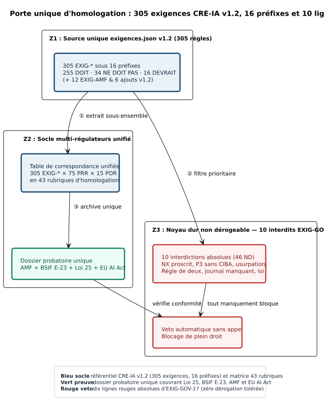
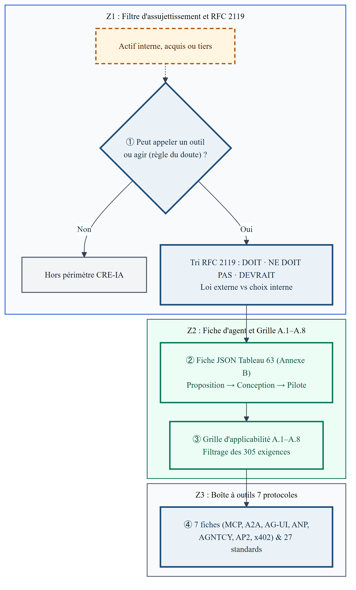
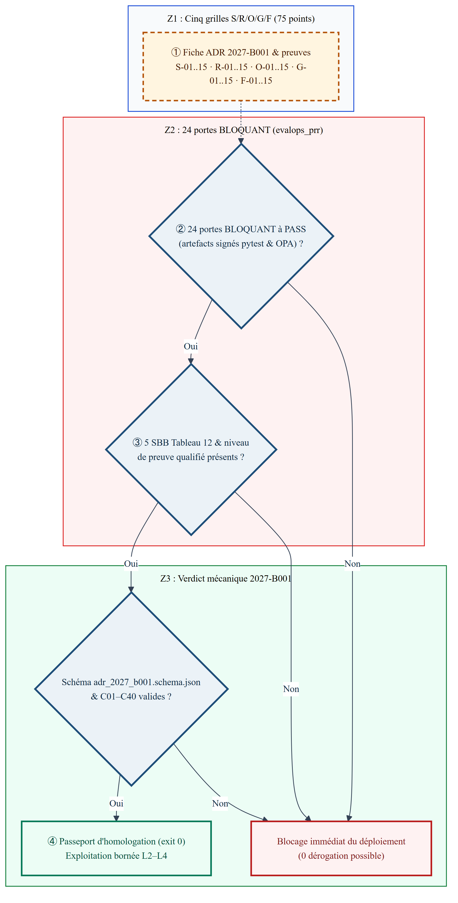

# Chapitre 34 — Référentiel d'homologation unifié : 305 exigences CRE-IA-2026-01, interdits GOV-17 et grille PRR-75

*Question directrice : Comment unifier 305 exigences normatives, dix interdictions absolues et une grille pré-production en 75 points afin de soumettre tout système agentique à une porte d'homologation unique, exécutable et opposable avant sa mise en service ?*

L'ingénierie d'un système agentique reste lettre morte tant que son passage en exploitation dépend d'attestations dispersées entre équipes sécurité, conformité, architecture et exploitation. La douzième et dernière partie du traité referme cet écart — dans le prolongement des verrous humains et organisationnels de la Partie XI (← Chapitre 33) — en soudant la norme prescrite, la preuve logicielle exécutée hors ligne et la traçabilité éditoriale complète de la collection. À l'ouverture de cette partie, le présent chapitre érige la porte unique d'homologation qui conditionne la mise en production de tout composant doté d'une capacité d'action, qu'il soit développé à l'interne, acquis sur étagère ou consommé auprès d'un fournisseur externe.

Jusqu'à l'unification documentaire réalisée au gel du **2 décembre 2026**, deux obstacles freinaient les revues pré-production : d'un côté, les prescriptions normatives, les grilles de risques et les attentes prudentielles vivaient dans des documents hétérogènes ; de l'autre, certaines dérogations locales fragilisaient des garde-fous non négociables. Le socle consolidé `CRE-IA-2026-01 v1.2` résout ce morcellement en regroupant dans une source structurée unique (`exigences.json`) un ensemble complet de `305` exigences vérifiables (suivant la force impérative `RFC 2119` [9]), adossées à dix interdictions absolues (`EXIG-GOV-17`), à la grille `PRR-75` (`24` verrous bloquants sur `75` points) et au gabarit `ADR 2027-B001` validé par schéma strict `JSON Schema Draft 2020-12` [1] avec couverture `OWASP ASI01–ASI10` [2]. L'ensemble des analyses réglementaires exposées ci-après demeure strictement consultatif et technique ; il ne constitue ni un avis juridique ni une certification prudentielle officielle [3, 4, 5].

Quatre piliers structurent le dispositif unifié d'homologation. Premièrement, la version `1.2` du référentiel `CRE-IA-2026-01`, arrêtée le `19 novembre 2026` selon la décision `DC-P08`, fédère `305` exigences vérifiables réparties sous `16` préfixes allant de l'architecture (`EXIG-ARC`) jusqu'à l'approvisionnement (`EXIG-APP`). L'usage rigoureux des verbes normatifs inspirés du standard IETF `RFC 2119` (`DOIT`, `NE DOIT PAS` et `DEVRAIT`) élimine toute ambiguïté d'interprétation entre impératifs bloquants et recommandations motivées [9]. Dès qu'un composant dispose d'une faculté d'appel d'outil ou d'action sur l'environnement, la règle du doute le fait entrer de plein droit dans le périmètre d'assujettissement.

Deuxièmement, une muraille de dix interdictions absolues (`EXIG-GOV-17`), pleinement réconciliée avec les `46` exigences non dérogeables (`46 ND`) de l'ossature normative, interdit toute dispense temporaire ou exception managériale sur les lignes rouges critiques. Aucun système ne peut être déployé en autonomie non bornée (`NX`), exécuter un outil critique (`P3`) sans approbation humaine hors bande liée cryptographiquement, usurper l'identité d'un mandant ou relayer aveuglément un jeton entrant. De même, il demeure proscrit de contourner la Règle de deux hors modèle, d'opérer sans fiche au registre ni journal d'audit distinct chaîné, ou de contrevenir aux lois applicables [2, 3, 5].

Troisièmement, le passage en exploitation aux niveaux d'autonomie `L2` à `L4` exige le franchissement intégral de la grille pré-production `PRR-75`. Celle-ci s'articule en cinq domaines de `15` points chacun : `S` pour la sécurité, `R` pour la résilience, `O` pour l'observabilité, `G` pour la gouvernance et `F` pour les frontières B2B et la souveraineté. Parmi ces `75` contrôles, `24` verrous constituent chacun une **Porte PRR bloquante** qui exige un artefact probatoire automatisé — journal signé, test de politique `OPA/Rego` vérifié en barrière `G0` ou validation de schéma `JSON Schema Draft 2020-12` [1]. Chaque dossier associe en outre une fiche d'agent évolutive (`Tome 2, Annexe B`, `Tableau 63`) et une fiche décisionnelle `ADR 2027-B001` contrôlée mécaniquement avant l'ouverture du flux.

Quatrièmement, une même archive probatoire répond simultanément aux quatre grands cadres juridiques et prudentiels cartographiés au gel du `2 décembre 2026`, évitant la duplication des dossiers d'audit :

- **Québec (Loi 25)** : L'article `12.1` inséré par `LQ 2021, c. 25` dans la *Loi sur le secteur privé* (`RLRQ, c. P-39.1`, en vigueur depuis le `22 septembre 2023`, ancré au registre `L+` et au Chapitre 25) encadre toute décision exclusivement automatisée. Il exige l'avis contemporain, les facteurs principaux sur demande, les observations et la révision humaine, sous peine de sanctions administratives jusqu'à `10 M$ CA` (`2 %`) et d'amendes pénales jusqu'à `25 M$ CA` (`4 %`).
- **Canada fédéral (BSIF E-23)** : La ligne directrice `E-23` révisée le `11 septembre 2025` entre en vigueur le `1er mai 2027` pour gouverner le risque de modélisation à l'échelle de l'entreprise, y compris l'intelligence artificielle et les agents autonomes [5].
- **Québec financier (AMF)** : L'échéance attendue du `1er mai 2027` pour la ligne directrice sur l'IA de l'Autorité des marchés financiers est rapportée sous réserve explicite via la source secondaire `AIBanks.ca`, le portail direct demeurant exclu en statut bloqué `F` [8].
- **Union européenne (EU AI Act et EN 18286:2026)** : Les obligations de transparence de l'article `50` du Règlement `(UE) 2024/1689` s'appliquent dès `août 2026` (`2 août 2026`), tandis que le Règlement `(UE) 2026/1744` fixe au plus tard au `2 décembre 2027` l'entrée en application de l'Annexe III et au `2 août 2028` celle de l'Annexe I [3, 4]. Le système de gestion de la qualité prévu à l'article `17` bénéficie en outre de la présomption de conformité portée par `EN 18286:2026` via la Décision `(UE) 2026/2274` [6, 7]. À cet horizon s'ajoute la fenêtre coordonnée `2030–2035` de transition post-quantique suivie par le `G7` et le NIST selon le calendrier du registre (← Chapitre 18).

## 34.1 Socle consolidé CRE-IA-2026-01 v1.2 (305 EXIG-*), dix interdictions GOV-17 et force normative RFC 2119

Le référentiel `CRE-IA-2026-01 v1.2` tire sa robustesse d'une source unique structurée, `exigences.json`, qui consolide toutes les règles opposables de conception, d'exploitation et de gouvernance des Systèmes d'agentivité. Par rapport à la version `1.1` qui comptait `287` prescriptions, la révision `1.2` arrêtée par la décision `DC-P08` le `19 novembre 2026` ajoute `18` règles normatives. Douze d'entre elles (`EXIG-AMF-01` à `EXIG-AMF-12`) transposent en contrôles techniques vérifiables les `41` attentes instruites dans la Note interne `AMF IA` (`CRE-IA-2026-01-QC` du `31 octobre 2026`, le portail officiel demeurant en statut bloqué `F`, date corroborée sous réserve via la source secondaire `AIBanks.ca` [8]). Les six autres ajouts couvrent l'agilité post-quantique et les cycles cryptographiques (`EXIG-SEC-27` et `EXIG-SEC-28`), la gouvernance et la convenance en valeurs mobilières `ACVM 11-348` (`EXIG-CON-27`), la véracité des déclarations et l'interdiction de l'« AI washing » (`EXIG-CON-28`), le tampon déterministe sur paiements temps réel `RTR` (`EXIG-CON-29`) et le système de gestion de la qualité conforme à `EN 18286:2026` (`EXIG-CON-30`) [6, 7].

La ventilation quantitative des `305` exigences révèle une architecture prescriptive fortement orientée vers les garanties déterministes et la maîtrise des risques. Sur le plan de la force illocutoire, `255` exigences emploient le verbe impératif `DOIT`, `34` posent une prohibition explicite via `NE DOIT PAS` et `16` formulent une recommandation motivée par `DEVRAIT`, dont toute déviation impose une justification consignée et approuvée [9]. Ces `305` règles s'articulent autour de `16` préfixes thématiques présentés au *Tableau 34.1* et croisent directement les `75` points `PRR`, les `15` portes adaptatives `POR`, les `31` décisions d'architecture `ADR` et les `43` rubriques de la grille d'homologation unifiée (`→ Annexe D`).

| Préfixe (`EXIG-*`) | Domaine normatif couvert | Nombre d'exigences | Exemples d'arrimage clé |
|---|---|---|---|
| `EXIG-ARC` | Architecture de référence et couches | `25` | Noyau possédé, `ACL`, isolation `CoALA` |
| `EXIG-INT` | Interopérabilité et contrats d'entreprise | `23` | Catalogue d'outils, schémas stricts, `vLEI` |
| `EXIG-MCP` | Protocole vertical `MCP 2026-07-28` | `22` | Épinglage `SHA-256` (`EXIG-MCP-03`), en-têtes `Mcp-Name`, `_meta` |
| `EXIG-A2A` | Protocole horizontal `A2A v1.0.1` | `15` | Validation signée `AgentCard`, anti-`SSRF` |
| `EXIG-EVT` | Interopérabilité événementielle | `10` | `CloudEvents`, `W3C Trace Context`, bornage |
| `EXIG-ORC` | Orchestration sobre et sagas durables | `30` | Modes `OO1–OO4`, idempotence, compensation (`EXIG-ORC-18`) |
| `EXIG-AUT` | Autonomie bornée et supervision humaine | `23` | Plafonds `L0–L4`, approbation `CIBA` liée à `h` |
| `EXIG-IAM` | Confiance zéro, `NHI` et délégation `OBO` | `21` | Rejet du relais de jeton, `DPoP`, `CAEP` |
| `EXIG-SEC` | Menaces agentiques et défenses hors modèle | `28` | `OPA/Rego`, Règle de deux, `CaMeL`, `PQC` |
| `EXIG-OBS` | Traçage `OTel` et journal d'audit ancré | `13` | Caviardage `OTel` (`EXIG-OBS-06`), double couloir `PII` (`EXIG-OBS-07..09`), `JCS`/`SCITT`, `SLH-DSA` |
| `EXIG-EVA` | Évaluation continue `EvalOps` | `6` | Constance `pass^k`, borne de Wilson `≥ 3/p` (`EXIG-EVA-03`) |
| `EXIG-FIN` | Économie de l'inférence et `FinOps` | `10` | `CPO`, facturation `FOCUS v1.4`, carbone (`CAP-046`), disjoncteur |
| `EXIG-GOV` | Gouvernance, registre et cycle de vie | `20` | Parrain nommé, `10` interdits `EXIG-GOV-17` |
| `EXIG-CON` | Risques, conformité et secteurs | `30` | Loi 25, `BSIF E-23`, `EU AI Act`, `EN 18286` |
| `EXIG-AMF` | Profil québécois `AMF IA` (`v1.2`) | `12` | `41` attentes de `CRE-IA-2026-01-QC`, métamorphique (`EXIG-AMF-11`) |
| `EXIG-APP` | Approvisionnement et réversibilité | `17` | `10` clauses contractuelles, sortie annuelle |

*Tableau 34.1 — Répartition des 305 exigences CRE-IA-2026-01 v1.2 par préfixe et rattachement architectural.*

Au cœur de ces `305` règles, l'exigence `EXIG-GOV-17` isole un noyau dur de dix interdictions absolues qui ne souffrent aucune dérogation, même provisoire ou assortie d'un plan de remédiation ultérieur. Ce verrouillage complet est aligné sans écart avec les `46` exigences non dérogeables (`46 ND`) recensées dans l'ossature normative du cadre de référence. Dès qu'une revue d'architecture ou un test automatisé constate le moindre manquement à l'une de ces dix lignes rouges, le déploiement est bloqué de plein droit :

1. **Proscription de l'autonomie non bornée (`EXIG-AUT-03`)** : Aucun agent ne peut opérer au niveau théorique `NX` hors plafond défini par la matrice de risque.
2. **Interdiction d'action critique sans approbation liée (`EXIG-AUT-09`, `12`, `13`)** : Tout outil de palier `P3` à effet irréversible requiert une approbation humaine hors bande (`CIBA`) liée par empreinte cryptographique à l'action exacte.
3. **Interdiction d'usurpation du mandant humain (`EXIG-IAM-08`, `09`)** : Un agent ne doit jamais agir sous l'identité brute d'un utilisateur humain sans identité propre traçable dans la chaîne de délégation.
4. **Rejet absolu du relais de jeton (`EXIG-IAM-12`, `EXIG-MCP-11`)** : Un jeton d'accès reçu en amont ne peut jamais être réémis tel quel (*token passthrough*) vers un serveur `MCP` ou un agent pair en aval.
5. **Exploitation interdite sans fiche ni parrain (`EXIG-GOV-01..15`)** : Aucun agent ne peut accéder à la production sans inscription complète au registre central et désignation d'un parrain métier imputable.
6. **Respect strict du plafond d'autonomie (`EXIG-AUT-01`, `02`, `EXIG-CON-02`)** : Aucune dérogation ne permet d'élever l'autonomie au-delà du plafond fixé par la classe de risque ou le cadre des décisions visant une personne.
7. **Plafond de la règle d'or (`EXIG-AUT-07`)** : Un agent atteignant les seuils de criticité financière, juridique ou prudentielle de la règle d'or demeure plafonné au niveau `L2` (anciennement `N2`) sous validation humaine.
8. **Blocage de la triade létale (`EXIG-SEC-06`)** : Aucun agent ne peut combiner simultanément l'accès aux données sensibles, l'exposition aux entrées externes non fiables et une capacité d'exfiltration sortante sans retrait déterministe des outils sortants hors modèle.
9. **Intégrité et distinction du journal d'audit (`EXIG-OBS-11`)** : Tout système en service doit alimenter un journal probatoire distinct, chaîné cryptographiquement et protégé contre toute altération par le modèle ou l'opérateur.
10. **Conformité impérative aux lois applicables (`EXIG-AUT-22..23`, `EXIG-CON-04..22`)** : Aucun motif technique ou économique ne permet de déroger aux obligations légales impérativement applicables, notamment l'article `12.1` de la Loi 25 sur les décisions automatisées (← Chapitre 25), l'ÉFVP préalable, la conservation canadienne des livres bancaires ou la transparence `EU AI Act` [3].

L'application cohérente de ces règles repose sur trois principes d'interprétation définis dès la section liminaire du cadre normatif (`CRE-IA-2026-01 § 1`). Premièrement, l'assujettissement est déterminé par la **portée fonctionnelle** : tout logiciel interne, progiciel SaaS acquis ou agent fournisseur capable de déclencher un appel d'outil ou de modifier un état métier tombe sous l'empire du cadre, quel que soit son habillage commercial. En cas d'incertitude sur le caractère purement conversationnel ou actif d'un composant, la **règle du doute** impose de l'inscrire au registre et de le soumettre au filtrage complet des `305` exigences.

Deuxièmement, la **force normative `RFC 2119`** [9] structure les responsabilités de vérification : chaque clause `DOIT` ou `NE DOIT PAS` forme une condition de blocage mécanique ; chaque clause `DEVRAIT` autorise un écart uniquement sur dossier d'équivalence documenté et signé. Quant aux blocs de code et de spécifications exécutables, ils sont formulés à l'indicatif présent parce qu'ils décrivent des contrôles logiciels déterministes qui s'exécutent sans ambiguïté.

Troisièmement, le référentiel maintient une **séparation nette entre les obligations légales externes et les choix d'ingénierie internes**. Les premières découlent directement des textes législatifs et prudentiels en vigueur ou programmés — tels que la Loi 25 (← Chapitre 25), les lignes directrices du BSIF [5], le repère AMF rapporté sous réserve via la source secondaire `AIBanks.ca` (portail en statut `F`) [8], les règlements européens `(UE) 2024/1689` et `2026/1744` [3, 4] ou la norme harmonisée `EN 18286:2026` [6, 7] — et s'imposent indépendamment de la pile technique retenue. Les seconds fixent des seuils architecturaux internes (tels que la constance `pass^5` ou la rétention chaude des journaux) susceptibles d'évoluer selon les cycles de révision semestriels du cadre.

Cette distinction éclaire aussi le mécanisme de gouvernance de la présomption de conformité. Dans l'Union européenne, le `12 octobre 2026`, la Commission a officialisé au Journal officiel par la Décision d'exécution `(UE) 2026/2274` la norme harmonisée `EN 18286:2026` relative au management de la qualité des systèmes d'IA à haut risque [6]. Son communiqué du `21 octobre 2026` précise l'arrimage de ce référentiel à l'article `17` et aux systèmes qualité sectoriels existants [7]. En raccordant `EXIG-CON-30` à ce jalon, le socle unifié réunit sous une seule architecture de preuves les exigences techniques internes et les attentes externes qui s'appliqueront pleinement à l'Annexe III d'ici le `2 décembre 2027` [4].

Afin que chaque partie prenante s'approprie ce volume normatif sans surcharge cognitive, le `Tableau 2` du référentiel `CRE-IA-2026-01` (`Tome 2`) organise le parcours de lecture par rôle (direction TI, architectes, plateforme, sécurité, risques/conformité/RP, responsables métier, approvisionnement et audit interne). En pratique, l'équipe juridique et de conformité cible les chapitres réglementaires ainsi que `EXIG-CON` et `EXIG-AMF` ; l'architecte d'entreprise (`AE`) vérifie l'alignement des principes `PRIN-01` à `PRIN-12`, les plafonds d'autonomie et le registre central. De son côté, l'architecte de solutions (`AS`) concentre son attention sur les interfaces `MCP`/`A2A`, l'orchestration et `EvalOps`, tandis que le `RSSI` et le `SRE` valident les contrôles `NHI`, `OPA`, le confinement, la journalisation et le coupe-circuit. La *Figure 124* synthétise cette architecture de porte unique à trois strates, montrant comment une archive probatoire unifiée satisfait simultanément quatre régulateurs tout en érigeant les dix interdictions `EXIG-GOV-17` en mur coupe-feu infranchissable.



*Figure 124 — SCH-34-01 : Architecture en trois strates du référentiel unifié `exigences.json v1.2` (`305` règles sous `16` préfixes), socle probatoire multi-régulateurs (Loi 25, BSIF E-23, AMF, EU AI Act) et noyau non dérogeable des `10` lignes rouges `EXIG-GOV-17` (`46 ND`).*

## 34.2 Grille d'homologation PRR-75, 24 portes bloquantes, fiche d'agent et annexes protocolaires

Disposer d'un catalogue normatif de `305` règles ne suffit pas pour instruire concrètement un dossier projet au fil de son cycle de vie. Pour rendre l'homologation opérationnelle dès l'amorce d'une initiative, le cadre s'appuie sur deux formulaires normatifs obligatoires issus des Annexes A et B du Tome 2. Le premier formulaire est la **fiche d'agent** (`Tome 2, Annexe B`, `Tableau 63` et schéma JSON associé), dont le contenu est exigé par `EXIG-GOV-07` (en complément de la grille d'homologation régie par `EXIG-GOV-11`). Ce dossier vivant accompagne l'initiative sur trois jalons formels :

- **Jalon Proposition** : la fiche identifie le parrain métier imputable, la finalité métier, les catégories de données manipulées et la classe de risque présumée.
- **Jalon Conception** : elle arrête le niveau d'autonomie maximal (`L0`–`L4`), la cartographie des outils (`P0`–`P3`), les mécanismes de compensation et les exigences `Loi 25`/`BSIF`/`RIA` applicables.
- **Jalon Pilote** : elle consigne les résultats des campagnes `EvalOps`, les empreintes des contrats et l'identifiant du coupe-circuit centralisé avant toute exposition à des utilisateurs réels.

Le second formulaire est la **grille d'applicabilité et d'homologation** (`Tome 2 Annexe A`, sections `A.1` à `A.8`, `57` points dont `28` universels et `29` conditionnels incluant `11` règles non dérogeables, consolidés en `43` rubriques `A.2.1` à `A.8.7` à l'Annexe D §12 du présent Compendium, après extension en `v1.2` des `41` rubriques initiales du corpus source `Tome 5 Annexe C.1`). Par projection déterministe du profil d'autonomie (`L0–L4`) et de la topologie déclarés en `A.1`, chaque capacité activée déclenche les rubriques applicables (`EXIG-GOV-16`) qui filtrent les `305` exigences `EXIG-*`, marquent le noyau `EXIG-GOV-17` et lient l'artefact système au jalon `POR`. Ainsi, un agent `L0–L1` reste hors périmètre `PRR-75` sous les seuls contrôles universels, tandis qu'un système `L2–L4` ouvre les portes `PRR` requises sans omission réglementaire.

Pour appuyer les équipes lors des revues d'architecture et d'acquisition, cette mécanique d'instruction s'accompagne d'un référentiel documentaire synoptique consolidé aux Annexes A, B, C, D et H du Tome 3. Ce corpus d'appoint réunit d'abord un glossaire bilingue d'usage structuré en huit rubriques thématiques (`A.1` à `A.8`), garantissant la rigueur des échanges entre ingénierie, conformité et fournisseurs (le glossaire normatif étant établi au `Tome 2 Annexe E`). Il fournit ensuite sept fiches comparatives normalisées couvrant les sept protocoles structurants de l'écosystème agentique — `MCP` (outil vers modèle), `A2A` (agent vers agent), `AG-UI` (interface agent-utilisateur), `ANP` (réseau décentralisé d'agents), `AGNTCY` (infrastructure collective et transport `SLIM`), `AP2` (mandats de paiement agentiques) et `x402` (micro-paiements HTTP natifs).

Ces sept fiches sont complétées par trois grilles d'évaluation probatoires portant sur l'interopérabilité, l'orchestration et le plan de contrôle de plateforme. Enfin, une chronologie vérifiée `2024–2028` (retraçant notamment la création en octobre 2026 des groupes IETF `agentproto` et `dawn`, ainsi que les livrables et révisions `OAuth 2.1` et `WIMSE` d'octobre–novembre 2026) et un index synoptique de `27` fondations et standards situent chaque choix technique sur son horizon de maturité réel. La *Figure 125* schématise ce guichet d'orientation méthodique reliant le filtre de capacité d'action, le tri `RFC 2119` [9] et le dossier documentaire complet.



*Figure 125 — SCH-34-02 : Parcours d'assujettissement par règle du doute et force normative `RFC 2119`, constitution progressive de la fiche d'agent (`Tome 2, Tableau 63`) et de la grille `A.1–A.8` (`305` exigences), et outillage de revue des `7` protocoles et `27` standards.*

Lorsqu'un système franchit le seuil de l'autonomie active (`L2` à `L4`) et s'approche de la mise en production, la vérification documentaire cède la place à la **grille pré-production `PRR-75`** (héritée de l'Annexe G du Tome 3 et formalisée en matrice exécutable dans l'Annexe B du Tome 8, reprise à l'Annexe D §10 du présent Compendium). Composée de `75` points de contrôle répartis équitablement en cinq domaines de `15` points chacun — Sécurité et `NHI` (`S-01` à `S-15`), Résilience et exécution durable (`R-01` à `R-15`), Observabilité, `EvalOps` et `FinOps` (`O-01` à `O-15`), Gouvernance, droit et conformité (`G-01` à `G-15`), et Frontières B2B, souveraineté et usine interne (`F-01` à `F-15`) — la grille `PRR-75` proscrit toute auto-attestation déclarative.

Chaque point de contrôle s'appuie sur un artefact vérifiable classé selon quatre forces probatoires : normative directe, banc reproductible, preuve d'éditeur sous réserve, ou synthèse architecturale. Au sein des `75` critères, `100 %` des `24` **Portes PRR bloquantes** conditionnent l'ouverture en production aux niveaux actifs (`L2–L4`). En complément, les **`26` critères conditionnels** (`S:4, R:4, O:3, G:4, F:11`) s'activent sélectivement selon le périmètre technique (`MCP`, `A2A`, multi-sauts, `CUA`, `OT`, `TEE`, distillation, fédération `B2B`, usine `ADLC`), le palier `L3–L4` (`O-05` `pass^k`, `F-07`) ou l'assujettissement (`G-04` `BSIF E-23`, `G-08` `EU AI Act`) [3, 5], complétés par `25` critères élevés ou moyens (*Tableau 34.2*).

| Grille `PRR-75` | Points totaux | Portes bloquantes (`24`) | Identifiants bloquants et artefacts probatoires vérifiés (`evalops_prr`) |
|---|---|---|---|
| `S` — Sécurité & `NHI` | `15` | `8` | `S-01` (registre `NHI`), `S-03` (`OBO` `RFC 8693`), `S-06` (séparation exposition/écriture), `S-08` (défense `ASI01`), `S-09` (`OPA`/`Cedar` hors modèle), `S-11` (bac à sable isolé), `S-14` (coupe-circuit `< 10 s`, `POR-003`), `S-15` (séparation des tâches SoD) |
| `R` — Résilience & Sagas | `15` | `5` | `R-01` (inviolabilité `SoR` par API validées et schémas stricts), `R-03` (idempotence), `R-06` (compensation Saga), `R-07` (`TTL` et approbation), `R-14` (confinement multilocataire) |
| `O` — Observabilité & `FinOps` | `15` | `2` | `O-02` (zéro `PII` en index général), `O-09` (disjoncteur budgétaire et `CPO` exact) |
| `G` — Gouvernance & Droit | `15` | `7` | `G-01` (parrain et `ADR 2027-B001`), `G-03` (empreinte réglementaire `2027-B001`), `G-05` (`ÉFVP` Loi 25), `G-06` (art. `12.1` Loi 25), `G-07` (art. `50` `EU AI Act`), `G-10` (effacement `CoALA`), `G-15` (journal `JCS`/`SCITT` + `SLH-DSA`) |
| `F` — Frontières B2B & Souveraineté | `15` | `2` | `F-04` (résidence juridictionnelle des couches d'état), `F-14` (confinement du SRE autonome sous `Cedar`/`OPA`) |

*Tableau 34.2 — Répartition des 75 points PRR et des 24 portes PRR bloquantes par domaine de contrôle.*

Pour garantir que l'arbitrage architectural d'homologation reste lui-même exempt d'omissions structurelles, chaque dossier pré-production instancie le gabarit `ADR 2027-B001` et le soumet au validateur strict `schemas/adr_2027_b001.schema.json` conforme à `JSON Schema Draft 2020-12` [1]. La *Figure 126* expose la mécanique de cet arbre de décision automatisé. Le candidat soumet d'abord sa fiche `ADR 2027-B001` et ses preuves pour les cinq domaines `S/R/O/G/F`, puis traverse le crible des `24` verrous bloquants dans `evalops_prr`. Il vérifie ensuite la présence conjointe des cinq blocs critiques (`5 SBB`) et de leur niveau probatoire, avant de recevoir son passeport d'homologation uniquement si le schéma strict et les critères des trois blueprints `C01–C40` valident à `exit 0`.



*Figure 126 — SCH-34-03 : Arbre décisionnel mécanique reliant les cinq grilles `PRR-75` (`S/R/O/G/F`), les `24` portes bloquantes exécutées par `evalops_prr`, les `5 SBB` du `Tableau 12` (Tome 2, détaillés au Chapitre 35), le schéma strict `adr_2027_b001.schema.json` et le contrôle `C01–C40`.*

L'extrait normatif `G0-EX-CH04-03` ci-dessous, synchronisé octet pour octet avec la trousse exécutable validée en barrière `G0`, fixe la structure exacte du contrat `Adr2027B001` :

<!-- CA-G0-SYNC id="G0-EX-CH04-03" path="Tomes/Tome 8 - Ingénierie exécutable et homologation vérifiable/trousse/schemas/adr_2027_b001.schema.json" lines="1-32" sha256="4f0a41e7280851ce1413efeb6accb3632bb3ee6a0bfefc4fa7d92338156e36ae" -->
```json
{"$schema":"https://json-schema.org/draft/2020-12/schema","title":
"Adr2027B001","x-license":"MIT","type":"object","additionalProperties":false,
"$defs":{"S":{"type":"string","minLength":3}},"required":["adr_id","title",
"status","date","owners","risk_and_autonomy","technical_invariants",
"fallback_and_killswitch","review_trigger"],"properties":{"adr_id":{"type":
"string","pattern":"^ADR-[0-9A-Z-]+$"},"title":{"$ref":"#/$defs/S"},"status":{
"type":"string","enum":["Proposed","Accepted","Deprecated","Superseded"]},
"date":{"type":"string","pattern":"^\\d{4}-\\d{2}-\\d{2}$"},"owners":{"type":
"object","additionalProperties":false,"required":["architecture_lead",
"named_business_owner"],"properties":{"architecture_lead":{"$ref":"#/$defs/S"}
,"named_business_owner":{"$ref":"#/$defs/S"}}},"risk_and_autonomy":{"type":
"object","additionalProperties":false,"required":["autonomy_ceiling",
"regulatory_footprint","owasp_asi_mitigated"],"properties":{
"autonomy_ceiling":{"type":"string","enum":["L0","L1","L2","L3","L4"]},
"owasp_asi_mitigated":{"type":"array","minItems":1,"items":{"type":"string",
"pattern":"^ASI(0[1-9]|10)$"}},"regulatory_footprint":{"type":"object",
"additionalProperties":false,"required":["bsif_e23_materiality",
"quebec_law25_automated_decision","eu_ai_act_tier"],"properties":{
"bsif_e23_materiality":{"type":"string","enum":["Low","Moderate","High"]},
"quebec_law25_automated_decision":{"type":"boolean"},"eu_ai_act_tier":{"type":
"string","enum":["Minimal","Art50","HighRisk_AnnexIII"]}}}}},
"technical_invariants":{"type":"object","additionalProperties":false,
"required":["vertical_protocol","horizontal_protocol","durable_runtime",
"compensation_strategy","max_cost_per_outcome_cad","minimum_eval_gate"],
"properties":{"vertical_protocol":{"$ref":"#/$defs/S"},"horizontal_protocol":{
"$ref":"#/$defs/S"},"durable_runtime":{"$ref":"#/$defs/S"},
"compensation_strategy":{"$ref":"#/$defs/S"},"max_cost_per_outcome_cad":{
"type":"number","exclusiveMinimum":0},"minimum_eval_gate":{"$ref":"#/$defs/S"}
}},"fallback_and_killswitch":{"type":"object","additionalProperties":false,
"required":["degraded_mode","soc_killswitch_id"],"properties":{
"degraded_mode":{"$ref":"#/$defs/S"},"soc_killswitch_id":{"$ref":"#/$defs/S"}}
},"review_trigger":{"$ref":"#/$defs/S"}}}
```

L'examen technique de ce schéma met en évidence cinq garde-fous structurels exigés dès le jalon `Conception` (`EXIG-HOM-04`, étiquette de synthèse du plan directeur du Compendium distincte des `305` règles `CRE-IA`). Premièrement, la directive `additionalProperties: false` appliquée à la racine comme à chaque sous-objet interdit tout champ libre non gouverné conformément à `JSON Schema Draft 2020-12` [1]. Deuxièmement, l'objet `owners` impose la co-signature formelle d'un responsable d'architecture (`architecture_lead`) et d'un propriétaire métier nommé (`named_business_owner`), concrétisant la gouvernance duale et le parrainage `EXIG-GOV-01`. Troisièmement, la section `risk_and_autonomy` borne l'autonomie dans l'ensemble fermé `L0`–`L4` (excluant mécaniquement `NX`), impose la couverture explicite d'au moins un risque `ASI01` à `ASI10` du référentiel OWASP agentique [2] et qualifie l'empreinte réglementaire sous `bsif_e23_materiality` [5], `quebec_law25_automated_decision` (← Chapitre 25) et `eu_ai_act_tier` (`Minimal`, `Art50` ou `HighRisk_AnnexIII`) [3, 4].

Quatrièmement, `technical_invariants` force la déclaration des protocoles verticaux et horizontaux, du moteur d'exécution durable, de la stratégie de compensation, d'un plafond strictement positif du coût par résultat conforme en dollars canadiens (`max_cost_per_outcome_cad`) et du seuil minimal d'évaluation (`minimum_eval_gate`, tel que `pass^5`). Cinquièmement, `fallback_and_killswitch` et `review_trigger` garantissent l'existence d'un mode dégradé éprouvé, d'un identifiant de coupe-circuit `SOC` et d'un déclencheur explicite de révision. À l'instanciation, l'identifiant du champ `adr_id` s'écrit avec trait d'union (`ADR-2027-B001`) afin de satisfaire au motif `^ADR-[0-9A-Z-]+$`, et le validateur Python applicatif complète le motif `date` (`^\d{4}-\d{2}-\d{2}$`) par un contrôle calendaire ISO 8601 strict.

## 34.3 Synthèse transversale, livrables et portes de contrôle

Sur le plan de l'architecture systémique, le présent chapitre agit comme le point de convergence normatif du domaine `D12`. En amont, il recueille les `12` principes directeurs `PRIN-01` à `PRIN-12` et les `31` décisions `ADR` (← Chapitre 06), ainsi que la couverture des menaces `OWASP ASI01–ASI10` (← Chapitre 19) [2]. Il intègre également les arbitrages d'enveloppe temporelle du coupe-circuit (`< 10 s` côté passerelle sous `POR-003`, `≤ 15 min` global) et de purge forensique (`≤ 14 jours` au lieu de `14–30 jours`, ← Chapitres 21 et 22), tout comme les cadres réglementaires et normes sectorielles applicables au Québec, au Canada et en Europe (← Chapitres 25 et 26) [3, 4, 5, 6, 7]. Enfin, il reçoit les validateurs Python et `OPA` exécutables de la trousse compagnon (→ Chapitre 35). En aval, il projette le socle des `305` exigences et les `10` lignes rouges `EXIG-GOV-17` vers les politiques hors modèle (← Chapitre 20), le banc d'évaluation `EvalOps` (← Chapitre 23), le régime des dérogations (← Chapitre 32) et le scellement de la concordance et de la chaîne probatoire `Wyvern` (→ Chapitre 36).

Conformément à la règle de non-contournement (`AO-01`), l'homologation s'appuie exclusivement sur les textes intégraux ouverts vérifiés par empreinte `SHA-256` et archivés dans la base documentaire fermée du chapitre. Les ressources bloquées par pare-feu applicatif ou mur payant demeurent consignées en statut bloqué `F` hors preuve. Tel est le cas du portail direct de l'Autorité des marchés financiers (`lautorite.qc.ca`, erreur `HTTP 403`), dont le repère attendu du `1er mai 2027` est rapporté sous réserve explicite via la source secondaire `AIBanks.ca` [8]. Il en va de même pour la fiche payante de la norme `ISO/IEC 42001` sur `iso.org` (`HTTP 403`) et pour le portail `CEN/CENELEC` (`HTTP 500`), compensé en preuve ouverte par la Décision d'exécution `(UE) 2026/2274` [6] et le communiqué officiel de la Commission européenne [7].

Le *Tableau 34.3* récapitule les livrables opposables et les critères de sortie du chapitre, rattachés aux six méta-exigences d'homologation du plan directeur du Compendium (`EXIG-HOM-01` à `EXIG-HOM-06`, distinctes des `305` règles `CRE-IA`). Ces six repères couvrent la soumission universelle et la règle du doute (`EXIG-HOM-01` → `EXIG-GOV-07`), la force `RFC 2119` et `EXIG-GOV-17` (`EXIG-HOM-02` → `46 ND`), ainsi que le verrouillage `PRR-75` (`EXIG-HOM-03` → `EXIG-EVA-01`, `EXIG-GOV-11`). Ils encadrent enfin la fiche d'agent, la grille `A.1–A.8` et `ADR-2027-B001` (`EXIG-HOM-04` → `EXIG-ARC-01`, `EXIG-GOV-01`, `EXIG-GOV-16`), les preuves multi-régulateurs (`EXIG-HOM-05` → `EXIG-CON-04..30`, `EXIG-AMF-01..12`), ainsi que la revue protocolaire et la mention `non-avis` (`EXIG-HOM-06` → vingt-trois règles `EXIG-INT-01` à `23`, vingt-deux règles `EXIG-MCP-01` à `22` et quinze règles `EXIG-A2A-01` à `15`).

| Livrable ou artefact d'homologation | Exigences et portes associées | Critère d'acceptation vérifiable (`G0`–`G5`) |
|---|---|---|
| Registre unifié `exigences.json` `v1.2` | `EXIG-HOM-01`, `EXIG-HOM-02`, `EXIG-GOV-17`, `DC-P08` | `305` exigences (`255 DOIT`, `34 NE DOIT PAS`, `16 DEVRAIT`) sous `16` préfixes ; tolérance zéro sur les `10` interdits et `46 ND` [9] |
| Fiche d'agent (`Tome 2, Annexe B, Tableau 63`) et grille `A.1–A.8` | `EXIG-HOM-04`, `EXIG-HOM-06`, `EXIG-GOV-07`, `EXIG-GOV-11` | Enrichissement aux `3` jalons (`Proposition`, `Conception`, `Pilote`) ; `43` rubriques filtrées reliant `305 EXIG-*`, `75 PRR`, `15 POR`, `31 ADR` |
| Matrice `PRR-75` (`S/R/O/G/F`) et `24` portes bloquantes | `EXIG-HOM-03`, `EXIG-HOM-05`, `DC-P11`, `PRR S-01..F-14` | `100 %` des `24` portes bloquantes validées par artefact `CI` ou journal signé ; preuve qualifiée (normative, mesurée, éditeur ou synthétique) |
| Gabarit `ADR 2027-B001` (`G0-EX-CH04-03`) | `EXIG-HOM-04`, `C05`, `C06`, `C35`, `C37` | Validation stricte sans erreur contre `adr_2027_b001.schema.json` (`Draft 2020-12`) couvrant `ASI01–ASI10`, `CPO`, `pass^5` et coupe-circuit [1, 2] |
| Appareil synoptique (`7` protocoles, `27` standards) | `EXIG-HOM-06`, `DC-P01`, `AO-05` | Fiches comparatives `MCP`, `A2A`, `AG-UI`, `ANP`, `AGNTCY`, `AP2`, `x402`, `3` grilles probatoires, chronologie `2024–2028` et mention `non-avis` [3, 5] |

*Tableau 34.3 — Livrables d'homologation, exigences associées et critères d'acceptation vérifiables du Chapitre 34.*

> **Trois invariants exécutables — Chapitre 34**
>
> 1. **Soumission universelle et tolérance zéro (`exigences.json v1.2`, `EXIG-GOV-17`)** : Tout composant interne, acquis ou tiers doté d'une capacité d'action entre dans le périmètre des `305` exigences sous la règle du doute et se heurte à un veto immédiat sans dérogation s'il enfreint l'une des dix interdictions `EXIG-GOV-17` (`46 ND`).
> 2. **Verrouillage pré-production `PRR-75` et `24` portes bloquantes (`evalops_prr`)** : Aucun système `L2`–`L4` n'accède à l'exploitation sur la foi d'une attestation déclarative ; il doit valider `100 %` des `24` contrôles `[BLOQUANT]` (`S:8`, `R:5`, `O:2`, `G:7`, `F:2`) adossés à des preuves vérifiées et qualifiées.
> 3. **Contrat mécanique `ADR 2027-B001` et socle multi-régulateurs unique (`G0-EX-CH04-03`)** : La validation stricte contre `adr_2027_b001.schema.json` [1] scelle conjointement le propriétaire nommé, le plafond `L0`–`L4`, la couverture `OWASP ASI01–ASI10` [2], le `CPO` maximal et l'empreinte réglementaire `Loi 25` (← Chapitre 25) / `BSIF E-23` [5] / `AMF` (source secondaire `AIBanks.ca`, portail en statut `F` [8]) / `EU AI Act` [3, 4] sans valeur d'avis juridique ni certification réglementaire.
