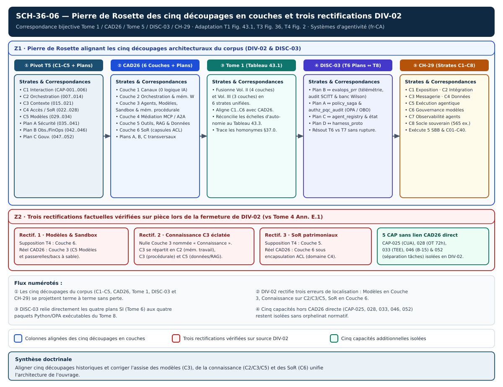
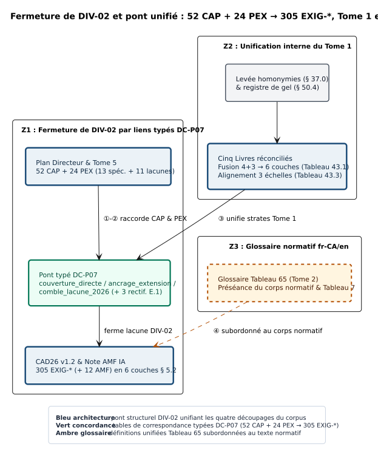
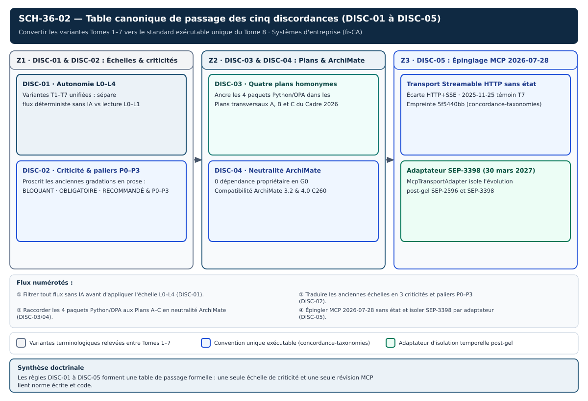
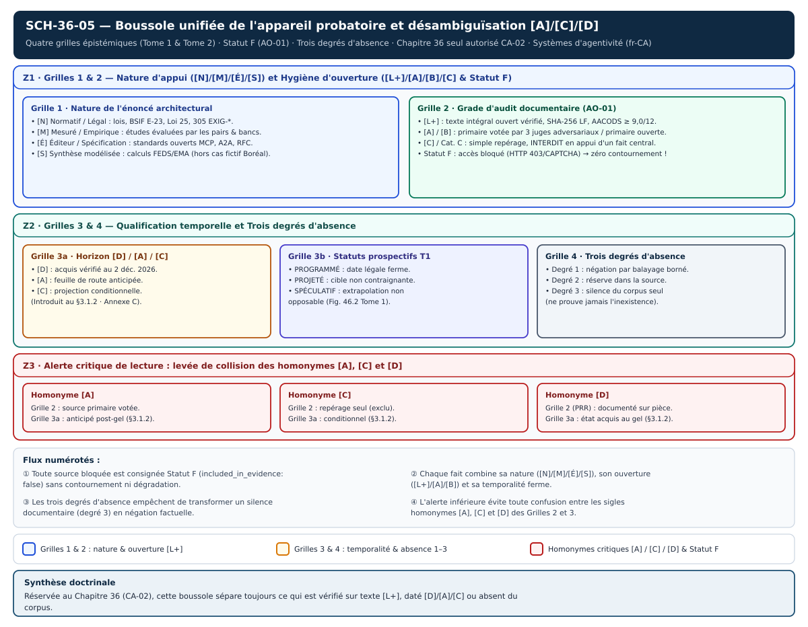
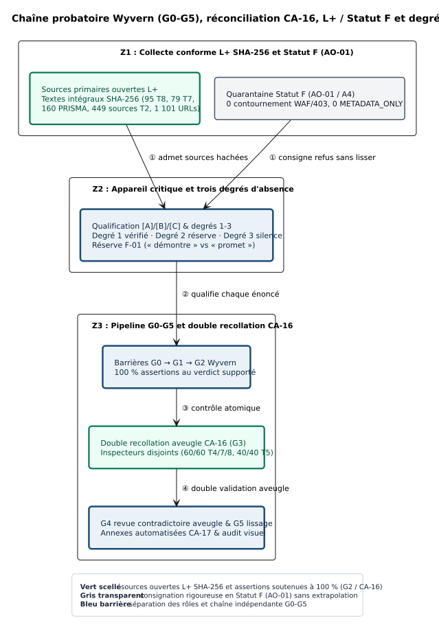
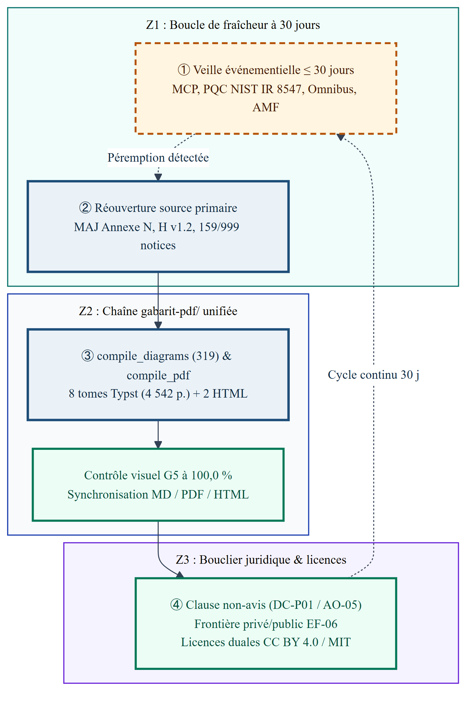

# Chapitre 36 — Concordance inter-tomes des systèmes d'entreprise (DIV-02, DISC-01 à DISC-05), régime probatoire Wyvern G0–G5 et clause non-avis

*Question directrice : Comment verrouiller la concordance structurelle, taxonomique et éditoriale des huit volumes antérieurs dans ce traité d'interopérabilité et d'automatisation agentique des systèmes d'entreprise, tout en soumettant l'ensemble de l'ouvrage à une chaîne d'ancrage probatoire reproductible (G0–G5) et à la frontière stricte du non-avis ?*

> **Clause non-avis et périmètre probatoire (`AO-05`, `DC-P01`, `DC-P12`)** — Le présent traité, ses schémas vectoriels et les modules logiciels de sa trousse compagnon constituent un référentiel consultatif d'architecture et d'ingénierie destiné aux architectes d'entreprise (`AE`), architectes de solutions (`AS`) et équipes techniques, figé au **2 décembre 2026**. Ils ne constituent ni un avis juridique, médical, financier ou réglementaire, ni une opinion actuarielle ni une certification d'audit. Ils ne sauraient donc se substituer au jugement humain ni à l'homologation sur un système en exploitation réelle ou sur ses systèmes d'enregistrement (`SoR`). Ce cadrage vaut au regard de la Loi 25 [7], de la ligne directrice `E-23` du BSIF [8], des attentes de l'Autorité des marchés financiers (`AMF`, repère rapporté sous réserve via la source secondaire `AIBanks.ca`, portail en statut `F` [12]) ou du Règlement européen `(UE) 2024/1689` (`EU AI Act`, visé via la décision d'exécution `(UE) 2026/2274` [9] et le Chapitre 26). Conformément à la règle de démarcation `EF-06`, aucune directive propre au secteur public (telle que l'`Arrêté 2025-02` et le *Guide sur l'utilisation responsable de l'IA agentique* du `MCN`, `AMOPS`, le décret américain `EO 14412`, `OMB M-26-15` ou les directives du Secrétariat du Conseil du Trésor) ne s'étend de plein droit aux entreprises privées (industrielles, commerciales, numériques ou financières). Les textes et figures sont publiés sous licence `CC BY 4.0`, tandis que la trousse logicielle et l'outillage déterministe relèvent de la licence `MIT`.

Consolider huit volumes rédigés successivement expose à deux risques : la dérive entre taxonomies révisées et la fragilité probatoire face aux sources qui évoluent ou ferment leur accès. Ce trente-sixième chapitre — adossé aux `8` tomes historiques (`4 542` pages en `Typst`, `319` diagrammes) — clôt la gouvernance éditoriale et probatoire.

Là où le Chapitre 34 a érigé la porte unique d'homologation (`305` exigences `CRE-IA-2026-01 v1.2`, `EXIG-GOV-17`, `PRR-75`) et le Chapitre 35 a livré la trousse exécutable à `exit 0` (`G0`, `5 SBB`), ce chapitre codifie les règles d'assemblage unifiant les huit tomes autour des systèmes d'entreprise. Il documente la fermeture de `DIV-02`, la concordance titulaire avec les huit volumes publiés et la réconciliation interne du Tome 1, la table des cinq discordances (`DISC-01` à `DISC-05`) et la préséance du glossaire. Il établit ensuite le pipeline `Wyvern G0–G5`, la double recollation `CA-16`, l'hygiène `L+` `SHA-256` face au **Statut F** (`AO-01` / `A4`), l'appareil `[A]`/`[B]`/`[C]` et les trois degrés d'absence, l'audit des `121` références et `449` sources (`Tome 2, Annexe G`), le cycle de veille à `30` jours, l'usine `Typst` et le bouclier `non-avis`.

Trois verrous conjoints assurent cette cohérence. D'abord, la **concordance architecturale et terminologique** résorbe les écarts entre les volumes initiaux et les révisions de l'automne 2026. La fermeture vérifiée de `DIV-02` soude les `52` capacités cibles (`CAP`, dont `42` invariantes et `10` conditionnelles) et les `24` extensions sectorielles (`PEX`) aux `305` exigences `EXIG-*` de la version `1.2` par des liens typés explicites (`DC-P07`), tout en rectifiant trois suppositions héritées sur l'emplacement des modèles, de la connaissance et des systèmes d'enregistrement. En parallèle, la table canonique `DISC-01` à `DISC-05` (`concordance-taxonomies.json`) tranche les conflits d'échelles d'autonomie et de criticité, relie les quatre paquets de code aux Plans `A`, `B` et `C`, garantit la neutralité `ArchiMate` et épingle strictement le protocole vertical sur `MCP 2026-07-28` (`5f5440bb`) [2, 3] face aux jalons `SEP-2596` [4] et `SEP-3398` [5].

En deuxième lieu, le **régime probatoire `Wyvern G0–G5`** interdit qu'une affirmation centrale repose sur une source inaccessible, un résumé partiel ou une relecture complaisante. Conformément à la règle anti-contournement `AO-01` (anti-objectif `A4`), toute adresse bloquée par `HTTP 401`, `403`, `429` ou `451`, pare-feu applicatif ou mur payant est écartée après une tentative unique et consignée en **Statut F** — à l'image de `lautorite.qc.ca` (repère corroboré sous réserve via la source secondaire `AIBanks.ca` [12]), `legisquebec.gouv.qc.ca`, `genai.owasp.org` [6] et `iso.org` [9]. Seuls les textes intégraux ouverts `L+` authentifiés par `SHA-256` et classés `A` ou `B` selon leur portée (la catégorie `A` étant requise au Tome 2 pour fonder une exigence) appuient les énoncés normatifs et factuels. Les barrières indépendantes `G0` à `G5` séparent strictement les rédacteurs, les bâtisseurs d'outils et les inspecteurs à l'aveugle (`CA-16` / `G3` et revue contradictoire aveugle `G4`), tandis que la qualification `[A]`/`[B]`/`[C]`, les trois degrés d'absence et la réserve `F-01` proscrivent toute extrapolation optimiste.

Enfin, la **traçabilité éditoriale et le bouclier juridique** unissent fond et forme. L'actualisation `v1.2` (`Tome 2, Annexe H`) et le protocole de péremption à `30` jours (`Tome 1, Annexe N`) encadrent la réouverture des sources datées sur les registres consolidés du Tome 1 (`159` entrées `S-001` à `S-159` en `Tome 1, Annexe B` et `999` notices en `Tome 1, Annexe I`). La chaîne `Sources/gabarit-pdf/` produit de manière déterministe les éditions synchronisées `Markdown` et `PDF Typst` (`6,14 × 9,21 po`, `4 542` pages, `319` diagrammes), validées à `100,0 %` en inspection visuelle `G5` et revêtues de la clause de `non-avis`, de la démarcation `EF-06` et des licences duales `CC BY 4.0` / `MIT`.

## 36.1 Concordance inter-tomes (DIV-02), résolution DISC-01 à DISC-05, glossaire et réconciliation interne

### 36.1.1 Fermeture structurale de `DIV-02` (`52 CAP + 24 PEX → 305 EXIG-* v1.2`)

Au fil de l'élaboration des volumes antérieurs, le Tome 4 (`Plan Directeur`) avait consigné un écart de traçabilité désigné `DIV-02` (`corpus_2026_absent`) entre le modèle stratégique à cinq couches (`C1` à `C5`) et trois volets transversaux d'une part, et le cadre normatif `CAD26` (`CRE-IA-2026-01`, six couches et trois plans) d'autre part. La fermeture vérifiée de `DIV-02`, consignée au Tome 5 par inspection directe du texte intégral de `CAD26 v1.2` et des `49` pages de la Note AMF IA, soude définitivement les quatre découpages architecturaux du corpus sans perte sémantique ni réécriture rétroactive des chapitres sources.

Cette soudure repose sur la règle méthodologique `DC-P07` et établit une correspondance complète entre les `52` capacités cibles (`42` invariantes du noyau possédé et `10` conditionnelles), les `24` extensions sectorielles (numérotées de façon non contiguë par secteur de `PEX-001` à `PEX-044`) et les `305` exigences `EXIG-*` de `CRE-IA-2026-01 v1.2`. Trois relations typées structurent ce pont. La relation `couverture_directe` relie les capacités du noyau aux exigences déjà formulées dans le socle ; `ancrage_extension` rattache `13` spécialisations sectorielles `PEX` aux règles de la version `v1.1` (dont `5` relèvent de `couverture_directe` et `12` d'`ancrage_extension` en `v1.2`). Quant à `comble_lacune_2026`, elle recensait `11` autres `PEX` comblant des lacunes initiales, ramenées à `7` entrées en statut `Lacune 2026` dans `matrice-exig-prr-c40.json` après l'intégration `v1.2` des profils `ACVM`, `RTR` et `PQC`. En parallèle, `DIV-02` isole explicitement les `5` capacités de `concordance-taxonomies.json` dépourvues d'exigence `CAD26` directe : `CAP-025` (harnais dérogatoire sous double validation et extinction `CUA`), `CAP-028` (sas déterministe `OT` et continuité déconnectée `72` h), `CAP-033` (inférence confidentielle en enclave matérielle attestée), `CAP-046` (comptabilisation énergétique et carbone `B-15`) et `CAP-052` (ingénierie assistée à séparation des tâches).

En outre, l'inspection directe des textes sources a permis de corriger trois suppositions formulées à l'Annexe E.1 du Tome 4 avant l'accès complet au cadre révisé :

1. **Localisation des modèles et du confinement (`Rectification 1`)** : Les modèles fondationnels, leur passerelle et les bacs à sable siègent en **Couche 3** de `CAD26` (*Agents et exécution cognitive*, correspondant au volet `C5` *modèles* du modèle pivot) et non en Couche 6 comme supposé initialement.
2. **Répartition de la connaissance (`Rectification 2`)** : Aucune Couche 3 nommée « Connaissance » n'existe dans `CAD26 § 5.2` ; le domaine `C3` (*contexte-connaissance*) se déploie en réalité sur la mémoire de travail en Couche 2, la mémoire procédurale en Couche 3 et les outils et données en Couche 5.
3. **Siège des systèmes d'enregistrement (`Rectification 3`)** : Les systèmes d'enregistrement patrimoniaux (`SoR`) siègent en **Couche 6** de `CAD26` (et non en Couche 5), encapsulés sous le domaine `C4` (*accès et médiation*) au moyen de couches anti-corruption (`ACL`).

La même vérification croisée a rectifié quatre coquilles matérielles héritées de `CAD26 v1.1`. Elle supprime d'abord le renvoi fantôme `EXIG-APP-18` (p. 32) et corrige le renvoi erroné `EXIG-APP-12` vers `EXIG-APP-17` sous `EXIG-APP-16` (p. 233). Elle remplace ensuite le fantôme `EXIG-MEM-01` par `EXIG-ARC-22` (p. 258 et 342) et rétablit `EXIG-ARC-21` dans les six occurrences fautives d'`EXIG-ARC-02` (p. 195 à 257). Enfin, la fermeture de `DIV-02` consigne avec transparence une dissonance résiduelle entre domaines sectoriels (`D6`/`D7`), où la fiche `M-12` maintient une limite plus prudente (plafond interne `L3`, historiquement noté `N3`, sans ouverture inter-organisations) que les cibles fédérées envisagées en `M-15` et `M-18` (→ Chapitre 28).

La table d'arrimage complète issue du Tome 5 (section `A.1` reprise dans `concordance-taxonomies.json`) verrouille la correspondance terme à terme entre les couches du modèle pivot (`C1` à `C5`), les trois plans transversaux (`Plans A`, `B` et `C`) et les six couches de référence (`Couche 1` à `Couche 6` de `CAD26`, auxquelles répondent les `6` couches `C1` à `C6` des repères sectoriels). Ainsi, `C1` (*interaction*, `CAP-001`..`006`) répond à la `Couche 1` (*Canaux et déclencheurs*, zéro logique agent), tandis que `C2` (*agents-orchestration*, `CAP-007`..`014`) couvre la `Couche 2` (*Orchestration et état*) et le volet agents de la `Couche 3`. Entre les deux versants, `C3` (*contexte-connaissance*, `CAP-015`..`021`) répartit la mémoire de travail en `Couche 2`, la mémoire procédurale en `Couche 3` et la recherche documentaire en `Couche 5` (*Outils et données*).

En aval, `C4` (*accès*, `CAP-022`..`028`) fédère la `Couche 4` (*Médiation et connectivité*), la `Couche 5` (*Outils et données*) et la `Couche 6` (*Systèmes d'enregistrement*, homologue technique de `C6` côté données). De son côté, `C5` (*modèles*, `CAP-029`..`034`) ancre passerelle et confinement en `Couche 3` (*Agents et exécution cognitive*). Parallèlement, les `Plans A` (`CAP-035`..`041`, identité et sécurité), `B` (`CAP-042`..`046`, observabilité, évaluation et `FinOps`) et `C` (`CAP-047`..`052`, gouvernance et registre, couvrant `C6 Gouvernance`) s'alignent exactement sur les trois plans transversaux de `CAD26 § 5.3`, assurant qu'aucune exigence ne reste orpheline.

La *Figure 131* aligne en table synoptique les cinq découpages en couches et les trois rectifications `DIV-02`.

*Figure 131 — SCH-36-06 : Correspondance entre les cinq découpages du corpus (`C1–C5`, `CAD26`, `Tome 1`, `DISC-03`, `C1–C8`) et les `3` rectifications `DIV-02`.*

### 36.1.2 Concordance titulaire des huit tomes historiques et réconciliation interne du Tome 1

Sous la règle d'intégrité archivistique `AO-02`, les huit volumes publiés du Corpus (`4 542` pages) gardent leurs intitulés historiques tandis que le présent traité les fédère sous *Interopérabilité et automatisation agentique des systèmes d'entreprise*. Les quatre premiers posent les fondations : *Tome 1 - Confiance protocolaire et encadrement financier* (étalon prudentiel), *Tome 2 - Cadre normatif et exigences d'architecture* (`305 EXIG`), *Tome 3 - Ingénierie du tissu conjonctif et état de l'art* (protocoles) et *Tome 4 - Prospective stratégique et trajectoire 2028-2035* (`DAPP`). Les quatre suivants scellent le déploiement : *Tome 5 - Synthèse exécutive et concordance architecturale* (`DIV-02`), *Tome 6 - Architecture multisectorielle et patrons de référence* (`bp1–bp3`), *Tome 7 - Gouverner l'industrialisation cognitive* (gouvernance) et *Tome 8 - Ingénierie exécutable et homologation vérifiable* (trousse `G0`).

En amont de cette collection, le Tome 1 pose l'architecture narrative et probatoire initiale sur un corpus gelé au **27 juillet 2026**, suivi de passes de revalidation datées jusqu'au **1er novembre 2026**. L'ouvrage s'organise en **cinq Livres** regroupant `50` chapitres : Livre I (*Coopérer*), Livre II (*Faire confiance*), Livre III (*Encadrer*), Livre IV (*Appliquer, exploiter, produire et composer*) et Livre V (*Livrer et clore*). Cinq exigences transversales de gouvernance unissent ces livres, soutenues par l'invariant d'interopérabilité posé au `§ 1.0.2` autour de quatre termes — découplage, contrat, évolution et exploitation — qui soude l'héritage des systèmes d'entreprise existants à l'automatisation agentique, avec les annexes `B` (`S-001` à `S-159`), `I` (`999` notices) et `N` (actualisation post-gel).

Issu de trois volumes composants (Volumes I, II et III), le Tome 1 opère sa réconciliation interne au `chapitre 43` du `dossier source Tome 1`. Son `Tableau 43.1` fusionne les quatre couches du Volume II et les trois couches du Volume III en **six couches** alignées sur `CAD26`.

Sur le plan des graduations d'autonomie et de maturité, le `Tableau 43.3` du `dossier source Tome 1` établit l'équivalence exacte entre trois échelles homonymes qui coexistaient dans les tomes initiaux : l'échelle à quatre paliers non numérotés, le continuum `0–5` (formellement retiré de la synthèse du Volume I afin d'éviter toute confusion) et la graduation `L0–L3` de référence Boréalis. Simultanément, la section `37.0` du `dossier source Tome 1` dissipe les homonymies lexicales — telles que « fabrique d'identité » face à « fabrique d'agents », ou les produits homonymes *AgentMesh* de Solace et Solo.io — tandis que la section `50.4` tient le registre de gel par chapitre et que le `Tableau 49.1` (`§ 49.12` du `dossier source Tome 1`) consigne les lacunes du socle unifié avant l'intégration `v1.2`. La *Figure 132* met en scène ce pont structurel global reliant la fermeture de `DIV-02`, la réconciliation interne du Tome 1 et le glossaire bilingue normatif.

*Figure 132 — SCH-36-01 : Pont structurel de fermeture `DIV-02` reliant les `52 CAP` et `24 PEX` aux `305` exigences `CRE-IA v1.2` (`DC-P07`), réconciliation des couches et échelles internes du Tome 1 (`Tableaux 43.1` et `43.3` du Tome 1) et préséance éditoriale du glossaire (`Tableau 65` du Tome 2).*

### 36.1.3 Table canonique de passage des cinq discordances inter-volumes (`DISC-01` à `DISC-05`)

Au-delà de `DIV-02`, l'audit des Tomes 1 à 7 lors du développement du Tome 8 a relevé cinq discordances d'implémentation touchant `Rego`, les schémas JSON et les adaptateurs protocolaires. La section `0.2` du Tome 8 et `concordance-taxonomies.json` tranchent canoniquement ces cinq points (`DISC-01` à `DISC-05`), résumés au *Tableau 36.1* (consolidé avec le calendrier `2023–2035` en `→ Annexe C`).

| Identifiant | Variantes historiques (Tomes 1–7) | Décision canonique retenue (`concordance-taxonomies.json`) | Incidence exécutable sur la trousse |
|---|---|---|---|
| `DISC-01` | Tome 3 désigne par `L0` un flux déterministe sans modèle ; Tome 7 y voit une lecture assistée par IA sans écriture | Conservation de `L0–L4` pour graduer les droits de mutation et de sortie externe, avec tri amont isolant tout flux sans modèle avant d'appliquer le profil `L0–L1` en lecture seule | Empêche le recours à un LLM lorsqu'un script déterministe suffit et unifie les profils `policies_opa` (→ Chapitre 05) |
| `DISC-02` | Coexistence de `N0–N4`, `P0–P3`, `R1–R4` (Tome 6), `Classes 1–6`, `Stades 0–4` et `Paliers 1–3` (Tomes 4–5) | Sous `AO-03`, la prose et le code du Tome 8 écartent `Classe 1–6`, `Stade 0–4` ainsi que `Palier 1–3` ; l'ossature logicielle recourt uniquement à `BLOQUANT`, `OBLIGATOIRE`, `RECOMMANDE` et aux paliers d'outils `P0–P3`, le Compendium ne conservant `Stade 0–4`, `Classe 1–6` et `Palier 1–3` que pour les renvois de portefeuille et la trajectoire `DAPP` raccordés par la table de passage inter-tomes (`→ Annexe C`) | Supprime toute collision de seuils dans `OPA/Rego` et les schémas JSON tout en conservant la traçabilité vers `C05–C06` |
| `DISC-03` | Quatre plans applicatifs au Tome 6 contre quatre plans du noyau au Tome 7, six couches et trois plans au Tome 2, ou cinq strates au Tome 5 | Raccordement des modules de télémétrie, d'audit `SCITT` et d'évaluation (`evalops_prr`) au Plan `B`, des garde-fous et mandats au Plan `A`, des registres et de l'état au Plan `C` (`agent_registry`), et du harnais protocolaire (`harness_proto`) au Plan `D` | Aligne directement les quatre paquets Python/`OPA` sur les `5 SBB` vérifiés sans rompre les vues de portefeuille |
| `DISC-04` | Vues `ArchiMate 3.2` (Tome 6 `C02`) face aux références `ArchiMate 4.0 C260` du `27 avril 2026` (Tomes 1 et 5) | Neutralité stricte de notation : aucun artefact propriétaire requis à la barrière `G0` ; stéréotypes contrôleur/acteur/politique compatibles `3.2` et `4.0` | Préserve la licence ouverte `MIT` et la compilation libre des diagrammes `PlantUML`, `Mermaid` et `SVG` |
| `DISC-05` | Tome 7 conserve `MCP 2025-11-25` (`HTTP+SSE`) en témoin historique [1], tandis que les Tomes 1, 2, 3, 5, 6 et 8 adoptent `MCP 2026-07-28` [2, 3] | Épinglage normatif strict sur `MCP 2026-07-28` (`5f5440bb`) en `Streamable HTTP` sans état ; refus explicite de `HTTP+SSE` et isolation des jalons `SEP-2596` [4] et `SEP-3398` [5] | Verrouille `StreamableHttpAdapter` sur `Mcp-Method` et `Mcp-Name`, et isole via `McpTransportAdapter` l'échéance `SEP-3398` (`30 mars 2027`) et la fenêtre `SEP-2596` (`2027-07-28`) |

*Tableau 36.1 — Table canonique de résolution des cinq discordances inter-volumes (`DISC-01` à `DISC-05`).*

La résolution `DISC-05` illustre concrètement l'enjeu opérationnel de cette table de passage. Si l'archive de la révision `MCP 2025-11-25` demeure conservée en base documentaire fermée comme témoin historique de la prose antérieure [1], tout connecteur exécutable en production doit rejeter le transport déprécié `HTTP+SSE` et imposer le mode `Streamable HTTP` sans état de la révision `2026-07-28` (`commit 5f5440bb`) [2, 3].

L'isolation du transport derrière l'interface `McpTransportAdapter` protège en outre le harnais contre deux évolutions publiées avant le gel. La première est la politique de cycle de vie `SEP-2596` (statut `Final`, archivée au commit du `22 novembre 2026`), qui impose une fenêtre minimale de `12` mois entre dépréciation et retrait pour toute nouvelle dépréciation — soit jusqu'au `28 juillet 2027` pour `2026-07-28` — tout en fixant trois mois de grâce transitoire aux fonctions déjà dépréciées telles qu'`HTTP+SSE` [4]. La seconde est le calendrier semestriel `SEP-3398` (statut `Accepted` du `14 octobre 2026`), qui fixe les publications au dernier mardi de mars et de septembre et reporte l'échéance initiale de décembre 2026 au `30 mars 2027` [5]. La *Figure 133* visualise ces cinq convertisseurs canoniques entre variantes historiques et standard unique du Tome 8.

*Figure 133 — SCH-36-02 : Comparatif canonique convertissant les variantes des Tomes 1–7 vers le standard exécutable unique de `concordance-taxonomies.json` (`DISC-01` à `DISC-05`, épinglage `MCP 2026-07-28` `5f5440bb` et adaptateur `SEP-3398`).*

### 36.1.4 Glossaire bilingue normatif fr-CA/en (`Tableau 65`, Annexe E du Tome 2)

Pour clore les risques de glissement sémantique entre les équipes francophones d'architecture, les conseillers juridiques et les spécifications techniques anglophones, l'Annexe E du Tome 2 (`Tableau 65`) établit le glossaire bilingue normatif `fr-CA`/`en` de `CRE-IA-2026-01`. Il normalise les définitions et équivalents des sigles structurants du traité, couvrant notamment `A2A`, `AAIF`, `CIBA`, `EIF`, `EFVP` (`ÉFVP`, évaluation des facteurs relatifs à la vie privée), `FinOps`, `MCP`, `NHI`, `OBO`, `ODD` (domaine de conception opérationnelle), `PEP` (point d'application des politiques), `RIA` (Règlement sur l'intelligence artificielle), `SVID` et `SMIA` (système de management de l'IA).

Ce glossaire consacre également la transposition française officielle des verbes prescriptifs du standard `RFC 2119` (`MUST` → `DOIT`, `MUST NOT` → `NE DOIT PAS`, `SHOULD` → `DEVRAIT`) [11], assurant la constance juridique et algorithmique des clauses d'exigences. Enfin, une règle explicite de **préséance éditoriale** complète ce lexique : en cas de divergence apparente entre une définition abrégée du glossaire (`Tome 2, Tableau 65`) et le texte prescriptif détaillé d'une section du corps ou du `Tableau 7` du Tome 2, le texte normatif du corps et ce `Tableau 7` prévalent toujours.

En complément de cette règle de préséance, la cohérence inter-tomes couvre également le raccordement des architectures sectorielles de référence. Le Tome 8 explicite ainsi la correspondance entre les trois blueprints du chapitre 14 du Tome 6 et les trois identifiants normalisés employés dans les validateurs exécutables et la matrice `matrice-exig-prr-c40.json` : `bp1_assistant_interne` (traitement transactionnel réglementé sur systèmes d'enregistrement), `bp2_rag_entreprise_acl` (enclave souveraine, passerelle d'IA, recherche augmentée filtrée par contrôle d'accès et micro-machine virtuelle) et `bp3_orchestration_multi_agents_b2b` (fédération horizontale entre organisations). Cette table de correspondance évite toute erreur d'aiguillage lors des vérifications automatisées sur `C01` à `C40`.

## 36.2 Chaîne probatoire Wyvern, G0–G5, Statut F / L+, gabarit Typst (4 542 pages) et clause non-avis

### 36.2.1 Hygiène probatoire `L+` `SHA-256`, `Statut F` (`AO-01` / `A4`), `[A]`/`[B]`/`[C]` et trois degrés d'absence

La crédibilité d'un ouvrage de synthèse repose sur la vérifiabilité indépendante de ses assertions sans que le lecteur ait à deviner quelles sources ont pu être lues intégralement et lesquelles ont été bloquées. Le présent traité applique dès la collecte documentaire une hygiène probatoire sans compromis gouvernée par le protocole `MLR-PRISMA-ScR` et par la règle anti-contournement `AO-01` (correspondant à l'anti-objectif `A4` dans la documentation des lots `W2.1` et `W3.2` du Tome 3). Tout contournement technique — qu'il s'agisse d'outrepasser un code `HTTP 401`, `403`, `429` ou `451`, un pare-feu applicatif (`WAF`), un contrôle anti-robot (`CAPTCHA` ou protection `Anubis`) ou un mur payant — est formellement interdit. En présence d'un blocage, l'outil de collecte s'arrête après au plus une requête infructueuse et consigne immédiatement la ressource sous le qualificatif **Statut F** (*Status F : Access-Blocked Exclusion*), l'excluant de l'évidence probante (`included_in_evidence: false`).

Pour chaque ressource accessible ou bloquée, la chaîne probatoire exige un réancrage rigoureux sur un texte intégral ouvert vérifié (`[L+]`), haché `SHA-256` après normalisation des fins de lignes `LF` et noté au moins `9,0/12` sur la grille qualitative `AACODS`. Au Tome 2, cette discipline correspond au classement en catégorie `A` (source primaire officielle) ou `B` (source secondaire reconnue, insuffisante seule pour fonder une exigence), à l'exclusion stricte des blogues de positionnement de catégorie `C` en appui d'une exigence ou d'un fait central.

Le lot `W3.2` du Tome 3 illustre cette exigence quantitative à grande échelle. À partir de `582` notices brutes extraites de cinq API scientifiques ouvertes productives (sur neuf interrogées, dont trois consignées en **Statut F** ; `453` notices dédupliquées, double filtrage indépendant à concordance `κ = 0,7935`), `223` textes intégraux en libre accès hachés `SHA-256` ont été inspectés pour retenir `160` études `L+` complètes. Celles-ci ont remplacé `83` anciens résumés seuls, abaissant la part d'appui sur résumé seul à `0,0 %` après contrôle de `1 101` occurrences d'URLs, à l'instar des `95` sources `L+` du Tome 8 et des `79` du Tome 7. Dans le périmètre de cette partie, quatre exclusions **Statut F** illustrent l'honnêteté de la méthode :

- **Portail `lautorite.qc.ca` (`HTTP 403` Cloudflare WAF)** : pour la Note AMF IA, la date attendue du `1er mai 2027` est rapportée sous réserve explicite via la source secondaire `AIBanks.ca` [12], tandis que les exigences normatives s'appuient sur la trace interne `CRE-IA-2026-01-QC` vérifiée par `SHA-256`.
- **Portail `legisquebec.gouv.qc.ca` (`P-39.1`, `HTTP 403`)** : compensé intégralement en preuve primaire `[L+]` par le texte sanctionné officiel de la Loi 25 (`LQ 2021, c. 25`) [7] et le rapport quinquennal 2026 de la CAI.
- **Portail `genai.owasp.org` (`HTTP 403`)** : compensé intégralement par l'archive officielle complète `CC BY-SA 4.0` (`Version 2026`, décembre 2025) hébergée dans le dépôt public *GenAI-Security-Corpus* [6].
- **Fiche payante `ISO/IEC 42001` sur `iso.org` (`HTTP 403`)** : exclue de la base probante `L+` et remplacée pour la présomption de conformité des systèmes de gestion de la qualité par la Décision d'exécution `(UE) 2026/2274` publiée au JOUE officialisant `EN 18286:2026` [9].

À cette discipline de provenance s'ajoute l'appareil critique établi aux Livres I et II du Tome 1, qui définit la taxonomie complète des marqueurs d'audit documentaire. Dans la classification du Tome 1, `[A]` désigne une affirmation soutenue par une source primaire extraite ayant survécu au vote adversarial de trois juges chargés de la réfuter ; `[B]` qualifie une source primaire ouverte citée sans vote complet ; `[C]` marque un simple repérage de source identifiée dont le contenu n'est pas extrait intégralement — une entrée `[C]` ne pouvant jamais fonder un fait central. Sur le plan de l'ingénierie des preuves de grille (`PRR-75`) et des livrables, les marqueurs `[N]` (normatif ou légal), `[M]` (mesuré sur banc reproductible), `[É]` (éditeur) et `[S]` (synthèse calculée ou modélisée) assurent la même transparence, complétés par `[D]` (documenté sur pièce) et `[L+]` (texte intégral ouvert authentifié par `SHA-256`).

Lorsqu'un énoncé rapporte un silence ou une négation, il doit en outre être qualifié selon les **trois degrés d'absence** : *degré 1* (fait négatif vérifié par balayage borné du texte), *degré 2* (fait négatif établi ou réserve explicite formulée par la source primaire elle-même), ou *degré 3* (absence simple de documentation ou silence du corpus, sans jamais inférer l'inexistence dans la réalité). Enfin, la **réserve cryptographique `F-01`** et le refus de lissage (`Tome 1, Tableau 11.5`) interdisent d'écrire qu'un protocole est « sécurisé » : la rédaction distingue toujours ce que la spécification « démontre » de ce qu'elle « promet » et consigne les divergences inter-volumes sans les aplanir (comme l'annonce Google Cloud d'`AP2` vers `FIDO` le `28 avril 2026` en `S-090` face à sa non-matérialisation au dépôt en `S-091`).

La *Figure 134* réunit ces quatre grilles épistémiques et signale les homonymes `[A]`, `[C]` et `[D]`.

*Figure 134 — SCH-36-05 : Boussole unifiée de l'appareil probatoire (`[N]/[M]/[É]/[S]`, `[L+]/[A]/[B]/[C]`, `[D]/[A]/[C]`, degrés `1–3`) et homonymes.*

### 36.2.2 Audit des `121` références et `449` sources, pipeline `Wyvern G0–G5` et double recollation `CA-16`

Pour s'assurer qu'aucune affirmation héritée de la rédaction initiale ne subsistait sans ancrage, le Tome 2 a subi un audit méthodique en trois passes les `27` et `28 octobre 2026` (complété par une déduplication le `19 novembre 2026`). La première passe a rouvert une à une les `121` références documentaires initiales (`108` accessibles directement) et confronté `427` liens affirmation-source aux textes réels, entraînant la correction, le remplacement ou le retrait de plus de sept liens sur dix (`302` sur `427`, soit `70,7 %`) et la publication de `32` corrections factuelles majeures au `Tableau 68` du Tome 2.

La deuxième passe a conduit `11` vérifications thématiques ciblées (de `MCP` au droit québécois). La troisième passe du `28 octobre` a examiné `1 409` affirmations sur les `428` références alors citées et recensé `473` entrées initiales à l'Annexe G du Tome 2, ramenées à `448` sources distinctes par fusion de `25` doublons le `19 novembre 2026`. L'ajout de l'entrée `474` du Tome 2 (`RFC 7515`) en version `1.1` porte cet ensemble à `449` sources distinctes classées en catégories `A`, `B` (dont Gartner reclassé hors catégorie `A`) et `C` (proscrite en appui), avant les références de l'Annexe H du Tome 2 (entrées `475`–`498`).

À l'échelle de l'ensemble du traité, cette exigence de vérification s'incarne dans le **pipeline `Wyvern G0–G5`** fondé sur la séparation stricte des devoirs (`CA-19`) : aucun auteur de prose ni bâtisseur de code ne valide ses propres tests, ses propres assertions ou ses propres annexes. De même, les manifestes et journaux probatoires imposent la canonisation `RFC 8785` (`JCS`) [10] avant calcul d'empreinte `SHA-256` et vérification des chaînes d'audit. Les six barrières successives sont synthétisées au *Tableau 36.2* et représentées sur le parcours séquentiel de la *Figure 135*.

| Barrière `Wyvern` | Outil ou acteur indépendant | Contrôle exécuté et critère bloquant |
|---|---|---|
| `G0` — Preuve logicielle | `execute_g0.py` (`auteur-tests-oracle` ≠ `batisseur-code`) | `83/83` `pytest`, `45/45` `OPA` à `100,0 %`, `4/4` vecteurs tiers (`50` fichiers), `SPDX MIT`, `14/14` scellés `CA-G0-SYNC` à `exit 0` [10] |
| `G1` — Conformité déterministe | `verifie_manuscrit.py --strict` | `CA-01` à `CA-12`, `CA-20` (`CA-G0-SYNC`), `CA-21` (`owned_concepts`), `CA-22` (charte `fr-CA`, zéro `12-gramme` avec `T1–T8`) |
| `G2` — Audit atomique `Wyvern` | Agent vérificateur indépendant sur `sources/` et `corpus_l_plus/` | `100 %` d'assertions atomiques actives vérifiées (`supporté`), zéro énoncé non supporté, journal `ancrage/chXX-ancrage.md` (`1 087` assertions au T7, `577` au T8, `356` corrections et `1 614` compléments au T3) |
| `G3` — Double recollation `CA-16` | Deux inspecteurs disjoints à l'aveugle (`seed1`, `seed2`) | Double recollation stratifiée sur textes bruts `L+` `SHA-256` sans chevauchement (`60/60` aux T4 [`120` items], T7 et T8 ; `40/40` au T5 ; `148` items par passe sur le Compendium) |
| `G4` — Duel critique | Boucle bâtisseur/critique contradictoire à l'aveugle | Critique à l'aveugle contre barre de qualité de référence jusqu'à résolution intégrale des constats bloquants et majeurs (`CA-15`) |
| `G5` — Lissage, annexes et visuel | `genere_annexes.py` (`CA-17`), `assemble_livre.py`, inspection `100 %` | Génération mécanique sans saisie manuelle des `5` annexes (`CA-17`), contrôle de `100 %` des pages PDF (zéro troncature ni tableau orphelin) et rejeu `G2` différentiel |

*Tableau 36.2 — Synthèse des six barrières d'assurance qualité Wyvern (G0–G5) et des contrôles probatoires associés.*

*Figure 135 — SCH-36-03 : Parcours complet de traçabilité reliant la collecte ouverte `L+` `SHA-256` et le rejet en `Statut F` (`AO-01`/`A4`), l'appareil `[A]/[B]/[C]` à trois degrés d'absence et réserve `F-01`, puis la chaîne indépendante `G0–G5` et la double recollation aveugle `CA-16`.*

### 36.2.3 Actualisation `v1.2` (`Annexe H du Tome 2`), péremption à `30` jours (`Annexe N du Tome 1`), registres (`Annexes B et I des Tomes 1–2`) et usine `Typst`

Parce qu'un corpus gelé devient rapidement obsolète si ses dépendances datées ne sont pas rouvertes avant publication, deux mécanismes complémentaires assurent le maintien de la fraîcheur documentaire. D'une part, l'**actualisation de novembre 2026** consignée à l'Annexe H du Tome 2 a réexaminé le `1er novembre 2026` les `24` dépendances datées du socle (`22/24` en lecture primaire directe et `2/24` en lecture partielle sous réserve `HTTP 403` ou résumé Web), avant que la remédiation du `19 novembre` n'ajoute un contrôle déterministe `24/24` des renvois et un protocole d'échantillonnage stratifié `n ≥ 8/24` pour toute réouverture réseau ultérieure. Elle a documenté les errata vérifiés au `Tableau 72` du Tome 2 — notamment les `9` sièges de gouvernance `A2A`, le report de cycle `MCP SEP-3398` [5] et l'erratum `RTR` du `9 novembre 2026`. Cette réouverture a débouché le `19 novembre 2026` sur la décision `DC-P08` unifiant `CRE-IA-2026-01` en version `1.2`, portant le registre de `287` à `305` exigences par intégration des douze exigences `EXIG-AMF-01` à `EXIG-AMF-12` et de six exigences `PQC`, `ACVM`, `RTR` et `EN 18286:2026` [9] (`EXIG-SEC-27` à `EXIG-SEC-28`, `EXIG-CON-27` à `EXIG-CON-30`).

D'autre part, le chapitre 50 du Tome 1 formalise un **protocole de péremption en trois temps** assorti d'un seuil de fraîcheur de `30` jours (`§ 50.3`) autour de `14` événements de péremption recensés entre le gel initial du `27 juillet 2026` et novembre 2026 (`Tableau 50.1`). Ces événements se répartissent en trois états types : événement survenu côté agent-outil (telles les révisions protocolaires `MCP`), événement survenu à moitié par annonce seule sans transfert matériel (gouvernance `AP2`), et événement encore attendu (désignation d'organisme technique du cadre bancaire ouvert). Face à chaque signal, la boucle exécute successivement l'extraction à la source primaire et l'amendement de l'entrée `S-nnn`, la confrontation des chapitres dépendants et la mise à jour du registre de gel.

L'Annexe N du Tome 1 exécute cette boucle au `1er novembre 2026` (`[AN-1]` à `[AN-27]`, `Tableaux N.1` et `N.2`). Elle actualise ainsi les révisions `MCP`/`SEP-3398` [5], le passage de la migration post-quantique du statut « projeté » à « programmé » suite à `NIST IR 8547 Final` (dépréciation après `2030`, interdiction après `2035`, ← Chapitre 18), le calendrier européen `EU AI Act` (← Chapitre 26) et l'entrée d'`EN 18286:2026` [9]. Le report de la Note AMF IA figure en `Annexe N.3` du Tome 1, tandis que la section `N.4` délimite ce qui demeure non revalidé.

L'ensemble de ces faits et notices bibliographiques est indexé dans deux registres consolidés du Tome 1. L'Annexe B du Tome 1 recense `159` entrées `S-001` à `S-159` qualifiées `[A]`/`[B]`/`[C]` (`S-001` à `S-046` pour le Volume II, `S-047` à `S-142` pour le Volume III et `S-143` à `S-159` pour le Volume I), garantissant la provenance de chaque exigence protocolaire ou juridique. Parallèlement, l'Annexe I du Tome 1 déduplique les `1 263` notices initiales du Volume I en `999` entrées uniques vérifiables (`§ I.1`) et justifie la partition documentaire avec les Volumes II et III (`§ I.2`).

Enfin, la fabrication matérielle et typographique des huit tomes est unifiée par l'usine `gabarit-pdf/` (`volumes.json`, `compile_diagrams.py`, `compile_pdf.py`). Cette chaîne déterministe compile les `319` diagrammes sources des tomes — `253` diagrammes `PlantUML` rendus en `.svg` et `66` diagrammes `Mermaid` rendus en `.png` au facteur d'échelle `3` — et compose les `8` volumes sous `Typst` au format standardisé `6,14 × 9,21 po` (corps `10,6` pt), totalisant `4 542` pages PDF physiques (~`72,81` Mo) ainsi que deux éditions `HTML` autonomes (Tomes 7 et 8). Parallèlement, `compile_schemas_compendium.py` valide et compile les `139` schémas du présent traité (`58` `PlantUML` `.svg` avec drapeau bloquant `-failfast2`, `23` `Mermaid` `.png` et `58` infographies `SVG` bilingues).

Sur le plan de la diffusion et de la sécurité documentaire, toute sortie `Markdown`, `HTML` autonome et `PDF` est synchronisée depuis la source unique après normalisation `LF`. Les éditions `HTML` autonomes embarquent leurs figures en `base64` afin d'exclure toute dépendance réseau externe (`23` figures pour le Tome 7, `9` pour le Tome 8 et `139` pour `Compendium.html`), tandis que l'inspection visuelle de `100 %` des pages en barrière `G5` écarte toute troncature ou tableau orphelin.

Enfin, le bouclier juridique (`DC-P01`, `AO-05`, `EF-06`, `DC-P12` et licences `CC BY 4.0` / `MIT`) demeure affiché de façon opposable sur chaque livrable. En vertu de `DC-P01` et `AO-05`, le traité qualifie ses analyses comme purement consultatives et subordonnées au jugement d'un professionnel habilité et d'un comité humain imputable. Parallèlement, la démarcation `EF-06` interdit d'étendre aux entreprises privées (industrielles, commerciales, numériques ou financières) les textes et échéances propres aux administrations publiques (`Arrêté 2025-02` et *Guide IA agentique* du `MCN`, `AMOPS`, `EO 14412`, `OMB M-26-15` ou directive du `SCT`), tout comme la règle `DC-P12` cantonne les bancs simulés aux doublures synthétiques hors production réelle. La *Figure 136* réunit cette boucle à `30` jours, la chaîne `Typst` et le bouclier de non-avis.

*Figure 136 — SCH-36-04 : Boucle continue de revalidation à `30` jours (`Tome 1, Annexe N`, `Tome 2, Annexe H v1.2`, registres du Tome 1 `159` et `999`), chaîne de fabrication unifiée `gabarit-pdf/` (`Typst 6,14 × 9,21 po`, `4 542` pages, `319` figures, `HTML` autonome, contrôle visuel `G5`) et bouclier opposable `non-avis` (`DC-P01`, `AO-05`, `EF-06`, `CC BY 4.0` / `MIT`).*

## 36.3 Synthèse transversale, livrables et portes de contrôle

En tant que chapitre de clôture du domaine `D12` et du traité tout entier, le Chapitre 36 noue les fils transversaux des douze parties précédentes. Il intègre les arbitrages d'échelle et la distinction des flux sans IA (← Chapitre 05) [2], ainsi que les règles d'exclusion en **Statut F** des ressources juridiques bloquées et l'isolation `EF-06` (← Chapitres 25 et 26 ; repère AMF corroboré sous réserve via la source secondaire `AIBanks.ca` [12]) [7, 8, 9]. Il consolide aussi le mappage des trois blueprints de référence (← Chapitre 29), l'indexation des `305` exigences `v1.2` (← Chapitre 34) et le socle exécutable `execute_g0.py` à `exit 0` (← Chapitre 35).

En retour, sa table canonique `DISC-01` à `DISC-05`, la fermeture de `DIV-02` et la chaîne `Wyvern G0–G5` garantissent la cohérence d'ensemble de la revue littéraire (→ Chapitre 01), de l'invariant d'interopérabilité (→ Chapitre 03) et des protocoles verticaux et horizontaux (→ Chapitres 07 et 08). Elles gouvernent également la défense contre la dérive d'outils (→ Chapitre 19), le basculement post-quantique programmé (→ Chapitre 18), les profils sectoriels `24 PEX` et `RTR` (→ Chapitre 28), la levée d'homonymies GitOps (→ Chapitre 30) et la validité du socle probatoire d'homologation (→ Chapitres 34 et 35).

Le *Tableau 36.3* récapitule les livrables de concordance, d'audit probatoire et d'édition unifiée qui scellent le traité avant la génération mécanique des cinq Annexes déterministes (`Annexe A` à `Annexe E`, dont les réconciliations inter-tomes en `→ Annexe C`, régénérées sans retouche manuelle conformément à `CA-17`).

| Livrable de concordance et d'audit | Référentiels et règles (`CA-*` / `EXIG-*`) | Critère d'acceptation exécutable (`G1`–`G5`) |
|---|---|---|
| Tables `concordance-taxonomies.json` (`DISC-01..05`) et pont `DIV-02` | `EXIG-CONC-01` (plan directeur du traité), `DC-P07`, `MCP 2026-07-28` | Soudure `52 CAP + 24 PEX → 305 EXIG-* v1.2` ; `3` rectifications `E.1` ; résolution exécutable `DISC-01..05` (`5f5440bb`) [2, 3, 4, 5] |
| Manifeste `L+` `SHA-256` et `registre-statut-f.json` | `EXIG-CONC-02` (plan directeur du traité), `AO-01`, `A4`, `CA-09`, `CA-10` | `0,0 % METADATA_ONLY` ; `AACODS ≥ 9,0/12` ; consignation `Statut F` (`lautorite.qc.ca` — source secondaire sous réserve `AIBanks.ca` [12] —, `legisquebec` [7], `genai.owasp.org` [6], `iso.org` [9]) |
| Journaux `Wyvern G2`, doubles recollations `G3`/`CA-16`, `G4` et `G5` | `EXIG-CONC-03`, `EXIG-CONC-04` (plan directeur du traité), `CA-12..17` | `100 %` assertions `supporté` (`G2`) ; `CA-16` sans chevauchement (`60/60` T4/T7/T8, `40/40` T5, `148/148` Compendium) ; `3` degrés d'absence et `F-01` [10] |
| Boucle de péremption `30` jours (`Tome 1, Annexes B, I, N` ; `Tome 2, Annexe H`) | `EXIG-CONC-04` (plan directeur du traité), `DC-P08`, `Tome 1, Tableau 50.1` | `24` dépendances (`n ≥ 8/24` ultérieur), `14` événements (`AN-1..27`), `159` entrées `S-001..S-159`, `999` notices, `449` sources (`121` réf.) |
| Chaîne `gabarit-pdf/` (`Typst`) et bouclier `non-avis` | `EXIG-CONC-05`, `EXIG-CONC-06` (plan directeur du traité), `AO-05`, `EF-06`, `CA-18` | `8` PDF (`4 542` p., `6,14 × 9,21 po`), `319` schémas tomes (`253` `.svg` + `66` `.png`) + `139` Compendium, `HTML` `base64` (`23`/`9`/`139`), `100 %` `G5`, `CC BY 4.0` / `MIT` |

*Tableau 36.3 — Livrables de concordance inter-tomes, registres probatoires et critères d'acceptation du Chapitre 36.*

> **Trois invariants exécutables — Chapitre 36**
>
> 1. **Concordance canonique `DIV-02` et `DISC-01`–`DISC-05` (`EXIG-CONC-01`)** : La collection entière applique la soudure `52 CAP + 24 PEX → 305 EXIG-* v1.2` et la table `concordance-taxonomies.json`, isolant les flux sans IA avant `L0–L4`, proscrivant dans la prose et le code du Tome 8 `Classe 1–6` / `Stade 0–4` / `Palier 1–3` au profit de `BLOQUANT` / `OBLIGATOIRE` / `RECOMMANDE` et `P0–P3` (avec table de correspondance inter-tomes), et épinglant `MCP 2026-07-28` (`5f5440bb`) contre le témoin `2025-11-25`.
> 2. **Intégrité probatoire `L+` / `Statut F` et séparation `Wyvern G0–G5` (`AO-01`, `CA-16`, `CA-17`)** : Aucun accès bloqué n'est contourné (`Statut F`), chaque fait central s'appuie sur un texte intégral ouvert `SHA-256`, les négations portent leur degré d'absence et la réserve `F-01`, la double recollation aveugle `CA-16` valide `100 %` des strates et les annexes `A` à `E` sont générées mécaniquement sans intervention manuelle.
> 3. **Fraîcheur à `30` jours, usine `Typst` unifiée et clause `non-avis` (`DC-P01`, `AO-05`, `EF-06`)** : Toute dépendance datée suit le cycle de revalidation à `30` jours (`Tome 2, Annexe H` et `Tome 1, Annexe N`), l'usine `gabarit-pdf/` synchronise `Markdown`, `HTML` autonome et `PDF` (`4 542` pages, `319` diagrammes) inspectés à `100 %` en `G5`, et l'ensemble demeure strictement consultatif sans valeur d'avis juridique ni certification sous licences `CC BY 4.0` et `MIT`.
